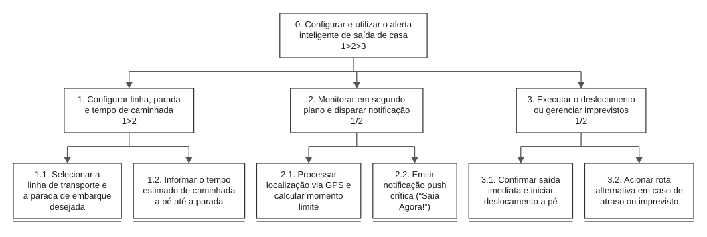
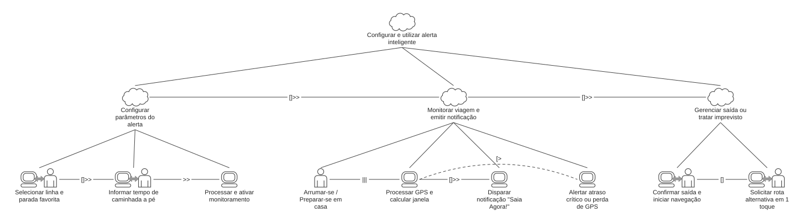
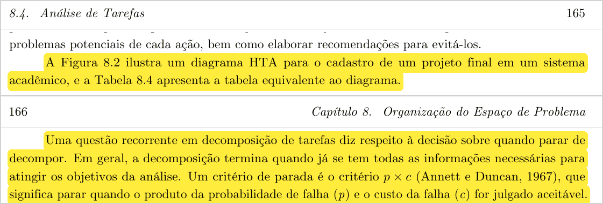
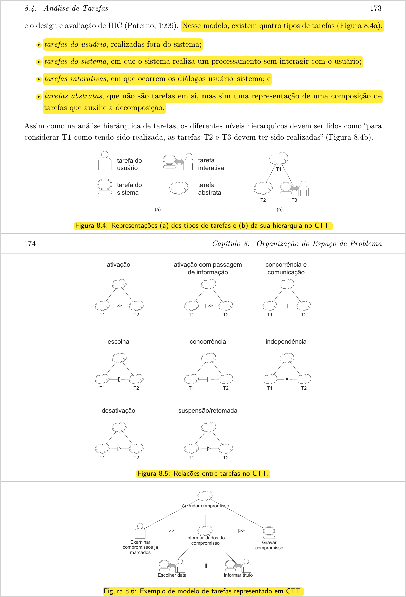

## Histórico de Versão e Contribuição

| Data | Versão | Descrição | Autor(es) | Revisor(es) | Declaração de Uso de IA |
| :---: | :---: | :--- | :--- | :--- | :--- |
| 23/09/2026 | `1.0` | Elaboração da Análise de Tarefas (HTA e CTT) para o Alerta Inteligente de Saída. | [Igor Dantas](https://github.com/IgorDARAUJO) | [Gabriel Melo](https://github.com/gabriellcardone-06) | Google Gemini: apoio na revisão textual e na formatação do artefato. |
| 27/09/2026 | `1.1` | Modularização em documento dedicado e padronização com a nova arquitetura. | [Carlos Costa](https://github.com/carloshfgit) | [Igor Dantas](https://github.com/IgorDARAUJO) | Claude (Anthropic): apoio na revisão textual e na formatação do artefato. |

# TAR-01: Alerta inteligente de saída

## 1. Introdução

Este documento analisa a tarefa de configurar e receber um alerta inteligente sobre o momento adequado para sair de casa. A modelagem utiliza HTA e CTT para decompor objetivos, ações e relações temporais, permitindo compreender como o acompanhamento do ônibus e o tempo de caminhada podem apoiar o passageiro e reduzir atrasos ou perdas do transporte.

**Artefatos relacionados — fluxo da funcionalidade TAR-01 (Alerta Inteligente de Saída de Casa):**

* **Persona:** [João Pedro Carvalho](../personas/joao-pedro-carvalho.md)
* **Cenário:** [Cenário 2](../cenarios/cenario-2-viagem-matutina.md)
* **Análise de tarefas:** TAR-01 (*esta página*)
* **Storyboard:** [Storyboard 01](../../design-avaliacao-desenvolvimento/nivel1/storyboards.md#31-storyboard-01-alerta-inteligente-de-saida-de-casa)
* **Nível 1: avaliação do storyboard e da análise de tarefas:** [Planejamento da avaliação](../../design-avaliacao-desenvolvimento/nivel1/planejamentos-individuais/Igor/igor-planejamento-avaliacao.md) · [Planejamento do relato](../../design-avaliacao-desenvolvimento/nivel1/planejamentos-individuais/Igor/igor-planejamento-relato-resultados-avaliacao.md) · [Relato dos resultados](../../design-avaliacao-desenvolvimento/nivel1/relatos-individuais/igor/relato-resultados-storyboard-tarefas.md)
* **Nível 2: protótipo de papel (baixa fidelidade):** [Planejamento da avaliação](../../design-avaliacao-desenvolvimento/nivel2/planejamentos-individuais/Igor/igor-planejamento-av-prototipo-papel.md) · [Planejamento do relato](../../design-avaliacao-desenvolvimento/nivel2/planejamentos-individuais/Igor/igor-planejamento-relato-prot-papel.md) · [Relato dos resultados](../../design-avaliacao-desenvolvimento/nivel2/relatos-individuais/igor/relato-resultados-prot-papel.md)
* **Nível 3: protótipo de alta fidelidade:** [Planejamento da avaliação](../../design-avaliacao-desenvolvimento/nivel3/planejamentos-individuais/igor/planejamento-av-prot-alta-fidel.md) · [Planejamento do relato](../../design-avaliacao-desenvolvimento/nivel3/planejamentos-individuais/igor/planejamento-relato-prot-alta-fidel.md) · [Relato dos resultados](../../design-avaliacao-desenvolvimento/nivel3/relatos-individuais/igor/relato-resultados-prot-alta-fidel.md)
* **Telas do protótipo de papel:** [telas no planejamento da avaliação](../../design-avaliacao-desenvolvimento/nivel2/planejamentos-individuais/Igor/igor-planejamento-av-prototipo-papel.md#9-telas-do-prototipo-avaliado)
* **Protótipo de alta fidelidade navegável:** [acessar o protótipo](https://www.figma.com/proto/00YEuKWtN4N1rBzpC8V7Gd/prototipo-de-igor?node-id=0-1&t=S9Z2PNsKlHC3LlTt-1)

## 2. Caracterização da Tarefa

* **Título da Tarefa:** Alerta inteligente de saída
* **Perfil do Participante:** Usuário primário / Passageiro Frequente ([João Pedro Carvalho](../personas/joao-pedro-carvalho.md))
* **Responsáveis pela Elaboração:** [Igor Dantas](https://github.com/IgorDARAUJO)
* **Data da Realização:** 23/09/2026
* **Objetivo da Tarefa:** Notificar proativamente o usuário sobre o momento exato de sair de casa, combinando o monitoramento do GPS do ônibus em tempo real com o seu tempo de caminhada até a parada para eliminar a carga cognitiva de cálculos mentais e evitar a perda do transporte.

---

## 3. Análise Hierárquica de Tarefas (HTA)

A Figura 1 apresenta o diagrama HTA desta tarefa na notação do livro da disciplina (Barbosa et al., 2021, pp. 165–167).

<strong>Figura 1</strong>: Diagrama HTA: Alerta inteligente de saída.

<em>Legenda (notação de Barbosa et al., 2021, Figuras 8.1 e 8.2): cada retângulo traz o número e o nome do objetivo e, na linha de baixo, o plano, que se refere aos subobjetivos do próprio objetivo (“&gt;” indica sequência, “/” indica seleção); os retângulos com linha dupla embaixo são operações (nível mais baixo da hierarquia).</em>

<em>Fonte: Igor Dantas (2026), redesenhado na notação de Barbosa et al. (2021, pp. 165–167).</em>

Abaixo, no Documento 1, é possível visualizar o diagrama e a tabela correspondente à Análise Hierárquica de Tarefas (HTA) para o fluxo do participante.

  <iframe src="../../../assets/PDFs/Igor_Artefato_HTA.pdf" width="100%" height="600px" style="border: 1px solid #ccc; border-radius: 8px;"></iframe>

*Caso o documento não carregue, [clique aqui para baixar o PDF do HTA](../../assets/PDFs/Igor_Artefato_HTA.pdf).*

<strong>Documento 1</strong>: Diagrama HTA: Alerta Inteligente de Saída.

<em>Legenda: a numeração decimal indica os níveis de decomposição; as linhas conectam objetivos aos seus subobjetivos; “&gt;” indica sequência, “/” indica seleção conforme as circunstâncias e “+” indica execução paralela. Os nós do último nível representam operações.</em>

<em>Fonte: Igor Dantas (2026).</em>

---

## 4. ConcurTaskTrees (CTT)

A Figura 2 reproduz a estrutura e as relações temporais definidas no PDF original da TAR-01. Em especial, a desativação `[>` liga a tarefa 2.2, “Processar GPS e calcular janela”, à tarefa 2.4, “Alertar atraso crítico ou perda de GPS”.

<strong>Figura 2</strong>: Diagrama CTT: Alerta inteligente de saída.

<em>Legenda (notação de Barbosa et al., 2021, Figuras 8.4 e 8.5): nuvem = tarefa abstrata; pessoa = tarefa do usuário; computador = tarefa do sistema; computador, seta dupla e pessoa = tarefa interativa. As linhas ligam cada tarefa às suas subtarefas. Os operadores temporais representam &gt;&gt; (ativação), []&gt;&gt; (ativação com passagem de informação), [] (escolha), ||| (concorrência) e [&gt; (desativação); a relação [&gt; entre 2.2 e 2.4 segue o traçado do PDF original.</em>

<em>Fonte: Igor Dantas (2026), redesenhado a partir do PDF original da TAR-01.</em>

Abaixo, no Documento 2, encontra-se a modelagem das relações temporais e lógicas desta mesma tarefa utilizando a notação CTT.

  <iframe src="../../../assets/PDFs/Igor_Artefato_CTT.pdf" width="100%" height="600px" style="border: 1px solid #ccc; border-radius: 8px;"></iframe>

*Caso o documento não carregue, [clique aqui para baixar o PDF do CTT](../../assets/PDFs/Igor_Artefato_CTT.pdf).*

<strong>Documento 2</strong>: Diagrama CTT: Alerta Inteligente de Saída.

<em>Legenda: nuvem = tarefa abstrata; pessoa = tarefa do usuário; monitor = tarefa do sistema; pessoa com monitor = tarefa interativa. Os operadores temporais representam sequência, passagem de informação, escolha, concorrência, independência, desativação e suspensão.</em>

<em>Fonte: Igor Dantas (2026).</em>

---

## 5. Fotos de Referência

As Figuras 3 a 10 mostram os trechos que fundamentam este artefato, recortados e grifados em amarelo diretamente do livro da disciplina (BARBOSA et al., 2021).

<strong>Figura 3</strong>: Métodos de análise de tarefas: HTA, GOMS e CTT

<em>Fonte: BARBOSA et al. (2021, p. 164).</em>

<strong>Figura 4</strong>: 8.4.1 HTA: objetivos antes das ações, decomposição, planos e operações

<em>Fonte: BARBOSA et al. (2021, p. 165).</em>

<strong>Figura 5</strong>: Notação do diagrama HTA: objetivo, operação e planos (Figuras 8.1 e 8.2 do livro)

<em>Fonte: BARBOSA et al. (2021, pp. 165–167).</em>

<strong>Figura 6</strong>: HTA: diagrama, representação em tabela e critério de parada

<em>Fonte: BARBOSA et al. (2021, pp. 165–166).</em>

<strong>Figura 7</strong>: Passos da Análise Hierárquica de Tarefas (Barbosa et al., 2021)

<em>Fonte: BARBOSA et al. (2021, pp. 166–167).</em>

<strong>Figura 8</strong>: CTT: tipos de tarefas e relações temporais

<em>Fonte: BARBOSA et al. (2021, p. 173).</em>

<strong>Figura 9</strong>: Notação do CTT: tipos de tarefas, hierarquia e relações temporais (Figuras 8.4, 8.5 e 8.6 do livro)

<em>Fonte: BARBOSA et al. (2021, pp. 173–174).</em>

<strong>Figura 10</strong>: CTT: vantagens e limitação quanto ao tratamento de erros

<em>Fonte: BARBOSA et al. (2021, p. 175).</em>

---

## 6. Referências Bibliográficas

* BARBOSA, Simone Diniz Junqueira; SILVA, Bruno Santana da; SILVEIRA, Milene Selbach; GASPARINI, Isabela; DARIN, Ticianne; BARBOSA, Gabriel Diniz Junqueira. **Interação Humano-Computador e Experiência do Usuário**. Rio de Janeiro: Autopublicação, 2021. ISBN 978-65-00-19677-1.
