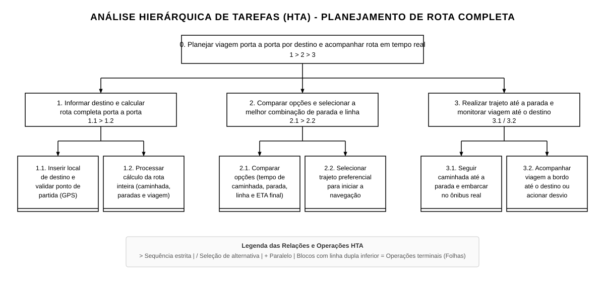
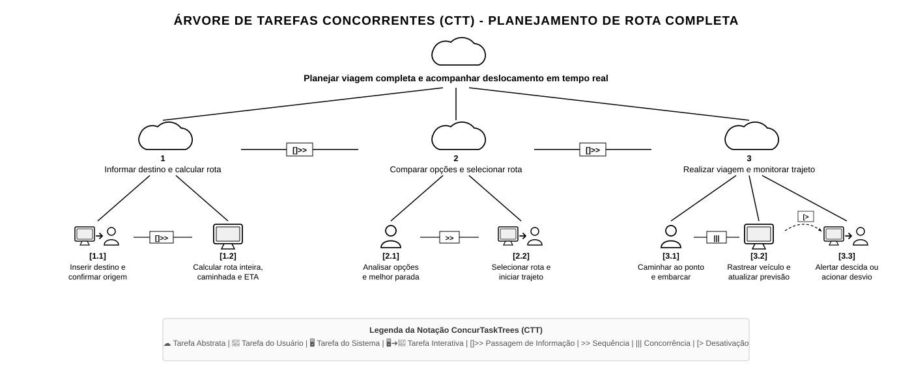

# TAR-03: Planejamento de Rota Completa (Porta a Porta) por Destino com Indicação de Paradas e Previsão de Chegada

## Histórico de Versão e Contribuição

| Data | Versão | Descrição | Autor(es) | Revisor(es) |
| :---: | :---: | :--- | :--- | :--- |
| 27/09/2026 | 1.0 | Elaboração completa da Análise de Tarefas (HTA, CTT e GOMS/KLM) para a tarefa do Passageiro Cotidiano. | [Arthur Mariani](https://github.com/arthur-mariani) e [Lucas Araújo](https://github.com/Lucasaraujoszz) | [Carlos Costa](https://github.com/carloshfgit) |
| 25/10/2026 | 1.1 | Correção e aprimoramento da Análise de Tarefas (HTA e CTT), refinando a decomposição de objetivos, inclusão do cálculo de rota porta a porta e atualização dos diagramas. | [Lucas Araújo](https://github.com/Lucasaraujoszz) | [Arthur Mariani](https://github.com/arthur-mariani) |

---

## 1. Introdução

Este documento analisa a tarefa de planejamento integral de deslocamento no transporte público coletivo do Distrito Federal (SEMOB-DF), estruturada a partir do conceito de **planejamento de rota multimodal porta a porta (*door-to-door transit route planning*)**, consagrado em sistemas de referência nacionais e internacionais como **Google Maps (Transit)**, **Moovit** e **Citymapper**.

Nesses sistemas funcionais modernos, a interação do passageiro é drasticamente simplificada: o usuário não precisa saber previamente qual linha pegar nem onde ficam os pontos de ônibus. Ao informar unicamente **para onde deseja ir**, o sistema utiliza a sua localização atual e calcula a rota inteira:
1. Identifica as paradas de embarque viáveis no entorno e **destaca a melhor parada**;
2. Informa com precisão o **tempo estimado de caminhada a pé** até essa parada;
3. Mostra a **previsão de chegada do ônibus em tempo real** à parada (via dados de telemetria GPS);
4. Calcula a duração do percurso dentro do ônibus, baldeações necessárias e o **tempo total em que o passageiro chegará ao destino final (*Estimated Time of Arrival - ETA*)**.

A presente análise modela como incorporar essa funcionalidade ao portal/aplicativo da SEMOB-DF, superando o modelo atual fragmentado e proporcionando ao cidadão uma ferramenta prática, transparente e eficaz para seu cotidiano.

## 2. Caracterização da Tarefa

* **Identificador da Tarefa:** `TAR-03`
* **Título:** Planejamento de Rota Completa (Porta a Porta) por Destino com Indicação da Melhor Parada e Tempo Estimado de Chegada (ETA)
* **Persona Primária Associada:** [Marcos Paulo Vieira (Passageiro Cotidiano)](../personas/marcos-paulo-vieira.md)
* **Perfil de Usuário:** [Passageiro do STPC/DF (Usuário Primário)](../perfis-de-usuario/perfil-primario.md)
* **Responsável pela Elaboração:** [Lucas Araújo](https://github.com/Lucasaraujoszz)
* **Objetivo da Tarefa:** Permitir que o passageiro planeje e execute seu deslocamento completo inserindo apenas o destino desejado (com origem automática via GPS ou informada manualmente), de modo que o sistema calcule a rota inteira: apresente as opções de paradas e recomende a melhor parada de embarque, informe o tempo de caminhada a pé até o ponto, a previsão em tempo real da chegada do ônibus e o horário estimado de chegada ao destino final, guiando o usuário ao longo de todo o trajeto.

---

## 3. Análise Hierárquica de Tarefas (HTA)

A **Análise Hierárquica de Tarefas (HTA - *Hierarchical Task Analysis*)** foi proposta originalmente por Annett e Duncan (1967) e consolidada em Interação Humano-Computador por Barbosa et al. (2021, pp. 177–183) para examinar o trabalho humano decompondo tarefas complexas em objetivos, subobjetivos e operações atômicas, mapeando as condições sob as quais as ações são ativadas (planos) e identificando riscos de erro e oportunidades de reprojeto.

### 3.1 Diagrama Hierárquico de Tarefas (Representação Gráfica)

O diagrama abaixo ilustra a decomposição da tarefa no padrão visual e estrutural rigoroso da TAR-01 (Igor Dantas), com disposição retangular de caixas, linhas ortogonais, notação padrão de planos e destaque com linha dupla inferior para nós terminais de operações:

  
  
<strong>Figura 1</strong> — Diagrama HTA: Planejamento de Rota Completa por Destino e Acompanhamento em Tempo Real.

  
<em>Legenda: A numeração decimal indica os níveis de decomposição hierárquica; as linhas conectam objetivos aos seus subobjetivos; “&gt;” indica sequência estrita, “/” indica seleção conforme circunstâncias e “+” indica execução em paralelo/ordem flexível. Os blocos do último nível com linha dupla inferior representam operações terminais (folhas).</em>

  
<em>Fonte: Lucas Araújo Lima (2026), adaptado de Barbosa et al. (2021).</em>

---

### 3.2 Tabela Detalhada do HTA (Tuplas e Análise de Falhas)

Conforme Barbosa et al. (2021, p. 179), cada operação é especificada formalmente por uma tupla composta por **⟨Input, Ação, Feedback⟩**, associada a um plano que define sua ativação. A tabela a seguir relaciona cada objetivo e operação folha aos problemas encontrados no portal da SEMOB-DF e às recomendações de IHC formuladas para o reprojeto.

<strong>Tabela 1</strong> — Tabela Detalhada da Análise Hierárquica de Tarefas (HTA) da TAR-03

| Objetivos / Operações | Plano de Execução | Tupla de Operação ⟨Input, Ação, Feedback⟩ | Problemas Potenciais / Detectados no Sistema Atual | Recomendações de IHC |
| :--- | :--- | :--- | :--- | :--- |
| **0. Planejar viagem porta a porta por destino e acompanhar rota inteira em tempo real** | **Plano 0:** Executar 1 para calcular a rota inteira, comparar as alternativas e escolher a melhor parada/linha em 2, e executar o deslocamento com acompanhamento em tempo real em 3 (1 > 2 > 3). | **Input:** Necessidade de deslocar-se até determinado local sem saber qual ônibus pegar, quanto tempo demora a caminhada até a parada ou quando o veículo chegará. **Ação:** Digitar o destino, escolher a rota recomendada e seguir as orientações até o destino final. **Feedback:** Rota completa traçada no mapa com tempo de caminhada, previsão do ônibus e horário exato de chegada ao destino (ETA). | O portal atual exige que o cidadão conheça previamente a linha ou consulte PDFs estáticos de horários teóricos, sem integração de mapas, rotas a pé ou cálculo de chegada. | Implementar buscador unificado "Para onde você quer ir?", com cálculo algorítmico da rota completa (caminhada + ônibus + chegada) nos moldes do Google Maps e Moovit. |
| **1. Informar destino e calcular rota completa porta a porta** | **Plano 1:** Inserir o local de destino e confirmar a origem (1.1) e aguardar o processamento automático da rota inteira pelo sistema (1.2) (1.1 > 1.2). | *N/A (Subobjetivo intermediário).* | Falta de inteligência de busca no portal; o passageiro não consegue pesquisar por endereço ou ponto de interesse popular. | Disponibilizar campo de busca preditiva de destino no topo da tela com detecção instantânea da localização GPS do usuário. |
| **1.1. Inserir local de destino e validar ponto de partida (GPS ou manual)** | Operação (Nível Folha) | **Input:** Campo de busca "Para onde você quer ir?" com origem pré-definida em "Sua Localização Atual (GPS)". **Ação:** Digitar nome do local, bairro ou ponto de interesse (ex.: "SIA Trecho 3", "UnB Gama") e confirmar. **Feedback:** Destino identificado e opções de itinerários geradas instantaneamente. | O usuário é forçado a selecionar pontos em listas codificadas por números que não correspondem à sua experiência espacial. | Campo único com autocomplete, permitindo sinônimos populares e correção de grafia (*fuzzy search*), mantendo a origem automática via GPS com opção de troca manual. |
| **1.2. Processar cálculo da rota inteira (caminhada, paradas e tempo de viagem)** | Operação (Nível Folha) | **Input:** Coordenadas de origem e destino, malha viária de pedestres e telemetria GPS em tempo real dos ônibus. **Ação:** Algoritmo do sistema cruza os dados e calcula os trechos de caminhada e os tempos de trânsito. **Feedback:** Apresentação de rotas multimodais integradas com indicação da melhor parada, tempo a pé, tempo no ônibus e ETA final. | O sistema atual não calcula tempos reais de caminhada nem prevê tempo de percurso do coletivo, gerando incerteza absoluta sobre o horário de chegada. | Integrar motor de roteamento multimodal com a API de telemetria da frota, calculando velocidade média das vias e distância a pé até cada parada. |
| **2. Comparar opções e selecionar a melhor combinação de parada e linha** | **Plano 2:** Comparar os cards de rotas com suas respectivas paradas e tempos (2.1) e selecionar o trajeto preferencial (2.2) (2.1 > 2.2). | *N/A (Subobjetivo intermediário).* | O passageiro não tem como comparar se vale a pena andar um pouco mais para pegar um ônibus expresso ou ficar na parada mais próxima. | Estruturar *cards* claros comparando o tempo a pé até a parada, a linha sugerida e o horário final de chegada ao destino. |
| **2.1. Comparar opções (tempo de caminhada, melhor parada, linha e ETA final)** | Operação (Nível Folha) | **Input:** Lista de rotas sugeridas pelo sistema com destaques visuais. **Ação:** Analisar tempo de caminhada até a parada recomendada, horário de passagem do ônibus e horário de chegada ao destino. **Feedback:** Destaque para o card "Melhor Opção / Mais Rápida" (ex.: "Parada 2 a 4 min a pé • Linha 0.818 passa em 6 min • Chegada às 08h35"). | Ausência de clareza sobre qual parada no quarteirão atende àquela linha e quanto tempo leva a caminhada. | Destacar no card: nome/foto da parada, tempo a pé (ex.: "Caminhada de 300m / 4 min"), horário previsto do ônibus e horário de chegada no destino final. |
| **2.2. Selecionar trajeto preferencial para iniciar navegação e acompanhamento** | Operação (Nível Folha) | **Input:** Toque no card de rota escolhido pelo passageiro. **Ação:** Tocar no botão "Iniciar Trajeto" ou no próprio card. **Feedback:** Tela transiciona para o modo de navegação passo a passo, traçando a linha de caminhada até a parada no mapa e ativando o rastreador do ônibus. | Links minúsculos e botões desconexos no portal que abrem arquivos PDF externos em vez de telas interativas. | Card inteiro clicável com alvo de toque adequado (mínimo de 48 × 48 px - Lei de Fitts) e botão de ação primária destacado ("Iniciar Rota"). |
| **3. Realizar trajeto até a parada e monitorar viagem até o destino final** | **Plano 3:** Seguir a rota a pé e embarcar no ônibus (3.1) e, a bordo, acompanhar a viagem até a descida OU acionar contingência em caso de retenção crítica (3.2) (3.1 / 3.2). | *N/A (Subobjetivo intermediário).* | O passageiro chega à parada e não sabe se o ônibus já passou, gerando ansiedade e sensação de desamparo. | Sistema fornece navegação orientada com contagem regressiva em tempo real e notificações automáticas de aproximação. |
| **3.1. Seguir caminhada até a parada indicada e embarcar no ônibus em tempo real** | Operação (Nível Folha) | **Input:** Instrução de caminhada na tela e posição em tempo real do ônibus no mapa. **Ação:** Caminhar até a parada indicada e aguardar a chegada física do coletivo. **Feedback:** Mapa atualizado com o ícone do ônibus se aproximando e aviso sonoro/vibratório: "Seu ônibus está a 200m da parada". | Atrasos na renderização de mapas pesados em smartphones e falta de confirmação se o ônibus está de fato em operação. | Mapa vetorial leve com atualização contínua (WebSocket/SSE) e indicação do status do veículo ("Veículo em trânsito com ar-condicionado e acessibilidade"). |
| **3.2. Acompanhar viagem a bordo até o destino ou acionar rota de contingência** | Operação (Nível Folha) | **Input:** Passageiro a bordo do ônibus; monitoramento do trajeto e tempo restante até o destino final. **Ação:** Acompanhar paradas restantes até o desembarque OU tocar em "Recalcular" caso haja acidente/desvio na rota. **Feedback:** Aviso de desembarque ("Desça na próxima parada") e confirmação de chegada no horário previsto (ETA). | *(Risco Alto)* Falta de aviso sobre a parada exata de descida faz com que pessoas percam o ponto, especialmente à noite ou em regiões desconhecidas. | *(Recomendação Crítica):* Alerta proativo de descida ("Próxima parada é a sua") e botão de contingência em 1 toque que sugere alternativas imediatas se o tráfego estagnar. |

<em>Fonte: Lucas Araújo Lima (2026), adaptado de Barbosa et al. (2021).</em>

---

### 3.3 Análise de Severidade de Operações e Critério (P × C)

Pelo critério **P × C** proposto na metodologia HTA (Annett & Duncan, 1967; Barbosa et al., 2021), em que **P** representa a probabilidade de falha ou erro na execução e **C** corresponde ao custo ou gravidade da consequência do erro, identificam-se as operações críticas da tarefa:

1. **Operação 1.1 (Inserir local de destino e validar ponto de partida):**
   * **Probabilidade de Falha (P):** Média. O passageiro utiliza nomenclaturas populares, nomes de prédios públicos ou abreviações que divergem dos nomes cadastrais oficiais da base de dados da SEMOB.
   * **Custo da Consequência (C):** Alto. O sistema retorna "Nenhum resultado encontrado", levando o cidadão a crer que não existe transporte público para sua localidade, desestimulando o uso do transporte coletivo.
   * **Avaliação de Risco (P × C):** **ALTO**. O design de IHC deve garantir busca preditiva tolerante a erros ortográficos (*fuzzy matching*) e mapeamento de locais notórios e sinônimos populares do DF.

2. **Operação 2.1 (Comparar opções com tempo de caminhada, melhor parada e ETA final):**
   * **Probabilidade de Falha (P):** Média. Excesso de opções ou informações confusas sobre paradas próximas podem desorientar o usuário, fazendo-o caminhar para a parada errada.
   * **Custo da Consequência (C):** Alto. O usuário perde o ônibus na parada errada e sofre atraso significativo em seu compromisso de trabalho ou estudo.
   * **Avaliação de Risco (P × C):** **ALTO**. A interface deve destacar de forma inequívoca o card da "Melhor Opção", com mapa ilustrando a caminhada até a parada correta e o tempo em minutos.

3. **Operação 3.1 (Seguir caminhada até a parada indicada e embarcar no ônibus em tempo real):**
   * **Probabilidade de Falha (P):** Média. Instabilidade na conexão de dados móveis (3G/4G) do usuário ou atrasos no sinal de telemetria GPS transmitido pelos ônibus.
   * **Custo da Consequência (C):** Alto. O passageiro confia em uma previsão desatualizada, perde o ônibus ou fica exposto a riscos de segurança pública por tempo excessivo na parada.
   * **Avaliação de Risco (P × C):** **CRÍTICO**. O sistema deve apresentar indicador visual do horário do último sinal recebido (ex.: "Atualizado há 15 segundos"), manter conexão leve e persistente (via WebSocket) e disparar aviso sonoro/vibratório quando o ônibus se aproximar a menos de 500 metros da parada.

4. **Operação 3.2 (Acompanhar viagem a bordo até o destino ou acionar rota de contingência):**
   * **Probabilidade de Falha (P):** Média. Desorientação do usuário sobre o momento exato de dar o sinal de parada ou ocorrência de retenção imprevista na via.
   * **Custo da Consequência (C):** Alto. O passageiro passa do ponto de descida ou fica preso no engarrafamento sem alternativas.
   * **Avaliação de Risco (P × C):** **ALTO**. Notificação push de alarme de descida ("Desça no próximo ponto") e botão em 1 toque para recalcular rota por itinerário alternativo em caso de interdição.

---

## 4. ConcurTaskTrees (CTT)

O modelo **ConcurTaskTrees (CTT)**, proposto por Fabio Paternò (1999, 2000), descreve graficamente as tarefas com foco na concorrência, suporte computacional e dinâmica de interação (Barbosa e Silva, 2010, pp. 203–205).

### 4.1 Classificação dos Nós no CTT

* **Tarefa Abstrata (Nuvem):** Tarefas compostas que englobam subníveis hierárquicos.
* **Tarefa do Usuário (Figura Humana):** Atividades estritamente cognitivas ou do mundo real (ex.: decidir rota, caminhar até a parada).
* **Tarefa Interativa (Usuário com Sistema):** Ações de entrada e diálogo bilateral com a interface (ex.: digitar destino, tocar em card).
* **Tarefa do Sistema (Computador):** Processamentos autônomos internos do software (ex.: calcular rotas, consultar API do GPS).

### 4.2 Estrutura Formal e Diagrama CTT

O diagrama abaixo apresenta a modelagem gráfica formal das relações temporais e lógicas da tarefa, seguindo rigorosamente a padronização visual da TAR-01 (Igor Dantas) com a simbologia de Paternò (1999) (nuvens para tarefas abstratas, silhuetas para usuários, monitores para sistemas e operadores temporais formais):

  
  
<strong>Figura 2</strong> — Diagrama CTT: Planejamento de Viagem Completa por Destino e Acompanhamento em Tempo Real.

  
<em>Legenda: Nuvem = tarefa abstrata; pessoa = tarefa do usuário; monitor = tarefa do sistema; pessoa com monitor = tarefa interativa. Operadores temporais: []&gt;&gt; (passagem de informação), &gt;&gt; (sequência), ||| (concorrência) e [&gt; (desativação / contingência).</em>

  
<em>Fonte: Lucas Araújo Lima (2026), adaptado de Paternò (1999) e no padrão visual da TAR-01 (Igor Dantas).</em>

### 4.3 Detalhamento e Mapeamento dos Ramos do CTT

A decomposição lógica do modelo CTT está organizada em três ramos principais com operadores formais:

* **Ramo 1: ☁️ [1] Informar destino e calcular rota**
  * **Contexto de IHC:** O usuário fornece os dados mínimos necessários (destino) e o sistema processa proativamente o trajeto multimodal completo.
  * **Fluxo de Interação:** O passageiro executa a tarefa interativa **[1.1] Inserir destino e confirmar origem** (🖥️➔👤). Com a submissão dos dados, o sistema ativa com passagem de informação (`[]>>`) a tarefa interna **[1.2] Calcular rota inteira, caminhada e ETA** (🖥️), que cruza o raio de paradas com a telemetria GPS da SEMOB-DF.

* **Ramo 2: ☁️ [2] Comparar opções e selecionar rota**
  * **Contexto de IHC:** Avaliação cognitiva e decisão pelo itinerário ótimo.
  * **Fluxo de Interação:** O passageiro executa a tarefa cognitiva **[2.1] Analisar opções e melhor parada** (👤), comparando o esforço de caminhada até a parada indicada e o tempo de chegada. Em seguida (`>>`), executa a tarefa interativa **[2.2] Selecionar rota e iniciar trajeto** (🖥️➔👤) para abrir a visão guiada de viagem.

* **Ramo 3: ☁️ [3] Realizar viagem e monitorar trajeto**
  * **Contexto de IHC:** Deslocamento físico apoiado por assistência contínua do sistema e planos de contingência.
  * **Fluxo de Interação:** O passageiro executa a ação física **[3.1] Caminhar ao ponto e embarcar** (👤), enquanto concomitantemente (`|||`) o software executa a tarefa de segundo plano **[3.2] Rastrear veículo e atualizar previsão** (🖥️). A tarefa interativa **[3.3] Alertar descida ou acionar desvio** (🖥️➔👤) monitora a proximidade do destino ou pode desativar (`[>`) o trajeto padrão para sugerir uma rota alternativa imediata em caso de retenção ou quebra do coletivo.

---

## 5. Análise Preditiva de Desempenho com GOMS / KLM (*Card, Moran & Newell, 1983*)

O **Keystroke-Level Model (KLM)** é uma técnica analítica da família GOMS que prevê o tempo de execução de uma tarefa rotineira realizada por um usuário competente sem erros (Barbosa & Silva, 2010, pp. 198–200; Kieras, 1993).

### 5.1 Operadores Padrão Adotados e Tempos de Referência

* **K (Pressionar Tecla / Toque no Teclado Virtual Móvel):** 0,20 s (usuário mediano em smartphone).
* **P (Apontar com o Dedo / Toque em Elemento da Tela):** 1,10 s (equivalente funcional ao apontamento de Fitts).
* **B (Tocar / Pressionar na Tela):** 0,10 s.
* **H (Reposicionar Mão / Ajustar Empunhadura do Celular):** 0,40 s.
* **M (Preparação Mental / Decisão Cognitiva):** 1,20 s.
* **W(t) (Tempo de Espera pela Resposta do Servidor/Rede):** Variável de acordo com a arquitetura do sistema.

---

### 5.2 Comparação Paramétrica de Métodos

#### Método 1: Fluxo Atual (Consulta Indireta com Redirecionamento e Busca Cega)
No modelo atual, o usuário abre o portal, fecha modais de propaganda, descobre que precisa do código da linha, pesquisa externamente e navega por tabelas pesadas.

A Tabela 2 estima, por meio do KLM, o tempo necessário para executar esse fluxo atual e evidencia o custo das etapas de navegação e espera.

<strong>Tabela 2</strong> — Predição de Tempo KLM para o Método Atual

| Passo | Operador KLM | Descrição do Operador | Duração (s) |
|---|:---:|---|:---:|
| 1 | **M** | Preparar-se mentalmente para procurar a área de linhas na Home | 1,20 |
| 2 | **P** | Deslocar o polegar até o menu de serviços | 1,10 |
| 3 | **B** | Tocar no link de linhas | 0,10 |
| 4 | **W** | Espera pelo carregamento do redirecionamento externo | 3,50 |
| 5 | **M** | Perceber o modal invasivo sugerindo baixar aplicativo | 1,20 |
| 6 | **P** | Mirar no botão de fechar (alvo pequeno) | 1,10 |
| 7 | **B** | Tocar para fechar o modal | 0,10 |
| 8 | **M** | Tentar lembrar ou deduzir o código da linha para o destino | 1,20 |
| 9 | **P** | Tocar no campo de código da linha | 1,10 |
| 10 | **K (5x)** | Digitar o número com 4 caracteres e ponto (ex.: 0.818) | 1,00 |
| 11 | **P** | Tocar no botão 'Consultar' | 1,10 |
| 12 | **W** | Espera do processamento e carregamento da tabela | 4,00 |
| 13 | **M** | Ler tabela de horários estática para interpretar o próximo | 1,20 |
| **TOTAL** | — | **Tempo Total Estimado (Método Atual)** | **17,80 s** |

<em>Fonte: Lucas Araújo Lima (2026), baseado em Card et al. (1983) e Kieras (1993).</em>

*(Nota: Este tempo considera um cenário ideal sem travamento de cache; nos casos reais reportados no Cenário 3, o tempo ultrapassa 50 segundos com falha de conexão).*

---

#### Método 2: Fluxo Projetado (Busca Direta por Origem/Destino e Rastreamento Integrado)
No modelo reprojetado, o campo de destino está disponível imediatamente no topo da página inicial com preenchimento preditivo e geolocalização automática.

A Tabela 3 estima o tempo do fluxo reprojetado, permitindo compará-lo ao método atual e avaliar o ganho de eficiência previsto.

<strong>Tabela 3</strong> — Predição de Tempo KLM para o Método Reprojetado

| Passo | Operador KLM | Descrição do Operador | Duração (s) |
|---|:---:|---|:---:|
| 1 | **M** | Decidir inserir o destino desejado | 1,20 |
| 2 | **P** | Tocar no campo 'Para onde você vai?' na Home | 1,10 |
| 3 | **K (3x)** | Digitar primeiras letras do destino (ex.: "SIA") | 0,60 |
| 4 | **M** | Reconhecer a sugestão do destino na lista automática | 1,20 |
| 5 | **P** | Tocar na opção "SIA Trecho 3" sugerida | 1,10 |
| 6 | **W** | Resposta instantânea da API de rotas integradas | 1,00 |
| 7 | **M** | Identificar o card da rota mais rápida em destaque | 1,20 |
| 8 | **P** | Tocar no card para abrir o mapa em tempo real | 1,10 |
| 9 | **W** | Renderização imediata do mapa vetorial leve com o ônibus | 1,20 |
| **TOTAL** | — | **Tempo Total Estimado (Método Reprojetado)** | **9,70 s** |

<em>Fonte: Lucas Araújo Lima (2026), baseado em Card et al. (1983) e Kieras (1993).</em>

### 5.3 Conclusão da Análise KLM
O fluxo reprojetado reduz o tempo preditivo de execução da tarefa de **17,80 s para 9,70 s** (um ganho de eficiência de **45,5%**), além de eliminar **4 operadores mentais de dúvida (M)** causados pela desorientação do código da linha e pelo modal indesejado, comprovando um salto substancial na **facilidade de aprendizado e eficiência de uso** (*Nielsen, 1993; Barbosa & Silva, 2010*).

---

## 6. Referências Bibliográficas

* ANNETT, John; DUNCAN, Keith D. **Task analysis and training design**. *Journal of Occupational Psychology*, v. 41, n. 4, p. 211–221, 1967.
* BARBOSA, Simone Diniz Junqueira; SILVA, Bruno Santana da. **Interação Humano-Computador**. Rio de Janeiro: Elsevier / Campus, 2010. Capítulo 6: Organização do Espaço de Problema — Análise de Tarefas (pp. 191–205).
* BARBOSA, Simone Diniz Junqueira; SILVA, Bruno Santana da; SILVEIRA, Milene Selbach; GASPARINI, Isabela; DARIN, Ticianne; BARBOSA, Gabriel Diniz Junqueira. **Interação Humano-Computador e Experiência do Usuário**. Rio de Janeiro: Autopublicação, 2021. ISBN 978-65-00-19677-1.
* CARD, Stuart K.; MORAN, Thomas P.; NEWELL, Allen. **The Psychology of Human-Computer Interaction**. Hillsdale: Lawrence Erlbaum Associates, 1983.
* KIERAS, David. **Using the Keystroke-Level Model to Estimate Execution Times**. Ann Arbor: University of Michigan, 1993.
* PATERNÒ, Fabio. **Model-Based Design and Evaluation of Interactive Applications**. London: Springer-Verlag, 1999.
