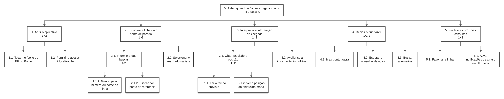
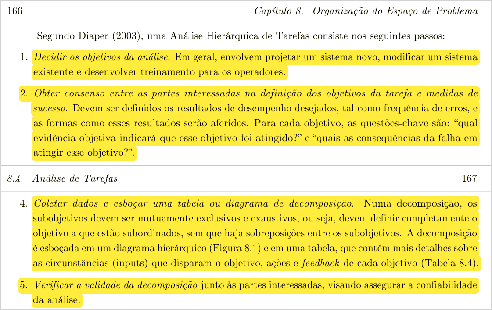
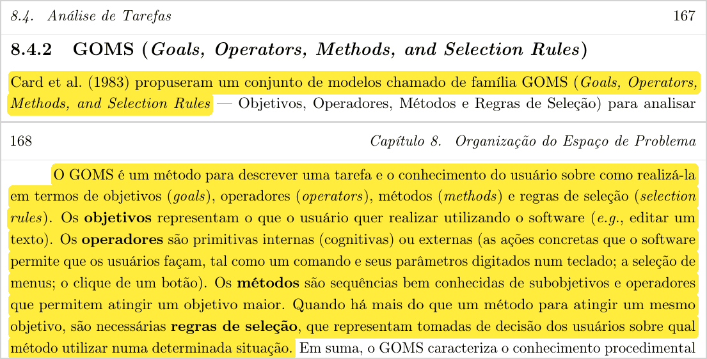

## Histórico de Versão e Contribuição

| Data | Versão | Descrição | Autor(es) | Revisor(es) | Declaração de Uso de IA |
| :---: | :---: | :--- | :--- | :--- | :--- |
| 27/09/2026 | `1.0` | Elaboração da Análise de Tarefas (HTA e GOMS) para a consulta de ônibus em tempo real no DF no Ponto. | [Rodrigo Barbosa](https://github.com/RodrigoCBarbosa) | [Arthur Mariani](https://github.com/arthur-mariani) | Claude (Anthropic) — revisar e formatar o texto em Markdown |
| 27/10/2026 | `1.1` | Alinhamento para a avaliação da Etapa 5: inclusão da persona João Pedro Carvalho, vínculo com os Cenários 2 e 10, numeração das hipóteses (H1 a H7) com tabela de consolidação, seção de artefatos relacionados e declaração de uso de IA. O conteúdo da análise foi mantido. | [Carlos Costa](https://github.com/carloshfgit) | [Rodrigo Barbosa](https://github.com/RodrigoCBarbosa) | Claude (Anthropic) — revisar e formatar o texto em Markdown |
| 28/10/2026 | `1.2` | Registro da situação das hipóteses H1 a H7 (Tabela 5) e do passo 5 da HTA (Tabela 4) após a avaliação com usuário da sessão S4, e atualização da situação dos artefatos relacionados. O conteúdo da análise foi mantido. | [Carlos Costa](https://github.com/carloshfgit) | [Rodrigo Barbosa](https://github.com/RodrigoCBarbosa) | Claude (Anthropic) — revisar e formatar o texto em Markdown |
| 03/11/2026 | `1.3` | Registro das evidências do protótipo de papel (P05) na situação das hipóteses (Tabela 5) e inclusão do relato do protótipo de papel e dos planejamentos da alta fidelidade nos artefatos relacionados (Tabela 6). O conteúdo da análise foi mantido. | [Carlos Costa](https://github.com/carloshfgit) | [Arthur Mariani](https://github.com/arthur-mariani) | Claude (Anthropic) — revisar e formatar o texto em Markdown |
| 14/11/2026 | `1.4` | Inclusão do protótipo de alta fidelidade e do relato dos resultados da alta fidelidade nos artefatos relacionados (Tabela 6). | [Carlos Costa](https://github.com/carloshfgit) | [Tomás Garcia Rocho](https://github.com/TomasRocho) | Claude (Anthropic) — revisar e formatar o texto em Markdown |
| 19/11/2026 | `1.5` | Padronização da estrutura (histórico no topo, conteúdo, fotos de referência e referências ao final); declaração de IA levada para o histórico; retirada das referências que não são o livro da disciplina nem material do professor; inclusão de fotos de referência grifadas. Redesenho dos diagramas HTA/CTT na notação do livro da disciplina (BARBOSA et al., 2021, pp. 165–174). Inclusão do bloco de artefatos relacionados (persona, cenário, análise de tarefas, storyboard, planejamentos, relatos e protótipos da funcionalidade). Correção das páginas e seções citadas do livro da disciplina (edição de 2021). | [Gabriel Melo](https://github.com/gabriellcardone-06) | Pendente de revisão | Claude (Anthropic) — apoio na padronização da estrutura do artefato, na revisão das referências e na formatação em Markdown; apoio no redesenho dos diagramas na notação do livro.; apoio na inclusão dos links entre artefatos |


!!! warning "Observação para correção manual"
    O fluxo da TAR-06 usa duas personas (João Pedro Carvalho e Mariana Borges Almeida) e dois cenários (2 e 10). A persona João Pedro e o Cenário 2 também são usados pela TAR-01. O fluxo pedido é de 1 persona e 1 cenário por funcionalidade; a equipe deve decidir qual persona e qual cenário ficam como principais. Também não foi encontrado o planejamento do relato de Nível 1.

---

# TAR-06: Consulta de ônibus em tempo real no DF no Ponto

## 1. Introdução

Este documento analisa a tarefa de consultar, no aplicativo DF no Ponto, quando um ônibus chegará à parada. A HTA organiza objetivos, operações, problemas e hipóteses de erro, enquanto o modelo GOMS descreve estratégias possíveis de consulta; como a análise se baseia em documentação, seus resultados permanecem como hipóteses a validar com usuários e com o sistema em uso.

As hipóteses estão identificadas de **H1 a H7** ao longo do texto e consolidadas na [seção 5](#5-hipoteses-a-validar). Elas são o objeto da avaliação formativa da Etapa 5, feita com o [Storyboard 08](#6-artefatos-relacionados).

**Artefatos relacionados — fluxo da funcionalidade TAR-06 (Consulta do Ônibus em Tempo Real no DF no Ponto):**

* **Persona:** [João Pedro Carvalho](../personas/joao-pedro-carvalho.md); [Mariana Borges Almeida](../personas/mariana-borges-almeida.md)
* **Cenário:** [Cenário 2](../cenarios/cenario-2-viagem-matutina.md); [Cenário 10](../cenarios/cenario-10-viagem-ideal.md)
* **Análise de tarefas:** TAR-06 (*esta página*)
* **Storyboard:** [Storyboard 08](../../design-avaliacao-desenvolvimento/nivel1/storyboards.md#38-storyboard-08-consulta-do-onibus-em-tempo-real-no-df-no-ponto)
* **Nível 1 — avaliação do storyboard e da análise de tarefas:** [Planejamento da avaliação](../../design-avaliacao-desenvolvimento/nivel1/planejamentos-individuais/Carlos/carlos-planejamento-avaliacao.md) · Planejamento do relato (*não disponível — pendente de correção manual*) · [Relato dos resultados](../../design-avaliacao-desenvolvimento/nivel1/relatos-individuais/carlos/relato-resultados-storyboard-tarefas.md)
* **Nível 2 — protótipo de papel (baixa fidelidade):** [Planejamento da avaliação](../../design-avaliacao-desenvolvimento/nivel2/planejamentos-individuais/Carlos/carlos-planejamento-av-prototipo-papel.md) · [Planejamento do relato](../../design-avaliacao-desenvolvimento/nivel2/planejamentos-individuais/Carlos/carlos-planejamento-relato-prot-papel.md) · [Relato dos resultados](../../design-avaliacao-desenvolvimento/nivel2/relatos-individuais/carlos/relato-resultados-prot-papel.md)
* **Nível 3 — protótipo de alta fidelidade:** [Planejamento da avaliação](../../design-avaliacao-desenvolvimento/nivel3/planejamentos-individuais/carlos/carlos-planejamento-av-prot-alta-fidel.md) · [Planejamento do relato](../../design-avaliacao-desenvolvimento/nivel3/planejamentos-individuais/carlos/carlos-planejamento-relato-prot-alta-fidel.md) · [Relato dos resultados](../../design-avaliacao-desenvolvimento/nivel3/relatos-individuais/carlos/relato-resultados-prot-alta-fidel.md)
* **Telas do protótipo de papel:** [telas no planejamento da avaliação](../../design-avaliacao-desenvolvimento/nivel2/planejamentos-individuais/Carlos/carlos-planejamento-av-prototipo-papel.md#8-telas-do-prototipo-avaliado)
* **Protótipo de alta fidelidade navegável:** [acessar o protótipo](https://carloshfgit.github.io/prototipo-tar06-df-no-ponto/)


## 2. Caracterização da Tarefa

* **Título da Tarefa:** Consulta de ônibus em tempo real no DF no Ponto
* **Perfil do Participante:** Usuário primário / Passageiro do transporte coletivo do DF (personas [João Pedro Carvalho](../personas/joao-pedro-carvalho.md) e [Mariana Borges Almeida](../personas/mariana-borges-almeida.md))
* **Cenários relacionados:** [Cenário 2 — Viagem matutina](../cenarios/cenario-2-viagem-matutina.md) (João Pedro: o ônibus não aparece no horário e o rastreamento falha) e [Cenário 10 — Viagem ideal sob chuva](../cenarios/cenario-10-viagem-ideal.md) (Mariana: acompanha o ônibus em tempo real antes de sair)
* **Responsáveis pela Elaboração:** [Rodrigo Barbosa](https://github.com/RodrigoCBarbosa)
* **Data da Realização:** 27/09/2026
* **Sistema analisado:** Aplicativo DF no Ponto, da Secretaria de Transporte e Mobilidade do DF (Semob-DF), lançado em julho de 2025.
* **Objetivo da Tarefa (estado final):** O passageiro sabe quando o ônibus chega ao ponto de parada e, com base nisso, definiu o que fazer (ir ao ponto, esperar ou buscar alternativa).
* **Objetivo de experiência (hipótese H7):** Não se sentir perdido ou sem informação enquanto espera o ônibus.
* **Escopo:** A tarefa não inclui a recarga do Cartão Mobilidade, que é feita pelos canais do BRB Mobilidade e não pelo DF no Ponto.
* **Fontes de dados:** documentação pública da Semob-DF e matéria jornalística sobre o aplicativo (ver Referências). Não houve observação nem entrevista com usuários.

> **Limitação declarada.** Conforme Barbosa et al. (2021, pp. 163–164), os dados de uma análise de tarefas são sempre uma simulação das tarefas reais, e a observação do desempenho é um insumo importante, complementado por entrevistas, questionários e sistemas existentes. Esta análise foi feita a partir de documentação, portanto os passos de interface, os problemas e as recomendações abaixo são **hipóteses a validar** com usuários e com o aplicativo aberto.

---

## 3. Análise Hierárquica de Tarefas (HTA)

Segundo Barbosa et al. (2021, pp. 164–165), a HTA parte dos **objetivos** das pessoas (estados finais) e os decompõe em subobjetivos. Os subobjetivos e a relação entre eles formam um **plano**, e no nível mais baixo cada subobjetivo é alcançado por uma **operação**. Os planos usam a notação da Figura 8.1 do livro:

A Tabela 1 apresenta os símbolos utilizados nos planos e esclarece a relação representada por cada um deles.

**Tabela 1** — Notação utilizada nos planos da HTA

| Notação | Relação entre os subobjetivos |
| :---: | :--- |
| `1>2` | sequencial (um objetivo deve ser atingido antes do próximo) |
| `1/2` | seleção (qual objetivo será atingido depende das circunstâncias) |
| `1+2` | paralelo (mais de um objetivo atingido ao mesmo tempo) |

Nos rótulos abaixo, os números do plano se referem aos subobjetivos do próprio objetivo (por exemplo, o plano `1>2` do objetivo 1 trata de 1.1 e 1.2), como na Figura 8.2 do livro. Itens marcados com **(operação)** estão no nível mais baixo da hierarquia.

### 3.1 Diagrama hierárquico

<div align="center" style="overflow-x: auto;">
<a href="../../../assets/images/analise-de-tarefas/tar-06-hta.svg" target="_blank"></a>
</div>

<div align="center">
<p><strong>Figura 1</strong> — Diagrama HTA da consulta de ônibus em tempo real no DF no Ponto.</p>
<p><em>Legenda (notação de Barbosa et al., 2021, Figuras 8.1 e 8.2): cada retângulo traz o número e o nome do objetivo e, na linha de baixo, o plano, que se refere aos subobjetivos do próprio objetivo (“&gt;” indica sequência, “/” indica seleção, “+” indica paralelo); os retângulos com linha dupla embaixo são operações (nível mais baixo da hierarquia).</em></p>
<p><em>Fonte: Rodrigo Barbosa (2026), redesenhado na notação de Barbosa et al. (2021, pp. 165–167).</em></p>
</div>

### 3.2 Tabela de objetivos, operações, problemas e recomendações

A Tabela 2 segue o formato da Tabela 8.4 do livro: cada objetivo tem *input* (circunstâncias que o ativam), *feedback* (condição que indica o atingimento), *plano* e, quando houver, *problema* e *recomendação*. Essa organização permite relacionar a decomposição da tarefa às oportunidades de melhoria.

**Tabela 2** — Objetivos, operações, problemas e recomendações da HTA

| objetivos / operações | problemas e recomendações |
| :--- | :--- |
| **0. Saber quando o ônibus chega ao ponto** 1>2>3>4>5 | *input*: necessidade de saber quando o ônibus chega; smartphone com o aplicativo e conexão de dados<br>*feedback*: o passageiro sabe se vai ao ponto, espera ou busca alternativa<br>*plano*: abrir o aplicativo **e depois** encontrar a linha ou o ponto, **e depois** interpretar a informação, **e depois** decidir o que fazer. O objetivo 5 é feito apenas por quem usa a linha com frequência (regra de seleção) |
| **1. Abrir o aplicativo** 1>2 | *input*: passageiro com o aplicativo instalado<br>*feedback*: tela inicial do aplicativo exibida<br>*plano*: tocar no ícone **e depois** permitir a localização (só se o aplicativo solicitar, no primeiro uso) |
| 1.1 Tocar no ícone do DF no Ponto | |
| 1.2 Permitir o acesso à localização | *problema (hipótese H1)*: o usuário nega a permissão e deixa de receber sugestões de pontos próximos<br>*recomendação*: explicar, no momento do pedido, para que a localização é usada |
| **2. Encontrar a linha ou o ponto de parada** 1>2 | *input*: linha ou local de interesse do passageiro<br>*feedback*: linha ou ponto de parada selecionado<br>*plano*: informar o que buscar **e depois** selecionar o resultado |
| **2.1 Informar o que buscar** 1/2 | *plano*: buscar pelo número ou nome da linha **ou** buscar por ponto de referência. Se o usuário sabe a linha, usa 2.1.1. Senão, usa 2.1.2 |
| 2.1.1 Buscar pelo número ou nome da linha | *problema (hipótese H2)*: exige que o usuário lembre o número ou o nome da linha<br>*recomendação*: oferecer atalho para linhas usadas antes |
| 2.1.2 Buscar por ponto de referência | *observação*: a busca aceita locais como shopping, hospital e escola, o que atende quem não sabe o nome da parada nem o número da linha<br>*recomendação*: manter esse caminho tão visível quanto a busca por linha |
| 2.2 Selecionar o resultado na lista | *problema (hipótese H3)*: vários pontos de parada ou linhas próximos podem gerar seleção errada |
| **3. Interpretar a informação de chegada** 1>2 | *input*: linha ou ponto selecionado<br>*feedback*: o passageiro formou uma expectativa confiável do horário de chegada<br>*plano*: obter previsão e posição **e depois** avaliar a confiabilidade |
| **3.1 Obter previsão e posição** 1+2 | *plano*: ler o tempo previsto **e** ver a posição no mapa |
| 3.1.1 Ler o tempo previsto | |
| 3.1.2 Ver a posição do ônibus no mapa | |
| 3.2 Avaliar se a informação é confiável | *problema*: a posição em tempo real depende do rastreador do veículo e da comunicação de dados, então pode ficar defasada por alguns minutos se o equipamento falhar ou o ônibus passar por área sem cobertura<br>*recomendação (hipótese H4)*: indicar a hora da última atualização da posição |
| **4. Decidir o que fazer** 1/2/3 | *input*: previsão e posição avaliadas<br>*feedback*: ação escolhida<br>*plano*: ir ao ponto **ou** esperar e consultar de novo **ou** buscar alternativa, conforme o tempo disponível e a confiança na informação |
| 4.1 Ir ao ponto agora | |
| 4.2 Esperar e consultar de novo | |
| 4.3 Buscar alternativa | *problema (hipótese H5)*: se a informação estava defasada e não foi percebida, o passageiro decide com base em dado errado |
| **5. Facilitar as próximas consultas** 1+2 | *input*: uso frequente da mesma linha<br>*feedback*: linha salva e alertas ativos<br>*plano*: favoritar a linha **e** ativar as notificações (o aplicativo permite receber aviso de atraso ou alteração) |
| 5.1 Favoritar a linha | |
| 5.2 Ativar notificações de atraso ou alteração | |

### 3.3 Critério de parada da decomposição

Conforme o livro (p. 195), a decomposição termina quando se têm as informações necessárias para os objetivos da análise, e um critério é o **p × c**: parar quando o produto da probabilidade de falha (*p*) pelo custo da falha (*c*) é julgado aceitável.

* **Objetivo 3.2 (avaliar a confiabilidade)** foi tratado como operação separada porque o custo da falha é alto (perder o ônibus ou esperar sem necessidade) e a defasagem da posição torna a falha plausível.
* **Objetivos 1, 4 e 5** não foram decompostos além das operações, pois a falha nesses pontos tem custo baixo e é facilmente corrigida pelo usuário.
* **Objetivo 2** foi decomposto em dois níveis porque envolve uma escolha entre duas estratégias (linha ou ponto de referência), o que gera o plano de seleção `1/2`.

### 3.4 Hipóteses sobre erros (classificação de Reason, 1990)

Na etapa 7 da HTA (p. 196), o livro sugere classificar erros como baseados em habilidades, regras ou conhecimento:

A Tabela 3 aplica essa classificação às operações com maior possibilidade de falha e registra as hipóteses que deverão ser verificadas posteriormente.

**Tabela 3** — Hipóteses de erro nas operações analisadas

| Operação | Tipo de erro | Hipótese | ID |
| :--- | :--- | :--- | :---: |
| 2.2 | Habilidades | Toque impreciso ao selecionar um item em uma lista com opções próximas. | H3 |
| 3.2 | Regras | Classificação equivocada da situação: tratar uma posição defasada como se fosse atual e aplicar a regra "se o ônibus está perto, vou ao ponto". | H5 |
| 2.1 | Conhecimento | Usuário novo que não sabe que a busca por ponto de referência existe e desiste ao não lembrar o número da linha. | H6 |

### 3.5 Situação dos passos da HTA (Diaper, 2003, apud Barbosa et al., 2021, pp. 166–167)

A Tabela 4 registra o andamento metodológico da análise e torna explícitas as etapas concluídas, parciais e ainda pendentes de validação.

**Tabela 4** — Situação dos passos metodológicos da HTA

| Passo | Situação |
| :--- | :--- |
| 1. Decidir os objetivos da análise | Feito: avaliar um sistema existente (DF no Ponto) e propor melhorias. |
| 2. Consenso sobre objetivos e medidas de sucesso | Parcial. Evidência de sucesso: o passageiro consegue informar quando o ônibus chega. Consequência da falha: perder o ônibus ou esperar sem necessidade. **Consenso com as partes interessadas pendente.** |
| 3. Fontes de informação e aquisição de dados | Parcial: documentação pública e uma entrevista com usuária (sessão S4, 28/10/2026). **Observação pendente.** |
| 4. Esboçar diagrama e tabela | Feito (seções 3.1 e 3.2). |
| 5. Verificar a validade com as partes interessadas | **Parcial.** Entrevista com uma usuária na Etapa 5 (sessão S4), sobre os passos da tarefa, sem exibir os diagramas. Resultados na Tabela 5 e no [relato da avaliação](../../design-avaliacao-desenvolvimento/nivel1/relatos-individuais/carlos/relato-resultados-storyboard-tarefas.md). |
| 6. Identificar operações significativas (p × c) | Feito (seção 3.3). |
| 7. Gerar hipóteses sobre aprendizado e desempenho | Feito como hipóteses (seção 3.4), **sem teste**. |

---

## 4. GOMS

Segundo Barbosa et al. (2021, pp. 167–169), o GOMS descreve a tarefa e o conhecimento do usuário em termos de **objetivos** (*goals*), **operadores** (*operators*), **métodos** (*methods*) e **regras de seleção** (*selection rules*). Ele se aplica principalmente a usuários que **já dominam** a tarefa, e costuma ser usado depois de uma análise básica de tarefas, que aqui é a HTA da seção 3.

Adotou-se o **CMN-GOMS**, cuja notação é de pseudocódigo com hierarquia estrita de objetivos, operadores em ordem sequencial e métodos com condicionais. Como nos Exemplos 6.7 e 6.8 do livro, **algarismos indicam sequência e letras indicam alternativas**. O nível de detalhe é o do Exemplo 8.8 (modelo detalhado), e só foram incluídas as tarefas mentais relacionadas ao design do sistema.

> **Perfil assumido para o GOMS:** passageiro que já conhece o aplicativo e sabe usá-lo. Para um usuário novato, que ainda está descobrindo o que fazer, o GOMS não é a técnica indicada.

### 4.1 Modelo CMN-GOMS

```
GOAL 0: saber quando o ônibus chega ao ponto
  GOAL 1: abrir o aplicativo
    OP. 1.1: localizar o ícone do DF no Ponto
    OP. 1.2: tocar no ícone

  GOAL 2: encontrar a linha ou o ponto de parada
    METHOD 2.A: buscar pelo número ou nome da linha
    (SEL. RULE: o usuário sabe o número ou o nome da linha)
      OP. 2.A.1: tocar no campo de busca
      OP. 2.A.2: digitar o número ou o nome da linha
      OP. 2.A.3: verificar os resultados da busca
      OP. 2.A.4: tocar na linha desejada
    METHOD 2.B: buscar por ponto de referência
    (SEL. RULE: o usuário não sabe a linha, mas conhece um local próximo, como shopping, hospital ou escola)
      OP. 2.B.1: tocar no campo de busca
      OP. 2.B.2: digitar o nome do local de referência
      OP. 2.B.3: verificar os resultados da busca
      OP. 2.B.4: tocar no ponto de parada próximo
      OP. 2.B.5: tocar na linha desejada

  GOAL 3: interpretar a informação de chegada
    OP. 3.1: ler o tempo previsto
    OP. 3.2: localizar o ônibus no mapa
    METHOD 3.A: aceitar a informação
    (SEL. RULE: a posição no mapa é coerente com o tempo previsto)
      OP. 3.A.1: considerar o tempo previsto como válido
    METHOD 3.B: verificar a informação
    (SEL. RULE: a posição parece parada ou não é coerente com o tempo previsto)
      OP. 3.B.1: consultar novamente a linha ou o ponto
      OP. 3.B.2: comparar com o horário previsto da linha

  GOAL 4: decidir o que fazer
    METHOD 4.A: ir ao ponto agora
    (SEL. RULE: o ônibus chega em tempo compatível com o deslocamento até o ponto)
      OP. 4.A.1: sair em direção ao ponto de parada
    METHOD 4.B: esperar e consultar de novo
    (SEL. RULE: o usuário já está no ponto e o tempo previsto é compatível com o tempo disponível)
      OP. 4.B.1: aguardar
      OP. 4.B.2: voltar à tela da linha e verificar a posição do ônibus
    METHOD 4.C: buscar alternativa
    (SEL. RULE: o tempo previsto é maior que o tempo disponível ou a informação não é confiável)
      OP. 4.C.1: escolher outra linha ou outro modo de transporte

  GOAL 5: facilitar as próximas consultas
  (usuário que usa a mesma linha com frequência)
    OP. 5.1: tocar em favoritar a linha
    OP. 5.2: ativar as notificações de atraso ou alteração
```

### 4.2 Leitura do modelo (análise qualitativa)

Conforme o livro (pp. 197, 201), o GOMS qualitativo ajuda a perceber métodos semelhantes, métodos atipicamente curtos ou longos e pontos onde faltam métodos ou *feedback*:

1. **Métodos 2.A e 2.B têm as mesmas operações de interação e diferem só no conhecimento exigido** (lembrar a linha ou lembrar um local de referência). O método 2.B tem uma operação a mais (2.B.4), mas dispensa uma memória difícil. Isso sugere manter os dois igualmente acessíveis (relacionado a H2 e H6).
2. **O objetivo 3 é o ponto crítico.** O método 3.B só existe porque a posição pode ficar defasada, e nada no fluxo ajuda o usuário a decidir entre 3.A e 3.B. Um indicador de "última atualização" daria *feedback* para essa regra de seleção (relacionado a H4 e H5).
3. **Consistência com o objetivo 5:** favoritar a linha (5.1) reduz a necessidade do método 2.A, pois o usuário deixa de precisar lembrar e digitar o número da linha (relacionado a H2).

### 4.3 Sobre o KLM

O livro apresenta o KLM (Tabela 8.5 e Exemplo 8.6) para estimar tempos, mas seus operadores e durações foram definidos para teclado e mouse. Como o DF no Ponto é usado em tela de toque, a estimativa de tempo não foi feita aqui, para não aplicar valores fora do contexto da tabela.

---

## 5. Hipóteses a Validar

A Tabela 5 reúne as hipóteses levantadas nas seções 2, 3 e 4. Como a análise foi feita só com documentação, elas correspondem aos passos 5 e 7 da HTA (Tabela 4) e devem ser verificadas com usuários (Barbosa et al., 2021, pp. 163–164, 167). A coluna "Situação" registra o resultado da avaliação com uma usuária na sessão S4 (28/10/2026), detalhado no [relato da avaliação](../../design-avaliacao-desenvolvimento/nivel1/relatos-individuais/carlos/relato-resultados-storyboard-tarefas.md#33-situacao-das-hipoteses-da-tar-06). Como houve uma única participante, "confirmada" e "refutada" indicam tendências, não conclusões definitivas.

**Tabela 5** — Hipóteses da TAR-06 a validar com usuários

| ID | Origem | Hipótese | Situação |
| :---: | :--- | :--- | :---: |
| **H1** | HTA 1.2 | O usuário nega a permissão de localização e deixa de receber sugestões de pontos próximos. | Refutada (P04 permite a localização) |
| **H2** | HTA 2.1.1; GOMS 2.A | A busca pela linha exige que o usuário lembre o número ou o nome dela; um atalho para linhas usadas antes ajudaria. | Parcialmente confirmada (P04 busca por referência e favoritaria a linha; no papel, P05 escolheu a linha pelo número, disse preferir buscar por lugar e favoritou a linha sem ajuda) |
| **H3** | HTA 2.2; Tabela 3 | Vários pontos ou linhas próximos na lista levam à seleção errada, inclusive por toque impreciso. | Confirmada (P04 já escolheu linha ou ponto errado); sem evidência no papel (P05 tocou direto na linha certa nas sugestões e não passou pela lista) |
| **H4** | HTA 3.2; GOMS 3.A/3.B | Indicar a hora da última atualização da posição ajuda o usuário a avaliar se a informação é confiável. | Confirmada (P04 não confia na previsão; última atualização "ajuda muito"; no papel, P05 disse que "aumenta a confiança") |
| **H5** | HTA 3.2 e 4.3; Tabela 3 | O usuário trata uma posição defasada como atual e decide com base em dado errado. | Não confirmada (P04 reconhece dado defasado e decide conforme a urgência; no papel, P05 entendeu o aviso e foi ver alternativas) |
| **H6** | HTA 2.1; Tabela 3; GOMS 2.B | O usuário novo não sabe que existe a busca por ponto de referência e desiste ao não lembrar a linha. | Não avaliada (P04 e P05 não são usuários novos) |
| **H7** | Seção 2 (objetivo de experiência) | Com a consulta em tempo real, o passageiro não se sente perdido ou sem informação enquanto espera. | Indício favorável no papel (P05 se sentiria informado, sem justificar) |

*Fonte: Rodrigo Barbosa (2026); consolidação por Carlos Costa (2026).*

---

## 6. Artefatos Relacionados

A Tabela 6 lista os artefatos do projeto que usam esta análise de tarefas.

**Tabela 6** — Artefatos que usam a TAR-06

| Artefato | Etapa | Autor | Situação |
| :--- | :---: | :--- | :---: |
| [Storyboard 08 — Consulta do ônibus em tempo real no DF no Ponto](../../design-avaliacao-desenvolvimento/nivel1/storyboards.md#38-storyboard-08-consulta-do-onibus-em-tempo-real-no-df-no-ponto) | 5 | [Carlos Costa](https://github.com/carloshfgit) | Concluído |
| [Planejamento da avaliação do Storyboard 08 e da TAR-06](../../design-avaliacao-desenvolvimento/nivel1/planejamentos-individuais/Carlos/carlos-planejamento-avaliacao.md) | 5 | [Carlos Costa](https://github.com/carloshfgit) | Concluído |
| [Relato dos resultados da avaliação do Storyboard 08 e da TAR-06](../../design-avaliacao-desenvolvimento/nivel1/relatos-individuais/carlos/relato-resultados-storyboard-tarefas.md) | 5 | [Carlos Costa](https://github.com/carloshfgit) | Concluído |
| [Planejamento da avaliação do protótipo de papel (TAR-06)](../../design-avaliacao-desenvolvimento/nivel2/planejamentos-individuais/Carlos/carlos-planejamento-av-prototipo-papel.md) | 5 | [Carlos Costa](https://github.com/carloshfgit) | Concluído |
| [Planejamento do relato do protótipo de papel (TAR-06)](../../design-avaliacao-desenvolvimento/nivel2/planejamentos-individuais/Carlos/carlos-planejamento-relato-prot-papel.md) | 5 | [Carlos Costa](https://github.com/carloshfgit) | Concluído |
| [Relato dos resultados do protótipo de papel (TAR-06)](../../design-avaliacao-desenvolvimento/nivel2/relatos-individuais/carlos/relato-resultados-prot-papel.md) | 6 | [Carlos Costa](https://github.com/carloshfgit) | Concluído |
| [Planejamento da avaliação do protótipo de alta fidelidade (TAR-06)](../../design-avaliacao-desenvolvimento/nivel3/planejamentos-individuais/carlos/carlos-planejamento-av-prot-alta-fidel.md) | 6 | [Carlos Costa](https://github.com/carloshfgit) | Concluído |
| [Planejamento do relato do protótipo de alta fidelidade (TAR-06)](../../design-avaliacao-desenvolvimento/nivel3/planejamentos-individuais/carlos/carlos-planejamento-relato-prot-alta-fidel.md) | 6 | [Carlos Costa](https://github.com/carloshfgit) | Concluído |
| [Protótipo navegável de alta fidelidade (TAR-06)](https://carloshfgit.github.io/prototipo-tar06-df-no-ponto/) | 7 | [Carlos Costa](https://github.com/carloshfgit) | Concluído |
| [Relato dos resultados da alta fidelidade (TAR-06)](../../design-avaliacao-desenvolvimento/nivel3/relatos-individuais/carlos/relato-resultados-prot-alta-fidel.md) | 7 | [Carlos Costa](https://github.com/carloshfgit) | Concluído |

*Fonte: Elaborado por Carlos Costa (2026).*

---

## 7. Fotos de Referência

As Figuras 7 a 12 mostram os trechos que fundamentam este artefato, recortados e grifados em amarelo diretamente do livro da disciplina (BARBOSA et al., 2021).

<div id="figura-7" align="center">
<p><strong>Figura 7</strong> — Métodos de análise de tarefas: HTA, GOMS e CTT</p>
</div>


<div align="center">
<p><em>Fonte: BARBOSA et al. (2021, p. 164). Recorte e grifo: [Gabriel Melo](https://github.com/gabriellcardone-06) (2026).</em></p>
</div>

<div id="figura-8" align="center">
<p><strong>Figura 8</strong> — 8.4.1 HTA: objetivos antes das ações, decomposição, planos e operações</p>
</div>


<div align="center">
<p><em>Fonte: BARBOSA et al. (2021, p. 165). Recorte e grifo: [Gabriel Melo](https://github.com/gabriellcardone-06) (2026).</em></p>
</div>

<div id="figura-9" align="center">
<p><strong>Figura 9</strong> — Notação do diagrama HTA: objetivo, operação e planos (Figuras 8.1 e 8.2 do livro)</p>
</div>


<div align="center">
<p><em>Fonte: BARBOSA et al. (2021, pp. 165–167). Recorte e grifo: [Gabriel Melo](https://github.com/gabriellcardone-06) (2026).</em></p>
</div>

<div id="figura-10" align="center">
<p><strong>Figura 10</strong> — HTA: diagrama, representação em tabela e critério de parada</p>
</div>


<div align="center">
<p><em>Fonte: BARBOSA et al. (2021, pp. 165–166). Recorte e grifo: [Gabriel Melo](https://github.com/gabriellcardone-06) (2026).</em></p>
</div>

<div id="figura-11" align="center">
<p><strong>Figura 11</strong> — Passos da Análise Hierárquica de Tarefas (Barbosa et al., 2021)</p>
</div>



<div align="center">
<p><em>Fonte: BARBOSA et al. (2021, pp. 166–167). Recorte e grifo: [Gabriel Melo](https://github.com/gabriellcardone-06) (2026).</em></p>
</div>

<div id="figura-12" align="center">
<p><strong>Figura 12</strong> — GOMS: objetivos, operadores, métodos e regras de seleção</p>
</div>



<div align="center">
<p><em>Fonte: BARBOSA et al. (2021, pp. 167–168). Recorte e grifo: [Gabriel Melo](https://github.com/gabriellcardone-06) (2026).</em></p>
</div>

---

## 8. Referências Bibliográficas

* BARBOSA, Simone Diniz Junqueira; SILVA, Bruno Santana da; SILVEIRA, Milene Selbach; GASPARINI, Isabela; DARIN, Ticianne; BARBOSA, Gabriel Diniz Junqueira. **Interação Humano-Computador e Experiência do Usuário**. Rio de Janeiro: Autopublicação, 2021. ISBN 978-65-00-19677-1. Capítulo 8, Seção 8.4, pp. 163–175.
