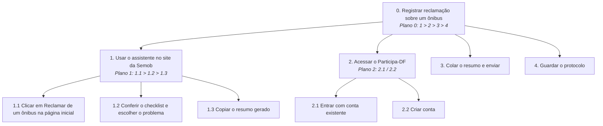

# TAR-08: Registro de reclamação sobre ônibus a partir do site da Semob

## Histórico de Versão e Contribuição

| Data | Versão | Descrição | Autor(es) | Revisor(es) |
| :---: | :---: | :--- | :--- | :--- |
| 13/10/2026 | 1.0 | Elaboração da Análise de Tarefas (HTA e GOMS) para o registro de reclamação sobre ônibus, partindo do site da Semob-DF, e proposta de melhoria. | [Rodrigo Barbosa](https://github.com/RodrigoCBarbosa) | [Arthur Mariani](https://github.com/arthur-mariani) |

---

## 1. Caracterização da Tarefa

* **Título da Tarefa:** Registro de reclamação sobre ônibus a partir do site da Semob
* **Perfil do Participante:** Usuária primária / Passageira do transporte coletivo do DF ([Cláudia Regina Santos](../personas/claudia-regina-santos.md))
* **Cenário de origem:** [Cenário 11 — Reclamação sobre ônibus que passou direto](../cenarios/cenario-11-reclamacao-onibus.md)
* **Responsáveis pela Elaboração:** [Rodrigo Barbosa](https://github.com/RodrigoCBarbosa)
* **Data da Realização:** 13/10/2026
* **Sistema analisado:** Portal institucional da Secretaria de Transporte e Mobilidade do DF (semob.df.gov.br) e plataforma Participa-DF (participa.df.gov.br), para onde as manifestações de ouvidoria são encaminhadas.
* **Objetivo da Tarefa (estado final):** O passageiro registrou uma reclamação sobre um problema com um ônibus (atraso, ônibus que não parou, superlotação, conduta do motorista etc.) e possui um número de protocolo para acompanhar a resposta.
* **Objetivo de experiência (hipótese):** Sentir que a reclamação foi ouvida e que vale a pena reclamar, sem se perder entre sites diferentes.
* **Justificativa da escolha:** É uma das tarefas mais frequentes do público da Semob. Segundo o relatório da própria Ouvidoria da Semob referente ao 1º trimestre de 2023, foram recebidas cerca de 5.947 manifestações, das quais cerca de 90% eram reclamações, com destaque para "ônibus não passa no horário" (1.099) e "ônibus não parou na parada" (551).
* **Escopo:** A tarefa vai desde a entrada no site da Semob até a obtenção do protocolo. A resposta da ouvidoria e eventuais recursos (por exemplo, reclamar do atendimento quando o prazo vence) ficam fora do escopo, exceto a consulta do andamento (objetivo 5).
* **Fontes de dados:** portal da Semob-DF, relatório da Ouvidoria da Semob, guia jornalístico sobre o Participa-DF (ver Referências). Não houve observação nem entrevista com usuários.

---

## 2. Análise Hierárquica de Tarefas (HTA)

Segundo Barbosa et al. (2021, p. 192–193), a HTA parte dos **objetivos** das pessoas (estados finais) e os decompõe em subobjetivos. Os subobjetivos e a relação entre eles formam um **plano**, e no nível mais baixo cada subobjetivo é alcançado por uma **operação**. Os planos usam a notação da Figura 6.1 do livro:

| Notação | Relação entre os subobjetivos |
| :---: | :--- |
| `1>2` | sequencial (um objetivo deve ser atingido antes do próximo) |
| `1/2` | seleção (qual objetivo será atingido depende das circunstâncias) |
| `1+2` | paralelo (mais de um objetivo atingido ao mesmo tempo, ou em qualquer ordem) |

*Fonte: Adaptado de Barbosa et al. (2021).*

Nos rótulos abaixo, os números do plano se referem aos subobjetivos do próprio objetivo, como na Figura 6.2 do livro.

### 2.1 Diagrama hierárquico

```mermaid
graph TD
    T0["0. Registrar reclamação sobre um ônibus<br/><i>Plano 0: 1 > 2 > 3 > 4 > 5</i>"]

    %% Nível 1
    T1["1. Reunir as informações do ocorrido<br/><i>Plano 1: 1.1 + 1.2 + 1.3</i>"]
    T2["2. Encontrar o canal de reclamação no site da Semob<br/><i>Plano 2: 2.1 > 2.2 > 2.3</i>"]
    T3["3. Acessar o Participa-DF<br/><i>Plano 3: 3.1 / 3.2</i>"]
    T4["4. Registrar a manifestação<br/><i>Plano 4: 4.1 > 4.2 > 4.3 > 4.4 > 4.5</i>"]
    T5["5. Guardar e acompanhar o protocolo<br/><i>Plano 5: 5.1 > 5.2</i>"]

    T0 --> T1
    T0 --> T2
    T0 --> T3
    T0 --> T4
    T0 --> T5

    %% Subníveis da Tarefa 1
    T11["1.1 Identificar a linha e o número do ônibus"]
    T12["1.2 Registrar data e horário"]
    T13["1.3 Registrar o local ou a parada"]
    T1 --> T11
    T1 --> T12
    T1 --> T13

    %% Subníveis da Tarefa 2
    T21["2.1 Acessar semob.df.gov.br"]
    T22["2.2 Localizar a área de Ouvidoria<br/><i>Plano 2.2: 2.2.1 / 2.2.2</i>"]
    T23["2.3 Seguir o link para o Participa-DF"]
    T2 --> T21
    T2 --> T22
    T2 --> T23

    T221["2.2.1 Navegar pelo menu"]
    T222["2.2.2 Usar a busca do site"]
    T22 --> T221
    T22 --> T222

    %% Subníveis da Tarefa 3
    T31["3.1 Entrar com conta existente"]
    T32["3.2 Criar conta<br/><i>Plano 3.2: 3.2.1 > 3.2.2</i>"]
    T3 --> T31
    T3 --> T32

    T321["3.2.1 Preencher dados pessoais"]
    T322["3.2.2 Confirmar o cadastro"]
    T32 --> T321
    T32 --> T322

    %% Subníveis da Tarefa 4
    T41["4.1 Escolher o tipo Reclamação"]
    T42["4.2 Indicar órgão e assunto"]
    T43["4.3 Descrever o ocorrido"]
    T44["4.4 Anexar arquivo (opcional)"]
    T45["4.5 Revisar e enviar"]
    T4 --> T41
    T4 --> T42
    T4 --> T43
    T4 --> T44
    T4 --> T45

    %% Subníveis da Tarefa 5
    T51["5.1 Anotar o número do protocolo"]
    T52["5.2 Consultar o andamento depois"]
    T5 --> T51
    T5 --> T52
```



*Figura 1 — Diagrama HTA do registro de reclamação sobre ônibus.*
*Fonte: [Rodrigo Barbosa](https://github.com/RodrigoCBarbosa) (2026).*

### 2.2 Tabela de objetivos, operações, problemas e recomendações

Formato da Tabela 6.3 do livro: cada objetivo tem *input* (circunstâncias que o ativam), *feedback* (condição que indica o atingimento), *plano*, e, quando houver, *problema* e *recomendação*.

| objetivos / operações | problemas e recomendações |
| :--- | :--- |
| **0. Registrar reclamação sobre um ônibus** 1>2>3>4>5 | *input*: passageiro passou por um problema com um ônibus; tem acesso a computador ou celular com internet<br>*feedback*: protocolo da reclamação obtido<br>*plano*: reunir as informações **e depois** encontrar o canal **e depois** acessar o Participa-DF **e depois** registrar a manifestação **e depois** guardar o protocolo |
| **1. Reunir as informações do ocorrido** 1+2+3 | *input*: ocorrido recente<br>*feedback*: linha, número do ônibus, data, horário e local conhecidos<br>*plano*: as três informações podem ser reunidas em qualquer ordem<br>*problema (hipótese)*: o site não informa **antes** quais dados serão necessários. O usuário só descobre isso no objetivo 4, quando o ocorrido já passou e ele não anotou o número do ônibus<br>*recomendação*: exibir, na entrada do serviço, um checklist do que ter em mãos |
| 1.1 Identificar a linha e o número do ônibus | *problema (hipótese)*: o número do veículo (prefixo) é a informação mais difícil de lembrar depois |
| 1.2 Registrar data e horário | |
| 1.3 Registrar o local ou a parada | |
| **2. Encontrar o canal de reclamação no site da Semob** 1>2>3 | *input*: passageiro sabe que a Semob é responsável pelo transporte coletivo<br>*feedback*: página do Participa-DF aberta<br>*plano*: acessar o site **e depois** localizar a Ouvidoria **e depois** seguir o link |
| 2.1 Acessar semob.df.gov.br | |
| **2.2 Localizar a área de Ouvidoria** 1/2 | *plano*: navegar pelo menu **ou** usar a busca. Se o usuário reconhece o termo "Ouvidoria", usa 2.2.1. Senão, tenta 2.2.2<br>*problema (hipótese)*: "Ouvidoria" é um termo institucional; o usuário pensa em "reclamar", "fale conosco" ou "denunciar ônibus". Isso dificulta o **reconhecimento** e aumenta o golfo de execução<br>*recomendação*: oferecer um acesso direto na página inicial com o vocabulário do usuário, como "Reclamar de um ônibus" |
| 2.2.1 Navegar pelo menu | |
| 2.2.2 Usar a busca do site | |
| 2.3 Seguir o link para o Participa-DF | *problema (hipótese)*: o usuário sai do site da Semob para outra plataforma, com outro visual e outro login, sem aviso claro. Pode achar que está no lugar errado (falha de **consistência** e de **visibilidade do estado do sistema**)<br>*recomendação*: avisar antes do redirecionamento que a reclamação é feita no Participa-DF e por quê |
| **3. Acessar o Participa-DF** 1/2 | *input*: página do Participa-DF aberta<br>*feedback*: usuário autenticado<br>*plano*: entrar com conta existente **ou** criar conta, dependendo de o usuário já ter cadastro |
| 3.1 Entrar com conta existente | |
| **3.2 Criar conta** 1>2 | *plano*: preencher os dados **e depois** confirmar<br>*problema (hipótese)*: o cadastro (nome, CPF, senha, e-mail, sexo, data de nascimento) é uma barreira para uma tarefa pontual e pode levar à desistência |
| 3.2.1 Preencher dados pessoais | |
| 3.2.2 Confirmar o cadastro | |
| **4. Registrar a manifestação** 1>2>3>4>5 | *input*: usuário autenticado<br>*feedback*: tela de confirmação com protocolo<br>*plano*: escolher o tipo **e depois** indicar órgão e assunto **e depois** descrever **e depois** anexar (só se houver arquivo) **e depois** revisar e enviar |
| 4.1 Escolher o tipo Reclamação | *problema (hipótese)*: os tipos (reclamação, denúncia, sugestão, elogio, solicitação) podem parecer sobrepostos para o usuário leigo |
| 4.2 Indicar órgão e assunto | *problema (hipótese)*: o usuário precisa saber que o órgão responsável é a Semob, e não, por exemplo, o Detran ou a empresa de ônibus |
| 4.3 Descrever o ocorrido | *problema (hipótese)*: campo de texto livre não orienta quais detalhes tornam a reclamação apurável<br>*recomendação*: campos estruturados (linha, prefixo, data, horário, local) ou um modelo de texto |
| 4.4 Anexar arquivo (opcional) | |
| 4.5 Revisar e enviar | |
| **5. Guardar e acompanhar o protocolo** 1>2 | *input*: manifestação enviada<br>*feedback*: protocolo guardado; andamento consultado<br>*plano*: anotar o protocolo **e depois**, em outro momento, consultar o andamento |
| 5.1 Anotar o número do protocolo | *problema (hipótese)*: se o usuário fechar a tela sem anotar, depende do e-mail ou da conta para recuperar o protocolo |
| 5.2 Consultar o andamento depois | |

*Fonte: [Rodrigo Barbosa](https://github.com/RodrigoCBarbosa) (2026).*

### 2.3 Critério de parada da decomposição

Conforme o livro (p. 195), a decomposição termina quando se têm as informações necessárias para os objetivos da análise, e um critério é o **p × c**: parar quando o produto da probabilidade de falha (*p*) pelo custo da falha (*c*) é julgado aceitável.

* **Objetivo 1 (reunir as informações)** foi decomposto porque a falha é provável (o usuário não sabe de antemão o que será pedido) e custosa (uma reclamação sem linha, horário ou veículo dificilmente é apurada, e o ocorrido não pode ser "refeito").
* **Objetivo 2.2 (localizar a Ouvidoria)** foi decomposto em métodos alternativos porque é o ponto em que o usuário pode desistir antes mesmo de começar o registro.
* **Objetivo 3.2 (criar conta)** foi decomposto porque representa uma barreira de esforço com risco de abandono.
* **Objetivo 4** foi decomposto até as operações porque é o núcleo da tarefa; as operações 4.4 e 4.5 não foram detalhadas por terem baixa probabilidade de falha.
* **Objetivo 5** não foi decomposto além das operações; a falha (perder o protocolo) é recuperável pela conta do usuário.

### 2.4 Hipóteses sobre erros (classificação de Reason, 1990)

Na etapa 7 da HTA (p. 196), o livro sugere classificar erros como baseados em habilidades, regras ou conhecimento:

| Operação | Tipo de erro | Hipótese |
| :--- | :--- | :--- |
| 3.2.1 | Habilidades | Erro de digitação em CPF, data de nascimento ou e-mail durante o cadastro. |
| 4.1 | Regras | Aplicar a regra "algo grave aconteceu, então é denúncia" e escolher **Denúncia** em vez de **Reclamação**, desviando o encaminhamento. |
| 2.3 | Conhecimento | Usuário não sabe que a reclamação é feita no Participa-DF; ao ser levado a outro site, acha que errou o caminho e abandona a tarefa. |

*Fonte: [Rodrigo Barbosa](https://github.com/RodrigoCBarbosa) (2026).*

### 2.5 Situação dos passos da HTA (Diaper, 2003, apud Barbosa et al., 2021, p. 195–196)

| Passo | Situação |
| :--- | :--- |
| 1. Decidir os objetivos da análise | Feito: avaliar o fluxo atual (site da Semob + Participa-DF) e propor uma melhoria no site da Semob. |
| 2. Consenso sobre objetivos e medidas de sucesso | Parcial. Evidência de sucesso: o passageiro obtém o protocolo com todas as informações necessárias para apuração. Consequência da falha: desistência ou reclamação não apurável. **Consenso com as partes interessadas pendente.** |
| 3. Fontes de informação e aquisição de dados | Parcial: documentação pública e relatório da Ouvidoria. **Observação e entrevistas pendentes.** |
| 4. Esboçar diagrama e tabela | Feito (seções 2.1 e 2.2). |
| 5. Verificar a validade com as partes interessadas | **Pendente.** |
| 6. Identificar operações significativas (p × c) | Feito (seção 2.3). |
| 7. Gerar hipóteses sobre aprendizado e desempenho | Feito como hipóteses (seção 2.4), **sem teste**. |

*Fonte: [Rodrigo Barbosa](https://github.com/RodrigoCBarbosa) (2026).*

---

## 3. GOMS

Segundo Barbosa et al. (2021, p. 196–198), o GOMS descreve a tarefa e o conhecimento do usuário em termos de **objetivos** (*goals*), **operadores** (*operators*), **métodos** (*methods*) e **regras de seleção** (*selection rules*). Ele se aplica principalmente a usuários que **já dominam** a tarefa, e costuma ser usado depois de uma análise básica de tarefas, que aqui é a HTA da seção 2.

Adotou-se o **CMN-GOMS**, com algarismos indicando sequência e letras indicando alternativas, como nos Exemplos 6.7 e 6.8 do livro.

> **Perfil assumido para o GOMS:** passageiro que já registrou reclamações antes e sabe que o canal é o Participa-DF. Para o usuário de primeira vez, os problemas mais relevantes estão nos objetivos 1 e 2 da HTA, que o GOMS não captura bem.

### 3.1 Modelo CMN-GOMS

```
GOAL 0: registrar reclamação sobre um ônibus
  GOAL 1: reunir as informações do ocorrido
    OP. 1.1: lembrar ou consultar a linha e o número do ônibus
    OP. 1.2: lembrar a data e o horário
    OP. 1.3: lembrar o local ou a parada

  GOAL 2: encontrar o canal de reclamação
    OP. 2.1: abrir o navegador e acessar semob.df.gov.br
    METHOD 2.A: navegar pelo menu
    (SEL. RULE: o usuário reconhece o termo "Ouvidoria")
      OP. 2.A.1: localizar o item Ouvidoria no menu
      OP. 2.A.2: clicar no item
    METHOD 2.B: usar a busca do site
    (SEL. RULE: o usuário não encontra o item no menu)
      OP. 2.B.1: clicar no campo de busca
      OP. 2.B.2: digitar "ouvidoria" ou "reclamação"
      OP. 2.B.3: verificar os resultados
      OP. 2.B.4: clicar no resultado da Ouvidoria
    OP. 2.2: clicar no link para o Participa-DF

  GOAL 3: acessar o Participa-DF
    METHOD 3.A: entrar com conta existente
    (SEL. RULE: o usuário já possui cadastro)
      OP. 3.A.1: digitar CPF e senha
      OP. 3.A.2: clicar em entrar
    METHOD 3.B: criar conta
    (SEL. RULE: o usuário não possui cadastro)
      OP. 3.B.1: clicar em criar conta
      OP. 3.B.2: preencher nome, CPF, senha, e-mail, sexo e data de nascimento
      OP. 3.B.3: confirmar o cadastro

  GOAL 4: registrar a manifestação
    METHOD 4.A: preencher o formulário diretamente
    (SEL. RULE: o usuário sabe o tipo de manifestação e o órgão responsável)
      OP. 4.A.1: selecionar o tipo Reclamação
      OP. 4.A.2: selecionar o órgão (Semob) e o assunto
      OP. 4.A.3: digitar a descrição com linha, número do ônibus, data, horário e local
      OP. 4.A.4: anexar arquivo, se houver
      OP. 4.A.5: revisar e clicar em enviar
    METHOD 4.B: registrar com ajuda da assistente virtual (IZA)
    (SEL. RULE: o usuário não sabe qual tipo ou órgão escolher)
      OP. 4.B.1: abrir a assistente virtual
      OP. 4.B.2: responder às perguntas da assistente
      OP. 4.B.3: revisar e enviar

  GOAL 5: guardar e acompanhar o protocolo
    OP. 5.1: anotar ou copiar o número do protocolo
    OP. 5.2: (em outro momento) entrar no Participa-DF e consultar o andamento
```

*Fonte: [Rodrigo Barbosa](https://github.com/RodrigoCBarbosa) (2026).*

### 3.2 Leitura do modelo (análise qualitativa)

Conforme o livro (p. 197, 201), o GOMS qualitativo ajuda a perceber métodos semelhantes, métodos atipicamente curtos ou longos e pontos onde faltam métodos ou *feedback*:

1. **O método 3.B é atipicamente longo** em relação ao objetivo do usuário: para uma reclamação pontual, criar conta exige mais operações do que o próprio registro. É um candidato a abandono.
2. **O objetivo 1 é o ponto crítico e não tem *feedback* do sistema.** Nenhuma operação do site ajuda o usuário a reunir as informações antes de começar. Se faltar o número do ônibus em 4.A.3, não há método para recuperá-lo.
3. **Os métodos 2.A e 2.B existem porque o vocabulário do site não corresponde ao do usuário.** O método 2.B tem o dobro de operações; um acesso direto com o termo "Reclamar de um ônibus" tornaria ambos desnecessários.
4. **O método 4.B mostra que o próprio sistema reconhece a dificuldade de escolher tipo e órgão**, o que reforça a hipótese de erro baseado em regras da seção 2.4.

### 3.3 Sobre o KLM

Diferente do caso do DF no Ponto, esta tarefa pode ser feita no computador, com teclado e mouse, que é o contexto para o qual os operadores do KLM (Tabela 6.4 do livro) foram definidos. A estimativa de tempo não foi feita nesta versão porque os passos de interface ainda são hipóteses; ela pode ser feita após a navegação de validação, comparando o fluxo atual com a proposta da seção 4.

---

## 4. Proposta de melhoria no site da Semob

**Problema central:** o site da Semob não prepara o usuário para a tarefa (objetivo 1), usa vocabulário institucional (objetivo 2.2) e redireciona para outra plataforma sem aviso (operação 2.3).

**Proposta:** incluir na página inicial do site da Semob um acesso direto **"Reclamar de um ônibus"**, que abre um assistente curto antes do redirecionamento:

1. **Checklist** do que ter em mãos: linha, número do ônibus (prefixo, pintado na lateral e na frente do veículo), data, horário e local.
2. **Escolha guiada do problema**, usando as categorias mais frequentes nos relatórios da Ouvidoria (ônibus não passou no horário, não parou na parada, superlotação, conduta do motorista, outro).
3. **Resumo pronto para copiar**, montado a partir das respostas, com o texto da reclamação já organizado.
4. **Aviso de redirecionamento**: explicação de que o registro oficial é feito no Participa-DF, com o tipo (Reclamação) e o órgão (Semob) que devem ser escolhidos, e lembrete para guardar o protocolo.

### 4.1 HTA revisada (resumo)



*Figura 2 — Diagrama HTA da proposta de melhoria no fluxo de reclamação.*
*Fonte: [Rodrigo Barbosa](https://github.com/RodrigoCBarbosa) (2026).*

### 4.2 Comparação antes e depois

| Aspecto | Fluxo atual | Fluxo proposto |
| :--- | :--- | :--- |
| Preparação das informações (obj. 1) | Sem apoio; usuário descobre o que falta só no formulário | Checklist antes de começar (prevenção de erros) |
| Localizar o canal (obj. 2.2) | Dois métodos (menu ou busca), termo "Ouvidoria" | Acesso direto na página inicial, com o vocabulário do usuário (reconhecimento em vez de memorização) |
| Mudança de site (op. 2.3) | Redirecionamento sem explicação | Aviso explícito do que acontecerá (visibilidade do estado do sistema) |
| Escolha de tipo e órgão (obj. 4) | Usuário decide sozinho; risco de erro baseado em regras | Orientação prévia de qual tipo e órgão escolher |
| Descrição (op. 4.3) | Texto livre sem orientação | Resumo estruturado pronto para colar |

*Fonte: [Rodrigo Barbosa](https://github.com/RodrigoCBarbosa) (2026).*

> A proposta não altera o Participa-DF, que é um sistema de outro órgão; ela atua apenas no site da Semob, que é o objeto deste trabalho. A melhoria deve ser validada com usuários (por exemplo, teste de usabilidade comparando os dois fluxos).

---

## 5. Referências Bibliográficas

* BARBOSA, Simone Diniz Junqueira; SILVA, Bruno Santana da; SILVEIRA, Milene Selbach; GASPARINI, Isabela; DARIN, Ticianne; BARBOSA, Gabriel Diniz Junqueira. **Interação Humano-Computador e Experiência do Usuário**. Rio de Janeiro: Autopublicação, 2021. ISBN 978-65-00-19677-1. Capítulo 6, seção 6.4, p. 191–203.
* SECRETARIA DE TRANSPORTE E MOBILIDADE DO DISTRITO FEDERAL (Semob-DF). **Portal institucional**. Disponível em: <https://www.semob.df.gov.br/>. Acesso em: 13 out. 2026.
* SOU BRASÍLIA. **Ouvidoria 162 e Participa-DF: como registrar reclamação e pedir serviço ao GDF**. Disponível em: <https://soubrasilia.com/ouvidoria-162-participa-df/>. Acesso em: 13 out. 2026.