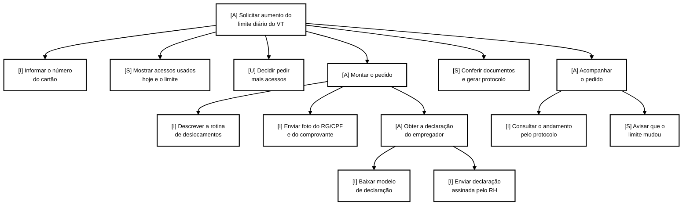
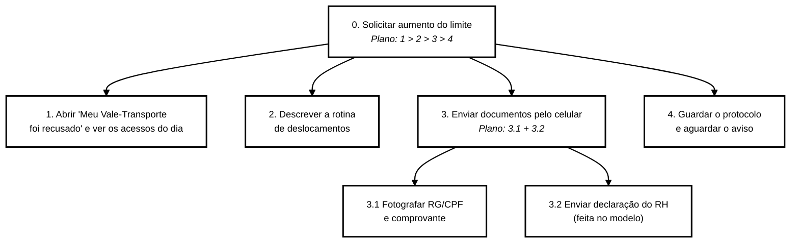

# TAR-09: Solicitar aumento do limite diário de uso do Vale-Transporte

## Histórico de Versão e Contribuição

| Data | Versão | Descrição | Autor(es) | Revisor(es) |
| :---: | :---: | :--- | :--- | :--- |
| 23/10/2026 | 1.0 | Elaboração da Análise de Tarefas (HTA e CTT) para a solicitação de aumento do limite diário de uso do Vale-Transporte, a partir da página "Limites do Vale-Transporte" do site da Semob-DF, e proposta de melhoria. | [Tomás Rocho](https://github.com/TomasRocho) | [Rodrigo Carvalho](https://github.com/RodrigoCBarbosa) |

---

## 1. Introdução

Este documento analisa a tarefa de pedir à Semob-DF o aumento do limite diário de uso do cartão Vale-Transporte. A tarefa é pouco visível no site: a página que trata dela fica em **Ouvidoria > Serviços**, não informa qual é o limite e depende de um formulário, de documentos e de entrega presencial. A análise usa HTA e CTT e trata os problemas encontrados como **hipóteses a validar** com usuários, com a Semob e com o BRB Mobilidade.

## 2. Caracterização da Tarefa

* **Título da Tarefa:** Solicitar aumento do limite diário de uso do Vale-Transporte.
* **Perfil do Participante:** Usuário primário / trabalhador que usa o Vale-Transporte para se deslocar entre vários endereços no mesmo dia ([Heitor Santos Júnior](../personas/heitor-santos-junior.md)).
* **Cenário de origem:** [Cenário 9 — Cartão de Vale-Transporte recusado no meio do expediente](../cenarios/cenario-9-limite-vale-transporte.md).
* **Responsável pela Elaboração:** [Tomás Rocho](https://github.com/TomasRocho).
* **Data da Realização:** 23/10/2026.
* **Sistema analisado:** página [Limites do Vale-Transporte](https://www.semob.df.gov.br/servicos/limites-do-vale-transporte) do portal da Semob-DF (caminho: Ouvidoria > Serviços), com os links que ela oferece para o site do BRB Mobilidade.
* **Regra de negócio envolvida:** o cartão Vale-Transporte permite **8 acessos por dia** no Sistema de Bilhetagem Automática (SBA), somando ônibus, micro-ônibus, metrô e BRT. Cada passagem do cartão no validador conta como um acesso, inclusive nas integrações. Quem precisa de mais acessos deve comprovar a necessidade à Semob (Portaria Semob nº 96/2021; perguntas frequentes do BRB Mobilidade).
* **Objetivo da Tarefa (estado final):** o pedido de aumento do limite foi entregue com todos os documentos, o trabalhador sabe quanto tempo vai esperar e, depois de aprovado, o cartão aceita mais de 8 acessos por dia.
* **Objetivo de experiência (hipótese):** entender por que o cartão foi recusado, sem se sentir acusado de uso indevido, e resolver sem faltar ao trabalho.
* **Justificativa da escolha:** a tarefa afeta trabalhadores que se deslocam entre vários endereços no expediente (manutenção, entregas, vendas externas, cuidadores). Quando o limite é atingido, o cartão é recusado no meio do dia e a pessoa paga a passagem do próprio bolso. Nenhuma outra tarefa do grupo cobre esse serviço: a [TAR-07](tar-07-credito-vale-transporte.md) trata do crédito que não aparece no cartão, e não do limite de usos.
* **Escopo:** da percepção de que o cartão foi recusado até a confirmação de que o novo limite está ativo. A análise da Semob e a alteração no SBA pelo BRB são tarefas do sistema e entram só como espera.
* **Fontes de dados:** página da Semob (consultada em 23/10/2026, atualizada pelo órgão em 01/09/2026), perguntas frequentes do cartão Vale-Transporte do BRB Mobilidade e notícia sobre a Portaria nº 96/2021 (ver Referências). Não houve observação nem entrevista específica com usuários.

### 2.1 O que foi observado na página da Semob

A Tabela 1 registra o que a página oferece hoje. Esses pontos sustentam os problemas apontados na HTA.

**Tabela 1** — Observações na página "Limites do Vale-Transporte" (23/10/2026)

| Elemento da página | Observação |
| :--- | :--- |
| Localização | Fica em **Ouvidoria > Serviços**. Não aparece entre os "Serviços mais procurados" da página inicial. |
| Valor do limite | A página não informa que o limite é de 8 acessos por dia. Essa informação só foi encontrada nas perguntas frequentes do BRB. |
| "CLIQUE AQUI PARA BAIXAR O FORMULÁRIO" | Leva para a página geral do cartão Vale-Transporte no site do BRB. Nela não foi encontrado um link de download do formulário. |
| "Formulário on-line" | Aparece como texto simples, sem link. |
| Documentos exigidos | Cópia do RG e do CPF; declaração do empregador com o endereço da prestação do serviço; comprovante de residência; descrição das linhas usadas no trajeto residência-trabalho. |
| Entrega | Somente presencial: Subsecretaria de Controle e Gratuidade (antiga Rodoferroviária) ou um de 10 postos BRB Mobilidade, entre eles Planaltina (Rodoviária). |
| Horário dos postos | Remete a uma página do BRB que, na consulta, retornou erro 503 (fora do ar). |
| Prazos | Até 5 dias úteis para a análise da Semob e até 2 dias úteis para o BRB alterar o SBA. Não há número de protocolo nem forma de acompanhar o pedido pela internet. |

*Fonte: [Tomás Rocho](https://github.com/TomasRocho) (2026), a partir do portal da Semob-DF.*

---

## 3. Análise Hierárquica de Tarefas (HTA)

Segundo Barbosa et al. (2021, p. 192–195), a HTA parte dos **objetivos** das pessoas e os decompõe em subobjetivos. Os subobjetivos e a relação entre eles formam um **plano**; no nível mais baixo, cada subobjetivo é alcançado por uma **operação**. Nos planos, `1>2` indica sequência, `1/2` indica seleção conforme a circunstância e `1+2` indica atividades paralelas ou em qualquer ordem.

### 3.1 Diagrama hierárquico

```mermaid
flowchart TB
    classDef mono fill:#ffffff,stroke:#000000,stroke-width:2px,color:#000000,font-size:12px;
    linkStyle default stroke:#000000,stroke-width:1.5px;

    T0["0. Solicitar aumento do limite<br/>diário do Vale-Transporte<br/><i>Plano: 1 > 2 > 3 > 4 > 5 > 6</i>"]:::mono

    T1["1. Entender por que o<br/>cartão foi recusado<br/><i>Plano: 1.1 > 1.2</i>"]:::mono
    T2["2. Encontrar o serviço<br/>no site da Semob<br/><i>Plano: 2.1 > 2.2</i>"]:::mono
    T3["3. Obter o formulário<br/><i>Plano: 3.1 / 3.2</i>"]:::mono
    T4["4. Reunir os documentos<br/><i>Plano: 4.1 + 4.2 + 4.3 + 4.4</i>"]:::mono
    T5["5. Entregar o pedido<br/><i>Plano: 5.1 > 5.2 > 5.3</i>"]:::mono
    T6["6. Aguardar e confirmar<br/>o novo limite<br/><i>Plano: 6.1 > 6.2</i>"]:::mono

    T0 --> T1
    T0 --> T2
    T0 --> T3
    T0 --> T4
    T0 --> T5
    T0 --> T6

    T11["1.1 Perceber a recusa<br/>no validador"]:::mono
    T12["1.2 Descobrir que existe<br/>limite de 8 acessos"]:::mono
    T1 --> T11
    T1 --> T12

    T21["2.1 Acessar<br/>semob.df.gov.br"]:::mono
    T22["2.2 Localizar a página<br/>Limites do Vale-Transporte<br/><i>Plano: 2.2.1 / 2.2.2</i>"]:::mono
    T2 --> T21
    T2 --> T22

    T221["2.2.1 Navegar por<br/>Ouvidoria > Serviços"]:::mono
    T222["2.2.2 Usar a busca<br/>do site"]:::mono
    T22 --> T221
    T22 --> T222

    T31["3.1 Baixar o formulário<br/>no site do BRB"]:::mono
    T32["3.2 Retirar o formulário<br/>em um posto"]:::mono
    T3 --> T31
    T3 --> T32

    T41["4.1 Copiar RG e CPF"]:::mono
    T42["4.2 Pedir a declaração<br/>ao empregador (RH)"]:::mono
    T43["4.3 Separar comprovante<br/>de residência"]:::mono
    T44["4.4 Descrever as linhas<br/>usadas no trajeto"]:::mono
    T4 --> T41
    T4 --> T42
    T4 --> T43
    T4 --> T44

    T51["5.1 Escolher o posto<br/>e o horário"]:::mono
    T52["5.2 Ir ao posto"]:::mono
    T53["5.3 Entregar formulário<br/>e documentos"]:::mono
    T5 --> T51
    T5 --> T52
    T5 --> T53

    T61["6.1 Aguardar a análise<br/>(até 5 + 2 dias úteis)"]:::mono
    T62["6.2 Confirmar o novo<br/>limite no uso do cartão"]:::mono
    T6 --> T61
    T6 --> T62
```



<div align="center">
<p><strong>Figura 1</strong> — Diagrama HTA da solicitação de aumento do limite diário do Vale-Transporte.</p>
<p><em>Legenda: a numeração decimal indica os níveis de decomposição; as setas ligam cada objetivo aos seus subobjetivos; "&gt;" indica sequência, "/" indica seleção conforme as circunstâncias e "+" indica execução em qualquer ordem.</em></p>
<p><em>Fonte: <a href="https://github.com/TomasRocho">Tomás Rocho</a> (2026).</em></p>
</div>

### 3.2 Tabela de objetivos, operações, problemas e recomendações

A Tabela 2 segue o formato da Tabela 6.3 do livro: cada objetivo tem *input* (o que o ativa), *feedback* (o que indica que foi atingido) e *plano*, e, quando houver, *problema* e *recomendação*.

**Tabela 2** — Objetivos, operações, problemas e recomendações da HTA

| Objetivos / operações | Problemas e recomendações |
| :--- | :--- |
| **0. Solicitar aumento do limite diário do Vale-Transporte** `1>2>3>4>5>6` | *Input:* o cartão foi recusado depois de vários embarques no mesmo dia; o trabalho exige mais de 8 acessos por dia.<br>*Feedback:* novo limite ativo no cartão.<br>*Plano:* entender a recusa **e depois** encontrar o serviço **e depois** obter o formulário **e depois** reunir os documentos **e depois** entregar **e depois** aguardar e confirmar. |
| **1. Entender por que o cartão foi recusado** `1>2` | *Input:* o validador não liberou a catraca.<br>*Feedback:* o usuário sabe que atingiu o limite diário, e não que está sem saldo ou com o cartão bloqueado. |
| 1.1 Perceber a recusa no validador | *Problema (hipótese):* a resposta do validador não diferencia "limite diário atingido" de "saldo insuficiente" ou "cartão bloqueado". O usuário não sabe o que aconteceu (falha de **visibilidade do estado do sistema**). |
| 1.2 Descobrir que existe limite de 8 acessos | *Problema:* a página da Semob sobre o tema **não informa o valor do limite**; o número 8 só aparece nas perguntas frequentes do BRB.<br>*Recomendação:* informar o limite em linguagem simples ("o Vale-Transporte vale para até 8 passagens por dia, contando as integrações") e mostrar quantos acessos já foram usados no dia. |
| **2. Encontrar o serviço no site da Semob** `1>2` | *Input:* o usuário sabe ou suspeita que o problema é de limite.<br>*Feedback:* página "Limites do Vale-Transporte" aberta. |
| 2.1 Acessar semob.df.gov.br | |
| **2.2 Localizar a página Limites do Vale-Transporte** `1/2` | *Plano:* navegar pelo menu **ou** usar a busca. Se o usuário associa o problema à Ouvidoria, usa 2.2.1; senão, tenta 2.2.2.<br>*Problema:* o serviço fica em **Ouvidoria > Serviços**, mas pedir mais acessos não é uma reclamação. O usuário procura por "cartão recusado", "cartão travou" ou "vale bloqueado", e não por "limites" (falha de **correspondência com a linguagem do usuário**).<br>*Recomendação:* acesso direto na página inicial, junto aos serviços de cartão, com o texto "Meu Vale-Transporte foi recusado". |
| 2.2.1 Navegar por Ouvidoria > Serviços | |
| 2.2.2 Usar a busca do site | |
| **3. Obter o formulário** `1/2` | *Input:* página aberta.<br>*Feedback:* formulário em mãos.<br>*Plano:* baixar pela internet **ou** retirar no posto, conforme o usuário consiga ou não encontrar o arquivo. |
| 3.1 Baixar o formulário no site do BRB | *Problema:* o link "CLIQUE AQUI PARA BAIXAR O FORMULÁRIO" leva a uma página geral do BRB, sem o arquivo; o item "Formulário on-line" está escrito sem link. O usuário fica num beco sem saída e pode concluir que o serviço não existe.<br>*Recomendação:* link direto para o formulário e, de preferência, formulário on-line de verdade. |
| 3.2 Retirar o formulário em um posto | *Problema (hipótese):* exige uma ida extra ao posto, além da entrega. |
| **4. Reunir os documentos** `1+2+3+4` | *Input:* lista de documentos conhecida.<br>*Feedback:* os quatro documentos estão prontos.<br>*Plano:* os documentos podem ser reunidos em qualquer ordem. |
| 4.1 Copiar RG e CPF | |
| 4.2 Pedir a declaração ao empregador (RH) | *Problema (hipótese):* a página pede "o endereço da prestação do serviço", no singular. Quem trabalha em vários endereços não sabe o que o RH deve escrever, e o RH também não tem um modelo.<br>*Recomendação:* modelo de declaração para baixar, com campo para vários endereços ou para a região de atuação. |
| 4.3 Separar comprovante de residência | |
| 4.4 Descrever as linhas usadas no trajeto | *Problema (hipótese):* o pedido exige as linhas do trajeto "residência-trabalho", mas o trabalhador que muda de endereço a cada dia não sabe de antemão quais linhas vai usar.<br>*Recomendação:* permitir descrever a rotina ("ida e volta Planaltina–Rodoviária e deslocamentos entre prédios do Plano Piloto") em vez de exigir uma lista fechada de linhas. |
| **5. Entregar o pedido** `1>2>3` | *Input:* formulário e documentos prontos.<br>*Feedback:* pedido recebido pelo atendente. |
| 5.1 Escolher o posto e o horário | *Problema:* a página manda consultar os horários em outro site, que estava fora do ar na consulta.<br>*Recomendação:* mostrar endereço e horário de cada posto na própria página. |
| 5.2 Ir ao posto | *Problema (hipótese):* a entrega só é presencial. Para quem sai de casa antes das 5h e volta depois das 17h, ir ao posto em horário comercial pode significar faltar ao trabalho.<br>*Recomendação:* envio dos documentos pela internet (foto pelo celular). |
| 5.3 Entregar formulário e documentos | *Problema (hipótese):* se faltar um documento, o usuário só descobre no balcão e precisa voltar outro dia. |
| **6. Aguardar e confirmar o novo limite** `1>2` | *Input:* pedido entregue.<br>*Feedback:* o cartão passa do 8º acesso sem ser recusado. |
| 6.1 Aguardar a análise (até 5 + 2 dias úteis) | *Problema:* não há número de protocolo nem consulta do andamento pela internet. Durante a espera, o usuário continua pagando do próprio bolso as passagens além da 8ª.<br>*Recomendação:* protocolo com acompanhamento e aviso por SMS ou WhatsApp quando o limite for alterado. |
| 6.2 Confirmar o novo limite no uso do cartão | *Problema (hipótese):* o usuário só descobre se deu certo ao tentar o 9º embarque. |

*Fonte: [Tomás Rocho](https://github.com/TomasRocho) (2026).*

### 3.3 Critério de parada da decomposição

Conforme o livro (p. 195), a decomposição termina quando já se têm as informações necessárias para a análise. Um critério é o **p × c**: parar quando o produto da probabilidade de falha (*p*) pelo custo da falha (*c*) é aceitável.

* **Objetivo 1** foi decomposto porque a falha é provável (nada informa o limite) e custosa (o usuário pode achar que o cartão está com defeito e ir ao posto errado, ou desistir e pagar do próprio bolso todos os dias).
* **Objetivo 2.2** foi decomposto em métodos alternativos porque a localização do serviço, dentro de Ouvidoria, é o ponto em que o usuário pode nem chegar à página.
* **Objetivo 3** foi decomposto porque o link quebrado leva a um beco sem saída, com alta chance de abandono.
* **Objetivo 4** foi decomposto até as operações porque dois documentos (4.2 e 4.4) não se encaixam na rotina de quem trabalha em vários endereços.
* **Objetivos 5 e 6** não foram detalhados além das operações: dependem do atendimento presencial e do processamento da Semob e do BRB, que precisam ser observados antes de qualquer detalhamento.

### 3.4 Hipóteses sobre erros

Na etapa 7 da HTA, o livro sugere classificar os erros como baseados em habilidades, regras ou conhecimento (Reason, 1990, apud Barbosa et al., 2021, p. 196). A Tabela 3 aplica essa classificação às operações mais sujeitas a falha.

**Tabela 3** — Hipóteses de erro nas operações analisadas

| Operação | Tipo de erro | Hipótese |
| :--- | :--- | :--- |
| 1.1 | Regras | Aplicar a regra "cartão recusado = sem saldo" e ir cobrar o RH pelo crédito, quando o problema é o limite de acessos. |
| 1.2 | Conhecimento | Não saber que as integrações também contam como acesso e achar que usou "só 4 ônibus" no dia. |
| 4.2 | Conhecimento | Levar uma declaração com um único endereço de trabalho e ter o pedido negado por não comprovar a necessidade. |
| 4.4 | Regras | Listar só a linha de casa até a Rodoviária, que é a que conhece, e omitir os deslocamentos durante o expediente. |
| 5.3 | Habilidades | Esquecer a cópia de um documento e precisar voltar ao posto em outro dia. |

*Fonte: [Tomás Rocho](https://github.com/TomasRocho) (2026).*

### 3.5 Situação dos passos da HTA (Diaper, 2003, apud Barbosa et al., 2021, p. 195–196)

**Tabela 4** — Situação dos passos metodológicos da HTA

| Passo | Situação |
| :--- | :--- |
| 1. Decidir os objetivos da análise | Feito: avaliar o fluxo atual de pedido de aumento do limite e propor melhorias no site da Semob. |
| 2. Consenso sobre objetivos e medidas de sucesso | Parcial. Sucesso: novo limite ativo sem o usuário faltar ao trabalho nem voltar ao posto. Consequência da falha: gasto do próprio bolso todos os dias e possível desistência. **Consenso com as partes interessadas pendente.** |
| 3. Fontes de informação e aquisição de dados | Parcial: página da Semob, perguntas frequentes do BRB e notícia sobre a portaria. **Observação e entrevistas pendentes.** |
| 4. Esboçar diagrama e tabela | Feito (seções 3.1 e 3.2). |
| 5. Verificar a validade com as partes interessadas | **Pendente.** |
| 6. Identificar operações significativas (p × c) | Feito (seção 3.3). |
| 7. Gerar hipóteses sobre aprendizado e desempenho | Feito como hipóteses (seção 3.4), **sem teste**. |

*Fonte: [Tomás Rocho](https://github.com/TomasRocho) (2026).*

---

## 4. ConcurTaskTrees (CTT)

O CTT representa tarefas de usuário, de sistema, de interação e abstratas, além das relações temporais entre elas (Barbosa et al., 2021, p. 203–205). O modelo abaixo descreve a **solução proposta** na seção 5: um pedido guiado pelo site da Semob, que começa explicando a recusa do cartão e termina com o acompanhamento do protocolo.

### 4.1 Estrutura formal e relações temporais

```text
[A] Solicitar aumento do limite diário do Vale-Transporte
 |
 |-- [I] Informar o número do cartão                       [ ] >>
 |-- [S] Mostrar acessos usados hoje e o limite de 8        [ ] >>
 |-- [U] Decidir pedir mais acessos                          >>
 |-- [A] Montar o pedido
 |     |-- [I] Descrever a rotina de deslocamentos           |||
 |     |-- [I] Enviar foto do RG/CPF e do comprovante        |||
 |     \-- [A] Obter a declaração do empregador
 |           |-- [I] Baixar modelo de declaração             >>
 |           \-- [I] Enviar declaração assinada pelo RH
 |                                                           >>
 |-- [S] Conferir documentos e gerar protocolo               [ ] >>
 \-- [A] Acompanhar o pedido
       |-- [I] Consultar o andamento pelo protocolo          [>
       \-- [S] Avisar por WhatsApp/SMS que o limite mudou
```

* **`[ ] >>` — ativação com passagem de informação:** o número do cartão permite ao sistema mostrar os acessos do dia; os documentos enviados alimentam a conferência e o protocolo.
* **`>>` — ativação:** a tarefa seguinte só começa quando a anterior termina.
* **`|||` — entrelaçamento:** a descrição da rotina, o envio dos documentos pessoais e a obtenção da declaração podem ser feitos em qualquer ordem, inclusive em dias diferentes.
* **`[>` — desativação:** a consulta do andamento deixa de ser necessária quando o sistema avisa que o novo limite está ativo.

### 4.2 Diagrama CTT



<div align="center">
<p><strong>Figura 2</strong> — Diagrama CTT do pedido guiado de aumento do limite diário do Vale-Transporte.</p>
<p><em>Legenda: [A] = tarefa abstrata; [U] = tarefa do usuário; [I] = tarefa interativa; [S] = tarefa do sistema. As setas representam a decomposição hierárquica; as relações temporais estão descritas na seção 4.1.</em></p>
<p><em>Fonte: <a href="https://github.com/TomasRocho">Tomás Rocho</a> (2026).</em></p>
</div>

> **Limite do CTT.** A notação representa tarefas e relações temporais. Os problemas de prevenção e recuperação de erros ficam registrados na HTA, porque o CTT não tem elementos próprios para isso (Barbosa et al., 2021, p. 205).

---

## 5. Proposta de melhoria no site da Semob

**Problema central:** o serviço está escondido em Ouvidoria, não informa o limite, tem o link do formulário quebrado e só aceita entrega presencial, sem protocolo para acompanhar.

**Proposta:** criar no site da Semob, junto aos serviços de cartão, o acesso **"Meu Vale-Transporte foi recusado"**, com um pedido guiado em quatro passos:

1. **Explicação da recusa:** o usuário informa o número do cartão e vê quantos acessos usou no dia e qual é o limite ("Você usou 8 de 8 passagens hoje"), com a explicação de que as integrações também contam.
2. **Pedido de mais acessos:** um formulário curto, em que a pessoa descreve a rotina com as próprias palavras, em vez de listar linhas.
3. **Documentos pelo celular:** envio de fotos do RG/CPF e do comprovante de residência, e um modelo de declaração para o RH preencher, com espaço para vários endereços de trabalho.
4. **Protocolo e aviso:** número de protocolo, consulta do andamento e aviso por WhatsApp ou SMS quando o novo limite estiver ativo. Quem preferir continua podendo entregar no posto, com endereço e horário mostrados na própria página.

### 5.1 HTA revisada (resumo)



<div align="center">
<p><strong>Figura 3</strong> — Diagrama HTA da proposta de pedido guiado.</p>
<p><em>Fonte: <a href="https://github.com/TomasRocho">Tomás Rocho</a> (2026).</em></p>
</div>

### 5.2 Comparação antes e depois

**Tabela 5** — Comparação entre o fluxo atual e o fluxo proposto

| Aspecto | Fluxo atual | Fluxo proposto |
| :--- | :--- | :--- |
| Entender a recusa (obj. 1) | Nenhuma explicação; o limite de 8 acessos não aparece na página da Semob | Acessos do dia e limite mostrados a partir do número do cartão (visibilidade do estado do sistema) |
| Encontrar o serviço (obj. 2) | Dentro de Ouvidoria > Serviços, com o nome "Limites do Vale-Transporte" | Acesso direto junto aos serviços de cartão, com a frase do usuário: "Meu Vale-Transporte foi recusado" |
| Formulário (obj. 3) | Link leva a página sem o arquivo; "Formulário on-line" sem link | Formulário curto no próprio site |
| Documentos (obj. 4) | Declaração com um único endereço; lista fechada de linhas | Modelo de declaração com vários endereços; rotina descrita com palavras do usuário |
| Entrega (obj. 5) | Só presencial; horários em outro site, fora do ar | Envio pelo celular; posto continua disponível, com endereço e horário na página |
| Acompanhamento (obj. 6) | Sem protocolo; o usuário só descobre o resultado ao tentar o 9º embarque | Protocolo, consulta do andamento e aviso por WhatsApp/SMS |

*Fonte: [Tomás Rocho](https://github.com/TomasRocho) (2026).*

> A proposta atua apenas no site da Semob, que é o objeto deste trabalho. A análise do pedido continua com a Semob e a alteração no cartão continua com o BRB Mobilidade. A melhoria deve ser validada com usuários, por exemplo com um teste de usabilidade comparando os dois fluxos.

---

## 6. Referências Bibliográficas

* BARBOSA, Simone Diniz Junqueira; SILVA, Bruno Santana da; SILVEIRA, Milene Selbach; GASPARINI, Isabela; DARIN, Ticianne; BARBOSA, Gabriel Diniz Junqueira. **Interação Humano-Computador e Experiência do Usuário**. Rio de Janeiro: Autopublicação, 2021. ISBN 978-65-00-19677-1. Capítulo 6, seção 6.4, p. 191–205.
* BRB MOBILIDADE. **Cartão Vale-Transporte: perguntas frequentes**. Disponível em: <https://brbnovo.brb.com.br/mobilidade/cartao-vale-transporte/>. Acesso em: 23 out. 2026.
* DIÁRIO DO TRANSPORTE. **Limite diário de oito acessos para vale-transporte do DF já está em vigor**. 18 jun. 2021. Disponível em: <https://diariodotransporte.com.br/2021/06/18/limite-diario-de-oito-acessos-para-vale-transporte-do-df-ja-esta-em-vigor/>. Acesso em: 23 out. 2026.
* PATERNÒ, Fabio. **Model-Based Design and Evaluation of Interactive Applications**. London: Springer-Verlag, 1999.
* REASON, James. **Human Error**. Cambridge: Cambridge University Press, 1990.
* SECRETARIA DE ESTADO DE TRANSPORTE E MOBILIDADE DO DISTRITO FEDERAL (Semob-DF). **Limites do Vale-Transporte**. Disponível em: <https://www.semob.df.gov.br/servicos/limites-do-vale-transporte>. Acesso em: 23 out. 2026.
