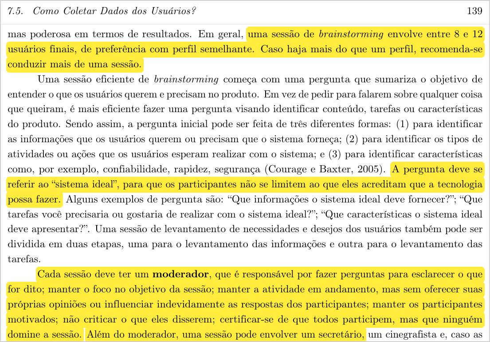
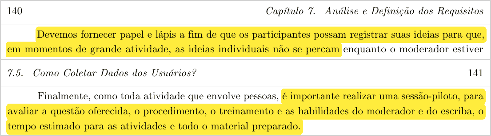

## Histórico de Versão e Contribuição

| Data | Versão | Descrição | Autor(es) | Revisor(es) | Declaração de Uso de IA |
| :---: | :---: | :--- | :--- | :--- | :--- |
| 27/09/2026 | `1.0` | Criação do roteiro, condução da reunião, registro dos dados coletados e análise do brainstorming sobre o portal da Semob-DF. | [Lucas Araújo](https://github.com/Lucasaraujoszz) e [Arthur Mariani](https://github.com/arthur-mariani) | [Carlos Costa](https://github.com/carloshfgit) | Google Gemini — auxílio na estruturação textual, refinamento de clareza formal e formatação Markdown do presente documento |
| 19/11/2026 | `1.1` | Padronização da estrutura (histórico no topo, conteúdo, fotos de referência e referências ao final); declaração de IA levada para o histórico; inclusão de fotos de referência grifadas. Retirada da referência à edição de 2011 do livro na seção de materiais (a edição de 2021 já consta nas Referências Bibliográficas) e correção da numeração das seções. | [Gabriel Melo](https://github.com/gabriellcardone-06) | Pendente de revisão | Claude (Anthropic) — apoio na padronização da estrutura do artefato, na revisão das referências e na formatação em Markdown. |

---

# Brainstorming de Necessidades e Desejos dos Usuários

## 1. Objetivo e método

O brainstorming foi planejado para levantar e priorizar **necessidades e desejos de cidadãos** sobre as informações e tarefas oferecidas pelo portal da Semob-DF. A atividade segue a técnica de *brainstorming de necessidades e desejos dos usuários* descrita por Barbosa et al. (2021): geração livre de ideias sobre o sistema ideal, mediação sem crítica e priorização individual dos itens considerados essenciais.

A pergunta central da sessão foi:

> **“Pensando em um portal ideal de informações e serviços de mobilidade do DF, que informações você precisaria encontrar e que tarefas gostaria de conseguir realizar?”**

O roteiro separa a geração de ideias em informações e tarefas, para evitar que necessidades de conteúdo e ações desejadas se confundam. Quando uma ideia descreve uma solução, o moderador deve investigar a necessidade que a motivou.

### 1.1 Planejamento da sessão

| Aspecto | Definição no roteiro |
|---|---|
| **Participantes previstos** | Entre 8 e 12 usuários finais por sessão, com perfis semelhantes; públicos muito diferentes devem participar de sessões separadas |
| **Participantes na reunião** | 9 usuários finais |
| **Equipe de condução** | [Lucas Araújo](https://github.com/Lucasaraujoszz) e [Arthur Mariani](https://github.com/arthur-mariani) |
| **Duração planejada** | 60 minutos |
| **Formato da reunião** | Remoto |
| **Duração efetiva aproximada** | 30 minutos |
| **Materiais** | Google Docs para anotação coletiva, Google Meet para realização e gravação da reunião remota e Bloco de Notas para anotação individual das ideias |
| **Etapas** | Abertura, regras, geração de ideias sobre informações, geração de ideias sobre tarefas, esclarecimento, priorização individual e encerramento |
| **Priorização** | Cada participante seleciona cinco itens essenciais, sem repetir um mesmo item e atribuindo o mesmo peso aos cinco |

*Fonte: Roteiro de brainstorming do portal da Semob-DF, elaborado por Lucas Araújo e Arthur Mariani.*

### 1.2 Treinamento para o brainstorming

Antes da reunião, foi realizado um treinamento para alinhar a condução da sessão, a mediação das ideias e o registro das contribuições dos participantes.

- **Registro do treinamento:** [Treinamento para brainstorming no YouTube](https://youtu.be/t4s5LiSbacg)

### 1.3 Regras de condução

- O foco é o **sistema ideal**; todas as ideias podem ser registradas sem autocensura ou crítica dos demais participantes.
- O moderador mantém o foco, esclarece ideias aparentemente repetidas e assegura que todos possam participar sem dominar a conversa.
- O registro é numerado somente após o moderador confirmar o sentido da sugestão com o participante.
- A análise posterior agrupa ideias semelhantes, preserva diferenças relevantes e usa a priorização como insumo, não como representação estatística de toda a população usuária da Semob-DF.

### 1.4 Realização da reunião

O brainstorming foi realizado **remotamente**, com nove participantes, e teve duração aproximada de **30 minutos**. O registro audiovisual da reunião está disponível no link a seguir:

- **Registro do brainstorming:** [Brainstorming da Semob-DF no YouTube](https://youtu.be/RmBUBJn1e28)

---

## 2. Resultados coletados

O arquivo de dados coletados registra **14 ideias preenchidas**, apresentadas a seguir em numeração sequencial de 1 a 14 após a desconsideração dos registros vazios. A reunião contou com **nove participantes**. Em 13 ideias há uma contagem de votos; a ideia 11 não possui voto registrado. Os resultados são apresentados por contagem de votos e pela proporção correspondente entre os nove participantes.

### 2.1 Registro das ideias

| Nº | Ideia na linguagem registrada | Necessidade interpretada pela equipe | Informação, tarefa ou característica? | Votos registrados |
| :---: | --- | --- | --- | :---: |
| 1 | Corrigir erros no site | Acessar serviços e páginas sem falhas que impeçam a tarefa | Característica de qualidade | 4 (44,4%) |
| 2 | Rastreamento em tempo real | Ver os ônibus em tempo real | Informação | 6 (66,7%) |
| 3 | Planejador de viagem simples | Planejar uma viagem sem precisar baixar um aplicativo | Tarefa | 1 (11,1%) |
| 4 | Reporte rápido | Registrar manifestação sem a complexidade atual da ouvidoria | Tarefa | 2 (22,2%) |
| 5 | Possibilidade de usar o site sem baixar o DF no Ponto | Usar o portal no navegador sem ser encaminhado obrigatoriamente a aplicativo externo | Tarefa | 6 (66,7%) |
| 6 | Menos informações na tela inicial | Encontrar primeiro os serviços mais buscados pela população | Informação | 7 (77,8%) |
| 7 | Integração de IA para tirar dúvidas objetivas e encaminhar para destinos efetivamente | Tirar dúvidas rapidamente e chegar a conteúdos ou serviços pertinentes | Tarefa | 4 (44,4%) |
| 8 | Site não prende a atenção e parece muito estático, “similar a um PDF” | Interagir com uma interface mais clara, dinâmica e orientada à ação | Característica de experiência | 2 (22,2%) |
| 9 | Ouvidoria não funciona corretamente | Comunicar-se diretamente com a instituição sem buscar contatos em outros canais | Tarefa | 3 (33,3%) |
| 10 | Possibilidade de colocar a localização final e já mostrar todas as linhas que passam nela e paradas próximas | Informar um destino e descobrir linhas e paradas que atendem ao local | Tarefa | 6 (66,7%) |
| 11 | Aplicativo às vezes não responde corretamente | Usar a ferramenta sem travamentos ou necessidade de reinício | Característica de qualidade | Não registrado |
| 12 | Aplicativo não abre às vezes e é necessário conhecimento técnico para resolver, como apagar cache | Recuperar-se de falhas sem conhecimento técnico | Característica de qualidade | 3 (33,3%) |
| 13 | Parece um site de redirecionamento para outros sites, mas não tem a “cara” do gov | Manter contexto, confiança e identidade ao acessar serviços relacionados | Característica de qualidade | 1 (11,1%) |
| 14 | Mapa interativo que mostre ciclovias | Visualizar ciclovias no contexto de mobilidade | Informação | 2 (22,2%) |

<em>Fonte: Dados coletados do brainstorming, reunião conduzida por Lucas Araújo e Arthur Mariani. As colunas “necessidade interpretada” e “informação, tarefa ou característica” foram elaboradas pela equipe a partir das ideias registradas.</em>

### 2.2 Priorização por votos

| Posição | Itens | Contagem de votos | Leitura do resultado |
| :---: | --- | :---: | --- |
| 1 | 6: Menos informações na tela inicial | 7 (77,8%) | O acesso rápido aos serviços mais relevantes é a principal prioridade registrada |
| 2 | 2: Rastreamento em tempo real; 5: Usar o site sem baixar o DF no Ponto; 10: Buscar por destino e linhas próximas | 6 cada (66,7%) | Os participantes priorizam informação operacional, autonomia no navegador e planejamento por destino |
| 3 | 1: Corrigir erros no site; 7: Tirar dúvidas objetivas e encaminhar ao serviço | 4 cada (44,4%) | Confiabilidade e orientação direta são demandas relevantes |
| 4 | 9: Ouvidoria; 12: Recuperação de falhas sem conhecimento técnico | 3 cada (33,3%) | Atendimento e recuperação de problemas precisam de caminhos compreensíveis |
| 5 | 4: Reporte rápido; 8: Interface menos estática; 14: Mapa com ciclovias | 2 cada (22,2%) | Há interesse em manifestação simples, melhor experiência e informação multimodal |
| 6 | 3: Planejador de viagem simples; 13: Evitar redirecionamentos | 1 cada (11,1%) | Demandas registradas, porém com menor priorização nesta sessão |
| Sem classificação | 11: Aplicativo não responde corretamente | Não registrado | A ideia deve ser preservada para investigação posterior, mas não pode ser ordenada pelos votos disponíveis |

---

## 3. Análise dos achados

### 3.1 Necessidades prioritárias

Os resultados apontam três grupos principais de necessidades:

1. **Acesso rápido à informação de mobilidade.** A maior votação foi para reduzir a sobrecarga da tela inicial e priorizar os serviços mais procurados. Rastreamento em tempo real e busca por destino reforçam que o portal deve apoiar decisões imediatas de deslocamento.
2. **Autonomia sem fragmentação.** Os participantes desejam usar o portal sem precisar baixar o DF no Ponto ou percorrer múltiplos sites. A navegação deve explicar com clareza quando um serviço externo é necessário e preservar o contexto do usuário.
3. **Confiabilidade e atendimento compreensível.** Erros, travamentos, necessidade de apagar *cache* e dificuldade de usar a ouvidoria mostram que a experiência deve oferecer mensagens claras, recuperação orientada e um caminho direto para reportar problemas.

### 3.2 Implicações para requisitos de IHC

| Achado | Implicação para o projeto |
|---|---|
| Serviços prioritários não aparecem de forma imediata na tela inicial | Organizar a página inicial em torno de tarefas frequentes, como planejar deslocamento, consultar linhas, rastrear ônibus e obter atendimento |
| Busca por linha é insuficiente para parte dos participantes | Permitir pesquisa por origem, destino, localização e pontos de referência, além do número da linha |
| Redirecionamentos e instalação obrigatória de aplicativo frustram o uso | Explicar o destino de cada link, manter a navegação no navegador quando possível e preservar o contexto ao encaminhar a outro serviço |
| Falhas técnicas interrompem tarefas críticas | Oferecer interface leve, estados de carregamento, mensagens de erro compreensíveis e orientações de recuperação sem exigir conhecimento técnico |
| Atendimento e ouvidoria são percebidos como complexos | Disponibilizar um fluxo de manifestação simples, com identificação do canal responsável, protocolo e acompanhamento |
| Ciclovias foram lembradas como informação desejada | Considerar a mobilidade ativa no mapa e validar essa necessidade com novos participantes antes de priorizá-la no escopo |

### 3.3 Limitações do registro

- A reunião contou com nove participantes, dentro da faixa de 8 a 12 prevista no roteiro.
- A coluna de classificação foi preenchida posteriormente pela equipe. Ideias que descrevem qualidade de uso, e não uma informação ou ação concreta, foram classificadas como **características**, terceira forma de pergunta prevista pelo método.
- O brainstorming revela necessidades e desejos do grupo participante; os achados devem ser confrontados com entrevistas, análise documental e avaliações do portal antes de se tornarem requisitos definitivos.

---

## 4. Rastreabilidade com os demais artefatos

Os achados reforçam perfis e cenários já registrados no projeto:

- A prioridade de acesso rápido a linhas, horários e rastreamento dialoga com as personas de passageiros e com os cenários de deslocamento cotidiano.
- A demanda por busca por destino e informações de linhas próximas apoia o cenário de planejamento de rota de [Marcos Paulo Vieira](cenarios/cenario-3-planejamento-origem-destino.md).
- A necessidade de atendimento simples e de recuperação de falhas deve orientar os cenários que envolvem cartão, crédito e manifestação de problemas.
- As ideias de navegação leve, linguagem direta e redução de sobrecarga informacional devem ser verificadas nas próximas atividades de design e avaliação.

---

## 5. Materiais da sessão

* **Roteiro de brainstorming do portal da Semob-DF.** Desenvolvido por Lucas Araújo e Arthur Mariani com o apoio de IA generativa (Gemini) e fundamentado nas referências metodológicas apresentadas no livro *Interação Humano-Computador*, de Barbosa et al. (2021).
* **Brainstorming dados coletados.** Registro feito por Arthur Mariani e Lucas Araújo durante o Brainstorm.

---

## 6. Fotos de Referência

As Figuras 1 a 2 mostram os trechos que fundamentam este artefato, recortados e grifados em amarelo diretamente do livro da disciplina (BARBOSA et al., 2021).

<strong>Figura 1</strong> — Brainstorming de necessidades e desejos dos usuários

<em>Fonte: BARBOSA et al. (2021, p. 139). Recorte e grifo: [Gabriel Melo](https://github.com/gabriellcardone-06) (2026).</em>

<strong>Figura 2</strong> — Brainstorming: papel e lápis e sessão-piloto

<em>Fonte: BARBOSA et al. (2021, pp. 140–141). Recorte e grifo: [Gabriel Melo](https://github.com/gabriellcardone-06) (2026).</em>

---

## 7. Referências Bibliográficas

* BARBOSA, Simone Diniz Junqueira; SILVA, Bruno Santana da; SILVEIRA, Milene Selbach; GASPARINI, Isabela; DARIN, Ticianne; BARBOSA, Gabriel Diniz Junqueira. **Interação Humano-Computador e Experiência do Usuário**. Rio de Janeiro: Autopublicação, 2021. ISBN 978-65-00-19677-1.
