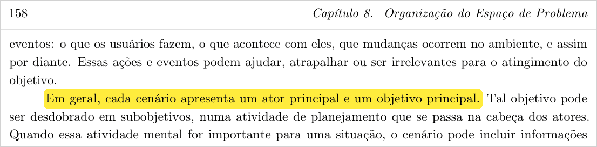
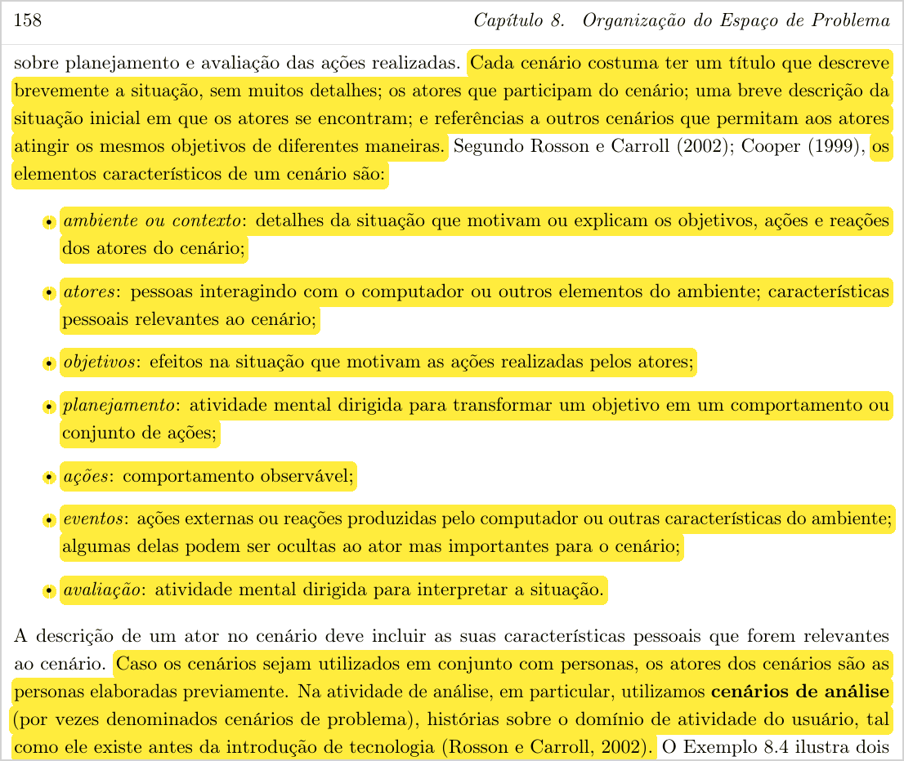

## Histórico de Versão e Contribuição

| Data | Versão | Descrição | Autor(es) | Revisor(es) | Declaração de Uso de IA |
| :---: | :---: | :--- | :--- | :--- | :--- |
| 27/09/2026 | `1.0` | Elaboração do cenário de problema sobre indisponibilidade de crédito de Vale-Transporte no cartão. | [Arthur Mariani](https://github.com/arthur-mariani) | [Lucas Araújo](https://github.com/Lucasaraujoszz) | Não declarado pelo autor |
| 19/11/2026 | `1.1` | Padronização da estrutura (histórico no topo, conteúdo, fotos de referência e referências ao final); declaração de IA levada para o histórico; retirada das referências que não são o livro da disciplina nem material do professor; inclusão de fotos de referência grifadas. Inclusão do bloco de artefatos relacionados (persona, cenário, análise de tarefas, storyboard, planejamentos, relatos e protótipos da funcionalidade). | [Gabriel Melo](https://github.com/gabriellcardone-06) | Pendente de revisão | Claude (Anthropic) — apoio na padronização da estrutura do artefato, na revisão das referências e na formatação em Markdown.; apoio na inclusão dos links entre artefatos |

!!! warning "Observação para correção manual"
    A coluna de declaração de IA foi preenchida com *Não declarado pelo autor* nas versões em que o artefato original não informava o uso de IA. O autor de cada versão deve confirmar se usou IA (somente Claude ou Google Gemini) e completar a célula.

---

# Cenário 4: Crédito de Vale-Transporte Não Disponível no Cartão Antes do Trabalho

## 1. Introdução

Este cenário de problema descreve Maria Eduarda Santos diante da indisponibilidade do crédito de Vale-Transporte pouco antes de ir ao trabalho. A situação foi modelada para revelar dificuldades de compreensão e encaminhamento entre empregador, SEMOB-DF e BRB Mobilidade, contribuindo para requisitos de orientação clara, definição de responsabilidades e apoio à resolução do problema.

**Artefatos relacionados — fluxo da funcionalidade TAR-07 (Regularização de Crédito de Vale-Transporte):**

* **Persona:** [Maria Eduarda Santos](../personas/maria-eduarda-santos.md)
* **Cenário:** Cenário 4 (*esta página*)
* **Análise de tarefas:** [TAR-07](../analise-de-tarefas/tar-07-credito-vale-transporte.md)
* **Storyboard:** [Storyboard 07](../../design-avaliacao-desenvolvimento/nivel1/storyboards.md#37-storyboard-07-regularizacao-de-credito-de-vale-transporte)
* **Nível 1 — avaliação do storyboard e da análise de tarefas:** [Planejamento da avaliação](../../design-avaliacao-desenvolvimento/nivel1/planejamentos-individuais/Arthur/arthur-planejamento-avaliacao.md) · [Planejamento do relato](../../design-avaliacao-desenvolvimento/nivel1/planejamentos-individuais/Arthur/planejamento-relato-analise-tarefas.md) · Relato dos resultados (*não disponível — pendente de correção manual*)
* **Nível 2 — protótipo de papel (baixa fidelidade):** [Planejamento da avaliação](../../design-avaliacao-desenvolvimento/nivel2/planejamentos-individuais/Arthur/arthur-planejamento-avaliacao-prototipo-papel.md) · [Planejamento do relato](../../design-avaliacao-desenvolvimento/nivel2/planejamentos-individuais/Arthur/arthur-planejamento-relato-prototipo-papel.md) · [Relato dos resultados](../../design-avaliacao-desenvolvimento/nivel2/relatos-individuais/arthur/relato-resultados-prototipo-papel.md)
* **Nível 3 — protótipo de alta fidelidade:** [Planejamento da avaliação](../../design-avaliacao-desenvolvimento/nivel3/planejamentos-individuais/Arthur/arthur-planejamento-avaliacao-prototipo-alta-fidelidade.md) · [Planejamento do relato](../../design-avaliacao-desenvolvimento/nivel3/planejamentos-individuais/Arthur/arthur-planejamento-relato-prototipo-alta-fidelidade.md) · [Relato dos resultados](../../design-avaliacao-desenvolvimento/nivel3/relatos-individuais/arthur/relato-resultados-prot-alta-fidel.md)
* **Telas do protótipo de papel:** [telas no planejamento da avaliação](../../design-avaliacao-desenvolvimento/nivel2/planejamentos-individuais/Arthur/arthur-planejamento-avaliacao-prototipo-papel.md#9-telas-do-prototipo-avaliado)
* **Protótipo de alta fidelidade navegável:** [acessar o protótipo](https://arthur-mariani.github.io/PAF-IHC/credito/)

## 2. Caracterização Geral

**Autor: Arthur Mariani**

* **Persona Associada:** [Maria Eduarda Santos (Usuária de Vale-Transporte)](../personas/maria-eduarda-santos.md)
* **Tipo de Cenário:** Cenário de Problema (*Problem Scenario*): diagnóstico da situação atual de atendimento relacionada a cartão e crédito de Vale-Transporte.
* **Tarefas da Persona Cobertas:** Conferir orientações sobre Vale-Transporte e cartão; resolver falha de crédito no cartão; consultar o canal correto de atendimento.

**Resumo da Situação:** numa segunda-feira pela manhã, Maria Eduarda embarca para ir ao trabalho após receber a confirmação do RH de que o Vale-Transporte foi creditado. O validador informa saldo insuficiente. Sem saber se o problema é do empregador, do cartão, do BRB Mobilidade ou da Semob, ela busca orientação pelo celular e encontra informações fragmentadas. Para não se atrasar, paga a passagem com o dinheiro reservado para o almoço e passa o dia sem saber como fazer o crédito aparecer no cartão.

---

## 3. Ambiente e Contexto

* **Momento Temporal e Espacial:** Segunda-feira, início de outubro, 07h08, em uma parada de ônibus em Samambaia Sul. Maria Eduarda inicia o trajeto até o supermercado onde trabalha, no Plano Piloto.
* **Pressão Temporal e Financeira:** O turno começa às 09h00. Ela precisa utilizar duas linhas de ônibus com integração e não pode perder a conexão. O dinheiro disponível fora do cartão está reservado para a alimentação do dia.
* **Condições do Dispositivo Móvel e Conectividade:** Smartphone Android intermediário, com 41% de bateria, conexão 4G oscilando e pacote de dados limitado. Ela está em pé, carregando bolsa e marmita.
* **Recursos Disponíveis:** Cartão +Vale-Transporte, validador do ônibus, site da Semob, busca do Google, link para o BRB Mobilidade, WhatsApp e contato do RH.
* **Estado do Serviço no Mundo Real [Fato Externo Oculto]:** Na sexta-feira anterior, o RH informou que os créditos do mês foram enviados. O procedimento da empresa registra o crédito, mas ele ainda não está disponível para uso no cartão da Duda. O motivo e o procedimento para disponibilizá-lo não estão claros para ela.

---

## 4. Atores Envolvidos

A Tabela 1 identifica os participantes do cenário e esclarece como seus papéis influenciam a busca de Maria Eduarda por uma solução para o crédito indisponível.

<strong>Tabela 1</strong>: Atores do Cenário 4

| Ator | Papel no Cenário | Características Relevantes |
|---|---|---|
| **Maria Eduarda Santos** | Ator Principal (Usuária) | 31 anos, trabalhadora e usuária diária de ônibus. Está sob pressão de horário e depende do cartão +Vale-Transporte para preservar seu orçamento. |
| **Motorista do ônibus** | Ator Secundário | Controla o tempo de embarque e atende dúvidas breves. Não possui acesso ao saldo nem aos créditos do cartão. |
| **Renata, profissional de RH** | Ator Secundário | Confirma o envio do benefício pela empresa apenas em horário comercial; não acompanha o estado do cartão em tempo real. |
| **BRB Mobilidade** | Ator Externo (Serviço) | Emite e atende questões relacionadas a cartões e créditos; aparece para Duda como serviço separado do portal da Semob. |

<em>Fonte: Arthur Mariani (2026), fundamentado em Rosson & Carroll (2002 apud BARBOSA et al., 2021).</em>

---

## 5. Objetivos

* **Objetivo Geral:** Chegar ao trabalho no horário sem arcar indevidamente com o custo da passagem que deveria estar coberto pelo Vale-Transporte.
* **Subobjetivos Operacionais:**
  1. Entender por que o crédito não está disponível no cartão.
  2. Descobrir qual instituição pode resolver o problema e qual procedimento deve seguir.
  3. Conseguir embarcar a tempo de manter a conexão e chegar ao trabalho às 09h00.
  4. Saber como garantir que o crédito estará disponível no restante do mês.
* **Motivações:** Evitar atraso, preservar o dinheiro reservado para alimentação, não depender de informação informal e resolver o problema sem faltar ao trabalho para ir a um posto de atendimento.

---

## 6. Ciclo Reflexivo: Planejamento, Ações, Eventos e Avaliação

### Passo 1: Tentativa de embarque com o cartão (07h08)

* **Planejamento:** *"O RH confirmou o crédito na sexta. É só passar o cartão e pegar a linha de sempre."* Duda não consulta o saldo antes de sair porque considera a confirmação da empresa suficiente.
* **Ação:** Quando o ônibus chega, aproxima o cartão +Vale-Transporte do validador.
* **Evento:** O validador exibe a mensagem de saldo insuficiente e não libera a catraca.
* **Avaliação Mental:** *"Mas o RH falou que já tinha colocado. Será que descontou tudo ou deu algum problema no cartão?"* Fica surpresa e constrangida, pois há outros passageiros esperando para embarcar.

### Passo 2: Busca de orientação imediata no ônibus

* **Planejamento:** Acredita que talvez o motorista saiba se o problema é comum ou se o cartão precisa de alguma ação simples.
* **Ação:** Pergunta ao motorista por que o crédito não entrou e se consegue atualizar o cartão no próprio ônibus.
* **Evento:** O motorista informa que não consegue consultar nem corrigir créditos e diz apenas que ela deve procurar o atendimento do cartão. A fila de passageiros cresce e ele precisa continuar a viagem.
* **Avaliação Mental:** *"Atendimento de qual cartão? É no BRB, na Semob ou com a empresa?"* Percebe que não recebeu uma orientação que permita agir naquele momento.

### Passo 3: Pesquisa pelo celular antes de decidir o que fazer

* **Planejamento:** Como não sabe para onde ir, decide pesquisar *"Vale-Transporte crédito não caiu no cartão"* no Google e procurar uma instrução oficial rápida.
* **Ação:** Abre os resultados da busca no celular e acessa primeiro o site da Semob. Procura por "cartão", "crédito" e "Vale-Transporte".
* **Evento:** Encontra informações institucionais e links para serviços externos, mas não uma explicação direta sobre a diferença entre crédito enviado pelo empregador, saldo disponível no cartão e a ação necessária para utilizar o crédito. Um dos caminhos leva ao site do BRB Mobilidade, com outra identidade visual.
* **Evento [oculto]:** O procedimento correto depende de uma atualização do cartão em um equipamento de leitura, mas a localização e o momento apropriado para fazê-la não aparecem no resultado inicial que Duda encontra.
* **Avaliação Mental:** *"O crédito pode ter sido enviado, mas não sei se isso quer dizer que ele já está no meu cartão. E agora tenho que entrar em outro site."* A dúvida aumenta e o próximo ônibus pode demorar.

### Passo 4: Escolha entre atrasar-se e pagar a passagem

* **Planejamento:** Calcula que, se esperar para tentar resolver naquela hora, perderá a conexão e poderá chegar atrasada. Decide embarcar para preservar o emprego, mesmo que isso comprometa o orçamento do dia.
* **Ação:** Paga em dinheiro a primeira passagem e embarca. Durante o trajeto, envia uma mensagem para Renata, do RH: "O VT não entrou no meu cartão. Vocês conseguem ver o que aconteceu?"
* **Evento:** O dinheiro usado é parte do valor reservado para o almoço. Renata ainda não está trabalhando e não responde de imediato.
* **Avaliação Mental:** *"Vou chegar no horário, mas paguei uma passagem que já devia estar coberta. Se acontecer de novo na volta, nem sei como faço."* Sente preocupação e injustiça, mas não tem tempo para continuar a busca.

### Passo 5: Resposta parcial do RH (10h17)

* **Planejamento:** Durante o intervalo, espera que o RH confirme se a empresa deixou de enviar o benefício ou se houve algum erro na folha.
* **Ação:** Lê a resposta de Renata no WhatsApp e pergunta o que precisa fazer para o valor aparecer no cartão.
* **Evento:** Renata confirma que a empresa enviou o crédito na sexta e informa que, em situações assim, o cartão pode precisar ser atualizado em um ponto de atendimento ou em um equipamento específico do BRB Mobilidade. Ela não sabe indicar o local mais próximo nem se Duda precisa apresentar algum documento.
* **Avaliação Mental:** *"Então não foi erro da empresa. Mas eu ainda não sei onde vou, o que levo e se dá para fazer isso depois do trabalho."* Descobre uma possível causa, mas continua sem um caminho acionável.

### Passo 6: Tentativa de localizar o atendimento correto após o trabalho

* **Planejamento:** Pretende resolver a falha no retorno para casa, sem faltar ao expediente. Busca no site do BRB Mobilidade um local próximo ao trabalho ou ao seu trajeto.
* **Ação:** Acessa o link indicado pelo RH, procura por atendimento e tenta identificar um posto com horário compatível com sua saída às 18h00.
* **Evento:** Encontra opções de atendimento, mas a informação não responde diretamente se aquele posto atualiza créditos de Vale-Transporte, se funciona após as 18h00 e se há outra alternativa no caminho de casa.
* **Avaliação Mental:** *"Vou ter que tentar adivinhar se esse posto resolve ou procurar de novo quando sair. Era para ser simples saber onde o meu crédito está."* Termina o dia sem garantia de que o cartão funcionará na volta ou no dia seguinte.

---

## 7. Problemas Revelados e Requisitos Elicitados

A Tabela 2 relaciona os problemas evidenciados no cenário às causas observadas no design atual e aos requisitos de IHC propostos.

<strong>Tabela 2</strong>: Problemas Identificados no Cenário 4 e Requisitos de IHC Correspondentes

| Problema Identificado no Cenário | Causa no Design Atual | Requisito de IHC Proposto |
| :--- | :--- | :--- |
| **Mensagem de erro sem diagnóstico** | O validador informa apenas saldo insuficiente, sem indicar se a causa é falta de crédito, falha no cartão ou crédito ainda indisponível. | **RNF-01:** Apresentar status compreensível do benefício e orientação imediata sobre o próximo passo. |
| **Encaminhamento genérico do motorista** | O passageiro busca ajuda no ponto de contato disponível, mas o motorista não possui acesso às informações nem indica claramente o canal responsável. | **RF-01:** Oferecer um fluxo de atendimento único, acessível por QR Code ou portal móvel, para problemas de cartão e crédito. |
| **Fragmentação entre Semob e BRB Mobilidade** | A usuária precisa navegar entre portais com identidades e responsabilidades distintas para entender uma única situação. | **RF-02:** Explicar o papel de cada instituição e redirecionar para o serviço correto com contexto preservado. |
| **Diferença entre crédito enviado e crédito utilizável não é clara** | A linguagem institucional não diferencia o processamento pela empresa da disponibilidade efetiva no cartão. | **RNF-02:** Usar linguagem simples e mostrar as etapas do crédito: enviado, processado, disponível e pendente de atualização. |
| **Atendimento incompatível com a rotina de trabalho** | Não há indicação contextual de posto, horário, documentos necessários e alternativas compatíveis com a jornada da usuária. | **RF-03:** Localizar automaticamente postos e alternativas de atualização compatíveis com a rota e o horário do passageiro. |

<em>Fonte: Arthur Mariani (2026).</em>

---

## 8. Fotos de Referência

As Figuras 1 a 2 mostram os trechos que fundamentam este artefato, recortados e grifados em amarelo diretamente do livro da disciplina (BARBOSA et al., 2021).

<strong>Figura 1</strong> — Cenários: definição, ator e objetivo principais

<em>Fonte: BARBOSA et al. (2021, p. 158). Recorte e grifo: [Gabriel Melo](https://github.com/gabriellcardone-06) (2026).</em>

<strong>Figura 2</strong> — Elementos característicos de um cenário e uso de personas como atores

<em>Fonte: BARBOSA et al. (2021, p. 158). Recorte e grifo: [Gabriel Melo](https://github.com/gabriellcardone-06) (2026).</em>

---

## 9. Referências Bibliográficas

* BARBOSA, Simone Diniz Junqueira; SILVA, Bruno Santana da; SILVEIRA, Milene Selbach; GASPARINI, Isabela; DARIN, Ticianne; BARBOSA, Gabriel Diniz Junqueira. **Interação Humano-Computador e Experiência do Usuário**. Rio de Janeiro: Autopublicação, 2021. ISBN 978-65-00-19677-1.
