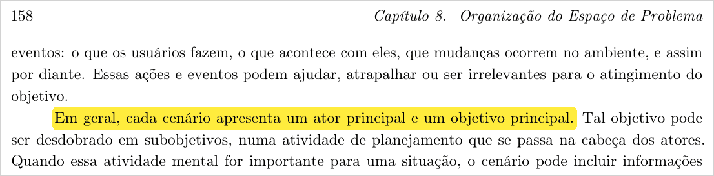
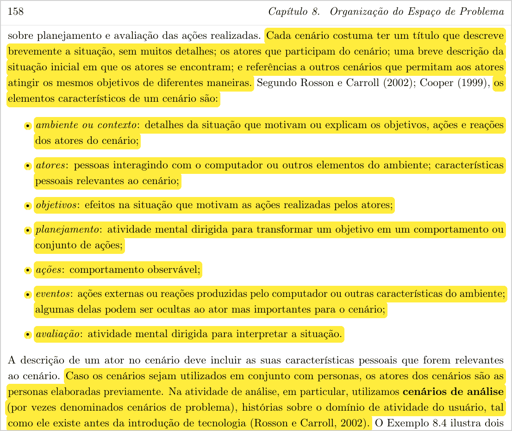

## Histórico de Versão e Contribuição

| Data | Versão | Descrição | Autor(es) | Revisor(es) | Declaração de Uso de IA |
| :---: | :---: | :--- | :--- | :--- | :--- |
| 26/09/2026 | `1.0` | Elaboração inicial dos cenários de uso a partir do perfil empírico do motorista (`MOT-01`) e da persona Valdir Soares, fundamentada na literatura clássica de IHC e Design Baseado em Cenários (Barbosa e Silva, 2010; Carroll, 2000; Rosson e Carroll, 2002; Cooper et al., 2007). | [Carlos Costa](https://github.com/carloshfgit) | [Arthur Mariani](https://github.com/arthur-mariani) e [Gabriel Melo](https://github.com/gabriellcardone-06) | Não declarado pelo autor |
| 27/09/2026 | `1.1` | Integração formal ao repositório MkDocs do projeto com padronização hipertextual e rastreabilidade bidirecional com personas e perfis. | [Carlos Costa](https://github.com/carloshfgit) | [Igor Dantas](https://github.com/IgorDARAUJO) | Não declarado pelo autor |
| 19/11/2026 | `1.2` | Padronização da estrutura (histórico no topo, conteúdo, fotos de referência e referências ao final); declaração de IA levada para o histórico; retirada das referências que não são o livro da disciplina nem material do professor; inclusão de fotos de referência grifadas. Inclusão do bloco de artefatos relacionados (persona, cenário, análise de tarefas, storyboard, planejamentos, relatos e protótipos da funcionalidade). | [Gabriel Melo](https://github.com/gabriellcardone-06) | Pendente de revisão | Claude (Anthropic) — apoio na padronização da estrutura do artefato, na revisão das referências e na formatação em Markdown.; apoio na inclusão dos links entre artefatos |

!!! warning "Observação para correção manual"
    A coluna de declaração de IA foi preenchida com *Não declarado pelo autor* nas versões em que o artefato original não informava o uso de IA. O autor de cada versão deve confirmar se usou IA (somente Claude ou Google Gemini) e completar a célula.

---

# Cenário 6: Intercorrência Viária e Alerta Emergencial de Desvio na Faixa Exclusiva

## 1. Introdução

Este cenário de contingência descreve Valdir Soares recebendo e interpretando um alerta emergencial de desvio durante a operação do ônibus. A situação foi modelada para examinar como informações urgentes devem ser comunicadas com segurança e clareza, fundamentando requisitos de prioridade, legibilidade, respaldo operacional e redução de distrações.

**Artefatos relacionados — fluxo da funcionalidade TAR-04/TAR-05 (Consulta de Escala e Alertas Operacionais (motorista)):**

* **Persona:** [Valdir Soares](../personas/valdir-soares.md)
* **Cenário:** [Cenário 5](cenario-5-consulta-escala.md); Cenário 6 (*esta página*); [Cenário 7](cenario-7-duvida-passageiro.md); [Cenário 8](cenario-8-conflito-catraca.md)
* **Análise de tarefas:** [TAR-04/TAR-05](../analise-de-tarefas/analise-hta-ctt-motorista.md)
* **Storyboard:** [Storyboard 04](../../design-avaliacao-desenvolvimento/nivel1/storyboards.md#34-storyboard-04-consulta-de-escala-e-alertas-operacionais)
* **Nível 1 — avaliação do storyboard e da análise de tarefas:** Planejamento da avaliação (*não disponível — pendente de correção manual*) · Planejamento do relato (*não disponível — pendente de correção manual*) · Relato dos resultados (*não disponível — pendente de correção manual*)
* **Nível 2 — protótipo de papel (baixa fidelidade):** Planejamento da avaliação (*não disponível — pendente de correção manual*) · Planejamento do relato (*não disponível — pendente de correção manual*) · Relato dos resultados (*não disponível — pendente de correção manual*)
* **Nível 3 — protótipo de alta fidelidade:** Planejamento da avaliação (*não disponível — pendente de correção manual*) · Planejamento do relato (*não disponível — pendente de correção manual*) · Relato dos resultados (*não disponível — pendente de correção manual*)
* **Telas do protótipo de papel:** *não disponível — pendente de correção manual*
* **Protótipo de alta fidelidade navegável:** *não disponível — pendente de correção manual*

## 2. Caracterização Geral

- **Persona:** [Valdir Soares](../personas/valdir-soares.md), motorista profissional.
- **Tipo:** Cenário de contingência / validação.
- **Resumo:** uma interdição na BR-020 exige que Valdir compreenda rapidamente um desvio autorizado e seguro.

## 3. Ambiente ou Contexto

Terminal Rodoviário de Sobradinho II, quarta-feira às 16h40, com calor de 30°C e trânsito crescendo. O celular está fixado no painel, em modo de espera, com alerta sonoro e visual de alta visibilidade.

## 4. Atores

A Tabela 1 identifica os participantes do cenário e esclarece o papel de cada um diante do alerta emergencial de desvio.

**Tabela 1** — Atores envolvidos no Cenário 6

| Ator | Papel |
| :--- | :--- |
| Valdir Soares | Ator principal, motorista profissional. |
| Fiscais de trânsito e passageiros | Atores secundários. |

## 5. Objetivos

- Efetuar o desvio com segurança, sem risco aos passageiros ou multas.
- Sentir-se orientado e respaldado pelas autoridades de trânsito.

## 6. Planejamento, Ações, Eventos e Avaliação

Valdir planeja seguir pela faixa expressa até o Balão do Colorado. Quatro minutos antes da saída, recebe o alerta **"BR-020 Km 12 (Colorado)"**: acidente com caminhão interditou a faixa exclusiva; coletivos estão autorizados a usar a marginal direita das 16h30 às 19h00 sem radar, com mapa vetorial indicando entrada e retorno. Ele assimila o aviso em 15 segundos, encontra os cones no trecho e desvia para a marginal, evitando cerca de 40 minutos de retenção para 65 passageiros.

## 7. Problemas Revelados pelo Cenário

- Orientações complexas devem ser compreendidas sem leitura de circulares enquanto o motorista se prepara para dirigir.
- O motorista precisa de respaldo explícito para não temer autuações.

## 8. Resultados e Desfecho

A viagem ocorre com segurança e fluidez; Valdir chega sem atraso expressivo e com a sensação de que o aviso evitou um bloqueio prolongado.

## 9. Requisitos e Diretrizes de IHC Derivados

1. Resumos objetivos e mapas vetoriais simples para alertas operacionais.
2. Cláusula visível de isenção de multas em desvios de faixa exclusiva.

---

## 10. Fotos de Referência

As Figuras 1 a 2 mostram os trechos que fundamentam este artefato, recortados e grifados em amarelo diretamente do livro da disciplina (BARBOSA et al., 2021).

<strong>Figura 1</strong> — Cenários: definição, ator e objetivo principais

<em>Fonte: BARBOSA et al. (2021, p. 158). Recorte e grifo: [Gabriel Melo](https://github.com/gabriellcardone-06) (2026).</em>

<strong>Figura 2</strong> — Elementos característicos de um cenário e uso de personas como atores

<em>Fonte: BARBOSA et al. (2021, p. 158). Recorte e grifo: [Gabriel Melo](https://github.com/gabriellcardone-06) (2026).</em>

---

## 11. Referências Bibliográficas

* BARBOSA, Simone Diniz Junqueira; SILVA, Bruno Santana da; SILVEIRA, Milene Selbach; GASPARINI, Isabela; DARIN, Ticianne; BARBOSA, Gabriel Diniz Junqueira. **Interação Humano-Computador e Experiência do Usuário**. Rio de Janeiro: Autopublicação, 2021. ISBN 978-65-00-19677-1.
