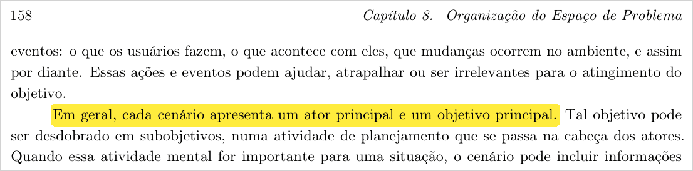
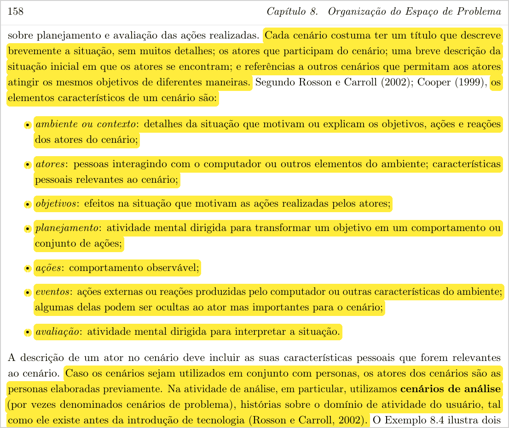

## Histórico de Versão e Contribuição

| Data | Versão | Descrição | Autor(es) | Revisor(es) | Declaração de Uso de IA |
| :---: | :---: | :--- | :--- | :--- | :--- |
| 26/09/2026 | `1.0` | Elaboração inicial dos cenários de uso a partir do perfil empírico do motorista (`MOT-01`) e da persona Valdir Soares, fundamentada na literatura clássica de IHC e Design Baseado em Cenários (Barbosa e Silva, 2010; Carroll, 2000; Rosson e Carroll, 2002; Cooper et al., 2007). | [Carlos Costa](https://github.com/carloshfgit) | [Arthur Mariani](https://github.com/arthur-mariani) e [Gabriel Melo](https://github.com/gabriellcardone-06) | Não declarado pelo autor |
| 27/09/2026 | `1.1` | Integração formal ao repositório MkDocs do projeto com padronização hipertextual e rastreabilidade bidirecional com personas e perfis. | [Carlos Costa](https://github.com/carloshfgit) | [Igor Dantas](https://github.com/IgorDARAUJO) | Não declarado pelo autor |
| 19/11/2026 | `1.2` | Padronização da estrutura (histórico no topo, conteúdo, fotos de referência e referências ao final); declaração de IA levada para o histórico; retirada das referências que não são o livro da disciplina nem material do professor; inclusão de fotos de referência grifadas. Inclusão do bloco de artefatos relacionados (persona, cenário, análise de tarefas, storyboard, planejamentos, relatos e protótipos da funcionalidade). | [Gabriel Melo](https://github.com/gabriellcardone-06) | Pendente de revisão | Claude (Anthropic) — apoio na padronização da estrutura do artefato, na revisão das referências e na formatação em Markdown.; apoio na inclusão dos links entre artefatos |

!!! warning "Observação para correção manual"
    A coluna de declaração de IA foi preenchida com *Não declarado pelo autor* nas versões em que o artefato original não informava o uso de IA. O autor de cada versão deve confirmar se usou IA (somente Claude ou Google Gemini) e completar a célula.

---

# Cenário 8: O Conflito na Catraca Gerado por Inconsistência de Dados Públicos

## 1. Introdução

Este cenário de problema descreve um conflito entre Valdir Soares e passageiros causado pela divergência entre os horários divulgados publicamente e a operação real do serviço. A situação permite compreender como inconsistências de informação afetam a confiança e a relação entre os atores, fundamentando requisitos de sincronização, transparência e respaldo ao motorista.

**Artefatos relacionados — fluxo da funcionalidade TAR-04/TAR-05 (Consulta de Escala e Alertas Operacionais (motorista)):**

* **Persona:** [Valdir Soares](../personas/valdir-soares.md)
* **Cenário:** [Cenário 5](cenario-5-consulta-escala.md); [Cenário 6](cenario-6-alerta-desvio.md); [Cenário 7](cenario-7-duvida-passageiro.md); Cenário 8 (*esta página*)
* **Análise de tarefas:** [TAR-04/TAR-05](../analise-de-tarefas/analise-hta-ctt-motorista.md)
* **Storyboard:** [Storyboard 04](../../design-avaliacao-desenvolvimento/nivel1/storyboards.md#34-storyboard-04-consulta-de-escala-e-alertas-operacionais)
* **Nível 1 — avaliação do storyboard e da análise de tarefas:** Planejamento da avaliação (*não disponível — pendente de correção manual*) · Planejamento do relato (*não disponível — pendente de correção manual*) · Relato dos resultados (*não disponível — pendente de correção manual*)
* **Nível 2 — protótipo de papel (baixa fidelidade):** Planejamento da avaliação (*não disponível — pendente de correção manual*) · Planejamento do relato (*não disponível — pendente de correção manual*) · Relato dos resultados (*não disponível — pendente de correção manual*)
* **Nível 3 — protótipo de alta fidelidade:** Planejamento da avaliação (*não disponível — pendente de correção manual*) · Planejamento do relato (*não disponível — pendente de correção manual*) · Relato dos resultados (*não disponível — pendente de correção manual*)
* **Telas do protótipo de papel:** *não disponível — pendente de correção manual*
* **Protótipo de alta fidelidade navegável:** *não disponível — pendente de correção manual*

## 2. Caracterização Geral

- **Persona:** [Valdir Soares](../personas/valdir-soares.md), motorista rodoviário e persona atendida.
- **Tipo:** Cenário de problema / contexto atual.
- **Resumo:** a tabela pública informa uma saída às 06h55, enquanto a ordem de serviço da garagem determina a chegada às 07h15; a divergência expõe Valdir a cobranças dos passageiros.

## 3. Ambiente ou Contexto

Plataforma B da Rodoviária do Plano Piloto, em uma manhã chuvosa de pico (07h10), com plataforma cheia, motores e passageiros impacientes. Valdir está na cabine; os passageiros usam smartphones na fila.

## 4. Atores

A Tabela 1 identifica os participantes do cenário e esclarece o papel de cada um no conflito causado pela divergência de horários.

**Tabela 1** — Atores envolvidos no Cenário 8

| Ator | Papel |
| :--- | :--- |
| Valdir Soares | Ator principal, motorista da linha Planaltina–Plano Piloto. |
| Passageiros | Usuários do portal que cobram o horário publicado. |
| Despachante da garagem | Fonte da ordem operacional. |

## 5. Objetivos

- Concluir o embarque no horário e iniciar a viagem sem advertências.
- Sentir-se respaldado profissionalmente e evitar atritos interpessoais.

## 6. Planejamento, Ações, Eventos e Avaliação

Valdir planeja encostar às 07h15, conforme a escala impressa e o aplicativo da concessionária. Chega às 07h12, mas passageiros mostram no celular o horário de 06h55 publicado no portal, vaiam e acusam o motorista de negligência. Ele apresenta a folha de bordo e explica que não houve aviso de alteração. Mesmo mantendo postura respeitosa e liberando o embarque, a tensão persiste durante o trajeto e prejudica seu bem-estar e sua atenção na condução.

## 7. Problemas Revelados pelo Cenário

- Atualização pública da tabela sem sincronização prévia com a concessionária.
- Motorista torna-se alvo do descompasso entre canais institucionais.
- Falha em preservar a dignidade do trabalhador e evitar conflitos.

## 8. Resultados e Desfecho

Valdir conclui a viagem com desgaste emocional e dez minutos de atraso acumulado. No terminal, descobre que outros motoristas passaram pelo mesmo constrangimento e teme uma reclamação formal.

## 9. Requisitos e Diretrizes de IHC Derivados

1. Sincronizar alterações de grade horária com as garagens antes da publicação.
2. Exibir data e hora da atualização e avisos de transição operacional.

---

## 10. Fotos de Referência

As Figuras 1 a 2 mostram os trechos que fundamentam este artefato, recortados e grifados em amarelo diretamente do livro da disciplina (BARBOSA et al., 2021).

<strong>Figura 1</strong> — Cenários: definição, ator e objetivo principais

<em>Fonte: BARBOSA et al. (2021, p. 158). Recorte e grifo: [Gabriel Melo](https://github.com/gabriellcardone-06) (2026).</em>

<strong>Figura 2</strong> — Elementos característicos de um cenário e uso de personas como atores

<em>Fonte: BARBOSA et al. (2021, p. 158). Recorte e grifo: [Gabriel Melo](https://github.com/gabriellcardone-06) (2026).</em>

---

## 11. Referências Bibliográficas

* BARBOSA, Simone Diniz Junqueira; SILVA, Bruno Santana da; SILVEIRA, Milene Selbach; GASPARINI, Isabela; DARIN, Ticianne; BARBOSA, Gabriel Diniz Junqueira. **Interação Humano-Computador e Experiência do Usuário**. Rio de Janeiro: Autopublicação, 2021. ISBN 978-65-00-19677-1.
