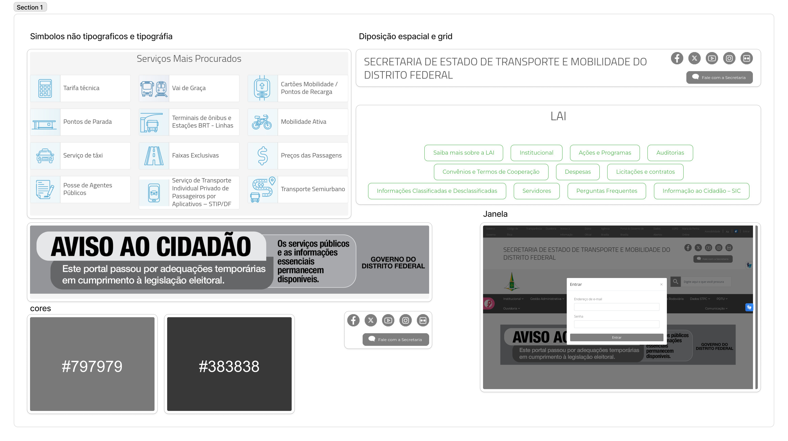

## Histórico de Versão e Contribuição

| Data | Versão | Descrição | Autor(es) | Revisor(es) | Declaração de Uso de IA |
| :---: | :---: | :--- | :--- | :--- | :--- |
| 06/10/2026 | `1.0` | Criação do documento de Elementos de Interface. | [Rodrigo Barbosa](https://github.com/RodrigoCBarbosa) | [Arthur Mariani](https://github.com/arthur-mariani) | Não declarado pelo autor |
| 20/10/2026 | `1.1` | Correção de digitação no nome do revisor. | [Rodrigo Barbosa](https://github.com/RodrigoCBarbosa) | [Arthur Mariani](https://github.com/arthur-mariani) | Não declarado pelo autor |
| 19/11/2026 | `1.2` | Padronização da estrutura (histórico no topo, conteúdo, fotos de referência e referências ao final); declaração de IA levada para o histórico; retirada das referências que não são o livro da disciplina nem material do professor. Correção das páginas e seções citadas do livro da disciplina (edição de 2021). | [Gabriel Melo](https://github.com/gabriellcardone-06) | Pendente de revisão | Claude (Anthropic) — apoio na padronização da estrutura do artefato, na revisão das referências e na formatação em Markdown. |

!!! warning "Observação para correção manual"
    A coluna de declaração de IA foi preenchida com *Não declarado pelo autor* nas versões em que o artefato original não informava o uso de IA. O autor de cada versão deve confirmar se usou IA (somente Claude ou Google Gemini) e completar a célula.

---

# Elementos de Interface

## 1. Introdução

Esta seção detalha os elementos de interface do Guia de Estilo para o portal da SEMOB-DF. Conforme estruturado por Mayhew (1999) e Marcus (1991) (citados por Barbosa et al., 2021, p. 242, imagem 1), os elementos de interface englobam a disposição espacial e grid, janelas, tipografia, símbolos não tipográficos, cores e animações, visando garantir a consistência visual, a legibilidade e a harmonia estética na apresentação dos componentes ao usuário.

## 2. Elementos de interface

Os elementos sobre disposição espacial e grid, janelas, tipografia, símbolos não tipográficos, cores e animações são apresentados na figura 1.

---

## 3. Fotos de Referência

Imagem 1 - Estrutura do guia de estilo (Elementos de interface) — Barbosa et al. (2021), p. 242

---

## 4. Referências Bibliográficas

* BARBOSA, Simone Diniz Junqueira; SILVA, Bruno Santana da; SILVEIRA, Milene Selbach; GASPARINI, Isabela; DARIN, Ticianne; BARBOSA, Gabriel Diniz Junqueira. **Interação Humano-Computador e Experiência do Usuário**. 1. ed. Rio de Janeiro: Autopublicação, 2021. ISBN 978-65-00-19677-1. (Capítulo 10, Seção 10.5, p. 242).
