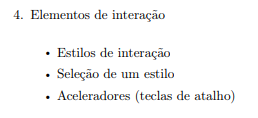

## Histórico de Versão e Contribuição

| Data | Versão | Descrição | Autor(es) | Revisor(es) | Declaração de Uso de IA |
| :---: | :---: | :--- | :--- | :--- | :--- |
| 06/10/2026 | `1.0` | Criação do documento de Elementos de Interface. | [Rodrigo Barbosa](https://github.com/RodrigoCBarbosa) | [Arthur Mariani](https://github.com/arthur-mariani) | Claude (Anthropic): apoio na revisão textual e na formatação do artefato. |
| 20/10/2026 | `1.1` | Correção de digitação no nome do revisor. | [Rodrigo Barbosa](https://github.com/RodrigoCBarbosa) | [Arthur Mariani](https://github.com/arthur-mariani) | Google Gemini: apoio na revisão textual e na formatação do artefato. |
| 19/11/2026 | `1.3` | Atualização dos elementos de interface para refletir a estrutura observada no portal vigente da SEMOB-DF. | [Gabriel Melo](https://github.com/gabriellcardone-06) | [Arthur Mariani](https://github.com/arthur-mariani) | Claude (Anthropic): apoio no inventário dos componentes e na organização do conteúdo. |

---

# Elementos de Interface

## 1. Introdução

Esta seção detalha os elementos de interface do Guia de Estilo para o portal da SEMOB-DF. O inventário foi atualizado após inspeção do portal em 19/11/2026 e organiza os componentes nas categorias indicadas pelo livro da disciplina: disposição espacial e *grid*, tipografia, símbolos não tipográficos, cores e comportamento dos componentes.

## 2. Elementos de interface

### 2.1 Inventário do portal vigente

| Região | Elementos observados | Diretriz de consistência |
| :--- | :--- | :--- |
| Barra institucional | Atalhos governamentais, acessibilidade, ajuste de texto, VLibras e autenticação | Manter no topo, com alto contraste e rótulos textuais legíveis |
| Cabeçalho | Identificação da Secretaria, redes sociais e acesso a “Fale com a Secretaria” | Preservar a hierarquia entre órgão, canais sociais e atendimento |
| Busca global | Campo de pesquisa acompanhado de botão com ícone de lupa | Usar rótulo/placeholder explícito e resposta visual ao acionamento |
| Navegação principal | Faixa amarela com categorias e menus expansíveis | Manter ordem, contraste e indicação inequívoca de expansão |
| Destaques | Carrossel de notícias com imagem, título e controles | Exibir controles visíveis e não depender apenas de rotação automática |
| Acesso rápido | Cartão azul com atalhos de serviço | Usar ícone e texto; manter alvos de clique amplos e alinhados |
| Novidades nas linhas | Cartões em carrossel para alterações do transporte | Informar título, resumo e controle de navegação |
| Serviços mais procurados | Grade de cartões com ícones e rótulos | Manter padrão visual e linguagem orientada à tarefa |
| Blocos informativos | PPP, LAI, Transparência, Ouvidoria e DODF | Diferenciar os blocos sem romper a identidade cromática do portal |
| Rodapé | Links institucionais, contato e endereço | Repetir os acessos institucionais essenciais e apresentar dados completos |

### 2.2 Especificações visuais e de comportamento

- **Disposição espacial e *grid*:** conteúdo centralizado, organizado em faixas horizontais e grades de cartões responsivas.
- **Tipografia:** família sem serifa, com títulos, subtítulos e rótulos diferenciados por tamanho e peso.
- **Cores:** fundo predominantemente branco/cinza-claro; amarelo na navegação; azul nos cartões e ícones; laranja no acionamento da busca.
- **Símbolos não tipográficos:** ícones lineares acompanhados de texto sempre que representam serviços ou ações.
- **Comportamento:** menus expansíveis e carrosséis devem oferecer indicação de estado, controles perceptíveis e navegação por teclado.

O registro visual consolidado do guia de estilo é apresentado na figura 1. Ele deve ser revisado no Figma sempre que divergir deste inventário do portal vigente.

---

## 3. Fotos de Referência

Imagem 1 - Estrutura do guia de estilo (Elementos de interface) — Barbosa et al. (2021), p. 242

---

## 4. Referências Bibliográficas

* BARBOSA, Simone Diniz Junqueira; SILVA, Bruno Santana da; SILVEIRA, Milene Selbach; GASPARINI, Isabela; DARIN, Ticianne; BARBOSA, Gabriel Diniz Junqueira. **Interação Humano-Computador e Experiência do Usuário**. 1. ed. Rio de Janeiro: Autopublicação, 2021. ISBN 978-65-00-19677-1. (Capítulo 10, Seção 10.5, p. 242).
