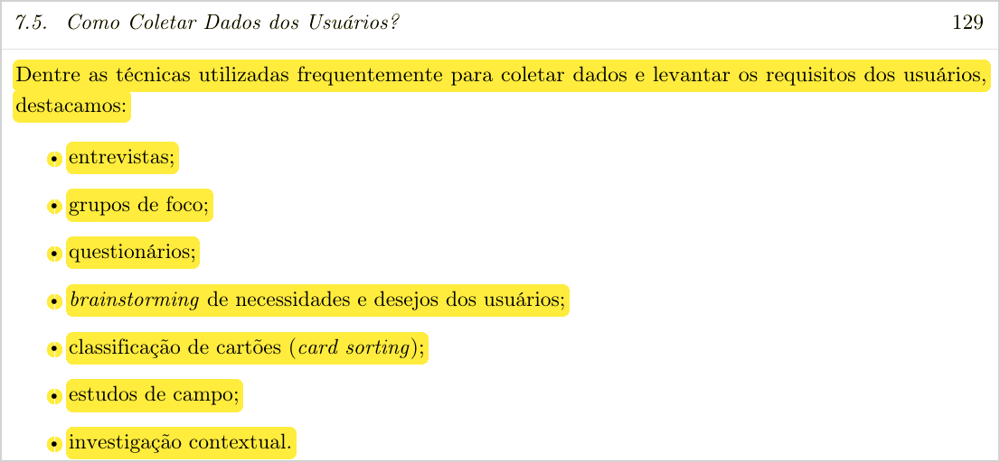
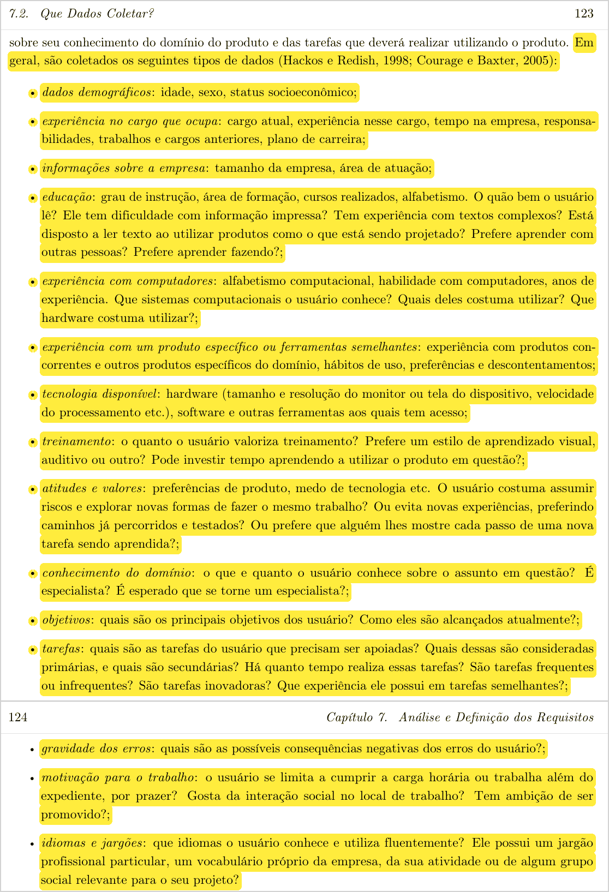

## Histórico de Versão e Contribuição

| Data | Versão | Descrição | Autor(es) | Revisor(es) | Declaração de Uso de IA |
| :---: | :---: | :--- | :--- | :--- | :--- |
| 21/09/2026 | `1.0` | Estruturação inicial da página de introdução à Análise de Requisitos e mapeamento de artefatos. | [Carlos Costa](https://github.com/carloshfgit) | [Arthur Mariani](https://github.com/arthur-mariani) | Não declarado pelo autor |
| 27/09/2026 | `1.1` | Estruturação final da página de introdução. | [Arthur Mariani](https://github.com/arthur-mariani) | [Carlos Costa](https://github.com/carloshfgit) | Não declarado pelo autor |
| 27/09/2026 | `1.2` | Atualização dos links após a modularização de Personas, Cenários e Análise de Tarefas. | [Carlos Costa](https://github.com/carloshfgit) | [Rodrigo Carvalho](https://github.com/RodrigoCBarbosa) | Não declarado pelo autor |
| 19/11/2026 | `1.3` | Padronização da estrutura (histórico no topo, conteúdo, fotos de referência e referências ao final); declaração de IA levada para o histórico; retirada das referências que não são o livro da disciplina nem material do professor; inclusão de fotos de referência grifadas. | [Gabriel Melo](https://github.com/gabriellcardone-06) | Pendente de revisão | Claude (Anthropic) — apoio na padronização da estrutura do artefato, na revisão das referências e na formatação em Markdown. |

!!! warning "Observação para correção manual"
    A coluna de declaração de IA foi preenchida com *Não declarado pelo autor* nas versões em que o artefato original não informava o uso de IA. O autor de cada versão deve confirmar se usou IA (somente Claude ou Google Gemini) e completar a célula.

---

# Análise de Requisitos

## 1. Visão Geral

A etapa de **Análise de Requisitos** em Interação Humano-Computador tem como objetivo compreender profundamente o público-alvo, suas necessidades reais, comportamentos, restrições e tarefas no domínio do portal da **Secretaria de Estado de Transporte e Mobilidade do Distrito Federal (SEMOB-DF)**.

Nesta fase, a equipe desenvolve atividades de elicitação e modelagem de usuários que fundamentam as decisões de projeto posteriores, garantindo que as intervenções de usabilidade e acessibilidade atendam a critérios rigorosos de qualidade de uso.

---

## 2. Artefatos da Etapa

Abaixo estão dispostos os artefatos desenvolvidos no âmbito da Análise de Requisitos:

* **[Aspectos Éticos](aspectos-eticos.md):** Diretrizes éticas da pesquisa e Termo de Consentimento Livre e Esclarecido (TCLE) aplicado à coleta de dados.
* **[Entrevistas e Treinamentos](entrevistas.md):** Organização e registros audiovisuais das sessões de treinamento (pilotagem) e entrevistas qualitativas com usuários, operadores e partes interessadas do sistema de transporte público.
* **[Brainstorming](brainstorm.md):** Página destinada ao registro das ideias levantadas pela equipe para identificar necessidades, oportunidades e possibilidades de solução.
* **[Análise de Documentos](analise-de-documentos.md):** Levantamento de informações sobre o público-alvo a partir de documentos e relatórios relacionados à mobilidade no Distrito Federal.
* **[Perfis de Usuário](perfis-de-usuario/index.md):** Caracterização demográfica, comportamental, tecnológica e de domínio dos perfis de usuário primário (passageiros) e terciário (motoristas de ônibus) do portal da SEMOB-DF.
* **[Personas](personas/index.md):** Representações detalhadas de usuários primários, com objetivos, habilidades, tarefas, relacionamentos, requisitos e expectativas.
* **[Cenários](cenarios/index.md):** Narrativas de uso que descrevem contextos, objetivos, ações, eventos e problemas enfrentados pelos usuários no transporte público.
* **[Análise de Tarefas](analise-de-tarefas/index.md):** Decomposição das tarefas selecionadas por meio de Análise Hierárquica de Tarefas (HTA) e ConcurTaskTrees (CTT).

---

## 3. Fotos de Referência

As Figuras 1 a 2 mostram os trechos que fundamentam este artefato, recortados e grifados em amarelo diretamente do livro da disciplina (BARBOSA et al., 2021).

<strong>Figura 1</strong> — Técnicas para coletar dados e levantar requisitos dos usuários

<em>Fonte: BARBOSA et al. (2021, p. 129). Recorte e grifo: [Gabriel Melo](https://github.com/gabriellcardone-06) (2026).</em>

<strong>Figura 2</strong> — Tipos de dados coletados sobre os usuários (Barbosa et al., 2021)

<em>Fonte: BARBOSA et al. (2021, pp. 123–124). Recorte e grifo: [Gabriel Melo](https://github.com/gabriellcardone-06) (2026).</em>

---

## 4. Referências Bibliográficas

* BARBOSA, Simone Diniz Junqueira; SILVA, Bruno Santana da; SILVEIRA, Milene Selbach; GASPARINI, Isabela; DARIN, Ticianne; BARBOSA, Gabriel Diniz Junqueira. **Interação Humano-Computador e Experiência do Usuário**. Rio de Janeiro: Autopublicação, 2021. ISBN 978-65-00-19677-1.
* SALES, André Barros de. *Plano de Ensino: Interação Humano Computador*. Universidade de Brasília, Faculdade UnB Gama, 2026.
