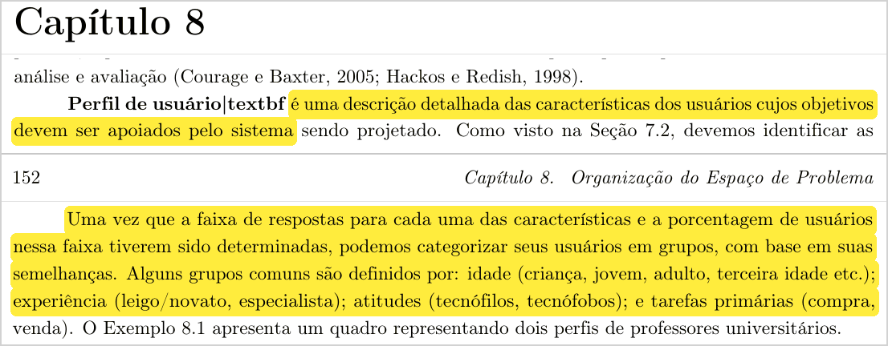
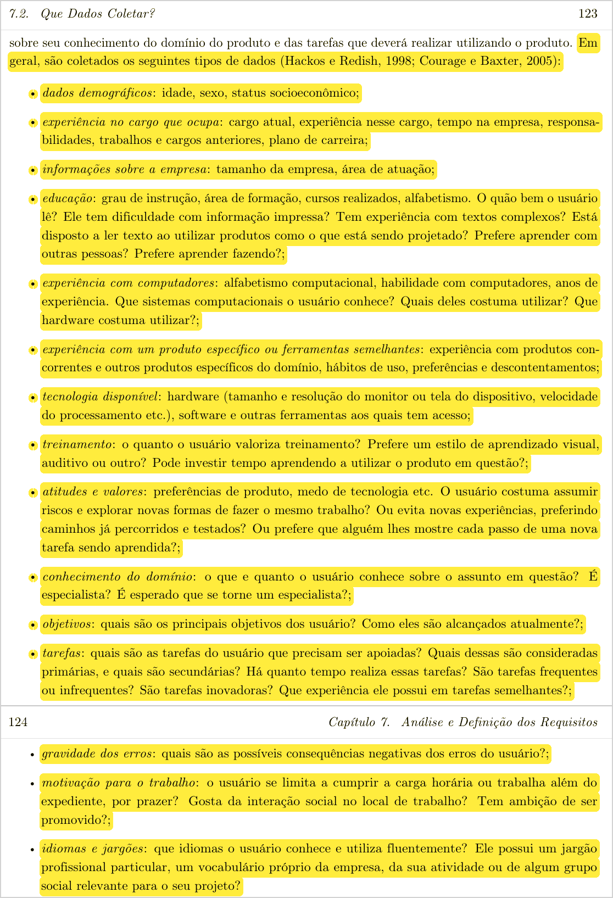
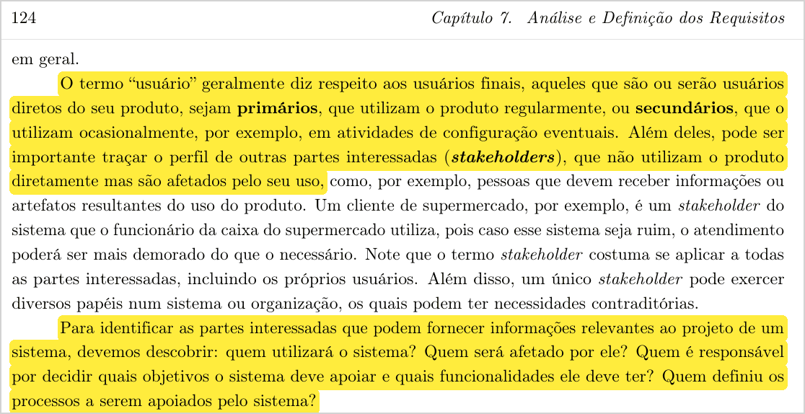

## Histórico de Versão e Contribuição

| Data | Versão | Descrição | Autor(es) | Revisor(es) | Declaração de Uso de IA |
| :---: | :---: | :--- | :--- | :--- | :--- |
| 27/09/2026 | `1.0` | Elaboração inicial do Perfil de Usuário a partir de entrevista empírica com motorista e padronização de artefato | [Rodrigo Barbosa](https://github.com/RodrigoCBarbosa) | [Arthur Mariani](https://github.com/arthur-mariani) | Google Gemini: apoio na revisão textual e na formatação do artefato. |

---

# Perfil de Usuário: Desenvolvedor/Técnico (Usuário Secundário)

## 1. Caracterização Geral

O utilizador Desenvolvedor/Técnico possui idade entre 20 e 24 anos e atua na sua área profissional há um período de 1 a 5 anos. Este perfil engloba pessoas do género masculino cuja função principal é o desenvolvimento de sistemas. Trata-se de um utilizador com altíssima experiência em tecnologia, capaz de realizar todas as tarefas sem precisar de ajuda, e que utiliza a tecnologia de forma constante, várias vezes ao dia.

Na sua rotina, o Desenvolvedor/Técnico passa cerca de 80% do seu tempo a utilizar ferramentas da Semob. O seu ambiente de trabalho caracteriza-se por manter muitos painéis abertos em simultâneo. As suas principais tarefas envolvem a conversação com o cliente, a procura por eficiência, o desenvolvimento de sistemas, a realização de testes (incluindo testes de segurança), a criação de protótipos, validação e a atualização de informações no site da Semob. O processo para publicar o seu trabalho envolve um sistema interno e resulta na publicação para o utilizador final através do portal de dados abertos da Semob.

---

## 2. Dados Demográficos, Relação com Tecnologia e Conhecimento do Domínio

A Tabela 1 reúne as características demográficas, profissionais e tecnológicas utilizadas para caracterizar o perfil secundário e fundamentar suas necessidades de interação.

<strong>Tabela 1</strong>: Dados Demográficos, Relação com Tecnologia e Conhecimento de Domínio do Utilizador Desenvolvedor/Técnico

| Característica | Faixa/categoria predominante no perfil secundário |
|---|---|
| Faixa etária | 20 a 24 anos. |
| Género | Masculino. |
| Ocupação / função principal | Desenvolvedor de sistemas. |
| Tempo na área | 1 a 5 anos. (Entrevistados possuem 1 ano e 5 anos de experiência). |
| Frequência de uso de tecnologia | Constante (várias vezes ao dia, nota 5). |
| Experiência com tecnologia | Alta (faz tudo sem ajuda, nota 5). |
| Atitude diante da tecnologia | **Tecnófila:** demonstra interesse, confiança e facilidade na adoção de novas tecnologias, utilizando-as continuamente no trabalho. |
| Estilo de aprendizagem | Prático (com aceitação visual e auditiva). |
| Uso de ferramentas Semob | Cerca de 80% do tempo. |
| Opinião sobre o sistema atual | Baixa satisfação (2), utilidade intermédia (3) e altamente ineficiente (1). |
| Tarefas e processo | Conversa com cliente, desenvolvimento, testes de segurança, protótipos, validação, publicação no portal de dados abertos. |
| Lidar com nova tecnologia | Simplificado; não há grandes problemas. |

<em>Fonte: Rodrigo Barbosa</em>

---

## 3. Atitudes diante da Tecnologia

O desenvolvedor/técnico apresenta atitude **tecnófila**, sustentada pelo uso constante de tecnologia, pela alta autonomia declarada e pela ausência de dificuldades relevantes ao lidar com novas ferramentas. A tecnologia não é apenas um meio ocasional, mas parte central de sua atividade profissional e de sua busca por eficiência.

Apesar dessa familiaridade, a baixa satisfação registrada com o sistema atual indica que experiência técnica elevada não elimina problemas de usabilidade. O perfil tende a aceitar novas soluções, mas espera ferramentas eficientes, estáveis e compatíveis com fluxos profissionais complexos.

---

## 4. Tarefas Primárias e Secundárias

As tarefas foram separadas de acordo com sua centralidade no desenvolvimento, na validação e na publicação dos sistemas e informações da SEMOB-DF.

### 4.1 Tarefas Primárias

1. Desenvolver e manter sistemas e funcionalidades utilizados pela SEMOB-DF.
2. Executar testes funcionais, validações e testes de segurança.
3. Atualizar e publicar informações por meio dos sistemas internos e do portal de dados abertos.

### 4.2 Tarefas Secundárias

1. Conversar com clientes e demais partes interessadas para compreender necessidades.
2. Criar protótipos para apoiar a comunicação e a validação das soluções.
3. Organizar painéis, ferramentas e informações simultâneas durante o trabalho.
4. Buscar melhorias de eficiência nos processos e nas ferramentas utilizadas.

---

## 5. Fontes de Dados Utilizadas

Para a elaboração deste perfil, foram articuladas as seguintes fontes de dados:
* **Entrevistas Qualitativas com Utilizadores:** Dados recolhidos de dois utilizadores (A e B) pertencentes ao perfil de Desenvolvedor/Técnico em [entrevista](https://youtu.be/f5bk6RBZwDE).

---

## 6. Fotos de Referência

As Figuras 1 a 3 mostram os trechos que fundamentam este artefato, recortados e grifados em amarelo diretamente do livro da disciplina (BARBOSA et al., 2021).

<strong>Figura 1</strong>: Perfil de usuário: definição e grupos de atributos

<em>Fonte: BARBOSA et al. (2021, pp. 151–152).</em>

<strong>Figura 2</strong>: Tipos de dados coletados sobre os usuários (Barbosa et al., 2021)

<em>Fonte: BARBOSA et al. (2021, pp. 123–124).</em>

<strong>Figura 3</strong>: Usuários primários, secundários e stakeholders

<em>Fonte: BARBOSA et al. (2021, p. 124).</em>

---

## 7. Referências Bibliográficas

* BARBOSA, Simone Diniz Junqueira; SILVA, Bruno Santana da; SILVEIRA, Milene Selbach; GASPARINI, Isabela; DARIN, Ticianne; BARBOSA, Gabriel Diniz Junqueira. **Interação Humano-Computador e Experiência do Usuário**. Rio de Janeiro: Autopublicação, 2021. ISBN 978-65-00-19677-1.
