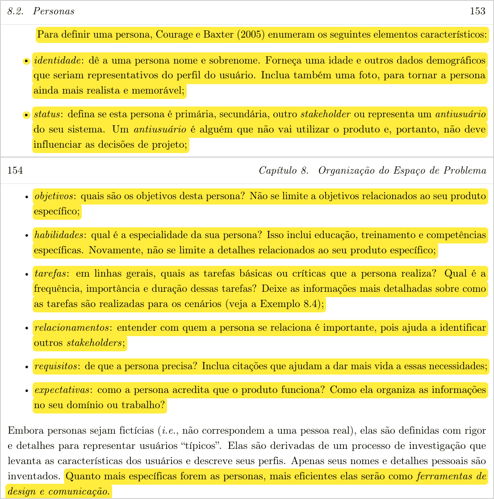
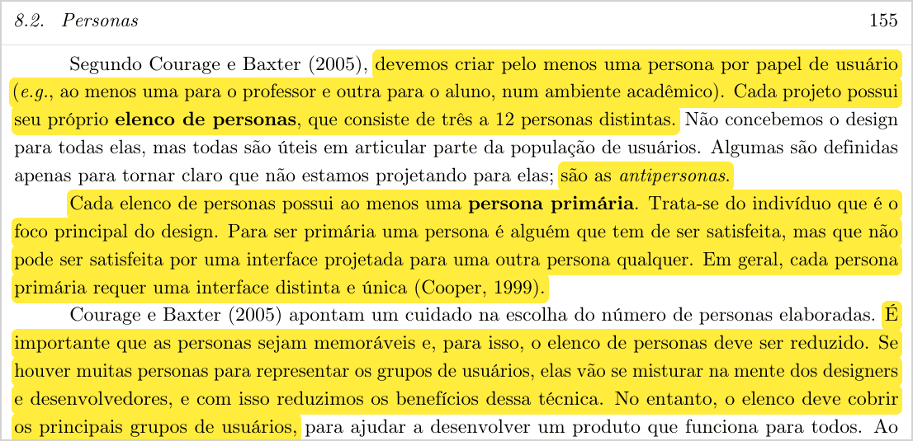

## Histórico de Versão e Contribuição

| Data | Versão | Descrição | Autor(es) | Revisor(es) | Declaração de Uso de IA |
| :---: | :---: | :--- | :--- | :--- | :--- |
| 13/10/2026 | `1.0` | Elaboração da persona Cláudia Regina Santos. | [Rodrigo Barbosa](https://github.com/RodrigoCBarbosa) | [Arthur Mariani](https://github.com/arthur-mariani) | Não declarado pelo autor |
| 19/11/2026 | `1.1` | Padronização da estrutura (histórico no topo, conteúdo, fotos de referência e referências ao final); declaração de IA levada para o histórico; inclusão de fotos de referência grifadas. Inclusão do bloco de artefatos relacionados (persona, cenário, análise de tarefas, storyboard, planejamentos, relatos e protótipos da funcionalidade). | [Gabriel Melo](https://github.com/gabriellcardone-06) | Pendente de revisão | Claude (Anthropic) — apoio na padronização da estrutura do artefato, na revisão das referências e na formatação em Markdown.; apoio na inclusão dos links entre artefatos |

!!! warning "Observação para correção manual"
    A coluna de declaração de IA foi preenchida com *Não declarado pelo autor* nas versões em que o artefato original não informava o uso de IA. O autor de cada versão deve confirmar se usou IA (somente Claude ou Google Gemini) e completar a célula.

---

# Persona: Cláudia Regina Santos

## 1. Caracterização Geral

**Autor:** [Rodrigo Barbosa](https://github.com/RodrigoCBarbosa)

*Figura 1 — Cláudia Regina Santos (imagem ilustrativa).*

> **"Eu não quero só reclamar no ponto com quem está do lado. Quero que alguém que resolve fique sabendo."**

**Resumo:** técnica de enfermagem que trabalha em regime de plantão e depende do ônibus em horários de pouco movimento, quando um ônibus perdido pode significar 40 minutos de espera. Usa o celular com segurança para WhatsApp, redes sociais e serviços simples, mas se sente insegura em sites do governo, que considera confusos. Quando o ônibus não para ou não passa, quer registrar a reclamação no lugar certo, mas não sabe por onde começar e desiste com facilidade se o processo parecer longo.

**Artefatos relacionados — fluxo da funcionalidade TAR-08 (Reclamação sobre Ônibus):**

* **Persona:** Cláudia Regina Santos (*esta página*)
* **Cenário:** [Cenário 11](../cenarios/cenario-11-reclamacao-onibus.md)
* **Análise de tarefas:** [TAR-08](../analise-de-tarefas/tar-08-reclamacao-onibus.md)
* **Storyboard:** [Storyboard 06](../../design-avaliacao-desenvolvimento/nivel1/storyboards.md#36-storyboard-06-reclamacao-sobre-onibus-a-partir-do-site-da-semob)
* **Nível 1 — avaliação do storyboard e da análise de tarefas:** [Planejamento da avaliação](../../design-avaliacao-desenvolvimento/nivel1/planejamentos-individuais/Rodrigo/rodrigo-planejamento-avaliacao.md) · [Planejamento do relato](../../design-avaliacao-desenvolvimento/nivel1/planejamentos-individuais/Rodrigo/rodrigo-planejamento-relato-resultados-avaliacao.md) · [Relato dos resultados](../../design-avaliacao-desenvolvimento/nivel1/relatos-individuais/rodrigo/relato-resultados-storyboard-tarefas.md)
* **Nível 2 — protótipo de papel (baixa fidelidade):** [Planejamento da avaliação](../../design-avaliacao-desenvolvimento/nivel2/planejamentos-individuais/Rodrigo/rodrigo-planejamento-av-prototipo-papel.md) · [Planejamento do relato](../../design-avaliacao-desenvolvimento/nivel2/planejamentos-individuais/Rodrigo/rodrigo-planejamento-relato-prot-papel.md) · [Relato dos resultados](../../design-avaliacao-desenvolvimento/nivel2/relatos-individuais/rodrigo/relato-resultado-prot-papel.md)
* **Nível 3 — protótipo de alta fidelidade:** [Planejamento da avaliação](../../design-avaliacao-desenvolvimento/nivel3/planejamentos-individuais/rodrigo/rodrigo-planejamento-av-prot-alta-fidel.md) · [Planejamento do relato](../../design-avaliacao-desenvolvimento/nivel3/planejamentos-individuais/rodrigo/rodrigo-planejamento-relato-prot-alta-fidel.md) · [Relato dos resultados](../../design-avaliacao-desenvolvimento/nivel3/relatos-individuais/rodrigo/relato-resultados-prot-alta-fidel.md)
* **Telas do protótipo de papel:** [telas no planejamento da avaliação](../../design-avaliacao-desenvolvimento/nivel2/planejamentos-individuais/Rodrigo/rodrigo-planejamento-av-prototipo-papel.md#8-telas-do-prototipo-avaliado)
* **Protótipo de alta fidelidade navegável:** *não disponível — pendente de correção manual*

---

## 2. Identidade

| Campo | Descrição |
|---|---|
| **Nome** | Cláudia Regina Santos |
| **Idade** | 46 anos |
| **Gênero** | Feminino |
| **Família** | Casada, mãe de uma filha de 19 anos que estuda na UnB e às vezes a ajuda com o celular |
| **Moradia** | Ceilândia Norte, Distrito Federal |
| **Escolaridade** | Ensino médio completo e curso técnico em Enfermagem |
| **Ocupação** | Técnica de enfermagem em hospital no Plano Piloto, em plantões de 12 horas, alguns começando às 7h e outros às 19h |
| **Renda** | Classe média baixa; renda própria somada à do marido |
| **Deslocamento** | Ônibus em dias de plantão, muitas vezes de madrugada ou à noite, quando a frequência das linhas é menor |
| **Cartões de transporte** | Possui cartão de transporte com vale-transporte do empregador |
| **Dispositivos** | Smartphone Android intermediário, com pouco espaço de armazenamento; não tem computador em casa, usa o notebook da filha quando precisa |
| **Como chega ao app/site** | Pesquisa no Google pelo que precisa ("reclamar ônibus DF") e entra no primeiro resultado que parece oficial |
| **Personalidade** | Responsável, direta e com forte senso de justiça; não gosta de "deixar passar"; impaciente com burocracia; desconfia de sites que pedem muitos dados pessoais |

*Fonte: [Rodrigo Barbosa](https://github.com/RodrigoCBarbosa).*

---

## 3. Status

**Persona primária (para a tarefa [TAR-08](../analise-de-tarefas/tar-08-reclamacao-onibus.md)).**

Por que ela é persona primária:

- Está associada a um **Cenário de Problema** ([Cenário 11](../cenarios/cenario-11-reclamacao-onibus.md)), no qual o fluxo atual de reclamação (site da Semob e Participa-DF) apresenta as dificuldades levantadas na análise de tarefas.
- Representa o motivo de reclamação mais frequente nos relatórios da Ouvidoria da Semob: ônibus que não passa no horário ou que não para na parada.
- Tem competência digital intermediária, o que a torna sensível aos problemas de vocabulário, de mudança de site e de cadastro identificados na [TAR-08](../analise-de-tarefas/tar-08-reclamacao-onibus.md), sem ser uma usuária que desistiria logo no início.
- Complementa a persona Mariana Borges Almeida: enquanto Mariana usa o portal para **evitar** problemas, Cláudia usa o portal **depois** que o problema aconteceu.

---

## 4. Objetivos

### Objetivos de vida (além do app)

- Chegar aos plantões no horário, sem prejudicar colegas que esperam a troca de turno.
- Ter um deslocamento mais seguro nos horários de madrugada e noite.
- Sentir que o dinheiro público investido no transporte está sendo bem usado.

### Objetivos ao usar o app/site

- (Objetivo principal) Registrar uma reclamação sobre o ônibus no canal oficial e ter um comprovante de que fez isso.
- Saber o que será feito com a reclamação e quando terá uma resposta.
- Gastar pouco tempo e não precisar pedir ajuda à filha.

### Motivações

- O ônibus da sua linha passou direto pela parada de madrugada, ela esperou o próximo por 40 minutos e chegou atrasada ao plantão.
- Já aconteceu outras vezes e nunca reclamou porque "não sabia onde".

### Sensações desejadas (nível visceral)

- Sensação de ter sido ouvida e de que a reclamação "foi para o lugar certo".
- Confiança de que não está entregando seus dados pessoais a um site qualquer.

---

## 5. Habilidades

- **Educação e formação:** ensino médio completo e curso técnico em Enfermagem.
- **Competências profissionais:** acostumada a registrar ocorrências e preencher prontuários no trabalho; entende a importância de anotar horário, local e detalhes, mas não associa esse hábito à reclamação de ônibus.
- **Competências digitais:** usa bem WhatsApp, Instagram e o aplicativo do banco; já usou o gov.br com ajuda da filha. Lê o que aparece na tela, mas evita menus com muitos itens e termos técnicos. Tende a usar a busca do Google em vez da navegação dos sites.
- **Conhecimento do domínio (transporte):** conhece sua linha pelo nome do destino e não pelo número completo; não sabe que cada ônibus tem um número de identificação (prefixo); não sabe a diferença entre Semob, empresa de ônibus e Detran; nunca ouviu falar do Participa-DF.
- **Limitações e contexto de uso:** após plantões de 12 horas, está cansada e com pouca paciência; quando o problema acontece de madrugada, não consegue reclamar na hora e só tenta horas depois, já em casa.

---

## 6. Tarefas

| Tarefa | Frequência | Importância | Duração |
|---|---|---|---|
| Registrar reclamação sobre ônibus | Eventual (quando ocorre um problema) | Alta | Espera concluir em até 10 minutos; desiste se demorar muito mais |
| Acompanhar o andamento da reclamação | Eventual (dias depois do registro) | Média | 1 a 2 minutos |
| Consultar linhas e horários | Semanal (dias de plantão) | Alta | 1 a 2 minutos |

*Fonte: [Rodrigo Barbosa](https://github.com/RodrigoCBarbosa).*

> Os passos detalhados da tarefa de registrar reclamação estão descritos na [**TAR-08**](../analise-de-tarefas/tar-08-reclamacao-onibus.md) e no [**Cenário 11**](../cenarios/cenario-11-reclamacao-onibus.md).

**Contexto da rotina (conhecido pelo [Cenário 11](../cenarios/cenario-11-reclamacao-onibus.md) — cenário de problema):**

| Horário | Atividade |
|---|---|
| 05:10 | Chega à parada para pegar o ônibus do plantão das 7h |
| 05:25 | O ônibus passa direto, sem parar, mesmo com ela sinalizando |
| 06:05 | Embarca no ônibus seguinte |
| 07:35 | Chega atrasada ao plantão |
| 19:40 | Em casa, depois do plantão, tenta registrar a reclamação pelo celular |

*Fonte: [Rodrigo Barbosa](https://github.com/RodrigoCBarbosa).*

---

## 7. Relacionamentos

| Quem | Relação com Cláudia | Por que importa para o projeto |
|---|---|---|
| **Larissa (filha)** | Estudante da UnB; ajuda a mãe com tarefas no celular e no computador | Representa o apoio externo de que a persona depende em sites complexos; o objetivo do projeto é que Cláudia não precise dela |
| **Dona Lúcia (colega de plantão)** | Colega de trabalho que também usa ônibus | Fonte informal de orientação ("liga no 162", "tem que reclamar no site do governo"), muitas vezes incompleta |
| **Motorista do ônibus** | Contato indireto; é sobre o serviço dele que ela reclama | A reclamação só pode ser apurada se ela informar dados do veículo e do horário |
| **Ouvidoria (Semob / Participa-DF)** | Destinatária da reclamação | Define as informações exigidas e o prazo de resposta; é a parte "invisível" do processo para a persona |

*Fonte: [Rodrigo Barbosa](https://github.com/RodrigoCBarbosa).*

---

## 8. Requisitos

| Necessidade | Em suas palavras |
|---|---|
| Encontrar onde reclamar com palavras que ela usa | *"Eu procurei 'reclamar' e não achei. Ouvidoria? Eu nem sabia que era isso."* |
| Saber antes o que vai ser pedido | *"Se eu soubesse que precisava do número do ônibus, eu tinha anotado."* |
| Entender quando e por que muda de site | *"Saí do site da Semob e caí em outro. Pensei que tinha clicado errado."* |
| Processo curto, sem cadastro longo | *"Para reclamar de um ônibus eu preciso fazer cadastro com tudo isso?"* |
| Saber qual opção escolher | *"Isso é reclamação ou denúncia? Ele passou direto, foi errado."* |
| Comprovante fácil de guardar | *"Quero um número para cobrar depois."* |

*Fonte: [Rodrigo Barbosa](https://github.com/RodrigoCBarbosa).*

---

## 9. Expectativas

### Como ela acredita que o serviço funciona

- Espera que o site da Semob tenha um botão claro de "reclamar" ou "fale conosco" na página inicial.
- Espera que a reclamação seja feita no próprio site da Semob, sem ir para outro lugar.
- Espera preencher poucos campos: o que aconteceu, a linha e o horário.
- Espera receber um número de protocolo e uma resposta em alguns dias.

### Como ela organiza as informações no seu dia a dia

- Pelo **nome do destino** da linha (por exemplo, "o que vai para a Rodoviária"), e não pelo número.
- Pelo **horário e lugar** em que o problema aconteceu.
- Pelo **órgão que ela acha responsável**: para ela, "ônibus é com a Semob", sem distinguir empresa, secretaria e ouvidoria.

### Onde essas expectativas colidem com a realidade

- O site da Semob usa o termo "Ouvidoria", e não "reclamar", e não tem um acesso direto para a tarefa na página inicial (hipótese da [TAR-08](../analise-de-tarefas/tar-08-reclamacao-onibus.md), objetivo 2.2).
- O registro acontece em outra plataforma, o Participa-DF, com outro visual e exigência de cadastro ([TAR-08](../analise-de-tarefas/tar-08-reclamacao-onibus.md), operação 2.3 e objetivo 3).
- O formulário pede informações que ela não anotou, como o número do ônibus, porque nada a avisou antes ([TAR-08](../analise-de-tarefas/tar-08-reclamacao-onibus.md), objetivo 1).
- Os tipos de manifestação (reclamação, denúncia, sugestão etc.) não correspondem ao modo como ela pensa o problema ([TAR-08](../analise-de-tarefas/tar-08-reclamacao-onibus.md), operação 4.1).

---

## 10. Fotos de Referência

As Figuras 2 a 3 mostram os trechos que fundamentam este artefato, recortados e grifados em amarelo diretamente do livro da disciplina (BARBOSA et al., 2021).

<strong>Figura 2</strong> — Elementos que compõem a descrição de uma persona

<em>Fonte: BARBOSA et al. (2021, pp. 153–154). Recorte e grifo: [Gabriel Melo](https://github.com/gabriellcardone-06) (2026).</em>

<strong>Figura 3</strong> — Elenco de personas, persona primária e antipersonas

<em>Fonte: BARBOSA et al. (2021, p. 155). Recorte e grifo: [Gabriel Melo](https://github.com/gabriellcardone-06) (2026).</em>

---

## 11. Referências Bibliográficas

* BARBOSA, Simone Diniz Junqueira; SILVA, Bruno Santana da; SILVEIRA, Milene Selbach; GASPARINI, Isabela; DARIN, Ticianne; BARBOSA, Gabriel Diniz Junqueira. **Interação Humano-Computador e Experiência do Usuário**. Rio de Janeiro: Autopublicação, 2021. ISBN 978-65-00-19677-1.
