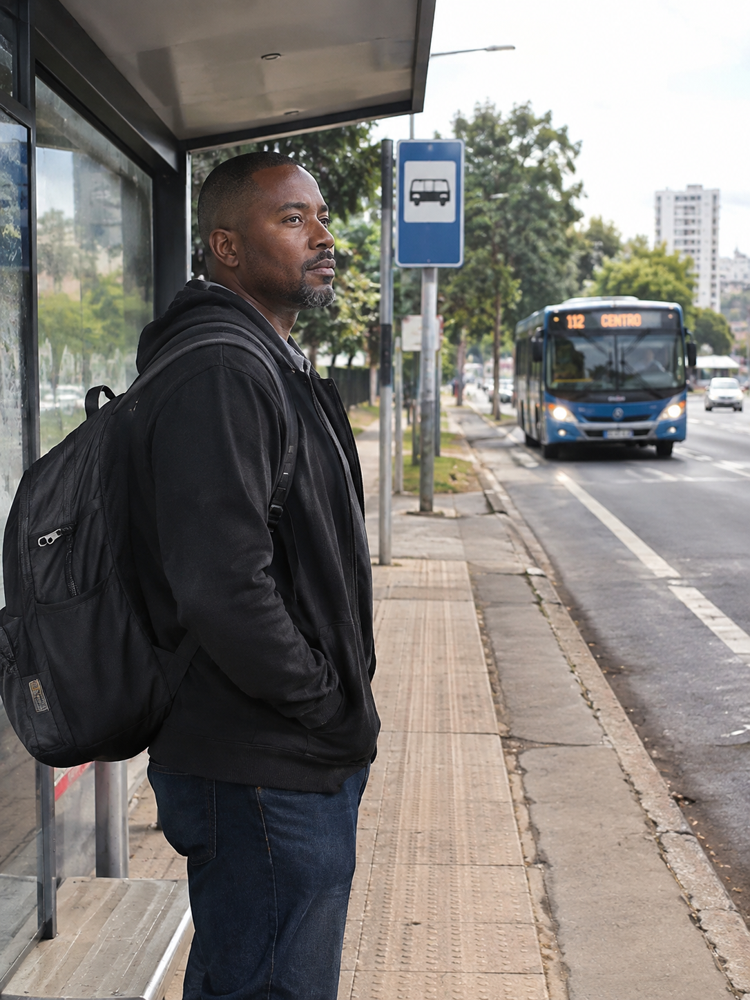

# Persona: Heitor Santos Júnior

## Histórico de Versão e Contribuição

| Data | Versão | Descrição | Autor(es) | Revisor(es) |
| :---: | :---: | :--- | :--- | :--- |
| 27/09/2026 | 1.0 | Elaboração detalhada da persona primária Heitor Santos Júnior. | [Tomás Rocho](https://github.com/TomasRocho) | [Rodrigo Carvalho](https://github.com/RodrigoCBarbosa) |
| 23/10/2026 | 1.1 | Atualização da persona para a nova tarefa [TAR-09](../analise-de-tarefas/tar-09-limite-vale-transporte.md) (aumento do limite diário do Vale-Transporte): citação, resumo, objetivos, habilidades, tarefas, relacionamentos, requisitos e expectativas. | [Tomás Rocho](https://github.com/TomasRocho) | [Rodrigo Carvalho](https://github.com/RodrigoCBarbosa) |

---

## 1. Introdução

Este documento apresenta Heitor Santos Júnior, persona que representa trabalhadores que dependem do transporte público e do Vale-Transporte para se deslocar entre vários endereços durante o expediente. Sua caracterização reúne aspectos pessoais, tecnológicos e de domínio relevantes para orientar a identificação de necessidades, a elaboração de cenários e as decisões de design do projeto.

## 2. Caracterização Geral

**Autor: Tomás Rocho**

*Figura 1 — Heitor Santos Júnior (imagem ilustrativa, gerada por IA ChatGPT).*

> **"Eu ando de ônibus o dia inteiro a serviço. Se o cartão trava no meio do expediente, a passagem sai do meu bolso."**

**Resumo:** trabalhador de manutenção predial, pai de família, que vai de Planaltina ao Plano Piloto e, durante o expediente, pega vários ônibus entre os prédios que atende. Em dias de muitos chamados, passa o cartão de Vale-Transporte 9 ou 10 vezes e ultrapassa o limite de 8 acessos por dia, uma regra que não conhecia. Usa o celular de forma prática (WhatsApp, app do banco, YouTube), mas se perde em sites cheios de menus e termos técnicos. Precisa entender por que o cartão foi recusado e pedir mais acessos sem faltar ao trabalho.

---

## 3. Identidade

A Tabela 1 reúne os dados de identidade de Heitor e contextualiza as características pessoais que influenciam sua relação com o transporte público e com a tecnologia.

**Tabela 1** — Identidade e características pessoais de Heitor Santos Júnior

| Campo | Descrição |
|---|---|
| **Nome** | Heitor Santos Júnior |
| **Idade** | 36 anos |
| **Gênero** | Masculino |
| **Família** | Casado com Cláudia (34, manicure autônoma que atende em casa). Pai de Ana Clara (12) e Davi (7), ambos estudantes de escola pública |
| **Moradia** | Planaltina (RA VI), Distrito Federal |
| **Escolaridade** | Ensino médio completo em escola pública; curso técnico de Eletricista Predial pelo SENAI |
| **Ocupação** | Técnico de manutenção predial (CLT) em empresa terceirizada que presta serviço a condomínios e prédios comerciais da Asa Norte e da Asa Sul, das 7h às 16h |
| **Renda** | Cerca de R$ 2.800/mês; renda familiar em torno de R$ 4.000, somando o trabalho da esposa |
| **Deslocamento** | Cerca de 3h30 por dia: ônibus de Planaltina até a Rodoviária do Plano Piloto e, durante o expediente, ônibus curtos entre os prédios atendidos. Em dias de muitos chamados, são 9 ou 10 embarques |
| **Cartões de transporte** | +Vale-Transporte, creditado mensalmente pela empresa, com o limite padrão de 8 acessos por dia |
| **Dispositivos** | Smartphone Android de entrada, com tela trincada e plano de dados pré-pago; não tem computador em casa |
| **Como chega ao site** | Pelo celular, via busca no Google ("vale transporte recusado df") ou por links repassados no grupo de WhatsApp do trabalho e da família |
| **Personalidade** | Responsável, pontual e desconfiado de novidades digitais. Prefere perguntar a quem já sabe do que "ficar mexendo" e errar. Fica irritado quando o sistema o faz perder tempo ou dinheiro |

*Fonte: Tomás Rocho.*

---

## 4. Status

**Persona primária.**

Por que ele é a persona primária:

- **Representa o trabalhador que depende do transporte coletivo para garantir o sustento da família.** Não tem carro nem moto, e cada atraso ou passagem paga do próprio bolso pesa no orçamento.
- **Mora em uma RA de renda baixa e distante do centro.** Planaltina está no grupo 4 da Codeplan, em que quase metade dos domicílios não tem automóvel e os trajetos até o trabalho são longos — exatamente o público descrito no **[Perfil de Usuário Primário](../perfis-de-usuario/perfil-primario.md)**.
- **Usa o transporte também durante o expediente.** Além de ida e volta, se desloca entre vários prédios do Plano Piloto, o que o faz ultrapassar o limite diário do Vale-Transporte e depender de um serviço pouco conhecido do site da Semob: o pedido de aumento desse limite.
- **Tem letramento digital intermediário e baixo conhecimento institucional.** Um site que ele consiga usar sem ajuda será compreensível para boa parte dos usuários com menos familiaridade digital, complementando o perfil mais tecnológico de João Pedro e o perfil nativo digital de Larissa.
- **Deve orientar decisões de linguagem, de simplicidade de navegação e de serviços que possam ser resolvidos pelo celular,** ao lado das demais personas primárias.

---

## 5. Objetivos

### Objetivos de vida e de trabalho (além do site)

- Manter o emprego e ser reconhecido como um funcionário pontual e de confiança.
- Garantir o sustento da família e o estudo dos filhos.
- Chegar em casa a tempo de jantar com a família e acompanhar a lição dos filhos.
- Passar menos tempo em pé dentro do ônibus e mais tempo descansando.
- Não perder dinheiro com passagens pagas do próprio bolso nem com cobranças indevidas no cartão.

### Objetivos ao usar o site

- Entender por que o cartão de Vale-Transporte foi recusado no validador.
- Pedir aumento do limite diário de uso do Vale-Transporte sem precisar faltar ao trabalho.
- Saber quando o novo limite estiver valendo, sem ter que descobrir no validador.
- Saber o horário da primeira viagem da manhã em Planaltina e se ela está saindo normalmente.
- Descobrir qual ônibus pegar para chegar a um endereço novo do Plano Piloto durante o expediente.

---

## 6. Habilidades

- **Educação e formação:** ensino médio completo em escola pública; curso técnico de Eletricista Predial (SENAI); NR-10 (segurança em instalações elétricas).
- **Competências profissionais:** manutenção elétrica e hidráulica de prédios, leitura de ordens de serviço, organização da própria agenda de atendimentos e bom relacionamento com síndicos e porteiros.
- **Competências digitais:** usa bem WhatsApp (inclusive áudios), YouTube, app do banco e Pix. Consegue buscar no Google, abrir links e tirar foto de documentos, mas tem dificuldade com formulários longos, cadastros com muitas etapas, PDFs e menus com muitas opções. Quando trava, pede ajuda à filha Ana Clara ou a um colega de trabalho. Prefere ícones grandes, botões claros e textos curtos.
- **Conhecimento do domínio (transporte):** conhece muito bem a linha que usa todos os dias de Planaltina até a Rodoviária, mas pouco as linhas internas do Plano Piloto. Não sabia que o Vale-Transporte tem limite diário de usos nem que cada integração conta como um acesso. Não entende termos como "integração tarifária", "SBA" ou "bacia", e não sabe diferenciar Semob, BRB Mobilidade e empresas de ônibus.
- **Limitações e contexto de uso:** acessa o site no escuro, de madrugada, antes de sair de casa, ou na rua, entre um atendimento e outro, com as mãos às vezes sujas ou ocupadas com ferramentas. O celular é lento e o pacote de dados costuma acabar antes do fim do mês. Tem leve dificuldade de leitura de letras pequenas sem óculos. Sai de casa antes das 5h e volta por volta das 18h, o que dificulta ir a postos de atendimento em horário comercial.

---

## 7. Tarefas

A Tabela 2 apresenta as tarefas mais frequentes de Heitor, permitindo relacionar sua rotina às necessidades consideradas pelo projeto.

**Tabela 2** — Tarefas realizadas por Heitor Santos Júnior

| Tarefa | Frequência | Importância | Duração |
|---|---|---|---|
| Conferir o horário da primeira viagem da manhã em Planaltina | Diária | Crítica | 1 a 2 min |
| Consultar rota e linha para um endereço novo no Plano Piloto | 2 a 3 vezes por semana | Alta | 3 a 5 min |
| Contar os embarques do dia para não passar do limite do Vale-Transporte | Diária, nos dias de muitos chamados | Alta | Contínua, ao longo do expediente |
| **Pedir aumento do limite diário do Vale-Transporte ([TAR-09](../analise-de-tarefas/tar-09-limite-vale-transporte.md))** | Eventual (ao começar no emprego ou quando a rotina muda) | Crítica quando ocorre | Hoje: 2 a 3 dias de esforço (formulário, RH, posto) e até 7 dias úteis de espera |
| Conferir saldo e crédito mensal do Vale-Transporte | Mensal (início do mês) e quando o cartão é recusado | Alta | 2 a 5 min |
| Verificar avisos de greves, desvios e mudanças de itinerário | Semanal ou quando o ônibus atrasa | Alta | 2 a 5 min |

*Fonte: Tomás Rocho.*

> Os passos detalhados das tarefas estão descritos nos **[Cenários](../cenarios/index.md)** (em especial o **[Cenário 9](../cenarios/cenario-9-limite-vale-transporte.md)**) e na análise da **[TAR-09](../analise-de-tarefas/tar-09-limite-vale-transporte.md)**.

**Contexto da rotina (dia útil):**

A Tabela 3 organiza a rotina diária de Heitor para evidenciar os momentos em que informações de transporte e o uso do cartão podem afetar seus deslocamentos e compromissos.

**Tabela 3** — Rotina diária de Heitor Santos Júnior

| Horário | Atividade |
|---|---|
| ~4h40 | Acorda e confere no celular se o ônibus está saindo normalmente |
| ~5h05 | Pega o ônibus em Planaltina rumo à Rodoviária do Plano Piloto (cerca de 1h30). Primeiro acesso do cartão no dia |
| 7h–16h | Atendimentos em prédios da Asa Norte e da Asa Sul, deslocando-se de ônibus entre eles. Cada trecho é mais um acesso no cartão |
| 16h–~17h45 | Volta para Planaltina no horário de pico, geralmente em pé. Em dias cheios, é aqui que o cartão pode ser recusado |
| ~18h | Chega em casa, janta com a família e acompanha a lição dos filhos |

*Fonte: Tomás Rocho.*

---

## 8. Relacionamentos

A Tabela 4 identifica as pessoas com quem Heitor se relaciona e explica como essas relações interferem em suas decisões e necessidades de deslocamento.

**Tabela 4** — Relacionamentos relevantes de Heitor Santos Júnior

| Quem | Relação com Heitor | Por que importa para o projeto |
|---|---|---|
| **Esposa (Cláudia) e filhos (Ana Clara e Davi)** | Convivência diária. Ana Clara o ajuda quando ele trava no celular | A filha funciona como "suporte técnico" informal; o site precisa ser usável sem esse apoio |
| **Supervisor e colegas de trabalho** | O supervisor define os chamados do dia e precisa liberar Heitor para ir a um posto; colegas trocam informações sobre linhas e sobre o cartão no grupo de WhatsApp | Ir a um posto em horário comercial significa sair do serviço; o grupo substitui o canal oficial quando ele falha |
| **RH da empresa terceirizada** | Credita o Vale-Transporte e emite a declaração exigida no pedido de aumento do limite | Sem modelo de declaração, o RH não sabe qual endereço informar para quem trabalha em vários lugares |
| **Síndicos e porteiros dos prédios atendidos** | Esperam o técnico no horário marcado e indicam como chegar ao endereço | Fonte informal de rota quando ele não sabe qual ônibus pegar |
| **Motoristas e cobradores** | Contato diário no embarque; são os primeiros a ver o cartão recusado | Não sabem explicar o motivo da recusa; refletem a falta de informação oficial (ver **[Perfil do Motorista](../perfis-de-usuario/perfil-motorista.md)**) |
| **BRB Mobilidade** | Emite o cartão +Vale-Transporte, recebe o pedido nos postos e altera o limite no sistema | Parte da tarefa termina no ambiente do BRB, não no da Semob |
| **Semob** | Analisa o pedido de aumento do limite e publica as regras do Vale-Transporte | Responsável pela página do serviço e pela decisão sobre o pedido |
| **Ouvidoria do GDF (162 / ouv.df.gov.br)** | Canal formal para reclamações | O serviço de limite fica dentro de "Ouvidoria" no site, embora não seja uma reclamação |

*Fonte: Tomás Rocho.*

---

## 9. Requisitos

A Tabela 5 sintetiza as necessidades de Heitor em requisitos que devem orientar as decisões de projeto da interface.

**Tabela 5** — Necessidades e requisitos de Heitor Santos Júnior

| Necessidade | Em suas palavras |
|---|---|
| Saber por que o cartão foi recusado | *"O motorista falou que era falta de saldo. Não era. Ninguém me disse que tinha limite."* |
| Ver quantas passagens já usou no dia | *"Se eu soubesse que tava na oitava, eu ia a pé até a Rodoviária."* |
| Encontrar o serviço com as palavras do dia a dia | *"Eu procurei 'cartão recusado', não 'limites'. E por que isso fica em Ouvidoria? Eu não quero reclamar."* |
| Resolver pelo celular, sem ir ao posto | *"O posto abre quando eu já tô no serviço. Se desse pra mandar a foto dos documentos pelo celular, resolvia."* |
| Pedido que aceite quem trabalha em vários lugares | *"Cada dia eu tô num prédio. Como é que eu vou dizer qual linha vou pegar?"* |
| Acompanhar o pedido e ser avisado | *"Queria um número pra acompanhar e uma mensagem no WhatsApp quando liberasse."* |
| Linguagem simples, sem termos técnicos | *"Não sei o que é 'SBA' nem 'integração tarifária'. Fala do jeito que o povo fala."* |
| Letras e botões grandes; site leve | *"Meu celular é pequeno, a tela é trincada e no fim do mês o pacote acaba."* |

*Fonte: Tomás Rocho.*

---

## 10. Expectativas

### Como ele acredita que o serviço funciona

- Acredita que, se o Vale-Transporte foi creditado, o cartão funciona em qualquer ônibus que ele precisar pegar para trabalhar.
- Acredita que existe "um lugar do governo" onde se resolve tudo sobre ônibus e cartão. Não diferencia Semob, BRB Mobilidade e empresas de ônibus.
- Espera que o site funcione como o WhatsApp ou o app do banco: abre, toca num botão grande e resolve, inclusive mandando foto de documento.
- Espera receber um número de protocolo e um aviso quando o problema for resolvido, como acontece no banco.

### Como ele organiza as informações no seu dia a dia

- Por **problema concreto** ("o cartão travou", "o vale não caiu", "o ônibus não passou"), e não por tipo de serviço ou órgão responsável.
- Por **lugares de referência**: "Planaltina", "Rodoviária", "Asa Norte" e o nome da quadra do prédio que vai atender.
- Pela **quantidade de chamados do dia**, que define quantos ônibus vai pegar.
- Pelo **número da linha** que já usa, e não pelo nome oficial ou pela empresa operadora.

### Onde essas expectativas colidem com o site hoje

- **Cartão que sempre funciona × limite que ninguém explica.** O validador recusa o cartão sem dizer o motivo, e a página da Semob sobre o tema não informa que o limite é de 8 acessos por dia.
- **Problema concreto × nome institucional.** O serviço se chama "Limites do Vale-Transporte" e fica em Ouvidoria > Serviços, longe dos serviços de cartão.
- **Resolver pelo celular × entrega presencial.** O link do formulário não leva ao formulário, o "Formulário on-line" não é um link e os documentos só podem ser entregues em um posto, em horário comercial.
- **Protocolo e aviso × espera no escuro.** Não há número de protocolo nem aviso de aprovação; ele só descobre que deu certo quando o cartão passa no 9º embarque.

---

## 11. Referências Bibliográficas

* BARBOSA, Simone Diniz Junqueira; SILVA, Bruno Santana da; SILVEIRA, Milene Selbach; GASPARINI, Isabela; DARIN, Ticianne; BARBOSA, Gabriel Diniz Junqueira. **Interação Humano-Computador e Experiência do Usuário**. Rio de Janeiro: Autopublicação, 2021. ISBN 978-65-00-19677-1.
* COMPANHIA DE PLANEJAMENTO DO DISTRITO FEDERAL (CODEPLAN). **Pesquisa Distrital por Amostra de Domicílios — PDAD 2021**. Brasília: Codeplan, 2021.
* SECRETARIA DE ESTADO DE TRANSPORTE E MOBILIDADE DO DISTRITO FEDERAL (Semob-DF). **Limites do Vale-Transporte**. Disponível em: <https://www.semob.df.gov.br/servicos/limites-do-vale-transporte>. Acesso em: 23 out. 2026.
