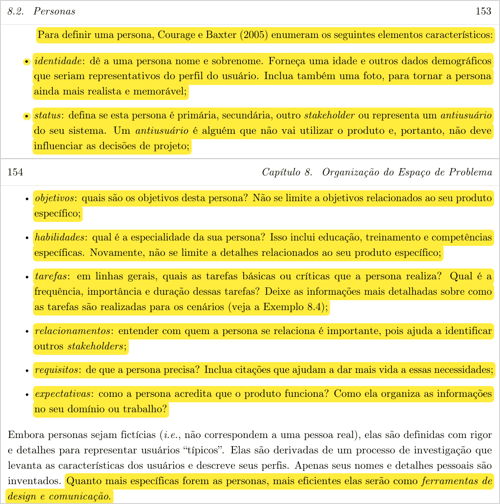
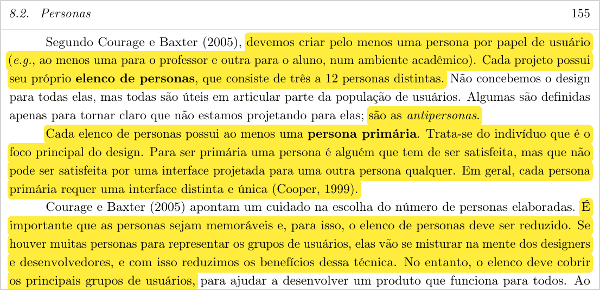

## Histórico de Versão e Contribuição

| Data | Versão | Descrição | Autor(es) | Revisor(es) | Declaração de Uso de IA |
| :---: | :---: | :--- | :--- | :--- | :--- |
| 26/09/2026 | `1.0` | Elaboração detalhada da persona primária João Pedro Carvalho. | [Igor Dantas](https://github.com/IgorDARAUJO) | [Gabriel Melo](https://github.com/gabriellcardone-06) | Não declarado pelo autor |
| 27/09/2026 | `1.1` | Modularização em documento dedicado e padronização com a nova estrutura. | [Carlos Costa](https://github.com/carloshfgit) | [Igor Dantas](https://github.com/IgorDARAUJO) | Não declarado pelo autor |
| 19/11/2026 | `1.2` | Padronização da estrutura (histórico no topo, conteúdo, fotos de referência e referências ao final); declaração de IA levada para o histórico; inclusão de fotos de referência grifadas. Inclusão do bloco de artefatos relacionados (persona, cenário, análise de tarefas, storyboard, planejamentos, relatos e protótipos da funcionalidade). | [Gabriel Melo](https://github.com/gabriellcardone-06) | Pendente de revisão | Claude (Anthropic) — apoio na padronização da estrutura do artefato, na revisão das referências e na formatação em Markdown.; apoio na inclusão dos links entre artefatos |

!!! warning "Observação para correção manual"
    A coluna de declaração de IA foi preenchida com *Não declarado pelo autor* nas versões em que o artefato original não informava o uso de IA. O autor de cada versão deve confirmar se usou IA (somente Claude ou Google Gemini) e completar a célula.

---

# Persona: João Pedro Carvalho

## 1. Introdução

Este documento apresenta João Pedro Carvalho, persona que representa estudantes com elevada familiaridade tecnológica e dependência cotidiana do transporte público para chegar à universidade. Sua caracterização permite compreender como informações imprecisas de horários e rastreamento afetam sua rotina, orientando cenários, requisitos e decisões de design do projeto.

**Artefatos relacionados — fluxo da funcionalidade TAR-01 (Alerta Inteligente de Saída de Casa):**

* **Persona:** João Pedro Carvalho (*esta página*)
* **Cenário:** [Cenário 2](../cenarios/cenario-2-viagem-matutina.md)
* **Análise de tarefas:** [TAR-01](../analise-de-tarefas/tar-01-alerta-saida.md)
* **Storyboard:** [Storyboard 01](../../design-avaliacao-desenvolvimento/nivel1/storyboards.md#31-storyboard-01-alerta-inteligente-de-saida-de-casa)
* **Nível 1 — avaliação do storyboard e da análise de tarefas:** [Planejamento da avaliação](../../design-avaliacao-desenvolvimento/nivel1/planejamentos-individuais/Igor/igor-planejamento-avaliacao.md) · [Planejamento do relato](../../design-avaliacao-desenvolvimento/nivel1/planejamentos-individuais/Igor/igor-planejamento-relato-resultados-avaliacao.md) · [Relato dos resultados](../../design-avaliacao-desenvolvimento/nivel1/relatos-individuais/igor/relato-resultados-storyboard-tarefas.md)
* **Nível 2 — protótipo de papel (baixa fidelidade):** [Planejamento da avaliação](../../design-avaliacao-desenvolvimento/nivel2/planejamentos-individuais/Igor/igor-planejamento-av-prototipo-papel.md) · [Planejamento do relato](../../design-avaliacao-desenvolvimento/nivel2/planejamentos-individuais/Igor/igor-planejamento-relato-prot-papel.md) · [Relato dos resultados](../../design-avaliacao-desenvolvimento/nivel2/relatos-individuais/igor/relato-resultados-prot-papel.md)
* **Nível 3 — protótipo de alta fidelidade:** [Planejamento da avaliação](../../design-avaliacao-desenvolvimento/nivel3/planejamentos-individuais/igor/planejamento-av-prot-alta-fidel.md) · [Planejamento do relato](../../design-avaliacao-desenvolvimento/nivel3/planejamentos-individuais/igor/planejamento-relato-prot-alta-fidel.md) · [Relato dos resultados](../../design-avaliacao-desenvolvimento/nivel3/relatos-individuais/igor/relato-resultados-prot-alta-fidel.md)
* **Telas do protótipo de papel:** [telas no planejamento da avaliação](../../design-avaliacao-desenvolvimento/nivel2/planejamentos-individuais/Igor/igor-planejamento-av-prototipo-papel.md#9-telas-do-prototipo-avaliado)
* **Protótipo de alta fidelidade navegável:** [acessar o protótipo](https://www.figma.com/proto/00YEuKWtN4N1rBzpC8V7Gd/prototipo-de-igor?node-id=0-1&t=S9Z2PNsKlHC3LlTt-1)

**Artefatos relacionados — fluxo da funcionalidade TAR-06 (Consulta do Ônibus em Tempo Real no DF no Ponto):**

* **Persona:** João Pedro Carvalho (*esta página*); [Mariana Borges Almeida](mariana-borges-almeida.md)
* **Cenário:** [Cenário 2](../cenarios/cenario-2-viagem-matutina.md); [Cenário 10](../cenarios/cenario-10-viagem-ideal.md)
* **Análise de tarefas:** [TAR-06](../analise-de-tarefas/tar-06-df-no-ponto.md)
* **Storyboard:** [Storyboard 08](../../design-avaliacao-desenvolvimento/nivel1/storyboards.md#38-storyboard-08-consulta-do-onibus-em-tempo-real-no-df-no-ponto)
* **Nível 1 — avaliação do storyboard e da análise de tarefas:** [Planejamento da avaliação](../../design-avaliacao-desenvolvimento/nivel1/planejamentos-individuais/Carlos/carlos-planejamento-avaliacao.md) · Planejamento do relato (*não disponível — pendente de correção manual*) · [Relato dos resultados](../../design-avaliacao-desenvolvimento/nivel1/relatos-individuais/carlos/relato-resultados-storyboard-tarefas.md)
* **Nível 2 — protótipo de papel (baixa fidelidade):** [Planejamento da avaliação](../../design-avaliacao-desenvolvimento/nivel2/planejamentos-individuais/Carlos/carlos-planejamento-av-prototipo-papel.md) · [Planejamento do relato](../../design-avaliacao-desenvolvimento/nivel2/planejamentos-individuais/Carlos/carlos-planejamento-relato-prot-papel.md) · [Relato dos resultados](../../design-avaliacao-desenvolvimento/nivel2/relatos-individuais/carlos/relato-resultados-prot-papel.md)
* **Nível 3 — protótipo de alta fidelidade:** [Planejamento da avaliação](../../design-avaliacao-desenvolvimento/nivel3/planejamentos-individuais/carlos/carlos-planejamento-av-prot-alta-fidel.md) · [Planejamento do relato](../../design-avaliacao-desenvolvimento/nivel3/planejamentos-individuais/carlos/carlos-planejamento-relato-prot-alta-fidel.md) · [Relato dos resultados](../../design-avaliacao-desenvolvimento/nivel3/relatos-individuais/carlos/relato-resultados-prot-alta-fidel.md)
* **Telas do protótipo de papel:** [telas no planejamento da avaliação](../../design-avaliacao-desenvolvimento/nivel2/planejamentos-individuais/Carlos/carlos-planejamento-av-prototipo-papel.md#8-telas-do-prototipo-avaliado)
* **Protótipo de alta fidelidade navegável:** [acessar o protótipo](https://carloshfgit.github.io/prototipo-tar06-df-no-ponto/)

## 2. Caracterização Geral

**Autor: Igor Dantas Araújo**

*Figura 1 — João Pedro Carvalho (imagem ilustrativa, gerada por IA Gemini).*

> **"Meu objetivo ao buscar informação é economizar tempo para ter a rota mais eficiente."**

**Resumo:** estudante de Engenharia de perfil tecnológico avançado, que depende do transporte público todos os dias para chegar à universidade. Consulta o app no celular em momentos críticos e curtos (antes de sair de casa e no ponto de ônibus), e é fortemente prejudicado quando a informação de horário e rastreamento falha.

---

## 3. Identidade

A Tabela 1 reúne os dados de identidade de João Pedro e contextualiza as características pessoais que influenciam sua relação com o transporte público e com a tecnologia.

**Tabela 1** — Identidade e características pessoais de João Pedro Carvalho

| Campo | Descrição |
|---|---|
| **Nome** | João Pedro Carvalho |
| **Idade** | 19 anos |
| **Gênero** | Masculino |
| **Família** | Dependente financeiramente dos pais; demais detalhes familiares não especificados no artefato original |
| **Moradia** | Samambaia Norte, Distrito Federal |
| **Escolaridade** | Ensino médio completo; cursando Engenharia no Campus da UnB Gama |
| **Ocupação** | Estudante universitário (Engenharia) |
| **Renda** | Classe média; sem renda própria (dependente dos pais); valor não especificado no artefato original |
| **Deslocamento** | Diário, entre Samambaia Norte e o Campus UnB Gama, combinando ônibus, BRT e metrô |
| **Cartões de transporte** | Possui cartão de transporte e realiza recargas pela internet; tipo/benefício específico não detalhado no artefato original |
| **Dispositivos** | Smartphone Android; usuário de tecnologia há cerca de 14 anos (perfil tecnológico alto); fluente em português e inglês |
| **Como chega ao app/site** | Não especificado no artefato original; hoje usa principalmente o Google Maps (pela precisão do rastreamento em tempo real) e, eventualmente, o Moovit |
| **Personalidade** | Prático, direto e autodidata ("aprende fuçando"); recusa tutoriais longos e manuais; incomoda-se com propagandas intrusivas, cobranças por recursos básicos e cadastros complexos |

*Fonte: Igor Dantas Araújo.*

---

## 4. Status

**Persona primária.**

Por que ele é a persona primária:

- Representa o perfil do estudante universitário que depende diariamente do transporte coletivo para uma tarefa crítica e com hora marcada — chegar à primeira aula no horário.
- É diretamente e gravemente afetado pelas falhas centrais que o projeto busca resolver: quando os horários informados falham ou os veículos não aparecem no mapa, ele perde o transporte, acumula atrasos frequentes nas aulas e tem a motivação para os estudos abalada. O Cenário de Problema associado a ele ilustra exatamente essa falha.
- Tem perfil tecnológico alto e pouca tolerância a fricção (tutoriais, cadastros complexos, anúncios), o que o torna um "usuário exigente": um sistema que funcione bem para ele tende a funcionar bem para usuários com menos afinidade digital.
- Assim como a Larissa, deve orientar decisões centrais de projeto — em especial a previsibilidade dos horários e a exibição de rastreamento em tempo real logo na tela inicial —, enquanto perfis secundários entram como adaptações.

---

## 5. Objetivos

### Objetivos de vida e de estudo (além do app)

- Ter sucesso em sua formação acadêmica no curso de Engenharia da UnB.
- Garantir viagens previsíveis e eficientes para dispor de maior tempo de lazer e convivência social.
- Não perder tempo no ponto de ônibus e conseguir chegar a tempo para estudar/trabalhar da melhor forma possível.
- Manter sua dignidade, evitando o estresse, o constrangimento do atraso e a queda de motivação acadêmica causados pela incerteza do transporte.

### Objetivos ao usar o app/site

- Descobrir a rota mais rápida e eficiente entre Samambaia Norte e o Campus UnB Gama.
- Saber com precisão o momento exato em que deve sair de casa para chegar ao ponto de ônibus sem tempo de espera perdido.
- Garantir que o ônibus passe exatamente no horário informado pelo aplicativo.
- Consultar rotas alternativas em dias atípicos (tarefa secundária).
- Recarregar o cartão de transporte (tarefa secundária).

### Sensações desejadas (nível visceral, conforme artefato original)

- Sentir-se no controle do próprio tempo e ter total previsibilidade sobre o itinerário.
- Experimentar praticidade, rapidez e fluidez ao interagir com uma interface limpa, sem anúncios intrusivos ou cobranças por recursos básicos.

---

## 6. Habilidades

- **Educação e formação:** ensino médio completo; cursando Engenharia no Campus da UnB Gama.
- **Competências profissionais:** não especificado no artefato original (persona ainda concentrada nos estudos, sem histórico profissional detalhado).
- **Competências digitais:** perfil tecnológico altamente desenvolvido; utiliza computadores e smartphones há cerca de 14 anos; fluência em português e inglês; lê textos acadêmicos complexos sem dificuldade, mas prefere comunicação visual e textual extremamente direta e objetiva em apps do dia a dia. Estilo de aprendizado prático e autodidata — aprende "fuçando" e testando por conta própria ou trocando informações com colegas, recusando-se a assistir tutoriais longos ou ler manuais. Usa o Google Maps como ferramenta principal, pela precisão do rastreamento em tempo real, recorrendo ao Moovit quando uma linha não consta no Maps. Sente-se seguro e confiante para realizar recargas de cartão e pagamentos pela internet.
- **Conhecimento do domínio (transporte):** familiaridade mediana com linhas e horários, mas pouca instrução sobre as regras detalhadas de integração tarifária entre ônibus e metrô no DF. Termos técnicos do setor — como "linha circular", "validador" e "integração tarifária" — parecem-lhe confusos e burocráticos quando usados em comunicados oficiais.
- **Limitações e contexto de uso:** incomoda-se com propagandas intrusivas, cobranças por recursos básicos e cadastros complexos. Sofre com a oscilação da internet móvel (4G/5G): a conexão funciona bem nos pontos de ônibus, mas costuma falhar dentro de vagões do metrô e em estações subterrâneas.

---

## 7. Tarefas

A Tabela 2 apresenta as tarefas mais frequentes de João Pedro, permitindo relacionar sua rotina às necessidades consideradas pelo projeto.

**Tabela 2** — Tarefas realizadas por João Pedro Carvalho

| Tarefa | Frequência | Importância | Duração |
|---|---|---|---|
| Consultar horários de ônibus e acompanhar o deslocamento da linha em tempo real | Diária | Crítica | Não especificado no artefato original |
| Consultar rotas alternativas em dias atípicos | Ocasional | Secundária | Não especificado no artefato original |
| Recarregar o cartão de transporte | Não especificado no artefato original | Secundária | Não especificado no artefato original |

*Fonte: Igor Dantas Araújo.*

> A gravidade dos erros do sistema sobre a vida de João é alta: quando os horários informados falham ou os veículos não aparecem no mapa, ele perde o transporte, acumula atrasos frequentes nas aulas da UnB e tem sua motivação para os estudos significativamente abalada. Os passos detalhados dessa tarefa crítica estão descritos nos **[Cenários](../cenarios/index.md)** (em especial o **[Cenário 2](../cenarios/cenario-2-viagem-matutina.md)**).

**Contexto da rotina (conhecido pelo Cenário de Problema):**

A Tabela 3 organiza a rotina de João Pedro para evidenciar os momentos em que informações de transporte podem afetar seus deslocamentos e compromissos acadêmicos.

**Tabela 3** — Rotina de João Pedro Carvalho

| Horário | Atividade |
|---|---|
| ~6h30 | Ainda em casa, em Samambaia Norte; consulta horário de ônibus no app |
| ~6h42 | Sai de casa em direção ao ponto de ônibus (caminho de 6 minutos) |
| ~6h48–8h00 (variável) | Aguarda e utiliza o transporte coletivo até o Campus UnB Gama |
| 8h00 | Início da primeira aula do dia |

*Fonte: Igor Dantas Araújo.*

---

## 8. Relacionamentos

A Tabela 4 identifica as pessoas e instituições com as quais João Pedro se relaciona e explica a relevância dessas relações para o projeto.

**Tabela 4** — Relacionamentos relevantes de João Pedro Carvalho

| Quem | Relação com João Pedro | Por que importa para o projeto |
|---|---|---|
| **Pais** | Dependência financeira | Não especificado além disso no artefato original |
| **Colegas de faculdade** | Convivência diária; compartilham dicas de rotas entre si | Fonte informal de informação sobre linhas e horários, que pode compensar (ou expor) falhas do app oficial |
| **Professores da UnB** | Ministram as aulas que dependem da pontualidade do deslocamento | Atrasos no transporte geram atrasos e faltas em aula, afetando o desempenho acadêmico |
| **Motoristas e cobradores** | Contato direto durante o embarque no transporte coletivo | Canal presencial de informação quando o app falha (como no Cenário 2, em que um outro passageiro faz esse papel) |
| **Equipe de suporte do sistema de transporte** | Contato eventual em caso de dúvidas ou falhas | Stakeholder responsável por investigar e corrigir erros como o "conflito de dados" relatado no Cenário 2 |
| **Outros passageiros do ponto de ônibus** | Contato eventual, geralmente em situações de dúvida ou atraso | Fonte informal e imediata de confirmação quando o app não é confiável |

*Fonte: Igor Dantas Araújo.*

---

## 9. Requisitos

A Tabela 5 sintetiza as necessidades de João Pedro em requisitos que devem orientar as decisões de projeto da interface.

**Tabela 5** — Necessidades e requisitos de João Pedro Carvalho

| Necessidade | Em suas palavras |
|---|---|
| Rota mais rápida e eficiente | *"Meu objetivo ao buscar informação é economizar tempo para ter a rota mais eficiente."* |
| Interface sem necessidade de tutoriais | *"Gosto de testar novas tecnologias se sinto a necessidade ou se é algo bem novo, e aprendo explorando sozinho."* |
| Localização dos ônibus em tempo real, já na tela inicial | *"Eu quero ver onde o ônibus está agora, sem precisar procurar — se for pra abrir o app, tem que estar logo na primeira tela."* |
| Linguagem simples, sem jargão técnico | *"Não sei o que é 'linha circular' nem 'integração tarifária'. Fala comigo do jeito que eu entendo o ônibus do meu bairro."* |
| App gratuito, sem anúncios intrusivos nem cobrança por recursos básicos | *"Não quero pagar nem ver propaganda só pra saber a que horas o ônibus passa."* |
| Previsibilidade real dos horários | *"Se o app diz que o ônibus passa às 06:50, ele tem que passar às 06:50 — ou pelo menos me avisar que mudou."* |

---

## 10. Expectativas

### Como ele acredita que o serviço funciona

- Espera acesso a um aplicativo gratuito, fluido e transparente, que exiba a localização exata de todos os ônibus em tempo real já na tela inicial.
- Espera que a interface dispense tutoriais, com padrões visuais já conhecidos do mercado (como no Google Maps).
- Espera que o horário informado pelo app corresponda ao horário real de passagem do ônibus, com atualização confiável em caso de atraso ou adiantamento.

### Como ele organiza as informações no seu dia a dia

- Por **linha e horário** da rota entre Samambaia Norte e o Campus UnB Gama.
- Por **momento de decisão prático**: a que horas sair de casa para não esperar à toa no ponto.
- Pelo **app de referência que já confia** (Google Maps como principal, pela precisão do rastreamento; Moovit como alternativa quando uma linha não aparece no Maps), e não por instituição responsável (Semob, BRB Mobilidade, Metrô-DF ou empresas de ônibus).

### Onde essas expectativas colidem com a realidade (conforme o Cenário de Problema)

- **Previsibilidade esperada × falha silenciosa.** Ele planeja a saída de casa com base em um horário informado pelo app, mas o sistema apresenta um erro de conflito de dados: para de exibir a previsão do veículo e passa a indicar, sem explicação, que a viagem já foi "concluída".
- **Rastreamento em tempo real × informação desatualizada.** O ônibus passou cerca de 10 minutos antes do horário cadastrado, e o app não atualizou essa divergência — João só descobre isso ao conversar com outro passageiro na parada, e não pela ferramenta oficial.
- **Interface autoexplicativa × ausência de alternativa clara.** Sem uma segunda linha direta disponível naquele momento, e sem indicação de rota alternativa pelo app, ele fica sem opção e precisa esperar mais de 35 minutos pelo próximo veículo.

---

## 11. Fotos de Referência

As Figuras 2 a 3 mostram os trechos que fundamentam este artefato, recortados e grifados em amarelo diretamente do livro da disciplina (BARBOSA et al., 2021).

<strong>Figura 2</strong> — Elementos que compõem a descrição de uma persona

<em>Fonte: BARBOSA et al. (2021, pp. 153–154). Recorte e grifo: [Gabriel Melo](https://github.com/gabriellcardone-06) (2026).</em>

<strong>Figura 3</strong> — Elenco de personas, persona primária e antipersonas

<em>Fonte: BARBOSA et al. (2021, p. 155). Recorte e grifo: [Gabriel Melo](https://github.com/gabriellcardone-06) (2026).</em>

---

## 12. Referências Bibliográficas

* BARBOSA, Simone Diniz Junqueira; SILVA, Bruno Santana da; SILVEIRA, Milene Selbach; GASPARINI, Isabela; DARIN, Ticianne; BARBOSA, Gabriel Diniz Junqueira. **Interação Humano-Computador e Experiência do Usuário**. Rio de Janeiro: Autopublicação, 2021. ISBN 978-65-00-19677-1.
