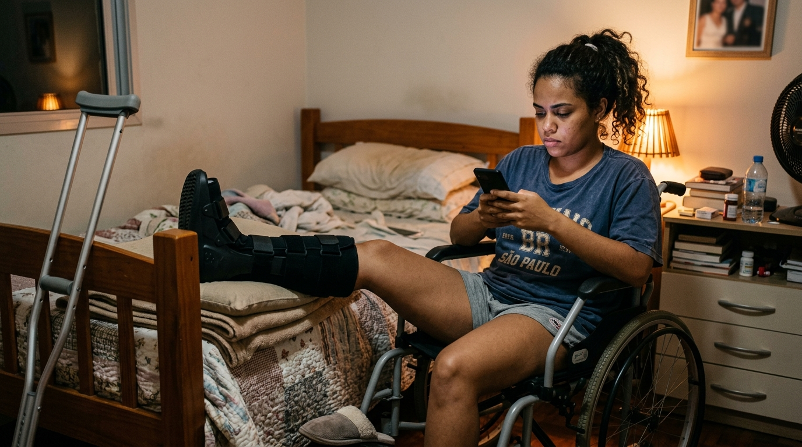

# Persona: Larissa Ferreira Lima

## Histórico de Versão e Contribuição

| Data | Versão | Descrição | Autor(es) | Revisor(es) |
| :---: | :---: | :--- | :--- | :--- |
| 26/09/2026 | 1.0 | Elaboração detalhada da persona primária Larissa Ferreira Lima. | [Gabriel Melo](https://github.com/gabriellcardone-06) | [Igor Dantas](https://github.com/IgorDARAUJO) |
| 27/09/2026 | 1.1 | Modularização em documento dedicado e padronização com a nova estrutura. | [Carlos Costa](https://github.com/carloshfgit) | [Gabriel Melo](https://github.com/gabriellcardone-06) |
| 11/10/2026 | 2.0 | Reformulação da persona: Larissa passa a ter mobilidade reduzida temporária e a depender do Programa DF Acessível (TAR-02). | [Gabriel Melo](https://github.com/gabriellcardone-06) | [Igor Dantas](https://github.com/IgorDARAUJO) |

---

## 1. Introdução

Este documento apresenta Larissa Ferreira Lima, persona que representa estudantes e trabalhadoras que, por uma condição de saúde **temporária**, ficam com mobilidade severamente reduzida e passam a depender de transporte adaptado porta a porta. Larissa é uma usuária que, até pouco tempo atrás, usava ônibus e metrô todos os dias e conhecia bem o sistema; hoje precisa do Programa DF Acessível e enfrenta o site da Semob como alguém que está, pela primeira vez, no papel de pessoa com deficiência. Sua caracterização apoia a compreensão de necessidades relacionadas a acessibilidade, clareza do caminho até o serviço, prazos e confiança na informação, orientando cenários, requisitos e decisões de design do projeto.

## 2. Caracterização Geral

**Autor: Gabriel Melo**

*Figura 1 — Larissa Ferreira Lima, a "Lari", em cadeira de rodas, com a perna esquerda imobilizada (imagem ilustrativa, gerada por IA).*

> **"Eu sei me virar sozinha, mas agora eu não consigo nem chegar na fisioterapia. Só preciso descobrir onde marcar o transporte e se eu tenho direito."**

**Resumo:** estudante e trabalhadora que, há poucas semanas, quebrou o tornozelo e a tíbia esquerda e ficará cerca de quatro a cinco meses sem poder apoiar o pé no chão. Usa cadeira de rodas e precisa de transporte adaptado para a fisioterapia e para as consultas. Procura o Programa DF Acessível pelo celular, à noite, em casa, e tenta descobrir como fazer o pré-agendamento a partir do site da Semob.

---

## 3. Identidade

A Tabela 1 reúne os dados de identidade de Larissa e contextualiza as características pessoais e de saúde que influenciam sua relação com o transporte e com a tecnologia.

**Tabela 1** — Identidade e características pessoais de Larissa Ferreira Lima

| Campo | Descrição |
|---|---|
| **Nome** | Larissa Ferreira Lima ("Lari") |
| **Idade** | 23 anos |
| **Gênero** | Feminino |
| **Família** | Solteira, sem filhos. Mora com a mãe, Sônia (49, auxiliar de serviços gerais), e o irmão mais novo, Pedro (15, estudante do ensino médio em escola pública) |
| **Moradia** | Ceilândia (RA IX), Distrito Federal |
| **Escolaridade** | Ensino médio em escola pública. Cursa o 5º semestre de Administração (noturno) em universidade pública no Plano Piloto; formatura prevista para 2028 |
| **Ocupação** | Assistente administrativa (CLT) em empresa privada no Setor Comercial Sul. Durante a recuperação, a empresa autorizou o trabalho remoto |
| **Renda** | Cerca de R$ 2.400/mês; renda familiar per capita em torno de R$ 1.400 |
| **Condição de saúde** | **Deficiência temporária.** Fratura no tornozelo e na tíbia esquerda após queda em escada molhada na universidade (início de setembro de 2026), com cirurgia logo em seguida. Sem apoiar o pé por cerca de 12 semanas, depois muletas e fisioterapia; alta prevista para fevereiro de 2027 |
| **Mobilidade atual** | Usa cadeira de rodas (comprada usada, com ajuda de familiares) e, em trechos curtos, muletas. Ônibus e metrô comuns deixaram de ser opção viável: escadas, lacunas entre veículo e plataforma, plataformas elevatórias nem sempre disponíveis e lotação |
| **Cartões de transporte** | +Estudante (Passe Livre Estudantil) e +Vale-Transporte, hoje pouco usados |
| **Dispositivos** | Smartphone Android intermediário, com plano de dados limitado; notebook antigo compartilhado em casa (quase sempre ocupado pelo irmão) |
| **Como chega ao site** | Quase sempre pelo celular, via busca no Google ou link recebido no WhatsApp |
| **Personalidade** | Organizada, prática e independente. Impaciente com burocracia, mas cautelosa para não perder prazos e benefícios. Incomoda-se em depender dos outros |

*Fonte: Gabriel Melo.*

---

## 4. Status

**Persona primária.**

Por que ela é a persona primária:

- **Representa o usuário que mais depende do serviço quando ele falha.** O Programa DF Acessível atende pessoas com deficiência ou patologia que causa redução severa de mobilidade, **temporária ou permanente** (Resolução TCB nº 33/2021). Larissa mostra que a deficiência pode atingir qualquer usuária do sistema, inclusive quem era autônoma e tinha alta familiaridade digital.
- **Concentra o fluxo de maior risco da Análise de Tarefas.** A TAR-02 mostra que a operação mais crítica (trocar de portal sem aviso para chegar ao agendamento) pode levar à desistência, deixando a pessoa sem transporte para um compromisso de saúde.
- **Soma as barreiras do site às barreiras físicas.** Ela precisa agendar com antecedência mínima de 30 dias, em janelas curtas, na cama ou na cadeira, com uma mão ocupada, e não pode "dar uma passada no posto" para tirar dúvidas.
- **Reflete uma condição que não é rara nem permanente.** Fraturas, cirurgias e lesões atingem pessoas de todas as idades; projetar para Larissa também atende quem tem deficiência permanente, acompanhantes e familiares que agendam em nome de outra pessoa.
- **Deve orientar as decisões de projeto.** Acessibilidade (eMAG/WCAG), clareza do caminho até o serviço, linguagem simples e prazos explícitos são pensados primeiro para ela; os perfis secundários entram como adaptações.

---

## 5. Objetivos

### Objetivos de vida e de trabalho (além do site)

- Recuperar-se totalmente e voltar a andar sem dor, cumprindo a fisioterapia sem faltar a nenhuma sessão.
- Concluir a graduação e manter o emprego, sem perder o semestre nem a efetivação na área administrativa.
- Reduzir a dependência da mãe, que precisa trabalhar, e dos gastos com aplicativo de corrida, que não cabem no orçamento da família.
- Chegar às consultas e sessões no horário, com segurança, sem passar por escadas, calçadas quebradas e ônibus sem acessibilidade.
- Manter o ritmo de estudo e trabalho durante a recuperação.

### Objetivos ao usar o site

- Descobrir **onde** e **como** pré-agendar o Programa DF Acessível, sem passar por vários sites.
- Saber se uma deficiência **temporária** dá direito ao programa e **quais documentos** levar.
- Escolher o posto de atendimento e o dia com o menor esforço, sabendo antes se o local é acessível e se há vagas.
- Receber a confirmação (comprovante) na hora, para não ficar em dúvida se deu certo.
- Entender os prazos: o agendamento das viagens exige antecedência mínima de 30 dias, e cada semana de atraso é uma semana de fisioterapia sem transporte.

---

## 6. Habilidades

- **Educação e formação:** ensino médio em escola pública; graduação em Administração em andamento; curso de Excel intermediário.
- **Competências profissionais:** rotinas administrativas (planilhas, arquivo, agenda), atendimento a clientes e fornecedores, comunicação escrita objetiva e boa gestão do tempo.
- **Competências digitais:** nativa digital. Usa com desenvoltura WhatsApp, redes sociais, apps de banco, Pix e aplicativos de mapas, e já usou serviços do gov.br. Preenche formulários e anexa documentos pelo celular quando o passo a passo é claro, mas perde a paciência com PDFs longos, links quebrados e trocas de site sem aviso.
- **Conhecimento do domínio (transporte):** especialista no uso do transporte comum, **leiga em transporte adaptado**. Nunca precisou do DF Acessível e não sabe quem o gerencia (Semob, TCB ou Secretaria da Pessoa com Deficiência) nem a diferença entre pré-agendamento e agendamento.
- **Limitações e contexto de uso:** acessa à noite, em casa, com a perna elevada, em sessões de 5 a 15 minutos; usa o celular com uma das mãos; toques precisos em itens pequenos (como os dias de um calendário) ficam mais difíceis quando está deitada ou cansada; tem franquia de dados limitada; está em dor e sob o efeito de medicação em parte do dia, o que reduz a paciência e a atenção.

---

## 7. Tarefas

A Tabela 2 apresenta as tarefas mais frequentes de Larissa durante a recuperação, permitindo relacionar sua rotina às necessidades consideradas pelo projeto.

**Tabela 2** — Tarefas realizadas por Larissa Ferreira Lima

| Tarefa | Frequência | Importância | Duração |
|---|---|---|---|
| **Realizar o pré-agendamento no Programa DF Acessível pelo site da Semob, escolhendo local e dia do atendimento (TAR-02)** | Uma vez (e novamente se houver prorrogação do tratamento) | Crítica | 10 a 30 min, mais a espera da análise |
| Conferir a confirmação do pré-agendamento e os documentos exigidos | Eventual (algumas vezes até a data do atendimento) | Alta | 2 a 5 min |
| Agendar e conferir as viagens regulares (fisioterapia e consultas) | Semanal ou mensal | Crítica | 5 a 10 min |
| Consultar regras do programa (quem tem direito, acompanhante, cadeira de rodas, limite de viagens por semana) | Eventual | Alta | 3 a 10 min |
| Combinar com a mãe quem a acompanha em cada compromisso | Semanal | Alta | 2 a 5 min |
| Cuidar do Passe Livre Estudantil (dela e do irmão): atualizar dados e informar troca de instituição | Semestral ou anual | Média | 10 a 20 min |
| Registrar reclamação ou sugestão sobre o atendimento ou o transporte | Eventual (poucas vezes por ano) | Média | 5 a 10 min |

*Fonte: Gabriel Melo.*

> Os passos detalhados da tarefa principal estão descritos na **[TAR-02: Pré-agendamento no Programa DF Acessível](../analise-de-tarefas/tar-02-df-acessivel.md)** e no **[Cenário 1](../cenarios/cenario-1-pre-agendamento-df-acessivel.md)**. Os demais cenários estão reunidos na **[visão geral de Cenários](../cenarios/index.md)**.

**Contexto da rotina (dia útil durante a recuperação):**

A Tabela 3 organiza a rotina diária de Larissa para evidenciar os momentos em que ela precisa de transporte adaptado e aqueles em que consegue resolver questões do programa pelo celular.

**Tabela 3** — Rotina diária de Larissa Ferreira Lima

| Horário | Atividade |
|---|---|
| ~7h30 | Acorda, higiene e café com ajuda da mãe antes de ela sair para o trabalho |
| 9h–17h | Trabalho remoto (assistente administrativa), com a perna elevada |
| 14h–15h | Fisioterapia em casa (exercícios orientados) ou, às segundas, quartas e sextas, deslocamento até a clínica de reabilitação |
| 19h–22h30 | Aulas acompanhadas de forma remota, quando disponível |
| 21h–23h | Janela em que mais usa o celular para resolver pendências, como o agendamento do transporte |

*Fonte: Gabriel Melo.*

---

## 8. Relacionamentos

A Tabela 4 identifica as pessoas e instituições com as quais Larissa se relaciona e explica como essas relações interferem em suas decisões de deslocamento.

**Tabela 4** — Relacionamentos relevantes de Larissa Ferreira Lima

| Quem | Relação com a Lari | Por que importa para o projeto |
|---|---|---|
| **Mãe (Sônia)** | Convivência diária; é a acompanhante natural nos deslocamentos, mas precisa trabalhar | Acompanhante em potencial; a disponibilidade dela condiciona o dia escolhido para o atendimento |
| **Irmão (Pedro)** | Convivência diária; ajuda com o notebook e com tarefas de casa | Usuário indireto: o site precisa ser compreensível por quem tem pouca familiaridade institucional |
| **Fisioterapeuta e ortopedista** | Definem a frequência das sessões e emitem o laudo que comprova a condição | O laudo é peça central do cadastro; o horário da fisioterapia define o dia do atendimento |
| **Chefe, equipe e RH** | Cobram prazos e autorizaram o trabalho remoto durante a recuperação | O cuidado com a saúde precisa ser compatível com o emprego |
| **Colegas de turma e secretaria do curso** | Trocam anotações e ajudam com a documentação da faculdade | A informação sobre o programa também circula informalmente entre eles |
| **Secretaria da Pessoa com Deficiência (SEPD)** | Responsável pelo cadastro da pessoa com deficiência (CadPcD) | Stakeholder crítico: o cadastro é pré-requisito para solicitar viagens |
| **TCB (Transporte Coletivo de Brasília)** | Gerencia e opera o Programa DF Acessível | Stakeholder crítico: define regras de uso e a resposta ao agendamento |
| **Semob** | Planeja e regula o sistema; seu site é o ponto de partida da busca | O site deveria guiá-la até o serviço, mas leva a outros portais |
| **Portais Participa DF, Na Hora e Agenda DF** | Caminho para chegar ao pré-agendamento | Troca de domínio sem aviso e identidade visual diferente geram desconfiança |
| **Grupos de WhatsApp de pessoas em reabilitação** | Fonte informal de dicas sobre transporte e direitos | Se o site não explica, o grupo vira a fonte principal |

*Fonte: Gabriel Melo.*

---

## 9. Requisitos

A Tabela 5 sintetiza as necessidades de Larissa em requisitos que devem orientar as decisões de projeto da interface.

**Tabela 5** — Necessidades e requisitos de Larissa Ferreira Lima

| Necessidade | Em suas palavras |
|---|---|
| Um caminho direto até o DF Acessível | *"Pensei que ia achar 'agendar transporte' no site da Semob. Fui parar no 'Participe', achei que era ouvidoria e quase desisti."* |
| Aviso antes de trocar de site | *"Do nada abriu outro site, com outra cara. Eu não sabia se ainda estava no lugar certo."* |
| Linguagem simples e explicação do serviço | *"Pré-agendamento, agendamento… qual é a diferença? E quais documentos eu levo? Fala comigo como gente."* |
| Saber se tem direito (deficiência temporária) | *"Eu não sou cadeirante pra sempre. Será que eu entro no programa? Isso tinha que estar escrito logo no começo."* |
| Informações do local de atendimento | *"Antes de escolher o posto, eu preciso ver o endereço, se tem rampa e qual é a próxima data com vaga."* |
| Calendário fácil de usar e com texto, não só cor | *"O calendário é pequeno e eu erro o toque. E eu não sei dizer pela cor quais dias estão livres."* |
| Tempo para decidir sem perder a sessão | *"Fui olhar a agenda da fisioterapia e, quando voltei, a sessão tinha caído e eu tive que começar tudo de novo."* |
| Confirmação imediata e por escrito | *"Depois de tudo isso, quero um comprovante no e-mail ou no WhatsApp pra ter certeza de que deu certo."* |
| Site leve, acessível e de uso com uma mão | *"Eu abro no celular, deitada, com uma mão só. Se pesar, travar ou pedir muito toque, eu desisto."* |
| Resolver tudo online | *"Não tenho como ir a um posto só pra perguntar. Se dá pra resolver pela internet, quero resolver pela internet."* |
| Confiança na informação | *"Tem que ser coisa oficial e atualizada. Se tiver a data da última atualização, melhor ainda."* |

*Fonte: Gabriel Melo.*

---

## 10. Expectativas

### Como ela acredita que o serviço funciona

- Acredita que o site da Semob, por ser o do "transporte do DF", tem um atalho para o transporte adaptado e para o agendamento, como um balcão virtual único.
- Espera encontrar o serviço pelas palavras que usa ("transporte para cadeirante", "agendar DF Acessível") e não pelo nome de órgãos.
- Espera fluxos parecidos com app de banco e gov.br: passos curtos, status do pedido e comprovante por e-mail ou WhatsApp.
- Espera respostas objetivas, com passo a passo, lista de documentos e prazos, sem precisar ler resoluções.
- Não sabe que, para solicitar as viagens, precisa antes ter o cadastro aprovado (CadPcD) e que o pedido é feito com antecedência mínima de 30 dias.

### Como ela organiza as informações no seu dia a dia

- Por **compromisso** ("fisioterapia segunda, quarta e sexta; consulta quinzenal") e por **lugares de referência** (casa, clínica de reabilitação, hospital, universidade).
- Por **agenda**: o dia do atendimento só pode ser escolhido depois de conferir a agenda dela e a da mãe, que a acompanha.
- Por **situação de vida** ("quebrei a perna", "preciso de transporte adaptado"), e não por órgão responsável (Semob, TCB, SEPD, Na Hora).

### Onde essas expectativas colidem com o site hoje (observado em 25/09/2026, na Análise de Tarefas TAR-02)

- **Lugar único × serviços distribuídos.** O caminho passa por quatro endereços diferentes (semob.df.gov.br → participa.df.gov.br → nahora.df.gov.br → agenda.df.gov.br) para concluir uma única tarefa.
- **Vocabulário do cidadão × vocabulário institucional.** Para chegar ao agendamento é preciso abrir "Acesso à Informação" e clicar em "Faça aqui o seu pedido – Participe", rótulos que sugerem pedido de informação ou ouvidoria.
- **Decisão informada × informação tardia.** A disponibilidade de vagas só é conhecida depois de escolher o local; o calendário não mostra endereço, recursos de acessibilidade nem a próxima data de cada posto.
- **Sessão sem aviso.** A sessão pode expirar por inatividade e obrigar a refazer o caminho desde o início.
- **Direito × desinformação.** O site não deixa claro, logo no início, que a deficiência temporária também dá direito ao programa.

---

## 11. Referências Bibliográficas

* BARBOSA, Simone Diniz Junqueira; SILVA, Bruno Santana da; SILVEIRA, Milene Selbach; GASPARINI, Isabela; DARIN, Ticianne; BARBOSA, Gabriel Diniz Junqueira. **Interação Humano-Computador e Experiência do Usuário**. Rio de Janeiro: Autopublicação, 2021. ISBN 978-65-00-19677-1.
* DISTRITO FEDERAL. Transporte Coletivo de Brasília (TCB). **Resolução nº 33, de 9 de novembro de 2021**. Regulamenta o Programa DF Acessível. Disponível em: [SINJ-DF](https://www.sinj.df.gov.br/sinj/Norma/087e8a61f20547eaa289deb4ef136839/Resolu_o_33_09_11_2021.html). Acesso em: 11 out. 2026.
