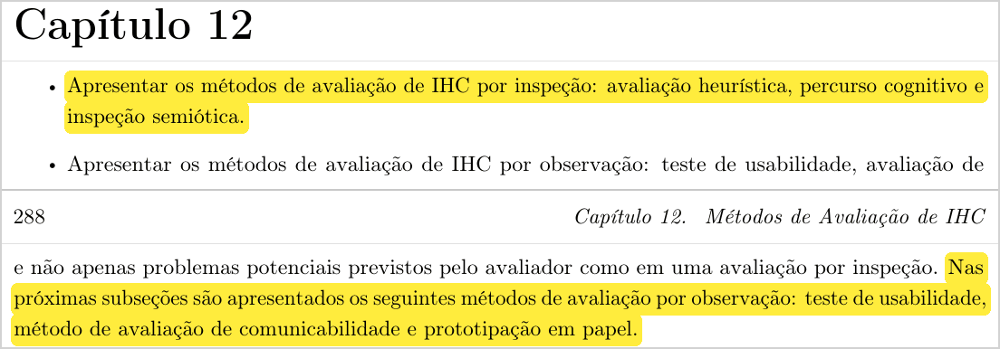

## Histórico de Versão e Contribuição

| Data | Versão | Descrição | Autor(es) | Revisor(es) | Declaração de Uso de IA |
| :---: | :---: | :--- | :--- | :--- | :--- |
| 03/11/2026 | `1.0` | Criação da ata da Reunião 10 referente à autoinspeção dos artefatos da Entrega 6 do Grupo 05, com base na Lista de Verificação 6. | [Lucas Araújo Lima](https://github.com/Lucasaraujoszz) | [Arthur Mariani](https://github.com/arthur-mariani) | Google Gemini |
| 19/11/2026 | `1.1` | Padronização da estrutura (histórico no topo, conteúdo, fotos de referência e referências ao final); declaração de IA levada para o histórico; retirada das referências que não são o livro da disciplina nem material do professor; inclusão de fotos de referência grifadas. | [Gabriel Melo](https://github.com/gabriellcardone-06) | Pendente de revisão | Claude (Anthropic) — apoio na padronização da estrutura do artefato, na revisão das referências e na formatação em Markdown. |

---

# Ata de reunião 10 (Inspeção da Entrega 6 do Próprio Grupo) - Interação Humano-Computador - Grupo 05

- **Data:** 03/11/2026 (Segunda-feira)
- **Horário:** Início às 22h45 (Duração da sessão gravada: 07 minutos e 26 segundos)
- **Local:** Reunião remota via Microsoft Teams (Canal Principal)
- **Objetivo da Reunião:** Inspeção interna dos artefatos da **Entrega 6** do **próprio Grupo 05** (Planejamento da Avaliação do Protótipo de Alta Fidelidade e Planejamento do Relato dos Resultados da Avaliação do Protótipo de Alta Fidelidade), utilizando a [Lista de Verificação 6](../verificacao/verif6.md) elaborada pelo Grupo 05 em conformidade com o Plano de Ensino da disciplina.
- **Redator da Ata:** [Lucas Araújo Lima](https://github.com/Lucasaraujoszz)
- **Revisor da Ata:** [Arthur Mariani de Andrade da Cruz](https://github.com/arthur-mariani)
- **Ausentes:** [Arthur Mariani de Andrade da Cruz](https://github.com/arthur-mariani), [Gabriel Melo Rodrigues Cardone](https://github.com/gabriellcardone-06) e [Igor Dantas Araújo](https://github.com/IgorDARAUJO)

## 1. Participantes presentes:

- [Carlos Henrique dos Santos Costa Filho](https://github.com/carloshfgit) (Apresentador e condutor da inspeção)
- [Lucas Araújo Lima](https://github.com/Lucasaraujoszz)
- [Rodrigo Carvalho Barbosa](https://github.com/RodrigoCBarbosa)
- [Tomás Garcia Rocho](https://github.com/TomasRocho)

---

## 2. Discussão e Metodologia da Inspeção:

A reunião teve como foco a autoinspeção dos artefatos da **Entrega 6** desenvolvidos pelo próprio **Grupo 05**. A condução da avaliação ocorreu de forma colaborativa:
- **Compartilhamento de tela e navegação:** [Carlos Henrique dos Santos Costa Filho](https://github.com/carloshfgit) transmitiu a tela e navegou pelos documentos do repositório/GitPages do Grupo 05.
- **Acompanhamento e deliberação:** [Lucas Araújo Lima](https://github.com/Lucasaraujoszz), [Rodrigo Carvalho Barbosa](https://github.com/RodrigoCBarbosa) e [Tomás Garcia Rocho](https://github.com/TomasRocho) acompanharam a conferência de cada critério e confirmaram o consenso da equipe.
- **Instrumento de avaliação:** A checagem baseou-se nas 14 perguntas estruturadas na **[Lista de Verificação da Entrega 6](../verificacao/verif6.md)**, divididas em:
  - **Perguntas 1 a 7:** Avaliação do Planejamento da Avaliação do Protótipo de Alta Fidelidade (objetivos, perguntas, método, participantes, tarefas, teste-piloto e TCLE);
  - **Perguntas 8 a 14:** Avaliação do Planejamento do Relato dos Resultados (objetivos/método, participantes/avaliadores, métricas por tarefa, interpretação, perguntas sem resposta, tabela de problemas de usabilidade, limitações e plano de reprojeto).
- **Referencial teórico:** Barbosa et al. (2021, Seção 7.4, Seção 12.2.1, pp. 127–289) e o Framework DECIDE.

---

## 3. Decisões e Resultados da Inspeção:

Todos os 14 itens avaliados foram classificados por unanimidade como **Conforme**, atestando a completude e o rigor metodológico dos planejamentos individuais da equipe.

**Tabela 1** — Resultados da Autoinspeção da Entrega 6 (Grupo 05)

| Nº | Pergunta de Verificação da Entrega 6 | Avaliação Registrada | Evidência / Parecer Técnico |
| :---: | :--- | :---: | :--- |
| **1** | O planejamento define com clareza o objetivo e o escopo da avaliação do protótipo? | **Conforme** | Apresenta os objetivos gerais e específicos delimitados com clareza para a avaliação no Figma. |
| **2** | O planejamento apresenta perguntas específicas que a avaliação deverá responder? | **Conforme** | Contempla as perguntas investigativas formuladas a partir do framework DECIDE. |
| **3** | O método de avaliação escolhido é adequado às perguntas e aos recursos disponíveis? | **Conforme** | O teste de usabilidade foi devidamente justificado como método adequado para a avaliação formativa. |
| **4** | O planejamento define o perfil e a quantidade de participantes compatíveis com o público-alvo? | **Conforme** | Perfil alinhado às personas e amostragem de 3 participantes fundamentada na literatura (Barbosa et al., 2021). |
| **5** | O planejamento descreve as tarefas que os participantes executarão no protótipo? | **Conforme** | Roteiro estruturado de tarefas e cenários realistas de uso descritos em detalhes. |
| **6** | O planejamento prevê um teste-piloto para conferir as instruções, o protótipo, o registro dos dados e o tempo das tarefas? | **Conforme** | Seção dedicada ao teste-piloto de alta fidelidade com objetivos, procedimentos e critérios de calibração. |
| **7** | O planejamento prevê consentimento, anonimato, participação voluntária e autorização para gravações? | **Conforme** | Resguardo bioético e modelo completo de Termo de Consentimento Livre e Esclarecido (TCLE) anexado. |
| **8** | O planejamento do relato prevê apresentar os objetivos, o escopo e o método usado na avaliação? | **Conforme** | Estrutura padrão do relato contempla introdução, objetivos e síntese metodológica. |
| **9** | O planejamento do relato prevê informar a quantidade e o perfil dos participantes e dos avaliadores? | **Conforme** | Tabela estruturada para consolidação do perfil demográfico dos participantes e papel dos avaliadores. |
| **10** | O planejamento do relato prevê resumir, por tarefa, dados como conclusão, tempo, erros e uso de ajuda? | **Conforme** | Tabela de desempenho por tarefa prevendo taxa de sucesso, tempo gasto, erros e solicitações de auxílio. |
| **11** | O planejamento do relato prevê interpretar os dados de cada participante para responder às perguntas da avaliação? | **Conforme** | Metodologia de triangulação e análise qualitativa estruturada para responder às perguntas de IHC. |
| **12** | O planejamento do relato prevê reunir os resultados dos participantes e indicar quais perguntas ficaram sem resposta? | **Conforme** | Matriz de síntese prevendo o status de cada questão investigativa (respondida, parcial ou inconclusiva). |
| **13** | O planejamento do relato prevê listar cada problema com sua localização, seu impacto e uma sugestão de solução? | **Conforme** | Tabela detalhada de problemas de usabilidade com localização, severidade de Nielsen (0 a 4) e sugestão de correção. |
| **14** | O planejamento do relato prevê apresentar as limitações dos resultados e um plano de reprojeto? | **Conforme** | Tópicos específicos para registro das limitações do escopo e cronograma/planejamento de reprojeto da interface. |

**Fonte:** Grupo 05 (2026), com base na [Lista de Verificação da Entrega 6](../verificacao/verif6.md) e na inspeção realizada em 03/11/2026.

---

### 3.1. Síntese da Inspeção:

* **Critérios Conformes (CF):** 14 itens (**100%**)
* **Critérios Não Conformes (NCF):** 0 itens (**0%**)
* **Critérios Incompletos (INC):** 0 itens (**0%**)

**Conclusão da Equipe:** Os documentos de planejamento do Nível 3 atendem integralmente às exigências do plano de ensino e estão aptos para guiar a condução dos testes práticos da próxima etapa.

---

## 4. Link da gravação:

O registro audiovisual integral da sessão de inspeção da Entrega 6 do Grupo 05 está disponível no YouTube no link a seguir:

- **Vídeo da Inspeção:** [https://youtu.be/7Uvmxk-r-WI](https://youtu.be/7Uvmxk-r-WI)

  <iframe width="560" height="315" src="https://www.youtube.com/embed/7Uvmxk-r-WI" title="Inspeção da Entrega 6 do Grupo 05 - Grupo 05 IHC" frameborder="0" allow="accelerometer; autoplay; clipboard-write; encrypted-media; gyroscope; picture-in-picture" allowfullscreen></iframe>
  
<em>Vídeo 1: Gravação da reunião de autoinspeção da Entrega 6 realizada pelo Grupo 05.</em>

---

## 5. Próxima Reunião:

- **Pauta:** Planejamento e organização dos testes de usabilidade práticos com os usuários no Figma (Etapa 7).
- **Data e Horário:** A combinar via canal de comunicação do grupo.

---

## 6. Fotos de Referência

As Figuras 1 a 3 mostram os trechos que fundamentam este artefato, recortados e grifados em amarelo diretamente do livro da disciplina (BARBOSA et al., 2021) e do Plano de Ensino do professor (SALES, 2026).

<strong>Figura 1</strong> — Itens do Desenvolvimento do projeto (1 a 11) da lista de verificação sugerida pelo professor

<em>Fonte: SALES (2026, Plano de Ensino, pp. 8–9). Recorte e grifo: [Gabriel Melo](https://github.com/gabriellcardone-06) (2026).</em>

<strong>Figura 2</strong> — 11.7.2 Teste-piloto: objetivo e descarte dos dados

<em>Fonte: BARBOSA et al. (2021, p. 260). Recorte e grifo: [Gabriel Melo](https://github.com/gabriellcardone-06) (2026).</em>

<strong>Figura 3</strong> — Métodos de avaliação por inspeção e por observação apresentados no Capítulo 12

<em>Fonte: BARBOSA et al. (2021, pp. 267–288). Recorte e grifo: [Gabriel Melo](https://github.com/gabriellcardone-06) (2026).</em>

---

## 7. Referências Bibliográficas

* BARBOSA, Simone Diniz Junqueira; SILVA, Bruno Santana da; SILVEIRA, Milene Selbach; GASPARINI, Isabela; DARIN, Ticianne; BARBOSA, Gabriel Diniz Junqueira. **Interação Humano-Computador e Experiência do Usuário**. Rio de Janeiro: Autopublicação, 2021. ISBN 978-65-00-19677-1.
* SALES, André Barros de. **Plano de Ensino: Interação Humano Computador**. Brasília: Universidade de Brasília, Faculdade UnB Gama (FCTE/UnB), 2026.
