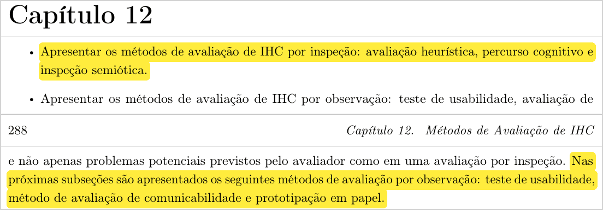

## Histórico de Versão e Contribuição

| Data | Versão | Descrição | Autor(es) | Revisor(es) | Declaração de Uso de IA |
| :---: | :---: | :--- | :--- | :--- | :--- |
| 05/10/2026 | `1.0` | Elaboração da ata da Reunião 04, realizada em 29/09/2026, com os resultados da inspeção do Grupo 03 e da autoinspeção do Grupo 05. | [Lucas Araújo Lima](https://github.com/Lucasaraujoszz) | [Rodrigo Carvalho Barbosa](https://github.com/RodrigoCBarbosa) | Google Gemini |
| 19/11/2026 | `1.1` | Padronização da estrutura (histórico no topo, conteúdo, fotos de referência e referências ao final); declaração de IA levada para o histórico; inclusão de fotos de referência grifadas. | [Gabriel Melo](https://github.com/gabriellcardone-06) | Pendente de revisão | Claude (Anthropic) — apoio na padronização da estrutura do artefato, na revisão das referências e na formatação em Markdown. |

---

# Ata de reunião 4 (Inspeção) - Interação Humano-Computador - Grupo 05

- **Data:** 29/09/2026 (Terça-feira)
- **Horário:** 22h00 às 22h50
- **Local:** Online via Microsoft Teams.
- **Objetivo da Reunião:** Inspeção dos artefatos do Grupo −1 (Grupo 03) e autoinspeção dos artefatos do Grupo 05, com base na lista de verificação da Entrega 2 do Plano de Ensino (SALES, 2026, pp. 9–11).
- **Redator da Ata:** [Lucas Araújo Lima](https://github.com/Lucasaraujoszz)
- **Ausentes:** Nenhum.

## 1. Participantes presentes:

Todos os integrantes do Grupo 05 participaram da reunião:

- [Arthur Mariani de Andrade da Cruz](https://github.com/arthur-mariani)
- [Carlos Henrique dos Santos Costa Filho](https://github.com/carloshfgit)
- [Gabriel Melo Rodrigues Cardone](https://github.com/gabriellcardone-06)
- [Igor Dantas Araújo](https://github.com/IgorDARAUJO)
- [Lucas Araújo Lima](https://github.com/Lucasaraujoszz)
- [Rodrigo Carvalho Barbosa](https://github.com/RodrigoCBarbosa)
- [Tomás Garcia Rocho](https://github.com/TomasRocho)

## 2. Discussão:

- **Inspeção do Grupo 03:** A equipe verificou os artefatos do grupo indicado para a inspeção e registrou a avaliação dos itens da lista de verificação. A avaliação do Grupo 03 foi registrada às **22h20 de 29/09/2026**.
- **Autoinspeção do Grupo 05:** Os integrantes também avaliaram os artefatos do próprio grupo. A autoinspeção identificou os itens completos e aqueles que ainda precisavam de complementação naquela data.
- **Lista de verificação adotada:** A inspeção se baseou na **Entrega 2: Perfil do usuário, Aspectos Éticos de Pesquisas Envolvendo Pessoas e Análise de tarefas**, do Plano de Ensino (SALES, 2026, pp. 9–11). A lista inclui os **11 itens gerais de desenvolvimento**, apresentados nas páginas 8–9, e **12 critérios de conteúdo** específicos dessa entrega. Os estados utilizados foram **“sim”**, **“não”** e **“incompleto”**, conforme o plano. As tabelas a seguir relacionam os critérios aos resultados registrados pela equipe.

## 3. Decisões e Resultados da Inspeção:

Os resultados apresentados nas tabelas 1 e 2 retratam a avaliação realizada em **29/09/2026**. Não representam uma nova inspeção do estado atual dos projetos.

### 3.1. Autoinspeção do Grupo 05

Na autoinspeção, **6 critérios de conteúdo foram marcados como “sim”** e **6 como “incompleto”**. Não houve item marcado como “não”. A tabela 1 apresenta cada resultado.

**Tabela 1** - Resultados da autoinspeção do Grupo 05 em 29/09/2026

| Item | Critério de conteúdo da Entrega 2 | Avaliação registrada |
| :---: | :--- | :---: |
| 1 | O perfil do usuário é definido por mais de uma forma (técnica de elicitação e/ou ferramenta)? | Sim |
| 2 | O perfil do usuário apresenta seus atributos, como dados demográficos, experiência no cargo, informações sobre a empresa e educação? | Incompleto |
| 3 | O perfil do usuário define os grupos de atributos de idade, experiência, atitudes e tarefas primárias? | Incompleto |
| 4 | São considerados os aspectos éticos de pesquisas envolvendo pessoas? | Sim |
| 5 | São apresentados os quatro princípios: autonomia, beneficência, não maleficência e justiça e equidade? | Sim |
| 6 | É prevista a solicitação de permissão antes de gravar a voz ou a imagem de qualquer pessoa? | Sim |
| 7 | É apresentado o Termo de Consentimento Livre e Esclarecido (TCLE) dos participantes? | Sim |
| 8 | Foram utilizadas ao menos duas técnicas para coletar dados e levantar os requisitos dos usuários? | Incompleto |
| 9 | São apresentados os cenários? | Incompleto |
| 10 | É apresentada a análise de tarefas? | Incompleto |
| 11 | Há uma atividade para cada integrante, modelada em ao menos duas técnicas para especificar as tarefas, conforme as orientações do plano? | Incompleto |
| 12 | Foi utilizada alguma técnica para especificar as tarefas? | Sim |

**Fonte:** Critérios adaptados de SALES (2026, pp. 9–11). Resultados da inspeção realizada pelo Grupo 05 em 29/09/2026.

**Pendências identificadas:** Os itens **2, 3, 8, 9, 10 e 11** estavam incompletos e precisam ser retomados na revisão dos artefatos.

### 3.2. Inspeção do Grupo 03

O registro da inspeção do Grupo 03 apresenta **1 critério de conteúdo marcado como “sim”**, **5 como “incompleto”** e **6 como “não”**. A tabela 2 detalha esses resultados.

**Tabela 2** - Resultados da inspeção do Grupo 03 em 29/09/2026

| Item | Critério de conteúdo da Entrega 2 | Avaliação registrada |
| :---: | :--- | :---: |
| 1 | O perfil do usuário é definido por mais de uma forma (técnica de elicitação e/ou ferramenta)? | Não |
| 2 | O perfil do usuário apresenta seus atributos, como dados demográficos, experiência no cargo, informações sobre a empresa e educação? | Não |
| 3 | O perfil do usuário define os grupos de atributos de idade, experiência, atitudes e tarefas primárias? | Não |
| 4 | São considerados os aspectos éticos de pesquisas envolvendo pessoas? | Sim |
| 5 | São apresentados os quatro princípios: autonomia, beneficência, não maleficência e justiça e equidade? | Incompleto |
| 6 | É prevista a solicitação de permissão antes de gravar a voz ou a imagem de qualquer pessoa? | Incompleto |
| 7 | É apresentado o Termo de Consentimento Livre e Esclarecido (TCLE) dos participantes? | Incompleto |
| 8 | Foram utilizadas ao menos duas técnicas para coletar dados e levantar os requisitos dos usuários? | Não |
| 9 | São apresentados os cenários? | Não |
| 10 | É apresentada a análise de tarefas? | Não |
| 11 | Há uma atividade para cada integrante, modelada em ao menos duas técnicas para especificar as tarefas, conforme as orientações do plano? | Incompleto |
| 12 | Foi utilizada alguma técnica para especificar as tarefas? | Incompleto |

**Fonte:** Critérios adaptados de SALES (2026, pp. 9–11). Resultados da inspeção realizada pelo Grupo 05 em 29/09/2026.

**Pendências identificadas:** Os itens **1, 2, 3, 8, 9 e 10** receberam a marcação “não”; os itens **5, 6, 7, 11 e 12** foram considerados incompletos. O **item 4** foi o único marcado como “sim”.

### 3.3. Observações e encaminhamentos

As anotações **“11 itens — incompleto”**, para o próprio grupo, e **“11 itens — não”**, para o Grupo 03, correspondem à avaliação conjunta dos **itens gerais de desenvolvimento do projeto**. Na Entrega 2, o Plano de Ensino solicita a verificação de todos esses 11 itens (SALES, 2026, p. 9). Eles são distintos dos 12 critérios de conteúdo apresentados nas tabelas 1 e 2. A tabela 3 registra a avaliação geral, sem atribuir um resultado individual a cada item de desenvolvimento.

**Tabela 3** - Avaliação conjunta dos 11 itens de desenvolvimento do projeto

| Conjunto avaliado | Grupo 05 | Grupo 03 |
| :--- | :---: | :---: |
| Todos os 11 itens de desenvolvimento | Incompleto | Não |

**Fonte:** Critérios de SALES (2026, pp. 8–9). Resultados da inspeção realizada pelo Grupo 05 em 29/09/2026.

Os critérios gerais abrangem histórico de versão, autoria e revisão, referências, legendas e fontes, introduções, cronograma executado, atas, gravações, apresentação em vídeo, tabela de contribuição e declaração de uso de IA. Para os critérios de conteúdo, o plano também orienta a inclusão de referências bibliográficas, imagens dos textos de referência e autoria nos itens indicados, além da participação de cada integrante em ao menos um item de conteúdo (SALES, 2026, pp. 9–11).

A partir dos resultados, recomenda-se:

- Retomar os itens incompletos da autoinspeção e registrar as complementações nos respectivos artefatos.
- Organizar os apontamentos do grupo inspecionado por item, acompanhados dos critérios da lista utilizada, para orientar a revisão.
- Conferir novamente os itens após os ajustes, mantendo os resultados desta reunião como registro histórico.

Esses encaminhamentos decorrem das pendências identificadas na inspeção. Não foram registrados responsáveis individuais ou prazos de correção nesta ata.

## 4. Link da gravação:

As gravações das reuniões de inspeção da Entrega 2 estão disponíveis nos links a seguir:

- **Autoinspeção do Grupo 05:** [Gravação da autoinspeção — Reunião 04](https://youtu.be/xcDPa3tNT-A).
- **Inspeção do Grupo −1 (Grupo 03):** [Gravação da inspeção do Grupo 03](https://youtu.be/fL6La7j0urA).
- **Participantes da reunião:** Arthur Mariani de Andrade da Cruz, Carlos Henrique dos Santos Costa Filho, Gabriel Melo Rodrigues Cardone, Igor Dantas Araújo, Lucas Araújo Lima, Rodrigo Carvalho Barbosa e Tomás Garcia Rocho.

## 5. Próxima Reunião:

A data e o horário da próxima reunião não constam nos registros fornecidos.

---

## 6. Fotos de Referência

As Figuras 1 a 2 mostram os trechos que fundamentam este artefato, recortados e grifados em amarelo diretamente do livro da disciplina (BARBOSA et al., 2021) e do Plano de Ensino do professor (SALES, 2026).

<strong>Figura 1</strong> — Itens do Desenvolvimento do projeto (1 a 11) da lista de verificação sugerida pelo professor

<em>Fonte: SALES (2026, Plano de Ensino, pp. 8–9). Recorte e grifo: [Gabriel Melo](https://github.com/gabriellcardone-06) (2026).</em>

<strong>Figura 2</strong> — Métodos de avaliação por inspeção e por observação apresentados no Capítulo 12

<em>Fonte: BARBOSA et al. (2021, pp. 267–288). Recorte e grifo: [Gabriel Melo](https://github.com/gabriellcardone-06) (2026).</em>

---

## 7. Referências Bibliográficas

* BARBOSA, Simone Diniz Junqueira; SILVA, Bruno Santana da; SILVEIRA, Milene Selbach; GASPARINI, Isabela; DARIN, Ticianne; BARBOSA, Gabriel Diniz Junqueira. **Interação Humano-Computador e Experiência do Usuário**. Rio de Janeiro: Autopublicação, 2021. ISBN 978-65-00-19677-1.
* SALES, André Barros de. **Plano de Ensino: Interação Humano Computador — Turma 01**. Versão 1. Universidade de Brasília, Campus UnB Gama, 2º semestre de 2026. Lista de Verificação da Entrega 2, pp. 9–11; critérios gerais de desenvolvimento, pp. 8–9. Disponível no projeto: [Plano de Ensino da disciplina](../assets/inspecoes/plano-de-ensino-ihc-2026-2-turma01-v1.pdf).
