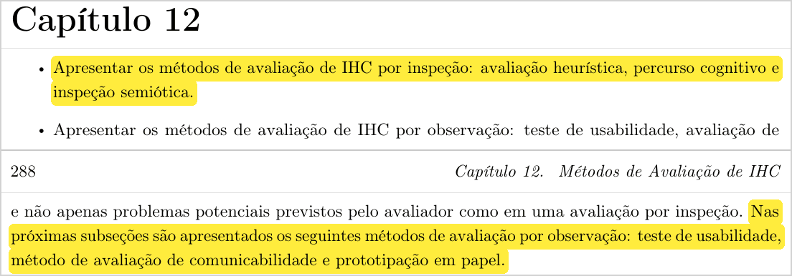

## Histórico de Versão e Contribuição

| Data | Versão | Descrição | Autor(es) | Revisor(es) | Declaração de Uso de IA |
| :---: | :---: | :--- | :--- | :--- | :--- |
| 13/10/2026 | `1.0` | Criação da ata da Reunião 05, realizada em 06/10/2026, para esclarecimento de dúvidas sobre a Entrega 3 e definição da data da inspeção do Grupo +1. | [Lucas Araújo Lima](https://github.com/Lucasaraujoszz) | [Arthur Mariani](https://github.com/arthur-mariani) | Google Gemini |

---

# Ata de reunião 5 - Interação Humano-Computador - Grupo 05

- **Data:** 06/10/2026 (Terça-feira)
- **Horário:** 08h40 às 09h30
- **Local:** Presencial (Sala de aula - FCTE/UnB)
- **Objetivo da Reunião:** Esclarecimento de dúvidas sobre a Entrega 3 com o auxílio do professor e definição da data da inspeção do Grupo +1.
- **Redator da Ata:** [Lucas Araújo Lima](https://github.com/Lucasaraujoszz)
- **Ausentes:** [Carlos Henrique dos Santos Costa Filho](https://github.com/carloshfgit)

## 1. Participantes presentes:

- [Arthur Mariani de Andrade da Cruz](https://github.com/arthur-mariani)
- [Gabriel Melo Rodrigues Cardone](https://github.com/gabriellcardone-06)
- [Igor Dantas Araújo](https://github.com/IgorDARAUJO)
- [Lucas Araújo Lima](https://github.com/Lucasaraujoszz)
- [Rodrigo Carvalho Barbosa](https://github.com/RodrigoCBarbosa)
- [Tomás Garcia Rocho](https://github.com/TomasRocho)

## 2. Discussão:

- **Dúvidas sobre a Entrega 3:** Durante o período da aula, o grupo utilizou a presença do professor para esclarecer dúvidas relacionadas aos artefatos, critérios e atividades previstos para a Entrega 3.
- **Organização da inspeção do Grupo +1:** A equipe discutiu a realização da inspeção dos artefatos do Grupo +1 e avaliou uma data adequada para a atividade.

## 3. Decisões:

- **Data da inspeção:** A inspeção do Grupo +1 referente à Entrega 3 foi marcada para **sábado, 10/10/2026**.
- **Orientações para a Entrega 3:** Os esclarecimentos fornecidos pelo professor durante a aula foram considerados pelo grupo para orientar a continuidade da elaboração e revisão dos artefatos da entrega.

## 4. Link da gravação:

> **Informação:** A reunião foi realizada presencialmente em sala de aula, com a participação do professor para o esclarecimento de dúvidas, portanto não houve gravação em vídeo.

## 5. Próxima Reunião:

A próxima reunião da equipe foi definida para **10/10/2026**, com o objetivo de realizar a inspeção do Grupo +1 referente à Entrega 3. O horário e a modalidade não foram definidos nesta ata.

---

## 6. Fotos de Referência

As Figuras 1 a 2 mostram os trechos que fundamentam este artefato, recortados e grifados em amarelo diretamente do livro da disciplina (BARBOSA et al., 2021) e do Plano de Ensino do professor (SALES, 2026).

<strong>Figura 1</strong>: Itens do Desenvolvimento do projeto (1 a 11) da lista de verificação sugerida pelo professor

<em>Fonte: SALES (2026, Plano de Ensino, pp. 8–9).</em>

<strong>Figura 2</strong>: Métodos de avaliação por inspeção e por observação apresentados no Capítulo 12

<em>Fonte: BARBOSA et al. (2021, pp. 267–288).</em>

---

## 7. Referências Bibliográficas

* BARBOSA, Simone Diniz Junqueira; SILVA, Bruno Santana da; SILVEIRA, Milene Selbach; GASPARINI, Isabela; DARIN, Ticianne; BARBOSA, Gabriel Diniz Junqueira. **Interação Humano-Computador e Experiência do Usuário**. Rio de Janeiro: Autopublicação, 2021. ISBN 978-65-00-19677-1.
* SALES, André Barros de. **Plano de Ensino: Interação Humano Computador: Turma 01**. Versão 1. Universidade de Brasília, Campus UnB Gama, 2º semestre de 2026. Disponível no projeto: [Plano de Ensino da disciplina](../assets/inspecoes/plano-de-ensino-ihc-2026-2-turma01-v1.pdf).
