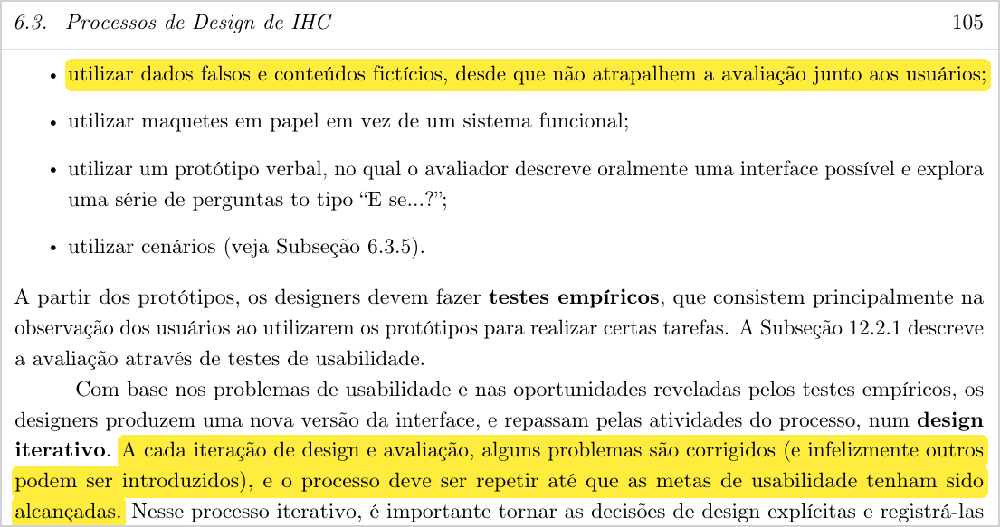

## Histórico de Versão e Contribuição

| Data | Versão | Descrição | Autor(es) | Revisor(es) | Declaração de Uso de IA |
| :---: | :---: | :--- | :--- | :--- | :--- |
| 19/11/2026 | `1.0` | Criação da visão geral dos três níveis e inclusão dos testes-piloto. | [Gabriel Melo](https://github.com/gabriellcardone-06) | [Arthur Mariani](https://github.com/arthur-mariani) | Claude (Anthropic): apoio na estruturação e na revisão dos vínculos internos. |

# Design, Avaliação e Desenvolvimento

Esta seção reúne os planejamentos, testes-piloto e relatos de avaliação produzidos de modo iterativo. Os conteúdos originais de cada autor foram preservados; a navegação apenas explicita as relações entre as entregas.

| Nível | Objeto avaliado | Acessos principais |
| :---: | :--- | :--- |
| 1 | Storyboards e análises de tarefas | [Storyboards](nivel1/storyboards.md), [protocolo do teste-piloto](nivel1/planejamento-e-protocolo-do-teste-piloto.md) e planejamentos/relatos individuais no menu lateral |
| 2 | Protótipos de baixa fidelidade (papel) | [Teste-piloto](nivel2/teste-piloto.md), planejamentos e relatos individuais no menu lateral |
| 3 | Protótipos de alta fidelidade | [Teste-piloto](nivel3/teste-piloto.md), planejamentos e relatos individuais no menu lateral |

---

## Fotos de Referência

*Imagem 1: Trecho do livro da disciplina utilizado como referência para a iteração de protótipos.*

---

## Referências Bibliográficas

- BARBOSA, Simone Diniz Junqueira et al. **Interação Humano-Computador e Experiência do Usuário**. Rio de Janeiro: Autopublicação, 2021.
- SALES, André Barros de. **Materiais e orientações da disciplina de Interação Humano-Computador**. Universidade de Brasília, 2026.
