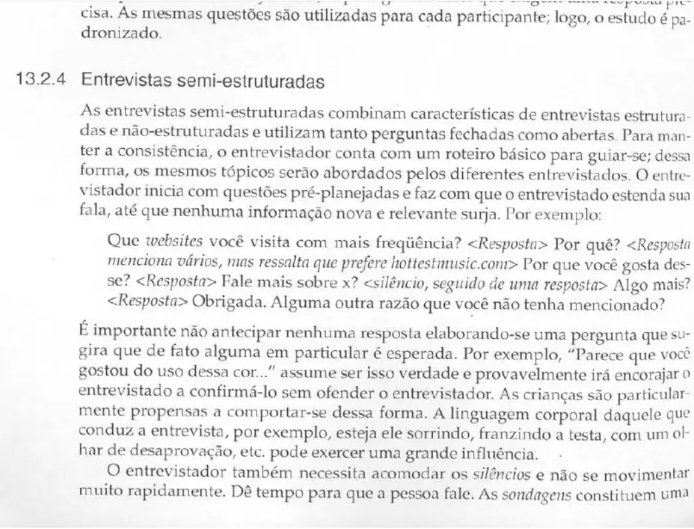

## Histórico de Versão

| Data | Versão | Descrição | Autor(es) | Revisor(es) | Declaração do uso de IA |
| :---: | :---: | :--- | :--- | :--- | :--- |
| 12/10/2026 | `1.0` | Elaboração do Cronograma e Logística das Sessões de Avaliação da Etapa 4 (agenda das sessões, plataformas, papéis, recrutamento previsto, logística e fundamentação teórica). | [Tomás Rocho](https://github.com/TomasRocho) | [Rodrigo Carvalho](https://github.com/RodrigoCBarbosa) | Google Gemini - usado para estruturação do texto e formatação Markdown da página |

---

# Cronograma e Logística das Sessões de Avaliação

Neste documento, apresenta-se o **Cronograma e a Logística das Sessões de Avaliação** do Storyboard e da Análise de Tarefas do projeto de Interação Humano-Computador (IHC) aplicado ao portal da **SEMOB-DF**. O planejamento foi feito na **Etapa 4**, e as sessões serão executadas na **Etapa 5**.

O documento define **quando**, **onde**, **com quem** e **sobre o quê** cada sessão acontece. Também define o que precisa ser feito antes, durante e depois de cada uma para que a coleta de dados ocorra sem improvisos.

---

## 1. Introdução

As avaliações da Etapa 5 serão **entrevistas semiestruturadas orientadas a tarefas**. Nelas, o participante conhece um storyboard e os modelos de tarefa (HTA e CTT) correspondentes e comenta se a história e os passos representam a sua realidade. O procedimento de cada sessão segue o roteiro ensaiado no [Planejamento e Protocolo do Teste Piloto](planejamento-e-protocolo-do-teste-piloto.md).

Como o grupo produziu **7 storyboards**, cada um ligado a uma tarefa da Análise de Tarefas, o cronograma prevê **7 sessões**, uma por storyboard. Cada sessão tem um participante convidado com o perfil da persona retratada, e a agenda inclui um horário de reserva.

As sessões acontecem **depois do teste piloto (17/10/2026)** e **antes da entrega da Etapa 5 (25/10/2026)**. Assim, o roteiro já está calibrado na primeira sessão e sobra tempo para consolidar os resultados nos relatos.

---

## 2. Fundamentação Teórica: Planejamento e Condução de Entrevistas de Avaliação

### 2.1 A entrevista semiestruturada

Preece, Rogers e Sharp (2005) classificam as entrevistas em **não estruturadas**, **estruturadas** e **semiestruturadas**. As sessões deste projeto usam o tipo semiestruturado, descrito pelos autores no trecho que pode ser visto na [imagem 1](#9-imagem-da-referencia-no-livro):

> *"As entrevistas semi-estruturadas combinam características de entrevistas estruturadas e não-estruturadas e utilizam tanto perguntas fechadas como abertas. Para manter a consistência, o entrevistador conta com um roteiro básico para guiar-se; dessa forma, os mesmos tópicos serão abordados pelos diferentes entrevistados. O entrevistador inicia com questões pré-planejadas e faz com que o entrevistado estenda sua fala, até que nenhuma informação nova e relevante surja."*  
> — **PREECE, ROGERS e SHARP (2005, Cap. 13, Seção 13.2.4, p. 416)**.

Isso justifica a forma das sessões. Todas seguem o **mesmo roteiro básico** do teste piloto, o que permite comparar os resultados dos 7 storyboards. Ao mesmo tempo, o avaliador pode pedir que o participante fale mais sobre o que ele trouxer.

Na mesma seção, os autores alertam para dois cuidados na condução, que valem para todos os avaliadores do cronograma:

> *"É importante não antecipar nenhuma resposta elaborando-se uma pergunta que sugira que de fato alguma em particular é esperada. [...] A linguagem corporal daquele que conduz a entrevista, por exemplo, esteja ele sorrindo, franzindo a testa, com um olhar de desaprovação, etc. pode exercer uma grande influência."*  
> — **PREECE, ROGERS e SHARP (2005, p. 416)**.

> *"O entrevistador também necessita acomodar os silêncios e não se movimentar muito rapidamente. Dê tempo para que a pessoa fale."*  
> — **PREECE, ROGERS e SHARP (2005, p. 416)**.

Esses cuidados explicam duas decisões deste documento. A primeira é a premissa 6 da Tabela 1: quem conduz a sessão não é o autor do storyboard, para não induzir respostas favoráveis. A segunda é a janela de 60 min para uma sessão de 45 min, que deixa tempo para o participante falar sem pressa.

### 2.2 Logística como parte do planejamento

Além das perguntas, o resultado de uma entrevista depende do seu planejamento prático. Os aspectos considerados neste documento são:

* **Agendamento e duração:** combinar data e horário com antecedência e informar a duração prevista, para que o participante não seja interrompido nem fique cansado.
* **Local ou ambiente:** escolher um ambiente tranquilo e familiar ao participante. Em sessões remotas, testar a plataforma antes.
* **Registro dos dados:** decidir antes como a sessão será registrada (gravação de áudio e vídeo e anotações) e pedir autorização ao participante.
* **Papéis da equipe:** definir quem conduz a entrevista e quem observa e anota, para que o condutor possa se dedicar à conversa.
* **Consentimento:** apresentar o objetivo do estudo e o Termo de Consentimento Livre e Esclarecido (TCLE) antes de qualquer registro.

Esses aspectos são aplicados nas Seções 3 a 7.

---

## 3. Premissas do Planejamento

<strong>Tabela 1</strong> — Premissas que orientaram a montagem da agenda

| # | Premissa | Justificativa |
| :---: | :--- | :--- |
| **1** | As sessões só começam **depois do teste piloto (17/10)**. | O piloto calibra o roteiro, o tempo e a gravação. Os ajustes são consolidados até 18/10, e as sessões começam em 19/10. |
| **2** | Todas as sessões terminam **até 22/10**, com reserva em 23/10. | A entrega da Etapa 5 é em 25/10, e a revisão por pares é em 23/10 (ver o [Cronograma](../../planejamento/cronograma.md)). Assim sobram dois dias para consolidar os dados. |
| **3** | **Uma sessão por storyboard**, com um participante do perfil da persona retratada. | Cada storyboard está ligado a uma tarefa e a um perfil de usuário. Avaliá-lo com alguém desse perfil dá mais validade às respostas. |
| **4** | Cada sessão tem **duração prevista de 45 min**, em uma janela de 60 min. | O roteiro do piloto estima cerca de 36 min. Os 15 min restantes servem para atrasos, conexão e anotações finais. |
| **5** | Os horários seguem o **[HeatMap de disponibilidade](../../planejamento/HeatMap_do_Grupo.md)** da equipe. | As noites de dias úteis, a partir das 19h30, têm boa disponibilidade da equipe e também dos participantes que trabalham ou estudam durante o dia. |
| **6** | **O autor do storyboard não conduz a própria sessão.** A condução fica com o revisor por pares do autor, e o autor atua como observador. | Evita que o condutor defenda o próprio artefato ou induza respostas, como orienta o roteiro do piloto (Seção 4.3). |

<em>Fonte: Tomás Rocho (2026).</em>

---

## 4. Cronograma das Sessões de Avaliação

A Tabela 2 apresenta a agenda das sessões. Os participantes são identificados por código (P01 a P07) para preservar o sigilo, conforme o TCLE. Os nomes só são registrados no controle interno da equipe.

<strong>Tabela 2</strong> — Agenda das Sessões de Avaliação do Storyboard e da Análise de Tarefas

| Sessão | Data e horário | Local / ambiente virtual | Avaliador (condução) | Observador / anotador | Participante convidado (perfil) | Storyboard avaliado | Tarefa avaliada (HTA/CTT) |
| :---: | :--- | :--- | :--- | :--- | :--- | :--- | :--- |
| **S1** | 19/10/2026 (seg), 19:30–20:30 | Microsoft Teams (link enviado no convite) | Gabriel Cardone | Igor Dantas Araújo | **P01**: estudante universitário que usa ônibus todos os dias para ir à faculdade (perfil de João Pedro Carvalho) | Storyboard 01: Alerta inteligente de saída | [TAR-01](../../analise-de-requisitos/analise-de-tarefas/tar-01-alerta-saida.md) |
| **S2** | 19/10/2026 (seg), 20:45–21:45 | Microsoft Teams | Igor Dantas Araújo | Gabriel Cardone | **P02**: pessoa com mobilidade reduzida (temporária ou permanente) que usa ou já precisou de transporte adaptado (perfil de Larissa Ferreira Lima) | Storyboard 02: Pré-agendamento no DF Acessível | [TAR-02](../../analise-de-requisitos/analise-de-tarefas/tar-02-df-acessivel.md) |
| **S3** | 20/10/2026 (ter), 19:30–20:30 | Microsoft Teams | Arthur Mariani | Lucas Araújo | **P03**: trabalhador que usa ônibus diariamente e planeja os trajetos só pelo celular (perfil de Marcos Paulo Vieira) | Storyboard 03: Planejamento de rota por origem/destino | [TAR-03](../../analise-de-requisitos/analise-de-tarefas/tar-03-planejamento-rota.md) |
| **S4** | 20/10/2026 (ter), 20:45–21:45 | Microsoft Teams, ou chamada de vídeo pelo celular se o participante preferir | Lucas Araújo | Carlos Costa | **P04**: motorista de ônibus do STPC/DF (perfil de Valdir Soares) | Storyboard 04: Consulta de escala e alertas operacionais | [TAR-04/TAR-05](../../analise-de-requisitos/analise-de-tarefas/analise-hta-ctt-motorista.md) |
| **S5** | 21/10/2026 (qua), 19:30–20:30 | Microsoft Teams | Rodrigo Carvalho | Tomás Rocho | **P05**: trabalhador que se desloca de ônibus para endereços diferentes durante o expediente, como técnico de manutenção ou prestador de serviço (perfil de Heitor Santos Júnior) | Storyboard 05: Consulta de rotas e desvios para novos endereços | [TAR-03](../../analise-de-requisitos/analise-de-tarefas/tar-03-planejamento-rota.md) e [Cenário 9](../../analise-de-requisitos/cenarios/cenario-9-endereco-novo.md) |
| **S6** | 21/10/2026 (qua), 20:45–21:45 | Microsoft Teams | Tomás Rocho | Rodrigo Carvalho | **P06**: passageira ou passageiro que acompanha o ônibus em tempo real pelo DF no Ponto (perfil de Mariana Borges Almeida) | Storyboard 06: Rastreamento em tempo real no DF no Ponto | [TAR-06](../../analise-de-requisitos/analise-de-tarefas/tar-06-df-no-ponto.md) |
| **S7** | 22/10/2026 (qui), 20:00–21:00 | Microsoft Teams | Carlos Costa | Arthur Mariani | **P07**: trabalhador com carteira assinada que usa Vale-Transporte no cartão (perfil de Maria Eduarda Santos) | Storyboard 07: Regularização de crédito de Vale-Transporte | [TAR-07](../../analise-de-requisitos/analise-de-tarefas/tar-07-credito-vale-transporte.md) |
| **Reserva** | 23/10/2026 (sex), 20:00–21:00 | Microsoft Teams | Conforme a sessão remarcada | Conforme a sessão remarcada | Participante de uma sessão que não ocorreu ou precisou ser interrompida | Conforme a sessão remarcada | Conforme a sessão remarcada |

<em>Fonte: Tomás Rocho (2026), com base na Matriz de Atribuição da Etapa 4 e no HeatMap de disponibilidade da equipe.</em>

> **Observação sobre a sessão S4:** motoristas trabalham em escalas que mudam. Se P04 não puder às 20:45 de 20/10, a sessão será remarcada para outro horário de folga do participante entre 19/10 e 22/10, ou para a reserva de 23/10.

### 4.1 Distribuição dos papéis por integrante

Cada integrante conduz uma sessão e observa outra, de acordo com os pares da revisão por pares.

<strong>Tabela 3</strong> — Carga de sessões por integrante

| Integrante | Conduz | Observa | Total de sessões |
| :--- | :---: | :---: | :---: |
| Arthur Mariani | S3 | S7 | 2 |
| Carlos Costa | S7 | S4 | 2 |
| Gabriel Cardone | S1 | S2 | 2 |
| Igor Dantas Araújo | S2 | S1 | 2 |
| Lucas Araújo | S4 | S3 | 2 |
| Rodrigo Carvalho | S5 | S6 | 2 |
| Tomás Rocho | S6 | S5 | 2 |

<em>Fonte: Tomás Rocho (2026).</em>

---

## 5. Recrutamento Previsto

Os critérios de seleção, a quantidade de participantes e o TCLE são definidos no documento de **Questões Práticas e Éticas das Avaliações**. Esta seção trata apenas da logística do convite.

<strong>Tabela 4</strong> — Canais de recrutamento e prazos do convite

| Perfil | Participante | Canal de recrutamento previsto | Responsável pelo convite |
| :--- | :---: | :--- | :--- |
| Estudante universitário | P01 | Colegas da FCTE/UnB Gama, por WhatsApp | Igor Dantas Araújo |
| Pessoa com mobilidade reduzida | P02 | Rede de contatos da equipe (familiares e conhecidos) | Gabriel Cardone |
| Trabalhador que planeja trajetos pelo celular | P03 | Rede de contatos da equipe | Lucas Araújo |
| Motorista do STPC/DF | P04 | Novo convite ao motorista entrevistado na Etapa 2 ([Entrevistas](../../analise-de-requisitos/entrevistas.md)) ou a outro motorista indicado por ele | Carlos Costa |
| Trabalhador que se desloca para endereços variados | P05 | Rede de contatos da equipe (técnicos, prestadores de serviço) | Tomás Rocho |
| Usuário do DF no Ponto | P06 | Passageiros entrevistados na Etapa 2 ou rede de contatos | Rodrigo Carvalho |
| Trabalhador com Vale-Transporte | P07 | Rede de contatos da equipe | Arthur Mariani |

<em>Fonte: Tomás Rocho (2026).</em>

**Prazos do recrutamento:**

* **14/10 a 16/10:** cada responsável faz o convite e confirma data e horário com o participante.
* **16/10:** a lista de participantes confirmados é fechada no grupo da equipe. Se alguém desistir, um substituto do mesmo perfil é convidado até 18/10.
* **24 horas antes de cada sessão:** o participante recebe o link da reunião, o TCLE e um lembrete com a duração prevista.

---

## 6. Logística de Cada Sessão

### 6.1 Recursos e plataformas

<strong>Tabela 5</strong> — Recursos utilizados nas sessões

| Recurso | Definição | Responsável |
| :--- | :--- | :--- |
| **Plataforma principal** | Microsoft Teams, com gravação ativada (a mesma plataforma testada no piloto). | Avaliador (condução) |
| **Plataforma alternativa** | Google Meet, se o Teams falhar ou o participante não conseguir entrar. | Avaliador (condução) |
| **Gravação de reserva** | OBS Studio ou 123APPS no computador do observador (captura local de tela e áudio). | Observador |
| **Materiais exibidos** | Storyboard da sessão, resumo do cenário e da persona, diagramas HTA e CTT da tarefa. | Avaliador (condução) |
| **Termo de consentimento** | [TCLE Pesquisa Transporte](../../assets/PDFs/TCLE_Pesquisa_Transporte.pdf), enviado com antecedência e lido no início da sessão. | Avaliador (condução) |
| **Ficha de anotação** | Roteiro de observação do avaliador, com espaço para tempos, dúvidas e comentários do participante. | Observador |
| **Armazenamento** | Pasta compartilhada da equipe, com acesso restrito aos integrantes. Os arquivos são nomeados pelo código da sessão (ex.: `S5-P05-gravacao.mp4`). | Observador |
| **Custo** | R\$ 0,00 (plataformas gratuitas ou institucionais e equipamentos próprios). | Equipe |

<em>Fonte: Tomás Rocho (2026).</em>

### 6.2 Linha do tempo de uma sessão

<strong>Tabela 6</strong> — Checklist logístico antes, durante e depois de cada sessão

| Momento | Ação | Responsável |
| :--- | :--- | :--- |
| **D-1 (24h antes)** | Enviar ao participante o link da reunião, o TCLE e o lembrete de data, horário e duração. | Avaliador (condução) |
| **D-1** | Conferir se o storyboard, o cenário e os diagramas HTA/CTT da sessão estão na versão final. | Observador |
| **15 min antes** | Abrir a reunião, testar áudio, vídeo e compartilhamento de tela. Abrir a gravação de reserva. | Avaliador e observador |
| **Início (0–7 min)** | Boas-vindas, leitura do TCLE, aceite verbal e **início da gravação**. | Avaliador (condução) |
| **Meio (7–40 min)** | Aplicação do roteiro: perfil, contexto, storyboard e análise de tarefas. | Avaliador (condução) |
| **Durante toda a sessão** | Anotar tempos, hesitações e comentários sem interromper. | Observador |
| **Fim (40–45 min)** | Comentários finais, agradecimento e **fim da gravação**. | Avaliador (condução) |
| **Até 15 min depois** | Conferir se a gravação foi salva e enviá-la à pasta da equipe. Registrar as impressões iniciais. | Observador |
| **Até 24h depois** | Preencher a ficha da sessão para o relato de resultados. | Avaliador e observador |

<em>Fonte: Tomás Rocho (2026), com base no roteiro do teste piloto.</em>

---

## 7. Visão Geral do Calendário e Riscos

### 7.1 Calendário consolidado

<strong>Tabela 7</strong> — Calendário das atividades de avaliação (Etapas 4 e 5)

| Período | Atividade | Responsável |
| :---: | :--- | :--- |
| 13/10 | Entrega da Etapa 4 (planejamento das avaliações). | Equipe Grupo 05 |
| 14/10 a 16/10 | Recrutamento e confirmação dos participantes P01 a P07. | Responsáveis da Tabela 4 |
| **17/10 (sáb), 15:00** | **Teste piloto** no Microsoft Teams. | Igor Dantas (condução do planejamento) e equipe |
| 17/10 a 18/10 | Ajustes no roteiro a partir da Ficha de Calibração do piloto. | Equipe |
| **19/10 a 22/10** | **Sessões S1 a S7** (Tabela 2). | Avaliadores e observadores |
| 23/10 (sex), 20:00 | Sessão de reserva, se necessário. | Conforme a sessão remarcada |
| 22/10 a 24/10 | Consolidação dos dados e redação dos relatos de resultados. | Equipe |
| 23/10 | Revisão por pares dos relatos. | Equipe |
| 24/10 a 25/10 | Gravação da apresentação e entrega da Etapa 5. | Equipe |

<em>Fonte: Tomás Rocho (2026), com base no Cronograma Geral do projeto e no Planejamento do Teste Piloto.</em>

### 7.2 Riscos e contingências

<strong>Tabela 8</strong> — Riscos logísticos e planos de contingência

| Risco | Impacto | Plano de contingência |
| :--- | :---: | :--- |
| Participante falta ou desmarca. | Alto | Remarcar para a reserva de 23/10 ou convidar um substituto do mesmo perfil. |
| Avaliador ou observador não pode participar. | Médio | Outro integrante assume o papel, desde que não seja o autor do storyboard no papel de condução. |
| Queda do Teams ou da conexão do participante. | Médio | Migrar para o Google Meet e retomar do passo interrompido. |
| Falha na gravação principal. | Alto | Usar a gravação de reserva do observador e as anotações da ficha. |
| Participante sem computador. | Baixo | Participar pelo celular (aplicativo do Teams ou chamada de vídeo), com o storyboard enviado antes como imagem. |
| Sessão passa de 45 min. | Baixo | Usar a folga da janela de 60 min. Se faltar tempo, priorizar as perguntas sobre a tarefa e registrar o que ficou de fora. |

<em>Fonte: Tomás Rocho (2026).</em>

---

## 8. Conformidade com o Checklist da Etapa 4

<strong>Tabela 9</strong> — Itens do checklist atendidos por este documento

| Item do checklist | Requisito | Localização no documento |
| :---: | :--- | :--- |
| **5** | Questões práticas: formato presencial ou remoto, equipamentos, cronograma, custos e mão de obra. | Seções 4, 4.1, 6.1 e 7.1 |
| **8** | Cronograma com data, horário e local ou plataforma de cada sessão de avaliação do Storyboard e da Análise de Tarefas. | Seção 4 (Tabela 2) |
| **14** | Fundamentação individual com referência bibliográfica e foto da página do livro. | Seções 2 e 9 |

<em>Fonte: Tomás Rocho (2026), com base no Plano de Ensino (SALES, 2026).</em>

---

## 9. Imagem da Referência no Livro

Conforme as diretrizes da disciplina, a fundamentação sobre o planejamento e a condução de entrevistas encontra-se no livro de referência:

*Imagem 1 - Preece, Rogers e Sharp, 2005, Cap. 13, Seção 13.2.4, p. 416*

---

## 10. Referências Bibliográficas

* PREECE, Jennifer; ROGERS, Yvonne; SHARP, Helen. **Design de Interação: Além da interação homem-computador**. Porto Alegre: Bookman, 2005. (Capítulo 13: Perguntando a Usuários e Especialistas, Seção 13.2.4, p. 416).
* SALES, André Barros de. **Plano de Ensino: Interação Humano Computador**. Brasília: Universidade de Brasília, FCTE/UnB, 2026.

---
**Autor:** [Tomás Rocho](https://github.com/TomasRocho)  
**Revisor:** [Rodrigo Carvalho](https://github.com/RodrigoCBarbosa)
