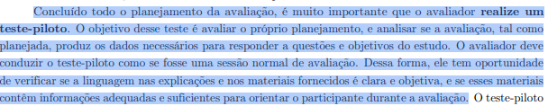

## Histórico de Versão

| Data | Versão | Descrição | Autor(es) | Revisor(es) | Declaração do uso de IA |
| :---: | :---: | :--- | :--- | :--- | :--- |
| 11/10/2026 | `1.0` | Elaboração do Planejamento e Protocolo do Teste Piloto da Etapa 4 (definição, roteiro, ficha de calibração e cronograma). | [Igor Dantas Araújo](https://github.com/IgorDARAUJO) | [Gabriel Cardone](https://github.com/gabriellcardone-06) | Google Gemini - utilizado para formatação MarkDown da página |

---

# Planejamento e Protocolo do Teste Piloto

Neste documento, apresenta-se o **Planejamento e Protocolo do Teste Piloto** para as avaliações formativas da **Etapa 4** do projeto de Interação Humano-Computador (IHC) aplicado ao portal da **SEMOB-DF**.

O teste piloto consiste em um ensaio preparatório essencial para calibrar os instrumentos de coleta, verificar o funcionamento das ferramentas de gravação, validar o tempo estimado das sessões e aperfeiçoar a postura do avaliador antes do início formal das avaliações com os usuários reais na Etapa 5.

O procedimento e os materiais do piloto estão ancorados nos artefatos produzidos pelo grupo: o **Storyboard 01 — Alerta inteligente de saída**, vinculado à tarefa [TAR-01](https://interacao-humano-computador.github.io/2026.2-Grupo05/analise-de-requisitos/analise-de-tarefas/tar-01-alerta-saida/) e ao [Cenário 2](https://interacao-humano-computador.github.io/2026.2-Grupo05/analise-de-requisitos/cenarios/cenario-2-viagem-matutina/), cuja persona de referência é [João Pedro Carvalho](https://interacao-humano-computador.github.io/2026.2-Grupo05/analise-de-requisitos/personas/joao-pedro-carvalho/).

---

## 1. Introdução

Este documento integra a **Etapa 4** do projeto de avaliação e reprojeto do portal da SEMOB-DF e descreve o **planejamento e o protocolo do teste piloto** que antecede as sessões de avaliação com usuários. O piloto é um ensaio interno, conduzido pela equipe, que simula uma sessão real para verificar se o roteiro, o tempo, a gravação e os equipamentos funcionam como o planejado, antes da coleta de dados da Etapa 5.

Como o teste piloto tem como foco ensaiar o *procedimento* de avaliação, um único storyboard e a análise de tarefas correspondente (modelos HTA e CTT da TAR-01) são suficientes para exercitar todo o roteiro.

> ⚠️ **CONFORMIDADE COM O ITEM 12 DO CHECKLIST DA ETAPA 4**  
> Os resultados obtidos no teste piloto servem **exclusivamente para calibração** do roteiro, do tempo e dos recursos tecnológicos. Eles **não serão computados nem contabilizados** nos resultados das avaliações finais do Storyboard nem da Análise de Tarefas. A declaração formal encontra-se na [Seção 6](#6-declaracao-de-conformidade-com-o-item-12-do-checklist).

---

## 2. Fundamentação Teórica: Conceito, Importância e Condução

### 2.1 Conceito do Teste Piloto em IHC
Segundo Barbosa et al. (2021), no trecho que pode ser visto na [imagem 1](#8-imagem-da-referencia-no-livro), o teste-piloto faz parte da subetapa de **Preparação** da avaliação (Capítulo 11, Seção 11.7.2), que antecede a Coleta de Dados. Para os autores, concluído o planejamento da avaliação, é fundamental que o avaliador execute essa simulação prática:

> *"Concluído todo o planejamento da avaliação, é muito importante que o avaliador realize um teste-piloto. O objetivo desse teste é avaliar o próprio planejamento, e analisar se a avaliação, tal como planejada, produz os dados necessários para responder a questões e objetivos do estudo. O avaliador deve conduzir o teste-piloto como se fosse uma sessão normal de avaliação. Dessa forma, ele tem oportunidade de verificar se a linguagem nas explicações e nos materiais fornecidos é clara e objetiva, e se esses materiais contêm informações adequadas e suficientes para orientar o participante durante a avaliação."*  
> — **BARBOSA et al. (2021, Cap. 11, Seção 11.7.2, p. 260)**.

### 2.2 Finalidade e Importância para o Projeto
A partir dessa orientação teórica, a equipe definiu as seguintes finalidades operacionais para o piloto:

* **Validar a clareza do roteiro:** Conferir se as instruções, a ordem das etapas e as perguntas do Framework DECIDE são claras e não induzem respostas.

* **Aferir o tempo da sessão:** Verificar se a duração prevista é realista e não causa fadiga.

* **Testar a captura de mídia:** Garantir que áudio, vídeo e compartilhamento de tela são salvos corretamente.

* **Testar equipamentos e plataformas:** Validar o uso do Microsoft Teams e ferramentas de gravação de reserva.

* **Ensaiar o protocolo ético:** Treinar a apresentação do Termo de Consentimento Livre e Esclarecido (TCLE) e o pedido de autorização de gravação.

* **Treinar a postura do avaliador:** Garantir condução neutra, cordial e sem interferências indevidas.

---

## 3. Planejamento Operacional do Teste Piloto

### 3.1 Objetivos Específicos
1. Executar de ponta a ponta uma sessão simulada, seguindo o roteiro do estudo.
2. Identificar perguntas ambíguas, extensas ou mal ordenadas.
3. Mensurar o tempo exato gasto em cada bloco da entrevista.
4. Testar a estabilidade da gravação remota e do compartilhamento dos diagramas.
5. Registrar os ajustes necessários na Ficha de Calibração e consolidar o roteiro final.

### 3.2 Materiais e Artefatos Utilizados
* **Storyboard 01 (Alerta inteligente de saída):** Apresentação sequencial quadro a quadro.
* **Cenário 2 e Persona:** Resumo do [Cenário 2](https://interacao-humano-computador.github.io/2026.2-Grupo05/analise-de-requisitos/cenarios/cenario-2-viagem-matutina/) e do perfil de [João Pedro Carvalho](https://interacao-humano-computador.github.io/2026.2-Grupo05/analise-de-requisitos/personas/joao-pedro-carvalho/).
* **Diagramas da Análise de Tarefas:** Modelos HTA e CTT da [TAR-01](https://interacao-humano-computador.github.io/2026.2-Grupo05/analise-de-requisitos/analise-de-tarefas/tar-01-alerta-saida/).
* **Termo de Consentimento (TCLE):** Versão oficial adaptada para as avaliações ([TCLE Pesquisa Transporte](https://interacao-humano-computador.github.io/2026.2-Grupo05/assets/PDFs/TCLE_Pesquisa_Transporte.pdf)).
* **Roteiro e Ficha de Calibração:** Formulários de condução e registro de ajustes.

### 3.3 Papéis e Atribuições
Para garantir a fidelidade do ensaio, os membros do grupo assumem papéis definidos na sessão piloto:

<strong>Tabela 1</strong> — Matriz de Papéis na Execução do Teste Piloto

| Papel | Responsável | Atribuições |
| :--- | :--- | :--- |
| **Avaliador (Condução)** | Gabriel Cardone | Conduz a sessão, lê o roteiro, apresenta o TCLE, compartilha o material e aplica as perguntas. |
| **Participante Simulado** | Carlos Henrique | Simula o perfil do usuário primário e responde de forma verossímil. |
| **Observador / Anotador** | Lucas, Tomás, Arthur, Rodgigo | Registra dúvidas, hesitações, tempos por bloco e falhas de clareza sem interromper a sessão. |
| **Responsável pela Gravação** | Igor Dantas | Controla o início/fim da gravação no Teams e monitora o software de reserva. |

<em>Fonte: Igor Dantas Araújo (2026).</em>

### 3.4 Agendamento, Plataforma e Infraestrutura

<strong>Tabela 2</strong> — Parâmetros Logísticos do Agendamento Interno

| Parâmetro | Definição Operacional |
| :--- | :--- |
| **Data e Horário:** | 17/10/2026 (sábado) às 15:00. |
| **Plataforma Principal:** | Microsoft Teams (reunião remota com gravação ativada). |
| **Gravação de Reserva:** | Software 123APPS / OBS Studio (captura local de tela e áudio). |
| **Condução e Apoio:** | Gabriel, Carlos, Igor, Tomás, Rodrigo, Lucas e Arthur. |
| **Custos Estimados:** | R\$ 0,00 (uso de infraestrutura corporativa/acadêmica já disponível). |

<em>Fonte: Igor Dantas Araújo (2026).</em>

---

## 4. Protocolo e Roteiro Passo a Passo do Teste Piloto

<strong>Tabela 3</strong> — Roteiro Sequencial da Sessão Piloto

| Passo | Atividade | Responsável | Tempo Est. | O que Verificar (Calibração) |
| :---: | :--- | :--- | :---: | :--- |
| **0** | **Preparação:** Abrir reunião no Teams, testar áudio/vídeo, carregar Storyboard, diagramas, TCLE e roteiro. | Gabriel e Igor | 15 min antes | Todos os arquivos abrem corretamente? O compartilhamento funciona? |
| **1** | **Boas-vindas:** Apresentar-se, explicar o objetivo e reforçar que a avaliação é sobre o **artefato**, não a pessoa. | Gabriel | 3 min | O texto de abertura é claro e acolhedor? |
| **2** | **TCLE e Consentimento:** Ler o termo, confirmar o aceite verbal para gravação e **iniciar a gravação**. | Gabriel e Igor | 4 min | A leitura do TCLE é fluida? O consentimento ficou registrado na gravação? |
| **3** | **Perfil do Participante:** Perguntas breves de caracterização (idade, rotina de transporte, uso de apps). | Gabriel | 3 min | As perguntas são suficientes e não invasivas? |
| **4** | **Contextualização:** Apresentar a persona João Pedro Carvalho e o resumo do Cenário 2. | Gabriel | 3 min | O contexto do problema foi compreendido sem necessidade de explicações extras? |
| **5** | **Exibição do Storyboard 01:** Apresentar os quadros em sequência, permitindo a leitura individual. | Gabriel | 5 min | Os desenhos e textos estão legíveis na tela compartilhada? |
| **6** | **Avaliação do Storyboard:** Aplicar perguntas sobre clareza, verossimilhança, reações e engajamento. | Gabriel, Lucas, Tomás, Arthur, Rodgigo  | 8 min | Alguma pergunta pareceu confusa ou induziu a resposta? |
| **7** | **Validação da Análise de Tarefas:** Exibir diagramas HTA/CTT e perguntar sobre a coerência do fluxo. | Gabriel, Lucas, Tomás, Arthur, Rodgigo | 8 min | Os diagramas de tarefas são compreensíveis para o participante? |
| **8** | **Encerramento:** Abrir espaço para comentários finais, agradecer e **encerrar a gravação**. | Gabriel e Igor | 2 min | A gravação foi salva corretamente? Qual foi o tempo total da sessão? |
| **9** | **Debriefing Interno:** Preencher a Ficha de Calibração com a equipe e listar ajustes do roteiro. | Gabriel, Igor,  Lucas, Tomás, Arthur, Rodgigo, Carlos | 15 min pós | Quais pontos do roteiro precisam de reformulação? |

<em>Fonte: Igor Dantas Araújo (2026). Tempo total estimado da sessão simulada: ~36 minutos.</em>

### 4.1 Perguntas-Modelo de Avaliação do Storyboard 01
* **Clareza Narrativa:** *"Com suas palavras, o que acontece nesta história?"*
* **Verossimilhança Contextual:** *"Essa situação de o ônibus se adiantar e perder a viagem parece com algo que você já viveu no DF?"*
* **Coerência de Reações:** *"A atitude do João Pedro de confiar na notificação e sair de casa imediatamente faz sentido para você?"*
* **Engajamento com a Solução:** *"Você ativaria um alerta inteligente como esse na sua rotina? O que mudaria nele?"*

### 4.2 Perguntas-Modelo de Validação da Análise de Tarefas (TAR-01 - HTA/CTT)
* *"A sequência de passos mostrada no diagrama corresponde à forma como você decide a hora de sair de casa?"*
* *"Falta algum passo importante no planejamento da sua caminhada até o ponto?"*
* *"Caso o sistema envie uma notificação de atraso crítico, a opção de rota alternativa atende à sua necessidade?"*

### 4.3 Diretrizes e Conduta Ética do Avaliador
* Conduzir o piloto com o mesmo rigor de uma sessão real, sem pular etapas (Barbosa et al., 2021, p. 260).
* Manter postura neutra, sem emitir opiniões pessoais ou defender os artefatos.
* Registrar os tempos exatos por bloco e assinalar momentos em que o participante hesitou.
* Durante o debriefing (Passo 9), ouvir o feedback do participante simulado sobre a fluidez do procedimento.

---

## 5. Ficha de Calibração do Teste Piloto

<strong>Tabela 4</strong> — Ficha de Avaliação e Calibração Pós-Piloto

| # | Item Verificado | Critério de Aprovação | Resultado (OK / Ajustar) | Ação Corretiva Realizada |
| :---: | :--- | :--- | :---: | :--- |
| **1** | Clareza do Roteiro | O avaliador conduz a sessão sem dúvidas sobre o que falar ou apresentar. | - | - |
| **2** | Duração Total | Sessão finalizada dentro da janela prevista (30–45 min). | - | - |
| **3** | Duração por Bloco | Nenhum bloco individual excede 50% do tempo estipulado. | - | - |
| **4** | Registro do TCLE | Leitura do termo e aceite registrado no início da gravação. | - | - |
| **5** | Compreensão das Perguntas | Participante responde diretamente, sem pedir reformulação. | - | - |
| **6** | Neutralidade das Perguntas | Perguntas não induzem respostas positivas ou negativas. | - | - |
| **7** | Legibilidade dos Artefatos | Storyboard e diagramas perfeitamente visíveis em tela. | - | - |
| **8** | Qualidade da Gravação | Áudio limpo, sem eco, e captura de vídeo/tela contínua. | - | - |
| **9** | Estabilidade da Conexão | Sessão conduzida sem quedas de sinal no Teams. | - | - |
| **10** | Qualidade das Anotações | O anotação permite identificar dúvidas e tempos de cada etapa. | - | - |
| **11** | Armazenamento Seguro | Arquivo de mídia salvo em repositório acessível à equipe. | - | - |

<em>Fonte: Igor Dantas Araújo (2026).</em>

---

## 6. Declaração de Conformidade com o Item 12 do Checklist

**Declara-se formalmente que os dados, respostas, anotações e gravações obtidos durante a execução deste teste piloto serão utilizados exclusivamente para calibrar o roteiro, o tempo de entrevista, as ferramentas de gravação e a postura do avaliador. Esses dados NÃO serão computados, contabilizados nem agregados aos resultados das avaliações finais do Storyboard nem da Análise de Tarefas (Etapa 5), e não comporão as tabelas de problemas ou priorização dos relatórios finais.**

<strong>Tabela 5</strong> — Mapeamento de Conformidade com o Plano de Ensino

| Item Checklist | Requisito do Plano de Ensino | Localização no Documento |
| :---: | :--- | :--- |
| **11** | Conceito de teste piloto definido com citação + indicação de obra, com data e procedimento agendados. | Seções 2.1, 3.4 e 4; Indicação da obra na Seção 8. |
| **12** | Declaração explícita de não contabilização dos dados do piloto nos resultados finais. | Seção 1 (Introdução) e Seção 6. |

<em>Fonte: Igor Dantas Araújo (2026), baseado no Plano de Ensino (SALES, 2026).</em>

---

## 7. Cronograma e Gestão de Riscos

<strong>Tabela 6</strong> — Cronograma de Execução do Teste Piloto

| Período | Atividade | Responsável |
| :---: | :--- | :--- |
| 10/10 a 17/10 | Elaboração do roteiro, TCLE, ficha de calibração e estrutura do piloto. | Igor Dantas |
| **17/10** | **Execução interna do teste piloto no Teams** e preenchimento da Ficha. | Gabriel, Igor,  Lucas, Tomás, Arthur, Rodgigo, Carlos |
| 17/10 a 20/10 | Refinamento do roteiro final com base nos ajustes da calibração. | Gabriel, Igor,  Lucas, Tomás, Arthur, Rodgigo, Carlos |
| 21/10 | Revisão por pares deste documento. | Gabriel Cardone |
| 24/10 | Fechamento da página e verificação final no MkDocs/GitHub Pages. | Gabriel, Igor,  Lucas, Tomás, Arthur, Rodgigo, Carlos |
| 25/10 (23:59) | Entrega oficial da Etapa 5. | Gabriel, Igor,  Lucas, Tomás, Arthur, Rodgigo, Carlos |

<em>Fonte: Igor Dantas Araújo (2026).</em>

<strong>Tabela 7</strong> — Matriz de Riscos e Planos de Contingência

| Risco Mapeado | Impacto | Plano de Contingência / Ação Imediata |
| :--- | :---: | :--- |
| Instabilidade ou queda no Teams | Médio | Reativar a reunião ou migrar para o Google Meet; retomar do passo interrompido. |
| Corrupção na gravação principal | Alto | Utilizar o arquivo de gravação de reserva gerado pelo 123APPS / OBS. |
| Ausência do participante simulado | Baixo | Convocar imediatamente outro integrante do Grupo 05 para assumir o papel. |
| Excesso de tempo na sessão (>45 min) | Médio | Identificar blocos extensos no debriefing e enxugar/reordenar perguntas no roteiro final. |

<em>Fonte: Igor Dantas Araújo (2026).</em>

---

## 8. Imagem da Referência no Livro

Conforme as diretrizes da disciplina, a fundamentação conceitual sobre o teste piloto encontra-se localizada no livro-texto oficial:

*Imagem 1 - Barbosa et al., 2021, Seção 11.7.2, p. 260*

---

## 9. Referências Bibliográficas

* BARBOSA, Simone Diniz Junqueira; SILVA, Bruno Santana da; SILVEIRA, Milene Selbach; GASPARINI, Isabela; DARIN, Ticianne; BARBOSA, Gabriel Diniz Junqueira. **Interação Humano-Computador e Experiência do Usuário**. Rio de Janeiro: Autopublicação, 2021. ISBN 978-65-00-19677-1. (Capítulo 11: Planejamento da Avaliação de IHC, Seção 11.7.2, p. 258–261).
* BRASIL. Conselho Nacional de Saúde. **Resolução nº 510, de 07 de abril de 2016**. Regulamenta as pesquisas em Ciências Humanas e Sociais. Brasília: Diário Oficial da União, 2016.
* PREECE, Jennifer; ROGERS, Yvonne; SHARP, Helen. **Design de Interação: Além da interação homem-computador**. São Paulo: Editora Érica, 2005.
* SALES, André Barros de. **Plano de Ensino: Interação Humano Computador**. Brasília: Universidade de Brasília, FCTE/UnB, 2026.

---
**Autor:** [Igor Dantas Araújo](https://github.com/IgorDARAUJO)  
**Revisor:** [Gabriel Cardone](https://github.com/gabriellcardone-06)
