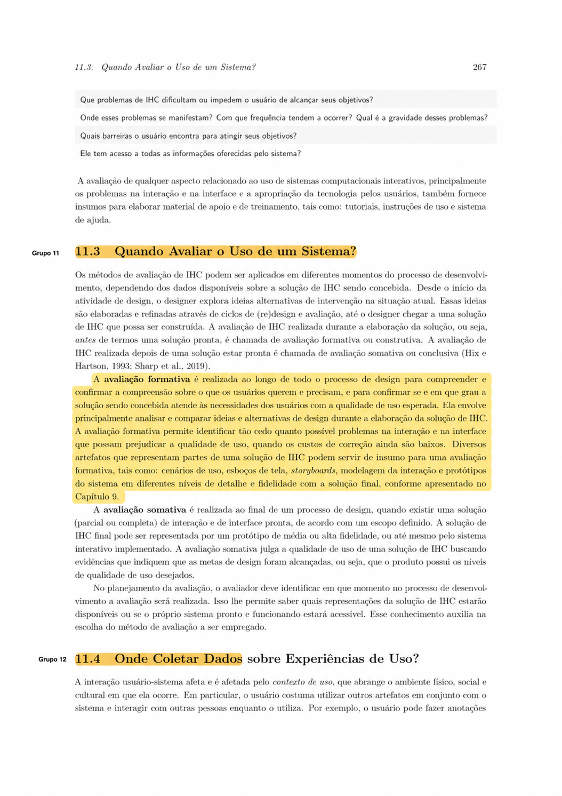
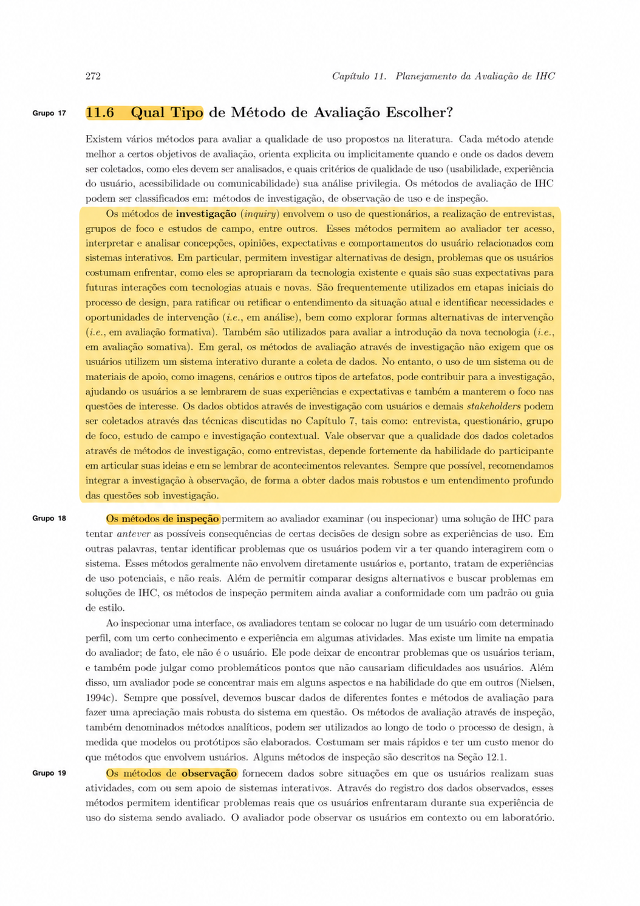
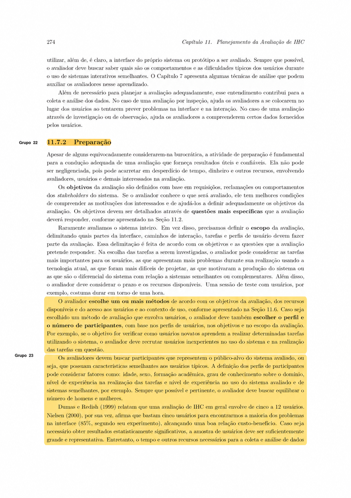
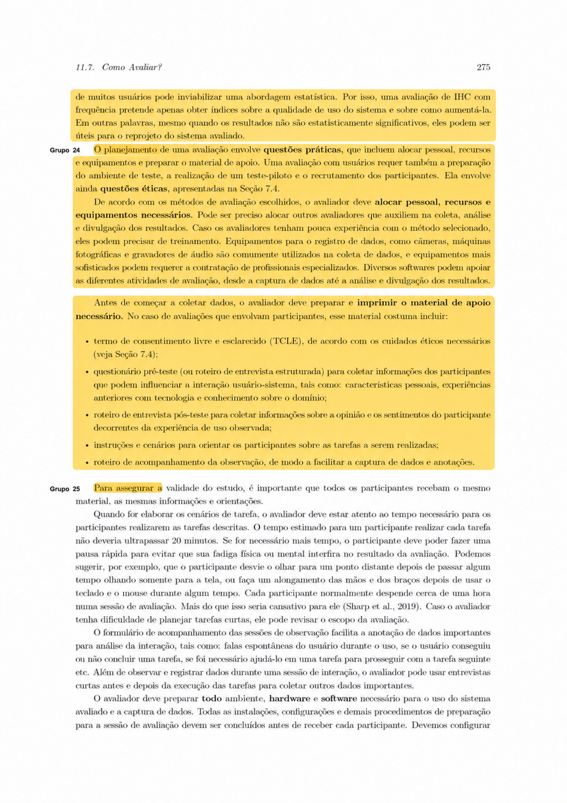
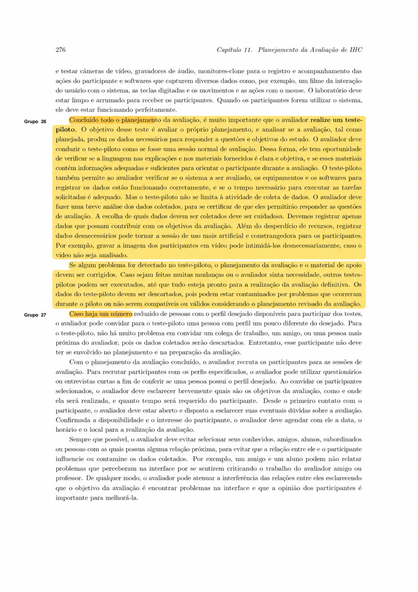
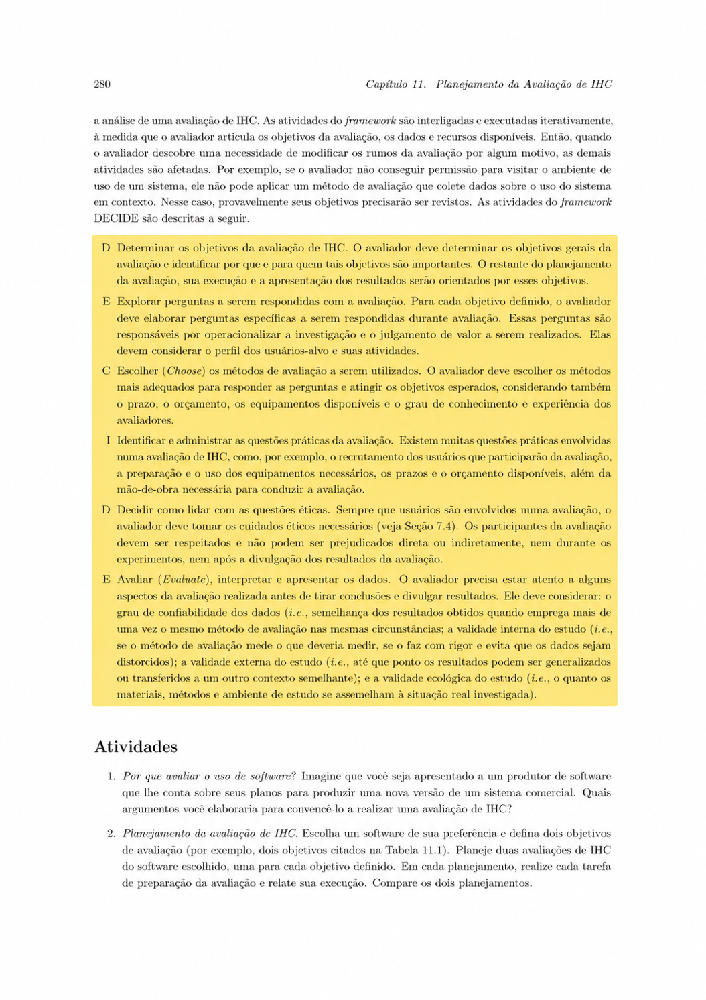

# Planejamento da Avaliação do Storyboard e da Análise de Tarefas (TAR-07)

## Histórico de Versão

| Data | Versão | Descrição | Autor(es) | Revisor(es) | Declaração de ferramenta de IA |
| :---: | :---: | :--- | :--- | :--- | :--- |
| 13/10/2026 | `1.0` | Criação do planejamento individual da avaliação do Storyboard 07 e da Análise de Tarefas TAR-07 com base no framework DECIDE. | [Arthur Mariani](https://github.com/arthur-mariani) | [Carlos Costa](https://github.com/carloshfgit) | Google Gemini - utilizado na elaboração inicial, comparação com a referência bibliográfica, formatação em Markdown e revisão textual; o conteúdo permanece sob responsabilidade do autor. |

## 1. Introdução

Este documento apresenta o planejamento da avaliação formativa do [Storyboard 07](../../storyboards.md) e da [TAR-07 - Resolver indisponibilidade de crédito de Vale-Transporte](../../../../analise-de-requisitos/analise-de-tarefas/tar-07-credito-vale-transporte.md), ambos relacionados ao [Cenário 04 - Crédito de Vale-Transporte não disponível no cartão antes do trabalho](../../../../analise-de-requisitos/cenarios/cenario-4-credito-vale-transporte.md).

O escopo inclui a narrativa vivenciada por Maria Eduarda Santos e os modelos de **Análise Hierárquica de Tarefas (HTA)** e **ConcurTaskTrees (CTT)** da TAR-07. A avaliação pretende verificar se esses artefatos representam de forma compreensível e verossímil a situação de crédito indisponível, bem como validar as hipóteses sobre a sequência de ações, a divisão de responsabilidades e os possíveis encaminhamentos. Não será avaliada a correção operacional dos procedimentos internos do empregador, da SEMOB-DF ou do BRB Mobilidade.

O planejamento segue o framework **DECIDE** descrito por Barbosa et al. (2021): **D**eterminar os objetivos; **E**xplorar as perguntas; **C**hoose, ou escolher, os métodos; **I**dentificar e administrar as questões práticas; **D**ecidir como lidar com as questões éticas; e **E**valuate, ou avaliar, interpretar e apresentar os dados. As etapas são interligadas e podem ser revistas quando houver mudanças no escopo ou nos recursos disponíveis.

---

## 2. Concordância com o Livro-Texto

A Tabela 1 registra como as principais orientações do livro-texto foram aplicadas neste planejamento.

<strong>Tabela 1</strong> - Concordância entre o planejamento e o livro-texto

| Orientação de Barbosa et al. (2021) | Aplicação neste planejamento |
| :--- | :--- |
| A avaliação formativa pode utilizar cenários, storyboards e modelos produzidos durante o design (Cap. 11, p. 267). | O Storyboard 07 e os modelos HTA e CTT da TAR-07 são os objetos da avaliação. |
| Os objetivos devem ser detalhados em perguntas específicas e o escopo deve delimitar tarefas e perfis de usuário (Cap. 11, p. 265 e 274). | As Seções 3 e 4 vinculam cada pergunta aos objetivos e aos elementos do Cenário 04 e da TAR-07. |
| Métodos de investigação, como entrevistas, são adequados para explorar opiniões, expectativas, problemas e alternativas de design, podendo usar imagens e cenários como apoio (Cap. 11, p. 272). | Será aplicada uma entrevista semiestruturada guiada pelo storyboard, pela HTA e pela CTT. |
| Participantes devem representar o público-alvo, e o número escolhido deve considerar objetivos, escopo e recursos (Cap. 11, p. 274-275). | Será convidada uma passageira trabalhadora que utilize transporte público e tenha experiência com cartão de transporte ou Vale-Transporte. A limitação de uma participante será declarada. |
| A preparação deve incluir materiais, ambiente, equipamentos, recrutamento e teste-piloto (Cap. 11, p. 275-276). | As Seções 6 e 7 definem materiais, papéis, roteiro, infraestrutura, cronograma e uso do piloto coletivo. |
| Os dados coletados devem contribuir para os objetivos e permitir responder às perguntas da avaliação (Cap. 11, p. 276 e 279). | Serão coletadas respostas qualitativas, observações e ocorrências objetivas de compreensão; a análise será organizada por pergunta. |
| Avaliações com participantes envolvem questões éticas, TCLE e respeito às pessoas antes, durante e depois da divulgação dos resultados (Cap. 11, p. 275 e 280). | A Seção 7 prevê TCLE, autorização separada para gravação, anonimização, confidencialidade e direito de retirada. |

<em>Fonte: Arthur Mariani (2026), com base em Barbosa et al. (2021).</em>

---

## 3. D - Determinar os Objetivos da Avaliação

### 3.1 Objetivos da Avaliação do Storyboard 07

1. **Verificar a clareza narrativa:** avaliar se a participante compreende a situação de crédito indisponível, o contexto de pressão temporal e financeira e o desfecho apresentado.
2. **Avaliar a verossimilhança do contexto:** investigar se a história é compatível com experiências ou expectativas de passageiras trabalhadoras que dependem do transporte público.
3. **Verificar a compreensão da proposta:** identificar se o storyboard comunica a diferença entre crédito enviado, processado, disponível e eventualmente pendente de atualização, sem atribuir indevidamente a causa do problema.
4. **Avaliar o encaminhamento institucional:** investigar se os papéis do empregador, da SEMOB-DF e do BRB Mobilidade e o próximo passo apresentado são compreensíveis.
5. **Identificar oportunidades de melhoria:** levantar dúvidas, informações ausentes, reações pouco plausíveis ou alterações necessárias na narrativa.

### 3.2 Objetivos da Avaliação da TAR-07

1. **Validar a decomposição da HTA:** verificar se os objetivos, subobjetivos, operações e planos representam a forma como a participante buscaria orientação e decidiria o que fazer.
2. **Validar as hipóteses de problema:** examinar as hipóteses de confusão entre envio e disponibilidade do crédito, vocabulário institucional, divisão de responsabilidades e decisão sob pressão de tempo.
3. **Avaliar a modelagem temporal da CTT:** verificar se a passagem de informação entre usuária e sistema, a explicação do estado e a escolha da providência fazem sentido para a situação.
4. **Identificar passos ausentes, desnecessários ou fora de ordem:** reunir evidências para corrigir a HTA e a CTT antes do reprojeto.
5. **Preservar os limites da análise:** não converter opiniões de uma participante em procedimento oficial nem apresentar hipóteses como fatos confirmados.

---

## 4. E - Explorar as Perguntas a Serem Respondidas

As perguntas são abertas e neutras. O avaliador poderá solicitar exemplos ou esclarecimentos, mas não deverá defender os artefatos nem sugerir a resposta considerada desejável.

### 4.1 Perguntas para Avaliação do Storyboard 07

<strong>Tabela 2</strong> - Roteiro de perguntas para avaliação do Storyboard 07

| ID | Foco | Pergunta ao participante | Evidência a registrar |
| :---: | :--- | :--- | :--- |
| **QS01** | Clareza narrativa | Com suas palavras, o que acontece nesta história? | Elementos compreendidos espontaneamente, dúvidas e interpretações divergentes. |
| **QS02** | Contexto | Em que situação Maria Eduarda se encontra e quais dificuldades influenciam as decisões dela? | Reconhecimento da ida ao trabalho, da pressão de horário, do orçamento e da dependência do transporte. |
| **QS03** | Verossimilhança | Essa situação parece possível na rotina de quem utiliza cartão de transporte ou Vale-Transporte? Por quê? | Experiências semelhantes, diferenças percebidas e condições que tornariam a história mais realista. |
| **QS04** | Estado do crédito | O que você entendeu sobre o estado do crédito de Maria Eduarda? | Distinções ou confusões entre crédito enviado, processado, disponível e pendente de alguma ação. |
| **QS05** | Responsabilidades | Depois de ver o storyboard, quem você entende que pode informar ou resolver cada parte do problema? | Compreensão dos papéis do empregador, da SEMOB-DF e do BRB Mobilidade; ambiguidades remanescentes. |
| **QS06** | Próximo passo | Ficou claro o que Maria Eduarda poderia fazer em seguida? Que informação ainda seria necessária? | Próximo passo identificado e lacunas relativas a canal, local, horário, documentos ou acompanhamento. |
| **QS07** | Reação da personagem | As decisões e reações de Maria Eduarda fazem sentido nesse contexto? O que você faria de modo diferente? | Coerência das ações, alternativas sugeridas e efeitos da pressão temporal e financeira. |
| **QS08** | Melhoria | O que deveria ser alterado, retirado ou acrescentado para tornar a história mais clara e útil? | Sugestões específicas para quadros, textos, sequência ou informações apresentadas. |

<em>Fonte: Arthur Mariani (2026).</em>

### 4.2 Perguntas para Avaliação da HTA e da CTT da TAR-07

Antes das perguntas, o avaliador explicará somente a legenda e a forma de leitura dos modelos, sem afirmar que o fluxo está correto.

<strong>Tabela 3</strong> - Roteiro de perguntas para validação da TAR-07

| ID | Foco | Pergunta ao participante | Evidência a registrar |
| :---: | :--- | :--- | :--- |
| **QT01** | Objetivo da tarefa | O objetivo “obter orientação para usar o crédito de Vale-Transporte” representa o que você tentaria alcançar nessa situação? | Concordâncias, reformulações e outros objetivos considerados prioritários. |
| **QT02** | Sequência da HTA | A sequência identificar o problema, buscar orientação, entender a situação, decidir como se deslocar e executar o próximo passo corresponde ao que você faria? | Passos confirmados, ausentes, desnecessários ou fora de ordem. |
| **QT03** | Busca e vocabulário | Que palavras você utilizaria para procurar ajuda quando o crédito “não caiu” ou o cartão apresenta saldo insuficiente? | Vocabulário cotidiano e diferenças em relação aos termos institucionais. |
| **QT04** | Estados do crédito | Quais informações seriam necessárias para você diferenciar crédito enviado, processado, disponível ou pendente de atualização? | Informações e feedbacks necessários para formar um diagnóstico compreensível. |
| **QT05** | Responsável e procedimento | Como você decidiria se deve procurar o empregador, a SEMOB-DF ou o BRB Mobilidade? | Critérios usados na decisão e pontos em que a divisão de responsabilidades não está clara. |
| **QT06** | Decisão imediata | As alternativas “embarcar com outro meio de pagamento” ou “adiar/alterar o deslocamento” cobrem as decisões possíveis naquele momento? | Alternativas adicionais e fatores de tempo, custo, integração e segurança. |
| **QT07** | Providência seguinte | As opções atualizar ou validar o cartão, solicitar correção ou registrar atendimento representam os próximos passos possíveis? | Opções confirmadas, ausentes ou dependentes de confirmação institucional. |
| **QT08** | CTT e passagem de informação | No modelo CTT, faz sentido que o problema informado seja usado para identificar estados, explicar a situação e permitir que a usuária escolha uma providência? | Coerência da ordem, da passagem de informação e da escolha; relações que precisam ser revistas. |
| **QT09** | Completude | Há alguma ação da usuária, resposta do sistema ou participação de outra pessoa que não aparece nos modelos? | Novos elementos e justificativa de sua inclusão. |
| **QT10** | Complexidade | Alguma parte do fluxo parece confusa, longa ou difícil de realizar sob pressão de tempo? | Gargalos, riscos de erro e oportunidades de simplificação. |

<em>Fonte: Arthur Mariani (2026).</em>

---

## 5. C - Escolher os Métodos de Avaliação

Será utilizado o método de **investigação por entrevista semiestruturada guiada por artefatos visuais**. O Storyboard 07 será apresentado primeiro, sem exposição prévia da HTA e da CTT, para que a interpretação inicial da narrativa não seja influenciada pelos modelos. Em seguida, serão apresentados a HTA e o CTT, acompanhados apenas da explicação necessária para leitura da notação.

Esse método é adequado porque a avaliação busca compreender interpretações, expectativas, dúvidas e experiências relacionadas a artefatos de design ainda não interativos. Barbosa et al. (2021, p. 272) afirmam que métodos de investigação permitem explorar opiniões, expectativas, problemas e alternativas de design, e que imagens, cenários e outros artefatos podem apoiar a investigação. Não será conduzido teste de usabilidade, pois o participante não executará tarefas em um sistema funcional.

### 5.1 Tipos de Dados

Serão coletados:

* **Dados qualitativos e subjetivos:** explicações, opiniões, lembranças, críticas e sugestões verbalizadas pela participante.
* **Dados categóricos:** compreensão integral, parcial ou não demonstrada de cada elemento; passo confirmado, ausente, desnecessário ou fora de ordem.
* **Dados objetivos de apoio:** necessidade de reformulação da pergunta, pedidos de esclarecimento e tempo aproximado de cada bloco. Esses dados servirão para contextualizar a sessão, não para medir desempenho da participante.

---

## 6. I - Identificar e Administrar as Questões Práticas

### 6.1 Perfil e Quantidade de Participantes

Será recrutada **uma participante adulta** com características próximas ao público representado por [Maria Eduarda Santos](../../../../analise-de-requisitos/personas/maria-eduarda-santos.md): passageira trabalhadora do Distrito Federal, usuária frequente de ônibus e com experiência no uso de cartão de transporte ou Vale-Transporte. É desejável que utilize o celular para buscar informações de transporte e que já tenha enfrentado dúvidas sobre saldo, crédito ou atendimento.

O uso de uma participante atende ao escopo individual e exploratório desta atividade, mas não permite generalização estatística. Os resultados serão apresentados como **indícios para revisão**. Barbosa et al. (2021, p. 274-275) indicam que o número de participantes deve considerar perfil, objetivos, escopo e recursos, e que resultados sem significância estatística ainda podem oferecer indícios úteis ao reprojeto.

Não serão recrutados menores de idade. Sempre que possível, também serão evitadas pessoas subordinadas ao avaliador ou diretamente envolvidas na elaboração dos artefatos.

### 6.2 Papéis

| Papel | Responsável | Atribuições |
| :--- | :--- | :--- |
| Avaliador e entrevistador | Arthur Mariani | Apresentar o estudo e o TCLE, conduzir a entrevista de forma neutra, controlar o tempo e realizar as anotações. |
| Participante | A recrutar | Examinar os artefatos e responder voluntariamente às perguntas. |
| Revisor do planejamento e dos resultados | Carlos Costa | Verificar a coerência do protocolo, das evidências e das conclusões. |

### 6.3 Materiais e Infraestrutura

* Storyboard 07 em formato digital e com resolução adequada para leitura;
* diagramas e tabelas HTA e CTT da TAR-07;
* resumo do Cenário 04 apenas para consulta do avaliador;
* [Termo de Consentimento Livre e Esclarecido](../../../../assets/PDFs/TCLE_Pesquisa_Transporte.pdf);
* roteiro desta entrevista e ficha de anotações;
* Microsoft Teams para reunião remota e compartilhamento de tela;
* gravação de áudio e tela somente após autorização explícita;
* custo estimado de **R$ 0,00**, com uso de ferramentas já disponíveis.

### 6.4 Roteiro da Sessão

<strong>Tabela 4</strong> - Roteiro da sessão individual

| Etapa | Procedimento | Tempo estimado |
| :---: | :--- | :---: |
| **1** | Recepção, apresentação do objetivo e explicação de que os artefatos, e não a participante, serão avaliados. | 3 min |
| **2** | Leitura do TCLE, esclarecimento de dúvidas e autorização específica para gravação. | 4 min |
| **3** | Caracterização breve do perfil e da experiência com transporte e cartões. | 3 min |
| **4** | Exibição silenciosa do Storyboard 07, permitindo leitura livre. | 3 min |
| **5** | Aplicação das perguntas QS01 a QS08. | 8 min |
| **6** | Explicação da legenda da HTA e da CTT e aplicação das perguntas QT01 a QT10. | 10 min |
| **7** | Comentários finais, confirmação sobre uso dos dados, agradecimento e encerramento da gravação. | 3 min |

<em>Fonte: Arthur Mariani (2026). Duração total estimada: 34 minutos.</em>

Caso a participante demonstre desconforto, cansaço ou constrangimento, a sessão será pausada ou encerrada. O avaliador não corrigirá respostas durante a entrevista; dúvidas factuais sobre procedimentos institucionais serão anotadas para verificação posterior, fora da coleta.

### 6.5 Teste-Piloto e Cronograma

O roteiro será submetido ao [teste-piloto coletivo da Etapa 4](../../planejamento-e-protocolo-do-teste-piloto.md). O piloto deverá verificar clareza, neutralidade, duração, legibilidade dos artefatos e funcionamento da gravação. Seus dados serão utilizados somente para calibrar o procedimento e não serão somados aos resultados da avaliação definitiva.

<strong>Tabela 5</strong> - Cronograma previsto

| Data ou período | Atividade | Responsável |
| :---: | :--- | :--- |
| 14/10/2026 a 16/10/2026 | Recrutamento, confirmação do perfil e preparação dos materiais. | Arthur Mariani |
| 17/10/2026 | Participação no teste-piloto coletivo e registro dos ajustes necessários. | Grupo 05 |
| 18/10/2026 a 19/10/2026 | Realização da sessão definitiva em horário acordado com a participante. | Arthur Mariani |
| 19/10/2026 a 20/10/2026 | Transcrição seletiva, organização e interpretação dos dados. | Arthur Mariani |
| 21/10/2026 a 24/10/2026 | Consolidação do relato, revisão por pares e correções. | Arthur Mariani e Carlos Costa |
| 25/10/2026 | Entrega do relato final da avaliação. | Arthur Mariani |

<em>Fonte: Arthur Mariani (2026), alinhado ao cronograma da Etapa 5 do Grupo 05.</em>

---

## 7. D - Decidir como Lidar com as Questões Éticas

1. **Consentimento informado:** antes da sessão, a participante receberá explicações sobre objetivo, duração, procedimentos, dados coletados, forma de uso e possíveis desconfortos. A participação começará apenas após o aceite do TCLE.
2. **Gravação opcional:** áudio, imagem e tela somente serão gravados após autorização específica. A recusa da gravação não impedirá a participação; nesse caso, serão utilizadas apenas anotações.
3. **Privacidade e anonimato:** o relato utilizará um identificador como `P01` e não divulgará nome, empregador, imagem ou detalhes que permitam identificar a participante.
4. **Confidencialidade e retenção:** os dados brutos ficarão restritos à equipe responsável e serão mantidos apenas durante o período necessário para a análise e a entrega acadêmica, sendo descartados quando deixarem de ser relevantes.
5. **Direito de desistência:** a participante poderá interromper ou retirar seu consentimento a qualquer momento, sem justificativa e sem penalização.
6. **Redução de constrangimento:** será reiterado que o objeto avaliado é o conjunto de artefatos. Não serão solicitados saldo, número do cartão, dados trabalhistas ou outras informações pessoais desnecessárias.
7. **Neutralidade:** perguntas e reações do avaliador não deverão induzir aprovação dos artefatos. Limitações, dados duvidosos e divergências serão registrados no relato.

---

## 8. E - Avaliar, Interpretar e Apresentar os Dados

### 8.1 Procedimento de Análise

1. Organizar as anotações e, quando autorizada, consultar a gravação apenas para completar ou confirmar os registros.
2. Analisar separadamente as respostas de cada pergunta e classificá-las nas categorias previstas na Seção 5.1.
3. Confrontar as evidências do storyboard com os objetivos de clareza, verossimilhança, compreensão dos estados do crédito e encaminhamento institucional.
4. Confrontar as evidências da TAR-07 com a decomposição da HTA, as hipóteses de erro e as relações temporais da CTT.
5. Registrar cada achado com: artefato afetado, evidência, interpretação, impacto e recomendação de correção.
6. Distinguir opiniões individuais, dúvidas factuais e problemas recorrentes já sustentados por outros artefatos. Procedimentos institucionais não serão corrigidos apenas com base na fala da participante; deverão ser verificados em fonte oficial.
7. Responder explicitamente às perguntas de avaliação e declarar perguntas sem evidência suficiente.

### 8.2 Critérios de Interpretação

| Classificação | Critério |
| :--- | :--- |
| **Compreendido** | A participante explica o elemento com suas próprias palavras sem informação substantiva fornecida pelo avaliador. |
| **Parcialmente compreendido** | A explicação contém o núcleo correto, mas deixa lacunas ou apresenta ambiguidade relevante. |
| **Não compreendido** | A interpretação diverge do artefato ou depende de explicação substantiva do avaliador. |
| **Confirmado** | A participante considera o passo, relação ou hipótese compatível com sua experiência ou expectativa e justifica a resposta. |
| **Revisar** | A participante identifica ausência, excesso, ordem inadequada, ambiguidade ou dificuldade e fornece evidência ou justificativa. |
| **Inconclusivo** | Não há dados suficientes para julgar o elemento. |

### 8.3 Forma de Apresentação dos Resultados

O relato final deverá conter objetivos e escopo, método, perfil da participante e dos avaliadores, síntese das respostas, interpretação dos dados, problemas encontrados, limitações e recomendações de reprojeto. As conclusões serão apresentadas como resultados de uma avaliação exploratória individual, sem generalização para toda a população usuária.

---

## 9. Fotos de Referência

### 9.1 Avaliação formativa e uso de storyboards

<figure id="figura-planejamento-1" markdown="span">
  
  <figcaption>Imagem 1 - Avaliação formativa e artefatos que podem servir como insumo. Fonte: Barbosa et al. (2021, Seção 11.3, p. 267).</figcaption>
</figure>

### 9.2 Método de investigação

<figure id="figura-planejamento-2" markdown="span">
  
  <figcaption>Imagem 2 - Métodos de investigação e uso de artefatos de apoio. Fonte: Barbosa et al. (2021, Seção 11.6, p. 272).</figcaption>
</figure>

### 9.3 Perfil e quantidade de participantes

<figure id="figura-planejamento-3" markdown="span">
  
  <figcaption>Imagem 3 - Definição do escopo, do perfil e do número de participantes. Fonte: Barbosa et al. (2021, Seção 11.7.2, p. 274).</figcaption>
</figure>

### 9.4 Questões práticas, ética e materiais

<figure id="figura-planejamento-4" markdown="span">
  
  <figcaption>Imagem 4 - Questões práticas, questões éticas e materiais de apoio. Fonte: Barbosa et al. (2021, Seção 11.7.2, p. 275).</figcaption>
</figure>

### 9.5 Teste-piloto

<figure id="figura-planejamento-5" markdown="span">
  
  <figcaption>Imagem 5 - Finalidade, condução e descarte dos dados do teste-piloto. Fonte: Barbosa et al. (2021, Seção 11.7.2, p. 276).</figcaption>
</figure>

### 9.6 Framework DECIDE

<figure id="figura-planejamento-6" markdown="span">
  
  <figcaption>Imagem 6 - Etapas do framework DECIDE. Fonte: Barbosa et al. (2021, Seção 11.8, p. 280).</figcaption>
</figure>

---

## 10. Referências Bibliográficas

* BARBOSA, Simone Diniz Junqueira; SILVA, Bruno Santana da; SILVEIRA, Milene Selbach; GASPARINI, Isabela; DARIN, Ticianne; BARBOSA, Gabriel Diniz Junqueira. **Interação Humano-Computador e Experiência do Usuário**. Rio de Janeiro: Autopublicação, 2021. ISBN 978-65-00-19677-1. Capítulo 11: Planejamento da Avaliação de IHC, p. 261-280.
