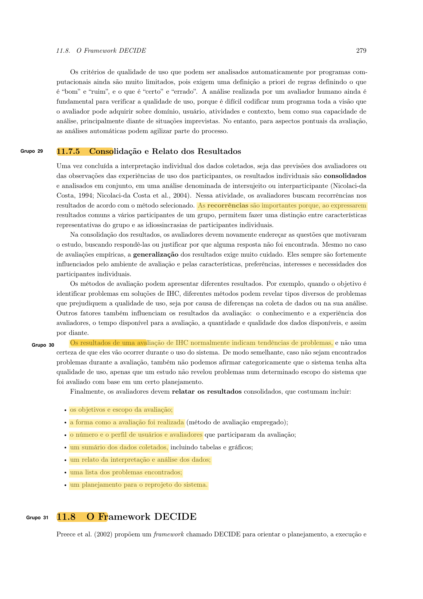
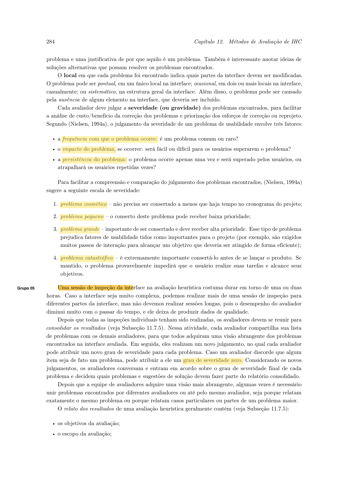
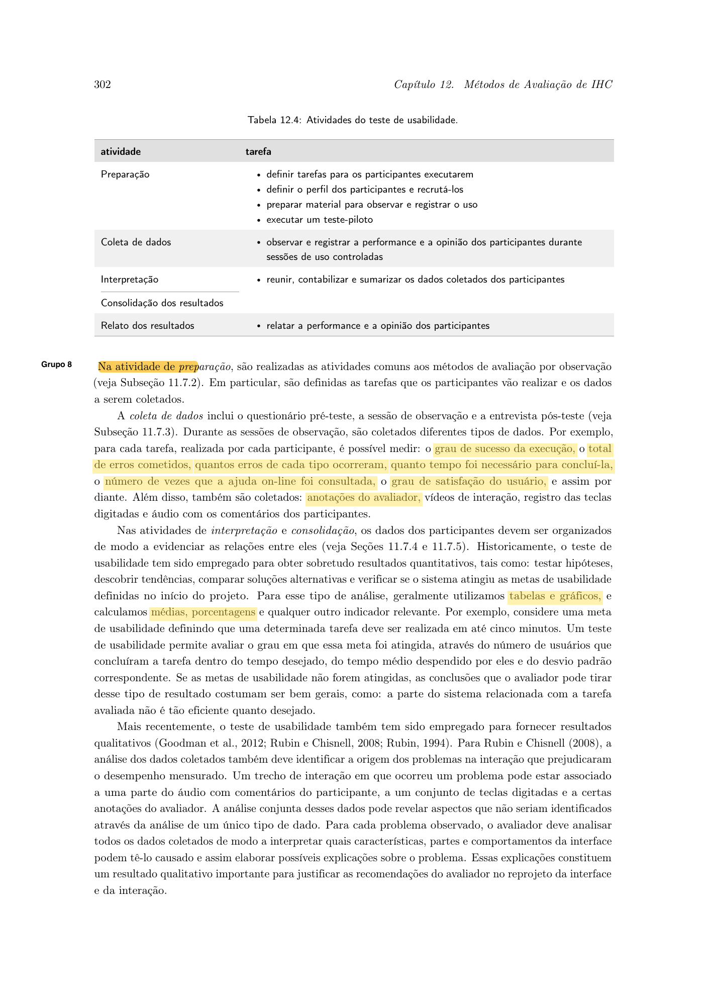
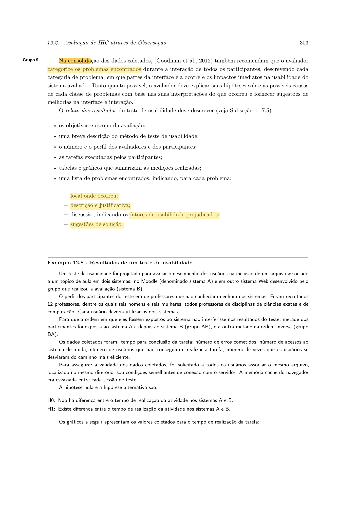
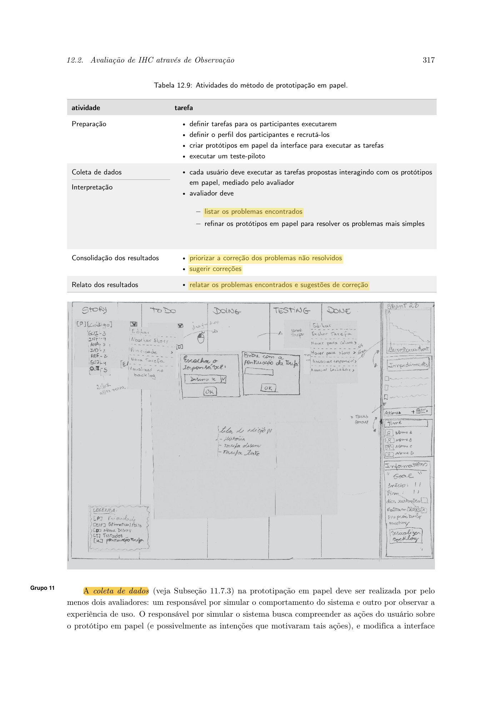
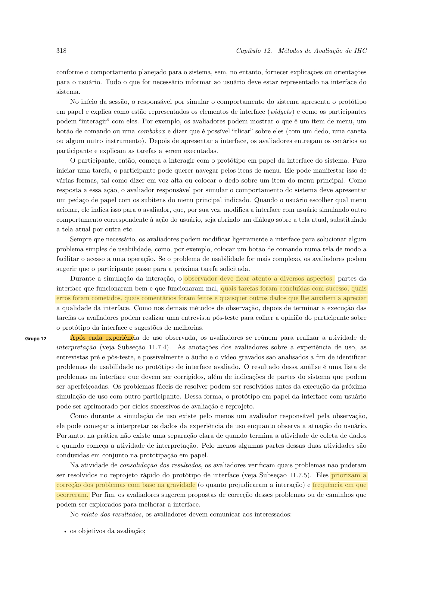

# Planejamento do Relato dos Resultados da Análise de Tarefas

## Histórico de Versão

| Data | Versão | Descrição | Autor(es) | Revisor(es) | Declaração do uso de IA |
| :---: | :---: | :--- | :--- | :--- | :--- |
| 12/10/2026 | `1.0` | Elaboração do planejamento do relato, do roteiro de observação, das métricas e dos critérios de priorização dos problemas da Análise de Tarefas. | [Arthur Mariani](https://github.com/arthur-mariani) | [Carlos Costa](https://github.com/carloshfgit) | Gemini - apoio na estruturação do documento, e formatação do mkdocs. |

---

## 1. Introdução

Este documento define antecipadamente como serão registrados, consolidados, interpretados e apresentados os resultados da avaliação das Análises de Tarefas do portal da SEMOB-DF. O planejamento contempla a estrutura do futuro relatório, o roteiro de observação do avaliador, as métricas de desempenho, o registro dos problemas e os critérios de priorização das correções.

O artefato não apresenta resultados da avaliação. As tabelas foram preparadas como modelos e somente serão preenchidas depois das sessões definitivas. Os dados do teste-piloto também não serão incorporados ao relato final, pois possuem finalidade exclusiva de calibração do procedimento.

As orientações de Barbosa et al. (2021) tratam do relato de avaliações de IHC e dos métodos de observação, teste de usabilidade, avaliação heurística e prototipação em papel. Como a obra não define um artefato denominado "Planejamento do Relato dos Resultados da Análise de Tarefas", este documento aplica essas orientações à avaliação das tarefas modeladas em HTA e CTT. Essa adaptação preserva os dados, as formas de consolidação e os critérios de priorização descritos no livro.

---

## 2. Fundamentação Teórica

### 2.1 Consolidação e relato dos resultados

Barbosa et al. (2021, Seção 11.7.5, p. 279) orientam que os resultados individuais sejam consolidados e analisados em conjunto. Nessa atividade, os avaliadores procuram recorrências que permitam distinguir resultados representativos do grupo de ocorrências particulares de um participante. A obra também alerta que os resultados normalmente indicam tendências de problemas, e não a certeza de que eles ocorrerão em qualquer situação de uso. Do mesmo modo, a ausência de problemas encontrados não comprova que a solução possua alta qualidade de uso.

Segundo os autores, o relato consolidado costuma incluir:

1. objetivos e escopo da avaliação;
2. método empregado;
3. número e perfil dos participantes e avaliadores;
4. sumário dos dados coletados, incluindo tabelas e gráficos;
5. interpretação e análise dos dados;
6. lista dos problemas encontrados;
7. planejamento para o reprojeto.

Os trechos correspondentes estão destacados na [Imagem 1](#figura-1).

### 2.2 Registro da observação e métricas

Na avaliação por observação, Barbosa et al. (2021, Seção 12.2.1, p. 302) indicam que, para cada tarefa realizada por cada participante, podem ser registrados o grau de sucesso, o total de erros, os tipos de erro, o tempo necessário, as consultas à ajuda e a satisfação. Também podem ser coletados anotações do avaliador, vídeos de interação, registros das ações e áudio com os comentários dos participantes.

Os dados devem ser reunidos, contabilizados e sumarizados. Quando forem adequados aos objetivos e à quantidade de dados disponível, podem ser empregados tabelas, gráficos, médias, porcentagens e outros indicadores relevantes. As métricas utilizadas neste planejamento são apresentadas na [Imagem 3](#figura-3).

### 2.3 Registro e consolidação dos problemas

Barbosa et al. (2021, Seção 12.2.1, p. 303) recomendam categorizar os problemas observados entre os participantes, descrevendo cada categoria, o local de ocorrência e o impacto imediato na usabilidade. Sempre que os dados permitirem, o avaliador deve registrar hipóteses sobre as possíveis causas e sugerir melhorias.

Para cada problema, o relato deve informar o local em que ocorreu, a descrição e justificativa, os fatores de usabilidade prejudicados e as sugestões de solução. Esses elementos estão destacados na [Imagem 4](#figura-4).

### 2.4 Severidade e priorização

Para apoiar a análise de custo e benefício das correções, Barbosa et al. (2021, Seção 12.1.1, p. 284) apresentam três fatores para o julgamento da severidade:

- **frequência:** indica se o problema é comum ou raro;
- **impacto:** indica se será fácil ou difícil para os usuários superarem o problema;
- **persistência:** indica se o problema ocorre uma única vez ou prejudica repetidamente a interação.

A obra apresenta a seguinte escala:

| Severidade | Classificação | Orientação para correção |
| :---: | :--- | :--- |
| **0** | Não é considerado um problema | Utilizada durante a consolidação quando um avaliador discorda que o item constitua um problema. |
| **1** | Problema cosmético | Não precisa ser corrigido, a menos que haja tempo disponível no cronograma. |
| **2** | Problema pequeno | A correção pode receber baixa prioridade. |
| **3** | Problema grande | É importante corrigi-lo e sua correção deve receber alta prioridade. |
| **4** | Problema catastrófico | É extremamente importante corrigi-lo antes da disponibilização do produto. |

Conforme ilustrado na [Imagem 2](#figura-2), o grau zero auxilia a revisão entre avaliadores. Depois da discussão, a equipe deve entrar em acordo sobre a severidade final e decidir quais problemas e sugestões integrarão o relatório consolidado.

Na prototipação em papel, os avaliadores são orientados a listar os problemas, priorizar a correção daqueles que permaneceram sem solução e sugerir correções, como mostra a [Imagem 5](#figura-5). A prioridade considera a gravidade do prejuízo à interação e a frequência de ocorrência, conforme a [Imagem 6](#figura-6). Este planejamento adota a mesma orientação qualitativa, sem criar uma fórmula numérica não definida pelo livro.

---

## 3. Estrutura Planejada do Relatório Final

O futuro relato dos resultados da avaliação da Análise de Tarefas será organizado conforme a Tabela 1.

<strong>Tabela 1</strong> - Estrutura do relatório final

| Seção | Conteúdo previsto |
| :--- | :--- |
| **Identificação da avaliação** | Data, horário, modalidade, avaliadores, participante e artefatos avaliados. |
| **Objetivos e escopo** | Objetivos da avaliação e delimitação das tarefas, operações, planos HTA e relações CTT avaliadas. |
| **Método** | Descrição de como as tarefas foram apresentadas, observadas e registradas. |
| **Participantes e avaliadores** | Quantidade e perfis das pessoas que participaram das sessões e da equipe avaliadora. |
| **Sumário dos dados** | Tabelas e, quando adequados, gráficos, médias, porcentagens ou outros indicadores relacionados às tarefas. |
| **Interpretação** | Análise conjunta dos dados quantitativos, qualitativos e das recorrências entre participantes. |
| **Problemas encontrados** | Lista consolidada, com localização, descrição, justificativa, impacto, severidade e sugestão. |
| **Planejamento do reprojeto** | Correções recomendadas e indicação dos elementos da tarefa ou da solução que precisam ser revistos. |
| **Limitações** | Restrições do estudo e questões que não puderam ser respondidas. |

<em>Fonte: Arthur Mariani (2026), adaptado de Barbosa et al. (2021, Seção 11.7.5, p. 279).</em>

---

## 4. Roteiro de Observação do Avaliador

Durante cada sessão, o avaliador deverá observar a realização das tarefas e registrar os dados previstos na Tabela 2. O roteiro deriva dos dados de observação descritos por Barbosa et al. (2021, pp. 302 e 318).

<strong>Tabela 2</strong> - Roteiro de observação por tarefa

| Item observado | Registro previsto |
| :--- | :--- |
| **Tarefa** | Identificação da tarefa e da operação ou etapa analisada. |
| **Grau de sucesso** | Registro do grau em que o participante conseguiu realizar a tarefa. |
| **Erros** | Total de erros e identificação dos tipos de erro observados. |
| **Tempo** | Tempo necessário para concluir ou interromper a tarefa, quando essa medida for aplicável. |
| **Uso de ajuda** | Quantidade de consultas ou solicitações de ajuda, quando houver mecanismo de ajuda disponível. |
| **Percurso** | Ações realizadas e eventuais desvios em relação ao caminho previsto na análise da tarefa. |
| **Comentários** | Falas e opiniões relevantes manifestadas pelo participante. |
| **Satisfação** | Opinião ou medida de satisfação definida no instrumento da avaliação. |
| **Evidências complementares** | Anotações, áudio, vídeo ou registros das ações disponíveis para apoiar a interpretação. |

<em>Fonte: Arthur Mariani (2026), adaptado de Barbosa et al. (2021, Seção 12.2.1, p. 302; Seção 12.2.3, p. 318).</em>

As medidas de tempo, uso de ajuda e satisfação serão utilizadas apenas quando forem compatíveis com o método definido no planejamento da avaliação. Quando não forem aplicáveis à forma de apresentação da HTA ou da CTT, o avaliador deverá registrar **Não se aplica**, sem atribuir valores artificiais.

### 4.1 Ficha de registro da sessão

<strong>Tabela 3</strong> - Ficha de registro da sessão

| Participante | Tarefa ou operação | Grau de sucesso | Tempo | Erros | Ajuda | Ações e desvios observados | Comentários e satisfação | Evidência |
| :--- | :--- | :--- | :---: | :---: | :---: | :--- | :--- | :--- |
| A preencher | A preencher | A preencher | A preencher | A preencher | A preencher | A preencher | A preencher | A preencher |

<em>Fonte: Arthur Mariani (2026), adaptado de Barbosa et al. (2021, Seção 12.2.1, p. 302).</em>

---

## 5. Métricas e Forma de Sumarização

As métricas previstas para o relato estão apresentadas na Tabela 4. Sua utilização dependerá dos objetivos, do método e da quantidade de dados coletados.

<strong>Tabela 4</strong> - Métricas planejadas

| Métrica | Forma planejada de registro e apresentação |
| :--- | :--- |
| **Grau de sucesso** | Resultado registrado por participante e tarefa, seguido de consolidação quando os dados permitirem. |
| **Erros** | Total de erros e quantidade de ocorrências de cada tipo. |
| **Tempo** | Tempo individual e, quando pertinente, média e dispersão dos tempos observados. |
| **Uso de ajuda** | Número de consultas ou solicitações de ajuda por participante e tarefa. |
| **Satisfação** | Opiniões ou medidas registradas pelo instrumento da avaliação. |
| **Desvios do percurso previsto** | Quantidade e descrição dos desvios entre a execução observada e o caminho representado na tarefa. |
| **Recorrência de problemas** | Número de participantes ou tarefas em que o mesmo problema foi observado. |
| **Evidências qualitativas** | Síntese das anotações, comentários, áudios, vídeos e registros associados a cada problema. |

<em>Fonte: Arthur Mariani (2026), adaptado de Barbosa et al. (2021, Seção 11.7.5, p. 279; Seção 12.2.1, pp. 302-303).</em>

O relatório deverá relacionar os dados quantitativos às evidências qualitativas. Um número de erros ou um tempo elevado, isoladamente, não explica a origem de um problema. Por isso, as medições serão interpretadas em conjunto com as ações, os comentários e as anotações da sessão.

---

## 6. Consolidação dos Problemas

Depois da interpretação individual, os avaliadores deverão reunir seus registros, procurar recorrências e consolidar ocorrências equivalentes. Problemas idênticos, casos particulares de um problema mais amplo ou partes de uma mesma dificuldade deverão ser reunidos antes da atribuição da severidade final.

<strong>Tabela 5</strong> - Registro consolidado dos problemas

| ID | Tarefa | Local ou operação | Descrição e justificativa | Evidência | Fator prejudicado | Frequência | Impacto | Persistência | Severidade | Sugestão de correção |
| :---: | :--- | :--- | :--- | :--- | :--- | :--- | :--- | :--- | :---: | :--- |
| PROB-01 | A preencher | A preencher | A preencher | A preencher | A preencher | A preencher | A preencher | A preencher | A preencher | A preencher |

<em>Fonte: Arthur Mariani (2026), adaptado de Barbosa et al. (2021, Seção 12.1.1, pp. 284-285; Seção 12.2.1, p. 303).</em>

---

## 7. Procedimento de Priorização

A equipe seguirá o procedimento abaixo:

1. reunir os registros individuais dos avaliadores;
2. identificar recorrências e consolidar ocorrências equivalentes;
3. discutir se cada item constitui de fato um problema;
4. atribuir severidade **0** quando, durante a consolidação, o item não for considerado um problema;
5. para os problemas aceitos, analisar frequência, impacto e persistência;
6. atribuir severidade de **1** a **4** por consenso;
7. priorizar os problemas não resolvidos considerando sua gravidade e frequência;
8. registrar as sugestões de correção que integrarão o futuro planejamento de reprojeto.

Não será calculada uma pontuação pela multiplicação ou soma dos fatores. O livro apresenta esses fatores como fundamentos para o julgamento e para o consenso entre avaliadores, e não como uma fórmula numérica.

---

## 8. Modelo do Sumário dos Resultados

<strong>Tabela 6</strong> - Sumário planejado por tarefa

| Tarefa | Participantes | Resultados de sucesso | Erros observados | Tempo e ajuda, se aplicáveis | Problemas recorrentes | Síntese das opiniões |
| :--- | :---: | :--- | :--- | :--- | :--- | :--- |
| TAR-01 a TAR-07 | A preencher | A preencher | A preencher | A preencher | A preencher | A preencher |

<em>Fonte: Arthur Mariani (2026), adaptado de Barbosa et al. (2021, Seção 11.7.5, p. 279; Seção 12.2.1, pp. 302-303).</em>

O relato conclusivo deverá apresentar a interpretação das recorrências, os principais problemas ordenados por severidade, as sugestões de correção, os elementos que precisam ser reprojetados e as limitações da avaliação. As conclusões deverão permanecer restritas ao escopo, aos participantes e às condições efetivamente avaliadas.

---

## 9. Fotos de Referência

### 9.1 Consolidação e estrutura do relato

<figure id="figura-1" markdown="span">
  
  <figcaption>Imagem 1 - Consolidação, limites de interpretação e estrutura do relato. Fonte: Barbosa et al. (2021, Seção 11.7.5, p. 279).</figcaption>
</figure>

### 9.2 Fatores e escala de severidade

<figure id="figura-2" markdown="span">
  
  <figcaption>Imagem 2 - Fatores e escala de severidade, incluindo o uso do grau zero na consolidação. Fonte: Barbosa et al. (2021, Seção 12.1.1, p. 284).</figcaption>
</figure>

### 9.3 Métricas e registros da observação

<figure id="figura-3" markdown="span">
  
  <figcaption>Imagem 3 - Dados coletados por tarefa e formas de sumarização. Fonte: Barbosa et al. (2021, Seção 12.2.1, p. 302).</figcaption>
</figure>

### 9.4 Estrutura do registro dos problemas

<figure id="figura-4" markdown="span">
  
  <figcaption>Imagem 4 - Categorização e campos do relato dos problemas. Fonte: Barbosa et al. (2021, Seção 12.2.1, p. 303).</figcaption>
</figure>

### 9.5 Atividades de registro e priorização

<figure id="figura-5" markdown="span">
  
  <figcaption>Imagem 5 - Listagem, priorização e relato dos problemas. Fonte: Barbosa et al. (2021, Seção 12.2.3, p. 317).</figcaption>
</figure>

### 9.6 Aspectos observados e critério de prioridade

<figure id="figura-6" markdown="span">
  
  <figcaption>Imagem 6 - Aspectos observados e priorização por gravidade e frequência. Fonte: Barbosa et al. (2021, Seção 12.2.3, p. 318).</figcaption>
</figure>

---

## 10. Referências Bibliográficas

BARBOSA, Simone Diniz Junqueira; SILVA, Bruno Santana da; SILVEIRA, Milene Selbach; GASPARINI, Isabela; DARIN, Ticianne; BARBOSA, Gabriel Diniz Junqueira. **Interação Humano-Computador e Experiência do Usuário**. Rio de Janeiro: Autopublicação, 2021. ISBN 978-65-00-19677-1.

