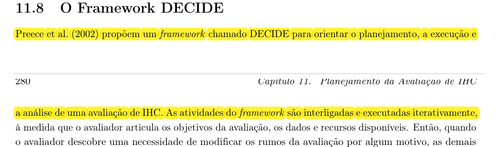
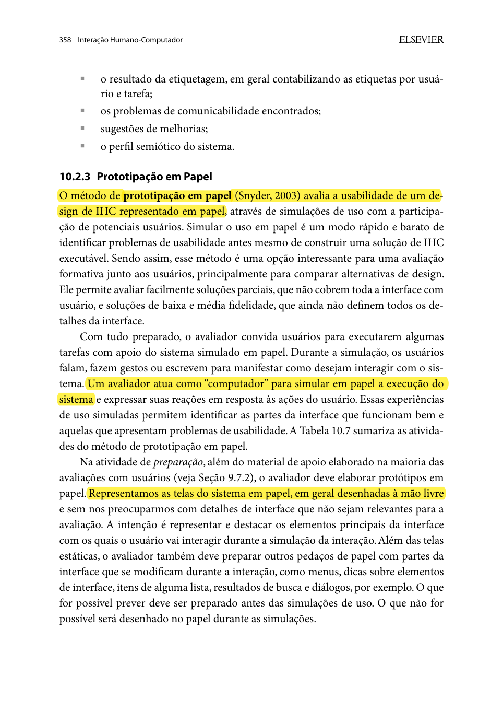
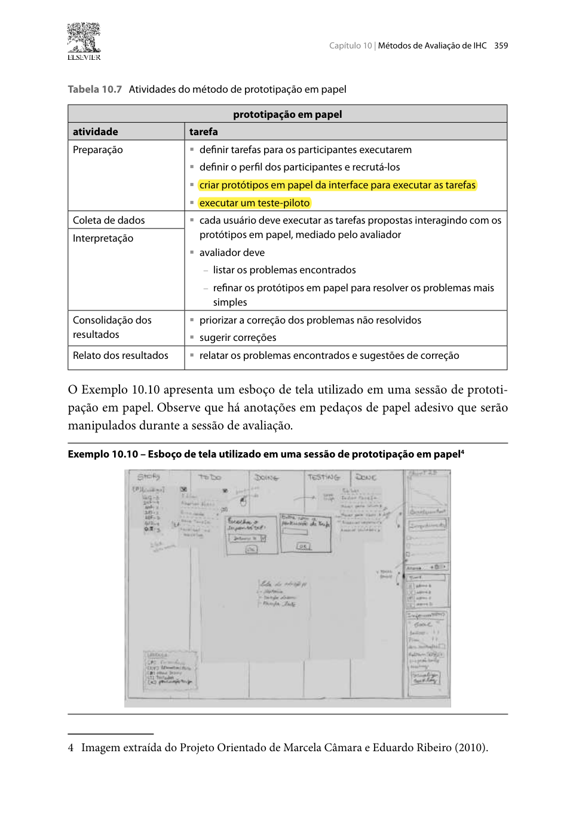

## Histórico de Versão

| Data | Versão | Descrição | Autor(es) | Revisor(es) | Declaração de uso de IA |
| :---: | :---: | :--- | :--- | :--- | :--- |
| 27/10/2026 | `1.0` | Criação do planejamento individual da avaliação do Protótipo de Papel (TAR-06) via DECIDE. | [Carlos Costa](https://github.com/carloshfgit) | [Igor Dantas Araújo](https://github.com/IgorDARAUJO) | Claude Code (Anthropic) - apenas revisou e formatou o texto em Markdown |

---

# Planejamento da Avaliação do Protótipo de Papel (TAR-06)

Neste documento, apresenta-se o **Planejamento da Avaliação do Protótipo de Papel** referente à **[TAR-06 (Consulta de ônibus em tempo real no DF no Ponto)](../../../../analise-de-requisitos/analise-de-tarefas/tar-06-df-no-ponto.md)**. Trata-se de um planejamento individual para orientar a avaliação formativa de um protótipo de baixa fidelidade, desenhado em papel, da consulta em tempo real que aparece no [Storyboard 08](../../storyboards.md#38-storyboard-08-consulta-do-onibus-em-tempo-real-no-df-no-ponto).

A avaliação envolve a simulação de uso por um participante do perfil da persona [João Pedro Carvalho](../../../../analise-de-requisitos/personas/joao-pedro-carvalho.md) e é estruturada pelo **Framework DECIDE** (Preece et al., 2002; Barbosa et al., 2021) ([Imagem 1](#imagem-1)). O protótipo incorpora as recomendações da TAR-06 e os resultados da [avaliação do Storyboard 08 e da TAR-06](../../relatos-individuais/carlos/relato-resultados-storyboard-tarefas.md).

---

## 1. D — Determinar os Objetivos da Avaliação

Segundo Barbosa e Silva (2010, Seção 10.2.3, p. 358), *"o método de prototipação em papel (Snyder, 2003) avalia a usabilidade de um design de IHC representado em papel, através de simulações de uso com a participação de potenciais usuários"*. É uma opção para avaliação formativa, antes de construir uma solução executável ([Imagem 2](#imagem-2)).

### 1.1 Objetivos Principais
* **Identificar problemas de usabilidade e navegação:** detectar rótulos confusos, botões ambíguos e falhas de layout nas telas de busca, resultados e detalhe da linha.
* **Avaliar a interpretação da previsão:** verificar se o participante entende o tempo previsto, a posição no mapa e a indicação de **última atualização**, que é a recomendação da hipótese H4 da TAR-06.
* **Avaliar a reação a uma informação defasada:** observar se o participante percebe o aviso de posição desatualizada e toma uma decisão coerente (hipótese H5).
* **Avaliar os atalhos para consultas frequentes:** verificar se favoritar a linha e ativar o aviso de atraso são encontrados e compreendidos (objetivo 5 da HTA e hipótese H2).
* **Coletar sugestões de reprojeto** para o protótipo de alta fidelidade.

---

## 2. E — Explorar as Perguntas a Serem Respondidas

<strong>Tabela 1</strong> — Perguntas da Avaliação do Protótipo de Papel

| ID | Categoria / Foco | Pergunta de Investigação | Hipótese / Elemento da TAR-06 | Critério de Aceitação |
| :---: | :--- | :--- | :--- | :--- |
| **P01** | **Busca** | O participante encontra a linha, pelo número ou pela referência "UnB Gama", sem ajuda? | HTA 2.1; H2 e H6 | Escolhe um dos caminhos de busca sem hesitação prolongada. |
| **P02** | **Seleção na lista** | O participante seleciona a linha e o ponto corretos na lista de resultados? | HTA 2.2; H3 | Não toca em resultado errado, ou percebe e corrige sozinho. |
| **P03** | **Leitura da previsão** | O participante lê o tempo previsto e localiza o ônibus no mapa? | HTA 3.1 | Informa corretamente em quanto tempo o ônibus chega. |
| **P04** | **Confiabilidade** | O participante nota e entende a indicação "atualizado há X"? | HTA 3.2; H4 | Explica, com suas palavras, o que a indicação significa. |
| **P05** | **Informação defasada** | Ao aparecer o aviso de posição desatualizada, o participante entende o aviso e decide o que fazer? | HTA 4; H5 | Escolhe esperar e consultar de novo ou buscar alternativa, justificando. |
| **P06** | **Consultas frequentes** | O participante encontra como favoritar a linha e ativar o aviso de atraso? | HTA 5; H2 | Conclui as duas ações sem ajuda. |

<em>Fonte: Elaborado por Carlos Costa (2026).</em>

---

## 3. C — Choose (Escolher) os Métodos de Avaliação

O método escolhido é a **Prototipação em Papel** (Snyder, 2003; Barbosa e Silva, 2010, Seção 10.2.3), um método de observação de uso com o participante. A Tabela 10.7 do livro resume suas atividades: preparação, coleta de dados, interpretação, consolidação e relato ([Imagem 3](#imagem-3)).

* **Justificativa:** o método é rápido e barato, permite avaliar soluções parciais, como uma única tarefa, e permite redesenhar uma tela no papel durante a própria sessão.
* **Técnica complementar:** o participante é incentivado a **pensar em voz alta** (*think aloud*), falando o que procura e o que espera de cada toque.

### 3.1 Tarefas Propostas ao Participante

As tarefas são apresentadas em um cartão impresso, com o contexto do Cenário 2: *"Você está no ponto de manhã e precisa chegar à UnB Gama para a primeira aula."*

<strong>Tabela 2</strong> — Tarefas da sessão com o protótipo de papel

| ID | Tarefa | Objetivos da HTA cobertos | Perguntas relacionadas |
| :---: | :--- | :--- | :--- |
| **06.1** | Descobrir em quanto tempo chega o próximo ônibus da sua linha para a UnB Gama. | 1, 2 e 3.1 | P01, P02, P03 |
| **06.2** | O app mostrou um aviso sobre a posição do ônibus. Decida o que fazer. | 3.2 e 4 | P04, P05 |
| **06.3** | Deixe essa linha pronta para as próximas manhãs e peça para ser avisado se ela atrasar. | 5 | P06 |

<em>Fonte: Elaborado por Carlos Costa (2026).</em>

---

## 4. I — Identificar e Administrar as Questões Práticas

### 4.1 Confecção do Protótipo em Papel

As telas são desenhadas à mão livre, sem detalhes que não importam para a avaliação. Além das telas estáticas, são preparados pedaços de papel com as partes que mudam durante a interação, como resultados de busca e mensagens (Barbosa e Silva, 2010, p. 358) ([Imagem 2](#imagem-2)).

<strong>Tabela 3</strong> — Telas e peças do protótipo de papel

| Peça | Tipo | Conteúdo | Tarefa |
| :--- | :--- | :--- | :--- |
| **Moldura de celular** | Base | Cartolina no formato de smartphone, que delimita a área da tela. | Todas |
| **T1 — Tela inicial** | Tela estática | Campo de busca com duas opções visíveis, "linha" e "lugar de referência", e área de linhas favoritas (vazia). | 06.1, 06.3 |
| **T2 — Resultados da busca** | Peça móvel | Lista de linhas e pontos próximos, com nomes parecidos para testar a seleção (H3). | 06.1 |
| **T3 — Detalhe da linha** | Tela estática | Tempo previsto ("chega em 4 min"), mapa com o ônibus, indicação "atualizado há 30 s" e botões "favoritar" e "avisar atraso". | 06.1, 06.2, 06.3 |
| **N1 — Aviso de posição desatualizada** | Peça móvel (*post-it*) | "Posição sem atualização há 5 min. A previsão pode estar errada." com as opções "consultar de novo" e "ver alternativas". | 06.2 |
| **T4 — Alternativas** | Tela estática | Outras linhas para o mesmo destino, com tempos previstos. | 06.2 |
| **N2 — Confirmações** | Peças móveis | "Linha salva nos favoritos" e "Você será avisado de atrasos nesta linha". | 06.3 |
| **Peças em branco** | Reserva | Papéis e canetas para redesenhar durante a sessão. | Todas |

<em>Fonte: Elaborado por Carlos Costa (2026).</em>

### 4.2 Papéis na Sessão

Na sessão, *"um avaliador atua como 'computador' para simular em papel a execução do sistema"* (Barbosa e Silva, 2010, p. 358), enquanto outro observa e registra ([Imagem 4](#imagem-4)):

* **Participante:** realiza as tarefas tocando no papel com o dedo e falando o que pensa.
* **"Computador" — Carlos Costa:** troca telas e peças **apenas em resposta às ações** do participante, sem dar dicas.
* **Observador — a confirmar com a equipe:** grava a mesa, cronometra cada tarefa e anota hesitações, erros e comentários.

### 4.3 Recrutamento e Perfil do Participante
* **Perfil:** estudante universitário da FCTE/UnB Gama que usa ônibus e já usou o DF no Ponto ou app semelhante (perfil de João Pedro Carvalho).
* **Quantidade:** 1 participante. Para não enviesar o resultado, deve ser **diferente** do participante da avaliação do storyboard, que já conhece a proposta.
* **Exclusão:** integrantes do Grupo 05.

### 4.4 Infraestrutura e Cronograma

<strong>Tabela 4</strong> — Cronograma da sessão com o protótipo de papel

| Parâmetro | Detalhamento |
| :--- | :--- |
| **Teste piloto:** | 31/10/2026, com um integrante do grupo como participante simulado. |
| **Sessão:** | 01/11/2026 (dom), 14:00 (a confirmar com o participante). |
| **Local:** | Ambiente presencial tranquilo e iluminado (sala de estudos na FCTE/UnB Gama ou outro local combinado). |
| **Gravação:** | Celular em suporte, enquadrando a mesa e as mãos, com áudio. |
| **Duração prevista:** | 25 minutos (5 min de recepção e TCLE, 15 min de tarefas e 5 min de conversa final). |
| **Materiais:** | TCLE impresso, cartão com o cenário e as tarefas, peças do protótipo e ficha do observador. |
| **Orçamento:** | **R\$ 0,00** (papel, canetas e celular próprios). |

<em>Fonte: Elaborado por Carlos Costa (2026).</em>

---

## 5. D — Decidir como Lidar com as Questões Éticas

Os cuidados seguem a Resolução nº 510/2016 do CNS e Barbosa et al. (2021, Seção 11.8, p. 280) ([Imagem 5](#imagem-5)):

1. **TCLE impresso:** o participante lê e assina o [Termo de Consentimento Livre e Esclarecido](../../../../assets/PDFs/TCLE_Pesquisa_Transporte.pdf) antes de começar.
2. **Imagem e áudio:** a câmera enquadra apenas a mesa e as mãos; o rosto do participante não aparece.
3. **Anonimato e liberdade:** o participante é identificado por código e pode parar a qualquer momento, sem prejuízo.
4. **Foco no protótipo:** o avaliador explica que é o protótipo que está sendo testado, não a pessoa, e que errar ajuda a encontrar problemas.

---

## 6. E — Avaliar, Interpretar e Apresentar os Dados

1. **Revisão do vídeo e das anotações:** registrar, para cada tarefa, sucesso sem ajuda, tempo, pedidos de ajuda e falas marcantes.
2. **Problemas encontrados:** listar os problemas com a escala de severidade de 0 a 4 (Nielsen, 1994).
3. **Correções no papel:** problemas simples podem ser redesenhados durante a sessão; o relato separa os problemas corrigidos no papel dos que ficam para a alta fidelidade.
4. **Hipóteses da TAR-06:** registrar se a sessão reforça ou contradiz H2 a H6.
5. **Relato:** os resultados seguem a estrutura definida no [Planejamento do Relato do Protótipo de Papel](carlos-planejamento-relato-prot-papel.md).

---

## 7. Planejamento do Teste Piloto

Antes da sessão com o participante, é feito um **teste piloto** (Barbosa et al., 2021, Seção 11.7.2, p. 260) ([Imagem 6](#imagem-6)):

* **Objetivo:** verificar se as peças cobrem todos os caminhos das três tarefas, treinar a troca rápida das peças pelo "computador", conferir o tempo e testar o enquadramento da gravação.
* **Data e participante:** 31/10/2026, com um integrante do grupo como participante simulado.
* **Dados do piloto:** servem **apenas para calibrar** o material e o procedimento e **não entram nos resultados** da avaliação.

---

## 8. Fotos de Referência

<em>Imagem 1 — Framework DECIDE (Barbosa et al., 2021, Seção 11.8, p. 279–280).</em>

<em>Imagem 2 — Prototipação em papel: definição, avaliador "computador" e preparação das telas e peças (Barbosa e Silva, 2010, Seção 10.2.3, p. 358).</em>

<em>Imagem 3 — Tabela 10.7: atividades do método de prototipação em papel (Barbosa e Silva, 2010, Seção 10.2.3, p. 359).</em>

<em>Imagem 4 — Condução da simulação e papéis do "computador" e do observador (Barbosa e Silva, 2010, Seção 10.2.3, p. 360).</em>

<em>Imagem 5 — Questões éticas da avaliação com usuários (Barbosa et al., 2021, Seção 11.8, p. 280).</em>

<em>Imagem 6 — Teste piloto (Barbosa et al., 2021, Seção 11.7.2, p. 260).</em>

---

## 9. Declaração sobre o Uso de IA Generativa

Em cumprimento ao Plano de Ensino e ao Código de Conduta da SBC, declara-se que a ferramenta **Claude Code (Anthropic)** foi utilizada apenas para revisar e formatar o texto em Markdown a partir do conteúdo e das decisões estruturadas por Carlos Costa. Carlos Costa responde integralmente pelo conteúdo.

---

## 10. Referências Bibliográficas

* BARBOSA, Simone Diniz Junqueira; SILVA, Bruno Santana da. **Interação Humano-Computador**. Rio de Janeiro: Elsevier, 2010. (Capítulo 10, Seção 10.2.3: Prototipação em Papel, p. 358–362).
* BARBOSA, Simone Diniz Junqueira; SILVA, Bruno Santana da; SILVEIRA, Milene Selbach; GASPARINI, Isabela; DARIN, Ticianne; BARBOSA, Gabriel Diniz Junqueira. **Interação Humano-Computador e Experiência do Usuário**. Rio de Janeiro: Autopublicação, 2021. ISBN 978-65-00-19677-1. (Capítulo 11, Seções 11.7.2 e 11.8, p. 260, 279–280).
* BRASIL. Conselho Nacional de Saúde. **Resolução nº 510, de 07 de abril de 2016**. Regulamenta as pesquisas em Ciências Humanas e Sociais. Brasília: Diário Oficial da União, 2016.
* NIELSEN, Jakob. **Usability Engineering**. San Francisco: Morgan Kaufmann, 1994.
* PREECE, Jennifer; ROGERS, Yvonne; SHARP, Helen. **Design de Interação: Além da interação homem-computador**. São Paulo: Editora Érica, 2005.
* SALES, André Barros de. **Plano de Ensino: Interação Humano Computador**. Brasília: Universidade de Brasília, Faculdade UnB Gama (FCTE/UnB), 2026.
* SNYDER, Carolyn. **Paper Prototyping: The Fast and Easy Way to Design and Refine User Interfaces**. San Francisco: Morgan Kaufmann, 2003.

---
**Autor:** [Carlos Costa](https://github.com/carloshfgit)  
**Revisor:** [Igor Dantas Araújo](https://github.com/IgorDARAUJO)
