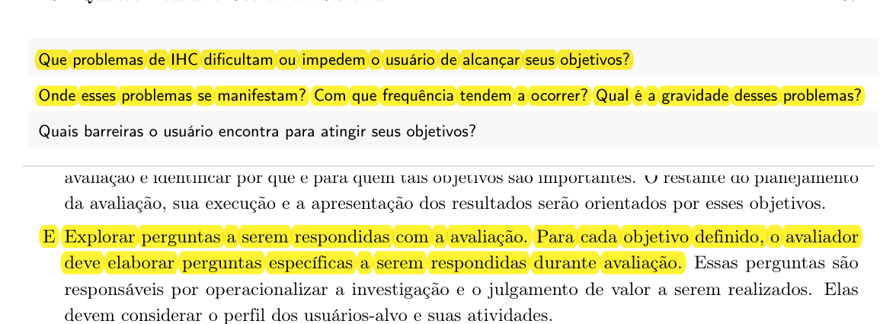
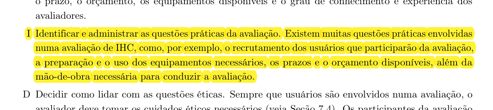

## Histórico de Versão

| Data | Versão | Descrição | Autor(es) | Revisor(es) | Declaração de uso de IA |
| :---: | :---: | :--- | :--- | :--- | :--- |
| 27/10/2026 | `1.0` | Criação do planejamento individual da avaliação do Storyboard 08 e da Análise de Tarefas (TAR-06) via DECIDE, com registro da alteração de escopo. | [Carlos Costa](https://github.com/carloshfgit) | [Igor Dantas Araújo](https://github.com/IgorDARAUJO) | Claude Code (Anthropic) - apenas revisou e formatou o texto em Markdown |

---

# Planejamento da Avaliação do Storyboard e da Análise de Tarefas (TAR-06)

Neste documento, apresenta-se o **Planejamento da Avaliação do Storyboard e da Análise de Tarefas** referente à **[TAR-06 (Consulta de ônibus em tempo real no DF no Ponto)](../../../../analise-de-requisitos/analise-de-tarefas/tar-06-df-no-ponto.md)**. Trata-se de um planejamento individual para orientar a avaliação formativa do **[Storyboard 08](../../storyboards.md#38-storyboard-08-consulta-do-onibus-em-tempo-real-no-df-no-ponto)** e dos modelos de **Análise Hierárquica de Tarefas (HTA)** e **CMN-GOMS** da tarefa.

O planejamento aplica o **Framework DECIDE** (Preece et al., 2002; Barbosa et al., 2021), que estrutura a avaliação em seis atividades interligadas: **D**eterminar objetivos, **E**xplorar perguntas, **C**hoose (escolher) métodos, **I**dentificar questões práticas, **D**ecidir questões éticas e **E**valuate (avaliar e interpretar os dados). Conforme Barbosa et al. (2021, Seção 11.8, p. 279–280), essas atividades são executadas de forma iterativa: quando o avaliador precisa mudar os rumos da avaliação, as demais atividades são afetadas ([Imagem 1](#imagem-1)). É o que aconteceu neste planejamento, como explica a seção a seguir.

---

## Alteração de Escopo

O planejamento original de Carlos Costa previa avaliar o **Storyboard 04** e a **TAR-04/TAR-05** (consulta de escala e alertas operacionais) com um **motorista de ônibus do STPC/DF**, perfil da persona Valdir Soares. Esse participante não pôde ser recrutado a tempo.

Avaliar as tarefas do motorista com outra pessoa não resolveria o problema: um passageiro não tem vivência para dizer se a consulta de escala e o processamento de alertas operacionais condizem com a prática da profissão. Recrutar alguém do perfil avaliado é uma das questões práticas da atividade **I** do DECIDE (Barbosa et al., 2021, Seção 11.8, p. 280) e uma das premissas do [Cronograma e Logística das Sessões](../../cronograma-e-logistica-das-sessoes.md) (premissa 3: um participante do perfil da persona retratada).

Por isso, com a concordância de todos os integrantes do grupo, a avaliação passou a ser:

<strong>Tabela 1</strong> — Escopo original e escopo atual da avaliação

| Elemento | Escopo original | Escopo atual |
| :--- | :--- | :--- |
| **Storyboard** | Storyboard 04 — Consulta de escala e alertas operacionais | [Storyboard 08 — Consulta do ônibus em tempo real no DF no Ponto](../../storyboards.md#38-storyboard-08-consulta-do-onibus-em-tempo-real-no-df-no-ponto) |
| **Tarefa** | TAR-04/TAR-05 (HTA e CTT) | [TAR-06](../../../../analise-de-requisitos/analise-de-tarefas/tar-06-df-no-ponto.md) (HTA e CMN-GOMS, elaborada por Rodrigo Barbosa) |
| **Persona** | Valdir Soares | [João Pedro Carvalho](../../../../analise-de-requisitos/personas/joao-pedro-carvalho.md) |
| **Cenário** | Cenários 5 e 6 | [Cenário 2 — Viagem matutina](../../../../analise-de-requisitos/cenarios/cenario-2-viagem-matutina.md) |
| **Participante (P04)** | Motorista de ônibus do STPC/DF | Estudante universitário que usa ônibus e já usou o DF no Ponto ou app de rastreamento semelhante |

<em>Fonte: Elaborado por Carlos Costa (2026).</em>

A TAR-06 foi escolhida por três motivos: (1) ela **não tinha storyboard nem avaliação**, então a troca não duplica o trabalho de outro integrante; (2) o próprio documento da TAR-06 declara que, por ter sido feito apenas com documentação, seus passos, problemas e recomendações são **hipóteses a validar com usuários** (hipóteses H1 a H7); e (3) o problema central de João Pedro é justamente que, quando o ônibus não aparece no mapa ou o horário falha, ele perde o transporte. O Storyboard 04 continua no projeto como artefato da Etapa 4.

---

## 1. D — Determinar os Objetivos da Avaliação

Segundo Barbosa et al. (2021, Seções 11.2 e 11.8), os objetivos da avaliação direcionam todo o estudo e costumam envolver a apropriação da tecnologia pelos usuários, ideias e alternativas de design, conformidade com padrões e problemas na interação e na interface ([Imagem 2](#imagem-2)). Esta avaliação é **formativa** e se concentra em **ideias de design** (Storyboard 08) e em **problemas na interação** previstos no modelo de tarefas (TAR-06).

### 1.1 Objetivos da Avaliação do Storyboard 08
* **Verificar a clareza da narrativa:** confirmar se o participante entende a história sem explicações do avaliador.
* **Verificar a verossimilhança:** avaliar se a situação de esperar no ponto sem saber se o ônibus vem, e de desconfiar da previsão, corresponde à realidade de um estudante no DF.
* **Avaliar a reação da persona:** verificar se a decisão de João Pedro diante da informação defasada (quadro 4) faz sentido para o participante.
* **Avaliar o engajamento:** identificar se o participante usaria a consulta em tempo real e em que momentos.

### 1.2 Objetivos da Avaliação da Análise de Tarefas (TAR-06 — HTA e CMN-GOMS)
* **Avaliar a correção e a completude do fluxo:** verificar se a sequência abrir → buscar → interpretar → decidir → facilitar as próximas consultas representa o que o participante faz.
* **Validar as hipóteses H1 a H7:** confirmar ou refutar cada hipótese registrada na [Tabela 5 da TAR-06](../../../../analise-de-requisitos/analise-de-tarefas/tar-06-df-no-ponto.md#5-hipoteses-a-validar).
* **Validar as regras de seleção do GOMS:** verificar se a escolha entre buscar pela linha (método 2.A) ou por ponto de referência (método 2.B), e entre aceitar ou verificar a previsão (métodos 3.A e 3.B), corresponde ao raciocínio real do participante.
* **Coletar sugestões de reprojeto** para o protótipo de papel da Etapa seguinte.

---

## 2. E — Explorar as Perguntas a Serem Respondidas

As perguntas operacionalizam os objetivos (Barbosa et al., 2021, Seção 11.8 e Tabela 11.1) ([Imagem 3](#imagem-3)). As perguntas do storyboard seguem o mesmo roteiro básico do teste piloto, para que os resultados possam ser comparados com os dos demais storyboards. As perguntas da análise de tarefas foram derivadas das hipóteses da TAR-06.

### 2.1 Tabela de Perguntas: Avaliação do Storyboard 08

<strong>Tabela 2</strong> — Roteiro de Perguntas para Avaliação do Storyboard 08

| ID | Categoria / Foco | Pergunta Orientada ao Participante | Resposta Esperada / Critério de Aceitação |
| :---: | :--- | :--- | :--- |
| **Q01** | **Clareza Narrativa** | Com suas palavras, o que acontece nesta história? | O participante resume a história (o ônibus não aparece, João Pedro consulta o app, desconfia da previsão e decide) sem explicações adicionais. |
| **Q02** | **Verossimilhança** | Você já ficou no ponto sem saber se o ônibus vinha, ou desconfiou do horário mostrado no aplicativo? Como foi? | O participante reconhece a situação ou explica por que ela não acontece com ele. |
| **Q03** | **Reação da Persona** | No quadro 4, o João Pedro percebe que a posição do ônibus parou de atualizar. A decisão dele faz sentido para você? O que você faria? | O participante considera a reação coerente ou descreve outra estratégia. |
| **Q04** | **Engajamento** | Você usaria essa consulta no seu dia a dia? Em que momento? | O participante indica se e quando usaria a funcionalidade e sugere ajustes. |

<em>Fonte: Elaborado por Carlos Costa (2026).</em>

### 2.2 Tabela de Perguntas: Avaliação da Análise de Tarefas (TAR-06 — HTA e CMN-GOMS)

<strong>Tabela 3</strong> — Roteiro de Perguntas para Validação da Análise de Tarefas

| ID | Categoria / Foco | Pergunta Orientada ao Participante | Hipótese / Elemento Avaliado | Resposta Esperada / Critério de Aceitação |
| :---: | :--- | :--- | :--- | :--- |
| **QT01** | **Sequência Lógica** | A ordem abrir o app → buscar a linha ou o ponto → ler a previsão → decidir o que fazer é como você faz na prática? | Plano 0 da HTA | O participante concorda com a sequência ou aponta passos faltantes ou desnecessários. |
| **QT02** | **Permissão de Localização** | Quando um app de transporte pede sua localização, você costuma permitir? Por quê? | H1 (HTA 1.2) | O participante explica o que faz e o que o levaria a permitir ou negar. |
| **QT03** | **Estratégia de Busca** | Você costuma buscar pelo número da linha ou por um lugar de referência, como a UnB Gama? Sabia que a busca por referência existe? | H2 e H6 (HTA 2.1; GOMS 2.A e 2.B) | O participante descreve a estratégia que usa e se lembra o número da linha. |
| **QT04** | **Seleção na Lista** | Já escolheu a linha ou o ponto errado numa lista de resultados? O que confundiu? | H3 (HTA 2.2) | O participante relata se já errou e por quê. |
| **QT05** | **Confiabilidade da Informação** | Você confia no tempo previsto que aparece no app? Ver a hora da última atualização da posição ajudaria? | H4 (HTA 3.2; GOMS 3.A e 3.B) | O participante diz se confia na previsão e se o indicador de atualização mudaria isso. |
| **QT06** | **Decisão com Dado Defasado** | Quando a previsão parece errada (o ônibus "parado" no mapa ou o tempo que não diminui), o que você faz? | H5 (HTA 3.2 e 4.3; GOMS 4) | O participante descreve como percebe a defasagem e que decisão toma. |
| **QT07** | **Completude e Experiência** | Faltou algum passo ou há algo desnecessário? Você favoritaria a linha ou ativaria avisos de atraso? Com essa consulta, você se sentiria menos perdido esperando? | H7 e objetivo 5 da HTA | O participante opina sobre a completude do fluxo, o objetivo 5 e o objetivo de experiência. |

<em>Fonte: Elaborado por Carlos Costa (2026), com base nas hipóteses da TAR-06 de Rodrigo Barbosa (2026).</em>

---

## 3. C — Choose (Escolher) os Métodos de Avaliação

Segundo Barbosa et al. (2021, Seção 11.8, p. 280), o avaliador deve escolher os métodos mais adequados para responder às perguntas, considerando prazo, orçamento, equipamentos e experiência dos avaliadores ([Imagem 4](#imagem-4)). Foi escolhida a **entrevista semiestruturada guiada pelos artefatos**, o mesmo método das demais sessões do grupo.

* **Justificativa:** diagramas de HTA e GOMS não são lidos naturalmente por usuários leigos. Na entrevista semiestruturada, o avaliador mostra o artefato, explica a notação em uma frase e faz as perguntas do roteiro, podendo pedir que o participante fale mais sobre o que ele trouxer. Isso permite comparar as respostas com as dos outros storyboards e, ao mesmo tempo, explorar as hipóteses da TAR-06.
* **Ordem de apresentação:** primeiro o Storyboard 08 com as perguntas Q01–Q04 e só depois os diagramas da TAR-06 com as perguntas QT01–QT07. Essa ordem foi definida na calibração do teste piloto ([Ata 7](../../../../atas/ata7.md)) para evitar sobrecarga visual.
* **Instrumentos de apoio:** imagem do Storyboard 08, diagrama HTA (Figura 1 da TAR-06), modelo CMN-GOMS (seção 4.1 da TAR-06), TCLE e ficha de anotação com cronômetro por bloco.

---

## 4. I — Identificar e Administrar as Questões Práticas

As questões práticas envolvem recrutamento, equipamentos, prazos e orçamento (Barbosa et al., 2021, Seção 11.8, p. 280) ([Imagem 5](#imagem-5)).

### 4.1 Recrutamento e Perfil do Participante
* **Perfil do convidado (P04):** estudante universitário da FCTE/UnB Gama, alinhado à persona [João Pedro Carvalho](../../../../analise-de-requisitos/personas/joao-pedro-carvalho.md), que usa ônibus algumas vezes por semana e **já usou o DF no Ponto ou outro aplicativo de rastreamento de ônibus**. Esse último critério é necessário porque o CMN-GOMS da TAR-06 descreve um usuário que já domina a tarefa.
* **Critério de exclusão:** integrantes do Grupo 05, que já conhecem os artefatos (o teste piloto foi feito com um integrante).
* **Canal:** colegas da FCTE/UnB Gama, por WhatsApp. Um segundo estudante fica avisado como reserva.
* **Quantidade:** 1 participante. A avaliação é formativa e qualitativa, e busca indícios sobre as hipóteses, não significância estatística (Barbosa et al., 2021).

### 4.2 Ferramentas e Infraestrutura
* **Ambiente:** Microsoft Teams com gravação ativada; Google Meet como alternativa.
* **Gravação de reserva:** OBS Studio no computador do observador.
* **Materiais:** arquivos do Storyboard 08 e da TAR-06 abertos em alta resolução, [TCLE](../../../../assets/PDFs/TCLE_Pesquisa_Transporte.pdf) em PDF e ficha de anotação.

### 4.3 Cronograma e Execução

<strong>Tabela 4</strong> — Cronograma da Sessão de Avaliação

| Parâmetro | Detalhamento da Sessão |
| :--- | :--- |
| **Sessão:** | S4 (ver [Cronograma e Logística das Sessões](../../cronograma-e-logistica-das-sessoes.md)). |
| **Data e horário:** | 29/10/2026 (qui), 19:30–20:00 (a confirmar com o participante). |
| **Local / canal:** | Reunião remota via Microsoft Teams. |
| **Avaliador (condução):** | **Carlos Costa**. |
| **Observador / anotador:** | Lucas Araújo (a confirmar). |
| **Duração estimada:** | **5 a 10 minutos**, conforme a calibração do teste piloto ([Ata 7](../../../../atas/ata7.md), item 2), em uma janela de 30 minutos. |
| **Custo estimado:** | **R\$ 0,00**. |

<em>Fonte: Elaborado por Carlos Costa (2026).</em>

### 4.4 Roteiro da Sessão
1. Ligar a gravação, ler o resumo do TCLE e registrar o **aceite verbal no primeiro minuto** (ajuste nº 4 da calibração, [Ata 7](../../../../atas/ata7.md)).
2. Mostrar apenas o Storyboard 08 e aplicar Q01–Q04.
3. Mostrar a HTA e o GOMS da TAR-06, explicar a notação em uma frase e aplicar QT01–QT07.
4. Agradecer e encerrar a gravação.

O observador cronometra cada bloco e anota hesitações e reações imediatas (ajuste nº 10 da calibração).

### 4.5 Teste Piloto
O roteiro básico de entrevista foi ensaiado no **teste piloto de 20/10/2026** ([Ata 7](../../../../atas/ata7.md); [Planejamento e Protocolo do Teste Piloto](../../planejamento-e-protocolo-do-teste-piloto.md)), em que Carlos Costa atuou como participante simulado. Como as perguntas do storyboard seguem esse roteiro e a sessão usa os mesmos ajustes de calibração, não é feito um novo piloto. Conforme o protocolo, **os dados do teste piloto não fazem parte dos resultados desta avaliação** ([Imagem 6](#imagem-6)).

---

## 5. D — Decidir como Lidar com as Questões Éticas

Os participantes devem ser respeitados e não podem ser prejudicados, nem durante a avaliação nem depois da divulgação dos resultados (Barbosa et al., 2021, Seção 11.8, p. 280) ([Imagem 7](#imagem-7)). A conduta segue os princípios de autonomia, beneficência, não maleficência e justiça (Barbosa e Silva, 2010, Cap. 5, p. 139) ([Imagem 8](#imagem-8)) e a Resolução nº 510/2016 do CNS:

1. **TCLE:** o participante recebe o [Termo de Consentimento Livre e Esclarecido](../../../../assets/PDFs/TCLE_Pesquisa_Transporte.pdf) com antecedência, e o termo é resumido no início da sessão.
2. **Autorização de gravação:** a gravação só segue após o aceite verbal registrado no primeiro minuto.
3. **Anonimato:** o participante é identificado apenas pelo código **P04** nos documentos e no vídeo publicado.
4. **Liberdade de desistir:** o participante pode interromper a sessão ou deixar de responder qualquer pergunta sem prejuízo.
5. **Foco no artefato:** o avaliador deixa claro que estão sendo avaliados o storyboard e o modelo de tarefas, não o participante.

---

## 6. E — Avaliar, Interpretar e Apresentar os Dados

Os dados (gravação, anotações e tempos) serão interpretados e consolidados conforme Barbosa et al. (2021, Seções 11.7.5 e 11.8) ([Imagem 9](#imagem-9)):

1. **Triagem qualitativa:** as respostas serão resumidas por pergunta, preservando falas marcantes com a minutagem do vídeo.
2. **Confronto com a TAR-06:** cada hipótese (H1 a H7) será marcada como **confirmada**, **refutada** ou **não avaliada**, com a evidência correspondente. A coluna "Situação" da Tabela 5 da TAR-06 será atualizada em uma nova versão do documento.
3. **Classificação de severidade:** os problemas encontrados serão classificados de 0 (sem importância) a 4 (catastrófico), segundo Nielsen (1994).
4. **Limitações:** com um único participante, os resultados indicam tendências e não garantem a ausência de outros problemas.
5. **Relato:** os resultados serão apresentados no documento de relato, com objetivos, método, perfil do participante, respostas, problemas com severidade e recomendações para o protótipo de papel.

---

## 7. Fotos de Referência

<em>Imagem 1 — Framework DECIDE (Barbosa et al., 2021, Seção 11.8, p. 279–280).</em>

<em>Imagem 2 — Determinação dos objetivos e aspectos avaliados em IHC (Barbosa et al., 2021, Seções 11.2 e 11.8, p. 264, 280).</em>

<em>Imagem 3 — Exploração das perguntas da avaliação (Barbosa et al., 2021, Tabela 11.1 e Seção 11.8, p. 267, 280).</em>

<em>Imagem 4 — Escolha dos métodos de avaliação (Barbosa et al., 2021, Seção 11.8, p. 280).</em>

<em>Imagem 5 — Questões práticas da avaliação (Barbosa et al., 2021, Seção 11.8, p. 280).</em>

<em>Imagem 6 — Teste piloto (Barbosa et al., 2021, Seção 11.7.2, p. 260).</em>

<em>Imagem 7 — Questões éticas da avaliação com usuários (Barbosa et al., 2021, Seção 11.8, p. 280).</em>

<em>Imagem 8 — Princípios éticos em pesquisas envolvendo pessoas (Barbosa e Silva, 2010, Cap. 5, p. 139).</em>

<em>Imagem 9 — Avaliação, interpretação e apresentação dos dados (Barbosa et al., 2021, Seções 11.7.5 e 11.8, p. 279–280).</em>

---

## 8. Declaração sobre o Uso de IA Generativa

Em cumprimento ao Plano de Ensino e ao Código de Conduta da SBC, declara-se que a ferramenta **Claude Code (Anthropic)** foi utilizada apenas para revisar e formatar o texto em Markdown a partir do conteúdo e das decisões estruturadas por Carlos Costa. Carlos Costa responde integralmente pelo conteúdo.

---

## 9. Referências Bibliográficas

* BARBOSA, Simone Diniz Junqueira; SILVA, Bruno Santana da. **Interação Humano-Computador**. Rio de Janeiro: Elsevier, 2010. (Capítulo 5, p. 139).
* BARBOSA, Simone Diniz Junqueira; SILVA, Bruno Santana da; SILVEIRA, Milene Selbach; GASPARINI, Isabela; DARIN, Ticianne; BARBOSA, Gabriel Diniz Junqueira. **Interação Humano-Computador e Experiência do Usuário**. Rio de Janeiro: Autopublicação, 2021. ISBN 978-65-00-19677-1. (Capítulo 11: Planejamento da Avaliação de IHC, p. 260–280).
* BRASIL. Conselho Nacional de Saúde. **Resolução nº 510, de 07 de abril de 2016**. Regulamenta as pesquisas em Ciências Humanas e Sociais. Brasília: Diário Oficial da União, 2016.
* NIELSEN, Jakob. **Usability Engineering**. San Francisco: Morgan Kaufmann, 1994.
* PREECE, Jennifer; ROGERS, Yvonne; SHARP, Helen. **Design de Interação: Além da interação homem-computador**. São Paulo: Editora Érica, 2005.
* SALES, André Barros de. **Plano de Ensino: Interação Humano Computador**. Brasília: Universidade de Brasília, Faculdade UnB Gama (FCTE/UnB), 2026.

---
**Autor:** [Carlos Costa](https://github.com/carloshfgit)  
**Revisor:** [Igor Dantas Araújo](https://github.com/IgorDARAUJO)
