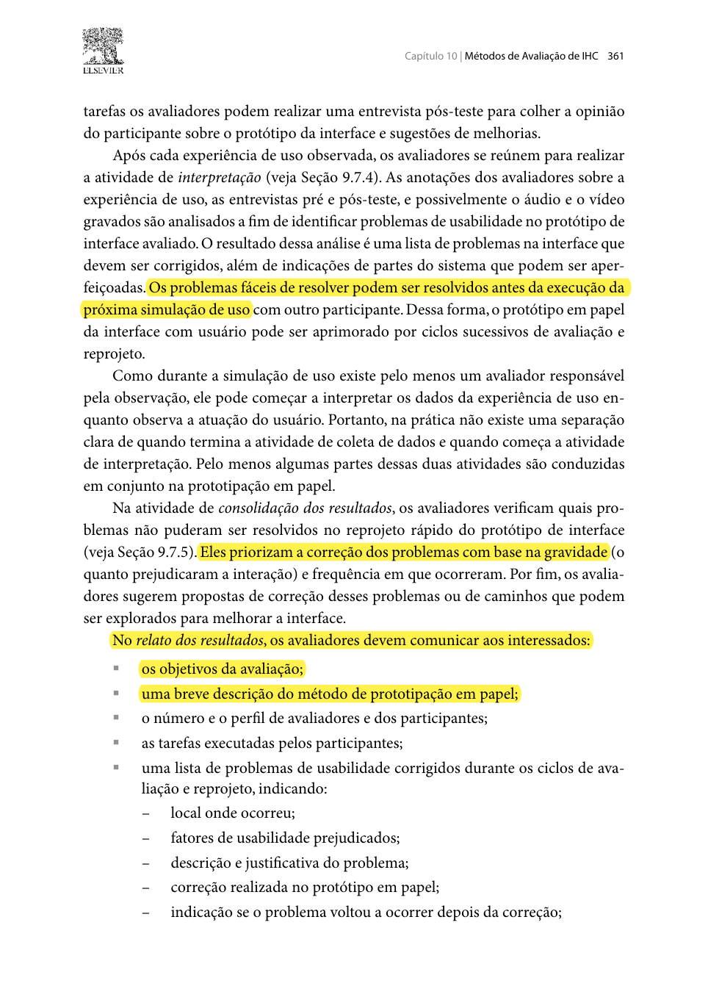
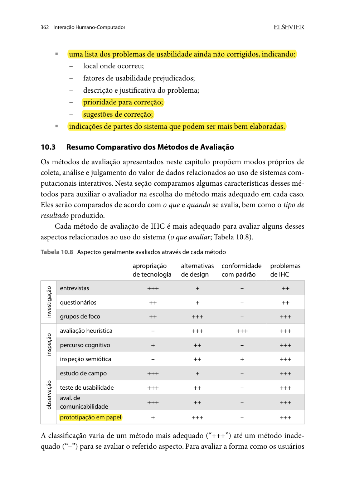

## Histórico de Versão

| Data | Versão | Descrição | Autor(es) | Revisor(es) | Declaração de uso de IA |
| :---: | :---: | :--- | :--- | :--- | :--- |
| 27/10/2026 | `1.0` | Criação do planejamento do relato dos resultados da avaliação do Protótipo de Papel (TAR-06). | [Carlos Costa](https://github.com/carloshfgit) | [Igor Dantas Araújo](https://github.com/IgorDARAUJO) | Claude Code (Anthropic) - apenas revisou e formatou o texto em Markdown |

---

# Planejamento do Relato dos Resultados da Avaliação do Protótipo de Papel (TAR-06)

Neste documento, apresenta-se o **Planejamento do Relato dos Resultados da Avaliação do Protótipo de Papel** referente à **[TAR-06 (Consulta de ônibus em tempo real no DF no Ponto)](../../../../analise-de-requisitos/analise-de-tarefas/tar-06-df-no-ponto.md)**. Ele define como serão organizados e apresentados os dados da sessão descrita no [Planejamento da Avaliação do Protótipo de Papel](carlos-planejamento-av-prototipo-papel.md).

A estrutura segue as orientações sobre consolidação e relato de resultados de Barbosa et al. (2021, Seção 11.7.5, p. 279) e o relato específico da prototipação em papel de Barbosa e Silva (2010, Seção 10.2.3, p. 361–362).

---

## 1. Objetivos do Relato dos Resultados

1. **Sintetizar o desempenho do participante** nas três tarefas (06.1, 06.2 e 06.3): sucesso sem ajuda, tempo e pedidos de ajuda.
2. **Registrar os problemas de usabilidade** encontrados, com severidade e sugestão de reprojeto.
3. **Separar os problemas corrigidos no papel** durante a sessão dos que ficam pendentes para a alta fidelidade, como pede o relato da prototipação em papel.
4. **Atualizar as hipóteses da TAR-06** (H2 a H6) com as evidências da simulação de uso.
5. **Fornecer recomendações** para o protótipo de alta fidelidade da Etapa 6.

---

## 2. Estrutura do Relatório Final

Barbosa e Silva (2010, p. 361–362) listam o que o relato da prototipação em papel deve conter: os objetivos, uma breve descrição do método, o número e o perfil dos avaliadores e dos participantes, as tarefas executadas, e os problemas encontrados, separando os que foram corrigidos no papel dos que não foram ([Imagens 1 e 2](#imagem-1)). Barbosa et al. (2021, p. 279) acrescentam que o relato deve deixar claros os limites da interpretação ([Imagem 3](#imagem-3)). Com base nisso, o relatório final terá as seções:

<strong>Tabela 1</strong> — Seções do relatório final

| # | Seção | Conteúdo |
| :---: | :--- | :--- |
| **1** | Introdução e objetivos | Escopo do protótipo (TAR-06) e objetivos da avaliação. |
| **2** | Método | Prototipação em papel com pensar em voz alta, papéis de "computador" e observador, e link para o planejamento. |
| **3** | Participante e equipe | Perfil do participante (código, sem nome), quem atuou como "computador" e quem observou, e link do vídeo. |
| **4** | Tarefas e desempenho | Tabela 3 deste planejamento, preenchida. |
| **5** | Problemas encontrados | Tabela 4, com severidade e sugestão de reprojeto. |
| **6** | Corrigidos no papel × pendentes | Tabela 5. |
| **7** | Hipóteses da TAR-06 | Tabela 6. |
| **8** | Recomendações e limitações | Diretrizes para a alta fidelidade e limites de um teste com um participante. |

<em>Fonte: Elaborado por Carlos Costa (2026), com base em Barbosa e Silva (2010, p. 361–362) e Barbosa et al. (2021, p. 279).</em>

---

## 3. Escala de Severidade dos Problemas

Os problemas serão classificados pela escala de severidade de Nielsen (1994), adaptada para a simulação em papel:

<strong>Tabela 2</strong> — Escala de severidade

| Nível | Classificação | Impacto na simulação em papel |
| :---: | :--- | :--- |
| **0** | Sem importância | Não afeta a tarefa; comentário estético ou opcional. |
| **1** | Leve | Hesitação breve; o participante conclui a tarefa sozinho. |
| **2** | Moderado | Escolha errada de tela ou peça, corrigida pelo participante, com perda de eficiência. |
| **3** | Grave | O participante só conclui a tarefa com muita dificuldade ou com ajuda do avaliador. |
| **4** | Catastrófico | O participante não consegue concluir a tarefa. |

<em>Fonte: Adaptado de Nielsen (1994).</em>

---

## 4. Modelos de Tabelas para Consolidação dos Resultados

### 4.1 Desempenho nas Tarefas

<strong>Tabela 3</strong> — Modelo de consolidação do desempenho por tarefa

| ID | Tarefa | Sucesso sem ajuda? | Tempo | Pedidos de ajuda | Observações (falas e hesitações, com minutagem do vídeo) |
| :---: | :--- | :---: | :---: | :---: | :--- |
| **06.1** | Descobrir em quanto tempo chega o próximo ônibus para a UnB Gama. | *[Sim / Não]* | *[mm:ss]* | *[qtd.]* | *[...]* |
| **06.2** | Entender o aviso de posição desatualizada e decidir o que fazer. | *[Sim / Não]* | *[mm:ss]* | *[qtd.]* | *[...]* |
| **06.3** | Favoritar a linha e ativar o aviso de atraso. | *[Sim / Não]* | *[mm:ss]* | *[qtd.]* | *[...]* |

<em>Fonte: Elaborado por Carlos Costa (2026).</em>

### 4.2 Registro e Priorização dos Problemas

Os campos seguem a categorização dos problemas proposta por Barbosa et al. (2021, Seção 12.2.1, p. 303) ([Imagem 4](#imagem-4)).

<strong>Tabela 4</strong> — Modelo de registro dos problemas de usabilidade

| ID | Descrição do problema | Tela / peça | Tarefa | Severidade (0–4) | Hipótese relacionada | Sugestão de reprojeto |
| :---: | :--- | :--- | :---: | :---: | :---: | :--- |
| **PP-01** | *[...]* | *[ex.: T3 — Detalhe da linha]* | *[06.x]* | *[0–4]* | *[H2–H6 ou —]* | *[...]* |
| **PP-02** | *[...]* | *[...]* | *[06.x]* | *[0–4]* | *[...]* | *[...]* |

<em>Fonte: Elaborado por Carlos Costa (2026).</em>

### 4.3 Problemas Corrigidos no Papel × Pendentes

<strong>Tabela 5</strong> — Modelo de registro das correções no protótipo de papel

| ID | Alteração feita no papel | Corrigido durante a sessão? | Voltou a ocorrer? | Encaminhamento |
| :---: | :--- | :---: | :---: | :--- |
| **PP-01** | *[ex.: redesenho do aviso N1 com texto mais curto]* | *[Sim / Não]* | *[Sim / Não]* | *[Resolvido no papel / Ajustar na alta fidelidade]* |

<em>Fonte: Elaborado por Carlos Costa (2026).</em>

### 4.4 Situação das Hipóteses da TAR-06

<strong>Tabela 6</strong> — Modelo de atualização das hipóteses

| ID | Hipótese (resumo) | Evidência na simulação | Situação após o protótipo de papel |
| :---: | :--- | :--- | :---: |
| **H2** | A busca exige lembrar a linha; atalho para linhas usadas ajudaria. | *[...]* | *[Reforçada / Contrariada / Sem evidência]* |
| **H3** | Itens próximos na lista levam à seleção errada. | *[...]* | *[...]* |
| **H4** | A indicação de última atualização ajuda a avaliar a confiabilidade. | *[...]* | *[...]* |
| **H5** | O usuário trata posição defasada como atual e decide errado. | *[...]* | *[...]* |
| **H6** | O usuário novo não conhece a busca por referência. | *[...]* | *[...]* |

<em>Fonte: Elaborado por Carlos Costa (2026), com base na Tabela 5 da TAR-06.</em>

---

## 5. Encaminhamento dos Resultados

1. **No papel:** problemas simples (texto, posição de botão) podem ser corrigidos e testados durante a própria sessão e entram na Tabela 5 como "Resolvido no papel".
2. **Para a alta fidelidade:** problemas de severidade 2, 3 ou 4 que não foram resolvidos no papel viram requisitos do protótipo de alta fidelidade.
3. **Para a TAR-06:** a situação das hipóteses é levada para uma nova versão do documento da TAR-06.
4. **Limitações:** com um participante, os resultados indicam tendências e não garantem a ausência de outros problemas (Barbosa et al., 2021, p. 279).

---

## 6. Fotos de Referência

<em>Imagem 1 — Interpretação, consolidação e itens do relato da prototipação em papel, parte 1 (Barbosa e Silva, 2010, Seção 10.2.3, p. 361).</em>

<em>Imagem 2 — Itens do relato da prototipação em papel, parte 2: problemas não corrigidos (Barbosa e Silva, 2010, Seção 10.2.3, p. 362).</em>

<em>Imagem 3 — Consolidação, limites da interpretação e estrutura do relato (Barbosa et al., 2021, Seção 11.7.5, p. 279).</em>

<em>Imagem 4 — Categorização e campos do relato dos problemas (Barbosa et al., 2021, Seção 12.2.1, p. 303).</em>

---

## 7. Declaração sobre o Uso de IA Generativa

Em cumprimento ao Plano de Ensino e ao Código de Conduta da SBC, declara-se que a ferramenta **Claude Code (Anthropic)** foi utilizada apenas para revisar e formatar o texto em Markdown a partir do conteúdo e das decisões estruturadas por Carlos Costa. Carlos Costa responde integralmente pelo conteúdo.

---

## 8. Referências Bibliográficas

* BARBOSA, Simone Diniz Junqueira; SILVA, Bruno Santana da. **Interação Humano-Computador**. Rio de Janeiro: Elsevier, 2010. (Capítulo 10, Seção 10.2.3: Prototipação em Papel, p. 361–362).
* BARBOSA, Simone Diniz Junqueira; SILVA, Bruno Santana da; SILVEIRA, Milene Selbach; GASPARINI, Isabela; DARIN, Ticianne; BARBOSA, Gabriel Diniz Junqueira. **Interação Humano-Computador e Experiência do Usuário**. Rio de Janeiro: Autopublicação, 2021. ISBN 978-65-00-19677-1. (Seção 11.7.5, p. 279; Seção 12.2.1, p. 303).
* NIELSEN, Jakob. **Usability Engineering**. San Francisco: Morgan Kaufmann, 1994.
* SALES, André Barros de. **Plano de Ensino: Interação Humano Computador**. Brasília: Universidade de Brasília, Faculdade UnB Gama (FCTE/UnB), 2026.
* SNYDER, Carolyn. **Paper Prototyping: The Fast and Easy Way to Design and Refine User Interfaces**. San Francisco: Morgan Kaufmann, 2003.

---
**Autor:** [Carlos Costa](https://github.com/carloshfgit)  
**Revisor:** [Igor Dantas Araújo](https://github.com/IgorDARAUJO)
