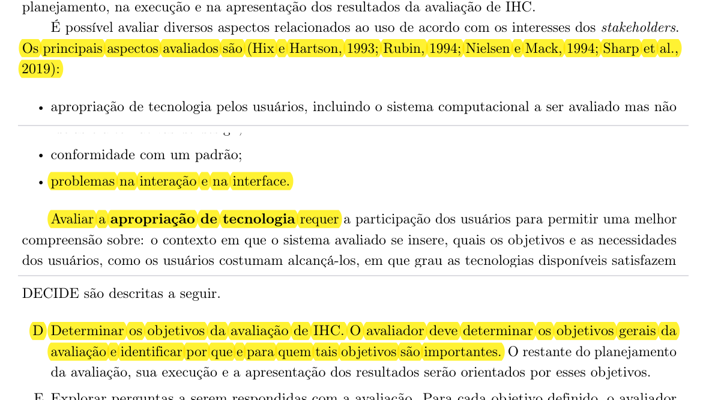
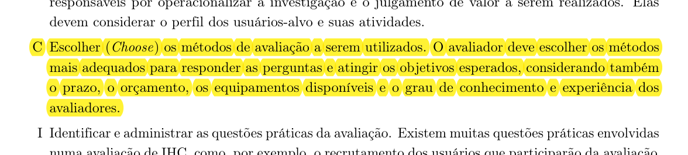
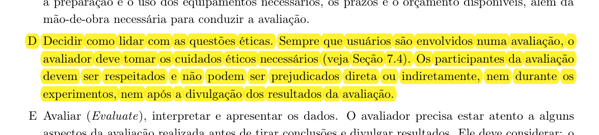
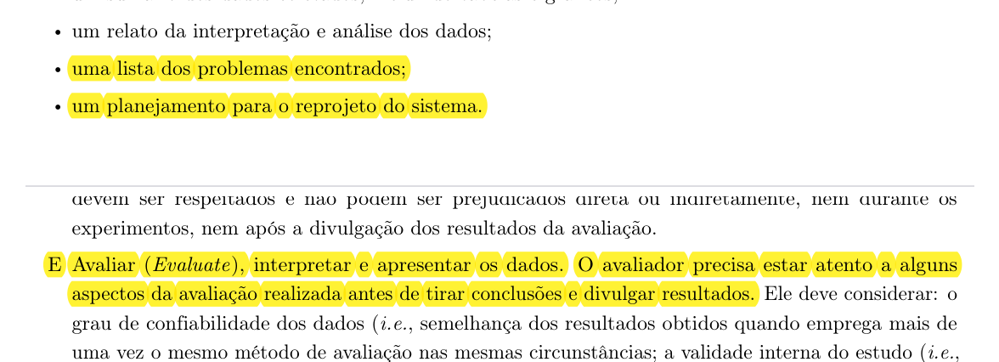

# Planejamento da Avaliação da Análise de Tarefas

## Histórico de Versão e Contribuição

| Data | Versão | Descrição | Autor(es) | Revisor(es) |
| :---: | :---: | :--- | :--- | :--- |
| 13/10/2026 | `1.0` | Elaboração do Planejamento da Avaliação da Análise de Tarefas fundamentado no Framework DECIDE (Capítulo 11 de Barbosa et al., 2021). | [Carlos Costa](https://github.com/carloshfgit) | [Arthur Mariani](https://github.com/arthur-mariani) |

---

## 1. Introdução

Este artefato apresenta o **Planejamento da Avaliação da Análise de Tarefas** desenvolvido pelo Grupo 05 no âmbito da disciplina de Interação Humano-Computador (IHC), correspondente à **Etapa 4** do projeto focado no portal institucional e nos serviços digitais da **Secretaria de Estado de Transporte e Mobilidade do Distrito Federal (SEMOB-DF)**.

Durante a Etapa 2 de Análise de Requisitos, a equipe modelou tarefas críticas através de duas técnicas consagradas da literatura: a **Análise Hierárquica de Tarefas (HTA - *Hierarchical Task Analysis*)** (Annett e Duncan, 1967; Barbosa et al., 2021) e o **ConcurTaskTrees (CTT)** (Paternò, 1999; Barbosa et al., 2021), abrangendo tarefas operacionais de passageiros e de motoristas de transporte público (TAR-01 a TAR-07).

Para garantir que tais modelos conceituais sejam representativos, verossímeis e capturem com fidelidade os objetivos humanos, as barreiras de interação e os fluxos práticos de uso, faz-se indispensável realizar uma avaliação formativa antes da prototipação detalhada. Este planejamento adota formalmente o **Framework DECIDE** (Preece et al., 2002; Rogers et al., 2013; Barbosa et al., 2021) para articular sistematicamente objetivos, perguntas, método de investigação, questões práticas, cuidados éticos e a interpretação dos resultados.

---

## 2. Fundamentação Teórica: O Framework DECIDE

O planejamento da avaliação estrutura-se com base nas diretrizes apresentadas no **Capítulo 11 (*Planejamento da Avaliação de IHC*)** do livro-texto oficial da disciplina (Barbosa et al., 2021, p. 279–280). Conforme ensinam os autores:

> *"Preece et al. (2002) propõem um framework chamado DECIDE para orientar o planejamento, a execução e a análise de uma avaliação de IHC. As atividades do framework são interligadas e executadas iterativamente, à medida que o avaliador articula os objetivos da avaliação, os dados e recursos disponíveis. Então, quando o avaliador descobre uma necessidade de modificar os rumos da avaliação por algum motivo, as demais atividades são afetadas."*  
> — **BARBOSA et al. (2021, Seção 11.8, p. 279–280)** *(evidenciado na [Imagem 1](#imagem-1))*.

O acrônimo **DECIDE** sintetiza as seis atividades essenciais para a condução de qualquer avaliação em IHC:

* **D — Determinar (*Determine*)** os objetivos gerais da avaliação de IHC e identificar por que e para quem tais objetivos são importantes.
* **E — Explorar (*Explore*)** as perguntas específicas a serem respondidas com a avaliação para operacionalizar a investigação.
* **C — Escolher (*Choose*)** os métodos de avaliação mais adequados considerando prazos, recursos e perfil do estudo.
* **I — Identificar (*Identify*)** e administrar as questões práticas envolvidas (recrutamento de usuários, ferramentas, infraestrutura e custos).
* **D — Decidir (*Decide*)** como lidar com as questões éticas de pesquisas envolvendo seres humanos (respeito, privacidade e TCLE).
* **E — Avaliar (*Evaluate*)**, interpretar e apresentar os dados coletados de maneira criteriosa.

---

## 3. Aplicação do Framework DECIDE à Análise de Tarefas

### 3.1 D — Determinar os Objetivos da Avaliação da Análise de Tarefas

Conforme preconizado por Barbosa et al. (2021, Seção 11.2, p. 264–265), a definição clara do que avaliar direciona todo o restante do estudo. Na literatura de IHC, os principais aspectos avaliados dividem-se em quatro categorias fundamentais *(evidenciado na [Imagem 2](#imagem-2))*:

1. Apropriação de tecnologia pelos usuários;
2. Ideias e alternativas de design;
3. Conformidade com um padrão;
4. **Problemas na interação e na interface**.

Para a avaliação dos diagramas de Análise de Tarefas (HTA e CTT), o foco primordial recai sobre a **identificação de problemas na interação e na interface** no plano conceitual e operacional, acompanhado da verificação de **apropriação da tecnologia**. Especificamente, os objetivos determinados para esta avaliação são:

* **Objetivo Geral 1 (Validação de Modelos Conceituais):** Verificar se a decomposição em objetivos, subobjetivos e operações (HTA) e a lógica de relações temporais e tipos de tarefas (CTT) refletem a execução real e as expectativas dos usuários ao utilizarem os serviços do SEMOB-DF.
* **Objetivo Geral 2 (Identificação de Falhas de Interação):** Identificar operações omitidas, redundantes, ambíguas, caminhos de erro ou decisões contra-intuitivas que possam frustrar os usuários durante a navegação.
* **Objetivo Geral 3 (Apoio ao Reprojeto):** Coletar sugestões qualitativas de melhoria e refinamento dos modelos de tarefas para subsidiar a prototipação de baixa e média fidelidade das etapas seguintes.

---

### 3.2 E — Explorar as Perguntas a Serem Respondidas

A atividade *E* tem a função de operacionalizar os objetivos definidos, convertendo-os em questionamentos precisos que os avaliadores buscarão responder ao longo da sessão com os participantes (Barbosa et al., 2021, Seção 11.8 e Tabela 11.1) *(evidenciado na [Imagem 3](#imagem-3))*.

A [Tabela 1](#tabela-1) estrutura as perguntas investigativas formuladas para a avaliação das tarefas:

<strong>Tabela 1</strong> — Perguntas Investigativas da Avaliação da Análise de Tarefas

| Categoria da Investigação | Pergunta Operacional | Foco no Modelo (HTA / CTT) |
| :--- | :--- | :--- |
| **Compreensão e Correspondência** | 1. O objetivo principal da tarefa e os subobjetivos descritos correspondem ao que você faz na prática ao usar os canais da SEMOB-DF? | Hierarquia de Subobjetivos (HTA) |
| **Completude das Etapas** | 2. Existe alguma ação ou passo que você precisa realizar no cotidiano que não foi representado no fluxo? | Operações e Planos (HTA) |
| **Sequenciamento e Lógica Temporal** | 3. A sequência descrita e as condições (ações em ordem estrita, escolhas alternativas ou ações simultâneas) fazem sentido lógico? | Relações Temporais CTT (`>>`, `[]`, `|||`) |
| **Barreiras e Obstáculos** | 4. Em que momento da execução dessa tarefa você mais costuma encontrar dificuldades, lentidão ou dúvidas na interface? | Pontos de Decisão e Planos de Erro (HTA) |
| **Terminologia e Vocabulário** | 5. Os termos técnicos e os nomes das ações atribuídos às operações são compreensíveis e familiares para você? | Rótulos das Tarefas (HTA/CTT) |
| **Tratamento de Exceções** | 6. Caso ocorra uma falha (ex.: saldo indisponível, sinal de GPS fora do ar ou desvio no trânsito), o fluxo contempla uma saída clara? | Tarefas de Feedback e Tolerância a Falhas |
| **Satisfação e Melhoria** | 7. Na sua opinião, qual alteração facilitaria ou tornaria a conclusão dessa tarefa mais ágil e menos cansativa? | Visão geral do modelo para reprojeto |

<em>Fonte: Autores (2026), adaptado de Barbosa et al. (2021, Tabela 11.1, p. 266–267).</em>

---

### 3.3 C — Escolher os Métodos de Avaliação

Segundo Barbosa et al. (2021, Seção 11.7 e Seção 11.8), o método deve ser escolhido com base nas perguntas a serem respondidas, na maturidade do artefato em análise e nos recursos disponíveis *(evidenciado na [Imagem 4](#imagem-4))*:

> *"O avaliador deve escolher os métodos mais adequados para responder as perguntas e atingir os objetivos esperados, considerando também o prazo, o orçamento, os equipamentos disponíveis e o grau de conhecimento e experiência dos avaliadores."*  
> — **BARBOSA et al. (2021, Seção 11.8, p. 280)**.

Para a avaliação dos diagramas de Análise de Tarefas (que constituem modelos abstratos e diagramáticos), o grupo selecionou o método de **Investigação por Entrevista Guiada por Tarefas (*Task Walkthrough* com Usuário)**, complementado por **Inspeção Baseada em Cenários**:

* **Justificativa da Escolha:** Modelos analíticos de tarefas (diagramas HTA e árvores CTT) não são naturalmente interpretados por usuários leigos se apresentados de forma puramente técnica. Portanto, uma entrevista semiestruturada conduzida pelo avaliador — na qual o avaliador verbaliza o fluxo, contextualiza cada ação através de cenários de uso reais e solicita a validação do participante passo a passo — é o meio mais eficaz para extrair críticas aprofundadas sem causar sobrecarga cognitiva.
* **Dinâmica do Walkthrough:** 
  1. O avaliador contextualiza a situação através de uma persona e de um cenário concreto.
  2. Apresenta o objetivo de nível mais alto e indaga se o participante concorda com a meta.
  3. Percorre cada plano de ação (HTA) e cada transição de tela/sistema (CTT), conferindo se as tarefas de usuário e do sistema condizem com o fluxo esperado.
  4. Registra feedbacks, divergências e sentimentos expressos pelo participante.

---

### 3.4 I — Identificar e Administrar as Questões Práticas

A atividade *I* assegura que toda a infraestrutura física, tecnológica e logística seja devidamente planejada com antecedência para viabilizar as sessões de avaliação sem imprevistos (Barbosa et al., 2021, Seção 11.7.2 e Seção 11.8) *(evidenciado na [Imagem 5](#imagem-5))*.

#### 3.4.1 Recrutamento e Perfil dos Participantes
O recrutamento baseia-se nos perfis identificados no projeto durante a fase de análise de requisitos:
* **Perfil Primário (Passageiros do Transporte Coletivo do DF):** Usuários regulares de ônibus e metrô que utilizam ou necessitam de funcionalidades como consulta de linhas, recarga e rotas (ex.: personas Larissa, João Pedro, Marcos Paulo, Maria Eduarda e Heitor).
* **Perfil Terciário/Stakeholder Operacional (Motoristas do STPC/DF):** Profissionais da operação que necessitam consultar escalas, boletins de serviço e alertas operacionais em trânsito (representados pela persona *Valdir Soares* para avaliação de TAR-04 e TAR-05).
* **Quantidade de Participantes:** Conforme Barbosa et al. (2021, p. 275), avaliações formativas qualitativas não buscam significância estatística, mas sim obter indícios consistentes sobre a qualidade de uso e identificar barreiras. Planeja-se a participação de **1 a 2 usuários para cada tarefa foco**, totalizando entre 5 e 8 participantes voluntários.

#### 3.4.2 Equipamentos e Ferramental
* **Ambiente de Videoconferência:** Microsoft Teams (institucional) com Google Meet como contingência homologada.
* **Recursos de Gravação:** Gravação em nuvem da chamada de vídeo e áudio, com software local de apoio (OBS Studio ou ferramenta de captura 123APPS) para prevenção de perdas por falhas de conectividade.
* **Apresentação Visual dos Modelos:** Exibição dos diagramas HTA (tabelas e árvores) e diagramas CTT em alta resolução via compartilhamento de tela.
* **Custos:** O projeto é de natureza estritamente acadêmica, de modo que não há remuneração monetária nem custos operacionais financeiros (orçamento zero).

#### 3.4.3 Prazos e Cronograma das Avaliações
A [Tabela 2](#tabela-2) esquematiza o cronograma logístico das sessões de entrevista da Análise de Tarefas:

<strong>Tabela 2</strong> — Cronograma Planejado das Sessões de Avaliação da Análise de Tarefas

| Sessão | Tarefa Avaliada | Perfil do Convidado | Formato / Local | Duração Estimada | Avaliador Responsável |
| :---: | :--- | :--- | :---: | :---: | :--- |
| **S1** | **TAR-01** (Alerta inteligente de saída) | Passageiro regular jovem/estudante | Remoto (Teams) | 20 a 30 min | Igor Dantas Araújo |
| **S2** | **TAR-02** (Pré-agendamento DF Acessível) | Passageiro com mobilidade reduzida / PCD | Remoto (Teams) | 25 a 35 min | Gabriel Cardone |
| **S3** | **TAR-03** (Planejamento de Rota e Rastreamento) | Passageiro de viagens inter-regionais | Remoto (Teams) | 25 a 35 min | Lucas Araújo |
| **S4** | **TAR-04/TAR-05** (Escala e alertas operacionais) | Motorista de ônibus ou operador de transporte | Remoto / Presencial | 25 a 35 min | Carlos Costa |
| **S5** | **TAR-06** (Consulta DF no Ponto) | Passageiro dependente de ônibus diário | Remoto (Teams) | 20 a 30 min | Rodrigo Barbosa |
| **S6** | **TAR-07** (Crédito de Vale-Transporte) | Trabalhador usuário de bilhetagem automática | Remoto (Teams) | 20 a 30 min | Arthur Mariani |

<em>Fonte: Elaborado pelos autores (2026).</em>

---

### 3.5 D — Decidir como Lidar com as Questões Éticas

A condução de qualquer avaliação em IHC que envolva seres humanos exige rigor ético intransigente, pautando-se nas orientações da Seção 7.4 e Seção 11.8 de Barbosa et al. (2021) e nas diretrizes da **Resolução nº 510/2016 do Conselho Nacional de Saúde** *(evidenciado na [Imagem 6](#imagem-6))*:

> *"Sempre que usuários são envolvidos numa avaliação, o avaliador deve tomar os cuidados éticos necessários (veja Seção 7.4). Os participantes da avaliação devem ser respeitados e não podem ser prejudicados direta ou indiretamente, nem durante os experimentos, nem após a divulgação dos resultados da avaliação."*  
> — **BARBOSA et al. (2021, Seção 11.8, p. 280)**.

Para tanto, os seguintes princípios e protocolos foram integrados a este planejamento:

1. **Princípio da Autonomia:** O participante participa de livre e espontânea vontade e tem a prerrogativa expressa de interromper a sessão a qualquer instante, recusar-se a responder a qualquer pergunta ou revogar sua participação a qualquer momento sem penalidades.
2. **Princípio da Não Maleficência e Beneficência:** Assegura-se que a avaliação não exporá o indivíduo a situações de constrangimento, teste de inteligência ou esforço emocional excessivo. O avaliador deixará explícito que é o *modelo do sistema* que está sob escrutínio, e não o usuário.
3. **Privacidade e Confidencialidade:** Os dados coletados serão utilizados unicamente para os propósitos acadêmicos do projeto de IHC do SEMOB-DF. Nomes, documentos e quaisquer dados sensíveis serão estritamente anonimizados em todas as tabelas e relatórios.
4. **Consentimento e Permissão para Gravação (TCLE):** Antes de iniciar qualquer sessão ou ligar a gravação de tela, o avaliador fará a leitura integral do **Termo de Consentimento Livre e Esclarecido (TCLE)**, solicitando autorização verbal clara e consentimento formal por escrito ou eletrônico para registro de áudio, imagem e notas.

---

### 3.6 E — Avaliar, Interpretar e Apresentar os Dados

A última etapa do framework abrange a consolidação rigorosa dos dados colhidos, prevenindo distorções interpretativas e orientando o reprojeto (Barbosa et al., 2021, Seção 11.7.5 e Seção 11.8) *(evidenciado na [Imagem 7](#imagem-7))*.

#### 3.6.1 Análise Intersujeito e Validade do Estudo
Conforme detalhado no livro-texto, os resultados qualitativos individuais devem ser consolidados em uma **análise intersujeito (ou interparticipante)**:
* **Identificação de Recorrências:** O avaliador busca padrões de dificuldades e sugestões compartilhadas por múltiplos participantes, distinguindo características representativas do grupo de idiossincrasias individuais.
* **Validade Interna e Ecológica:** O estudo busca manter estrita coerência entre o que se propõe avaliar (a lógica das tarefas) e as perguntas feitas, garantindo que os cenários descritos correspondam a situações verossímeis vivenciadas no transporte público do DF.
* **Limitações Metodológicas:** Reitera-se a advertência dos autores de que os resultados de avaliações em IHC indicam tendências de problemas sob determinado escopo e planejamento, não representando garantias absolutas de ausência de falhas em outros contextos.

#### 3.6.2 Classificação de Severidade de Problemas Encontrados
Para orientar as prioridades de intervenção nos diagramas HTA e CTT, os problemas relatados serão classificados na escala apresentada na [Tabela 3](#tabela-3):

<strong>Tabela 3</strong> — Classificação de Gravidade para Problemas de Análise de Tarefas

| Nível de Gravidade | Critério Aplicado ao Modelo da Tarefa | Ação no Reprojeto |
| :---: | :--- | :--- |
| **0 — Falso Problema** | Discordância pontual que não interfere na consecução da meta e não reflete necessidade geral. | Nenhuma alteração imediata. |
| **1 — Leve** | Inadequação de nomenclatura de operação ou detalhe cosmético que causa dúvida momentânea sem impedir a ação. | Ajuste textual de rótulo no HTA/CTT. |
| **2 — Moderado** | Omissão de um subobjetivo alternativo ou passo intermediário que retarda a execução da tarefa. | Inclusão de suboperações ou planos condicionais. |
| **3 — Grave** | Sequenciamento incorreto no plano (HTA) ou relação temporal errada (CTT) que induz o usuário a erro frequente. | Reestruturação profunda do diagrama e dos planos. |
| **4 — Catastrófico** | Falha de premissa que inviabiliza a conclusão do objetivo do usuário no sistema. | Reprojeto completo do modelo conceitual da tarefa. |

<em>Fonte: Adaptado de Nielsen (1994) e Barbosa et al. (2021, Seção 11.7.5).</em>

#### 3.6.3 Estrutura do Relatório de Resultados
Conforme preceitua a Seção 11.7.5 do livro-texto (Barbosa et al., 2021, p. 279), o documento final de relato dos resultados das tarefas deverá conter obrigatoriamente:
1. Os objetivos e o escopo da avaliação;
2. A metodologia empregada (entrevista orientada a tarefas baseada no DECIDE);
3. O número e o perfil dos participantes e avaliadores;
4. O sumário dos dados coletados e respostas às perguntas investigativas;
5. A lista consolidada dos problemas encontrados acompanhada do nível de gravidade;
6. O planejamento para a correção e reprojeto dos diagramas HTA e CTT.

---

## 4. Alinhamento com o Teste Piloto e Roteiro do Avaliador

Em estrita consonância com os critérios avaliativos do Plano de Ensino da disciplina (Itens 11, 12 e 13):

1. **Execução Prévia do Teste Piloto (Item 11 e 12):** Antes de iniciar as sessões com usuários externos, o protocolo de entrevista de tarefas passará por um ensaio geral interno (teste piloto) coordenado por Igor Dantas, com data fixada no cronograma. Os dados do teste piloto **não serão incorporados aos resultados da avaliação** ([planejamento-e-protocolo-do-teste-piloto.md](../../planejamento-e-protocolo-do-teste-piloto.md)), servindo exclusivamente para verificar a clareza da linguagem e o tempo de sessão.
2. **Postura e Guia do Avaliador (Item 13):** Durante as sessões, o avaliador seguirá o protocolo padronizado:
   * Evitar emitir opiniões pessoais ou defender os modelos desenvolvidos;
   * Dar tempo ao participante para ler e expressar seu raciocínio;
   * Anotar reações verbais e não-verbais (hesitações, expressões de surpresa ou dúvida);
   * Registrar imediatamente no modelo de anotações as discordâncias levantadas para tabulação posterior.

---

## 5. Fotos de Referência

Nesta seção reúnem-se os recortes comprobatórios extraídos diretamente do livro-texto oficial *Interação Humano-Computador e Experiência do Usuário* (Barbosa et al., 2021).

<em>Imagem 1 — Framework DECIDE (Barbosa et al., 2021, Seção 11.8, p. 279–280).</em>

 

<em>Imagem 2 — Determinação dos Objetivos e Aspectos Avaliados em IHC (Barbosa et al., 2021, Seções 11.2 e 11.8, p. 264, 280).</em>

 

<em>Imagem 3 — Exploração de Perguntas Investigativas em IHC (Barbosa et al., 2021, Tabela 11.1 e Seção 11.8, p. 267, 280).</em>

 

<em>Imagem 4 — Escolha dos Métodos de Avaliação (Barbosa et al., 2021, Seção 11.8, p. 280).</em>

 

<em>Imagem 5 — Administração de Questões Práticas (Barbosa et al., 2021, Seção 11.8, p. 280).</em>

 

<em>Imagem 6 — Decisões Éticas na Avaliação com Usuários (Barbosa et al., 2021, Seção 11.8, p. 280).</em>

 

<em>Imagem 7 — Avaliação, Interpretação de Dados e Estrutura do Relato de Resultados (Barbosa et al., 2021, Seções 11.7.5 e 11.8, p. 279–280).</em>

---

## 6. Declaração sobre o Uso de IA Generativa

Em conformidade com o Código de Conduta da Sociedade Brasileira de Computação (SBC) e com as exigências do Plano de Ensino da disciplina de Interação Humano-Computador, declara-se que o modelo de linguagem **Google Gemini** foi utilizado como ferramenta de apoio instrumental para estruturação em linguagem Markdown, revisão ortográfica e formatação das tabelas comparativas. Toda a articulação conceitual do Framework DECIDE e o mapeamento dos modelos HTA/CTT do SEMOB-DF foram concebidos, validados e revisados exclusivamente pelos membros da equipe.

---

## 7. Referências Bibliográficas

* ANNETT, John; DUNCAN, Keith D. **Task analysis and training design**. *Journal of Occupational Psychology*, v. 41, n. 4, p. 211–221, 1967.
* BARBOSA, Simone Diniz Junqueira; SILVA, Bruno Santana da; SILVEIRA, Milene Selbach; GASPARINI, Isabela; DARIN, Ticianne; BARBOSA, Gabriel Diniz Junqueira. **Interação Humano-Computador e Experiência do Usuário**. Rio de Janeiro: Autopublicação, 2021. ISBN 978-65-00-19677-1. (Capítulo 11: *Planejamento da Avaliação de IHC*, pp. 261–281).
* BRASIL. Conselho Nacional de Saúde. **Resolução nº 510, de 07 de abril de 2016**. Regulamenta as normas aplicáveis a pesquisas em Ciências Humanas e Sociais envolvendo seres humanos. Brasília: Diário Oficial da União, 2016.
* NIELSEN, Jakob. **Usability Engineering**. San Francisco: Morgan Kaufmann, 1994.
* PATERNÒ, Fabio. **Model-Based Design and Evaluation of Interactive Applications**. London: Springer-Verlag, 1999.
* PREECE, Jennifer; ROGERS, Yvonne; SHARP, Helen. **Design de Interação: Além da interação homem-computador**. São Paulo: Editora Érica, 2005.
* ROGERS, Yvonne; SHARP, Helen; PREECE, Jennifer. **Interaction Design: Beyond Human-Computer Interaction**. 3. ed. John Wiley & Sons, 2011.
* SALES, André Barros de. **Plano de Ensino: Interação Humano Computador**. Brasília: Universidade de Brasília, FCTE/UnB, 2026.
