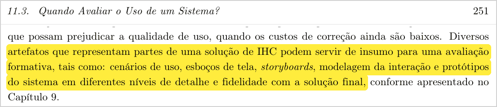

## Histórico de Versão e Contribuição

| Data | Versão | Descrição | Autor(es) | Revisor(es) | Declaração de Uso de IA |
| :---: | :---: | :--- | :--- | :--- | :--- |
| 13/10/2026 | `1.0` | Criação do planejamento individual da avaliação do Storyboard 01 e da Análise de Tarefas (TAR-01) via DECIDE. | [Igor Dantas Araújo](https://github.com/IgorDARAUJO) | [Gabriel Cardone](https://github.com/gabriellcardone-06) | Google Gemini - usado para formatação markdown da página |

---

# Planejamento da Avaliação do Storyboard e da Análise de Tarefas (TAR-01)

Neste documento, apresenta-se o **Planejamento da Avaliação do Storyboard e da Análise de Tarefas** referente à **TAR-01 (Alerta Inteligente de Saída de Casa)**. Trata-se de um planejamento individual desenvolvido para orientar a avaliação formativa do **Storyboard 01** e dos modelos de **Análise Hierárquica de Tarefas (HTA)** e **Árvores de Tarefas Concorrentes (CTT)** associados.

O planejamento foi elaborado aplicando o **Framework DECIDE** (Barbosa et al., 2021), que estrutura as atividades de avaliação em seis etapas interligadas: **D**eterminar objetivos, **E**xplorar perguntas, **C**hoose (Escolher) métodos, **I**dentificar questões práticas, **D**ecidir questões éticas e **E**valuate (Avaliar e interpretar dados).

**Artefatos relacionados — fluxo da funcionalidade TAR-01 (Alerta Inteligente de Saída de Casa):**

* **Persona:** [João Pedro Carvalho](../../../../analise-de-requisitos/personas/joao-pedro-carvalho.md)
* **Cenário:** [Cenário 2](../../../../analise-de-requisitos/cenarios/cenario-2-viagem-matutina.md)
* **Análise de tarefas:** [TAR-01](../../../../analise-de-requisitos/analise-de-tarefas/tar-01-alerta-saida.md)
* **Storyboard:** [Storyboard 01](../../storyboards.md#31-storyboard-01-alerta-inteligente-de-saida-de-casa)
* **Nível 1: avaliação do storyboard e da análise de tarefas:** Planejamento da avaliação (*esta página*) · [Planejamento do relato](igor-planejamento-relato-resultados-avaliacao.md) · [Relato dos resultados](../../relatos-individuais/igor/relato-resultados-storyboard-tarefas.md)
* **Nível 2: protótipo de papel (baixa fidelidade):** [Planejamento da avaliação](../../../nivel2/planejamentos-individuais/Igor/igor-planejamento-av-prototipo-papel.md) · [Planejamento do relato](../../../nivel2/planejamentos-individuais/Igor/igor-planejamento-relato-prot-papel.md) · [Relato dos resultados](../../../nivel2/relatos-individuais/igor/relato-resultados-prot-papel.md)
* **Nível 3: protótipo de alta fidelidade:** [Planejamento da avaliação](../../../nivel3/planejamentos-individuais/igor/planejamento-av-prot-alta-fidel.md) · [Planejamento do relato](../../../nivel3/planejamentos-individuais/igor/planejamento-relato-prot-alta-fidel.md) · [Relato dos resultados](../../../nivel3/relatos-individuais/igor/relato-resultados-prot-alta-fidel.md)
* **Telas do protótipo de papel:** [telas no planejamento da avaliação](../../../nivel2/planejamentos-individuais/Igor/igor-planejamento-av-prototipo-papel.md#9-telas-do-prototipo-avaliado)
* **Protótipo de alta fidelidade navegável:** [acessar o protótipo](https://www.figma.com/proto/00YEuKWtN4N1rBzpC8V7Gd/prototipo-de-igor?node-id=0-1&t=S9Z2PNsKlHC3LlTt-1)

---

## 1. D: Determinar os Objetivos da Avaliação

A avaliação formativa dos artefatos busca investigar a qualidade conceitual e a adequação das soluções propostas para o problema de mobilidade urbana da **SEMOB-DF**, antes do desenvolvimento de protótipos de alta fidelidade (Barbosa et al., 2021).

### 1.1 Objetivos da Avaliação do Storyboard 01
* **Verificar a verossimilhança contextual:** Avaliar se a narrativa retratada no [Storyboard 01](https://interacao-humano-computador.github.io/2026.2-Grupo05/design-avaliacao-desenvolvimento/storyboards/) reflete com fidelidade a realidade cotidiana de deslocamento dos estudantes universitários no Distrito Federal.
* **Validar a clareza da proposta de valor:** Confirmar se o usuário compreende a atuação proativa do aplicativo em monitorar o GPS do ônibus e emitir um alarme no momento exato de sair de casa.
* **Avaliar o engajamento e aceitação da solução:** Identificar se o usuário enxerga utilidade prática na funcionalidade e se confiaria na notificação sonora prioritária.

### 1.2 Objetivos da Avaliação da Análise de Tarefas (TAR-01 - HTA e CTT)
* **Avaliar a correção e completude do fluxo de tarefas:** Verificar se a sequência de passos modelada no [HTA da TAR-01](https://interacao-humano-computador.github.io/2026.2-Grupo05/analise-de-requisitos/analise-de-tarefas/tar-01-alerta-saida/) representa fielmente as ações mentais e físicas que o usuário realiza ao planejar sua saída de casa.
* **Validar a concorrência e o diálogo do sistema:** Verificar se as tarefas paralelas e interrupções modeladas no [diagrama CTT](https://interacao-humano-computador.github.io/2026.2-Grupo05/analise-de-requisitos/analise-de-tarefas/tar-01-alerta-saida/) (ex.: monitoramento em segundo plano versus perda de sinal de GPS ou adiantamento do veículo) refletem as necessidades reais da interação.
* **Identificar gargalos e oportunidades de reprojeto:** Descobrir etapas onde o usuário possa cometer erros ou sentir incerteza durante o uso do alerta.

---

## 2. E: Explorar as Perguntas a Serem Respondidas

Para operacionalizar os objetivos da avaliação, elaborou-se um conjunto de perguntas específicas orientadas pela literatura de IHC (Barbosa et al., 2021).

### 2.1 Tabela de Perguntas: Avaliação do Storyboard 01

<strong>Tabela 1</strong>: Roteiro de Perguntas para Avaliação do Storyboard 01

| ID | Categoria / Foco | Pergunta Orientada ao Participante | Resposta Esperada / Critério de Aceitação |
| :---: | :--- | :--- | :--- |
| **Q01** | **Clareza Narrativa** | Com suas palavras, o que acontece nesta história representada nos quadrinhos? | O participante consegue resumir a história sem necessidade de explicações adicionais do avaliador. |
| **Q02** | **Verossimilhança** | A situação retratada (ônibus adiantar no trânsito e o passageiro perder a viagem) é parecida com algo que você já viveu no DF? | O participante valida a dor do adiantamento de horários e a ansiedade no ponto. |
| **Q03** | **Atuação do Sistema** | Ficou claro como o aplicativo atua enquanto o João Pedro está se arrumando em casa? | O participante identifica que o aplicativo monitora o GPS em *background* sem exigir atenção contínua. |
| **Q04** | **Reação da Persona** | A atitude do João Pedro de confiar no alerta e sair imediatamente de casa faz sentido para você? | O participante considera a reação lógica e condizente com a proposta da notificação. |
| **Q05** | **Engajamento** | Você ativaria um alerta de saída inteligente desses na sua rotina diária? O que mudaria na história? | O participante expressa interesse positivo e sugere ajustes ou melhorias no fluxo. |

<em>Fonte: Elaborado por Igor Dantas Araújo (2026).</em>

### 2.2 Tabela de Perguntas: Avaliação da Análise de Tarefas (TAR-01 - HTA e CTT)

<strong>Tabela 2</strong>: Roteiro de Perguntas para Validação da Análise de Tarefas (HTA e CTT)

| ID | Categoria / Foco | Pergunta Orientada ao Participante | Resposta Esperada / Critério de Aceitação |
| :---: | :--- | :--- | :--- |
| **QT01** | **Sequência Lógica** | Os passos mostrados no diagrama (configurar tempo de caminhada, ativar alarme e receber aviso) correspondem ao que você faria na prática? | O participante concorda com a sequência ou aponta passos faltantes/desnecessários. |
| **QT02** | **Entrada e Feedback** | O tipo de aviso sonoro vibratório e o tempo padrão de caminhada (6 min) parecem adequados como configuração inicial? | O participante avalia a utilidade das entradas e feedbacks informados na tabela HTA. |
| **QT03** | **Tratamento de Exceção** | Se o ônibus atrasar excessivamente ou perder o sinal de GPS, a opção de 'Sugerir rota alternativa em 1 toque' atende à sua necessidade? | O participante valida o mecanismo de contingência do diagrama CTT. |
| **QT04** | **Simplicidade do Fluxo** | Você acha que alguma etapa desta tarefa é muito complexa ou exige muitos cliques? | O participante opina sobre a simplicidade estrutural da tarefa. |

<em>Fonte: Elaborado por Igor Dantas Araújo (2026).</em>

---

## 3. C: Choose (Escolher) os Métodos de Avaliação

Para este planejamento formativo, selecionou-se o **Método de Investigação por Entrevista Semiestruturada** guiada por artefatos visuais (Barbosa et al., 2021, Cap. 11 e 12).

* **Justificativa da Escolha:** A entrevista semiestruturada permite ao avaliador explorar em profundidade as opiniões, percepções e interpretações do usuário sobre o [Storyboard 01](https://interacao-humano-computador.github.io/2026.2-Grupo05/design-avaliacao-desenvolvimento/storyboards/) e os diagramas da [TAR-01](https://interacao-humano-computador.github.io/2026.2-Grupo05/analise-de-requisitos/analise-de-tarefas/tar-01-alerta-saida/), garantindo flexibilidade para detalhar comentários qualitativos ricos sem engessar a conversa (Barbosa et al., 2021).
* **Instrumentos de Suporte:** Apresentação da imagem do Storyboard 01 e exibição explicada dos diagramas HTA e CTT da tarefa durante a entrevista remota.

---

## 4. I: Identificar e Administrar as Questões Práticas

### 4.1 Recrutamento e Perfil do Participante
Em conformidade com a literatura de IHC (Barbosa et al., 2021), o recrutamento de participantes para avaliações formativas deve focar na representatividade do público-alvo primário.

* **Perfil do Convidado:** Usuário primário do transporte público do Distrito Federal, com perfil alinhado à persona [João Pedro Carvalho](https://interacao-humano-computador.github.io/2026.2-Grupo05/analise-de-requisitos/personas/joao-pedro-carvalho/) (estudante universitário, faixa etária entre 18 e 25 anos, usuário frequente de linhas de ônibus interurbanas e possuidor de smartphone Android/iOS com pacote de dados).
* **Quantidade:** 1 participante convidado para a sessão individual de avaliação.

### 4.2 Ferramentas e Infraestrutura Tecnológica
* **Ambiente Virtual:** Sala de reunião remota no **Microsoft Teams** (com gravação de áudio e vídeo habilitada).
* **Software de Reserva para Gravação:** 123APPS / OBS Studio para captura local de tela e backup.
* **Materiais Preparados:** Arquivos digitais do Storyboard 01, diagramas HTA/CTT da TAR-01 e o Termo de Consentimento Livre e Esclarecido (TCLE) em formato PDF.

### 4.3 Cronograma e Execução Individual

<strong>Tabela 3</strong>: Cronograma da Sessão Individual de Avaliação

| Parâmetro | Detalhamento da Sessão |
| :--- | :--- |
| **Data e Horário:** | 12/10/2026 às 16:30. |
| **Local / Canal:** | Reunião remota via Microsoft Teams. |
| **Avaliador Responsável:** | **Igor Dantas Araújo** (Condução da entrevista e apresentação). |
| **Participante Convidado:** | Estudante universitário recrutado conforme o Perfil Primário. |
| **Duração Estimada:** | **30 a 40 minutos** (respeitando os limites de fadiga). |
| **Custo Estimado:** | **R\$ 0,00** (uso de softwares corporativos/acadêmicos gratuitos). |

<em>Fonte: Elaborado por Igor Dantas Araújo (2026).</em>

---

## 5. D: Decidir como Lidar com as Questões Éticas

Toda a conduta da avaliação é pautada nos princípios éticos de pesquisas com seres humanos estabelecidos nas Resoluções nº 466/2012 e nº 510/2016 do Conselho Nacional de Saúde (CNS) e na literatura de IHC (Barbosa et al., 2021, Seção 7.4):

1. **Apresentação do TCLE:** Antes de iniciar qualquer pergunta ou exibição de tela, o avaliador apresentará o [Termo de Consentimento Livre e Esclarecido (TCLE)](https://interacao-humano-computador.github.io/2026.2-Grupo05/assets/PDFs/TCLE_Pesquisa_Transporte.pdf), explicando os objetivos do estudo, o caráter exclusivamente acadêmico e a ausência de riscos físicos ou financeiros.
2. **Autorização de Gravação:** A gravação de áudio e imagem da tela só será iniciada após a leitura e o aceite verbal e registrado do participante no TCLE.
3. **Garantia de Anonimato e Desistência:** Será assegurado o sigilo dos dados pessoais do participante (utilizando identificadores como *Participante A*) e o direito de interromper a entrevista a qualquer momento, sem qualquer penalidade.

---

## 6. E: Avaliar, Interpretar e Apresentar os Dados

Após a realização da entrevista de avaliação, os dados brutos (gravações de mídia e anotações do avaliador) passarão pela fase de interpretação e consolidação (Barbosa et al., 2021, Seção 11.7.4):

1. **Triagem Qualitativa:** As falas, hesitações e sugestões do participante serão transcritas e agrupadas por categorias de análise (clareza, utilidade, problemas identificados na sequência de tarefas e sugestões de melhoria).
2. **Confronto de Modelos:** As respostas do participante serão comparadas diretamente com a estrutura planejada na [TAR-01 (HTA/CTT)](https://interacao-humano-computador.github.io/2026.2-Grupo05/analise-de-requisitos/analise-de-tarefas/tar-01-alerta-saida/) para identificar possíveis discrepâncias entre a visão do designer e o modelo mental do usuário.
3. **Encaminhamento para o Relato dos Resultados:** As descobertas consolidadas servirão de insumo direto para o documento de *Relato dos Resultados da Avaliação do Storyboard e da Análise de Tarefas*, fornecendo recomendações de reprojeto para as próximas etapas do ciclo de vida.

---

## 7. Fotos de Referência

As Figuras 1 a 4 mostram os trechos que fundamentam este artefato, recortados e grifados em amarelo diretamente do livro da disciplina (BARBOSA et al., 2021).

<strong>Figura 1</strong>: 11.8 Framework DECIDE

<em>Fonte: BARBOSA et al. (2021, p. 264).</em>

<strong>Figura 2</strong>: 11.2 Principais aspectos (objetivos) avaliados em IHC

<em>Fonte: BARBOSA et al. (2021, p. 248).</em>

<strong>Figura 3</strong>: Artefatos que podem ser avaliados de forma formativa (incluindo storyboards)

<em>Fonte: BARBOSA et al. (2021, p. 251).</em>

<strong>Figura 4</strong>: 11.7.2 Escopo da avaliação, perfil e número de participantes

<em>Fonte: BARBOSA et al. (2021, p. 258).</em>

---

## 8. Referências Bibliográficas

* BARBOSA, Simone Diniz Junqueira; SILVA, Bruno Santana da; SILVEIRA, Milene Selbach; GASPARINI, Isabela; DARIN, Ticianne; BARBOSA, Gabriel Diniz Junqueira. **Interação Humano-Computador e Experiência do Usuário**. Rio de Janeiro: Autopublicação, 2021. ISBN 978-65-00-19677-1. (Capítulo 11: Planejamento da Avaliação de IHC, p. 245–266; Capítulo 12: Métodos de Avaliação de IHC, p. 267–308).
* SALES, André Barros de. **Plano de Ensino: Interação Humano Computador**. Brasília: Universidade de Brasília, Faculdade UnB Gama (FCTE/UnB), 2026.
