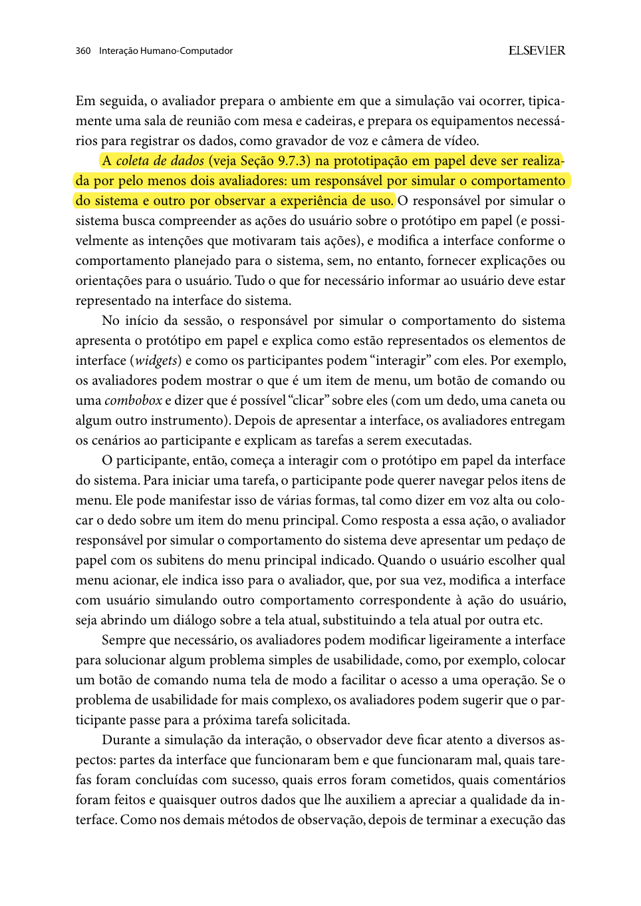

## Histórico de Versão

| Data | Versão | Descrição | Autor(es) | Revisor(es) | Declaração de uso de IA |
| :---: | :---: | :--- | :--- | :--- | :--- |
| 25/10/2026 | `1.0` | Criação do planejamento individual da avaliação do Protótipo de Papel (TAR-03) via framework DECIDE com referências do livro-texto. | [Lucas Araújo Lima](https://github.com/Lucasaraujoszz) | [Arthur Mariani](https://github.com/arthur-mariani) | Google Gemini — utilizado apenas para apoio na formatação sintática de tabelas em Markdown |

---

# Planejamento da Avaliação do Protótipo de Papel (TAR-03)

Neste documento, apresenta-se o **Planejamento da Avaliação do Protótipo de Papel** referente à **[TAR-03 — Planejamento de Rota Completa (Porta a Porta) por Destino com Indicação de Paradas e Previsão de Chegada](../../../../analise-de-requisitos/analise-de-tarefas/tar-03-planejamento-rota.md)**. Trata-se do planejamento individual elaborado por Lucas Araújo Lima para orientar a avaliação formativa presencial do protótipo de baixa/média fidelidade confeccionado em papel, representando a proposta de redesign da interface móvel da **SEMOB-DF / DF no Ponto**.

A avaliação será conduzida de forma empírica presencial, envolvendo a simulação de uso por um participante real cujo perfil corresponde à persona primária [Marcos Paulo Vieira ("Marquinhos")](../../../../analise-de-requisitos/personas/marcos-paulo-vieira.md) (trabalhador cotidiano do STPC/DF que realiza o deslocamento Samambaia Sul → SIA com urgência de horário). O planejamento foi estruturado segundo o **Framework DECIDE** (Sharp, Rogers & Preece, 2007; Barbosa & Silva, 2010, Seção 9.8; Barbosa et al., 2021, Seção 11.8), contemplando as seis etapas interdependentes: **D**eterminar objetivos, **E**xplorar perguntas, **C**hoose (Escolher) métodos, **I**dentificar questões práticas, **D**ecidir questões éticas e **E**valuate (Avaliar, interpretar e apresentar dados).

---

## 1. D — Determinar os Objetivos da Avaliação

De acordo com Snyder (2003) e Barbosa & Silva (2010, Cap. 10, Seção 10.2.3, p. 358), a **prototipação em papel** é um método de observação de uso voltado à avaliação formativa que avalia a usabilidade de um design de IHC representado em papel através de simulações de uso com potenciais usuários antes mesmo de construir uma solução de software executável.

### 1.1 Objetivos Gerais e Específicos
1. **Validar a usabilidade da busca direta de destino na Home (Subtarefa 1 da TAR-03):** Verificar se o usuário identifica imediatamente o campo de busca *"Para onde você quer ir?"* na tela inicial do protótipo em papel, compreendendo a captura automática de sua localização atual via GPS sem necessidade de conhecer códigos numéricos de linhas.
2. **Avaliar a clareza e a tomada de decisão nos cartões comparativos de rota porta a porta (Subtarefa 2 da TAR-03):** Investigar se a disposição visual dos cartões de rota no papel permite ao usuário comparar sem esforço cognitivo a linha convencional (`0.092`) e a linha semiexpressa (`092.1`), compreendendo o tempo de caminhada até a parada recomendada, o tempo de espera do veículo, a tarifa e o horário previsto de chegada ao destino final (ETA).
3. **Inspecionar a compreensibilidade do rastreamento em tempo real e da rota a pé no mapa (Subtarefa 3 da TAR-03):** Observar se o participante compreende a transição da seleção do cartão para o mapa interativo em papel, distinguindo o trajeto tracejado a pé até o ponto de embarque e o ícone do ônibus aproximando-se ao vivo.
4. **Testar o tratamento de exceções e alertas de incidente viário com rota alternativa em 1 toque (Subtarefa 4 da TAR-03):** Avaliar a reação do usuário quando o avaliador ("computador") sobrepõe um *post-it* de alerta proativo de trânsito severo na EPTG, verificando se ele localiza e aciona com segurança o botão de recálculo de rota alternativa em 1 toque, além do recurso de visualização *offline* da tabela de horários em caso de falha de GPS.
5. **Incorporar e validar as melhorias oriundas da avaliação do Storyboard 03 e da TAR-03:** Confirmar na prática se o destaque visual da distância de caminhada até a parada e a clareza da notificação de retenção (apontados na entrevista da Etapa 5 com o participante Danilo) eliminam dúvidas operacionais durante o toque nas telas de papel.

---

## 2. E — Explorar as Perguntas a Serem Respondidas

Para operacionalizar os objetivos definidos na etapa anterior, foram formuladas perguntas específicas de investigação que nortearão a observação direta durante a simulação de uso e a entrevista pós-teste (Barbosa & Silva, 2010, p. 313; Barbosa et al., 2021, p. 264):

<strong>Tabela 1</strong> — Perguntas Investigativas da Avaliação do Protótipo de Papel (TAR-03)

| ID | Foco / Subtarefa (TAR-03) | Pergunta Investigativa da Avaliação | Critério de Aceitação / Comportamento Esperado no Papel |
| :---: | :--- | :--- | :--- |
| **QP01** | **Acesso Direto e Origem via GPS** *(Subtarefa 1)* | O participante localiza de imediato o campo *"Para onde você quer ir?"* na tela inicial em papel e percebe que sua origem atual já foi preenchida pelo GPS? | O participante toca/aponta diretamente para a barra de destino na Home em menos de 10 segundos, sem procurar menus ocultos ou tentar digitar o endereço de origem manualmente. |
| **QP02** | **Autocompletar de Destino** *(Subtarefa 1)* | Ao indicar o destino *"SIA"*, o participante compreende a lista suspensa (*post-it* de autocompletar) e seleciona o destino desejado sem hesitação? | O participante toca no item *"SIA Trecho 3"* no *dropdown* de papel na primeira tentativa. |
| **QP03** | **Comparação de Rotas e Parada Ideal** *(Subtarefa 2)* | Os rótulos e ícones desenhados nos cartões de opções de rota (tempo de caminhada até a parada, código da linha, tarifa e ETA final) são suficientes para o participante escolher a melhor opção para não se atrasar? | O participante verbaliza a diferença entre as opções (ex.: linha semiexpressa `092.1` mais rápida vs. linha normal `0.092`) e toca no cartão mais vantajoso sem pedir ajuda ao avaliador. |
| **QP04** | **Rastreamento no Mapa e Trajeto a Pé** *(Subtarefa 3)* | Na tela de mapa em papel, o participante distingue claramente onde deve caminhar até a parada recomendada e onde está o ônibus em tempo real? | O participante interpreta corretamente a linha pontilhada de caminhada (4 min até a parada) e a posição do ônibus com o selo *"Chega na parada em 5 min"*. |
| **QP05** | **Alerta de Retenção e Rota Alternativa** *(Subtarefa 4)* | Quando o avaliador "computador" aplica o *post-it* simulando um acidente/engarrafamento na via (atraso > 10 min), o participante identifica e aciona a ação de rota alternativa em 1 toque? | O participante lê o banner de alerta em papel e toca no botão *"Ver Rota Alternativa (+Rápida)"* sem demonstrar confusão ou bloqueio. |
| **QP06** | **Contingência de Falha de GPS** *(Subtarefa 4)* | Diante do cartão simulado de queda do sinal de GPS em tempo real, o participante compreende o aviso de contingência e consegue consultar a grade horária estática? | O participante reconhece que o rastreamento ao vivo caiu e aciona o botão de contingência *"Ver Horários Programados (Offline)"*. |

<em>Fonte: Elaborado por Lucas Araújo Lima (2026).</em>

---

## 3. C — Choose (Escolher) os Métodos de Avaliação

O método escolhido para esta etapa é a **Prototipação em Papel** (Snyder, 2003; Barbosa & Silva, 2010, Seção 10.2.3, p. 358–362; Barbosa et al., 2021, Seção 12.2.3, p. 303–306), classificado na literatura de IHC como um **Método de Observação de Uso (Empírico)** conduzido em ambiente controlado presencial.

* **Justificativa Metodológica:** Conforme a Tabela 10.8 de Barbosa & Silva (2010, p. 362), a prototipação em papel possui adequação máxima (`+++`) tanto para **comparar alternativas de design** quanto para **identificar problemas de IHC** em estágios formativos. Ela permite testar todo o fluxo interativo da TAR-03 (troca de telas, abertura de *dropdowns*, seleção de cartões de rota e disparo de alertas dinâmicos em *post-its*) com baixíssimo custo e possibilidade de **reprojeto imediato** (desenhando ou ajustando um rótulo diretamente no papel entre tarefas ou ciclos).
* **Técnicas Complementares Combinadas:**
  1. **Protocolo *Think Aloud* (Pensar em Voz Alta):** O participante será instruído a verbalizar continuamente seus pensamentos, expectativas e dúvidas enquanto aponta ou "clica" com o dedo/caneta sobre as telas de papel.
  2. **Entrevista Pós-Teste Rápida:** Ao término da execução das tarefas no papel, será realizada uma breve entrevista semiestruturada (5 minutos) para colher a impressão geral do participante e sugestões diretas de melhoria visual (Barbosa & Silva, 2010, p. 361).

---

## 4. I — Identificar e Administrar as Questões Práticas

Seguindo a sistematização da **Tabela 10.7 (*Atividades do método de prototipação em papel*)** de Barbosa & Silva (2010, p. 359), as questões práticas e operacionais foram organizadas nos itens a seguir.

### 4.1 Confecção das Telas Estáticas e Peças Móveis (Widgets em Papel)
O protótipo em papel da **TAR-03** será confeccionado manualmente em folhas sulfite A4, cartolina e blocos adesivos (*post-its*), estruturado em:

1. **Moldura Física de Smartphone (*Frame*):** Molde retangular em papel cartão simulando a carcaça de um aparelho celular vertical, com janela vazada onde as telas em papel deslizam ou são sobrepostas.
2. **Telas Base (Estáticas):**
   * **Tela 01 — Home do Portal/App SEMOB-DF:** Cabeçalho institucional enxuto, card de destaque no topo com origem pré-preenchida (*"📍 Sua localização atual: Samambaia Sul - QR 302"*) e botão/barra de busca principal *"Para onde você quer ir?"*, além de atalhos de destinos frequentes (*Trabalho - SIA*, *Rodoviária*).
   * **Tela 02 — Resultados Comparativos de Rota Porta a Porta:** Tela listando os cartões de rota calculados para o destino *"SIA Trecho 3"*:
     * *Card A (Recomendado / Mais Rápido):* Linha `092.1 - Samambaia Sul / SIA (Semiexpresso)` | 🚶 Caminhada: **4 min (280m)** até a *Parada QR 302 Conj. 4* | 🚌 Próximo ônibus em: **5 min (Tempo Real GPS)** | 💰 Tarifa: **R$ 5,50** | 🏁 **Chegada ao destino (ETA): 07h52**.
     * *Card B (Alternativa Convencional):* Linha `0.092 - Samambaia Sul / SIA (Via EPTG)` | 🚶 Caminhada: **3 min (210m)** até a *Parada QR 302 Conj. 1* | 🚌 Próximo ônibus em: **12 min** | 💰 Tarifa: **R$ 5,50** | 🏁 **Chegada ao destino (ETA): 08h08**.
   * **Tela 03 — Mapa de Navegação Porta a Porta e Rastreamento Ao Vivo:** Mapa esquemático desenhado à mão mostrando a posição do usuário, a linha pontilhada de caminhada até a parada recomendada, o ícone do ônibus movendo-se na via com telemetria ativa e o painel inferior retrátil (*bottom sheet*) com o passo a passo da viagem.
3. **Componentes Móveis e Dinâmicos (*Widgets* em *Post-its* e Fichas Recortadas):**
   * **Widget W01 — Teclado Virtual e Autocompletar (*Post-it*):** Lista suspensa exibida quando o usuário toca no campo de busca da Tela 01, exibindo sugestões para *"SIA"* (*SIA Trecho 3 - Setor de Indústria e Abastecimento*, *SIA Trecho 1 - Feira dos Importados*).
   * **Widget W02 — Ícone Móvel do Ônibus no Mapa:** Pequena peça recortada representando o veículo `092.1` que o avaliador "computador" desliza fisicamente sobre o mapa para simular a aproximação em tempo real.
   * **Widget W03 — Banner de Alerta de Retenção na Via (*Post-it* de Alerta):** Peça sobreposta no topo da Tela 03 com a mensagem: *"⚠️ Retenção severa na EPTG (+14 min de atraso na linha 092.1). Linha alternativa 0.380 disponível na mesma parada chegando em 3 min"* e botão de ação `[Trocar para Rota Alternativa]`.
   * **Widget W04 — Modal de Contingência de Falha de GPS (*Post-it*):** Aviso sobreposto informando *"📡 Sinal de GPS do veículo indisponível no momento"* acompanhado do botão `[Consultar Horários Programados da Linha (Offline)]` e ficha da tabela horária estática.

### 4.2 Definição das Tarefas a Serem Executadas pelo Participante
O participante receberá uma folha impressa com o cenário contextual da persona **Marcos Paulo Vieira** (07h15 da manhã em Samambaia Sul, chovendo, precisando chegar ao trabalho no SIA Trecho 3 até as 08h00) e executará **3 tarefas encadeadas** no protótipo de papel:

* **Tarefa TAR-03.1 (Informar Destino na Home):** A partir da tela inicial em papel, informar o destino *"SIA Trecho 3"* aproveitando a localização atual automática do GPS.
* **Tarefa TAR-03.2 (Comparar Rotas e Selecionar a Melhor Parada/Linha):** Analisar os cartões de rota exibidos, identificar qual opção permite chegar ao SIA antes das 08h00, verificar para qual parada deve caminhar e iniciar o acompanhamento da viagem.
* **Tarefa TAR-03.3 (Rastrear Ônibus no Mapa e Reagir a Imprevisto na Via):** Acompanhar a aproximação do ônibus no mapa em papel e, diante do surgimento de um alerta de retenção severa na via (e posteriormente de falha de sinal de GPS), acionar a alternativa de contorno mais rápida.

### 4.3 Papéis da Equipe na Sessão Presencial
Em conformidade com Barbosa & Silva (2010, p. 360), a coleta de dados na prototipação em papel deve contar com papéis claramente delimitados:

* **Participante (Usuário):** Interage diretamente com os protótipos de papel sobre a mesa utilizando o dedo ou uma caneta como ponteiro ("mouse/toque") e verbalizando seus pensamentos (*Think Aloud*).
* **Avaliador "Computador" ([Lucas Araújo Lima](https://github.com/Lucasaraujoszz)):** Simula o comportamento mecânico do sistema em resposta estrita às ações do usuário (substitui a Tela 01 pela Tela 02, aplica o *post-it* de autocompletar W01, move o ônibus W02 e sobrepõe o alerta W03). **Regra estrita:** o avaliador "computador" não fornece explicações, dicas nem orientações sobre como usar a interface; tudo o que precisa ser comunicado ao usuário deve estar representado no papel.
* **Avaliador Observador / Anotador ([Arthur Mariani](https://github.com/arthur-mariani) ou apoio cruzado da equipe):** Responsável por operar a gravação de vídeo focada nas mãos e no papel, cronometrar o tempo e registrar na ficha de observação as hesitações, erros, comentários espontâneos e eventuais modificações rápidas feitas no papel.

### 4.4 Perfil do Participante, Local e Equipamentos
* **Perfil e Amostragem:** 1 participante presencial pertencente ao perfil primário de usuários do transporte público do DF (representante da persona Marcos Paulo Vieira, 18 a 45 anos, usuário frequente de ônibus da SEMOB-DF e acostumado ao uso de smartphones).
* **Ambiente Físico:** Mesa ampla em ambiente silencioso e bem iluminado (sala de estudo na UnB Gama ou residência), permitindo dispor organizadamente as telas e fichas móveis fora do campo de visão prévio do participante.
* **Equipamentos e Materiais:** Smartphone posicionado em suporte/tripé apontado de cima para baixo (*top-down*) enquadrando exclusivamente a mesa, as mãos do usuário e os protótipos em papel (preservando o anonimato facial), canetas hidrocor e bloco de *post-its* extras para redesenho rápido em tempo de execução, TCLE impresso e ficha de observação.

### 4.5 Cronograma e Orçamento da Avaliação

<strong>Tabela 2</strong> — Logística, Cronograma e Orçamento da Sessão de Prototipação em Papel (TAR-03)

| Parâmetro Logístico | Especificação Planejada para a TAR-03 |
| :--- | :--- |
| **Teste Piloto do Protótipo em Papel:** | **30/10/2026 às 19h00** (validação prévia do encaixe das peças de papel e enquadramento da câmera). |
| **Sessão Definitiva com Participante:** | **31/10/2026 às 15h00** (sessão presencial individual — Etapa 6). |
| **Avaliador "Computador":** | [Lucas Araújo Lima](https://github.com/Lucasaraujoszz). |
| **Revisor / Observador:** | [Arthur Mariani](https://github.com/arthur-mariani). |
| **Duração Total Estimada:** | **25 minutos** (5 min recepção/TCLE + 3 min apresentação dos *widgets* de papel + 12 min simulação das 3 tarefas + 5 min entrevista pós-teste). |
| **Orçamento Previsto:** | **R$ 0,00** (utilização de folhas A4, *post-its*, canetas e smartphone próprio já disponíveis). |

<em>Fonte: Elaborado por Lucas Araújo Lima (2026).</em>

---

## 5. D — Decidir como Lidar com as Questões Éticas

A avaliação do protótipo em papel respeitará integralmente os princípios éticos da Resolução CNS nº 466/2012 e nº 510/2016 e as diretrizes detalhadas no documento de [Questões Práticas e Éticas das Avaliações](questoes-praticas-e-eticas.md) (Barbosa & Silva, 2010, Seção 5.4, p. 138–143):

1. **Termo de Consentimento Livre e Esclarecido (TCLE):** Antes de iniciar qualquer atividade ou gravação, o participante lerá e assinará o [TCLE oficial do projeto](../../../../assets/PDFs/TCLE_Pesquisa_Transporte.pdf), autorizando expressamente a gravação de voz e da interação manual com os artefatos de papel para fins exclusivamente acadêmicos.
2. **Garantia de Não-Maleficência e Conforto Psicológico:** O avaliador reforçará na abertura que **o objeto em avaliação é exclusivamente o protótipo em papel da SEMOB-DF, e jamais a capacidade ou inteligência do participante**. Qualquer dificuldade encontrada ao tocar nas peças de papel será tratada como uma falha de design da interface a ser corrigida pela equipe.
3. **Preservação da Privacidade no Enquadramento de Vídeo:** A câmera de gravação será posicionada focando apenas a superfície da mesa, os papéis e as mãos durante os toques nos *widgets*, sem expor o rosto ou dados sensíveis do voluntário.
4. **Liberdade de Desistência:** O participante poderá solicitar pausa ou encerrar sua participação a qualquer momento, sem qualquer constrangimento ou prejuízo.

---

## 6. E — Avaliar, Interpretar e Apresentar os Dados

Conforme preconizado por Barbosa & Silva (2010, p. 313, 361), na prototipação em papel as atividades de coleta e interpretação ocorrem de maneira estreitamente acoplada e iterativa:

1. **Interpretação e Reprojeto Rápido no Papel:** Ao término da execução das tarefas (ou durante a própria sessão, no caso de obstáculos triviais de nomenclatura), o avaliador analisará as anotações de observação e o vídeo gravado. Problemas simples de usabilidade — como um rótulo ambíguo no cartão de rota ou a posição pouco visível do botão de rota alternativa — serão redesenhados diretamente em um novo *post-it* para verificar se a alteração soluciona a dúvida.
2. **Critérios de Confiabilidade e Validade (DECIDE):**
   * *Validade Interna:* Garantida pela neutralidade estrita do "avaliador computador" (que não induz as escolhas do usuário) e pelo roteiro padronizado das 3 tarefas (`TAR-03.1` a `TAR-03.3`).
   * *Validade Ecológica:* Buscada por meio do cenário realista de pressão temporal de Marcos Paulo Vieira e da representação fiel dos dados reais das linhas do DF (`0.092` e `092.1`).
   * *Limites de Validade Externa:* Os resultados serão reportados como evidências qualitativas formativas para refinar o design, sem pretensão de generalização estatística populacional.
3. **Consolidação e Relato Padronizado:** Os problemas de usabilidade corrigidos no papel e aqueles pendentes para o protótipo digital de alta fidelidade serão classificados por severidade e documentados segundo a estrutura formal definida no [Planejamento do Relato dos Resultados da Avaliação do Protótipo de Papel (TAR-03)](lucas-planejamento-relato-prot-papel.md).

---

## 7. Planejamento do Teste Piloto do Protótipo de Papel

Em estrita observância ao **Item 11 do Checklist do Plano de Ensino** e à Tabela 10.7 de Barbosa & Silva (2010, p. 299, 359), antes da sessão definitiva com o usuário externo será conduzido um **Teste Piloto do Protótipo de Papel**:

* **Objetivo do Teste Piloto:** Verificar se todas as telas estáticas e peças móveis (*post-its* W01 a W04) estão completas, treinar a destreza mecânica do "avaliador computador" na troca rápida de telas sem travar o fluxo do usuário, calibrar o enquadramento *top-down* da câmera e validar se as instruções das tarefas `TAR-03.1` a `TAR-03.3` são claras.
* **Procedimento:** O teste piloto será executado em **30/10/2026** com um integrante do próprio Grupo 05 simulando a interação sobre a mesa.
* **Declaração de Isenção dos Dados (Conformidade com o Item 12 do Checklist):** Declara-se expressamente que os registros gerados durante o teste piloto destinam-se **unicamente à calibração logística e material do protótipo em papel**, sendo integralmente descartados e **jamais contabilizados nos resultados finais da avaliação**.

---

## 8. Fundamentação Teórica e Prints de Referência do Livro-Texto

Para atender ao rigor metodológico da disciplina (**Item 14 do Checklist**), apresentam-se a seguir as referências exatas e os registros visuais (*prints* com destaques) extraídos diretamente do livro-texto oficial da disciplina — **BARBOSA, S. D. J.; SILVA, B. S. *Interação Humano-Computador*. Rio de Janeiro: Elsevier, 2010** (e correspondente Capítulo 11 e Seção 12.2.3 na edição de 2021) — que fundamentam este planejamento:

### 8.1 O Framework DECIDE no Planejamento da Avaliação de IHC
Na Seção 9.8 (*O Framework DECIDE*, p. 312–313), Barbosa & Silva sintetizam as seis atividades propostas por Sharp, Rogers e Preece (2007) para articular objetivos, perguntas, métodos, logística, ética e interpretação dos dados:

  
  
<strong>Figura 1</strong> — Visão geral das seis atividades interligadas do Framework DECIDE

  
<em>Fonte: BARBOSA & SILVA (2010, Capítulo 9, Seção 9.8, p. 312–313).</em>

### 8.2 Definição e Preparação do Método de Prototipação em Papel
Na Seção 10.2.3 (*Prototipação em Papel*, p. 358), os autores fundamentam o uso de simulações em papel com potenciais usuários, a criação de telas desenhadas à mão livre e o preparo de pedaços móveis de papel (menus, listas de busca e diálogos) manipulados pelo avaliador que atua como "computador":

  
  
<strong>Figura 2</strong> — Fundamentação do método de Prototipação em Papel, atuação do avaliador "computador" e preparação de telas estáticas e peças dinâmicas

  
<em>Fonte: BARBOSA & SILVA (2010, Capítulo 10, Seção 10.2.3, p. 358).</em>

### 8.3 Sistematização das Atividades e Uso de Post-its na Prototipação em Papel
Na página 359, a **Tabela 10.7** sintetiza as cinco etapas formais do método (*Preparação, Coleta de dados, Interpretação, Consolidação dos resultados e Relato dos resultados*), incluindo a obrigatoriedade do **teste-piloto** e o exemplo de esboço de tela com pedaços de papel adesivo (*post-its*) manipuláveis:

  
  
<strong>Figura 3</strong> — Tabela 10.7 (Atividades do método de prototipação em papel) e Exemplo 10.10 (Esboço com papéis adesivos)

  
<em>Fonte: BARBOSA & SILVA (2010, Capítulo 10, Seção 10.2.3, p. 359).</em>

### 8.4 Condução da Coleta de Dados e Papéis dos Avaliadores
Na página 360, a obra detalha a divisão de papéis entre o avaliador que simula o comportamento do sistema ("computador", que modifica a interface sem dar dicas verbais) e o avaliador observador, bem como a possibilidade de ajustes rápidos na interface em papel:

  
  
<strong>Figura 4</strong> — Condução da sessão de simulação em papel e distinção entre o avaliador "computador" e o observador

  
<em>Fonte: BARBOSA & SILVA (2010, Capítulo 10, Seção 10.2.3, p. 360).</em>

---

## 9. Declaração sobre o Uso de IA Generativa

Em conformidade com as diretrizes do Plano de Ensino da disciplina (SALES, 2026), declara-se que ferramentas de Inteligência Artificial Generativa foram utilizadas exclusivamente para revisão gramatical e formatação sintática de tabelas em Markdown. A concepção metodológica das telas e *widgets* em papel da TAR-03, a formulação das perguntas investigativas e o protocolo experimental são de autoria e responsabilidade de Lucas Araújo Lima.

---

## 10. Referências Bibliográficas

* BARBOSA, Simone Diniz Junqueira; SILVA, Bruno Santana da. **Interação Humano-Computador**. Rio de Janeiro: Elsevier / Campus, 2010. ISBN 978-85-352-1120-7. (Capítulo 9: Planejamento da Avaliação de IHC, Seção 9.8, p. 312–313; Capítulo 10: Métodos de Avaliação de IHC, Seção 10.2.3: Prototipação em Papel, p. 358–362).
* BARBOSA, Simone Diniz Junqueira; SILVA, Bruno Santana da; SILVEIRA, Milene Selbach; GASPARINI, Isabela; DARIN, Ticianne; BARBOSA, Gabriel Diniz Junqueira. **Interação Humano-Computador e Experiência do Usuário**. Rio de Janeiro: Autopublicação, 2021. ISBN 978-65-00-19677-1. (Capítulo 11, p. 261–280; Capítulo 12, Seção 12.2.3, p. 303–306).
* BRASIL. Conselho Nacional de Saúde. **Resolução nº 510, de 07 de abril de 2016**. Dispõe sobre as normas aplicáveis a pesquisas em Ciências Humanas e Sociais. Brasília: Diário Oficial da União, 2016.
* RUBIN, Jeffrey; CHISNELL, Dana. **Handbook of Usability Testing: How to Plan, Design, and Conduct Effective Tests**. 2. ed. Indianapolis: Wiley Publishing, 2008.
* SALES, André Barros de. **Plano de Ensino: Interação Humano Computador**. Brasília: Universidade de Brasília, Faculdade UnB Gama (FCTE/UnB), 2026.
* SHARP, Helen; ROGERS, Yvonne; PREECE, Jennifer. **Interaction Design: Beyond Human-Computer Interaction**. 2. ed. New York: John Wiley & Sons, 2007.
* SNYDER, Carolyn. **Paper Prototyping: The Fast and Easy Way to Design and Refine User Interfaces**. San Francisco: Morgan Kaufmann, 2003.

---
**Autor:** [Lucas Araújo Lima](https://github.com/Lucasaraujoszz)  
**Revisor:** [Arthur Mariani](https://github.com/arthur-mariani)
