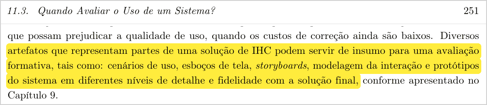

## Histórico de Versão e Contribuição

| Data | Versão | Descrição | Autor(es) | Revisor(es) | Declaração de Uso de IA |
| :---: | :---: | :--- | :--- | :--- | :--- |
| 13/10/2026 | `1.0` | Elaboração do Planejamento Individual de Tarefas de Lucas Araújo para a Etapa 4. | [Lucas Araújo](https://github.com/Lucasaraujoszz) | [Arthur Mariani](https://github.com/arthur-mariani) | Google Gemini - utilizado apenas para formatação em Markdown |
| 19/11/2026 | `1.2` | Substituição de vínculo local inválido pela visão geral versionada do projeto. | [Gabriel Melo](https://github.com/gabriellcardone-06) | [Arthur Mariani](https://github.com/arthur-mariani) | Claude (Anthropic): apoio na verificação dos vínculos internos. |

---

# Planejamento Individual de Tarefas: Lucas Araújo (Etapa 4)

## 1. Contexto e Objetivos Individuais na Etapa 4

A **Etapa 4** do projeto de Interação Humano-Computador (IHC), aplicado ao portal e serviços da **SEMOB-DF / BRB Mobilidade**, compreende o planejamento sistemático das avaliações formativas de IHC. Conforme estabelecido no [Plano de Ensino da Disciplina](https://interacao-humano-computador.github.io/2026.2-Grupo05/assets/inspecoes/plano-de-ensino-ihc-2026-2-turma01-v1.pdf) (páginas 12 e 13) e na [visão geral de Design, Avaliação e Desenvolvimento](../../../index.md), cada integrante possui responsabilidades individuais intransferíveis de modelagem, redação de artefatos metodológicos, fundamentação teórica referenciada e inspeção por pares.

Este documento formaliza as atribuições, o fluxo operacional, os cronogramas de entrega e os critérios de aceitação específicos do integrante **Lucas Araújo Lima**.

**Artefatos relacionados — fluxo da funcionalidade TAR-03 (Planejamento de Rota por Origem e Destino):**

* **Persona:** [Marcos Paulo Vieira](../../../../analise-de-requisitos/personas/marcos-paulo-vieira.md)
* **Cenário:** [Cenário 3](../../../../analise-de-requisitos/cenarios/cenario-3-planejamento-origem-destino.md)
* **Análise de tarefas:** [TAR-03](../../../../analise-de-requisitos/analise-de-tarefas/tar-03-planejamento-rota.md)
* **Storyboard:** [Storyboard 03](../../storyboards.md#33-storyboard-03-planejamento-de-rota-por-origem-e-destino-com-monitoramento-em-tempo-real)
* **Nível 1: avaliação do storyboard e da análise de tarefas:** Planejamento da avaliação (*não realizado*) · Planejamento do relato (*não realizado*) · [Relato dos resultados](../../relatos-individuais/lucas/relato-resultados-storyboard-tarefas.md) · Planejamento individual de tarefas (*esta página*) · [Questões práticas e éticas](questoes-praticas-e-eticas.md)
* **Nível 2: protótipo de papel (baixa fidelidade):** [Planejamento da avaliação](../../../nivel2/planejamentos-individuais/Lucas/lucas-planejamento-av-prototipo-papel.md) · [Planejamento do relato](../../../nivel2/planejamentos-individuais/Lucas/lucas-planejamento-relato-prot-papel.md) · [Relato dos resultados](../../../nivel2/relatos-individuais/lucas/relato-resultados-prot-papel.md)
* **Nível 3: protótipo de alta fidelidade:** [Planejamento da avaliação](../../../nivel3/planejamentos-individuais/lucas/planejamento-av-prot-alta-fidel.md) · [Planejamento do relato](../../../nivel3/planejamentos-individuais/lucas/planejamento-relato-prot-alta-fidel.md) · [Relato dos resultados](../../../nivel3/relatos-individuais/lucas/relato-resultados-prot-alta-fidel.md)
* **Telas do protótipo de papel:** [telas no planejamento da avaliação](../../../nivel2/planejamentos-individuais/Lucas/lucas-planejamento-av-prototipo-papel.md#9-telas-do-prototipo-avaliado)
* **Protótipo de alta fidelidade navegável:** [acessar o protótipo](../../../../prototipos/tar-03/index.html)

---

## 2. Matriz de Atribuições de Lucas Araújo

A Tabela 1 detalha o escopo de atuação de Lucas Araújo na Etapa 4, articulando suas entregas com os artefatos das etapas anteriores:

<strong>Tabela 1</strong>: Atribuições e Responsabilidades Individuais de Lucas Araújo

| Dimensão de Entrega | Artefato Sob Responsabilidade | Vínculo no Projeto | Revisor por Pares |
| :--- | :--- | :--- | :--- |
| **Storyboard Individual** | **Storyboard 03:** *Planejamento de Rota por Origem/Destino e Rastreamento de Ônibus em Tempo Real*. | [TAR-03](../../../../analise-de-requisitos/analise-de-tarefas/tar-03-planejamento-rota.md) [Cenário 3](../../../../analise-de-requisitos/cenarios/cenario-3-planejamento-origem-destino.md) [Persona Marcos Paulo Vieira](../../../../analise-de-requisitos/personas/marcos-paulo-vieira.md) | [Arthur Mariani](https://github.com/arthur-mariani) |
| **Artefato Metodológico Central** | **Questões Práticas e Éticas da Avaliação:** Estruturação de recrutamento, perfil, infraestrutura, custos e minuta completa do TCLE. | [Perfil Primário](../../../../analise-de-requisitos/perfis-de-usuario/perfil-primario.md) Checklist Itens 5 e 6 | [Arthur Mariani](https://github.com/arthur-mariani) |
| **Fundamentação Teórica** | Seção teórica sobre *Aspectos Éticos em Pesquisas com Usuários e TCLE* (Barbosa et al., 2021). | Cap. 7, Seção 7.4 (pp. 126–129) Prints das páginas do livro | [Arthur Mariani](https://github.com/arthur-mariani) |
| **Revisão por Pares (Inspeção Cruzada)** | Inspeção do **Storyboard 04** e do documento de **Planejamento da Avaliação da Análise de Tarefas via DECIDE**. | Artefatos de [Carlos Costa](https://github.com/carloshfgit) Checklist Itens 2, 3 e 4 | [Lucas Araújo](https://github.com/Lucasaraujoszz) |
| **Comunicação e Disseminação** | Participação na gravação em vídeo da apresentação da Etapa 4. | Apresentação em vídeo (YouTube Não Listado) | Equipe Grupo 05 |

<em>Fonte: Elaborado por Lucas Araújo (2026).</em>

---

## 3. Detalhamento Operacional das Entregas

### 3.1. Storyboard 03: Planejamento de Rota e Rastreamento
* **Objetivo:** Materializar em prototipagem de baixa fidelidade a experiência do passageiro cotidiano planejando seu deslocamento por linguagem natural (Origem/Destino) e monitorando o veículo no mapa.
* **Procedimento de Produção:**
  1. Criação manual de 6 quadros sequenciais no papel em formato paisagem;
  2. Inclusão de balões de fala, pensamentos e expressões faciais da persona;
  3. Redação de legenda narrativa abaixo de cada quadro descrevendo a correspondência com as operações da TAR-03;
  4. Digitalização em alta resolução e arquivamento em `docs/assets/storyboards/Storyboard-3-Lucas.jpg`;
  5. Integração na página unificada [Storyboards](../../storyboards.md#33-storyboard-03-planejamento-de-rota-por-origem-e-destino-com-monitoramento-em-tempo-real), acompanhado da respectiva tabela de verificação.

### 3.2. Artefato de Questões Práticas e Éticas da Avaliação
* **Objetivo:** Estabelecer o protocolo prático, logístico e ético que orientará todas as sessões de avaliação formativa com usuários da Etapa 5.
* **Componentes Obrigatórios:**
  * **Recrutamento:** Critérios de elegibilidade alinhados ao Perfil Primário (passageiro do STPC/DF), definição do tamanho amostral com base em Nielsen (2000 apud BARBOSA et al., 2021) e Dumas & Redish (1999 apud BARBOSA et al., 2021);
  * **Recursos e Infraestrutura:** Relação detalhada de hardware, software de conferência (Microsoft Teams), software de gravação redundante (OBS / 123APPS) e conectividade;
  * **Orçamento Estimado:** Demonstração de custo financeiro nulo (uso de infraestrutura acadêmica e trabalho voluntário);
  * **Termo de Consentimento Livre e Esclarecido (TCLE):** Minuta integral contendo autorização expressa para gravação de imagem e voz, compromisso de anonimato, confidencialidade e liberdade de desistência sem ônus.

### 3.3. Fundamentação Teórica com Registro Fotográfico do Livro
* **Objetivo:** Atender ao Item 14 do Checklist do Plano de Ensino (*Cada integrante elabora ao menos 1 item com fundamentação teórica formal e foto/print da página da obra*).
* **Fundamentação:** Princípios éticos da Resolução CNS nº 196/96 (autonomia, beneficência, não-maleficência e justiça) e diretrizes de pesquisa em IHC conforme Simone Barbosa et al. (2021).
* **Evidências:** Inserção dos prints das páginas 139 e 141 do livro de referência.

### 3.4. Inspeção por Pares (Avaliação de Carlos Costa)
* **Objetivo:** Conduzir avaliação crítica e imparcial sobre o *Planejamento da Avaliação da Análise de Tarefas via DECIDE* e sobre o *Storyboard 04* produzidos por Carlos Costa.
* **Instrumento:** Aplicação dos critérios da Tabela 3 do Plano de Ensino da disciplina, preenchendo o histórico de versão e apontamentos de melhoria.

---

## 4. Cronograma Individual Escalonado

A Tabela 2 apresenta o cronograma individual de trabalho de Lucas Araújo, alinhado às janelas de revisão da equipe para evitar sobrecargas pré-entrega:

<strong>Tabela 2</strong>: Cronograma de Execução Individual (Lucas Araújo)

| Data / Período | Atividade | Entregável / Meta | Status |
| :---: | :--- | :--- | :---: |
| **08/10 a 10/10** | Concepção e desenho do Storyboard 03 no papel. | 6 quadros desenhados a mão e legendados. | **Concluído** |
| **11/10 a 12/10** | Digitalização da imagem e inserção no MkDocs. | Arquivo de imagem em assets e seção 3.3 em `storyboards.md`. | **Concluído** |
| **12/10 a 13/10** | Redação do documento de Questões Práticas e Éticas + TCLE. | Arquivo `questoes-praticas-e-eticas.md` completo no MkDocs. | **Concluído** |
| **13/10 (Tarde)** | Extração de prints do livro e fundamentação teórica. | Prints das páginas 139 e 141 incorporados com citação ABNT. | **Concluído** |
| **13/10 (Noite)** | Gravação da apresentação em vídeo da Etapa 4 com a equipe. | Trecho individual gravado apresentando Storyboard e Ética/TCLE. | **Concluído** |
| **13/10 a 14/10** | Revisão por Pares do artefato de Carlos Costa. | Registro da inspeção no histórico de versão do Carlos. | **Planejado** |
| **14/10 a 15/10** | Ajustes finais pós-revisão e fechamento da entrega. | Submissão dos links na Wiki/GitHub Pages e Aprender3. | **Planejado** |

<em>Fonte: Elaborado por Lucas Araújo (2026).</em>

---

## 5. Checklist de Verificação dos Artefatos de Lucas Araújo

A Tabela 3 consolida a autoavaliação de conformidade dos artefatos produzidos por Lucas Araújo em relação às exigências do Plano de Ensino da disciplina (SALES, 2026):

<strong>Tabela 3</strong>: Checklist de Conformidade dos Artefatos de Lucas Araújo

| Item | Critério de Aceitação do Plano de Ensino | Situação no Artefato | Localização da Evidência |
| :---: | :--- | :---: | :--- |
| **1** | Histórico de versão padronizado, autor, revisor, tabelas/figuras com legendas e fontes. | **Conforme** | Presente em todas as páginas e tabelas elaboradas. |
| **5** | Recrutamento de participantes definido (perfil, quantidade, justificativa, formato, equipamentos, custos). | **Conforme** | Seções 2 e 3 do documento `questoes-praticas-e-eticas.md`. |
| **6** | Respeito aos participantes, minimização de riscos e presença do TCLE com autorização de gravação. | **Conforme** | Seções 4 e 5 do documento `questoes-praticas-e-eticas.md`. |
| **9** | Cada Storyboard explicitamente vinculado a uma tarefa da Análise de Tarefas (HTA/CTT). | **Conforme** | Seção 3.3 de `storyboards.md` vinculado à TAR-03. |
| **10** | Quantidade de Storyboards compatível com o número de integrantes (Storyboard 03/07). | **Conforme** | Storyboard 03 integrado ao repositório. |
| **14** | Fundamentação teórica individual com citação formal, página e imagem da página do livro. | **Conforme** | Seção 4 do documento de Ética com prints das pp. 126–129. |

<em>Fonte: Elaborado por Lucas Araújo (2026).</em>

---

## 6. Fotos de Referência

As Figuras 1 a 4 mostram os trechos que fundamentam este artefato, recortados e grifados em amarelo diretamente do livro da disciplina (BARBOSA et al., 2021).

<strong>Figura 1</strong>: 11.8 Framework DECIDE

<em>Fonte: BARBOSA et al. (2021, p. 264).</em>

<strong>Figura 2</strong>: 11.2 Principais aspectos (objetivos) avaliados em IHC

<em>Fonte: BARBOSA et al. (2021, p. 248).</em>

<strong>Figura 3</strong>: Artefatos que podem ser avaliados de forma formativa (incluindo storyboards)

<em>Fonte: BARBOSA et al. (2021, p. 251).</em>

<strong>Figura 4</strong>: 11.7.2 Escopo da avaliação, perfil e número de participantes

<em>Fonte: BARBOSA et al. (2021, p. 258).</em>

---

## 7. Referências Bibliográficas

* BARBOSA, Simone Diniz Junqueira; SILVA, Bruno Santana da; SILVEIRA, Milene Selbach; GASPARINI, Isabela; DARIN, Ticianne; BARBOSA, Gabriel Diniz Junqueira. **Interação Humano-Computador e Experiência do Usuário**. Rio de Janeiro: Autopublicação, 2021. ISBN 978-65-00-19677-1.
* SALES, André Barros de. **Plano de Ensino: Interação Humano Computador**. Brasília: Faculdade UnB Gama (FCTE/UnB), 2026.
