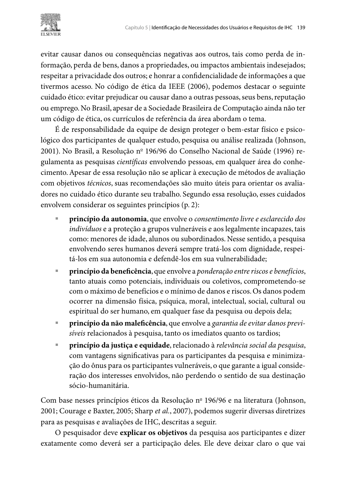
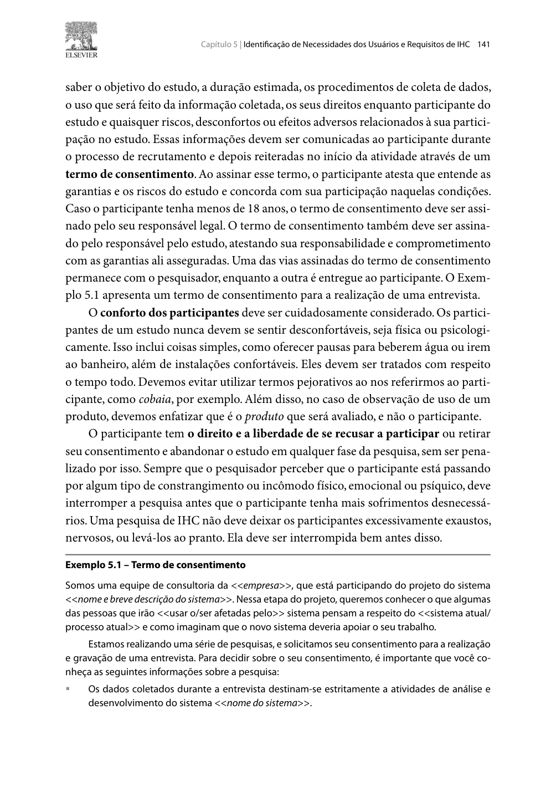

## Histórico de Versão

| Data | Versão | Descrição | Autor(es) | Revisor(es) | Declaração do uso de IA |
| :---: | :---: | :--- | :--- | :--- | :--- |
| 13/10/2026 | `1.0` | Elaboração completa do documento de Questões Práticas e Éticas das Avaliações de IHC, incluindo recrutamento, infraestrutura, orçamento, fundamentação teórica com prints do livro e minuta integral do TCLE com autorização de gravação. | [Lucas Araújo](https://github.com/Lucasaraujoszz) | [Arthur Mariani](https://github.com/arthur-mariani) | Google Gemini - utilizado apenas para formatação em Markdown |

---

# Questões Práticas e Éticas das Avaliações de IHC

Neste documento, apresentam-se as **Questões Práticas e Éticas** que norteiam o planejamento e a futura condução das avaliações formativas da **Etapa 4** e **Etapa 5** do projeto de Interação Humano-Computador (IHC), aplicado ao portal da **Secretaria de Transporte e Mobilidade do Distrito Federal (SEMOB-DF)**.

O planejamento de uma avaliação de IHC exige rigor tanto nos aspectos operacionais e logísticos (recrutamento, recursos, prazos e custos) quanto no cumprimento irrestrito dos preceitos éticos que resguardam a dignidade, a privacidade e o bem-estar dos participantes (Barbosa et al., 2021).

---

## 1. Introdução

De acordo com o framework **DECIDE** (Preece et al., 2002; Sharp et al., 2007) e os fundamentos de Engenharia de Usabilidade de Barbosa & Silva (2010) e Barbosa et al. (2021), as etapas **"I"** (*Identify the practical issues*) e **"D"** (*Decide how to deal with the ethical issues*) são pilares indispensáveis para assegurar a viabilidade técnica e a integridade humana de qualquer investigação empírica.

Este documento estabelece as diretrizes que serão adotadas por todos os avaliadores do **Grupo 05** na condução das entrevistas de avaliação dos **Storyboards** e de validação da **Análise de Tarefas (HTA e CTT)**, garantindo conformidade estrita com o Plano de Ensino da disciplina (SALES, 2026).

---

## 2. Recrutamento e Amostragem de Participantes (Questões Práticas)

### 2.1. Perfil dos Participantes Recrutados
O recrutamento dos participantes é rigorosamente ancorado no [Perfil de Usuário Primário (Passageiro Cotidiano)](../../../../analise-de-requisitos/perfis-de-usuario/perfil-primario.md) e representado pela persona primária [Marcos Paulo Vieira](../../../../analise-de-requisitos/personas/marcos-paulo-vieira.md), além de contemplar os demais perfis mapeados pelo grupo (estudantes, passageiros com mobilidade reduzida e motoristas).

A Tabela 1 sintetiza os critérios de elegibilidade para o recrutamento dos participantes:

<strong>Tabela 1</strong> — Critérios de Elegibilidade para Recrutamento de Participantes

| Dimensão | Critérios de Inclusão | Critérios de Exclusão |
| :--- | :--- | :--- |
| **Experiência de Uso** | Usuários reais e cotidianos do transporte coletivo do DF (ônibus, BRT ou metrô), com frequência mínima de uso semanal. | Pessoas que nunca utilizaram o sistema de transporte coletivo do DF ou que dependem exclusivamente de transporte individual próprio. |
| **Familiaridade Digital** | Usuários que acessam serviços de mobilidade, mapas ou internet por meio de smartphones (Android ou iOS). | Pessoas que não possuem acesso a smartphone ou computadores conectados à internet. |
| **Vínculo com o Projeto** | Cidadãos sem envolvimento prévio com a elaboração dos artefatos de IHC do Grupo 05. | Integrantes da própria equipe de desenvolvimento do Grupo 05 ou avaliadores de grupos concorrentes da mesma disciplina. |
| **Faixa Etária e Autonomia** | Indivíduos civilmente capazes, com idade igual ou superior a 18 anos, com autonomia plena de consentimento. | Menores de idade ou pessoas legalmente incapazes desacompanhadas de autorização formal dos responsáveis legais. |

<em>Fonte: Elaborado por Lucas Araújo (2026).</em>

### 2.2. Quantidade de Participantes e Justificativa Teórica
Para as avaliações formativas da Etapa 5, cada sessão de avaliação (Storyboard e Análise de Tarefas) contará com uma amostra planejada de **3 a 5 participantes por perfil investigado**.

#### **Justificativa Metodológica:**
1. **Curva de Rendimento Decrescente de Nielsen (2000):** Segundo Jakob Nielsen e Robert Landauer (1993, citados por Barbosa & Silva, 2010, p. 305), a inclusão de **5 participantes** em testes qualitativos de usabilidade é suficiente para descobrir aproximadamente **85% dos problemas de interação** mais críticos da interface. Adicionar participantes além desse número acarreta repetição de descobertas e elevação desproporcional do custo de coleta e análise sem retorno substancial em novas informações (*relação custo-benefício ótima*).
2. **Recomendação de Dumas & Redish (1999):** Em avaliações formativas com foco qualitativo em profundidade, amostras menores (entre 3 e 5 usuários bem selecionados) permitem ao avaliador conduzir entrevistas semiestruturadas com maior riqueza de detalhes, sem comprometer o tempo de tabulação e consolidação dos relatos.

### 2.3. Estratégia e Abordagem de Recrutamento
O recrutamento será conduzido por meio de:
* **Abordagem direta e convite:** Contato com estudantes, trabalhadores do comércio/logística e usuários regulares das linhas de ônibus de regiões administrativas como Samambaia, Gama, Ceilândia e Plano Piloto.
* **Questionário pré-teste de triagem:** Aplicação de perguntas curtas de caracterização para assegurar o alinhamento com a Tabela 1 antes da confirmação da sessão.
* **Agendamento antecipado:** Confirmação de data, horário e ambiente com antecedência mínima de 48 horas, assegurando o cumprimento da agenda planejada.

---

## 3. Recursos, Equipamentos e Infraestrutura

A execução das avaliações formativas requer um ambiente controlado e ferramentas estáveis que permitam a apresentação visual dos artefatos (Storyboards e diagramas HTA/CTT) e o registro audiovisual fidedigno das reações e verbalizações dos participantes.

A Tabela 2 apresenta o inventário de infraestrutura e tecnologias mobilizadas:

<strong>Tabela 2</strong> — Inventário de Recursos, Ferramentas e Infraestrutura

| Categoria | Recurso / Ferramenta | Finalidade na Avaliação | Responsável Operacional |
| :--- | :--- | :--- | :--- |
| **Hardware** | Computador / Notebook com webcam e fone/microfone estéreo | Condução da sessão pelo avaliador e visualização clara dos artefatos em tela. | Avaliador designado |
| **Software de Comunicação** | **Microsoft Teams** (ou Google Meet corporativo/acadêmico) | Plataforma de videoconferência para encontro síncrono remoto, compartilhamento de tela e gravação da sessão. | Avaliador designado |
| **Software de Gravação Redundante** | **OBS Studio** / 123APPS | Captura local de reserva de áudio e vídeo de tela, prevenindo eventuais perdas em caso de falha de gravação na nuvem. | Avaliador de suporte / Responsável pela gravação |
| **Conectividade** | Conexão à Internet Banda Larga (mínimo 15 Mbps estáveis) | Garantir estabilidade da chamada, clareza no áudio e ausência de atrasos (*lags*) no compartilhamento de imagens. | Todos os avaliadores |
| **Material de Apoio** | Arquivo digital dos Storyboards, diagramas HTA/CTT, roteiro da entrevista e TCLE em PDF | Apresentação padronizada dos artefatos ao participante durante a sessão. | Avaliador designado |

<em>Fonte: Elaborado por Lucas Araújo (2026).</em>

---

## 4. Orçamento e Estimativa de Custos

Conforme preconizado nas boas práticas acadêmicas e na legislação brasileira (Resolução CNS nº 196/96 e 510/2016), a participação dos usuários em pesquisas acadêmicas sem fins lucrativos é **voluntária e não remunerada**, sendo vedado o pagamento de gratificações monetárias diretas pela participação (Barbosa & Silva, 2010, p. 142).

A Tabela 3 consolida o detalhamento orçamentário do projeto:

<strong>Tabela 3</strong> — Detalhamento Orçamentário e Estimativa de Custos

| Item de Despesa | Descrição do Recurso | Custo Unitário | Quantidade | Custo Total (R$) |
| :--- | :--- | :---: | :---: | :---: |
| **Licença de Softwares** | Microsoft Teams / Google Meet / OBS Studio | R$ 0,00 | 7 membros | **R$ 0,00** (Uso de licenças institucionais UnB e ferramentas *open source*) |
| **Equipamentos** | Computadores pessoais, microfones e webcams | R$ 0,00 | 7 unidades | **R$ 0,00** (Recursos próprios pré-existentes dos estudantes) |
| **Hospedagem e Wiki** | GitHub Pages / Repositório GitHub | R$ 0,00 | 1 plataforma | **R$ 0,00** (Infraestrutura pública gratuita) |
| **Remuneração de Participantes** | Participação voluntária acadêmica | R$ 0,00 | ~7 participantes | **R$ 0,00** (Gratuito conforme legislação ética nacional) |
| **Material Impresso / Físico** | Documentação e Storyboards no papel | R$ 0,00 | Folhas sulfite | **R$ 0,00** (Custos absorvidos pelos próprios autores) |
| **TOTAL GERAL** | — | — | — | **R$ 0,00** |

<em>Fonte: Elaborado por Lucas Araújo (2026).</em>

> **Nota de Custos:** Como as sessões são planejadas primordialmente em ambiente remoto (online) via videoconferência, não há previsão de despesas de deslocamento, transporte urbano ou alimentação para os participantes ou para os pesquisadores.

---

## 5. Fundamentação Teórica: Aspectos Éticos em Pesquisas com Usuários

A realização de qualquer atividade investigativa em IHC envolvendo seres humanos deve pautar-se pelo respeito incondicional aos sujeitos de pesquisa. Na Computação, os códigos de ética de entidades como a **ACM (1992)** e o **IEEE (2006)** estabelecem expressamente os deveres de *evitar danos*, *respeitar a privacidade* e *garantir a confidencialidade das informações* coletadas (Barbosa & Silva, 2010, p. 138–139).

### 5.1. Os 4 Princípios Éticos da Resolução CNS nº 196/96 aplicados a IHC
No Brasil, a regulamentação ética de pesquisas envolvendo pessoas é orientada pelos princípios do Conselho Nacional de Saúde (CNS), consolidados na literatura de IHC por Simone Barbosa et al. (2010; 2021):

1. **Princípio da Autonomia:** Reconhece que cada participante é um sujeito livre, dotado de capacidade de autodeterminação. O participante deve ser plenamente esclarecido sobre os objetivos do estudo e possui o **direito de interromper ou abandonar a sessão a qualquer instante**, sem sofrer constrangimentos, punições ou qualquer prejuízo. O consentimento deve ser livre, voluntário e revogável.
2. **Princípio da Beneficência:** Exige a maximização de benefícios e a garantia de que a pesquisa trará contribuições sociais efetivas (no caso, a melhoria da qualidade do serviço público de transporte da SEMOB-DF para toda a população).
3. **Princípio da Não-Maleficência:** Compromisso estrito de prevenir e evitar qualquer dano físico, psicológico, moral ou intelectual ao participante. O avaliador deve reiterar constantemente que **o que está sendo avaliado é o sistema/artefato de IHC, e JAMAIS o usuário ou sua inteligência**, eliminando sentimentos de ansiedade ou julgamento de desempenho pessoal.
4. **Princípio da Justiça e Equidade:** Distribuição equitativa de ônus e benefícios, tratando com igual consideração todos os perfis e respeitando as particularidades de populações vulneráveis ou pessoas com deficiência.

### 5.2. Privacidade, Sigilo e Anonimização de Dados
Durante a divulgação dos resultados da avaliação, os avaliadores têm o dever de garantir:
* **Preservação da imagem e do nome:** É vedada a publicação de nomes completos, números de documentos pessoais (CPF, RG) ou contatos dos voluntários. Nos relatos finais e tabelas, os usuários serão identificados exclusivamente por códigos fictícios neutros (ex.: *Participante 1*, *Usuário A*).
* **Anonimização de relatos:** Quaisquer menções a dados de terceiros ou termos específicos que possam identificar o entrevistado serão mascarados.

### 5.3. Autorização Expressa para Gravação de Voz e Imagem
Conforme exigido pelo **Item 6 do Checklist do Plano de Ensino da disciplina** e detalhado por Barbosa & Silva (2010, p. 140):
> *"É necessário obter permissão para gravar a voz ou imagem de qualquer pessoa, antes de começar a gravação. Devemos informar aos participantes logo no recrutamento sobre os tipos de gravações que serão realizadas, para evitar mal-entendidos ou desistências no momento da atividade."*

Sendo assim, o início da gravação no Microsoft Teams só poderá ser acionado **após o esclarecimento do termo e a confirmação afirmativa e verbal de aceite do participante**.

---

## 6. Imagens da Referência no Livro-Texto Oficial

Conforme estabelecido pelo critério de validação da disciplina (**Item 14 do Checklist**), as Figuras 1 e 2 comprovam as páginas da obra de referência de IHC onde estão fundamentados os aspectos éticos e a elaboração do termo de consentimento:

  
  
<strong>Figura 1</strong> — Princípios Éticos em Pesquisas Envolvendo Pessoas (Autonomia, Beneficência, Não-maleficência e Justiça)

  
<em>Fonte: BARBOSA & SILVA (2010, Capítulo 5, p. 139).</em>

  
  
<strong>Figura 2</strong> — Exemplo de Estrutura do Termo de Consentimento Livre e Esclarecido (TCLE) em IHC

  
<em>Fonte: BARBOSA & SILVA (2010, Capítulo 5, p. 141).</em>

---

## 7. Minuta Oficial do Termo de Consentimento Livre e Esclarecido (TCLE)

A seguir, apresenta-se a minuta oficial e integral do **Termo de Consentimento Livre e Esclarecido (TCLE)**, elaborada por Lucas Araújo e adaptada especificamente para as avaliações formativas dos Storyboards e da Análise de Tarefas do Grupo 05:

---

<h3 align="center">TERMO DE CONSENTIMENTO LIVRE E ESCLARECIDO (TCLE)</h3>

<strong>Projeto de Interação Humano-Computador — Sistema SEMOB-DF</strong> 
Faculdade UnB Gama (FCTE) · Universidade de Brasília

Prezado(a) participante,

Convidamos você a participar voluntariamente da pesquisa acadêmica de <strong>Avaliação de Usabilidade e Prototipagem da Interface da Secretaria de Transporte e Mobilidade do Distrito Federal (SEMOB-DF)</strong>, conduzida pelos estudantes da disciplina de Interação Humano-Computador da Universidade de Brasília (FCTE/UnB), sob supervisão do Prof. Dr. André Barros de Sales.

Para decidir conscientemente sobre sua participação, leia com atenção as informações a seguir:

<h4>1. Objetivo da Pesquisa</h4>

O estudo tem por objetivo avaliar propostas de design, narrativas de uso (Storyboards) e fluxos da Análise de Tarefas (HTA e CTT) para o aperfeiçoamento da experiência do cidadão no portal e nos serviços digitais de transporte coletivo da SEMOB-DF.

<h4>2. Procedimentos da Sessão</h4>

Sua participação consistirá em uma sessão remota (via videoconferência no Microsoft Teams/Google Meet) com duração média de <strong>30 a 45 minutos</strong>. Durante o encontro, você será convidado(a) a observar desenhos de cenários cotidianos (Storyboards) e fluxos de tarefas, respondendo a perguntas abertas de opinião sobre a clareza, facilidade e utilidade das soluções apresentadas.

<h4>3. Garantia Fundamental ao Participante</h4>

<strong>É fundamental esclarecer que NÃO se trata de um teste sobre você, sua inteligência ou seus conhecimentos.</strong> Apenas os artefatos computacionais e as propostas de design estão sendo avaliados. Não existem respostas "certas" ou "erradas"; sua opinião sincera sobre eventuais dificuldades é o dado mais valioso para o projeto.

<h4>4. Riscos e Desconfortos</h4>

A presente pesquisa acarreta riscos mínimos aos participantes. Caso sinta cansaço, constrangimento ou desconforto durante as perguntas, você pode solicitar uma pausa imediata ou encerrar a participação a qualquer momento.

<h4>5. Confidencialidade, Sigilo e Anonimato</h4>

Garantimos sigilo absoluto sobre sua identidade civil. Seu nome, imagem de rosto ou dados pessoais jamais serão publicados na Wiki da disciplina, em relatórios acadêmicos ou apresentações públicas. Quaisquer dados consolidados serão identificados unicamente por códigos neutros (ex.: "Participante A").

<h4>6. Autorização Expressa para Gravação de Voz e Imagem</h4>

Para fins estritamente analíticos de transcrição e registro fidedigno de suas sugestões pela equipe discente, solicitamos sua permissão para efetuar a <strong>gravação em áudio e vídeo da sessão remota</strong>. Os arquivos brutos de gravação permanecerão sob guarda restrita da equipe e serão excluídos ao término do semestre letivo.

<h4>7. Voluntariedade e Direito de Desistência</h4>

A sua participação é inteiramente voluntária e isenta de ônus financeiro. Você é livre para recusar a participação ou retirar seu consentimento em qualquer fase do estudo, sem qualquer penalidade, justificativa ou prejuízo.

<h4>8. Canais de Contato</h4>

Em caso de dúvidas a respeito dos direitos éticos ou procedimentos da pesquisa, você pode entrar em contato com a equipe discente pelo e-mail: <code>ihc.grupo05.unb@gmail.com</code> ou com a coordenação da disciplina na Universidade de Brasília.

<h4>Consentimento Pós-Informado</h4>

Ao assinalar as opções abaixo e confirmar seu aceite (verbal na gravação ou por assinatura digital), você atesta que leu, compreendeu e concordou com as condições da pesquisa:

[ &nbsp; ] <strong>CONCORDO</strong> em participar voluntariamente deste estudo de avaliação de IHC. 
[ &nbsp; ] <strong>AUTORIZO</strong> expressamente a gravação de áudio e imagem da minha tela e voz exclusivamente para fins de análise acadêmica da disciplina.

 

Brasília - DF, _____ de ____________________ de 2026.

 
<table width="100%" style="border: none;">
  <tr style="border: none;">
    <td width="50%" align="center" style="border: none;">
      __________________________________________ 
      <strong>Assinatura do Participante</strong>
    </td>
    <td width="50%" align="center" style="border: none;">
      __________________________________________ 
      <strong>Lucas Araújo Lima (Grupo 05 / FCTE-UnB)</strong>
    </td>
  </tr>
</table>

---

## 8. Mapeamento de Conformidade com o Checklist do Plano de Ensino

A Tabela 4 espelha os critérios da Tabela 3 do Plano de Ensino da disciplina (SALES, 2026), comprovando o atendimento integral de cada item avaliativo sob responsabilidade de Lucas Araújo:

<strong>Tabela 4</strong> — Mapeamento de Conformidade com o Checklist da Etapa 4

| # Item | Item de Verificação do Plano de Ensino | Critério de Aceitação Exigido | Situação no Artefato | Seção de Evidência |
| :---: | :--- | :--- | :---: | :--- |
| **1** | **Itens Gerais de Desenvolvimento** | Histórico de versão padronizado, autores/revisores, introdução, legendas e fontes em tabelas/figuras, declaração de IA. | **Conforme** | Cabeçalho, Seções 1 a 7 e metadados. |
| **5** | **Questões Práticas** | Recrutamento de participantes definido (perfil, quantidade, justificativa, formato presencial/remoto, equipamentos, cronograma, custos). | **Conforme** | **Seção 2** (Perfil e amostragem), **Seção 3** (Equipamentos) e **Seção 4** (Orçamento zero). |
| **6** | **Questões Éticas** | Respeito aos participantes, minimização de riscos e presença do Termo de Consentimento Livre e Esclarecido (TCLE) com permissão para gravação. | **Conforme** | **Seção 5** (Princípios da Res. 196/96) e **Seção 7** (Minuta integral do TCLE com cláusula de gravação). |
| **14** | **Fundamentação Individual com Foto** | Cada um dos 7 integrantes elaborou ao menos 1 item com referência bibliográfica e foto da página do livro. | **Conforme** | **Seção 5** (Citação formal) e **Seção 6** (Figuras 1 e 2 comprovando as páginas 139 e 141 do livro). |

<em>Fonte: Elaborado por Lucas Araújo (2026), baseado no Plano de Ensino (SALES, 2026).</em>

---

## 9. Referências Bibliográficas

* ACM. **ACM Code of Ethics and Professional Conduct**. Association for Computing Machinery, New York, 1992.
* BARBOSA, Simone Diniz Junqueira; SILVA, Bruno Santana da. **Interação Humano-Computador**. Rio de Janeiro: Elsevier / Campus, 2010. ISBN 978-85-352-1120-7. (Capítulo 5: Identificação de Necessidades dos Usuários e Requisitos de IHC, Seção 5.4: Aspectos Éticos de Pesquisas Envolvendo Pessoas, p. 138–143).
* BARBOSA, Simone Diniz Junqueira; SILVA, Bruno Santana da; SILVEIRA, Milene Selbach; GASPARINI, Isabela; DARIN, Ticianne; BARBOSA, Gabriel Diniz Junqueira. **Interação Humano-Computador e Experiência do Usuário**. Rio de Janeiro: Autopublicação, 2021. ISBN 978-65-00-19677-1. (Capítulo 11: Planejamento da Avaliação de IHC).
* BRASIL. Conselho Nacional de Saúde. **Resolução nº 196, de 10 de outubro de 1996**. Diretrizes e normas regulamentadoras de pesquisas envolvendo seres humanos. Brasília: Ministério da Saúde, 1996.
* BRASIL. Conselho Nacional de Saúde. **Resolução nº 510, de 07 de abril de 2016**. Normas aplicáveis a pesquisas em Ciências Humanas e Sociais. Brasília: Diário Oficial da União, 2016.
* DUMAS, Joseph S.; REDISH, Janice C. **A Practical Guide to Usability Testing**. Exeter: Intellect Books, 1999.
* IEEE. **IEEE Code of Ethics**. Institute of Electrical and Electronics Engineers, Piscataway, NJ, 2006.
* NIELSEN, Jakob. **Why You Only Need to Test with 5 Users**. Alertbox, 2000. Disponível em: <https://www.nngroup.com/articles/why-you-only-need-to-test-with-5-users/>.
* PREECE, Jennifer; ROGERS, Yvonne; SHARP, Helen. **Design de Interação: Além da interação homem-computador**. São Paulo: Editora Érica, 2005.
* SALES, André Barros de. **Plano de Ensino: Interação Humano Computador**. Universidade de Brasília, Faculdade UnB Gama (FCTE/UnB), 2026.

---
**Autor:** [Lucas Araújo](https://github.com/Lucasaraujoszz)  
**Revisor:** [Arthur Mariani](https://github.com/arthur-mariani)
