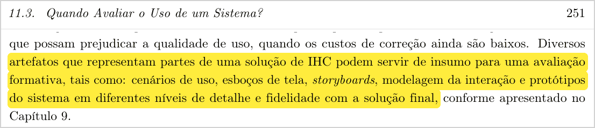

## Histórico de Versão e Contribuição

| Data | Versão | Descrição | Autor(es) | Revisor(es) | Declaração de Uso de IA |
| :---: | :---: | :--- | :--- | :--- | :--- |
| 13/10/2026 | `1.0` | Criação do planejamento individual da avaliação do Storyboard 05 e da Análise de Tarefas (TAR-03) via DECIDE. | [Tomás Rocho](https://github.com/TomasRocho) | [Rodrigo Carvalho](https://github.com/RodrigoCBarbosa) | Claude (Anthropic) - usado para estruturação do texto e formatação Markdown da página |
| 23/10/2026 | `1.1` | Atualização do planejamento para o novo Storyboard 05 (Pedido de Aumento do Limite Diário do Vale-Transporte) e para a TAR-09 (HTA e CTT): objetivos, roteiro de perguntas, materiais e análise dos dados. | [Tomás Rocho](https://github.com/TomasRocho) | [Rodrigo Carvalho](https://github.com/RodrigoCBarbosa) | Claude (Anthropic) - usado para adaptar o texto ao novo storyboard e à nova tarefa |
| 19/11/2026 | `1.2` | Padronização da estrutura (histórico no topo, conteúdo, fotos de referência e referências ao final); declaração de IA levada para o histórico; autor e revisor retirados do rodapé; retirada das referências que não são o livro da disciplina nem material do professor; inclusão de fotos de referência grifadas. Inclusão do bloco de artefatos relacionados (persona, cenário, análise de tarefas, storyboard, planejamentos, relatos e protótipos da funcionalidade). | [Gabriel Melo](https://github.com/gabriellcardone-06) | Pendente de revisão | Claude (Anthropic) — apoio na padronização da estrutura do artefato, na revisão das referências e na formatação em Markdown.; apoio na inclusão dos links entre artefatos |

---

# Planejamento da Avaliação do Storyboard e da Análise de Tarefas (TAR-09 / Cenário 9)

Neste documento, apresenta-se o **Planejamento da Avaliação do Storyboard e da Análise de Tarefas** referente ao **Storyboard 05 (Pedido de Aumento do Limite Diário do Vale-Transporte)** e à **TAR-09 (Solicitar Aumento do Limite Diário de Uso do Vale-Transporte)**. Trata-se de um planejamento individual para orientar a avaliação formativa do storyboard e dos modelos de **Análise Hierárquica de Tarefas (HTA)** e **ConcurTaskTrees (CTT)** associados.

O storyboard retrata a persona [Heitor Santos Júnior](../../../../analise-de-requisitos/personas/heitor-santos-junior.md) na situação do [Cenário 9](../../../../analise-de-requisitos/cenarios/cenario-9-limite-vale-transporte.md). Depois de um dia com vários chamados de manutenção, o cartão de Vale-Transporte de Heitor é recusado no validador porque ele passou do limite de 8 acessos por dia. No storyboard, o site da Semob explica a recusa, recebe o pedido de mais acessos pelo celular, gera um protocolo e avisa pelo WhatsApp quando o novo limite está valendo. Por isso, a avaliação dá atenção especial a três pontos da TAR-09: **entender a recusa** (objetivo 1 do HTA), **reunir e enviar os documentos** (objetivos 4 e 5) e **acompanhar o pedido** (objetivo 6).

O planejamento segue o **Framework DECIDE** (Barbosa et al., 2021), em seis etapas: **D**eterminar objetivos, **E**xplorar perguntas, **C**hoose (Escolher) métodos, **I**dentificar questões práticas, **D**ecidir questões éticas e **E**valuate (Avaliar e interpretar os dados).

**Artefatos relacionados — fluxo da funcionalidade TAR-09 (Pedido de Aumento do Limite Diário do Vale-Transporte):**

* **Persona:** [Heitor Santos Júnior](../../../../analise-de-requisitos/personas/heitor-santos-junior.md)
* **Cenário:** [Cenário 9](../../../../analise-de-requisitos/cenarios/cenario-9-limite-vale-transporte.md)
* **Análise de tarefas:** [TAR-09](../../../../analise-de-requisitos/analise-de-tarefas/tar-09-limite-vale-transporte.md)
* **Storyboard:** [Storyboard 05](../../storyboards.md#35-storyboard-05-pedido-de-aumento-do-limite-diario-do-vale-transporte)
* **Nível 1 — avaliação do storyboard e da análise de tarefas:** Planejamento da avaliação (*esta página*) · [Planejamento do relato](tomas-planejamento-relato-resultados-avaliacao.md) · Relato dos resultados (*não disponível — pendente de correção manual*)
* **Nível 2 — protótipo de papel (baixa fidelidade):** [Planejamento da avaliação](../../../nivel2/planejamentos-individuais/Tomas/tomas-planejamento-av-prototipo-papel.md) · [Planejamento do relato](../../../nivel2/planejamentos-individuais/Tomas/tomas-planejamento-relato-prot-papel.md) · [Relato dos resultados](../../../nivel2/relatos-individuais/tomas/relato-resultados-prot-papel.md)
* **Nível 3 — protótipo de alta fidelidade:** [Planejamento da avaliação](../../../nivel3/planejamentos-individuais/tomas/tomas-planejamento-av-prot-alta-fidel.md) · [Planejamento do relato](../../../nivel3/planejamentos-individuais/tomas/tomas-planejamento-relato-prot-alta-fidel.md) · [Relato dos resultados](../../../nivel3/relatos-individuais/tomas/relato-resultados-prot-alta-fidel.md)
* **Telas do protótipo de papel:** [telas no planejamento da avaliação](../../../nivel2/planejamentos-individuais/Tomas/tomas-planejamento-av-prototipo-papel.md)
* **Protótipo de alta fidelidade navegável:** [acessar o protótipo](../../../../prototipos/tar-09/index.html)

---

## 1. D — Determinar os Objetivos da Avaliação

A avaliação é **formativa**. O objetivo é verificar se a história e o modelo de tarefa representam a realidade de quem usa o Vale-Transporte para vários deslocamentos no mesmo dia, antes de qualquer protótipo de tela.

### 1.1 Objetivos da Avaliação do Storyboard 05
* **Verificar a verossimilhança contextual:** avaliar se a situação do [Storyboard 05](../../storyboards.md) (ter o cartão recusado depois de vários embarques a serviço) é parecida com o que trabalhadores que usam o Vale-Transporte no DF realmente vivem, e se eles conhecem o limite diário de acessos.
* **Validar a clareza da proposta:** confirmar se o participante entende, só pelos quadros, que o site **explica o motivo da recusa**, permite **pedir mais acessos pelo celular** e **avisa** quando o pedido é aprovado.
* **Avaliar a confiança e a aceitação da solução:** descobrir se o participante enviaria fotos de documentos pelo site e se confiaria no protocolo e no aviso pelo WhatsApp, no lugar de ir a um posto do BRB.

### 1.2 Objetivos da Avaliação da Análise de Tarefas (TAR-09 - HTA e CTT)
* **Avaliar a correção e a completude do fluxo:** verificar se os passos do [HTA da TAR-09](../../../../analise-de-requisitos/analise-de-tarefas/tar-09-limite-vale-transporte.md) (entender a recusa, encontrar o serviço, obter o formulário, reunir os documentos, entregar e aguardar) correspondem ao que o participante faz ou faria.
* **Validar os documentos exigidos:** a página da Semob pede declaração do empregador com "o endereço da prestação do serviço" e a lista de linhas usadas. A avaliação deve descobrir se essas exigências fazem sentido para quem trabalha em vários endereços (operações 4.2 e 4.4 do HTA).
* **Identificar passos faltantes ou dispensáveis:** verificar se o modelo deixa de fora ações reais, como pedir ajuda a alguém para entender a recusa ou conferir o saldo antes, e se algum passo do CTT da proposta (por exemplo, informar o número do cartão) seria uma barreira.

---

## 2. E — Explorar as Perguntas a Serem Respondidas

As perguntas abaixo transformam os objetivos em um roteiro de entrevista. Elas foram escritas de forma aberta e neutra, para não sugerir a resposta esperada (Barbosa et al., 2021).

### 2.1 Tabela de Perguntas: Avaliação do Storyboard 05

<strong>Tabela 1</strong> — Roteiro de Perguntas para Avaliação do Storyboard 05

| ID | Categoria / Foco | Pergunta Orientada ao Participante | Resposta Esperada / Critério de Aceitação |
| :---: | :--- | :--- | :--- |
| **Q01** | **Clareza Narrativa** | Com suas palavras, o que acontece nesta história? | O participante resume a história (cartão recusado → explicação no site → pedido pelo celular → protocolo → aviso de aprovação) sem ajuda do avaliador. |
| **Q02** | **Verossimilhança** | Você já teve o cartão recusado no ônibus? Sabia que o Vale-Transporte tem um limite de passagens por dia? | O participante relata uma experiência parecida ou diz o que sabe sobre o limite. |
| **Q03** | **Atuação do Sistema** | Nos quadros 2 e 3, o que o site está fazendo pelo Heitor? | O participante identifica o botão de acesso direto e a explicação de que ele usou 8 de 8 passagens. |
| **Q04** | **Confiança no Envio** | Você mandaria foto dos seus documentos pelo site, como no quadro 4? Confiaria no protocolo e no aviso pelo WhatsApp? | O participante diz se usaria o envio pelo celular ou explica o que faltaria para confiar nele. |
| **Q05** | **Engajamento** | Você usaria o site da Semob para isso? O que mudaria nesta história? | O participante opina sobre o uso da solução e sugere ajustes. |

<em>Fonte: Elaborado por Tomás Rocho (2026).</em>

### 2.2 Tabela de Perguntas: Avaliação da Análise de Tarefas (TAR-09 - HTA e CTT)

<strong>Tabela 2</strong> — Roteiro de Perguntas para Validação da Análise de Tarefas (HTA e CTT)

| ID | Categoria / Foco | Pergunta Orientada ao Participante | Resposta Esperada / Critério de Aceitação |
| :---: | :--- | :--- | :--- |
| **QT01** | **Sequência Lógica** | Os passos do diagrama (entender por que o cartão travou, achar o serviço, pegar o formulário, juntar os documentos, entregar e esperar) são os que você faria? | O participante concorda com a sequência ou aponta passos faltantes, desnecessários ou fora de ordem. |
| **QT02** | **Entender a Recusa (1)** | Quando o cartão é recusado, como você descobre o motivo? Com quem fala ou onde procura? | O participante indica as fontes que usa (motorista, colegas, site, RH) e o que precisaria ver para entender a recusa. |
| **QT03** | **Documentos (4.2 e 4.4)** | Se você trabalhasse em vários endereços, como pediria a declaração ao RH? Saberia dizer antes quais linhas vai usar? | O participante diz se as exigências fazem sentido para a sua rotina e o que mudaria. |
| **QT04** | **Entrega e Espera (5 e 6)** | Como seria para você ir a um posto do BRB em horário comercial? E esperar até 7 dias úteis sem um número de protocolo? | O participante descreve o custo da entrega presencial e da espera, e o que tornaria isso aceitável. |
| **QT05** | **Simplicidade do Fluxo (CTT)** | Alguma etapa do pedido pelo celular parece difícil, como informar o número do cartão ou fotografar os documentos? | O participante opina sobre o esforço da tarefa proposta no contexto do Cenário 9. |

<em>Fonte: Elaborado por Tomás Rocho (2026).</em>

---

## 3. C — Choose (Escolher) os Métodos de Avaliação

Escolheu-se o **método de investigação por entrevista semiestruturada**, apoiada pela apresentação do storyboard e dos diagramas da tarefa.

* **Justificativa da escolha:** segundo Preece, Rogers e Sharp (2002 apud BARBOSA et al., 2021), a entrevista semiestruturada usa *"um roteiro básico para guiar-se"*, de modo que *"os mesmos tópicos serão abordados pelos diferentes entrevistados"*, e o entrevistador *"faz com que o entrevistado estenda sua fala, até que nenhuma informação nova e relevante surja"*. Isso combina com esta avaliação: as Tabelas 1 e 2 formam o roteiro comum a todas as sessões do grupo, e o avaliador pode aprofundar o que o participante contar sobre as próprias experiências com o Vale-Transporte.
* **Instrumentos de apoio:** a imagem do Storyboard 05 apresentada quadro a quadro, um resumo do Cenário 9 e da persona Heitor, e os diagramas HTA e CTT da TAR-09, explicados em linguagem simples.

---

## 4. I — Identificar e Administrar as Questões Práticas

### 4.1 Recrutamento e Perfil do Participante
* **Perfil do convidado:** usuário do transporte público do DF com perfil alinhado à persona [Heitor Santos Júnior](../../../../analise-de-requisitos/personas/heitor-santos-junior.md). É um trabalhador com carteira assinada que usa o **Vale-Transporte** e, durante o expediente, pega vários ônibus para atender endereços diferentes, como técnico de manutenção, prestador de serviço ou entregador.
* **Quantidade:** 1 participante (P05), conforme o [Cronograma e Logística das Sessões de Avaliação](../../cronograma-e-logistica-das-sessoes.md).
* **Recrutamento:** rede de contatos da equipe. O convite e a confirmação acontecem entre 14/10 e 16/10.

### 4.2 Ferramentas e Infraestrutura Tecnológica
* **Ambiente virtual:** reunião remota no **Microsoft Teams**, com gravação ativada. O Google Meet fica como alternativa.
* **Gravação de reserva:** OBS Studio ou 123APPS no computador do observador.
* **Materiais preparados:** imagem do Storyboard 05, diagramas HTA e CTT da TAR-09, resumo do Cenário 9 e o TCLE em PDF.

### 4.3 Cronograma e Execução Individual

<strong>Tabela 3</strong> — Cronograma da Sessão Individual de Avaliação

| Parâmetro | Detalhamento da Sessão |
| :--- | :--- |
| **Sessão:** | S5 do [Cronograma e Logística das Sessões de Avaliação](../../cronograma-e-logistica-das-sessoes.md). |
| **Data e Horário:** | 21/10/2026 (quarta-feira), das 19:30 às 20:30. |
| **Local / Canal:** | Reunião remota via Microsoft Teams. |
| **Avaliador (condução):** | **Rodrigo Carvalho**. O autor do storyboard não conduz a própria sessão, para não defender o artefato nem induzir respostas. |
| **Observador / anotador:** | **Tomás Rocho** (autor do Storyboard 05). |
| **Participante Convidado:** | P05, trabalhador que usa o Vale-Transporte em vários deslocamentos no mesmo dia (perfil de Heitor Santos Júnior). |
| **Duração Estimada:** | **45 minutos**, em uma janela de 60 minutos. |
| **Custo Estimado:** | **R\$ 0,00** (plataformas gratuitas ou institucionais e equipamentos próprios). |

<em>Fonte: Elaborado por Tomás Rocho (2026).</em>

---

## 5. D — Decidir como Lidar com as Questões Éticas

A avaliação segue as Resoluções nº 466/2012 e nº 510/2016 do Conselho Nacional de Saúde (CNS) e a literatura de IHC (Barbosa et al., 2021):

1. **Apresentação do TCLE:** antes de qualquer pergunta, o avaliador apresenta o [Termo de Consentimento Livre e Esclarecido (TCLE)](../../../../assets/PDFs/TCLE_Pesquisa_Transporte.pdf), explicando o objetivo acadêmico do estudo e que a avaliação é sobre o **artefato**, e não sobre o participante.
2. **Autorização de gravação:** a gravação só começa depois da leitura do termo e do aceite verbal do participante, registrado no início do vídeo.
3. **Anonimato e desistência:** o participante é identificado apenas como **P05**. Ele pode deixar de responder qualquer pergunta ou encerrar a sessão a qualquer momento, sem prejuízo.
4. **Cuidado com dados pessoais e do trabalho:** como o tema envolve o cartão de Vale-Transporte e documentos pessoais, o avaliador pede que o participante **não mostre nem leia** número do cartão, CPF, RG ou comprovantes, e que não cite nomes de empresas, clientes ou endereços reais de trabalho. Se forem citados, esses dados não entram nas anotações nem no relato.
5. **Sem julgamento sobre o uso do benefício:** o avaliador deixa claro que perguntar sobre o limite diário não é uma verificação de uso indevido do Vale-Transporte, para que o participante se sinta à vontade para contar sua rotina.

---

## 6. E — Avaliar, Interpretar e Apresentar os Dados

Depois da sessão, a gravação e as anotações do observador passam pelas etapas abaixo:

1. **Triagem qualitativa:** as falas, hesitações e sugestões de P05 são transcritas nos trechos relevantes e agrupadas por categoria: clareza, verossimilhança, confiança no envio de documentos, passos faltantes e sugestões.
2. **Confronto com o modelo:** as respostas às perguntas QT01 a QT05 são comparadas com o [HTA e o CTT da TAR-09](../../../../analise-de-requisitos/analise-de-tarefas/tar-09-limite-vale-transporte.md), em especial com os objetivos 1 (entender a recusa), 4 (reunir os documentos) e 6 (aguardar e confirmar o novo limite). Cada diferença entre o modelo e o relato do participante é registrada como um possível problema.
3. **Encaminhamento para o relato:** as descobertas alimentam o [Planejamento do Relato dos Resultados](tomas-planejamento-relato-resultados-avaliacao.md), que define como os resultados serão tabelados e priorizados.

---

## 7. Fotos de Referência

As Figuras 1 a 4 mostram os trechos que fundamentam este artefato, recortados e grifados em amarelo diretamente do livro da disciplina (BARBOSA et al., 2021).

<strong>Figura 1</strong> — 11.8 Framework DECIDE

<em>Fonte: BARBOSA et al. (2021, p. 264). Recorte e grifo: [Gabriel Melo](https://github.com/gabriellcardone-06) (2026).</em>

<strong>Figura 2</strong> — 11.2 Principais aspectos (objetivos) avaliados em IHC

<em>Fonte: BARBOSA et al. (2021, p. 248). Recorte e grifo: [Gabriel Melo](https://github.com/gabriellcardone-06) (2026).</em>

<strong>Figura 3</strong> — Artefatos que podem ser avaliados de forma formativa (incluindo storyboards)

<em>Fonte: BARBOSA et al. (2021, p. 251). Recorte e grifo: [Gabriel Melo](https://github.com/gabriellcardone-06) (2026).</em>

<strong>Figura 4</strong> — 11.7.2 Escopo da avaliação, perfil e número de participantes

<em>Fonte: BARBOSA et al. (2021, p. 258). Recorte e grifo: [Gabriel Melo](https://github.com/gabriellcardone-06) (2026).</em>

---

## 8. Referências Bibliográficas

* BARBOSA, Simone Diniz Junqueira; SILVA, Bruno Santana da; SILVEIRA, Milene Selbach; GASPARINI, Isabela; DARIN, Ticianne; BARBOSA, Gabriel Diniz Junqueira. **Interação Humano-Computador e Experiência do Usuário**. Rio de Janeiro: Autopublicação, 2021. ISBN 978-65-00-19677-1.
* SALES, André Barros de. **Plano de Ensino: Interação Humano Computador**. Brasília: Universidade de Brasília, Faculdade UnB Gama (FCTE/UnB), 2026.
