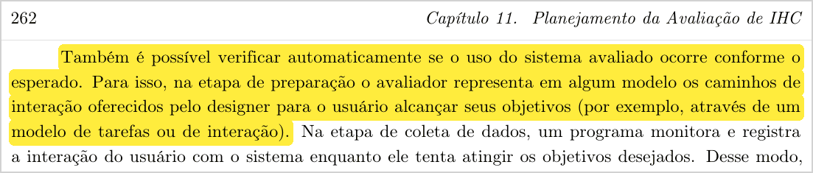

## Histórico de Versão e Contribuição

| Data | Versão | Descrição | Autor(es) | Revisor(es) | Declaração de Uso de IA |
| :---: | :---: | :--- | :--- | :--- | :--- |
| 25/10/2026 | `1.0` | Criação da estrutura do relato dos resultados da avaliação formativa do Storyboard 06 e da TAR-08. | [Rodrigo Barbosa](https://github.com/RodrigoCBarbosa) | [Carlos Costa](https://github.com/carloshfgit) | Google Gemini - usado para formatação markdown da página |
| 25/10/2026 | `1.1` | Preenchimento dos resultados com base na transcrição da entrevista, análise qualitativa e registro de problemas. | [Rodrigo Barbosa](https://github.com/RodrigoCBarbosa) | [Carlos Costa](https://github.com/carloshfgit) | Google Gemini - usado para apoio na síntese textual e formatação das tabelas |

---

# Relato dos Resultados da Avaliação do Storyboard e da Análise de Tarefas (TAR-08)

## 1. Introdução e Objetivos do Relato

Este documento apresenta a consolidação dos resultados da avaliação formativa realizada sobre o **[Storyboard 06](https://interacao-humano-computador.github.io/2026.2-Grupo05/design-avaliacao-desenvolvimento/nivel1/storyboards/#36-storyboard-06-reclamacao-sobre-onibus-a-partir-do-site-da-semob)** e os modelos de tarefas (**[HTA e GOMS da TAR-08: Reclamação sobre Ônibus a partir do Site da Semob](https://interacao-humano-computador.github.io/2026.2-Grupo05/analise-de-requisitos/analise-de-tarefas/tar-08-reclamacao-onibus/)**).

O objetivo principal desta avaliação foi investigar a verossimilhança da narrativa apresentada no storyboard (fluxo atual e fluxo proposto), a clareza da proposta de valor do assistente de reclamação e a correção do fluxo de tarefas modelado para a interação do usuário com o sistema.

**Artefatos relacionados — fluxo da funcionalidade TAR-08 (Reclamação sobre Ônibus):**

* **Persona:** [Cláudia Regina Santos](../../../../analise-de-requisitos/personas/claudia-regina-santos.md)
* **Cenário:** [Cenário 11](../../../../analise-de-requisitos/cenarios/cenario-11-reclamacao-onibus.md)
* **Análise de tarefas:** [TAR-08](../../../../analise-de-requisitos/analise-de-tarefas/tar-08-reclamacao-onibus.md)
* **Storyboard:** [Storyboard 06](../../storyboards.md#36-storyboard-06-reclamacao-sobre-onibus-a-partir-do-site-da-semob)
* **Nível 1: avaliação do storyboard e da análise de tarefas:** [Planejamento da avaliação](../../planejamentos-individuais/Rodrigo/rodrigo-planejamento-avaliacao.md) · [Planejamento do relato](../../planejamentos-individuais/Rodrigo/rodrigo-planejamento-relato-resultados-avaliacao.md) · Relato dos resultados (*esta página*)
* **Nível 2: protótipo de papel (baixa fidelidade):** [Planejamento da avaliação](../../../nivel2/planejamentos-individuais/Rodrigo/rodrigo-planejamento-av-prototipo-papel.md) · [Planejamento do relato](../../../nivel2/planejamentos-individuais/Rodrigo/rodrigo-planejamento-relato-prot-papel.md) · [Relato dos resultados](../../../nivel2/relatos-individuais/rodrigo/relato-resultado-prot-papel.md)
* **Nível 3: protótipo de alta fidelidade:** [Planejamento da avaliação](../../../nivel3/planejamentos-individuais/rodrigo/rodrigo-planejamento-av-prot-alta-fidel.md) · [Planejamento do relato](../../../nivel3/planejamentos-individuais/rodrigo/rodrigo-planejamento-relato-prot-alta-fidel.md) · [Relato dos resultados](../../../nivel3/relatos-individuais/rodrigo/relato-resultados-prot-alta-fidel.md)
* **Telas do protótipo de papel:** [telas no planejamento da avaliação](../../../nivel2/planejamentos-individuais/Rodrigo/rodrigo-planejamento-av-prototipo-papel.md#8-telas-do-prototipo-avaliado)
* **Protótipo de alta fidelidade navegável:** *não disponível*

---

## 2. Metodologia e Caracterização do Participante

A coleta de dados seguiu a metodologia de **entrevista semiestruturada** orientada por artefatos visuais. Antes do início das perguntas, o [Termo de Consentimento Livre e Esclarecido (TCLE)](https://interacao-humano-computador.github.io/2026.2-Grupo05/analise-de-requisitos/aspectos-eticos/#2-termo-de-consentimento-livre-e-esclarecido-tcle) foi assinado e os objetivos do estudo foram apresentados e aceitos verbalmente pelo participante, autorizando a gravação.

### Perfil dos Envolvidos na Sessão:
* **Entrevistador:** [Rodrigo Barbosa](https://github.com/RodrigoCBarbosa).
* **Perfil do Participante Convidado:** Vinícius, usuário do sistema de transporte público coletivo do Distrito Federal (STPC/DF), que utiliza ônibus em seus deslocamentos.
* **Ambiente e Recursos:** Sessão presencial gravada em áudio e vídeo com apresentação física dos artefatos (Storyboard 06 e diagramas da TAR-08), com aceite prévio do TCLE.
* **Gravação da Entrevista:** O vídeo da entrevista foi gravado para fins didáticos e acadêmicos, mediante consentimento do participante.
* **Vídeo da Entrevista:** Disponível em: [YouTube](https://youtu.be/yy85p41IPUY).

---

## 3. Sumário dos Dados Coletados

### 3.1 Consolidação das Respostas: Avaliação do Storyboard 06

<strong>Tabela 1</strong>: Respostas da Avaliação do Storyboard 06

| ID | Tópico Avaliado | Pergunta Aplicada ao Participante | Resumo da Resposta do Participante | Avaliação do Artefato |
| :---: | :--- | :--- | :--- | :---: |
| **Q01** | **Clareza Narrativa** | *"Com suas palavras, o que acontece na história apresentada?"* | O participante foi capaz de descrever com clareza a história de Cláudia: caminha até a parada, o ônibus passa direto mesmo ela acenando, ela se atrasa para o trabalho/hospital, tenta fazer uma reclamação e, após enfrentar várias etapas e frustração, desiste no quinto quadro. | **Conforme** |
| **Q02** | **Verossimilhança** | *"Você já passou por algo parecido com o que aconteceu com a Cláudia na parada? Você reclamou? Como?"* | Relatou que pessoalmente nunca passou por algo parecido com o ônibus passar direto ("sempre deu certo pra mim"), não tendo chegado a registrar reclamações. | **Conforme** |
| **Q03** | **Percepção de Problemas** | *"Em qual quadro a Cláudia teve mais dificuldade? Por quê?"* | Apontou prontamente o quinto quadro, no momento em que houve o redirecionamento para outro site exigindo a realização de um novo login, culminando na desistência da personagem. | **Conforme** |
| **Q04** | **Vocabulário** | *"Se você quisesse reclamar de um ônibus no site da Semob, que palavra ou botão procuraria?"* | Indicou que procuraria por termos como "ouvidoria", "reclamação" ou "feedback". | **Conforme** |
| **Q05** | **Confiança e Reação** | *"O que você sentiria ao ser levado do site da Semob para outro site, como aconteceu com a Cláudia?"* | Declarou que sentiria a mesma frustração de Cláudia por ter que refazer cadastro, preencher mais dados e demorar em algo que deveria ser simples e rápido. | **Conforme** |

<em>Fonte: Elaborado por Rodrigo Barbosa (2026), com base na transcrição da entrevista.</em>

---

### 3.2 Consolidação das Respostas: Análise de Tarefas (TAR-08 - HTA e GOMS)

<strong>Tabela 2</strong>: Respostas da Avaliação da Análise de Tarefas (TAR-08)

| ID | Tópico Avaliado | Pergunta Aplicada ao Participante | Resumo da Resposta do Participante | Avaliação do Modelo |
| :---: | :--- | :--- | :--- | :---: |
| **QT01** | **Sequência Lógica** | *"Os passos mostrados no diagrama (reunir as informações, encontrar onde reclamar, entrar no Participa-DF, preencher a reclamação e guardar o protocolo) correspondem ao que você faria na prática?"* | Confirmou que os passos apresentados condizem perfeitamente com suas ações na prática ("Muito parecidos, se não iguais"), validando o fluxo geral da tarefa. | **Validade Confirmada** |
| **QT02** | **Informações de Entrada** | *"Na hora em que o ônibus passa direto, você saberia dizer a linha, o número do ônibus, o horário e o local? Sabe onde fica o número do ônibus no veículo?"* | Informou que saberia apontar a linha, o local e um intervalo aproximado para o horário, mas destacou que não saberia o número específico do veículo/ônibus. | **Validade Confirmada** |

<em>Fonte: Elaborado por Rodrigo Barbosa (2026), com base na transcrição da entrevista.</em>

---

## 4. Análise Qualitativa e Registro de Problemas

Durante a condução da entrevista, o participante demonstrou excelente compreensão da linguagem gráfica do storyboard e da estrutura em níveis apresentada na Análise de Tarefas (HTA e GOMS da TAR-08).

A sessão evidenciou a validação das principais hipóteses levantadas na fase de planejamento:
1. **Gargalo no redirecionamento e autenticação:** A mudança de domínio (do portal da SEMOB-DF para o Participa-DF) e a exigência de novo cadastro/login foram identificadas como o ponto crítico de atrito que gera desistência na usuária.
2. **Barreira de dados de entrada:** O participante confirmou a hipótese prevista na TAR-08 de que o número do veículo é um dado de difícil retenção ou acesso no momento em que o ônibus não para, ao passo que a linha, localização e horário estimado são facilmente recordados.

### Tabela de Registro e Priorização de Problemas de IHC

<strong>Tabela 3</strong>: Registro e Classificação dos Problemas Identificados

| ID Problema | Descrição do Problema | Local / Artefato | Severidade (0 a 4) | Impacto na Experiência | Sugestão de Reprojeto / Ação |
| :---: | :--- | :--- | :---: | :--- | :--- |
| **PROB-01** | Redirecionamento de site e exigência de novo cadastro/login para registrar manifestação simples. | Storyboard 06 (Quadro 5) / TAR-08 | **3 (Grave)** | Provoca forte frustração e desmotiva o usuário a concluir o registro da reclamação, causando abandono da tarefa. | Integrar o registro diretamente no portal ou prover autenticação unificada, simplificando as etapas preliminares. |
| **PROB-02** | Exigência potencial de identificação exata do número do ônibus (veículo) na manifestação. | TAR-08 (Objetivo 1 - Reunir informações) | **2 (Pequeno)** | Dificuldade do passageiro em memorizar ou localizar o número da carcaça do ônibus que passou direto. | Tornar o número do ônibus opcional no formulário, auxiliando a identificação através da linha, parada/local e faixa horária aproximada. |

<em>Fonte: Elaborado por Rodrigo Barbosa (2026). Escala de severidade baseada em Nielsen (1994 apud BARBOSA et al., 2021) e Barbosa et al. (2021).</em>

---

## 5. Recomendações e Próximos Passos (Ciclo de Iteração)

Com base nas evidências coletadas e na validação das hipóteses com o participante Vinícius, definem-se as seguintes diretrizes para as próximas fases de design:

1. **Desobstrução do Fluxo de Reclamação:** Projetar o protótipo de papel de modo que o canal de manifestação/ouvidoria esteja visível na página inicial por meio de termos claros e acessíveis (*"Reclamação"*, *"Ouvidoria"* e *"Feedback"*), com aviso explícito e transparente caso haja encaminhamento para outro sistema.
2. **Flexibilização dos Campos de Entrada:** No formulário de reclamação, assegurar que os campos obrigatórios sejam apenas aqueles de fácil alcance pelo cidadão (linha, localização da parada e horário aproximado), mantendo o número do veículo como campo facultativo ou assistido por preenchimento automático de itinerário.
3. **Avanço para Prototipação em Papel:** Utilizar a estrutura validada da TAR-08 para modelar os fluxos do protótipo de papel, contemplando as melhorias de usabilidade discutidas na sessão.

---

## 6. Fotos de Referência

As Figuras 1 a 3 mostram os trechos que fundamentam este artefato, recortados e grifados em amarelo diretamente do livro da disciplina (BARBOSA et al., 2021).

<strong>Figura 1</strong>: 11.7.4 Interpretação dos dados de cada participante

<em>Fonte: BARBOSA et al. (2021, p. 262).</em>

<strong>Figura 2</strong>: 11.7.5 Consolidação e relato dos resultados

<em>Fonte: BARBOSA et al. (2021, p. 263).</em>

<strong>Figura 3</strong>: Comparação entre o uso esperado (modelo de tarefas) e o uso observado

<em>Fonte: BARBOSA et al. (2021, p. 262).</em>

---

## 7. Referências Bibliográficas

* BARBOSA, Simone Diniz Junqueira et al. **Interação Humano-Computador e Experiência do Usuário**. Rio de Janeiro: Autopublicação, 2021. (Capítulo 11: Planejamento da Avaliação de IHC, Seção 11.7.5, p. 263–264).
* SALES, André Barros de. **Plano de Ensino: Interação Humano Computador**. Brasília: Universidade de Brasília, FCTE/UnB, 2026.
