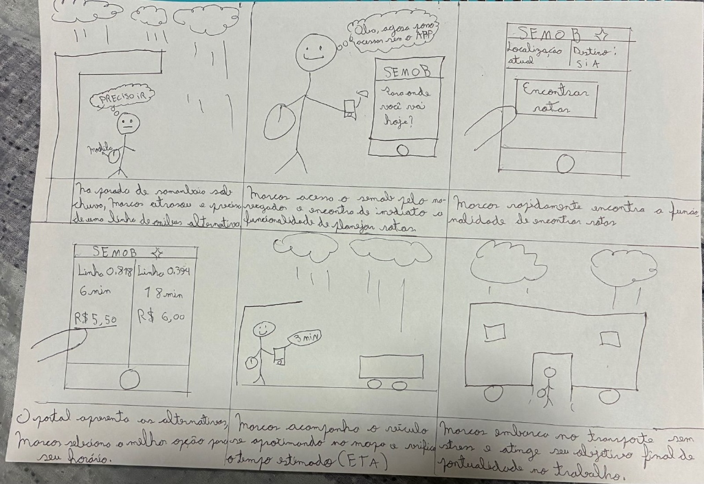
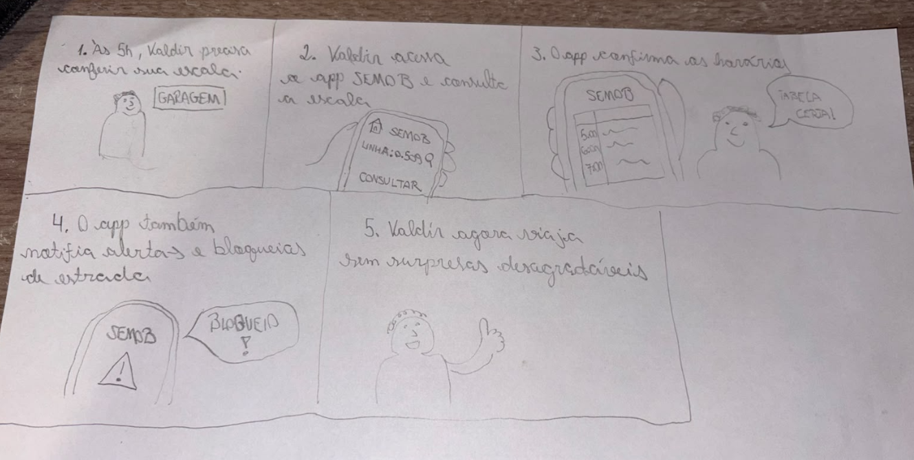
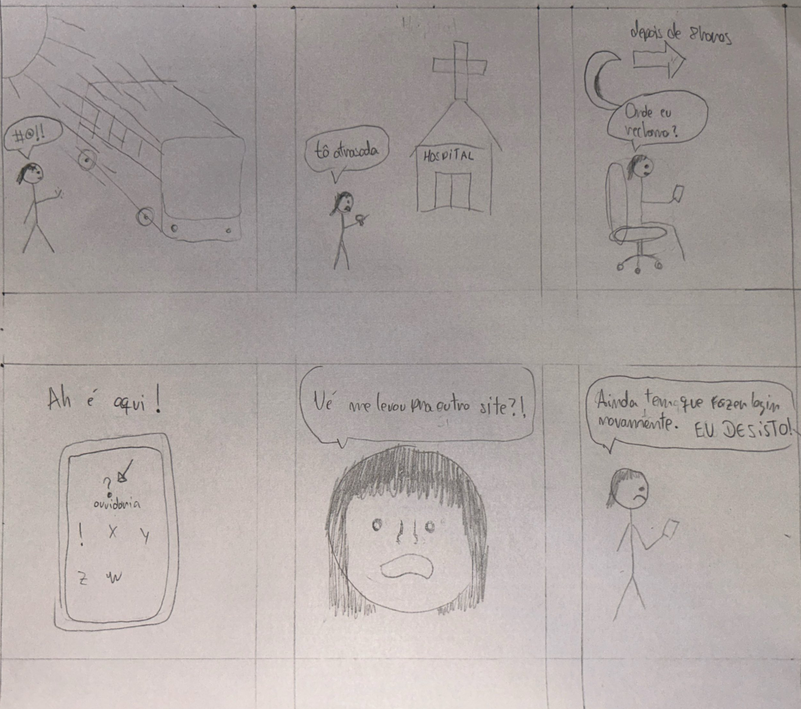
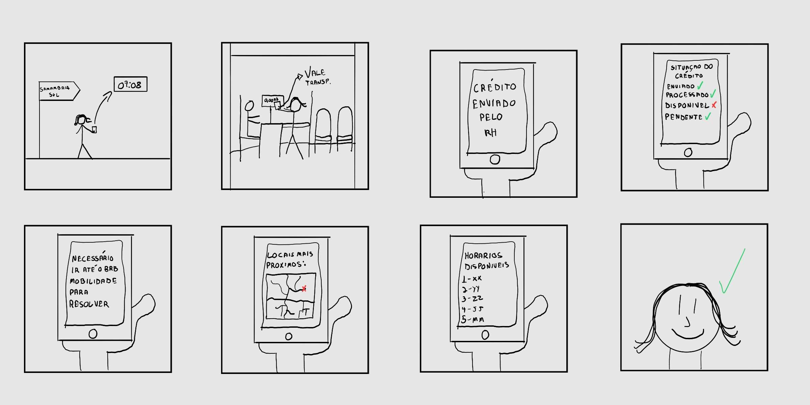
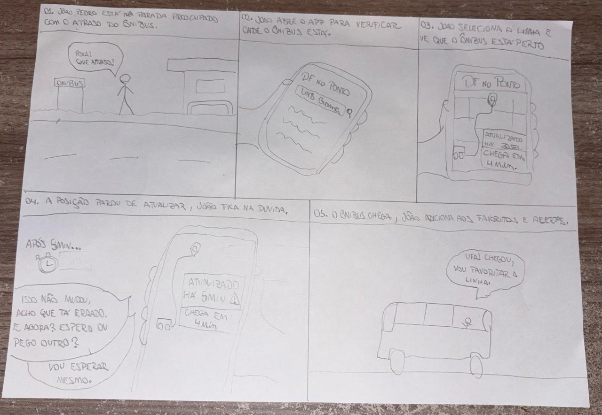

## Histórico de Versão

| Data | Versão | Descrição | Autor(es) | Revisor(es) | Declaração do uso de IA |
| :---: | :---: | :--- | :--- | :--- | :--- |
| 11/10/2026 | `1.0` | Criação e estruturação do documento de Storyboards e adição do Storyboard 01 (Alerta Inteligente de Saída). | [Igor Dantas Araújo](https://github.com/IgorDARAUJO) | [Gabriel Cardone](https://github.com/gabriellcardone-06) | Google Gemini - usado para formatação Markdown da página |
| 11/10/2026 | `1.1` | Adição do Storyboard 02 (Pré-agendamento no Programa DF Acessível) e atualização do link do Cenário 1. | [Gabriel Cardone](https://github.com/gabriellcardone-06) | [Igor Dantas Araújo](https://github.com/IgorDARAUJO) | Google Gemini - usado para tratamento da imagem e formatação Markdown da seção |
| 12/10/2026 | `1.2` | Adição do Storyboard 05 (Consulta de Rotas e Desvios para Novos Endereços): roteiro dos quadros, ilustração e tabela de verificação. | [Tomás Rocho](https://github.com/TomasRocho) | [Rodrigo Carvalho](https://github.com/RodrigoCBarbosa) | Google Gemini - usado para formatação Markdown da seção |
| 13/10/2026 | `1.3` | Adição do Storyboard 03 (Planejamento de Rota por Origem/Destino e Rastreamento), descrição narrativa acessível e tabela de conformidade. | [Lucas Araújo](https://github.com/Lucasaraujoszz) | [Arthur Mariani](https://github.com/arthur-mariani) | Google Gemini - utilizado apenas para formatação em Markdown |
| 13/10/2026 | `1.4` | Adição do Storyboard 04 (Consulta de Escala de Trabalho e Alertas Operacionais) elaborado por Carlos Costa. | [Carlos Costa](https://github.com/carloshfgit) | [Arthur Mariani](https://github.com/arthur-mariani) | Não utilizada (elaboração autoral manual do integrante) |
| 23/10/2026 | `1.5` | Reformulação do Storyboard 05 para a nova tarefa TAR-09 (Pedido de Aumento do Limite Diário do Vale-Transporte): nova ilustração, descrição narrativa dos quadros, tabela de verificação e vínculos na matriz. | [Tomás Rocho](https://github.com/TomasRocho) | [Rodrigo Carvalho](https://github.com/RodrigoCBarbosa) | Claude (Anthropic) - usado para pesquisa no site da Semob e redação do roteiro e da seção |
| 27/10/2026 | `1.6` | Adição do Storyboard 08 (Consulta do Ônibus em Tempo Real no DF no Ponto — TAR-06), que substitui o Storyboard 04 na avaliação da Etapa 5: linha na matriz de vínculos, descrição narrativa dos quadros e tabela de verificação. | [Carlos Costa](https://github.com/carloshfgit) | [Rodrigo Barbosa](https://github.com/RodrigoCBarbosa) | Claude Code (Anthropic) - apenas revisou e formatou o texto em Markdown |

---

# Storyboards da Equipe

Neste documento, apresentam-se os **Storyboards** desenvolvidos pelos integrantes do **Grupo 05** para a **Etapa 4** do projeto de Interação Humano-Computador (IHC) aplicado ao sistema de mobilidade da **SEMOB-DF / BRB Mobilidade**.

O *storyboarding* é uma técnica de prototipagem de baixa fidelidade e prototipação conceitual amplamente utilizada em IHC para ilustrar graficamente como uma solução de interface se insere no contexto de vida do usuário (Preece, Rogers & Sharp, 2005; Barbosa et al., 2021). Cada storyboard consiste em uma sequência de quadros em quadrinhos que retrata uma persona vivenciando uma situação real, reagindo a um gatilho de necessidade e utilizando o sistema para alcançar seus objetivos.

---

## 1. Introdução e Metodologia

Conforme o plano de ensino da disciplina, esta entrega exige a elaboração de **7 Storyboards individuais** (exatamente 1 para cada integrante do grupo), garantindo o rastreamento direto entre a análise de necessidades e o reprojeto da solução de IHC.

Cada storyboard elaborado pela equipe atende aos seguintes requisitos metodológicos (Barbosa et al., 2021, Cap. 8):

1. **Relação 1:1 com a Análise de Tarefas:** Cada história desenhada é ancorada a uma tarefa específica modelada nas etapas de HTA e CTT.

2. **Contextualização com Personas e Cenários:** As narrativas utilizam as personas primárias e operacionais e os cenários de problema previamente validados pelo grupo.

3. **Foco na Experiência Humana:** Os quadrinhos priorizam o contexto físico, as motivações, as reações emocionais e o papel proativo da tecnologia, sem se prender a detalhes complexos de botões ou telas individuais.

---

## 2. Matriz de Vínculos: Storyboards ↔ Tarefas e Personas

A Tabela 1 sintetiza a distribuição dos 7 Storyboards do Grupo 05, indicando o autor responsável, a persona retratada, o cenário de problema e o link direto para a respectiva tarefa na Análise de Tarefas (HTA/CTT):

<div align="center">
<p><strong>Tabela 1</strong> — Matriz de Vínculos dos Storyboards da Equipe</p>
</div>

| # | Autor | Título do Storyboard | Persona Associada | Cenário de Uso | Tarefa Vinculada (HTA / CTT) |
| :---: | :--- | :--- | :--- | :--- | :---: |
| **01** | **Igor Dantas Araújo** | *Alerta inteligente de saída de casa* | [João Pedro Carvalho](https://interacao-humano-computador.github.io/2026.2-Grupo05/analise-de-requisitos/personas/joao-pedro-carvalho/) | [Cenário 2](https://interacao-humano-computador.github.io/2026.2-Grupo05/analise-de-requisitos/cenarios/cenario-2-viagem-matutina/) | [TAR-01 (Alerta de Saída)](https://interacao-humano-computador.github.io/2026.2-Grupo05/analise-de-requisitos/analise-de-tarefas/tar-01-alerta-saida/) |
| **02** | **Gabriel Cardone** | *Pré-agendamento no Programa DF Acessível* | [Larissa Ferreira Lima](https://interacao-humano-computador.github.io/2026.2-Grupo05/analise-de-requisitos/personas/larissa-ferreira-lima/) | [Cenário 1](https://interacao-humano-computador.github.io/2026.2-Grupo05/analise-de-requisitos/cenarios/cenario-1-pre-agendamento-df-acessivel/) | [TAR-02 (DF Acessível)](https://interacao-humano-computador.github.io/2026.2-Grupo05/analise-de-requisitos/analise-de-tarefas/tar-02-df-acessivel/) |
| **03** | **Lucas Araújo** | *Planejamento de Rota por Origem/Destino* | [Marcos Paulo Vieira](https://interacao-humano-computador.github.io/2026.2-Grupo05/analise-de-requisitos/personas/marcos-paulo-vieira/) | [Cenário 3](https://interacao-humano-computador.github.io/2026.2-Grupo05/analise-de-requisitos/cenarios/cenario-3-planejamento-origem-destino/) | [TAR-03 (Origem/Destino)](https://interacao-humano-computador.github.io/2026.2-Grupo05/analise-de-requisitos/analise-de-tarefas/tar-03-planejamento-rota/) |
| **04** | **Carlos Costa** | *Consulta de escala e alertas operacionais* | [Valdir Soares](https://interacao-humano-computador.github.io/2026.2-Grupo05/analise-de-requisitos/personas/valdir-soares/) | [Cenário 5](https://interacao-humano-computador.github.io/2026.2-Grupo05/analise-de-requisitos/cenarios/cenario-5-consulta-escala/) / [Cenário 6](https://interacao-humano-computador.github.io/2026.2-Grupo05/analise-de-requisitos/cenarios/cenario-6-alerta-desvio/) | [TAR-04/TAR-05 (Motorista)](https://interacao-humano-computador.github.io/2026.2-Grupo05/analise-de-requisitos/analise-de-tarefas/analise-hta-ctt-motorista/) |
| **05** | **Tomas Garcia Rocho** | *Pedido de aumento do limite diário do Vale-Transporte* | [Heitor Santos Júnior](https://interacao-humano-computador.github.io/2026.2-Grupo05/analise-de-requisitos/personas/heitor-santos-junior/) | [Cenário 9](https://interacao-humano-computador.github.io/2026.2-Grupo05/analise-de-requisitos/cenarios/cenario-9-limite-vale-transporte/) | [TAR-09 (Limite do Vale-Transporte)](https://interacao-humano-computador.github.io/2026.2-Grupo05/analise-de-requisitos/analise-de-tarefas/tar-09-limite-vale-transporte/) |
| **06** | **Rodrigo Barbosa** | *Reclamação sobre ônibus a partir do site da Semob* | [Cláudia Regina Santos](https://interacao-humano-computador.github.io/2026.2-Grupo05/analise-de-requisitos/personas/claudia-regina-santos/) | [Cenário 11](https://interacao-humano-computador.github.io/2026.2-Grupo05/analise-de-requisitos/cenarios/cenario-11-reclamacao-onibus/) | [TAR-08 (Reclamação sobre Ônibus)](https://interacao-humano-computador.github.io/2026.2-Grupo05/analise-de-requisitos/analise-de-tarefas/tar-08-reclamacao-onibus/) |
| **07** | **Arthur Mariani** | *Regularização de crédito de Vale-Transporte* | [Maria Eduarda Santos](https://interacao-humano-computador.github.io/2026.2-Grupo05/analise-de-requisitos/personas/maria-eduarda-santos/) | [Cenário 4](https://interacao-humano-computador.github.io/2026.2-Grupo05/analise-de-requisitos/cenarios/cenario-4-credito-vale-transporte/) | [TAR-07 (Vale-Transporte)](https://interacao-humano-computador.github.io/2026.2-Grupo05/analise-de-requisitos/analise-de-tarefas/tar-07-credito-vale-transporte/) |
| **08** | **Carlos Costa** | *Consulta do ônibus em tempo real no DF no Ponto* | [João Pedro Carvalho](https://interacao-humano-computador.github.io/2026.2-Grupo05/analise-de-requisitos/personas/joao-pedro-carvalho/) | [Cenário 2](https://interacao-humano-computador.github.io/2026.2-Grupo05/analise-de-requisitos/cenarios/cenario-2-viagem-matutina/) | [TAR-06](https://interacao-humano-computador.github.io/2026.2-Grupo05/analise-de-requisitos/analise-de-tarefas/tar-06-df-no-ponto/) |

<div align="center">
<p><em>Fonte: Igor Dantas araújo (2026).</em></p>
</div>

> **Observação sobre o Storyboard 08:** o motorista de ônibus necessário para avaliar o Storyboard 04 (TAR-04/TAR-05) não pôde ser recrutado. Para que a avaliação fosse feita com um participante do perfil correto, Carlos Costa elaborou o Storyboard 08, ancorado na TAR-06, que até então não tinha storyboard. O Storyboard 04 permanece neste documento como artefato da Etapa 4.

---

## 3. Storyboards Individuais

---

### 3.1. Storyboard 01: Alerta Inteligente de Saída de Casa

* **Autor:** [Igor Dantas Araújo](https://github.com/IgorDARAUJO)
* **Persona Retratada:** [João Pedro Carvalho](https://interacao-humano-computador.github.io/2026.2-Grupo05/analise-de-requisitos/personas/joao-pedro-carvalho/) (Estudante da UnB Gama, 19 anos)
* **Cenário de Uso:** [Cenário 2 — Atraso por Conflito de Horários no App](https://interacao-humano-computador.github.io/2026.2-Grupo05/analise-de-requisitos/cenarios/cenario-2-viagem-matutina/)
* **Tarefa Ancorada:** [TAR-01 — Configurar e utilizar o alerta inteligente de saída de casa](https://interacao-humano-computador.github.io/2026.2-Grupo05/analise-de-requisitos/analise-de-tarefas/tar-01-alerta-saida/)
* **Tempo para confecção:** ~10 minutos.

#### **Ilustração do Storyboard 01**
{ width="100%" }
<div align="center">
  <p><strong>Figura 1</strong> — Storyboard 01: Alerta inteligente de saída de casa</p>
  <p><em>Fonte: Elaborado por Igor Dantas Araújo (2026).</em></p>
</div>

#### **Tabela de Verificação do Storyboard 01**

<div align="center">
<p><strong>Tabela 2</strong> — Verificação de Conformidade do Storyboard 01</p>
</div>

| Categoria / Critério | Atendimento no Storyboard 01 | Situação |
| :--- | :--- | :---: |
| **1. Personas e Atores** | Apresenta o personagem **João Pedro Carvalho** em traço simples. | **Conforme** |
| **2. Contexto e Ambiente** | Transita do ambiente doméstico (quarto) para a rua e o ponto de ônibus. | **Conforme** |
| **3. Tarefa Retratada** | Ilustra a execução completa da **TAR-01** (Alerta de Saída). | **Conforme** |
| **4. Papel do Sistema** | Exibe a atuação proativa do alarme via monitoramento de GPS. | **Conforme** |
| **5. Estrutura Narrativa** | Possui fluxo claro com Início (Q1), Meio (Q2–Q4) e Fim (Q5). | **Conforme** |

<div align="center">
<p><em>Fonte: Igor Dantas Araújo (2026).</em></p>
</div>

---

### 3.2. Storyboard 02: Pré-agendamento no Programa DF Acessível

* **Autor:** [Gabriel Cardone](https://github.com/gabriellcardone-06)
* **Persona Retratada:** [Larissa Ferreira Lima](https://interacao-humano-computador.github.io/2026.2-Grupo05/analise-de-requisitos/personas/larissa-ferreira-lima/) (Estudante e assistente administrativa, 23 anos, com deficiência temporária de mobilidade)
* **Cenário de Uso:** [Cenário 1 — Pré-agendamento no Programa DF Acessível](https://interacao-humano-computador.github.io/2026.2-Grupo05/analise-de-requisitos/cenarios/cenario-1-pre-agendamento-df-acessivel/)
* **Tarefa Ancorada:** [TAR-02 — Pré-agendamento no Programa DF Acessível](https://interacao-humano-computador.github.io/2026.2-Grupo05/analise-de-requisitos/analise-de-tarefas/tar-02-df-acessivel/)
* **Tempo para confecção:** ~9 minutos.

#### **Ilustração do Storyboard 02**

<div align="center">
  
  <p><strong>Figura 2</strong> — Storyboard 02: Pré-agendamento no Programa DF Acessível</p>
  <p><em>Fonte: Elaborado por Gabriel Cardone (2026).</em></p>
</div>

#### **Tabela de Verificação do Storyboard 02**

<div align="center">
<p><strong>Tabela 3</strong> — Verificação de Conformidade do Storyboard 02</p>
</div>

| Categoria / Critério | Atendimento no Storyboard 02 | Situação |
| :--- | :--- | :---: |
| **1. Personas e Atores** | Apresenta a personagem **Larissa Ferreira Lima** em traço simples, usando cadeira de rodas. | **Conforme** |
| **2. Contexto e Ambiente** | Situa a ação no quarto de Larissa, em casa, onde ela resolve o agendamento pelo celular. | **Conforme** |
| **3. Tarefa Retratada** | Ilustra a execução completa da **TAR-02** (acesso ao site, escolha do posto e escolha do dia). | **Conforme** |
| **4. Papel do Sistema** | Exibe o atalho "Agendar DF Acessível" no site da Semob-DF e o envio do comprovante por e-mail e WhatsApp. | **Conforme** |
| **5. Estrutura Narrativa** | Possui fluxo claro com Início (Q1), Meio (Q2–Q4) e Fim (Q5). | **Conforme** |

<div align="center">
<p><em>Fonte: Gabriel Cardone (2026).</em></p>
</div>

---

### 3.3. Storyboard 03: Planejamento de Rota por Origem e Destino com Monitoramento em Tempo Real

* **Autor:** [Lucas Araújo](https://github.com/Lucasaraujoszz)
* **Persona Retratada:** [Marcos Paulo Vieira](https://interacao-humano-computador.github.io/2026.2-Grupo05/analise-de-requisitos/personas/marcos-paulo-vieira/) (Assistente de logística e estoque, 31 anos, morador de Samambaia Sul)
* **Cenário de Uso:** [Cenário 3 — Deslocamento com Busca por Destino](https://interacao-humano-computador.github.io/2026.2-Grupo05/analise-de-requisitos/cenarios/cenario-3-planejamento-origem-destino/)
* **Tarefa Ancorada:** [TAR-03 — Planejamento de Rota por Origem/Destino e Rastreamento](https://interacao-humano-computador.github.io/2026.2-Grupo05/analise-de-requisitos/analise-de-tarefas/tar-03-planejamento-rota/)
* **Tempo para confecção:** ~15 minutos.

#### **Ilustração do Storyboard 03**

<div align="center">
  
  <p><strong>Figura 3</strong> — Storyboard 03: Planejamento de rota por Origem/Destino e rastreamento em tempo real</p>
  <p><em>Fonte: Elaborado por Lucas Araújo (2026).</em></p>
</div>

#### **Descrição Narrativa dos Quadros (Acessibilidade e Rastreamento)**

1. **Quadro 1 (Contexto e Problema):** Na parada de ônibus de Samambaia Sul, sob chuva, Marcos percebe que sua linha habitual atrasou e precisa encontrar com urgência uma rota alternativa para não se atrasar no trabalho no SIA (evitando punição de ponto).
2. **Quadro 2 (Acesso ao Novo Portal):** Marcos acessa o portal da SEMOB-DF pelo navegador do smartphone e encontra de imediato a funcionalidade de planejamento de rotas na página inicial, com a mensagem proativa: *"Para onde você vai hoje?"*, comemorando o fato de poder resolver a demanda sem precisar baixar aplicativo sob a chuva.
3. **Quadro 3 (Definição dos Parâmetros):** O sistema preenche automaticamente sua localização atual via GPS (*Samambaia Sul*) e, ao digitar *"SIA"*, a ferramenta sugere instantaneamente o destino *"SIA Trecho 3"*, permitindo acionar o botão *"Encontrar rotas"* (Subtarefas 1.1 e 1.2 da TAR-03).
4. **Quadro 4 (Comparação e Seleção de Itinerário):** O portal exibe os cartões com as linhas disponíveis, tempo previsto e tarifa (ex.: *Linha 0.818 - Semiexpressa em 6 min por R$ 5,50* vs. *Linha 0.394 em 18 min por R$ 6,00*). Marcos seleciona a melhor alternativa para sua necessidade de horário (Subtarefas 2.1 e 2.2 da TAR-03).
5. **Quadro 5 (Rastreamento Georreferenciado):** Marcos visualiza o ônibus se aproximando no mapa em tempo real e confere o tempo estimado de chegada (*ETA: 3 min*), preparando seu cartão de embarque com tranquilidade e previsibilidade (Subtarefas 3.1 e 3.2 da TAR-03).
6. **Quadro 6 (Desfecho e Sucesso):** O ônibus chega pontualmente à parada e Marcos realiza o embarque sem estresse, garantindo a chegada no trabalho no SIA com pontualidade e segurança.

#### **Tabela de Verificação do Storyboard 03**

<div align="center">
<p><strong>Tabela 4</strong> — Verificação de Conformidade do Storyboard 03</p>
</div>

| Categoria / Critério | Atendimento no Storyboard 03 | Situação |
| :--- | :--- | :---: |
| **1. Personas e Atores** | Apresenta a persona primária **Marcos Paulo Vieira** no ponto de ônibus com sua mochila. | **Conforme** |
| **2. Contexto e Ambiente** | Retrata fielmente a parada de Samambaia Sul sob chuva, a urgência de horário e o uso do celular em pé. | **Conforme** |
| **3. Tarefa Retratada** | Ilustra a execução completa da **TAR-03** (informar origem/destino, selecionar linha, acompanhar no mapa e embarcar). | **Conforme** |
| **4. Papel do Sistema** | Demonstra a busca direta sem exigência de código da linha, sem redirecionamento para app e mapa em tempo real. | **Conforme** |
| **5. Estrutura Narrativa** | Apresenta sequência com início (Q1), meio e interação (Q2 a Q5) e desfecho bem-sucedido (Q6). | **Conforme** |

<div align="center">
<p><em>Fonte: Elaborado por Lucas Araújo (2026).</em></p>
</div>

---

### 3.4. Storyboard 04: Consulta de Escala e Alertas Operacionais

* **Autor:** [Carlos Costa](https://github.com/carloshfgit)
* **Persona Retratada:** [Valdir Soares](https://interacao-humano-computador.github.io/2026.2-Grupo05/analise-de-requisitos/personas/valdir-soares/) (Motorista Profissional de Ônibus Urbano, 48 anos)
* **Cenário de Uso:** [Cenário 5 — Consulta de Escala de Trabalho](https://interacao-humano-computador.github.io/2026.2-Grupo05/analise-de-requisitos/cenarios/cenario-5-consulta-escala/) e [Cenário 6 — Alerta Emergencial de Desvio](https://interacao-humano-computador.github.io/2026.2-Grupo05/analise-de-requisitos/cenarios/cenario-6-alerta-desvio/)
* **Tarefa Ancorada:** [TAR-04/TAR-05 — Análise de Tarefas do Motorista](https://interacao-humano-computador.github.io/2026.2-Grupo05/analise-de-requisitos/analise-de-tarefas/analise-hta-ctt-motorista/)
* **Tempo para confecção:** ~10 minutos.

#### **Ilustração do Storyboard 04**

<div align="center">
  
  <p><strong>Figura 4</strong> — Storyboard 04: Consulta de escala e alertas operacionais</p>
  <p><em>Fonte: Elaborado por Carlos Costa (2026).</em></p>
</div>

#### **Descrição Narrativa dos Quadros do Storyboard 04**

* **Quadro 1 (Início — Contexto e Necessidade):** Às 5h da manhã, na garagem da empresa concessionária antes de assumir o veículo, Valdir Soares precisa conferir sua escala de trabalho oficial do dia.
* **Quadro 2 (Ação — Consulta no Aplicativo Móvel):** Valdir pega seu smartphone, abre o aplicativo da SEMOB e digita a linha escalada (`0.509`) no campo de consulta.
* **Quadro 3 (Feedback — Confirmação e Segurança Operacional):** O aplicativo da SEMOB confirma a grade horária homologada (`5:00`, `6:00`, `7:00`). Valdir comemora aliviado ao verificar que as informações estão sincronizadas com a garagem: *"Tabela certa!"*.
* **Quadro 4 (Contingência — Notificação Proativa de Alertas e Bloqueios):** Durante sua rotina, o aplicativo emite alertas operacionais em tempo real sobre bloqueios viários e contingências na estrada (`SEMOB: Bloqueio!`).
* **Quadro 5 (Fim — Condução Segura e Desfecho Positivo):** Munido de informações confiáveis e avisos tempestivos, Valdir segue sua viagem tranquilo, sem surpresas desagradáveis ou atritos operacionais, comemorando com um gesto positivo.

#### **Tabela de Verificação do Storyboard 04**

<div align="center">
<p><strong>Tabela 5</strong> — Verificação de Conformidade do Storyboard 04</p>
</div>

| Categoria / Critério | Atendimento no Storyboard 04 | Situação |
| :--- | :--- | :---: |
| **1. Personas e Atores** | Apresenta a persona **Valdir Soares ("Seu Valdir")**, motorista rodoviário de 48 anos, em traço simples e expressivo. | **Conforme** |
| **2. Contexto e Ambiente** | Situa a narrativa na garagem nas primeiras horas da manhã (5h) e durante a condução no itinerário da linha. | **Conforme** |
| **3. Tarefa Retratada** | Retrata a execução completa da consulta de escala homologada e recepção de alertas operacionais viários (**TAR-04/TAR-05**). | **Conforme** |
| **4. Papel do Sistema** | Demonstra o aplicativo da SEMOB permitindo consulta da linha 0.509, exibindo grade de horários e alertando sobre bloqueios. | **Conforme** |
| **5. Estrutura Narrativa** | Apresenta estrutura clássica com Início contextual (Q1), Ação e Feedback (Q2–Q4) e Desfecho positivo (Q5). | **Conforme** |

<div align="center">
<p><em>Fonte: Carlos Costa (2026).</em></p>
</div>

---

### 3.5. Storyboard 05: Pedido de Aumento do Limite Diário do Vale-Transporte

* **Autor:** [Tomas Garcia Rocho](https://github.com/TomasRocho)
* **Persona Retratada:** [Heitor Santos Júnior](https://interacao-humano-computador.github.io/2026.2-Grupo05/analise-de-requisitos/personas/heitor-santos-junior/) (Técnico de manutenção predial, 36 anos, morador de Planaltina)
* **Cenário de Uso:** [Cenário 9 — Cartão de Vale-Transporte Recusado no Meio do Expediente](https://interacao-humano-computador.github.io/2026.2-Grupo05/analise-de-requisitos/cenarios/cenario-9-limite-vale-transporte/)
* **Tarefa Ancorada:** [TAR-09 — Solicitar Aumento do Limite Diário do Vale-Transporte](https://interacao-humano-computador.github.io/2026.2-Grupo05/analise-de-requisitos/analise-de-tarefas/tar-09-limite-vale-transporte/)
* **Tempo para confecção:** *[a preencher pelo autor]*

O Storyboard 05 retrata a **solução proposta** na TAR-09 para a situação do Cenário 9: o cartão de Heitor é recusado depois de vários embarques a serviço, e o site da Semob explica o motivo, recebe o pedido de mais acessos pelo celular e avisa quando o novo limite está valendo. As telas são representadas como esboços, preservando o caráter de planejamento do storyboard.

#### **Ilustração do Storyboard 05**

<div align="center">
  
  <p><strong>Figura 5</strong> — Storyboard 05: Pedido de aumento do limite diário do Vale-Transporte</p>
  <p><em>Fonte: Elaborado por Tomás Rocho (2026).</em></p>
</div>

#### **Descrição Narrativa dos Quadros do Storyboard 05**

* **Quadro 1 (Início — Cartão recusado):** Às 16h40, numa estação de BRT, depois de cinco chamados em prédios diferentes, Heitor encosta o cartão no validador e a catraca continua travada. Ele não entende o motivo: *"Ué, recusou?"*
* **Quadro 2 (Ação — Acesso direto no site):** Heitor abre o site da Semob no celular e já encontra o botão certo: **"Meu Vale-Transporte foi recusado"**, na página inicial (objetivos 1 e 2 da TAR-09).
* **Quadro 3 (Feedback — Explicação da recusa):** O site mostra **"Você usou 8 de 8 passagens hoje!"**, com as oito passagens marcadas, avisa que **as integrações também contam** e oferece o botão **"Pedir mais passagens por dia"**.
* **Quadro 4 (Ação — Pedido pelo celular):** À noite, em casa, Heitor fotografa com o celular o RG e o comprovante de residência sobre a mesa e envia o pedido guiado, sem precisar ir ao posto (objetivos 3 a 5 da TAR-09).
* **Quadro 5 (Confirmação — Protocolo):** O site confirma **"Pedido enviado!"** com o **protocolo 2026-0451** e avisa: *"Vamos te avisar pelo WhatsApp"*. Heitor faz um sinal de positivo.
* **Quadro 6 (Fim — Novo limite valendo):** Dias depois, chega no celular a mensagem de WhatsApp: *"SEMOB: seu novo limite do cartão foi aprovado e já está valendo"*. Agora o cartão acompanha o dia de trabalho de Heitor (objetivo 6 da TAR-09).

#### **Tabela de Verificação do Storyboard 05**

<div align="center">
<p><strong>Tabela 6</strong> — Verificação de Conformidade do Storyboard 05</p>
</div>

| Categoria / Critério | Atendimento no Storyboard 05 | Situação |
| :--- | :--- | :---: |
| **1. Personas e Atores** | Apresenta a persona **Heitor Santos Júnior** em traço simples, desenhado à mão, no validador (Q1) e em casa (Q4). | **Conforme** |
| **2. Contexto e Ambiente** | Transita da estação de BRT no fim do expediente (Q1–Q3) para a casa de Heitor à noite (Q4–Q5) e, dias depois, para a mensagem de aprovação no celular (Q6). | **Conforme** |
| **3. Tarefa Retratada** | Ilustra a **TAR-09** na versão proposta: entender a recusa, pedir mais acessos, enviar documentos, receber protocolo e ser avisado do novo limite. | **Conforme** |
| **4. Papel do Sistema** | Exibe o acesso direto na página inicial (Q2), o contador de passagens do dia (Q3), o envio de documentos por foto (Q4), o protocolo (Q5) e o aviso de aprovação pelo WhatsApp (Q6). | **Conforme** |
| **5. Estrutura Narrativa** | Possui fluxo claro com Início (Q1), Meio (Q2–Q5) e Fim com desfecho positivo (Q6). | **Conforme** |

<div align="center">
<p><em>Fonte: Tomás Rocho (2026).</em></p>
</div>

---

### 3.6. Storyboard 06: Reclamação sobre Ônibus a partir do Site da Semob

* **Autor:** [Rodrigo Barbosa](https://github.com/RodrigoCBarbosa)
* **Persona Retratada:** [Cláudia Regina Santos](https://interacao-humano-computador.github.io/2026.2-Grupo05/analise-de-requisitos/personas/claudia-regina-santos/) (Técnica de enfermagem, 46 anos, moradora de Ceilândia Norte)
* **Cenário de Uso:** [Cenário 11 — Reclamação sobre Ônibus que Passou Direto](https://interacao-humano-computador.github.io/2026.2-Grupo05/analise-de-requisitos/cenarios/cenario-11-reclamacao-onibus/)
* **Tarefa Ancorada:** [TAR-08 — Registro de Reclamação sobre Ônibus a partir do Site da Semob](https://interacao-humano-computador.github.io/2026.2-Grupo05/analise-de-requisitos/analise-de-tarefas/tar-08-reclamacao-onibus/)
* **Tempo para confecção:** ~10 minutos.

O Storyboard 06 retrata o **fluxo atual** da tarefa: Cláudia tenta reclamar de um ônibus que passou direto pela parada, mas encontra as barreiras identificadas na TAR-08 e **desiste antes de registrar a reclamação**. O desfecho evidencia o principal gargalo da tarefa: a mudança do site da Semob para o Participa-DF e a exigência de login, que fazem a usuária abandonar o objetivo. As telas são representadas como esboços, e não como capturas do site, preservando o caráter de planejamento do storyboard.

#### **Ilustração do Storyboard 06**

{ width="100%" }
<div align="center">
  <p><strong>Figura 6</strong> — Storyboard 06: Reclamação sobre ônibus a partir do site da Semob</p>
  <p><em>Fonte: Elaborado por Rodrigo Barbosa (2026).</em></p>
</div>

#### **Descrição Narrativa dos Quadros do Storyboard 06**

* **Quadro 1 (Início — O Ocorrido):** De madrugada, na parada de ônibus, Cláudia perde o ônibus da sua linha, que passa direto sem parar.
* **Quadro 2 (Consequência — Atraso no Plantão):** Por causa do ônibus perdido, Cláudia chega atrasada ao trabalho no hospital e decide que vai reclamar.
* **Quadro 3 (Ação — Procura do Canal):** Mais tarde, já em casa, Cláudia abre o site da Semob no celular para descobrir onde pode registrar sua reclamação.
* **Quadro 4 (Descoberta — Ouvidoria):** Depois de procurar pelo site, Cláudia encontra o símbolo da Ouvidoria no celular e toca nele.
* **Quadro 5 (Ruptura — Mudança de Site):** Cláudia é levada para outro site, o Participa-DF, e se pergunta por que saiu do site da Semob.
* **Quadro 6 (Fim — Desistência):** O novo site exige que ela faça login novamente. Cláudia reclama do esforço extra e desiste de registrar a reclamação.

#### **Tabela de Verificação do Storyboard 06**

<div align="center">
<p><strong>Tabela 7</strong> — Verificação de Conformidade do Storyboard 06</p>
</div>

| Categoria / Critério | Atendimento no Storyboard 06 | Situação |
| :--- | :--- | :---: |
| **1. Personas e Atores** | Apresenta a persona **Cláudia Regina Santos**, técnica de enfermagem de 46 anos, em traço simples. | **Conforme** |
| **2. Contexto e Ambiente** | Transita da parada de ônibus, de madrugada, para o hospital e, depois, para a casa de Cláudia, onde ela tenta reclamar pelo celular. | **Conforme** |
| **3. Tarefa Retratada** | Retrata a tentativa de execução da **TAR-08** até o ponto de abandono: encontrar o canal no site da Semob (objetivo 2) e acessar o Participa-DF (objetivo 3). | **Conforme** |
| **4. Papel do Sistema** | Mostra o site da Semob, o acesso pela Ouvidoria, o redirecionamento ao Participa-DF e a exigência de login como barreiras à tarefa. | **Conforme** |
| **5. Estrutura Narrativa** | Possui fluxo claro com Início (Q1–Q2), Meio (Q3–Q5) e Fim com desfecho negativo (Q6). | **Conforme** |

<div align="center">
<p><em>Fonte: Rodrigo Barbosa (2026).</em></p>
</div>

---

### 3.7. Storyboard 07: Regularização de Crédito de Vale-Transporte

* **Autor:** [Arthur Mariani](https://github.com/arthur-mariani)
* **Persona Retratada:** [Maria Eduarda Santos](https://interacao-humano-computador.github.io/2026.2-Grupo05/analise-de-requisitos/personas/maria-eduarda-santos/)
* **Cenário de Uso:** [Cenário 4 — Resolução de Falha de Crédito de Vale-Transporte](https://interacao-humano-computador.github.io/2026.2-Grupo05/analise-de-requisitos/cenarios/cenario-4-credito-vale-transporte/)
* **Tarefa Ancorada:** [TAR-07 — Consulta e Regularização de Crédito](https://interacao-humano-computador.github.io/2026.2-Grupo05/analise-de-requisitos/analise-de-tarefas/tar-07-credito-vale-transporte/)
* **Tempo para confecção:** ~9 minutos.

#### **Ilustração do Storyboard 07**

<div align="center">
  
  <p><strong>Figura 7</strong> — Storyboard 07: Regularização de Crédito de Vale-Transporte</p>
  <p><em>Fonte: Elaborado por Arthur Mariani (2026).</em></p>
</div>

#### **Tabela de Verificação do Storyboard 07**

<div align="center">
<p><strong>Tabela 8</strong> — Verificação de Conformidade do Storyboard 07</p>
</div>

| Categoria / Critério | Atendimento no Storyboard 07 | Situação |
| :--- | :--- | :---: |
| **1. Personas e Atores** | Apresenta a personagem **Maria Eduarda Santos** em traço simples durante a busca pela regularização do Vale-Transporte. | **Conforme** |
| **2. Contexto e Ambiente** | Situa a ação em Samambaia Sul, às 07h08, durante o deslocamento da personagem e a tentativa de utilizar o Vale-Transporte no ônibus. | **Conforme** |
| **3. Tarefa Retratada** | Representa a **TAR-07**, desde a identificação do crédito indisponível até a compreensão da situação, do responsável e do próximo passo necessário. | **Conforme** |
| **4. Papel do Sistema** | Exibe informações sobre o estado do crédito, o encaminhamento ao BRB Mobilidade, os locais mais próximos e os horários disponíveis. | **Conforme** |
| **5. Estrutura Narrativa** | Possui fluxo claro com início (Q1–Q2), desenvolvimento da orientação (Q3–Q7) e desfecho positivo (Q8). | **Conforme** |

<div align="center">
<p><em>Fonte: Arthur Mariani (2026).</em></p>
</div>

---

### 3.8. Storyboard 08: Consulta do Ônibus em Tempo Real no DF no Ponto

* **Autor:** [Carlos Costa](https://github.com/carloshfgit)
* **Persona Retratada:** [João Pedro Carvalho](https://interacao-humano-computador.github.io/2026.2-Grupo05/analise-de-requisitos/personas/joao-pedro-carvalho/) (estudante de Engenharia na UnB Gama, 19 anos)
* **Cenário de Uso:** [Cenário 2 — Viagem matutina](https://interacao-humano-computador.github.io/2026.2-Grupo05/analise-de-requisitos/cenarios/cenario-2-viagem-matutina/)
* **Tarefa Ancorada:** [TAR-06 — Consulta de ônibus em tempo real no DF no Ponto](https://interacao-humano-computador.github.io/2026.2-Grupo05/analise-de-requisitos/analise-de-tarefas/tar-06-df-no-ponto/)
* **Tempo para confecção:** ~14 minutos.
* **Diferença em relação ao Storyboard 01:** o Storyboard 01 trata do alerta que avisa o João Pedro a hora de **sair de casa** (TAR-01). O Storyboard 08 trata do que acontece **já no ponto**: consultar a previsão, avaliar se ela é confiável e decidir o que fazer.

#### **Ilustração do Storyboard 08**

<div align="center">
  
  <p><strong>Figura 8</strong> — Storyboard 08: Consulta do ônibus em tempo real no DF no Ponto</p>
  <p><em>Fonte: Elaborado por Carlos Costa (2026).</em></p>
</div>

#### **Descrição Narrativa dos Quadros do Storyboard 08**

<div align="center">
<p><strong>Tabela 9</strong> — Quadros do Storyboard 08 e sua relação com a HTA da TAR-06</p>
</div>

| Quadro | Momento | Descrição | Objetivo da HTA (TAR-06) |
| :---: | :--- | :--- | :--- |
| **1** | Início — contexto e necessidade | João Pedro está na parada, preocupado com o atraso do ônibus ("Poxa! Que atraso!"). | 0 (*input*: necessidade de saber quando o ônibus chega) |
| **2** | Ação — busca no aplicativo | Ele abre o DF no Ponto para ver onde o ônibus está e busca o ponto de referência "UnB Gama", que retorna uma lista de resultados. | 1 (abrir o aplicativo) e 2.1 (buscar a linha ou o ponto) |
| **3** | *Feedback* — previsão e posição | Ele seleciona a linha e vê que o ônibus está perto: o mapa mostra a posição do ônibus, a indicação "Atualizado há 30 seg." e a previsão "Chega em 4 min". | 2.2 (selecionar a linha), 3.1 (obter previsão e posição) e 3.2 (avaliar se a informação é confiável) |
| **4** | Contingência — informação defasada | Após 5 minutos, a tela mostra "Atualizado há 5 min" com um sinal de alerta, e a previsão continua "Chega em 4 min". João Pedro desconfia ("Isso não mudou, acho que tá errado. E agora? Espero ou pego outro?") e decide esperar. | 3.2 (avaliar a confiabilidade) e 4 (decidir o que fazer: considera 4.3 e escolhe 4.2) |
| **5** | Desfecho — próximas consultas | O ônibus chega ("Ufa! Chegou, vou favoritar a linha."), e João Pedro adiciona a linha aos favoritos e ativa os alertas. | 5 (facilitar as próximas consultas: 5.1 + 5.2) |

<div align="center">
<p><em>Fonte: Carlos Costa (2026), com base na HTA da TAR-06 de Rodrigo Barbosa (2026).</em></p>
</div>

#### **Tabela de Verificação do Storyboard 08**

<div align="center">
<p><strong>Tabela 10</strong> — Verificação de Conformidade do Storyboard 08</p>
</div>

| Categoria / Critério | Atendimento no Storyboard 08 | Situação |
| :--- | :--- | :---: |
| **1. Personas e Atores** | Apresenta a persona **João Pedro Carvalho**, estudante universitário que depende do ônibus para chegar à primeira aula. | **Conforme** |
| **2. Contexto e Ambiente** | Situa a narrativa no ponto de ônibus, de manhã, antes da aula na UnB Gama, como no Cenário 2. | **Conforme** |
| **3. Tarefa Retratada** | Retrata a **TAR-06** do início ao fim: busca da linha, leitura da previsão, avaliação da confiabilidade, decisão e favoritar a linha. | **Conforme** |
| **4. Papel do Sistema** | Mostra o DF no Ponto exibindo previsão, posição no mapa e hora da última atualização, e oferecendo favoritos e aviso de atraso. | **Conforme** |
| **5. Estrutura Narrativa** | Segue início (Q1), ação e *feedback* (Q2–Q3), contingência (Q4) e desfecho positivo (Q5), com legenda numerada em cada quadro. | **Conforme** |

<div align="center">
<p><em>Fonte: Carlos Costa (2026).</em></p>
</div>

---

## 4. Referências Bibliográficas

* BARBOSA, Simone Diniz Junqueira; SILVA, Bruno Santana da; SILVEIRA, Milene Selbach; GASPARINI, Isabela; DARIN, Ticianne; BARBOSA, Gabriel Diniz Junqueira. **Interação Humano-Computador e Experiência do Usuário**. Rio de Janeiro: Autopublicação, 2021. ISBN 978-65-00-19677-1. (Capítulo 8: Organização do Espaço de Problema — Storyboards e Cenários, p. 158–162).
* PREECE, Jennifer; ROGERS, Yvonne; SHARP, Helen. **Design de Interação: Além da interação homem-computador**. São Paulo: Editora Érica, 2005. (Capítulo 8: Design, Prototipação e Construção).
* SALES, André Barros de. **Plano de Ensino: Interação Humano Computador**. Brasília: Universidade de Brasília, Faculdade UnB Gama (FCTE/UnB), 2026.
```
