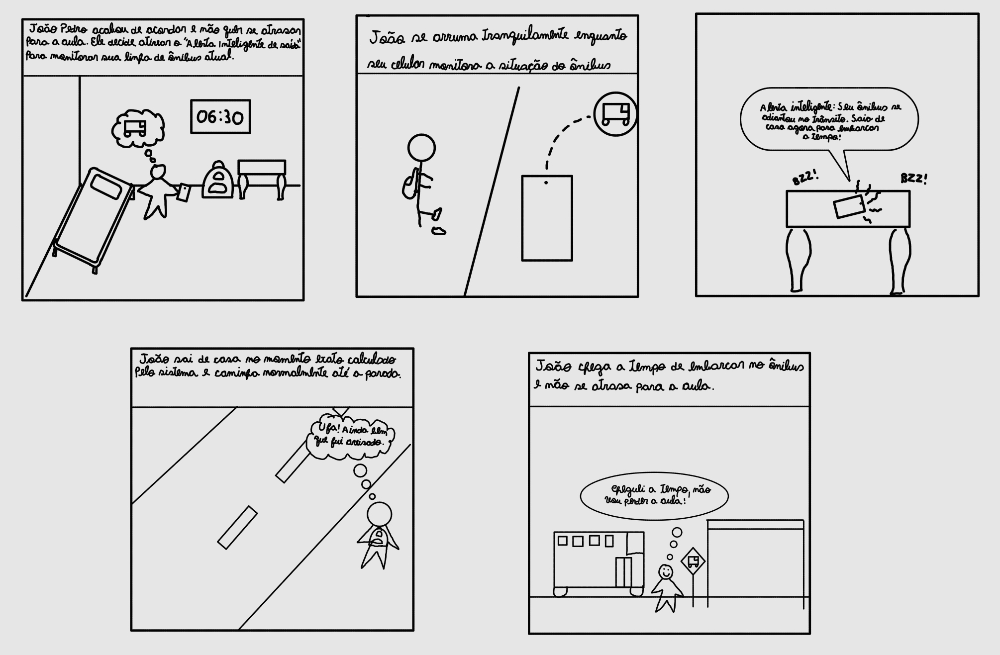
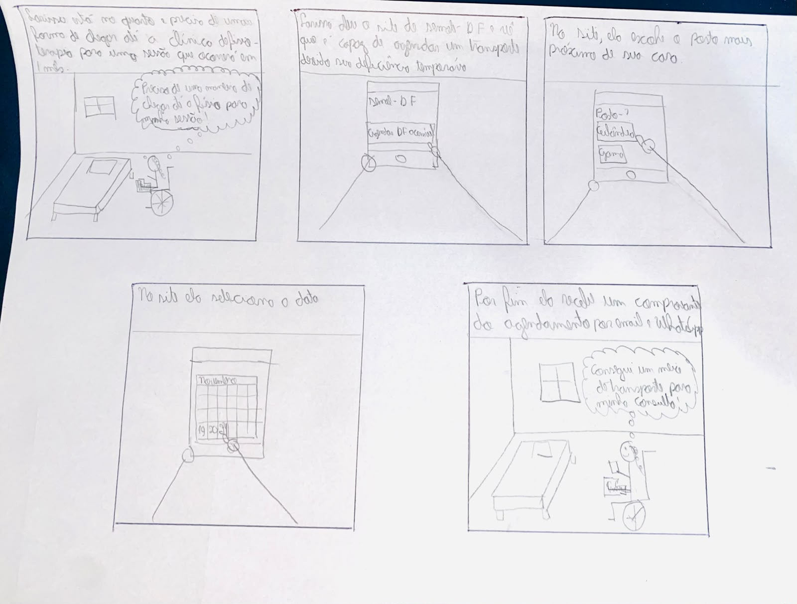
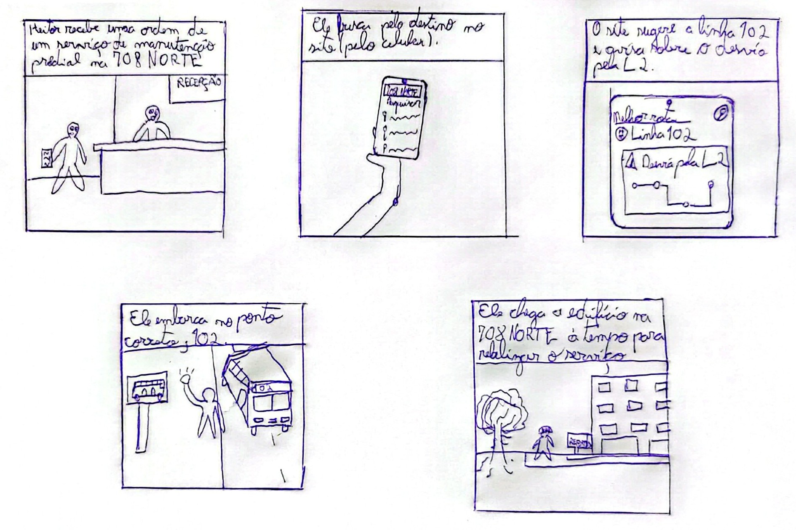

## Histórico de Versão

| Data | Versão | Descrição | Autor(es) | Revisor(es) | Declaração do uso de IA |
| :---: | :---: | :--- | :--- | :--- | :--- |
| 11/10/2026 | `1.0` | Criação e estruturação do documento de Storyboards e adição do Storyboard 01 (Alerta Inteligente de Saída). | [Igor Dantas Araújo](https://github.com/IgorDARAUJO) | [Gabriel Cardone](https://github.com/gabriellcardone-06) | Google Gemini - usado para formatação Markdown da página |
| 11/10/2026 | `1.1` | Adição do Storyboard 02 (Pré-agendamento no Programa DF Acessível) e atualização do link do Cenário 1. | [Gabriel Cardone](https://github.com/gabriellcardone-06) | [Igor Dantas Araújo](https://github.com/IgorDARAUJO) | Claude (Anthropic) - usado para tratamento da imagem e formatação Markdown da seção |
| 12/10/2026 | `1.2` | Adição do Storyboard 05 (Consulta de Rotas e Desvios para Novos Endereços): roteiro dos quadros, ilustração e tabela de verificação. | [Tomás Rocho](https://github.com/TomasRocho) | [Rodrigo Carvalho](https://github.com/RodrigoCBarbosa) | Claude (Anthropic) - usado para formatação Markdown da seção |

---

# Storyboards da Equipe

Neste documento, apresentam-se os **Storyboards** desenvolvidos pelos integrantes do **Grupo 05** para a **Etapa 4** do projeto de Interação Humano-Computador (IHC) aplicado ao sistema de mobilidade da **SEMOB-DF / BRB Mobilidade**.

O *storyboarding* é uma técnica de prototipagem de baixa fidelidade e prototipação conceitual amplamente utilizada em IHC para ilustrar graficamente como uma solução de interface se insere no contexto de vida do usuário (Preece, Rogers & Sharp, 2005; Barbosa et al., 2021). Cada storyboard consiste em uma sequência de quadros em quadrinhos que retrata uma persona vivenciando uma situação real, reagindo a um gatilho de necessidade e utilizando o sistema para alcançar seus objetivos.

---

## 1. Introdução e Metodologia

Conforme o plano de ensino da disciplina, esta entrega exige a elaboração de **7 Storyboards individuais** (exatamente 1 para cada integrante do grupo), garantindo o rastreamento direto entre a análise de necessidades e o reprojeto da solução de IHC.

Cada storyboard elaborado pela equipe atende aos seguintes requisitos metodológicos (Barbosa et al., 2021, Cap. 8):

1. **Relação 1:1 com a Análise de Tarefas:** Cada história desenhada é ancorada a uma tarefa específica modelada nas etapas de HTA e CTT.

2. **Contextualização com Personas e Cenários:** As narrativas utilizam as personas primárias e operacionais e os cenários de problema previamente validados pelo grupo.

3. **Foco na Experiência Humana:** Os quadrinhos priorizam o contexto físico, as motivações, as reações emocionais e o papel proativo da tecnologia, sem se prender a detalhes complexos de botões ou telas individuais.

---

## 2. Matriz de Vínculos: Storyboards ↔ Tarefas e Personas

A Tabela 1 sintetiza a distribuição dos 7 Storyboards do Grupo 05, indicando o autor responsável, a persona retratada, o cenário de problema e o link direto para a respectiva tarefa na Análise de Tarefas (HTA/CTT):

<div align="center">
<p><strong>Tabela 1</strong> — Matriz de Vínculos dos Storyboards da Equipe</p>
</div>

| # | Autor | Título do Storyboard | Persona Associada | Cenário de Uso | Tarefa Vinculada (HTA / CTT) |
| :---: | :--- | :--- | :--- | :--- | :---: |
| **01** | **Igor Dantas Araújo** | *Alerta inteligente de saída de casa* | [João Pedro Carvalho](https://interacao-humano-computador.github.io/2026.2-Grupo05/analise-de-requisitos/personas/joao-pedro-carvalho/) | [Cenário 2](https://interacao-humano-computador.github.io/2026.2-Grupo05/analise-de-requisitos/cenarios/cenario-2-viagem-matutina/) | [TAR-01 (Alerta de Saída)](https://interacao-humano-computador.github.io/2026.2-Grupo05/analise-de-requisitos/analise-de-tarefas/tar-01-alerta-saida/) |
| **02** | **Gabriel Cardone** | *Pré-agendamento no Programa DF Acessível* | [Larissa Ferreira Lima](https://interacao-humano-computador.github.io/2026.2-Grupo05/analise-de-requisitos/personas/larissa-ferreira-lima/) | [Cenário 1](https://interacao-humano-computador.github.io/2026.2-Grupo05/analise-de-requisitos/cenarios/cenario-1-pre-agendamento-df-acessivel/) | [TAR-02 (DF Acessível)](https://interacao-humano-computador.github.io/2026.2-Grupo05/analise-de-requisitos/analise-de-tarefas/tar-02-df-acessivel/) |
| **03** | **Lucas Araújo** | *Planejamento de Rota por Origem/Destino* | [Marcos Paulo Vieira](https://interacao-humano-computador.github.io/2026.2-Grupo05/analise-de-requisitos/personas/marcos-paulo-vieira/) | [Cenário 3](https://interacao-humano-computador.github.io/2026.2-Grupo05/analise-de-requisitos/cenarios/cenario-3-planejamento-origem-destino/) | [TAR-03 (Origem/Destino)](https://interacao-humano-computador.github.io/2026.2-Grupo05/analise-de-requisitos/analise-de-tarefas/tar-03-planejamento-rota/) |
| **04** | **Carlos Costa** | *Consulta de escala e alertas operacionais* | [Valdir Soares](https://interacao-humano-computador.github.io/2026.2-Grupo05/analise-de-requisitos/personas/valdir-soares/) | [Cenário 5](https://interacao-humano-computador.github.io/2026.2-Grupo05/analise-de-requisitos/cenarios/cenario-5-consulta-escala/) / [Cenário 6](https://interacao-humano-computador.github.io/2026.2-Grupo05/analise-de-requisitos/cenarios/cenario-6-alerta-desvio/) | [TAR-04/TAR-05 (Motorista)](https://interacao-humano-computador.github.io/2026.2-Grupo05/analise-de-requisitos/analise-de-tarefas/analise-hta-ctt-motorista/) |
| **05** | **Tomas Garcia Rocho** | *Consulta de rotas e desvios para novos endereços* | [Heitor Santos Júnior](https://interacao-humano-computador.github.io/2026.2-Grupo05/analise-de-requisitos/personas/heitor-santos-junior/) | [Cenário 9](https://interacao-humano-computador.github.io/2026.2-Grupo05/analise-de-requisitos/cenarios/cenario-9-endereco-novo/) | [TAR-03 (Pesquisa de Rota)](https://interacao-humano-computador.github.io/2026.2-Grupo05/analise-de-requisitos/analise-de-tarefas/tar-03-planejamento-rota/) |
| **06** | **Rodrigo Barbosa** | *Rastreamento de ônibus sob chuva no DF no Ponto* | [Mariana Borges Almeida](https://interacao-humano-computador.github.io/2026.2-Grupo05/analise-de-requisitos/personas/mariana-borges-almeida/) | [Cenário 10](https://interacao-humano-computador.github.io/2026.2-Grupo05/analise-de-requisitos/cenarios/cenario-10-viagem-ideal/) | [TAR-06 (DF no Ponto)](https://interacao-humano-computador.github.io/2026.2-Grupo05/analise-de-requisitos/analise-de-tarefas/tar-06-df-no-ponto/) |
| **07** | **Arthur Mariani** | *Regularização de crédito de Vale-Transporte* | [Maria Eduarda Santos](https://interacao-humano-computador.github.io/2026.2-Grupo05/analise-de-requisitos/personas/maria-eduarda-santos/) | [Cenário 4](https://interacao-humano-computador.github.io/2026.2-Grupo05/analise-de-requisitos/cenarios/cenario-4-credito-vale-transporte/) | [TAR-07 (Vale-Transporte)](https://interacao-humano-computador.github.io/2026.2-Grupo05/analise-de-requisitos/analise-de-tarefas/tar-07-credito-vale-transporte/) |

<div align="center">
<p><em>Fonte: Igor Dantas araújo (2026).</em></p>
</div>

---

## 3. Storyboards Individuais

---

### 3.1. Storyboard 01: Alerta Inteligente de Saída de Casa

* **Autor:** [Igor Dantas Araújo](https://github.com/IgorDARAUJO)
* **Persona Retratada:** [João Pedro Carvalho](https://interacao-humano-computador.github.io/2026.2-Grupo05/analise-de-requisitos/personas/joao-pedro-carvalho/) (Estudante da UnB Gama, 19 anos)
* **Cenário de Uso:** [Cenário 2 — Atraso por Conflito de Horários no App](https://interacao-humano-computador.github.io/2026.2-Grupo05/analise-de-requisitos/cenarios/cenario-2-viagem-matutina/)
* **Tarefa Ancorada:** [TAR-01 — Configurar e utilizar o alerta inteligente de saída de casa](https://interacao-humano-computador.github.io/2026.2-Grupo05/analise-de-requisitos/analise-de-tarefas/tar-01-alerta-saida/)
* **Tempo para confecção:** ~10 minutos.

#### **Ilustração do Storyboard 01**

<div align="center">
  
  <p><strong>Figura 1</strong> — Storyboard 01: Alerta inteligente de saída de casa</p>
  <p><em>Fonte: Elaborado por Igor Dantas Araújo (2026).</em></p>
</div>

#### **Tabela de Verificação do Storyboard 01**

<div align="center">
<p><strong>Tabela 2</strong> — Verificação de Conformidade do Storyboard 01</p>
</div>

| Categoria / Critério | Atendimento no Storyboard 01 | Situação |
| :--- | :--- | :---: |
| **1. Personas e Atores** | Apresenta o personagem **João Pedro Carvalho** em traço simples. | **Conforme** |
| **2. Contexto e Ambiente** | Transita do ambiente doméstico (quarto) para a rua e o ponto de ônibus. | **Conforme** |
| **3. Tarefa Retratada** | Ilustra a execução completa da **TAR-01** (Alerta de Saída). | **Conforme** |
| **4. Papel do Sistema** | Exibe a atuação proativa do alarme via monitoramento de GPS. | **Conforme** |
| **5. Estrutura Narrativa** | Possui fluxo claro com Início (Q1), Meio (Q2–Q4) e Fim (Q5). | **Conforme** |

<div align="center">
<p><em>Fonte: Igor Dantas Araújo (2026).</em></p>
</div>

---

### 3.2. Storyboard 02: Pré-agendamento no Programa DF Acessível

* **Autor:** [Gabriel Cardone](https://github.com/gabriellcardone-06)
* **Persona Retratada:** [Larissa Ferreira Lima](https://interacao-humano-computador.github.io/2026.2-Grupo05/analise-de-requisitos/personas/larissa-ferreira-lima/) (Estudante e assistente administrativa, 23 anos, com deficiência temporária de mobilidade)
* **Cenário de Uso:** [Cenário 1 — Pré-agendamento no Programa DF Acessível](https://interacao-humano-computador.github.io/2026.2-Grupo05/analise-de-requisitos/cenarios/cenario-1-pre-agendamento-df-acessivel/)
* **Tarefa Ancorada:** [TAR-02 — Pré-agendamento no Programa DF Acessível](https://interacao-humano-computador.github.io/2026.2-Grupo05/analise-de-requisitos/analise-de-tarefas/tar-02-df-acessivel/)
* **Tempo para confecção:** ~9 minutos.

#### **Ilustração do Storyboard 02**

<div align="center">
  
  <p><strong>Figura 2</strong> — Storyboard 02: Pré-agendamento no Programa DF Acessível</p>
  <p><em>Fonte: Elaborado por Gabriel Cardone (2026).</em></p>
</div>

#### **Tabela de Verificação do Storyboard 02**

<div align="center">
<p><strong>Tabela 3</strong> — Verificação de Conformidade do Storyboard 02</p>
</div>

| Categoria / Critério | Atendimento no Storyboard 02 | Situação |
| :--- | :--- | :---: |
| **1. Personas e Atores** | Apresenta a personagem **Larissa Ferreira Lima** em traço simples, usando cadeira de rodas. | **Conforme** |
| **2. Contexto e Ambiente** | Situa a ação no quarto de Larissa, em casa, onde ela resolve o agendamento pelo celular. | **Conforme** |
| **3. Tarefa Retratada** | Ilustra a execução completa da **TAR-02** (acesso ao site, escolha do posto e escolha do dia). | **Conforme** |
| **4. Papel do Sistema** | Exibe o atalho "Agendar DF Acessível" no site da Semob-DF e o envio do comprovante por e-mail e WhatsApp. | **Conforme** |
| **5. Estrutura Narrativa** | Possui fluxo claro com Início (Q1), Meio (Q2–Q4) e Fim (Q5). | **Conforme** |

<div align="center">
<p><em>Fonte: Gabriel Cardone (2026).</em></p>
</div>

---

### 3.3. Storyboard 03: Planejamento de Rota por Origem e Destino

* **Autor:** [Lucas Araújo](https://github.com/Lucasaraujoszz)
* **Persona Retratada:** [Marcos Paulo Vieira](https://interacao-humano-computador.github.io/2026.2-Grupo05/analise-de-requisitos/personas/marcos-paulo-vieira/)
* **Cenário de Uso:** [Cenário 3 — Deslocamento com Busca por Destino](https://interacao-humano-computador.github.io/2026.2-Grupo05/analise-de-requisitos/cenarios/cenario-3-planejamento-origem-destino/)
* **Tarefa Ancorada:** [TAR-03 — Planejamento de Rota por Origem/Destino](https://interacao-humano-computador.github.io/2026.2-Grupo05/analise-de-requisitos/analise-de-tarefas/tar-03-planejamento-rota/)

*(Esta seção será preenchida com a ilustração e descrição detalhada do Storyboard 03 elaborado pelo integrante Lucas Araújo).*

---

### 3.4. Storyboard 04: Consulta de Escala e Alertas Operacionais

* **Autor:** [Carlos Costa](https://github.com/carloshfgit)
* **Persona Retratada:** [Valdir Soares](https://interacao-humano-computador.github.io/2026.2-Grupo05/analise-de-requisitos/personas/valdir-soares/)
* **Cenário de Uso:** [Cenário 5 — Consulta de Escala de Trabalho](https://interacao-humano-computador.github.io/2026.2-Grupo05/analise-de-requisitos/cenarios/cenario-5-consulta-escala/)
* **Tarefa Ancorada:** [TAR-04/TAR-05 — Análise de Tarefas do Motorista](https://interacao-humano-computador.github.io/2026.2-Grupo05/analise-de-requisitos/analise-de-tarefas/analise-hta-ctt-motorista/)

*(Esta seção será preenchida com a ilustração e descrição detalhada do Storyboard 04 elaborado pelo integrante Carlos Costa).*

---

### 3.5. Storyboard 05: Consulta de Rotas e Desvios para Novos Endereços

* **Autor:** [Tomas Garcia Rocho](https://github.com/TomasRocho)
* **Persona Retratada:** [Heitor Santos Júnior](https://interacao-humano-computador.github.io/2026.2-Grupo05/analise-de-requisitos/personas/heitor-santos-junior/)
* **Cenário de Uso:** [Cenário 9 — Navegação para Endereço Novo com Desvio](https://interacao-humano-computador.github.io/2026.2-Grupo05/analise-de-requisitos/cenarios/cenario-9-endereco-novo/)
* **Tarefa Ancorada:** [TAR-03 — Pesquisa e Seleção de Itinerário](https://interacao-humano-computador.github.io/2026.2-Grupo05/analise-de-requisitos/analise-de-tarefas/tar-03-planejamento-rota/)

#### **Roteiro dos Quadros do Storyboard 05**

O storyboard mostra a situação do Cenário 9 com a solução proposta: Heitor encontra a rota a partir do destino e é avisado do desvio antes de ir até o ponto errado.

<div align="center">
<p><strong>Tabela 4</strong> — Roteiro quadro a quadro do Storyboard 05</p>
</div>

| Quadro | O que é mostrado | Papel do sistema |
| :---: | :--- | :--- |
| **Q1** | Heitor recebe na recepção uma ordem de serviço de manutenção predial no edifício da 708 Norte, endereço que não conhece. | Gatilho da necessidade. |
| **Q2** | Ele abre o site pelo celular e digita "708 Norte" no campo de busca. O site mostra uma lista de endereços parecidos para ele escolher. | Busca por destino, sem precisar saber o nome ou o número da linha. |
| **Q3** | A tela **Melhor rota encontrada** mostra a **linha 102**, sentido 708 Norte, um aviso em destaque de **desvio pela L2** e um esquema do trajeto desviado. | Aviso de desvio associado à linha que o usuário vai pegar. |
| **Q4** | Heitor embarca no ponto correto, na linha 102, que segue com o desvio pela L2. | Rota e parada atualizadas de acordo com o desvio. |
| **Q5** | Ele chega ao edifício da 708 Norte, onde a equipe já trabalha, a tempo de realizar o serviço. | Tarefa concluída sem atraso. |

<div align="center">
<p><em>Fonte: Tomás Rocho (2026), com base no Cenário 9.</em></p>
</div>

#### **Ilustração do Storyboard 05**

<div align="center">
  
  <p><strong>Figura 5</strong> — Storyboard 05: Consulta de rotas e desvios para novos endereços</p>
  <p><em>Fonte: Elaborado por Tomás Rocho (2026).</em></p>
</div>

#### **Tabela de Verificação do Storyboard 05**

<div align="center">
<p><strong>Tabela 5</strong> — Verificação de Conformidade do Storyboard 05</p>
</div>

| Categoria / Critério | Atendimento no Storyboard 05 | Situação |
| :--- | :--- | :---: |
| **1. Personas e Atores** | Apresenta o personagem **Heitor Santos Júnior**, em traço simples, como trabalhador de manutenção predial, com mochila e o celular como ferramenta. | **Conforme** |
| **2. Contexto e Ambiente** | Transita da recepção onde recebe a ordem de serviço (Q1) e consulta o celular (Q2–Q3) para o ponto de ônibus (Q4) e a entrada do edifício da 708 Norte (Q5). | **Conforme** |
| **3. Tarefa Retratada** | Ilustra a **TAR-03** (pesquisa e seleção de itinerário) aplicada a um endereço novo, como no Cenário 9. | **Conforme** |
| **4. Papel do Sistema** | Exibe a busca por destino com sugestões (Q2) e a melhor rota com o aviso de desvio associado à linha (Q3). | **Conforme** |
| **5. Estrutura Narrativa** | Possui fluxo claro com Início (Q1), Meio (Q2–Q4) e Fim (Q5), com legenda em cada quadro. | **Conforme** |

<div align="center">
<p><em>Fonte: Tomás Rocho (2026).</em></p>
</div>

---

### 3.6. Storyboard 06: Rastreamento em Tempo Real no DF no Ponto

* **Autor:** [Rodrigo Barbosa](https://github.com/RodrigoCBarbosa)
* **Persona Retratada:** [Mariana Borges Almeida](https://interacao-humano-computador.github.io/2026.2-Grupo05/analise-de-requisitos/personas/mariana-borges-almeida/)
* **Cenário de Uso:** [Cenário 10 — Viagem sob Chuva e Monitoramento em Tempo Real](https://interacao-humano-computador.github.io/2026.2-Grupo05/analise-de-requisitos/cenarios/cenario-10-viagem-ideal/)
* **Tarefa Ancorada:** [TAR-06 — Consulta de Ônibus no DF no Ponto](https://interacao-humano-computador.github.io/2026.2-Grupo05/analise-de-requisitos/analise-de-tarefas/tar-06-df-no-ponto/)

*(Esta seção será preenchida com a ilustração e descrição detalhada do Storyboard 06 elaborado pelo integrante Rodrigo Barbosa).*

---

### 3.7. Storyboard 07: Regularização de Crédito de Vale-Transporte

* **Autor:** [Arthur Mariani](https://github.com/arthur-mariani)
* **Persona Retratada:** [Maria Eduarda Santos](https://interacao-humano-computador.github.io/2026.2-Grupo05/analise-de-requisitos/personas/maria-eduarda-santos/)
* **Cenário de Uso:** [Cenário 4 — Resolução de Falha de Crédito de Vale-Transporte](https://interacao-humano-computador.github.io/2026.2-Grupo05/analise-de-requisitos/cenarios/cenario-4-credito-vale-transporte/)
* **Tarefa Ancorada:** [TAR-07 — Consulta e Regularização de Crédito](https://interacao-humano-computador.github.io/2026.2-Grupo05/analise-de-requisitos/analise-de-tarefas/tar-07-credito-vale-transporte/)

*(Esta seção será preenchida com a ilustração e descrição detalhada do Storyboard 07 elaborado pelo integrante Arthur Mariani).*

---

## 4. Referências Bibliográficas

* BARBOSA, Simone Diniz Junqueira; SILVA, Bruno Santana da; SILVEIRA, Milene Selbach; GASPARINI, Isabela; DARIN, Ticianne; BARBOSA, Gabriel Diniz Junqueira. **Interação Humano-Computador e Experiência do Usuário**. Rio de Janeiro: Autopublicação, 2021. ISBN 978-65-00-19677-1. (Capítulo 8: Organização do Espaço de Problema — Storyboards e Cenários, p. 158–162).
* PREECE, Jennifer; ROGERS, Yvonne; SHARP, Helen. **Design de Interação: Além da interação homem-computador**. São Paulo: Editora Érica, 2005. (Capítulo 8: Design, Prototipação e Construção).
* SALES, André Barros de. **Plano de Ensino: Interação Humano Computador**. Brasília: Universidade de Brasília, Faculdade UnB Gama (FCTE/UnB), 2026.
```