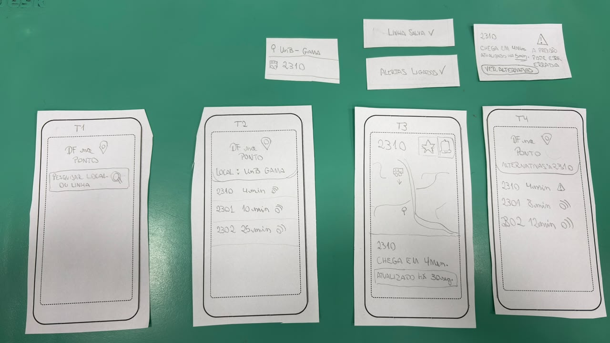
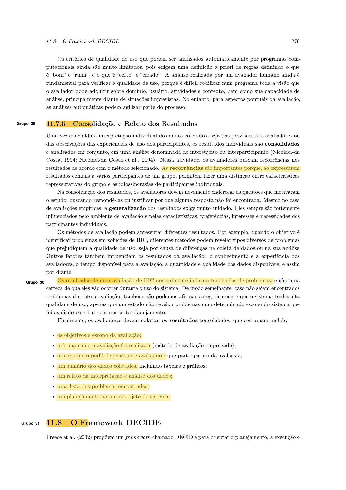
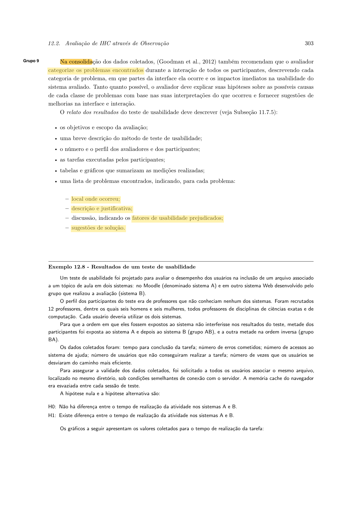

## Histórico de Versão e Contribuição

| Data | Versão | Descrição | Autor(es) | Revisor(es) | Declaração de Uso de IA |
| :---: | :---: | :--- | :--- | :--- | :--- |
| 27/10/2026 | `1.0` | Criação do planejamento do relato dos resultados da avaliação do Protótipo de Papel (TAR-06). | [Carlos Costa](https://github.com/carloshfgit) | [Igor Dantas Araújo](https://github.com/IgorDARAUJO) | Claude (Anthropic) - apenas revisou e formatou o texto em Markdown |

---

# Planejamento do Relato dos Resultados da Avaliação do Protótipo de Papel (TAR-06)

Neste documento, apresenta-se o **Planejamento do Relato dos Resultados da Avaliação do Protótipo de Papel** referente à **[TAR-06 (Consulta de ônibus em tempo real no DF no Ponto)](../../../../analise-de-requisitos/analise-de-tarefas/tar-06-df-no-ponto.md)**. Ele define como serão organizados e apresentados os dados da sessão descrita no [Planejamento da Avaliação do Protótipo de Papel](carlos-planejamento-av-prototipo-papel.md).

A estrutura segue as orientações sobre consolidação e relato de resultados de Barbosa et al. (2021, Seção 11.7.5, p. 263) e o relato específico da prototipação em papel de Barbosa et al. (2021, Seção 12.2.3, pp. 305–306).

**Artefatos relacionados — fluxo da funcionalidade TAR-06 (Consulta do Ônibus em Tempo Real no DF no Ponto):**

* **Persona:** [João Pedro Carvalho](../../../../analise-de-requisitos/personas/joao-pedro-carvalho.md); [Mariana Borges Almeida](../../../../analise-de-requisitos/personas/mariana-borges-almeida.md)
* **Cenário:** [Cenário 2](../../../../analise-de-requisitos/cenarios/cenario-2-viagem-matutina.md); [Cenário 10](../../../../analise-de-requisitos/cenarios/cenario-10-viagem-ideal.md)
* **Análise de tarefas:** [TAR-06](../../../../analise-de-requisitos/analise-de-tarefas/tar-06-df-no-ponto.md)
* **Storyboard:** [Storyboard 08](../../../nivel1/storyboards.md#38-storyboard-08-consulta-do-onibus-em-tempo-real-no-df-no-ponto)
* **Nível 1: avaliação do storyboard e da análise de tarefas:** [Planejamento da avaliação](../../../nivel1/planejamentos-individuais/Carlos/carlos-planejamento-avaliacao.md) · Planejamento do relato (*não realizado*) · [Relato dos resultados](../../../nivel1/relatos-individuais/carlos/relato-resultados-storyboard-tarefas.md)
* **Nível 2: protótipo de papel (baixa fidelidade):** [Planejamento da avaliação](carlos-planejamento-av-prototipo-papel.md) · Planejamento do relato (*esta página*) · [Relato dos resultados](../../relatos-individuais/carlos/relato-resultados-prot-papel.md)
* **Nível 3: protótipo de alta fidelidade:** [Planejamento da avaliação](../../../nivel3/planejamentos-individuais/carlos/carlos-planejamento-av-prot-alta-fidel.md) · [Planejamento do relato](../../../nivel3/planejamentos-individuais/carlos/carlos-planejamento-relato-prot-alta-fidel.md) · [Relato dos resultados](../../../nivel3/relatos-individuais/carlos/relato-resultados-prot-alta-fidel.md)
* **Telas do protótipo de papel:** [telas no planejamento da avaliação](carlos-planejamento-av-prototipo-papel.md#8-telas-do-prototipo-avaliado)
* **Protótipo de alta fidelidade navegável:** [acessar o protótipo](https://carloshfgit.github.io/prototipo-tar06-df-no-ponto/)

---

## 1. Objetivos do Relato dos Resultados

1. **Sintetizar o desempenho do participante** nas três tarefas (06.1, 06.2 e 06.3): sucesso sem ajuda, tempo e pedidos de ajuda.
2. **Registrar os problemas de usabilidade** encontrados, com severidade e sugestão de reprojeto.
3. **Separar os problemas corrigidos no papel** durante a sessão dos que ficam pendentes para a alta fidelidade, como pede o relato da prototipação em papel.
4. **Atualizar as hipóteses da TAR-06** (H2 a H6) com as evidências da simulação de uso.
5. **Fornecer recomendações** para o protótipo de alta fidelidade da Etapa 6.

---

## 2. Estrutura do Relatório Final

Barbosa et al. (2021) listam o que o relato da prototipação em papel deve conter: os objetivos, uma breve descrição do método, o número e o perfil dos avaliadores e dos participantes, as tarefas executadas, e os problemas encontrados, separando os que foram corrigidos no papel dos que não foram ([Imagens 1 e 2](#imagem-2)). Barbosa et al. (2021, p. 263) acrescentam que o relato deve deixar claros os limites da interpretação ([Imagem 4](#imagem-4)). Com base nisso, o relatório final terá as seções:

<strong>Tabela 1</strong>: Seções do relatório final

| # | Seção | Conteúdo |
| :---: | :--- | :--- |
| **1** | Introdução e objetivos | Escopo do protótipo (TAR-06) e objetivos da avaliação. |
| **2** | Método | Prototipação em papel com pensar em voz alta, papéis de "computador" e observador, e link para o planejamento. |
| **3** | Participante e equipe | Perfil do participante (código, sem nome), quem atuou como "computador" e quem observou, e link do vídeo. |
| **4** | Tarefas e desempenho | Tabela 3 deste planejamento, preenchida. |
| **5** | Problemas encontrados | Tabela 4, com severidade e sugestão de reprojeto. |
| **6** | Corrigidos no papel × pendentes | Tabela 5. |
| **7** | Hipóteses da TAR-06 | Tabela 6. |
| **8** | Recomendações e limitações | Diretrizes para a alta fidelidade e limites de um teste com um participante. |

<em>Fonte: Elaborado por Carlos Costa (2026), com base em Barbosa et al. (2021) e Barbosa et al. (2021, p. 263).</em>

---

## 3. Escala de Severidade dos Problemas

Os problemas serão classificados pela escala de severidade de Nielsen (1994 apud BARBOSA et al., 2021), adaptada para a simulação em papel:

<strong>Tabela 2</strong>: Escala de severidade

| Nível | Classificação | Impacto na simulação em papel |
| :---: | :--- | :--- |
| **0** | Sem importância | Não afeta a tarefa; comentário estético ou opcional. |
| **1** | Leve | Hesitação breve; o participante conclui a tarefa sozinho. |
| **2** | Moderado | Escolha errada de tela ou peça, corrigida pelo participante, com perda de eficiência. |
| **3** | Grave | O participante só conclui a tarefa com muita dificuldade ou com ajuda do avaliador. |
| **4** | Catastrófico | O participante não consegue concluir a tarefa. |

<em>Fonte: Adaptado de Nielsen (1994 apud BARBOSA et al., 2021).</em>

---

## 4. Modelos de Tabelas para Consolidação dos Resultados

### 4.1 Desempenho nas Tarefas

<strong>Tabela 3</strong>: Modelo de consolidação do desempenho por tarefa

| ID | Tarefa | Sucesso sem ajuda? | Tempo | Pedidos de ajuda | Observações (falas e hesitações, com minutagem do vídeo) |
| :---: | :--- | :---: | :---: | :---: | :--- |
| **06.1** | Descobrir em quanto tempo chega o próximo ônibus para a UnB Gama. | *[Sim / Não]* | *[mm:ss]* | *[qtd.]* | *[...]* |
| **06.2** | Entender o aviso de posição desatualizada e decidir o que fazer. | *[Sim / Não]* | *[mm:ss]* | *[qtd.]* | *[...]* |
| **06.3** | Favoritar a linha e ativar o aviso de atraso. | *[Sim / Não]* | *[mm:ss]* | *[qtd.]* | *[...]* |

<em>Fonte: Elaborado por Carlos Costa (2026).</em>

### 4.2 Registro e Priorização dos Problemas

Os campos seguem a categorização dos problemas proposta por Barbosa et al. (2021, Seção 12.2.1, p. 289) ([Imagem 5](#imagem-5)).

<strong>Tabela 4</strong>: Modelo de registro dos problemas de usabilidade

| ID | Descrição do problema | Tela / peça | Tarefa | Severidade (0–4) | Hipótese relacionada | Sugestão de reprojeto |
| :---: | :--- | :--- | :---: | :---: | :---: | :--- |
| **PP-01** | *[...]* | *[ex.: T3 — Detalhe da linha]* | *[06.x]* | *[0–4]* | *[H2–H6 ou —]* | *[...]* |
| **PP-02** | *[...]* | *[...]* | *[06.x]* | *[0–4]* | *[...]* | *[...]* |

<em>Fonte: Elaborado por Carlos Costa (2026).</em>

### 4.3 Problemas Corrigidos no Papel × Pendentes

<strong>Tabela 5</strong>: Modelo de registro das correções no protótipo de papel

| ID | Alteração feita no papel | Corrigido durante a sessão? | Voltou a ocorrer? | Encaminhamento |
| :---: | :--- | :---: | :---: | :--- |
| **PP-01** | *[ex.: redesenho do aviso N1 com texto mais curto]* | *[Sim / Não]* | *[Sim / Não]* | *[Resolvido no papel / Ajustar na alta fidelidade]* |

<em>Fonte: Elaborado por Carlos Costa (2026).</em>

### 4.4 Situação das Hipóteses da TAR-06

<strong>Tabela 6</strong>: Modelo de atualização das hipóteses

| ID | Hipótese (resumo) | Evidência na simulação | Situação após o protótipo de papel |
| :---: | :--- | :--- | :---: |
| **H2** | A busca exige lembrar a linha; atalho para linhas usadas ajudaria. | *[...]* | *[Reforçada / Contrariada / Sem evidência]* |
| **H3** | Itens próximos na lista levam à seleção errada. | *[...]* | *[...]* |
| **H4** | A indicação de última atualização ajuda a avaliar a confiabilidade. | *[...]* | *[...]* |
| **H5** | O usuário trata posição defasada como atual e decide errado. | *[...]* | *[...]* |
| **H6** | O usuário novo não conhece a busca por referência. | *[...]* | *[...]* |

<em>Fonte: Elaborado por Carlos Costa (2026), com base na Tabela 5 da TAR-06.</em>

---

## 5. Encaminhamento dos Resultados

1. **No papel:** problemas simples (texto, posição de botão) podem ser corrigidos e testados durante a própria sessão e entram na Tabela 5 como "Resolvido no papel".
2. **Para a alta fidelidade:** problemas de severidade 2, 3 ou 4 que não foram resolvidos no papel viram requisitos do protótipo de alta fidelidade.
3. **Para a TAR-06:** a situação das hipóteses é levada para uma nova versão do documento da TAR-06.
4. **Limitações:** com um participante, os resultados indicam tendências e não garantem a ausência de outros problemas (Barbosa et al., 2021, p. 263).

## 6. Telas do Protótipo Avaliado

A Imagem 1 mostra as telas do protótipo de papel da [TAR-06](../../../../analise-de-requisitos/analise-de-tarefas/tar-06-df-no-ponto.md), também apresentadas no [relato dos resultados da avaliação](../../../nivel2/relatos-individuais/carlos/relato-resultados-prot-papel.md).

<strong>Imagem 1</strong>: Telas e peças do protótipo de papel da TAR-06

{ width="600" }

<em>Fonte: Elaborado por Carlos Costa (2026).</em>

---
---

## 7. Fotos de Referência

<em>Imagem 2: Interpretação, consolidação e itens do relato da prototipação em papel, parte 1 (Barbosa et al., 2021, Seção 12.2.3, pp. 305–306).</em>

<em>Imagem 3: Itens do relato da prototipação em papel, parte 2: problemas não corrigidos (Barbosa et al., 2021, Seção 12.2.3, pp. 305–306).</em>

<em>Imagem 4: Consolidação, limites da interpretação e estrutura do relato (Barbosa et al., 2021, Seção 11.7.5, p. 263).</em>

<em>Imagem 5: Categorização e campos do relato dos problemas (Barbosa et al., 2021, Seção 12.2.1, p. 289).</em>

---

## 8. Referências Bibliográficas
* BARBOSA, Simone Diniz Junqueira; SILVA, Bruno Santana da; SILVEIRA, Milene Selbach; GASPARINI, Isabela; DARIN, Ticianne; BARBOSA, Gabriel Diniz Junqueira. **Interação Humano-Computador e Experiência do Usuário**. Rio de Janeiro: Autopublicação, 2021. ISBN 978-65-00-19677-1. (Seção 11.7.5, p. 263; Seção 12.2.1, p. 289).
* SALES, André Barros de. **Plano de Ensino: Interação Humano Computador**. Brasília: Universidade de Brasília, Faculdade UnB Gama (FCTE/UnB), 2026.
