## Histórico de Versão e Contribuição

| Data | Versão | Descrição | Autor(es) | Revisor(es) | Declaração de Uso de IA |
| :---: | :---: | :--- | :--- | :--- | :--- |
| 25/10/2026 | `1.0` | Criação do planejamento individual da avaliação do Protótipo de Papel (TAR-02) via DECIDE para teste presencial. | [Gabriel Cardone](https://github.com/gabriellcardone-06) | [Igor Dantas Araújo](https://github.com/IgorDARAUJO) | Claude (Anthropic) - formatação markdown da página |
| 20/11/2026 | `1.1` | Inclusão do link para o protótipo de alta fidelidade da TAR-02 no Figma no bloco de artefatos relacionados. | [Gabriel Cardone](https://github.com/gabriellcardone-06) | Pendente de revisão | Claude (Anthropic) - formatação markdown. |

---

# Planejamento da Avaliação do Protótipo de Papel (TAR-02)

Neste documento, apresenta-se o **Planejamento da Avaliação do Protótipo de Papel** referente à **[TAR-02 (Pré-agendamento no Programa DF Acessível)](https://interacao-humano-computador.github.io/2026.2-Grupo05/analise-de-requisitos/analise-de-tarefas/tar-02-df-acessivel/)**. Trata-se de um planejamento individual desenvolvido para orientar a avaliação formativa presencial do protótipo de baixa fidelidade confeccionado em papel, representando, na versão para celular do site da **SEMOB-DF**, a funcionalidade proposta de pré-agendamento de viagens do Programa DF Acessível. O protótipo começa já dentro da funcionalidade (a partir da página do serviço "Agendar DF Acessível") e segue o [Guia de Estilo](https://interacao-humano-computador.github.io/2026.2-Grupo05/analise-de-requisitos/guia-de-estilo/introducao/) do projeto.

A avaliação será conduzida de forma empírica presencial, envolvendo a simulação de uso por um participante representante da persona [Larissa Ferreira Lima](https://interacao-humano-computador.github.io/2026.2-Grupo05/analise-de-requisitos/personas/larissa-ferreira-lima/). O protótipo incorpora as recomendações do [Relato dos Resultados da Avaliação do Storyboard 02 e da TAR-02](../../../nivel1/relatos-individuais/gabriel/relato-resultados-storyboard-tarefas.md). O planejamento foi estruturado aplicando o **Framework DECIDE** (Barbosa et al., 2021), que organiza o estudo nas seis etapas: **D**eterminar objetivos, **E**xplorar perguntas, **C**hoose (Escolher) métodos, **I**dentificar questões práticas, **D**ecidir questões éticas e **E**valuate (Avaliar e interpretar dados).

**Artefatos relacionados — fluxo da funcionalidade TAR-02 (Pré-agendamento no Programa DF Acessível):**

* **Persona:** [Larissa Ferreira Lima](../../../../analise-de-requisitos/personas/larissa-ferreira-lima.md)
* **Cenário:** [Cenário 1](../../../../analise-de-requisitos/cenarios/cenario-1-pre-agendamento-df-acessivel.md)
* **Análise de tarefas:** [TAR-02](../../../../analise-de-requisitos/analise-de-tarefas/tar-02-df-acessivel.md)
* **Storyboard:** [Storyboard 02](../../../nivel1/storyboards.md#32-storyboard-02-pre-agendamento-no-programa-df-acessivel)
* **Nível 1: avaliação do storyboard e da análise de tarefas:** [Planejamento da avaliação](../../../nivel1/planejamentos-individuais/Gabriel/gabriel-planejamento-avaliacao.md) · [Planejamento do relato](../../../nivel1/planejamentos-individuais/Gabriel/gabriel-planejamento-relato-resultados-avaliacao.md) · [Relato dos resultados](../../../nivel1/relatos-individuais/gabriel/relato-resultados-storyboard-tarefas.md)
* **Nível 2: protótipo de papel (baixa fidelidade):** Planejamento da avaliação (*esta página*) · [Planejamento do relato](gabriel-planejamento-relato-prot-papel.md) · [Relato dos resultados](../../relatos-individuais/gabriel/relato-resultado-prot-papel.md)
* **Nível 3: protótipo de alta fidelidade:** [Planejamento da avaliação](../../../nivel3/planejamentos-individuais/gabriel/planejamento-av-prot-alta-fidel.md) · [Planejamento do relato](../../../nivel3/planejamentos-individuais/gabriel/planejamento-relato-prot-alta-fidel.md) · [Relato dos resultados](../../../nivel3/relatos-individuais/gabriel/relato-resultados-prot-alta-fidel.md)
* **Telas do protótipo de papel:** telas no planejamento da avaliação (*nesta página*)
* **Protótipo de alta fidelidade navegável:** [acessar o protótipo](https://www.figma.com/proto/AIO6YnlBnPcriwQzsEdHpi/Prot%C3%B3tipo-Alta-Fidelidade-%E2%80%94-TAR-02-DF-Acess%C3%ADvel--SEMOB-DF-?node-id=6-67&starting-point-node-id=6%3A67&t=a6O7kf7iKozAdr05-1)

---

## 1. D: Determinar os Objetivos da Avaliação

Conforme Barbosa et al. (2021, Cap. 12, p. 303), a prototipação em papel é um método de observação de uso voltado à avaliação formativa, ideal para explorar ideias de design, validar o modelo conceitual e identificar problemas de IHC antes do desenvolvimento de software executável.

### 1.1 Objetivos Principais
* **Identificar problemas de usabilidade e navegação:** Detectar falhas de layout, rótulos confusos, botões ambíguos ou áreas de toque pequenas nas telas de papel durante o pré-agendamento da viagem.
* **Avaliar as três etapas do fluxo:** Verificar se o participante escolhe o posto de embarque (perto de casa) e o de desembarque (perto do compromisso), escolhe o dia e envia o laudo e o comprovante de residência sem ajuda do avaliador.
* **Avaliar a confiança no resultado:** Verificar se o comprovante com o resumo do agendamento faz o participante sentir que o transporte está garantido (ressalva da Q05 no relato anterior).
* **Coletar sugestões de reprojeto:** Obter feedback direto para aprimorar os elementos visuais e o fluxo de interação antes da construção do protótipo de alta fidelidade.

---

## 2. E: Explorar as Perguntas a Serem Respondidas

Para operacionalizar os objetivos da avaliação, foram elaboradas perguntas investigativas aplicadas durante e após a simulação com o protótipo de papel (Barbosa et al., 2021):

<strong>Tabela 1</strong>: Roteiro de Perguntas Investigativas da Avaliação

| ID | Categoria / Foco | Pergunta de Investigação da Avaliação | Critério de Aceitação / Resposta Esperada |
| :---: | :--- | :--- | :--- |
| **Q01** | **Envio de Documentos** | O participante consegue enviar o laudo do profissional de saúde e o comprovante de residência e entende que cada documento foi enviado? | O participante envia os dois documentos sem pedir ajuda e reconhece o "✓ Enviado" de cada um. |
| **Q02** | **Interpretação de Rótulos** | Os termos desenhados nas telas e peças de papel (ex.: "Pré-agendamento", "Posto de embarque", "Posto de desembarque", "Recursos de acessibilidade", "Concluir pré-agendamento") são compreensíveis? | O participante explica com suas palavras o que é o pré-agendamento da viagem, a diferença entre os postos de embarque e de desembarque e o que cada rótulo indica, sem pedir explicações. |
| **Q03** | **Feedback e Confiança** | O comprovante (na tela, por e-mail e WhatsApp) com o protocolo, os postos de embarque e de desembarque, os endereços e o dia faz o participante sentir que o transporte está garantido? | O participante declara confiança no agendamento ou aponta a informação que faltou. |

<em>Fonte: Elaborado por Gabriel Cardone (2026).</em>

---

## 3. C: Choose (Escolher) os Métodos de Avaliação

O método selecionado é a **Prototipação em Papel (Barbosa et al., 2021, Seção 12.2.3)**, enquadrado como um **Método de Observação de Uso (Empírico)** em ambiente controlado presencial.

* **Justificativa:** Trata-se de uma técnica ágil, de baixo custo e altamente interativa para testes formativos com usuários reais. Permite simular o comportamento da versão para celular do site manipulando folhas de papel, post-its e cartas recortadas, sem escrever código, e corrigir rótulos ou layouts no próprio papel entre uma tarefa e outra.

---

## 4. I: Identificar e Administrar as Questões Práticas

### 4.1 Confecção do Protótipo em Papel
O protótipo será construído à mão em folhas de papel, contendo:
* **Moldura do Dispositivo:** Um molde em papel no formato do site para delimitar a área da tela.
* **Telas Base:** Folhas de papel com os esboços das seguintes telas, todas com o cabeçalho da SEMOB-DF e seguindo o guia de estilo:
    1. **Apresentação do pré-agendamento**, com uma frase explicando que o serviço reserva a viagem em transporte adaptado, a informação de que deficiência temporária ou permanente dá direito, as três etapas (postos, dia e documentos) e o botão "Iniciar pré-agendamento";
    2. **Etapa 1 de 4 — Posto de embarque**, com a lista de postos ordenada pela distância de casa (endereço, distância e recursos de acessibilidade);
    3. **Etapa 2 de 4 — Posto de desembarque**, com a lista de postos e as mesmas informações;
    4. **Etapa 3 de 4 — Dia**, com o calendário do mês em áreas de toque amplas e a linha "Dia escolhido";
    5. **Etapa 4 de 4 — Documentos**, com os campos "Laudo do profissional de saúde" e "Comprovante de residência", cada um com o botão "Enviar arquivo", e o botão "Concluir pré-agendamento";
    6. **Comprovante**, com o protocolo, o resumo (postos, endereços e dia) e a indicação de envio por e-mail e WhatsApp.
* **Peças Móveis:** estado "✓ Selecionado" para os cartões de posto, marcação do dia escolhido e data por extenso, "✓ Enviado" para cada documento e botões "Continuar" ativos.

### 4.2 Definição dos Papéis da Equipe na Sessão Presencial
Conforme Barbosa et al. (2021, p. 304), a condução do teste presencial exige a distribuição clara das atribuições:

* **Usuário / Participante:** Recrutado conforme o perfil da persona, realiza as tarefas interagindo com o papel (apontando o dedo ou uma caneta para simular toques na tela).
* **Avaliador "Computador"/Observador (Gabriel Cardone):** Responsável por manipular o protótipo de papel na mesa, trocando telas e sobrepondo as peças móveis estritamente em reação às ações do participante. **O "computador" não deve dar dicas nem explicar como usar a interface.**

### 4.3 Recrutamento e Perfil do Participante
* **Perfil do Convidado:** 1 participante convidado presencialmente, representante do público-alvo primário ([Larissa Ferreira Lima](https://interacao-humano-computador.github.io/2026.2-Grupo05/analise-de-requisitos/personas/larissa-ferreira-lima/)): pessoa com mobilidade reduzida (temporária ou permanente) que usa ou já precisou de transporte adaptado. Na impossibilidade de encontrar esse perfil, aceita-se um familiar ou acompanhante que já tenha agendado transporte adaptado para outra pessoa.
* **Canal de Recrutamento:** Rede de contatos da equipe (familiares e conhecidos), sob responsabilidade de Gabriel Cardone.
* **Quantidade:** 1 usuário para a sessão de teste presencial.

### 4.4 Infraestrutura e Equipamentos Presenciais
* **Local:** Mesa de trabalho/estudo organizada em ambiente tranquilo, iluminado e acessível, livre de distrações externas.
* **Equipamentos de Gravação:** Smartphone em suporte focado na mesa (capturando o manuseio do papel e o áudio da conversa).
* **Kit de Material de Apoio:** Termo de Consentimento (TCLE) previamente assinado, folha com o cenário e as instruções das tarefas, conjunto de telas e peças do protótipo em papel e uma "aba de arquivos" em papel com pdfs de laudo e de comprovante de residência (sem dados reais), para simular o envio dos documentos.

### 4.5 Roteiro de Tarefas da Sessão
As tarefas serão apresentadas oralmente, uma de cada vez, a partir do [Cenário 1](https://interacao-humano-computador.github.io/2026.2-Grupo05/analise-de-requisitos/cenarios/cenario-1-pre-agendamento-df-acessivel/): *"Você precisa de transporte adaptado para ir à fisioterapia, em Taguatinga, daqui a um mês. Você mora em Ceilândia e já abriu, no celular, a página 'Agendar DF Acessível' do site da SEMOB-DF. Faça o pré-agendamento da viagem."*

<strong>Tabela 2</strong>: Tarefas Simuladas no Protótipo de Papel

| ID Tarefa | Descrição da Tarefa | Operações Relacionadas (HTA/CTT) | Perguntas Investigadas |
| :---: | :--- | :--- | :--- |
| **TAR-02.1** | Escolher o posto de embarque perto de casa e o posto de desembarque perto da clínica. | HTA 1 (1.1 e 1.2) / CTT Ramo 1 (1.1 a 1.4) | Q02 |
| **TAR-02.2** | Escolher o dia da viagem. | HTA 2 / CTT Ramo 2 (2.1 a 2.3) | Q02 |
| **TAR-02.3** | Enviar o laudo e o comprovante de residência e concluir o pré-agendamento. | HTA 3 (3.1 a 3.3) / CTT 3.1 a 3.4 | Q01, Q02 |
| **TAR-02.4** | Conferir o comprovante do agendamento. | Feedback da HTA 3.3 / CTT 3.5 | Q03 |

<em>Fonte: Elaborado por Gabriel Cardone (2026).</em>

### 4.6 Cronograma de Execução Presencial

<strong>Tabela 3</strong>: Cronograma da Sessão Presencial do Protótipo de Papel

| Parâmetro | Detalhamento da Sessão Presencial |
| :--- | :--- |
| **Data e Horário:** | 28/10/2026 às 14:00. |
| **Local:** | Ambiente presencial reservado e acessível (sala na FCTE/UnB ou local de preferência do participante). |
| **Condutor / "Computador / Observador":** | **Gabriel Cardone**. |
| **Duração Prevista:** | **5 minutos** |
| **Orçamento Estimado:** | **R\$ 0,00** (uso de papéis, canetas e smartphone próprio para gravação). |

<em>Fonte: Elaborado por Gabriel Cardone (2026).</em>

---

## 5. D: Decidir como Lidar com as Questões Éticas

A condução do teste presencial com o protótipo de papel atende às diretrizes éticas do livro-texto (Barbosa et al., 2021, Seção 7.4):

1. **Assinatura do TCLE Impresso:** No início da sessão presencial, o avaliador entregará o [Termo de Consentimento Livre e Esclarecido (TCLE)](https://interacao-humano-computador.github.io/2026.2-Grupo05/assets/PDFs/TCLE_Pesquisa_Transporte.pdf) impresso, explicando os objetivos acadêmicos da pesquisa e colhendo a assinatura do participante.
2. **Autorização de Imagem e Áudio:** O participante será informado de que a gravação focará nas mãos manipulando o papel sobre a mesa e na captação do áudio de suas impressões, sem exposição do rosto.
3. **Respeito e Anonimato:** Será garantido o anonimato do participante, identificado apenas por código, e a liberdade total de interromper o teste a qualquer momento sem qualquer encargo ou prejuízo.
4. **Cuidado com Informações de Saúde:** O participante não é obrigado a relatar diagnóstico, condição ou histórico clínico. Qualquer informação de saúde compartilhada espontaneamente será tratada como dado sensível e registrada apenas de forma anonimizada.
5. **Foco no Artefato:** Será reforçado que o objeto da avaliação é o protótipo, e não o participante, e que dificuldades encontradas indicam problemas da interface.

---

## 6. E: Avaliar, Interpretar e Apresentar os Dados

Os dados coletados na sessão presencial serão processados seguindo a abordagem de **análise qualitativa e ciclo iterativo rápido** (Barbosa et al., 2021, Seção 12.2.3):

1. **Análise de Mídia e Anotações:** O áudio e a gravação do manuseio do papel serão revisados para mapear o tempo de conclusão de cada tarefa, os pedidos de ajuda, os pontos de dúvida e as falhas na troca de peças do protótipo.
2. **Reprojeto Rápido no Papel:** Problemas de usabilidade simples identificados no papel (ex.: um rótulo confuso nos postos ou um botão pequeno no calendário) poderão ser corrigidos ou redesenhados diretamente no papel para validação rápida nas próximas iterações.
3. **Consolidação dos Resultados:** Todos os problemas identificados, sua classificação de severidade (níveis 0 a 4) e as propostas de correção serão estruturados e apresentados no documento de *Relato dos Resultados da Avaliação do Protótipo de Papel*, conforme o [Planejamento do Relato](gabriel-planejamento-relato-prot-papel.md).

---

## 7. Planejamento do Teste Piloto do Protótipo de Papel

Em cumprimento ao **Item 11 do checklist do Plano de Ensino** e à literatura de IHC (Barbosa et al., 2021, pp. 260, 304), antes da realização do teste definitivo com o participante convidado, será executado um **teste piloto**:

* **Objetivo do Piloto:** Avaliar o próprio planejamento, testar o encaixe e a agilidade da troca das peças de papel pelo "computador", verificar o tempo de execução das tarefas e testar o enquadramento do celular na gravação da mesa.
* **Execução e Data:** O teste piloto será realizado presencialmente em **27/10/2026**, contando com um membro da equipe fazendo o papel de participante simulado.
* **Isenção de Dados (Conformidade com o Item 12 do Checklist):** Declara-se formalmente que os dados e vídeos do teste piloto servirão **exclusivamente para calibração** dos materiais de papel e do procedimento, **não sendo computados nos resultados finais da avaliação**.

---

## 8. Localização das Referências no Livro

Conforme as normas da disciplina, a fundamentação conceitual aplicada a este planejamento encontra-se nas seguintes seções do livro-texto oficial:

* **Obra:** BARBOSA, S. D. J.; SILVA, B. S. da; SILVEIRA, M. S.; GASPARINI, I.; DARIN, T.; BARBOSA, G. D. J. **Interação Humano-Computador e Experiência do Usuário**. Rio de Janeiro: Autopublicação, 2021.
* **Localização Exata:** **Parte IV, Capítulo 11 — Planejamento da Avaliação de IHC, Seção 11.8 (*O Framework DECIDE*), páginas 264–265**; e **Capítulo 12 — Métodos de Avaliação de IHC, Seção 12.2.3 (*Prototipação em Papel*), páginas 303–306**.

## 9. Telas do Protótipo Avaliado

As Figuras 1 a 11 mostram as telas do protótipo de papel da [TAR-02](../../../../analise-de-requisitos/analise-de-tarefas/tar-02-df-acessivel.md), também apresentadas no [relato dos resultados da avaliação](../../../nivel2/relatos-individuais/gabriel/relato-resultado-prot-papel.md).

* **Telas do protótipo de papel (PDF):** [Visualizar PDF das telas do protótipo de papel](../../../../assets/PDFs/Gabriel_telas_prototipo_papel.pdf)

<strong>Figura 1</strong>: Apresentação do Agendamento DF Acessível (página 1 do PDF das telas)

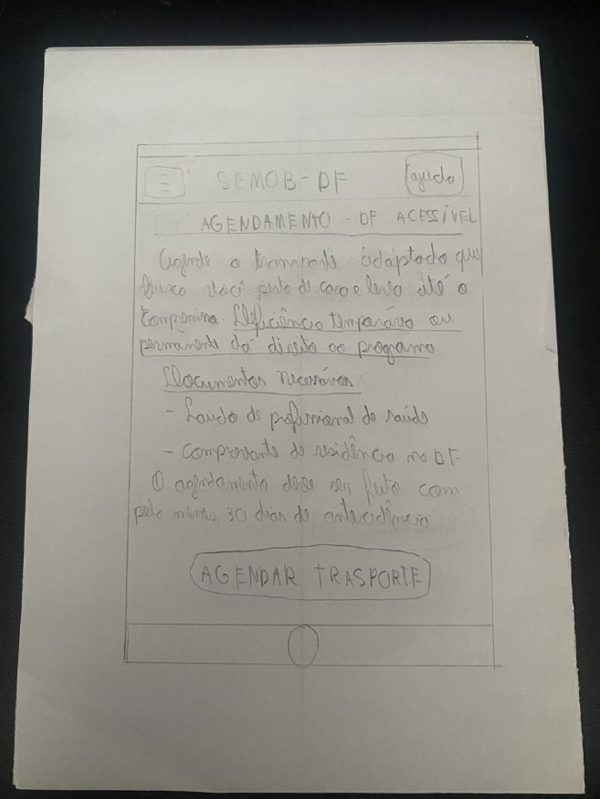{ width="420" }

<em>Fonte: Elaborado por Gabriel Cardone (2026). Fotos extraídas do [PDF das telas do protótipo de papel](../../../../assets/PDFs/Gabriel_telas_prototipo_papel.pdf).</em>

<strong>Figura 2</strong>: Etapa 1 de 4 — Posto de embarque (página 2 do PDF das telas)

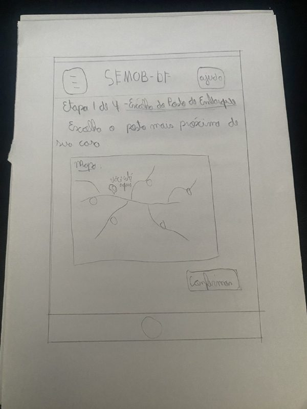{ width="420" }

<em>Fonte: Elaborado por Gabriel Cardone (2026). Fotos extraídas do [PDF das telas do protótipo de papel](../../../../assets/PDFs/Gabriel_telas_prototipo_papel.pdf).</em>

<strong>Figura 3</strong>: Etapa 1 de 4 — Posto de embarque selecionado (página 3 do PDF das telas)

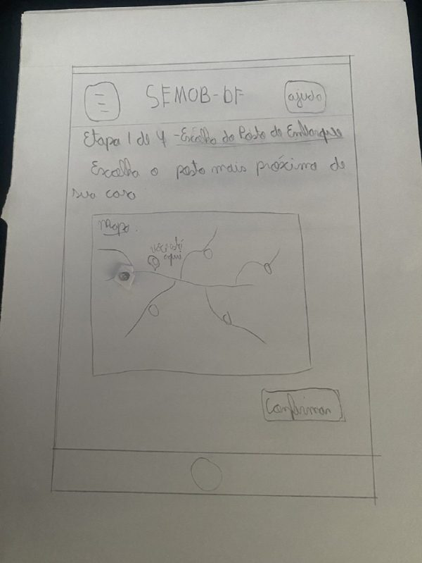{ width="420" }

<em>Fonte: Elaborado por Gabriel Cardone (2026). Fotos extraídas do [PDF das telas do protótipo de papel](../../../../assets/PDFs/Gabriel_telas_prototipo_papel.pdf).</em>

<strong>Figura 4</strong>: Etapa 2 de 4 — Posto de desembarque (página 4 do PDF das telas)

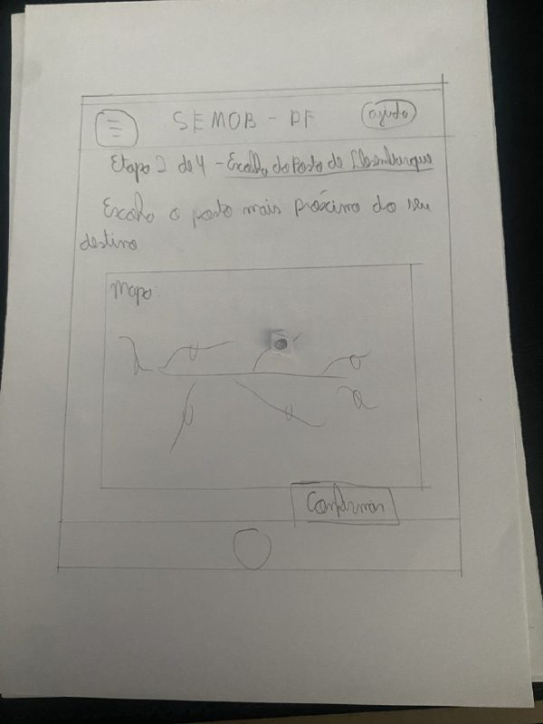{ width="420" }

<em>Fonte: Elaborado por Gabriel Cardone (2026). Fotos extraídas do [PDF das telas do protótipo de papel](../../../../assets/PDFs/Gabriel_telas_prototipo_papel.pdf).</em>

<strong>Figura 5</strong>: Etapa 3 de 4 — Dia (página 5 do PDF das telas)

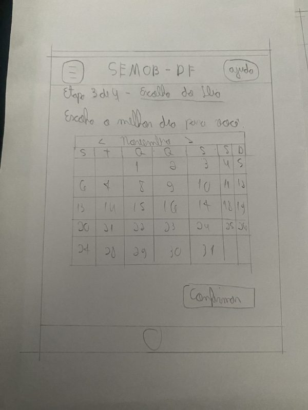{ width="420" }

<em>Fonte: Elaborado por Gabriel Cardone (2026). Fotos extraídas do [PDF das telas do protótipo de papel](../../../../assets/PDFs/Gabriel_telas_prototipo_papel.pdf).</em>

<strong>Figura 6</strong>: Etapa 3 de 4 — Dia selecionado (página 6 do PDF das telas)

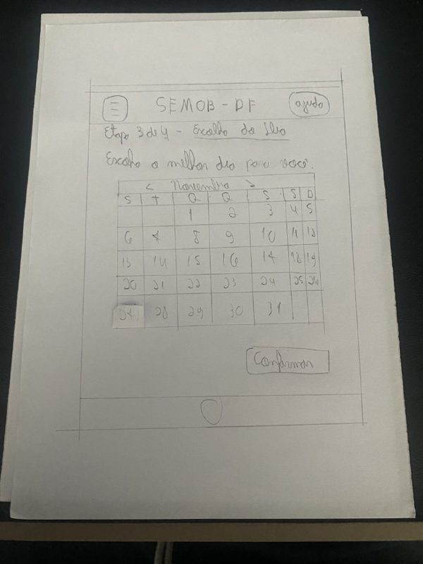{ width="420" }

<em>Fonte: Elaborado por Gabriel Cardone (2026). Fotos extraídas do [PDF das telas do protótipo de papel](../../../../assets/PDFs/Gabriel_telas_prototipo_papel.pdf).</em>

<strong>Figura 7</strong>: Etapa 4 de 4 — Documentos (página 7 do PDF das telas)

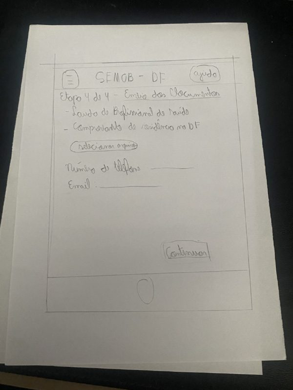{ width="420" }

<em>Fonte: Elaborado por Gabriel Cardone (2026). Fotos extraídas do [PDF das telas do protótipo de papel](../../../../assets/PDFs/Gabriel_telas_prototipo_papel.pdf).</em>

<strong>Figura 8</strong>: Etapa 4 de 4 — Seleção de arquivos (página 8 do PDF das telas)

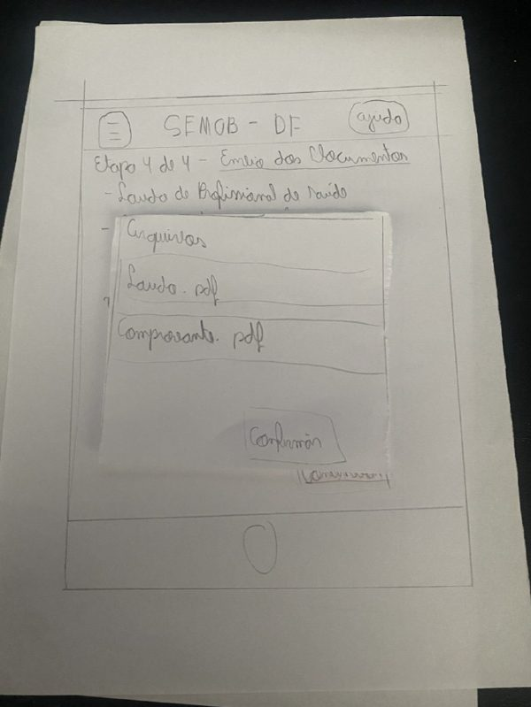{ width="420" }

<em>Fonte: Elaborado por Gabriel Cardone (2026). Fotos extraídas do [PDF das telas do protótipo de papel](../../../../assets/PDFs/Gabriel_telas_prototipo_papel.pdf).</em>

<strong>Figura 9</strong>: Etapa 4 de 4 — Confirmação de envio (página 9 do PDF das telas)

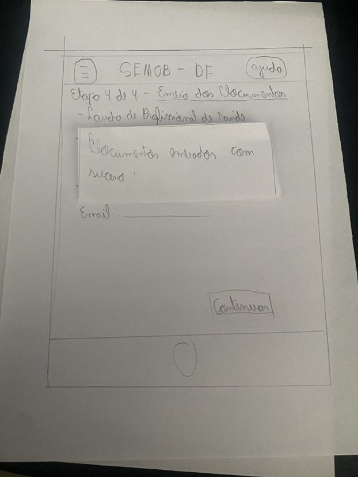{ width="420" }

<em>Fonte: Elaborado por Gabriel Cardone (2026). Fotos extraídas do [PDF das telas do protótipo de papel](../../../../assets/PDFs/Gabriel_telas_prototipo_papel.pdf).</em>

<strong>Figura 10</strong>: Etapa 4 de 4 — Contato preenchido (página 10 do PDF das telas)

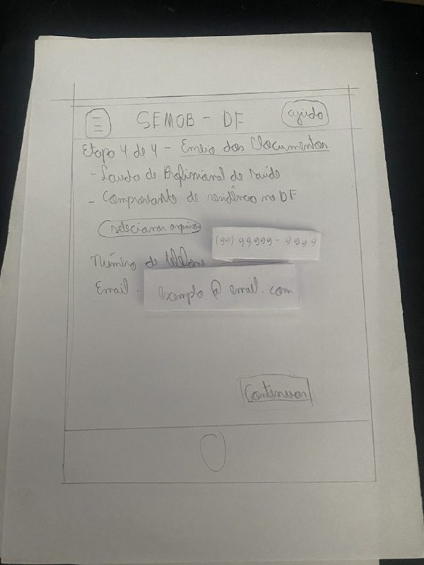{ width="420" }

<em>Fonte: Elaborado por Gabriel Cardone (2026). Fotos extraídas do [PDF das telas do protótipo de papel](../../../../assets/PDFs/Gabriel_telas_prototipo_papel.pdf).</em>

<strong>Figura 11</strong>: Conclusão (página 11 do PDF das telas)

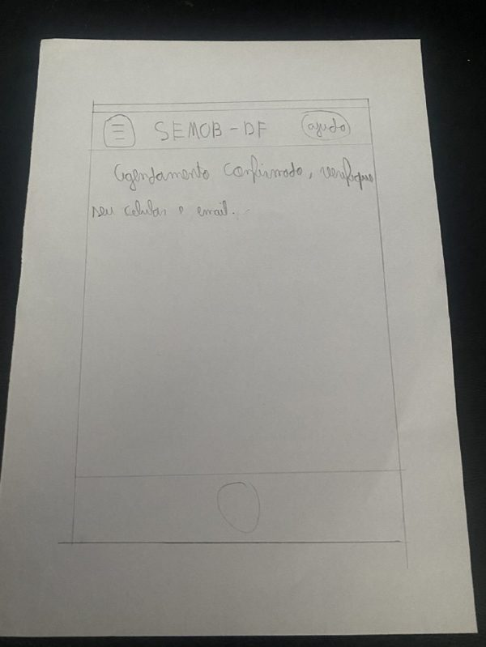{ width="420" }

<em>Fonte: Elaborado por Gabriel Cardone (2026). Fotos extraídas do [PDF das telas do protótipo de papel](../../../../assets/PDFs/Gabriel_telas_prototipo_papel.pdf).</em>

---
---

## 10. Fotos de Referência
As Figuras 12 a 15 mostram os trechos que fundamentam este artefato, recortados e grifados em amarelo diretamente do livro da disciplina (BARBOSA et al., 2021).

<strong>Figura 12</strong>: 11.8 Framework DECIDE

<em>Fonte: BARBOSA et al. (2021, p. 264).</em>

<strong>Figura 13</strong>: 12.2.3 Prototipação em papel: método e papel do avaliador como ‘computador’

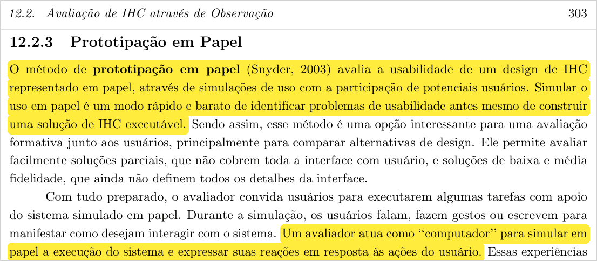

<em>Fonte: BARBOSA et al. (2021, p. 303).</em>

<strong>Figura 14</strong>: Tabela 12.9 – Atividades do método de prototipação em papel

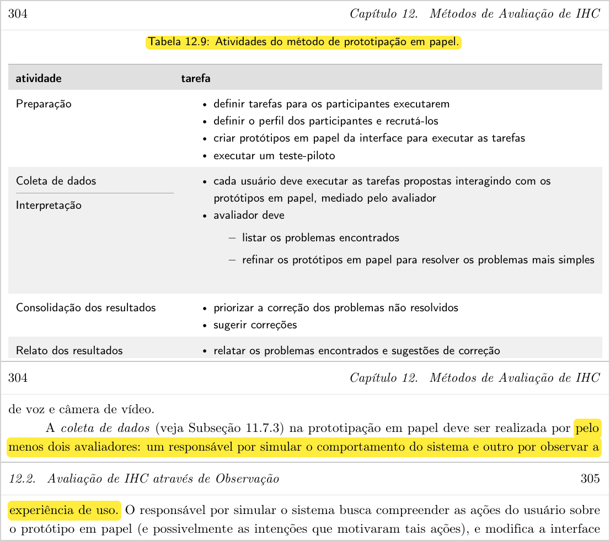

<em>Fonte: BARBOSA et al. (2021, pp. 304–305).</em>

<strong>Figura 15</strong>: 11.7.2 Teste-piloto: objetivo e descarte dos dados

<em>Fonte: BARBOSA et al. (2021, p. 260).</em>

---

## 11. Referências Bibliográficas
* BARBOSA, Simone Diniz Junqueira; SILVA, Bruno Santana da; SILVEIRA, Milene Selbach; GASPARINI, Isabela; DARIN, Ticianne; BARBOSA, Gabriel Diniz Junqueira. **Interação Humano-Computador e Experiência do Usuário**. Rio de Janeiro: Autopublicação, 2021. ISBN 978-65-00-19677-1. (Capítulo 11, p. 245–266; Capítulo 12, Seção 12.2.3, p. 303–306).
* SALES, André Barros de. **Plano de Ensino: Interação Humano Computador**. Brasília: Universidade de Brasília, FCTE/UnB, 2026.
