## Histórico de Versão e Contribuição

| Data | Versão | Descrição | Autor(es) | Revisor(es) | Declaração de Uso de IA |
| :---: | :---: | :--- | :--- | :--- | :--- |
| 25/10/2026 | `1.0` | Criação do planejamento do relato dos resultados do Protótipo de Papel (TAR-02). | [Gabriel Cardone](https://github.com/gabriellcardone-06) | [Igor Dantas Araújo](https://github.com/IgorDARAUJO) | Claude (Anthropic) - usado para formatação markdown da página |
| 20/11/2026 | `1.1` | Inclusão do link para o protótipo de alta fidelidade da TAR-02 no Figma no bloco de artefatos relacionados. | [Gabriel Cardone](https://github.com/gabriellcardone-06) | Pendente de revisão | Claude (Anthropic) - formatação markdown. |

---

# Planejamento do Relato dos Resultados da Avaliação do Protótipo de Papel (TAR-02)

Neste documento, apresenta-se o **Planejamento do Relato dos Resultados da Avaliação do Protótipo de Papel** referente à **[TAR-02 (Pré-agendamento no Programa DF Acessível)](https://interacao-humano-computador.github.io/2026.2-Grupo05/analise-de-requisitos/analise-de-tarefas/tar-02-df-acessivel/)**. Trata-se de um planejamento individual desenvolvido para orientar a futura compilação, análise e apresentação dos dados obtidos na avaliação presencial do protótipo de baixa fidelidade em papel, descrita no [Planejamento da Avaliação do Protótipo de Papel](gabriel-planejamento-av-prototipo-papel.md).

A estrutura deste relato foi definida com base nas recomendações do livro-texto da disciplina (Barbosa et al., 2021, Cap. 11, Seção 11.7.5; Cap. 12, Seção 12.2.3), garantindo que os problemas de usabilidade encontrados, os ajustes realizados diretamente no papel e as recomendações para o protótipo de alta fidelidade sejam reportados de forma padronizada e transparente.

**Artefatos relacionados — fluxo da funcionalidade TAR-02 (Pré-agendamento no Programa DF Acessível):**

* **Persona:** [Larissa Ferreira Lima](../../../../analise-de-requisitos/personas/larissa-ferreira-lima.md)
* **Cenário:** [Cenário 1](../../../../analise-de-requisitos/cenarios/cenario-1-pre-agendamento-df-acessivel.md)
* **Análise de tarefas:** [TAR-02](../../../../analise-de-requisitos/analise-de-tarefas/tar-02-df-acessivel.md)
* **Storyboard:** [Storyboard 02](../../../nivel1/storyboards.md#32-storyboard-02-pre-agendamento-no-programa-df-acessivel)
* **Nível 1: avaliação do storyboard e da análise de tarefas:** [Planejamento da avaliação](../../../nivel1/planejamentos-individuais/Gabriel/gabriel-planejamento-avaliacao.md) · [Planejamento do relato](../../../nivel1/planejamentos-individuais/Gabriel/gabriel-planejamento-relato-resultados-avaliacao.md) · [Relato dos resultados](../../../nivel1/relatos-individuais/gabriel/relato-resultados-storyboard-tarefas.md)
* **Nível 2: protótipo de papel (baixa fidelidade):** [Planejamento da avaliação](gabriel-planejamento-av-prototipo-papel.md) · Planejamento do relato (*esta página*) · [Relato dos resultados](../../relatos-individuais/gabriel/relato-resultado-prot-papel.md)
* **Nível 3: protótipo de alta fidelidade:** [Planejamento da avaliação](../../../nivel3/planejamentos-individuais/gabriel/planejamento-av-prot-alta-fidel.md) · [Planejamento do relato](../../../nivel3/planejamentos-individuais/gabriel/planejamento-relato-prot-alta-fidel.md) · [Relato dos resultados](../../../nivel3/relatos-individuais/gabriel/relato-resultados-prot-alta-fidel.md)
* **Telas do protótipo de papel:** [telas no planejamento da avaliação](gabriel-planejamento-av-prototipo-papel.md#9-telas-do-prototipo-avaliado)
* **Protótipo de alta fidelidade navegável:** [acessar o protótipo](https://www.figma.com/proto/AIO6YnlBnPcriwQzsEdHpi/Prot%C3%B3tipo-Alta-Fidelidade-%E2%80%94-TAR-02-DF-Acess%C3%ADvel--SEMOB-DF-?node-id=6-67&starting-point-node-id=6%3A67&t=a6O7kf7iKozAdr05-1)

---

## 1. Objetivos do Relato dos Resultados

O relato dos resultados tem como finalidade principal organizar e comunicar aos interessados as descobertas obtidas durante a simulação presencial com o protótipo de papel. Seus objetivos específicos incluem:

1. **Sintetizar o desempenho do participante:** Registrar a eficácia e a eficiência com que o usuário navegou pelas telas de papel nas três etapas do pré-agendamento da viagem: escolher os postos de embarque e de desembarque, escolher o dia e enviar os documentos.
2. **Mapear e categorizar os problemas de IHC:** Documentar todos os obstáculos, dúvidas sobre rótulos e falhas de layout observadas durante o manuseio das telas e dos componentes móveis (*post-its*, fichas e avisos).
3. **Registrar o ciclo de reprojeto no papel:** Listar os problemas de usabilidade que puderam ser corrigidos de forma imediata no próprio papel durante o teste versus os problemas pendentes.
4. **Subsidiar a Prototipação de Alta Fidelidade:** Fornecer recomendações consolidadas para guiar o design detalhado das telas nas próximas etapas do projeto.

---

## 2. Estrutura Padronizada do Relatório Final de Resultados

Em conformidade com a literatura de IHC (Barbosa et al., 2021, pp. 263, 306), o documento final de relato dos resultados do protótipo de papel conterá as seguintes seções estruturadas:

1. **Introdução e Objetivos da Avaliação:** Apresentação do escopo do protótipo em papel e das metas de usabilidade investigadas.
2. **Metodologia Empregada:** Descrição da técnica de Prototipação em Papel (observação de uso empírica presencial), incluindo data, local, duração real e eventuais desvios em relação ao planejamento.
3. **Caracterização dos Participantes e Papéis da Equipe:** Detalhamento do perfil do participante convidado (representante de [Larissa Ferreira Lima](https://interacao-humano-computador.github.io/2026.2-Grupo05/analise-de-requisitos/personas/larissa-ferreira-lima/)), sem dados identificáveis, e a identificação do condutor ("Avaliador Computador", Gabriel Cardone).
4. **Análise Qualitativa e Tabela de Problemas de IHC:** Consolidação das falhas de usabilidade encontradas, classificadas segundo a escala de severidade apresentada em Barbosa et al. (2021).
5. **Registro de Alterações no Protótipo de Papel:** Tabela comparativa dos problemas resolvidos no próprio papel durante a sessão versus pendências de reprojeto.
6. **Recomendações para a Prototipação de Alta Fidelidade:** Diretrizes finais de interface para o desenvolvimento das telas digitais.
7. **Conclusão:** Resumo dos aprendizados obtidos e limitações do estudo (participante único, ausência de generalização estatística).

---

## 3. Metodologia de Análise e Escala de Severidade dos Problemas

Como a prototipação em papel privilegia a produção de dados qualitativos (Barbosa et al., 2021, p. 308), a análise dos resultados será interpretativa. As anotações do observador e as gravações de áudio/vídeo da mesa serão examinadas para identificar a origem das hesitações e erros do participante.

Uma tarefa será considerada **Satisfatória** quando concluída sem pedido de ajuda e sem escolha incorreta de tela. Será considerada **Com Falhas** quando houver pedido de ajuda, escolha incorreta de tela ou peça, ou desistência. Toda tarefa **Com Falhas** deve originar ao menos um registro na tabela de problemas.

Os problemas de usabilidade identificados serão classificados segundo a **Escala de Severidade de Problemas** (Barbosa et al., 2021):

<strong>Tabela 1</strong>: Escala de Severidade de Problemas de Usabilidade

| Nível de Severidade | Classificação | Descrição do Impacto na Interação do Usuário |
| :---: | :--- | :--- |
| **0** | **Sem Importância** | Não afeta a execução da tarefa no papel; trata-se apenas de uma sugestão estética ou comentário opcional. |
| **1** | **Leve** | Gera pequena hesitação ou dúvida sobre qual pedaço de papel tocar, mas o usuário conclui a tarefa sozinho. |
| **2** | **Moderado** | Provoca incerteza ou escolha incorreta de tela/widget de papel, reduzindo a eficiência sem bloquear o fluxo. |
| **3** | **Grave** | Dificulta bastante a realização da tarefa, gerando grande frustração ou necessidade de intervenção. |
| **4** | **Catastrófico** | Impede totalmente o usuário de concluir a tarefa no protótipo em papel (desistência ou erro bloqueante). |

<em>Fonte: Adaptado de Barbosa et al. (2021).</em>

---

## 4. Modelos de Tabelas para Consolidação dos Resultados

O relatório final utilizará quatro modelos padronizados de tabelas para registrar as evidências da sessão presencial:

### 4.1 Modelo de Tabela 1: Desempenho nas Tarefas do Protótipo em Papel

<strong>Tabela 2</strong>: Consolidação do Desempenho nas Tarefas em Papel

| ID Tarefa | Descrição do Cenário / Tarefa no Papel | Sucesso sem Ajuda? | Tempo Gasto | Pedidos de Ajuda | Avaliação da Usabilidade |
| :---: | :--- | :---: | :---: | :---: | :---: |
| **TAR-02.1** | Escolher o posto de embarque perto de casa e o posto de desembarque perto da clínica. | **[Sim / Não]** | *[mm:ss]* | *[Qtd]* | **[Satisfatório / Com Falhas]** |
| **TAR-02.2** | Escolher o dia da viagem. | **[Sim / Não]** | *[mm:ss]* | *[Qtd]* | **[Satisfatório / Com Falhas]** |
| **TAR-02.3** | Enviar o laudo e o comprovante de residência e concluir o pré-agendamento. | **[Sim / Não]** | *[mm:ss]* | *[Qtd]* | **[Satisfatório / Com Falhas]** |

<em>Fonte: Elaborado por Gabriel Cardone (2026).</em>

### 4.2 Modelo de Tabela : Problemas Corrigidos no Papel vs. Pendentes para Alta Fidelidade

<strong>Tabela 5</strong>: Registro de Iterações no Protótipo de Papel e Pendências

| ID Problema | Modificação Realizada no Protótipo em Papel | Corrigido Durante o Teste? | Reincidiu na Interação? | Status para Prototipação Digital |
| :---: | :--- | :---: | :---: | :--- |
| **PROB-P01** | *[Ex.: Redesenho do rótulo do calendário com novo texto]* | **[Sim / Não]** | **[Sim / Não]** | **[Resolvido no Papel / Ajustar na Alta Fidelidade]** |
| **PROB-P02** | *[Ex.: Aumento da área de toque dos dias no calendário]* | **[Sim / Não]** | **[Sim / Não]** | **[Resolvido no Papel / Ajustar na Alta Fidelidade]** |

<em>Fonte: Elaborado por Gabriel Cardone (2026).</em>

---

## 5. Planejamento do Reprojeto e Próximos Passos

Os resultados consolidados passarão pelo ciclo de iteratividade característico da prototipação em papel (Barbosa et al., 2021, p. 305):

1. **Iteração Imediata no Papel:** Alterações simples de texto ou posicionamento de botões serão testadas e validadas diretamente no material físico durante a própria sessão ou no debriefing.
2. **Transferência para a Prototipação de Alta Fidelidade:** Os problemas de severidade moderada, grave ou catastrófica (níveis 2, 3 e 4) não resolvidos no papel serão convertidos em requisitos diretos de design para o protótipo digital do site da **SEMOB-DF**, observando as diretrizes de acessibilidade eMAG/WCAG (contraste, áreas de toque amplas e compatibilidade com leitores de tela).
3. **Atualização dos Modelos de Tarefa:** Caso o teste revele passos novos, desnecessários ou exceções não previstas, o [HTA e o CTT da TAR-02](https://interacao-humano-computador.github.io/2026.2-Grupo05/analise-de-requisitos/analise-de-tarefas/tar-02-df-acessivel/) serão revisados.
4. **Documentação na Wiki:** Todas as decisões de design justificadas pelos testes em papel serão incorporadas ao histórico de versão dos artefatos correspondentes do Grupo 05.

---

## 6. Localização das Referências no Livro

Conforme as diretrizes da disciplina, a fundamentação teórica sobre a consolidação e o relato dos resultados do protótipo de papel encontra-se nas seguintes seções da obra oficial:

* **Obra:** BARBOSA, S. D. J.; SILVA, B. S. da; SILVEIRA, M. S.; GASPARINI, I.; DARIN, T.; BARBOSA, G. D. J. **Interação Humano-Computador e Experiência do Usuário**. Rio de Janeiro: Autopublicação, 2021.
* **Localização Exata:** **Parte IV, Capítulo 11 — Seção 11.7.5 (*Consolidação e Relato dos Resultados*), páginas 263–264**; e **Capítulo 12 — Seção 12.2.3 (*Prototipação em Papel — Relato dos Resultados*), páginas 305–306**.

## 7. Telas do Protótipo Avaliado

As Figuras 1 a 11 mostram as telas do protótipo de papel da [TAR-02](../../../../analise-de-requisitos/analise-de-tarefas/tar-02-df-acessivel.md), também apresentadas no [relato dos resultados da avaliação](../../../nivel2/relatos-individuais/gabriel/relato-resultado-prot-papel.md).

* **Telas do protótipo de papel (PDF):** [Visualizar PDF das telas do protótipo de papel](../../../../assets/PDFs/Gabriel_telas_prototipo_papel.pdf)

<strong>Figura 1</strong>: Apresentação do Agendamento DF Acessível (página 1 do PDF das telas)

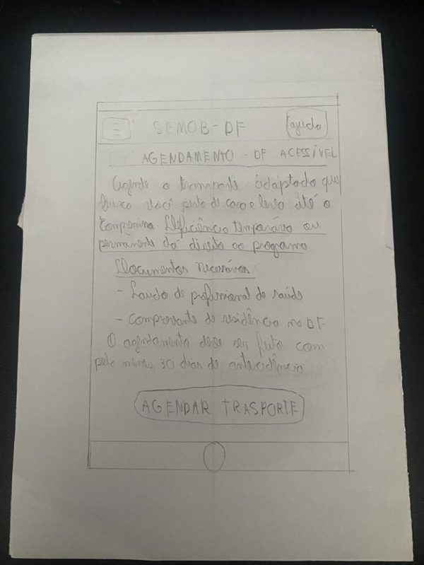{ width="420" }

<em>Fonte: Elaborado por Gabriel Cardone (2026). Fotos extraídas do [PDF das telas do protótipo de papel](../../../../assets/PDFs/Gabriel_telas_prototipo_papel.pdf).</em>

<strong>Figura 2</strong>: Etapa 1 de 4 — Posto de embarque (página 2 do PDF das telas)

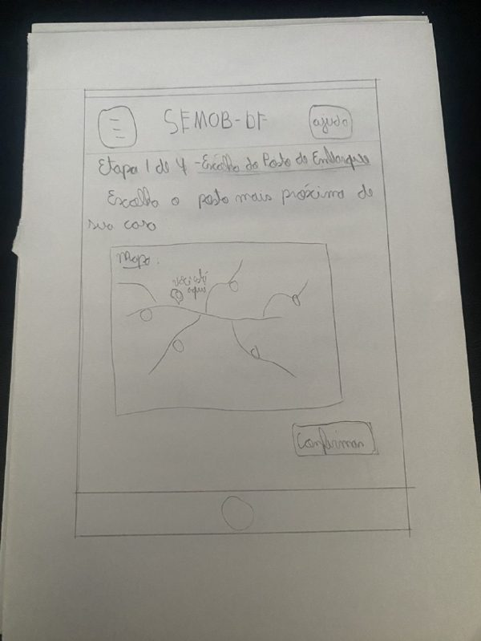{ width="420" }

<em>Fonte: Elaborado por Gabriel Cardone (2026). Fotos extraídas do [PDF das telas do protótipo de papel](../../../../assets/PDFs/Gabriel_telas_prototipo_papel.pdf).</em>

<strong>Figura 3</strong>: Etapa 1 de 4 — Posto de embarque selecionado (página 3 do PDF das telas)

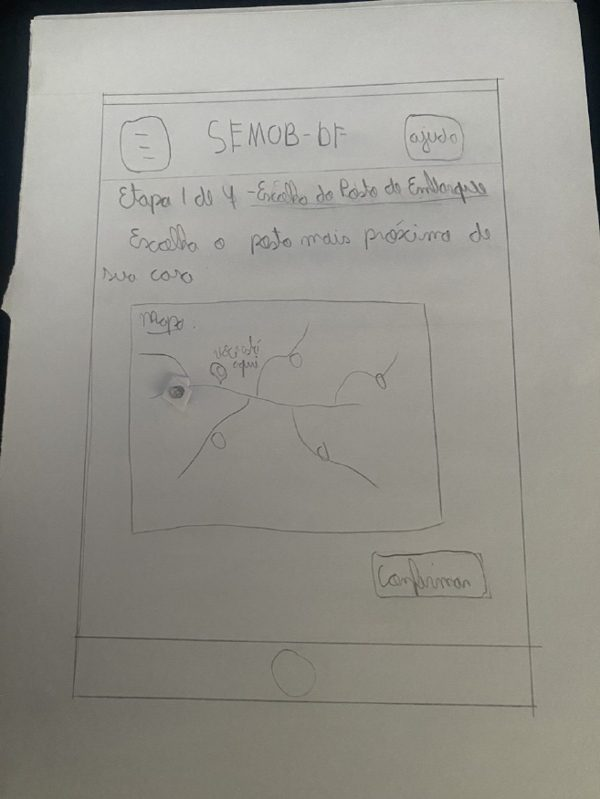{ width="420" }

<em>Fonte: Elaborado por Gabriel Cardone (2026). Fotos extraídas do [PDF das telas do protótipo de papel](../../../../assets/PDFs/Gabriel_telas_prototipo_papel.pdf).</em>

<strong>Figura 4</strong>: Etapa 2 de 4 — Posto de desembarque (página 4 do PDF das telas)

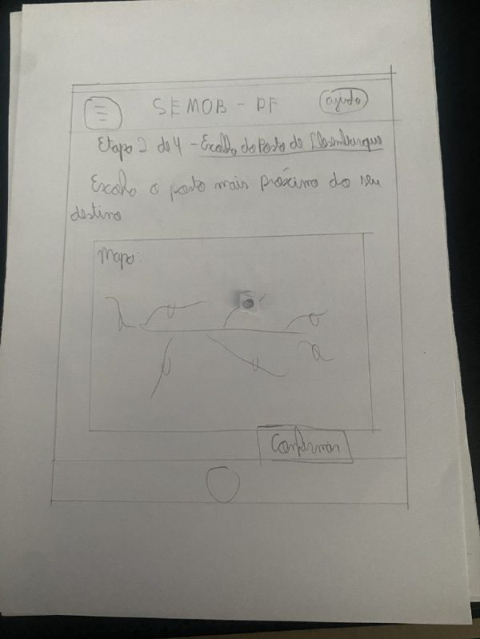{ width="420" }

<em>Fonte: Elaborado por Gabriel Cardone (2026). Fotos extraídas do [PDF das telas do protótipo de papel](../../../../assets/PDFs/Gabriel_telas_prototipo_papel.pdf).</em>

<strong>Figura 5</strong>: Etapa 3 de 4 — Dia (página 5 do PDF das telas)

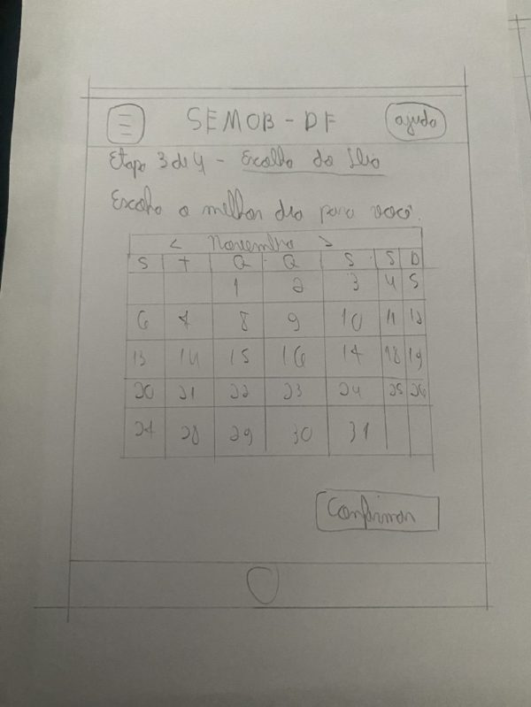{ width="420" }

<em>Fonte: Elaborado por Gabriel Cardone (2026). Fotos extraídas do [PDF das telas do protótipo de papel](../../../../assets/PDFs/Gabriel_telas_prototipo_papel.pdf).</em>

<strong>Figura 6</strong>: Etapa 3 de 4 — Dia selecionado (página 6 do PDF das telas)

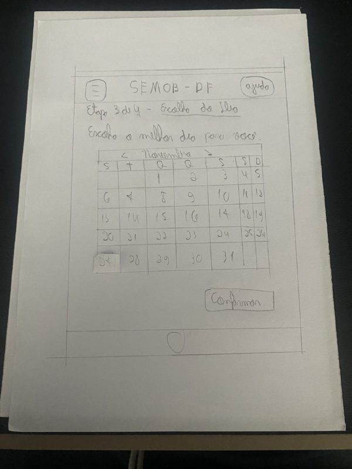{ width="420" }

<em>Fonte: Elaborado por Gabriel Cardone (2026). Fotos extraídas do [PDF das telas do protótipo de papel](../../../../assets/PDFs/Gabriel_telas_prototipo_papel.pdf).</em>

<strong>Figura 7</strong>: Etapa 4 de 4 — Documentos (página 7 do PDF das telas)

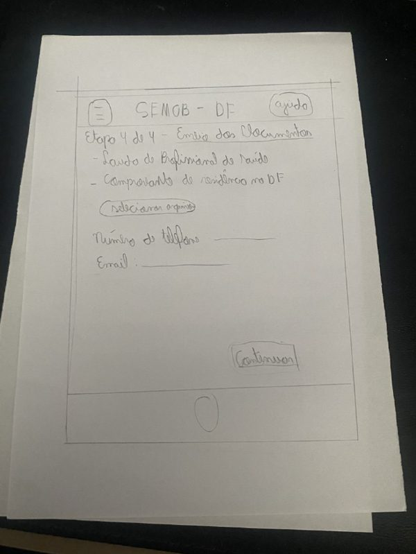{ width="420" }

<em>Fonte: Elaborado por Gabriel Cardone (2026). Fotos extraídas do [PDF das telas do protótipo de papel](../../../../assets/PDFs/Gabriel_telas_prototipo_papel.pdf).</em>

<strong>Figura 8</strong>: Etapa 4 de 4 — Seleção de arquivos (página 8 do PDF das telas)

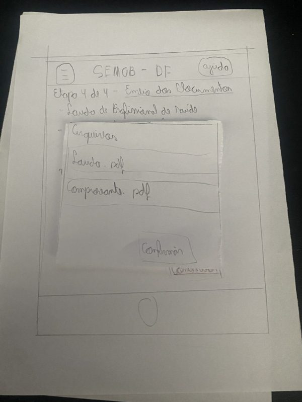{ width="420" }

<em>Fonte: Elaborado por Gabriel Cardone (2026). Fotos extraídas do [PDF das telas do protótipo de papel](../../../../assets/PDFs/Gabriel_telas_prototipo_papel.pdf).</em>

<strong>Figura 9</strong>: Etapa 4 de 4 — Confirmação de envio (página 9 do PDF das telas)

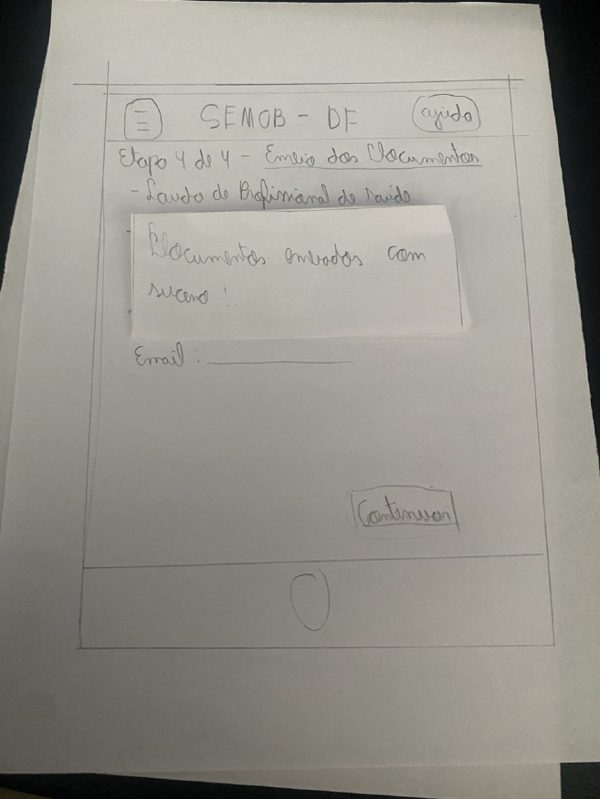{ width="420" }

<em>Fonte: Elaborado por Gabriel Cardone (2026). Fotos extraídas do [PDF das telas do protótipo de papel](../../../../assets/PDFs/Gabriel_telas_prototipo_papel.pdf).</em>

<strong>Figura 10</strong>: Etapa 4 de 4 — Contato preenchido (página 10 do PDF das telas)

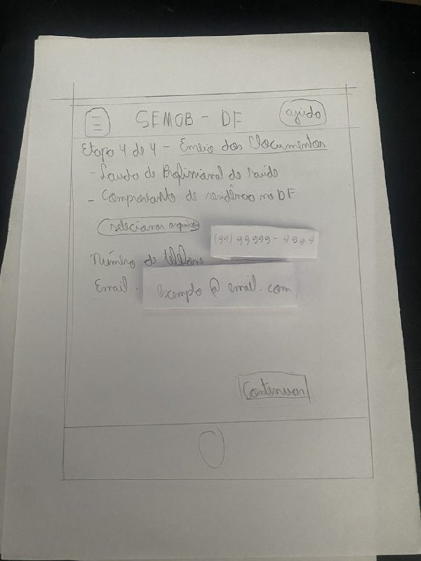{ width="420" }

<em>Fonte: Elaborado por Gabriel Cardone (2026). Fotos extraídas do [PDF das telas do protótipo de papel](../../../../assets/PDFs/Gabriel_telas_prototipo_papel.pdf).</em>

<strong>Figura 11</strong>: Conclusão (página 11 do PDF das telas)

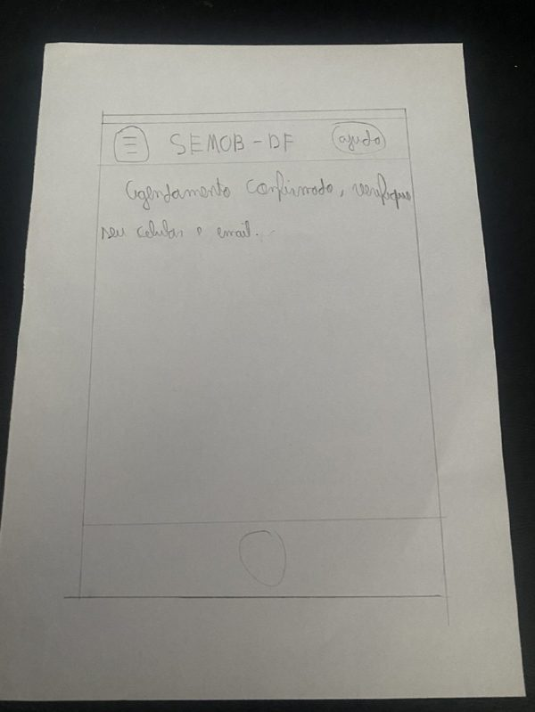{ width="420" }

<em>Fonte: Elaborado por Gabriel Cardone (2026). Fotos extraídas do [PDF das telas do protótipo de papel](../../../../assets/PDFs/Gabriel_telas_prototipo_papel.pdf).</em>

---
---

## 8. Fotos de Referência
As Figuras 12 a 13 mostram os trechos que fundamentam este artefato, recortados e grifados em amarelo diretamente do livro da disciplina (BARBOSA et al., 2021).

<strong>Figura 12</strong>: Prototipação em papel: conteúdo do relato dos resultados

<em>Fonte: BARBOSA et al. (2021, pp. 305–306).</em>

<strong>Figura 13</strong>: 12.2.3 Prototipação em papel: refinamento, priorização e relato

<em>Fonte: BARBOSA et al. (2021, pp. 305–306).</em>

---

## 9. Referências Bibliográficas
* BARBOSA, Simone Diniz Junqueira; SILVA, Bruno Santana da; SILVEIRA, Milene Selbach; GASPARINI, Isabela; DARIN, Ticianne; BARBOSA, Gabriel Diniz Junqueira. **Interação Humano-Computador e Experiência do Usuário**. Rio de Janeiro: Autopublicação, 2021. ISBN 978-65-00-19677-1. (Capítulo 11, p. 245–266; Capítulo 12, Seção 12.2.3, p. 303–306).
* SALES, André Barros de. **Plano de Ensino: Interação Humano Computador**. Brasília: Universidade de Brasília, FCTE/UnB, 2026.
