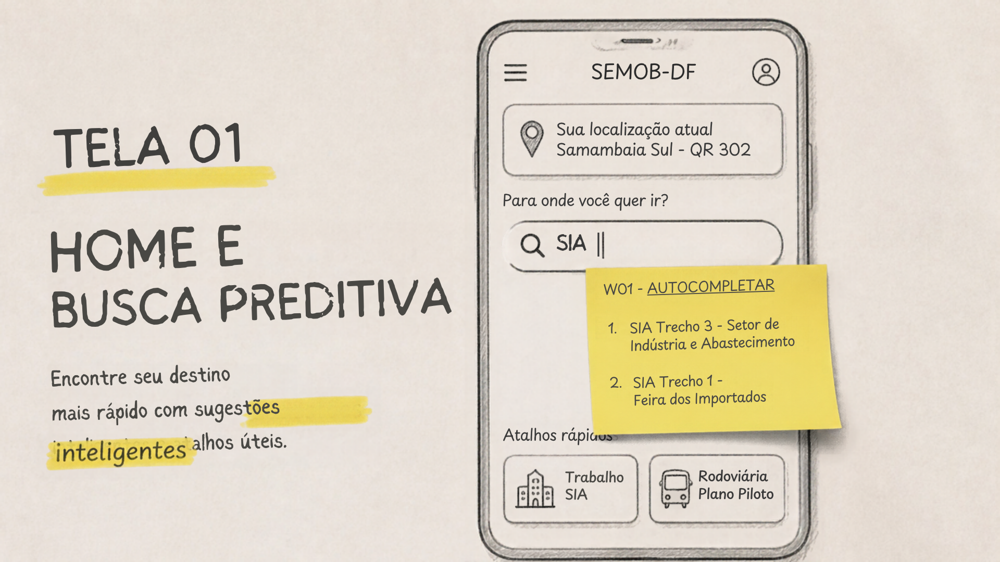
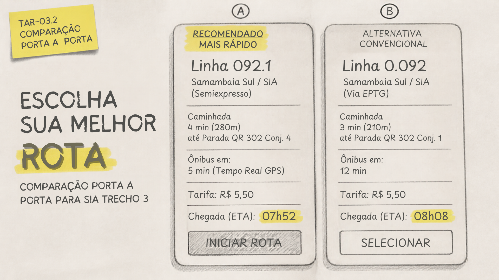
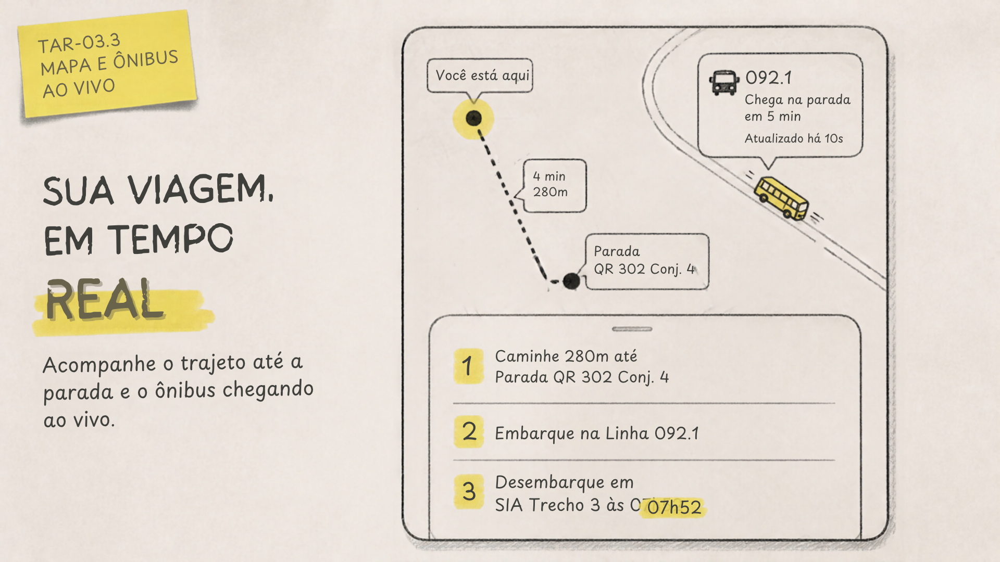
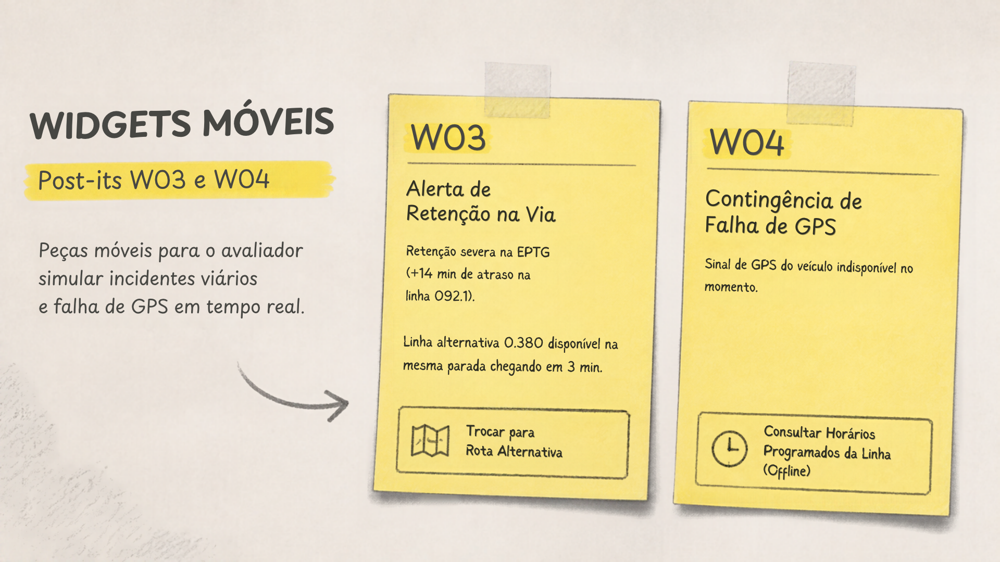
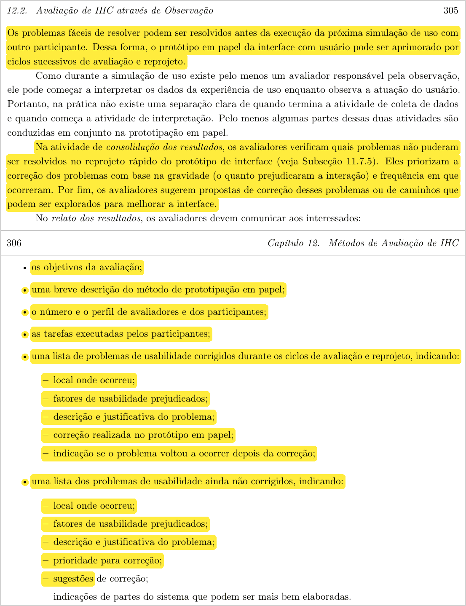

## Histórico de Versão e Contribuição

| Data | Versão | Descrição | Autor(es) | Revisor(es) | Declaração de Uso de IA |
| :---: | :---: | :--- | :--- | :--- | :--- |
| 25/10/2026 | `1.0` | Criação do planejamento do relato dos resultados da avaliação do Protótipo de Papel (TAR-03) com modelos de tabelas e referências do livro-texto. | [Lucas Araújo Lima](https://github.com/Lucasaraujoszz) | [Arthur Mariani](https://github.com/arthur-mariani) | Google Gemini — utilizado apenas para apoio na formatação sintática de tabelas em Markdown |
| 19/11/2026 | `1.1` | Padronização da estrutura (histórico no topo, conteúdo, fotos de referência e referências ao final); declaração de IA levada para o histórico; autor e revisor retirados do rodapé; retirada das referências que não são o livro da disciplina nem material do professor; inclusão de fotos de referência grifadas. Inclusão das telas do protótipo avaliado, com links para o protótipo e para o artefato relacionado. Inclusão do bloco de artefatos relacionados (persona, cenário, análise de tarefas, storyboard, planejamentos, relatos e protótipos da funcionalidade). Correção das páginas e seções citadas do livro da disciplina (edição de 2021). | [Gabriel Melo](https://github.com/gabriellcardone-06) | Pendente de revisão | Claude (Anthropic) — apoio na padronização da estrutura do artefato, na revisão das referências e na formatação em Markdown; apoio na inclusão das telas do protótipo.; apoio na inclusão dos links entre artefatos |

---

# Planejamento do Relato dos Resultados da Avaliação do Protótipo de Papel (TAR-03)

Neste documento, apresenta-se o **Planejamento do Relato dos Resultados da Avaliação do Protótipo de Papel** referente à **[TAR-03 — Planejamento de Rota Completa (Porta a Porta) por Destino com Indicação de Paradas e Previsão de Chegada](../../../../analise-de-requisitos/analise-de-tarefas/tar-03-planejamento-rota.md)**. Trata-se de um documento metodológico individual elaborado por Lucas Araújo Lima para padronizar como os dados coletados na sessão presencial de prototipação em papel (Etapa 6) serão analisados, consolidados e comunicados à equipe e aos interessados.

A estrutura deste planejamento fundamenta-se diretamente nas diretrizes de **Consolidação e Relato dos Resultados** (Barbosa et al., 2021, Seção 11.7.5, pp. 262–263) e nas exigências específicas de relato do método de **Prototipação em Papel** (Barbosa et al., 2021, Seção 12.2.3, pp. 305–306).

**Artefatos relacionados — fluxo da funcionalidade TAR-03 (Planejamento de Rota por Origem e Destino):**

* **Persona:** [Marcos Paulo Vieira](../../../../analise-de-requisitos/personas/marcos-paulo-vieira.md)
* **Cenário:** [Cenário 3](../../../../analise-de-requisitos/cenarios/cenario-3-planejamento-origem-destino.md)
* **Análise de tarefas:** [TAR-03](../../../../analise-de-requisitos/analise-de-tarefas/tar-03-planejamento-rota.md)
* **Storyboard:** [Storyboard 03](../../../nivel1/storyboards.md#33-storyboard-03-planejamento-de-rota-por-origem-e-destino-com-monitoramento-em-tempo-real)
* **Nível 1 — avaliação do storyboard e da análise de tarefas:** Planejamento da avaliação (*não disponível — pendente de correção manual*) · Planejamento do relato (*não disponível — pendente de correção manual*) · [Relato dos resultados](../../../nivel1/relatos-individuais/lucas/relato-resultados-storyboard-tarefas.md) · [Planejamento individual de tarefas](../../../nivel1/planejamentos-individuais/Lucas/planejamento-individual-lucas.md) · [Questões práticas e éticas](../../../nivel1/planejamentos-individuais/Lucas/questoes-praticas-e-eticas.md)
* **Nível 2 — protótipo de papel (baixa fidelidade):** [Planejamento da avaliação](lucas-planejamento-av-prototipo-papel.md) · Planejamento do relato (*esta página*) · [Relato dos resultados](../../relatos-individuais/lucas/relato-resultados-prot-papel.md)
* **Nível 3 — protótipo de alta fidelidade:** [Planejamento da avaliação](../../../nivel3/planejamentos-individuais/lucas/planejamento-av-prot-alta-fidel.md) · [Planejamento do relato](../../../nivel3/planejamentos-individuais/lucas/planejamento-relato-prot-alta-fidel.md) · [Relato dos resultados](../../../nivel3/relatos-individuais/lucas/relato-resultados-prot-alta-fidel.md)
* **Telas do protótipo de papel:** [telas no planejamento da avaliação](lucas-planejamento-av-prototipo-papel.md#9-telas-do-prototipo-avaliado)
* **Protótipo de alta fidelidade navegável:** [acessar o protótipo](../../../../prototipos/tar-03/index.html)

---

## 1. Objetivos do Relato dos Resultados

O relato dos resultados da avaliação do protótipo em papel tem como objetivo central transformar as observações empíricas da sessão presencial (toques nas telas de papel, verbalizações do protocolo *Think Aloud* e ajustes em *post-its*) em insumos rastreáveis de engenharia de usabilidade para o projeto da **SEMOB-DF / DF no Ponto**. Seus objetivos específicos são:

1. **Avaliar o cumprimento das metas de eficácia e fluidez na TAR-03:** Registrar se o participante representante da persona [Marcos Paulo Vieira](../../../../analise-de-requisitos/personas/marcos-paulo-vieira.md) conseguiu planejar sua rota porta a porta (*Samambaia Sul → SIA Trecho 3*), identificar a parada de embarque ideal e reagir a imprevistos no trânsito interagindo exclusivamente com as peças de papel.
2. **Distinguir problemas corrigidos no ciclo rápido em papel de problemas pendentes:** Cumprir a exigência metodológica de Barbosa et al. (2021), documentando separadamente as falhas simples resolvidas durante a própria simulação no papel (ex.: reescrita de um rótulo em *post-it*) e os problemas estruturais que exigirão reprojeto na etapa de alta fidelidade.
3. **Priorizar falhas por severidade e fatores de usabilidade prejudicados:** Classificar cada obstáculo observado segundo a escala de severidade de Nielsen (1994 apud BARBOSA et al., 2021) e mapear os fatores de qualidade de uso afetados (aprendizado, eficiência, memorização, segurança/prevenção de erros e satisfação).
4. **Fornecer especificações concretas para o Protótipo Digital de Alta Fidelidade:** Traduzir os achados empíricos em diretrizes visuais e interativas para o desenvolvimento executável do sistema nas etapas subsequentes.

---

## 2. Estrutura Padronizada do Relatório Final de Resultados

Em estrita conformidade com a lista de itens obrigatórios estabelecida por Barbosa et al. (2021, pp. 263–306), o documento final de relato dos resultados da prototipação em papel da TAR-03 será composto pelas **8 seções padronizadas** descritas a seguir:

1. **Objetivos e Escopo da Avaliação:** Contextualização da TAR-03 avaliada em papel e retomada das perguntas investigativas (`QP01` a `QP06`) definidas no [Planejamento da Avaliação do Protótipo de Papel](lucas-planejamento-av-prototipo-papel.md).
2. **Descrição do Método e Protocolo Executado:** Síntese da aplicação da Prototipação em Papel combinada ao protocolo *Think Aloud*, apresentando fotos reais das telas estáticas (Telas 01 a 03) e dos *widgets* móveis (*post-its* W01 a W04) confeccionados, além do link da gravação da sessão.
3. **Número e Perfil dos Avaliadores e do Participante:** Caracterização demográfica e comportamental do usuário participante (anonimizado conforme o TCLE) e identificação explícita dos papéis desempenhados pelos avaliadores (*Avaliador "Computador"* e *Avaliador Observador*).
4. **Sumário das Tarefas Executadas e Dados Coletados:** Consolidação do desempenho do participante nas sub-tarefas `TAR-03.1`, `TAR-03.2` e `TAR-03.3` (sucesso com ou sem auxílio, tempo de execução, hesitações e citações diretas da transcrição).
5. **Lista de Problemas de Usabilidade Corrigidos Durante o Ciclo no Papel:** Relação detalhada dos problemas simples reparados imediatamente no próprio material em papel (indicando local, fatores de usabilidade prejudicados, descrição/justificativa, correção aplicada no papel e se o problema voltou a ocorrer após o ajuste).
6. **Lista de Problemas de Usabilidade Ainda Não Corrigidos (Pendentes):** Relação dos problemas que não puderam ser solucionados no reprojeto rápido em papel (indicando local, fatores de usabilidade prejudicados, descrição/justificativa, prioridade/severidade de correção e sugestões de reprojeto).
7. **Indicações de Partes do Sistema que Podem Ser Mais Bem Elaboradas:** Recomendações de aprimoramento visual, arquitetura da informação e feedback dinâmico para a transição rumo ao protótipo de alta fidelidade (Figma / executável).
8. **Análise de Limitações e Conclusão do Estudo:** Reflexão sobre a validade ecológica da simulação em papel e fechamento do ciclo formativo.

---

## 3. Metodologia de Análise e Escala de Severidade dos Problemas

Conforme ressaltam Barbosa et al. (2021), na prototipação em papel a interpretação inicia-se simultaneamente à coleta de dados, à medida que o observador registra as reações do usuário diante da manipulação das peças pelo "avaliador computador". Após a sessão, a gravação em vídeo da mesa e as anotações de campo são revisadas para priorizar os problemas segundo sua **gravidade** (o quanto prejudicaram a interação) e **frequência**.

Para padronizar a priorização entre todos os integrantes do Grupo 05, será adotada a **Escala de Severidade de Problemas de Usabilidade** de Nielsen (1994 apud BARBOSA et al., 2021), integrada aos fatores de usabilidade de Barbosa et al. (2021):

<strong>Tabela 1</strong> — Escala de Severidade para Priorização de Problemas no Protótipo de Papel

| Nível | Classificação de Severidade | Critério de Julgamento na Simulação em Papel (TAR-03) |
| :---: | :--- | :--- |
| **0** | **Sem Importância** | Comentário estético ou preferência subjetiva pontual que não afeta a compreensão nem o toque nos elementos de papel. |
| **1** | **Problema Cosmético / Leve** | Causa leve estranhamento visual (ex.: ícone de caminhada pouco detalhado no desenho à mão), mas o usuário toca no local correto sem atraso. |
| **2** | **Problema Simples / Moderado** | Provoca hesitação perceptível ou toque inicial em elemento incorreto do papel (ex.: dúvida entre o card da linha normal e semiexpressa), sendo superado pelo próprio usuário. Geralmente passível de **correção imediata no papel**. |
| **3** | **Problema Grave** | Compromete seriamente a execução da tarefa (ex.: o usuário não percebe o *post-it* de alerta de retenção ou não entende para qual parada deve caminhar), exigindo esforço elevado ou dica indireta para prosseguir. |
| **4** | **Problema Catastrófico** | Bloqueia integralmente a conclusão da tarefa no protótipo em papel, levando o usuário ao erro irreversível (ex.: perder o ônibus simulado) ou à desistência. |

<em>Fonte: Adaptado de Nielsen (1994 apud BARBOSA et al., 2021) e Barbosa et al. (2021).</em>

---

## 4. Modelos de Tabelas para Consolidação e Relato dos Resultados

A seguir, definem-se os **quatro modelos de tabelas** que serão preenchidos no relatório final da avaliação do protótipo em papel da TAR-03, cobrindo integralmente os requisitos das páginas 361 e 362 do livro-texto.

### 4.1 Modelo de Tabela 1: Sumário de Execução das Tarefas no Papel

<strong>Tabela 2</strong> — Modelo de Sumário de Desempenho nas Tarefas Executadas no Protótipo em Papel

| ID Tarefa | Tarefa Solicitada ao Participante (Escopo TAR-03) | Telas / Widgets Manipulados | Concluiu sem Ajuda? | Tempo Gasto | Erros / Hesitações Observadas | Síntese da Verbalização (*Think Aloud*) |
| :---: | :--- | :--- | :---: | :---: | :--- | :--- |
| **TAR-03.1** | Informar o destino *"SIA Trecho 3"* na Home aproveitando a origem automática do GPS. | Tela 01 (Home) + *Post-it* W01 (Autocompletar) | *[Sim / Não]* | *[mm:ss]* | *[Qtd e descrição]* | *[Trecho da fala do participante]* |
| **TAR-03.2** | Comparar os cartões de rota, identificar a parada recomendada (tempo a pé) e escolher a linha mais rápida (`092.1`). | Tela 02 (Cards de Rota Porta a Porta) | *[Sim / Não]* | *[mm:ss]* | *[Qtd e descrição]* | *[Trecho da fala do participante]* |
| **TAR-03.3** | Acompanhar o ônibus no mapa em papel e acionar rota alternativa ou grade *offline* diante do *post-it* de retenção/falha de GPS. | Tela 03 (Mapa) + Peça W02 + *Post-its* W03 e W04 | *[Sim / Não]* | *[mm:ss]* | *[Qtd e descrição]* | *[Trecho da fala do participante]* |

<em>Fonte: Elaborado por Lucas Araújo Lima (2026).</em>

---

### 4.2 Modelo de Tabela 2: Problemas Corrigidos Durante os Ciclos no Papel
Atende diretamente ao quinto tópico do relato exigido por Barbosa et al. (2021): *"uma lista de problemas de usabilidade corrigidos durante os ciclos de avaliação e reprojeto"*.

<strong>Tabela 3</strong> — Modelo de Registro de Problemas Corrigidos Imediatamente no Protótipo em Papel

| ID | Local Onde Ocorreu (Tela / Widget) | Fatores de Usabilidade Prejudicados | Descrição e Justificativa do Problema | Correção Realizada no Protótipo em Papel | Voltou a Ocorrer Depois da Correção? |
| :---: | :--- | :--- | :--- | :--- | :---: |
| **PC-01** | *[Ex.: Tela 02 — Card da Linha 092.1]* | *[Ex.: Facilidade de aprendizado / Clareza visual]* | *[Descrição da dúvida observada ao tocar no cartão de papel]* | *[Ex.: Acréscimo de destaque em caneta marca-texto no tempo de caminhada até a parada]* | **[Sim / Não]** |
| **PC-02** | *[Ex.: Widget W03 — Post-it de Alerta de Trânsito]* | *[Ex.: Eficiência / Visibilidade]* | *[Descrição da dificuldade no reconhecimento do botão de ação]* | *[Ex.: Redesenho do botão em post-it amarelo com rótulo "Trocar para Linha 0.380 Agora"]* | **[Sim / Não]** |

<em>Fonte: Elaborado por Lucas Araújo Lima (2026), baseado em Barbosa et al. (2021).</em>

---

### 4.3 Modelo de Tabela 3: Problemas Ainda Não Corrigidos (Pendentes para o Reprojeto)
Atende diretamente ao sexto tópico do relato exigido por Barbosa et al. (2021): *"uma lista dos problemas de usabilidade ainda não corrigidos"*.

<strong>Tabela 4</strong> — Modelo de Registro de Problemas Pendentes e Sugestões de Correção para Alta Fidelidade

| ID | Local Onde Ocorreu (Tela / Widget) | Fatores de Usabilidade Prejudicados | Descrição e Justificativa do Problema | Prioridade / Severidade (0 a 4) | Sugestões de Correção (Protótipo de Alta Fidelidade) |
| :---: | :--- | :--- | :--- | :---: | :--- |
| **PP-01** | *[Ex.: Tela 03 — Mapa de Rastreamento]* | *[Ex.: Satisfação do usuário / Prevenção de erros]* | *[Ex.: Limitação física do papel para simular zoom contínuo entre a rua da parada e o trajeto completo da EPTG]* | **[0 a 4]** | *[Ex.: Implementar botão de reenquadramento automático "Focar na Minha Parada" vs. "Ver Rota Completa" no protótipo digital]* |
| **PP-02** | *[Ex.: Widget W04 — Modal de Falha de GPS]* | *[Ex.: Segurança no uso / Consistência]* | *[Ex.: Necessidade de transição mais clara entre estimativa por satélite e horário programado na tabela estática]* | **[0 a 4]** | *[Ex.: Diferenciar por código de cores (verde = GPS ao vivo; cinza = horário da tabela oficial SEMOB)]* |

<em>Fonte: Elaborado por Lucas Araújo Lima (2026), baseado em Barbosa et al. (2021).</em>

---

### 4.4 Modelo de Tabela 4: Matriz de Rastreabilidade das Perguntas Investigativas (DECIDE)

<strong>Tabela 5</strong> — Modelo de Resposta às Perguntas Investigativas (`QP01` a `QP06`) do Planejamento

| ID Pergunta | Foco Investigado | Evidência Empírica Coletada na Sessão em Papel | Julgamento / Status | Impacto para o Protótipo de Alta Fidelidade |
| :---: | :--- | :--- | :---: | :--- |
| **QP01** | Acesso direto na Home e origem via GPS | *[A preencher após a sessão]* | *[Atendido / Parcial / Não Atendido]* | *[Manter padrão / Ajustar layout]* |
| **QP02** | Autocompletar do destino *"SIA"* | *[A preencher após a sessão]* | *[Atendido / Parcial / Não Atendido]* | *[Manter padrão / Ajustar layout]* |
| **QP03** | Comparação de cartões de rota e parada ideal | *[A preencher após a sessão]* | *[Atendido / Parcial / Não Atendido]* | *[Manter padrão / Ajustar layout]* |
| **QP04** | Mapa de caminhada até a parada e ônibus ao vivo | *[A preencher após a sessão]* | *[Atendido / Parcial / Não Atendido]* | *[Manter padrão / Ajustar layout]* |
| **QP05** | Alerta de retenção e rota alternativa em 1 toque | *[A preencher após a sessão]* | *[Atendido / Parcial / Não Atendido]* | *[Manter padrão / Ajustar layout]* |
| **QP06** | Contingência de falha de GPS (horários *offline*) | *[A preencher após a sessão]* | *[Atendido / Parcial / Não Atendido]* | *[Manter padrão / Ajustar layout]* |

<em>Fonte: Elaborado por Lucas Araújo Lima (2026).</em>

---

## 5. Cronograma de Consolidação e Entrega do Relato (Etapa 6)

<strong>Tabela 6</strong> — Cronograma de Elaboração e Revisão do Relato do Protótipo de Papel (TAR-03)

| Data Prevista | Atividade | Responsável |
| :---: | :--- | :--- |
| **30/10/2026** | Execução do Teste Piloto do protótipo em papel e ajuste das fichas móveis (descarte dos dados do piloto). | Lucas Araújo Lima e Arthur Mariani |
| **31/10/2026** | Condução da sessão presencial definitiva de avaliação do protótipo em papel da TAR-03 com gravação em vídeo. | Lucas Araújo Lima |
| **01/11/2026** | Transcrição da gravação, preenchimento das Tabelas 2 a 5 e redação do Relato dos Resultados da Prototipação em Papel. | Lucas Araújo Lima |
| **02/11/2026** | Revisão por pares do relato final e verificação cruzada com o checklist da Etapa 6. | Arthur Mariani |

<em>Fonte: Elaborado por Lucas Araújo Lima (2026).</em>

---

## 6. Fundamentação Teórica e Prints de Referência do Livro-Texto

Em cumprimento às exigências de rigor bibliográfico da disciplina (**Item 14 do Checklist**), apresentam-se a seguir os *prints* extraídos diretamente do livro-texto oficial — **BARBOSA, S. D. J. et al. *Interação Humano-Computador e Experiência do Usuário*. Rio de Janeiro: Autopublicação, 2021** (Seções 11.7.5 e 12.2.3) — que fundamentam a estrutura e as tabelas deste planejamento de relato:

### 6.1 Interpretação, Consolidação e Estrutura do Relato na Prototipação em Papel (Página 305)
Na página 305 (Seção 12.2.3), Barbosa et al. (2021) detalham como os avaliadores analisam as anotações e gravações para corrigir problemas simples entre simulações, priorizam os problemas restantes pela gravidade e frequência, e listam os itens obrigatórios que devem constar no relato dos resultados (incluindo os atributos dos problemas corrigidos no papel):

  
  
<strong>Figura 1</strong> — Diretrizes de interpretação, consolidação e lista de itens obrigatórios do relato da Prototipação em Papel (Parte 1: problemas corrigidos no papel)

  
<em>Fonte: BARBOSA et al. (2021, Seção 12.2.3, pp. 305–306). Recorte e grifo: <a href="https://github.com/gabriellcardone-06">Gabriel Melo</a> (2026).</em>

### 6.2 Relato dos Problemas Não Corrigidos e Adequação do Método (Página 306)
Na página 306, os autores completam os requisitos do relato exigindo a lista de problemas de usabilidade ainda não corrigidos (com local, fatores prejudicados, descrição/justificativa, prioridade e sugestões de correção) e as indicações de partes do sistema que podem ser mais bem elaboradas, além da **Tabela 12.10**, que comprova a alta eficácia (`+++`) da prototipação em papel para avaliar alternativas de design e problemas de IHC:

  
  
<strong>Figura 2</strong> — Lista de itens obrigatórios do relato da Prototipação em Papel (Parte 2: problemas não corrigidos) e Tabela 12.10 de comparação de métodos

  
<em>Fonte: BARBOSA et al. (2021, Seção 12.2.3, pp. 305–306). Recorte e grifo: <a href="https://github.com/gabriellcardone-06">Gabriel Melo</a> (2026).</em>

### 6.3 Diretrizes Gerais de Consolidação e Relato de Avaliações de IHC
De forma complementar, a Seção 11.7.5 (*Consolidação e Relato dos Resultados*, pp. 262–263) estabelece os cuidados contra generalizações indevidas e os elementos estruturais de todo relatório de avaliação de IHC:

  
  
<strong>Figura 3</strong> — Diretrizes gerais de consolidação dos resultados, limites de generalização e elementos do relatório de avaliação

  
<em>Fonte: BARBOSA et al. (2021, Seção 11.7.5, p. 263). Recorte e grifo: <a href="https://github.com/gabriellcardone-06">Gabriel Melo</a> (2026).</em>

## 7. Telas do Protótipo Avaliado

As Figuras 4 a 7 mostram as telas do protótipo de papel da [TAR-03](../../../../analise-de-requisitos/analise-de-tarefas/tar-03-planejamento-rota.md), também apresentadas no [relato dos resultados da avaliação](../../../nivel2/relatos-individuais/lucas/relato-resultados-prot-papel.md).

* **Protótipo de papel (PDF):** [Visualizar PDF do protótipo de papel](../../../../assets/PDFs/Prototipo_Papel_TAR03_Lucas.pdf)

<strong>Figura 4</strong> — Tela 01 (Home SEMOB-DF com localização GPS automática) e sobreposição do Post-it móvel W01 (Autocompletar para "SIA Trecho 3")

{ width="600" }

<em>Fonte: Elaborado por Lucas Araújo Lima (2026).</em>

<strong>Figura 5</strong> — Tela 02: Cartões comparativos de rota porta a porta (Card A Recomendado: Linha 092.1 Semiexpresso vs. Card B: Linha 0.092 Via EPTG)

{ width="600" }

<em>Fonte: Elaborado por Lucas Araújo Lima (2026).</em>

<strong>Figura 6</strong> — Tela 03: Mapa esquemático com rota tracejada a pé (4 min / 280m até a Parada QR 302 Conj. 4), peça móvel do ônibus 092.1 (W02) e passo a passo inferior

{ width="600" }

<em>Fonte: Elaborado por Lucas Araújo Lima (2026).</em>

<strong>Figura 7</strong> — Widgets móveis em Post-its: W03 (Alerta de Retenção Severa na EPTG com troca para Linha 0.380) e W04 (Contingência de Falha de GPS com consulta de horários offline)

{ width="600" }

<em>Fonte: Elaborado por Lucas Araújo Lima (2026).</em>

---
---

## 8. Fotos de Referência
As Figuras 8 a 9 mostram os trechos que fundamentam este artefato, recortados e grifados em amarelo diretamente do livro da disciplina (BARBOSA et al., 2021).

<strong>Figura 8</strong> — Prototipação em papel: conteúdo do relato dos resultados

<em>Fonte: BARBOSA et al. (2021, pp. 305–306). Recorte e grifo: [Gabriel Melo](https://github.com/gabriellcardone-06) (2026).</em>

<strong>Figura 9</strong> — 12.2.3 Prototipação em papel: refinamento, priorização e relato

<em>Fonte: BARBOSA et al. (2021, pp. 305–306). Recorte e grifo: [Gabriel Melo](https://github.com/gabriellcardone-06) (2026).</em>

---

## 9. Referências Bibliográficas
* BARBOSA, Simone Diniz Junqueira; SILVA, Bruno Santana da; SILVEIRA, Milene Selbach; GASPARINI, Isabela; DARIN, Ticianne; BARBOSA, Gabriel Diniz Junqueira. **Interação Humano-Computador e Experiência do Usuário**. Rio de Janeiro: Autopublicação, 2021. ISBN 978-65-00-19677-1. (Capítulo 11, Seção 11.7.5, p. 263–264; Capítulo 12, Seção 12.2.3, p. 303–306).
* SALES, André Barros de. **Plano de Ensino: Interação Humano Computador**. Brasília: Universidade de Brasília, Faculdade UnB Gama (FCTE/UnB), 2026.
