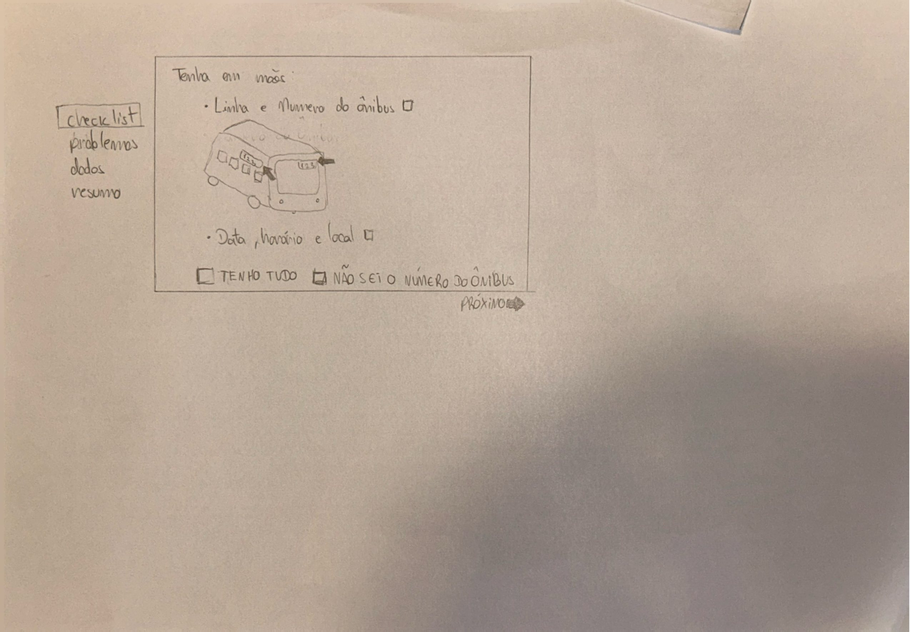
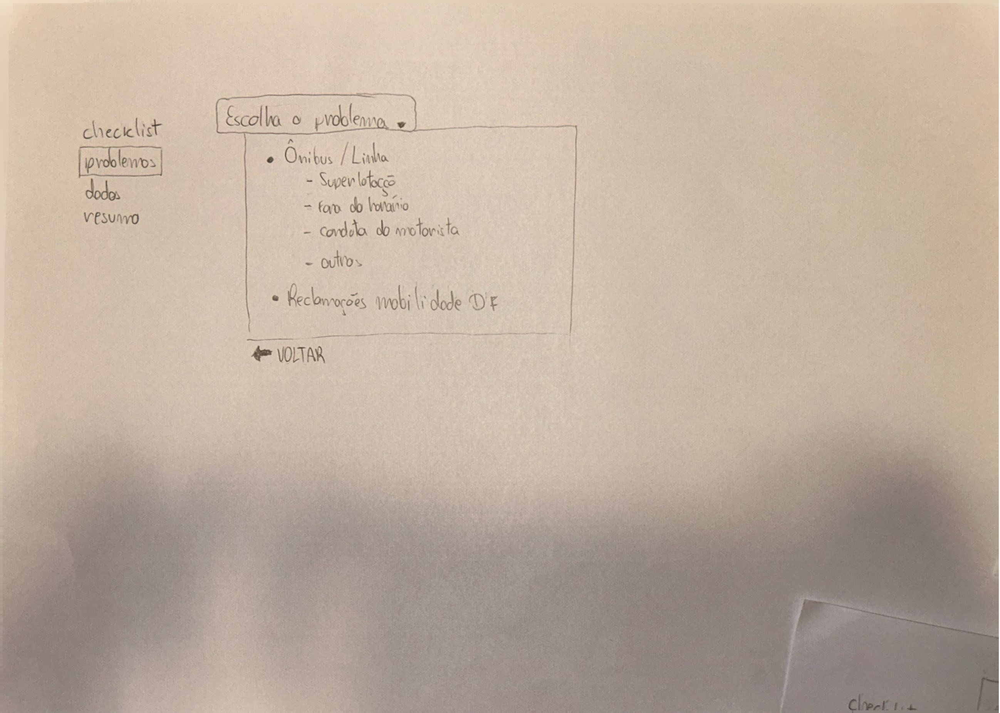
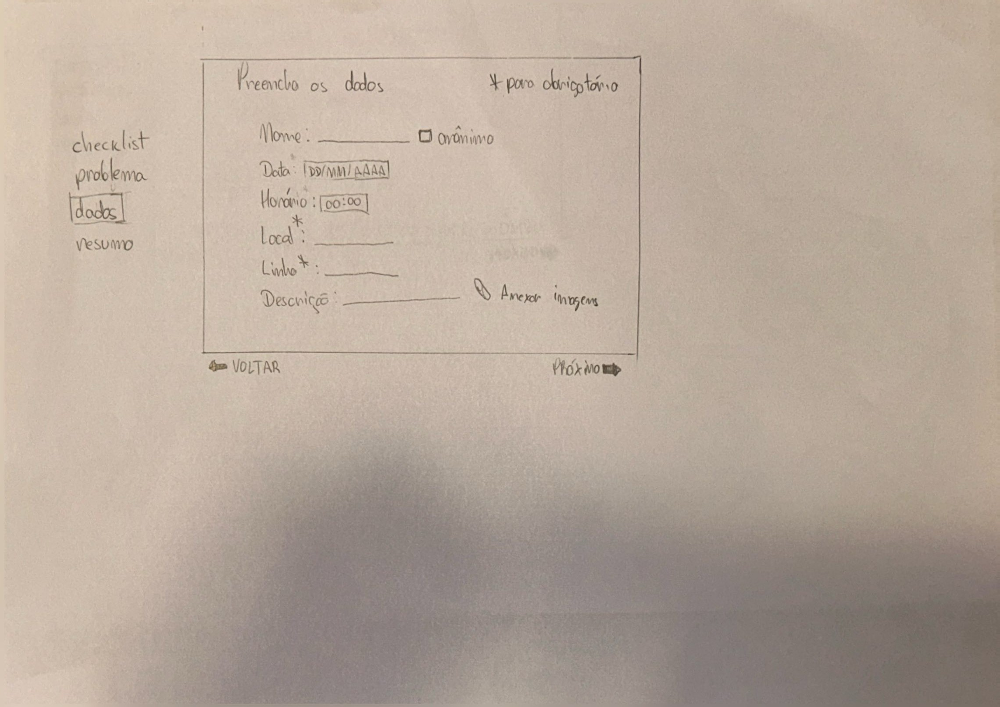
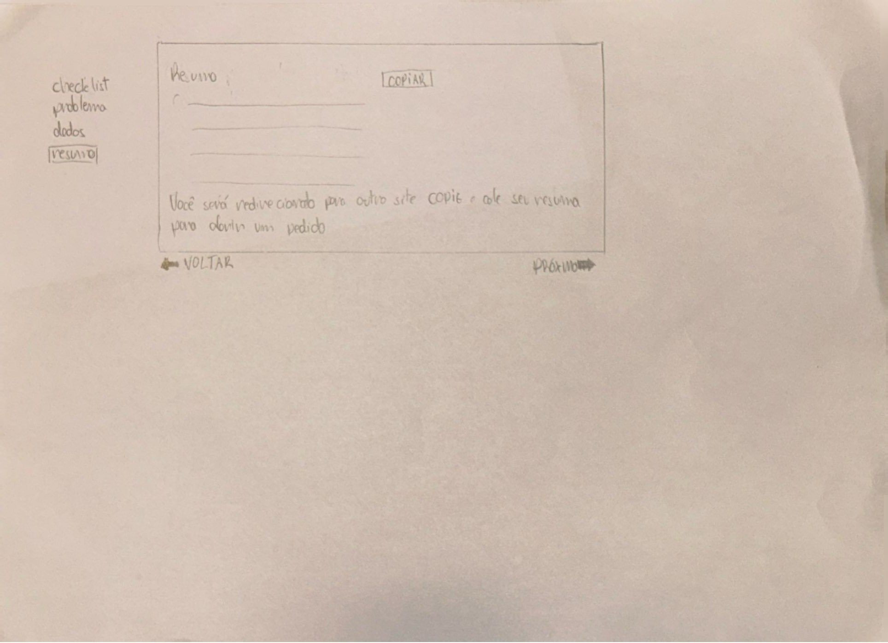
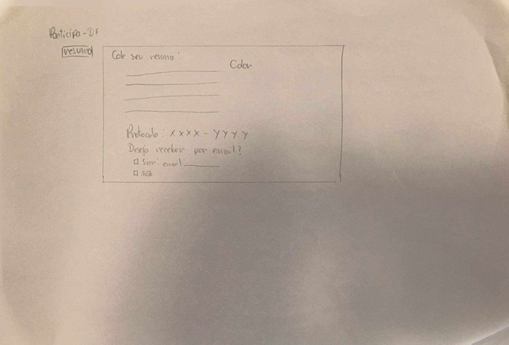
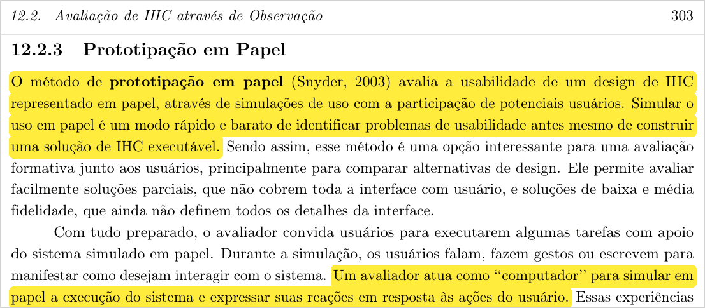
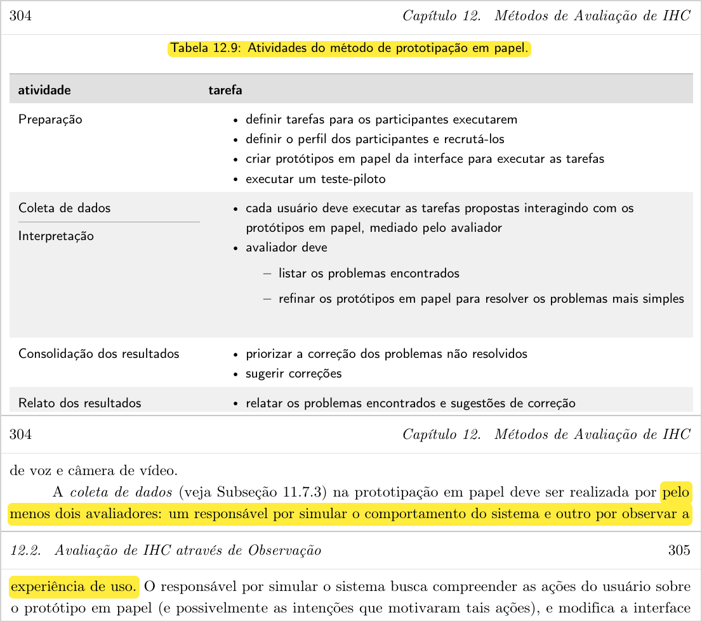

## Histórico de Versão e Contribuição

| Data | Versão | Descrição | Autor(es) | Revisor(es) | Declaração de Uso de IA |
| :---: | :---: | :--- | :--- | :--- | :--- |
| 27/10/2026 | `1.0` | Criação do planejamento individual da avaliação do Protótipo de Papel (TAR-08) via DECIDE para teste presencial. | [Rodrigo Barbosa](https://github.com/RodrigoCBarbosa) | [Carlos Costa](https://github.com/carloshfgit) | Google Gemini - estruturação em Markdown e apoio na formatação textual |

---

# Planejamento da Avaliação do Protótipo de Papel (TAR-08)

Neste documento, apresenta-se o **Planejamento da Avaliação do Protótipo de Papel** referente à **[TAR-08 (Registro de Reclamação sobre Ônibus a partir do Site da Semob)](../../../../analise-de-requisitos/analise-de-tarefas/tar-08-reclamacao-onibus.md)**. Trata-se de um planejamento individual desenvolvido para orientar a avaliação formativa presencial do protótipo de baixa fidelidade confeccionado em papel, representando o fluxo aprimorado do canal de reclamações e manifestações da **SEMOB-DF**.

O protótipo de papel dá continuidade direta aos achados da avaliação do [Storyboard 06](../../../nivel1/storyboards.md#36-storyboard-06-reclamacao-sobre-onibus-a-partir-do-site-da-semob) e dos modelos de tarefas da TAR-08 ([HTA e GOMS](../../../../analise-de-requisitos/analise-de-tarefas/tar-08-reclamacao-onibus.md)), sintetizados no [Relato dos Resultados do Nível 1](../../../nivel1/relatos-individuais/rodrigo/relato-resultados-storyboard-tarefas.md). Naquela etapa, evidenciou-se que o usuário enfrenta forte atrito cognitivo decorrente do redirecionamento para o sistema Participa-DF com exigência de novo cadastro (problema PROB-01, severidade 3) e da cobrança do número da carcaça/ordem do veículo quando o ônibus passa direto pela parada (problema PROB-02, severidade 2).

A avaliação será conduzida de forma empírica presencial, envolvendo a simulação de uso por um participante alinhado à persona [Cláudia Regina Santos](../../../../analise-de-requisitos/personas/claudia-regina-santos.md). O planejamento foi estruturado aplicando o **Framework DECIDE** (Barbosa et al., 2021), organizado em seis etapas: **D**eterminar objetivos, **E**xplorar perguntas, **C**hoose (Escolher) métodos, **I**dentificar questões práticas, **D**ecidir questões éticas e **E**valuate (Avaliar e interpretar dados).

**Artefatos relacionados — fluxo da funcionalidade TAR-08 (Reclamação sobre Ônibus):**

* **Persona:** [Cláudia Regina Santos](../../../../analise-de-requisitos/personas/claudia-regina-santos.md)
* **Cenário:** [Cenário 11](../../../../analise-de-requisitos/cenarios/cenario-11-reclamacao-onibus.md)
* **Análise de tarefas:** [TAR-08](../../../../analise-de-requisitos/analise-de-tarefas/tar-08-reclamacao-onibus.md)
* **Storyboard:** [Storyboard 06](../../../nivel1/storyboards.md#36-storyboard-06-reclamacao-sobre-onibus-a-partir-do-site-da-semob)
* **Nível 1: avaliação do storyboard e da análise de tarefas:** [Planejamento da avaliação](../../../nivel1/planejamentos-individuais/Rodrigo/rodrigo-planejamento-avaliacao.md) · [Planejamento do relato](../../../nivel1/planejamentos-individuais/Rodrigo/rodrigo-planejamento-relato-resultados-avaliacao.md) · [Relato dos resultados](../../../nivel1/relatos-individuais/rodrigo/relato-resultados-storyboard-tarefas.md)
* **Nível 2: protótipo de papel (baixa fidelidade):** Planejamento da avaliação (*esta página*) · [Planejamento do relato](rodrigo-planejamento-relato-prot-papel.md) · [Relato dos resultados](../../relatos-individuais/rodrigo/relato-resultado-prot-papel.md)
* **Nível 3: protótipo de alta fidelidade:** [Planejamento da avaliação](../../../nivel3/planejamentos-individuais/rodrigo/rodrigo-planejamento-av-prot-alta-fidel.md) · [Planejamento do relato](../../../nivel3/planejamentos-individuais/rodrigo/rodrigo-planejamento-relato-prot-alta-fidel.md) · [Relato dos resultados](../../../nivel3/relatos-individuais/rodrigo/relato-resultados-prot-alta-fidel.md)
* **Telas do protótipo de papel:** telas no planejamento da avaliação (*nesta página*)
* **Protótipo de alta fidelidade navegável:** *não disponível*

---

## 1. D: Determinar os Objetivos da Avaliação

Segundo Barbosa et al. (2021, Cap. 12, Seção 12.2.3, p. 303) e Snyder (2003 apud BARBOSA et al., 2021), a prototipação em papel é um método de observação de uso voltado à avaliação formativa, propício para investigar e validar o modelo conceitual, a organização dos fluxos de interação e a comunicabilidade das alternativas de design antes do desenvolvimento de protótipos de alta fidelidade ou código executável.

### 1.1 Objetivos Principais

* **Identificar barreiras de usabilidade e navegação no fluxo de reclamação:** Detectar hesitações, rótulos confusos, botões ambíguos ou ambiguidades conceituais durante a busca e o preenchimento do assistente de reclamação em papel.
* **Validar a proposta do Assistente Guiado Passo a Passo:** Verificar se a estrutura simplificada de registro (escolha guiada do motivo, formulário resumido e geração imediata de protocolo) reduz o esforço cognitivo e elimina a frustração observada no fluxo tradicional.
* **Avaliar a eficácia da flexibilização dos dados do veículo:** Verificar se tornar o número do veículo/ônibus opcional — permitindo a identificação da ocorrência por meio da Linha, Parada/Local e Faixa Horária — atende à expectativa do usuário e evita a desistência da manifestação (mitigação do problema PROB-02 da TAR-08).
* **Avaliar a percepção de transparência e feedback:** Observar se o participante compreende com clareza o resumo dos dados antes do envio e reconhece a validade do protocolo gerado para acompanhamento posterior.
* **Coletar sugestões e oportunidades de reprojeto:** Capturar percepções qualitativas do participante para subsidiar a construção do protótipo de alta fidelidade no Figma.

---

## 2. E: Explorar as Perguntas a Serem Respondidas

Para operacionalizar os objetivos definidos, formulou-se um conjunto de perguntas investigativas a serem respondidas por meio da observação do manuseio do protótipo em papel e da inquirição pós-teste (Barbosa et al., 2021):

<strong>Tabela 1</strong>: Roteiro de Perguntas Investigativas da Avaliação (DECIDE)

| ID | Categoria / Foco | Pergunta de Investigação | Relação com a TAR-08 / Hipótese | Critério de Aceitação / Resposta Esperada |
| :---: | :--- | :--- | :--- | :--- |
| **P01** | **Localização do Canal** | O participante localiza facilmente o ponto de entrada para registrar a reclamação sobre o ônibus na tela inicial de papel? | Subtarefa 2 da HTA (Encontrar onde reclamar); Hipótese do vocabulário ("Reclamar de Ônibus" vs. "Ouvidoria"). | O participante aponta para a opção de reclamação/ouvidoria sem hesitação superior a 10 segundos. |
| **P02** | **Seleção do Motivo** | A apresentação das opções guiadas de motivo (ex.: "Ônibus passou direto", "Atraso excessivo", "Lotação") permite uma escolha rápida e intuitiva? | Subtarefa 4.1 da HTA (Indicar tipo da manifestação); Mitigação de erro de classificação (Reason). | O participante seleciona o cartão com o motivo correto ("Ônibus passou direto") imediatamente. |
| **P03** | **Entrada de Informações** | O formulário simplificado é compreendido sem dúvidas, especialmente quanto à facultatividade do número do ônibus? | Subtarefa 1 da HTA (Reunir informações); Resolução do problema PROB-02 (número do ônibus opcional). | O participante preenche linha, parada e horário sem se sentir bloqueado por não possuir o número do ônibus. |
| **P04** | **Revisão e Confirmação** | A peça de resumo da reclamação transmite clareza e segurança quanto aos dados que serão encaminhados? | Subtarefa 4.3 da HTA (Revisar manifestação); Princípio de prevenção de erros. | O participante revisa os dados no papel e confirma o envio com convicção. |
| **P05** | **Feedback e Protocolo** | A tela final deixa claro que o registro foi realizado com sucesso e fornece os dados necessários para o acompanhamento? | Subtarefa 5 da HTA (Guardar comprovante); Feedback imediato do sistema. | O participante identifica prontamente o número do protocolo e o prazo de resposta da SEMOB-DF. |

<em>Fonte: Elaborado por Rodrigo Barbosa (2026).</em>

---

## 3. C: Choose (Escolher) os Métodos de Avaliação

O método escolhido é a **Prototipação em Papel (Barbosa et al., 2021, Seção 12.2.3)**, caracterizado como um **Método de Observação de Uso Empírico** realizado em ambiente controlado presencial.

* **Justificativa da Escolha:** A prototipação em papel é ágil, de baixo custo e oferece alta flexibilidade para avaliar a estrutura da tarefa e a arquitetura da informação antes de qualquer investimento em código ou componentes digitais acabados. Permite que o participante manipule peças físicas e cartões, revelando rapidamente incompreensões de terminologia, barreiras no preenchimento de campos e incoerências na ordem das ações.
* **Técnica Complementar:** Durante a realização do teste, empregar-se-á a técnica de **Pensar em Voz Alta (*Think Aloud*)** (Barbosa et al., 2021), estimulando o participante a verbalizar suas dúvidas, intenções e interpretações a cada toque simulado no papel.

---

## 4. I: Identificar e Administrar as Questões Práticas

### 4.1 Confecção e Peças do Protótipo em Papel
O protótipo será construído artesanalmente com folhas de papel sulfite, cartolina e *post-its* coloridos, simulando uma interface móvel (*mobile-first*):

* **Moldura do Dispositivo:** Molde em papel cartão recortado no formato de smartphone para delimitar o campo visual do usuário.
* **Tela Base 1 (Início SEMOB-DF):** Folha com a página inicial do portal móvel da SEMOB-DF, exibindo o botão em destaque para o assistente `[ 📢 Reclamar de Ônibus ]`.
* **Tela Base 2 (Seleção Guiada do Motivo):** Cartões destacáveis com os principais problemas enfrentados no transporte coletivo (ex.: *Ônibus não parou*, *Atraso excessivo*, *Superlotação*, *Conduta do motorista*).
* **Tela Base 3 (Formulário Inteligente de Ocorrência):** Folha com campos essenciais para preenchimento simulado (Linha do ônibus, Parada/Local de referência, Horário aproximado da ocorrência e campo com a indicação explícita `Número de Ordem do Ônibus (Opcional)`).
* **Peça Móvel 4 (Resumo da Reclamação):** Cartão simulando o modal de confirmação dos dados digitados com botões `[ Editar ]` e `[ Confirmar Envio ]`.
* **Peça Móvel 5 (Tela de Sucesso e Protocolo):** Folha final contendo a mensagem de confirmação de envio, número do protocolo gerado (ex.: *SEMOB-2026-984321*), prazo legal de retorno e botão `[ Salvar / Copiar Protocolo ]`.

---

### 4.2 Definição dos Papéis da Equipe na Sessão Presencial
Conforme as recomendações de Snyder (2003 apud BARBOSA et al., 2021) e Barbosa et al. (2021, p. 304), a sessão contará com divisão estrita de responsabilidades:

* **Participante (Usuário):** Interage diretamente com o protótipo em papel, simulando cliques e toques com o dedo e verbalizando seus pensamentos (*Think Aloud*).
* **Avaliador "Computador" ([Rodrigo Barbosa](https://github.com/RodrigoCBarbosa)):** Responsável exclusivo por operar os papéis sobre a mesa — trocar as folhas base, sobrepor *post-its* e apresentar as mensagens do sistema estritamente em reação às escolhas do participante. O "computador" atua de forma neutra, sem dar instruções sobre como usar a interface.
* **Avaliador Observador / Escriba ([Carlos Costa](https://github.com/carloshfgit)):** Responsável por orientar a gravação em vídeo focando a mesa, cronometrar as etapas e anotar em ficha física os tempos, hesitações, perguntas e reações expressas pelo participante.

---

### 4.3 Recrutamento e Perfil do Participante
* **Perfil Recrutado:** 1 participante representante da persona [Cláudia Regina Santos](../../../../analise-de-requisitos/personas/claudia-regina-santos.md): usuário regular do sistema de ônibus do DF, que já vivenciou situações de atraso ou ônibus que não parou no ponto e possui experiência cotidiana com smartphones.
* **Quantidade de Usuários:** 1 participante para a sessão presencial de prototipação em papel.

---

### 4.4 Infraestrutura e Equipamentos Presenciais
* **Local:** Ambiente tranquilo, silencioso e iluminado (sala de reuniões/estudos reservada na FCTE/UnB Gama).
* **Equipamentos de Gravação:** Smartphone posicionado em suporte/tripé focado na mesa (capturando o manuseio das peças e a movimentação das mãos) e microfone para captação clara do áudio.
* **Materiais de Apoio:** Via impressa do Termo de Consentimento Livre e Esclarecido (TCLE), folha com o cenário e a tarefa impressos, peças do protótipo em papel, canetas e ficha de anotações do observador.

---

### 4.5 Cronograma de Execução Presencial

<strong>Tabela 2</strong>: Cronograma da Sessão Presencial do Protótipo de Papel

| Parâmetro | Detalhamento da Sessão Presencial |
| :--- | :--- |
| **Data e Horário:** | 29/10/2026 às 14:00. |
| **Local:** | Sala de Estudos — FCTE/UnB Gama. |
| **Condutor ("Avaliador Computador"):** | [Rodrigo Barbosa](https://github.com/RodrigoCBarbosa). |
| **Observador / Escriba:** | [Carlos Costa](https://github.com/carloshfgit). |
| **Duração Prevista:** | **30 minutos** (10 min de recepção e TCLE + 15 min de simulação em papel + 5 min de entrevista pós-teste). |
| **Orçamento Estimado:** | **R\$ 0,00** (materiais escolares próprios e smartphone dos integrantes). |

<em>Fonte: Elaborado por Rodrigo Barbosa (2026).</em>

---

### 4.6 Planejamento do Teste-Piloto

Em cumprimento rigoroso ao **Item 11 do checklist do Plano de Ensino** e à literatura de IHC (Barbosa et al., 2021, pp. 260, 304), será conduzido um **teste-piloto** previamente à sessão oficial com o participante recrutado:

* **Objetivo do Piloto:** Avaliar a clareza das instruções do cenário, calibrar o tempo de troca das folhas e peças pelo "avaliador computador", testar a ergonomia da mesa e o ângulo do celular na gravação.
* **Data e Execução do Piloto:** Realizado presencialmente em **28/10/2026 às 15:30**, com um membro do Grupo 05 atuando como participante simulado.
* **Declaração Formal de Isenção de Dados (Item 12 do Checklist):** Declara-se formalmente que os dados e a gravação decorrentes do teste-piloto servirão **exclusivamente para calibração e aprimoramento dos materiais e da dinâmica**, **não sendo incluídos nem computados nos resultados finais da avaliação**.

---

## 5. D: Decidir como Lidar com as Questões Éticas

A condução do teste presencial atende integralmente às Resoluções nº 466/2012 e nº 510/2016 do Conselho Nacional de Saúde (CNS) e às diretrizes de ética em pesquisa de IHC (Barbosa et al., 2021, Seção 7.4):

1. **Apresentação e Assinatura do TCLE:** Antes de qualquer interação prática, o participante lerá e assinará o [Termo de Consentimento Livre e Esclarecido (TCLE)](../../../../assets/PDFs/TCLE_Pesquisa_Transporte.pdf), recebendo explicações claras sobre o caráter estritamente acadêmico da pesquisa.
2. **Proteção da Imagem e Anonimato:** A gravação em vídeo será enquadrada com foco estrito sobre a mesa e as peças do protótipo em papel, preservando a identidade física do participante.
3. **Voluntariedade e Direito de Desistência:** O participante será informado de que sua participação é voluntária e de que é o protótipo que está sendo avaliado (nunca o usuário), com garantia de interrupção a qualquer momento sem penalidades.

---

## 6. E: Avaliar, Interpretar e Apresentar os Dados

A análise dos dados será de natureza primordialmente qualitativa e interpretativa (Barbosa et al., 2021, Seção 12.2.3):

1. **Triangulação de Observações:** Confrontar as verbalizações obtidas pelo *Think Aloud*, as anotações do observador e as reações físicas registradas no vídeo.
2. **Classificação de Severidade dos Problemas:** Todos os problemas de usabilidade detectados serão catalogados e classificados de acordo com a escala de severidade de Nielsen (1994 apud BARBOSA et al., 2021):
   * **0 — Sem importância:** Comentário cosmético que não interfere no preenchimento da reclamação.
   * **1 — Leve:** Pequena dúvida de leitura resolvida espontaneamente pelo próprio usuário.
   * **2 — Moderado:** Hesitação relevante ao preencher um campo ou escolher um cartão, sem interrupção do fluxo.
   * **3 — Grave:** Dificuldade acentuada na conclusão de uma das etapas do formulário.
   * **4 — Catastrófico:** Erro bloqueante ou desistência na realização do registro da reclamação.
3. **Alimentação do Relato dos Resultados:** Os achados fundamentarão o documento de *Relato dos Resultados da Avaliação do Protótipo de Papel*, orientando as decisões de design para o protótipo de alta fidelidade no Figma.

---

## 7. Localização das Referências no Livro

Conforme as diretrizes pedagógicas da disciplina, a fundamentação teórica adotada neste planejamento localiza-se nas seguintes seções do livro-texto oficial:

* **Obra:** BARBOSA, S. D. J.; SILVA, B. S. da; SILVEIRA, M. S.; GASPARINI, I.; DARIN, T.; BARBOSA, G. D. J. **Interação Humano-Computador e Experiência do Usuário**. Rio de Janeiro: Autopublicação, 2021.
* **Localização Exata:** **Parte IV, Capítulo 11 — Planejamento da Avaliação de IHC, Seção 11.8 (*O Framework DECIDE*), páginas 264–265**; e **Capítulo 12 — Métodos de Avaliação de IHC, Seção 12.2.3 (*Prototipação em Papel*), páginas 303–306**.

## 8. Telas do Protótipo Avaliado

As Figuras 1 a 5 mostram as telas do protótipo de papel da [TAR-08](../../../../analise-de-requisitos/analise-de-tarefas/tar-08-reclamacao-onibus.md), também apresentadas no [relato dos resultados da avaliação](../../../nivel2/relatos-individuais/rodrigo/relato-resultado-prot-papel.md).

<strong>Figura 1</strong>: Tela 1 do Protótipo de Papel: Checklist inicial e opção "Não sei o número do ônibus"

{ width="600" }

<em>Fonte: Elaborado por Rodrigo Barbosa (2026).</em>

<strong>Figura 2</strong>: Tela 2 do Protótipo de Papel: Escolha guiada do problema (Ônibus / Linha)

{ width="600" }

<em>Fonte: Elaborado por Rodrigo Barbosa (2026).</em>

<strong>Figura 3</strong>: Tela 3 do Protótipo de Papel: Preenchimento dos dados da ocorrência (com opção de anonimato)

{ width="600" }

<em>Fonte: Elaborado por Rodrigo Barbosa (2026).</em>

<strong>Figura 4</strong>: Tela 4 do Protótipo de Papel: Resumo gerado para cópia e aviso prévio de redirecionamento

{ width="600" }

<em>Fonte: Elaborado por Rodrigo Barbosa (2026).</em>

<strong>Figura 5</strong>: Tela 5 do Protótipo de Papel: Colagem do resumo no Participa-DF, geração do protocolo e envio por e-mail

{ width="600" }

<em>Fonte: Elaborado por Rodrigo Barbosa (2026).</em>

---
---

## 9. Fotos de Referência
As Figuras 6 a 9 mostram os trechos que fundamentam este artefato, recortados e grifados em amarelo diretamente do livro da disciplina (BARBOSA et al., 2021).

<strong>Figura 6</strong>: 11.8 Framework DECIDE

<em>Fonte: BARBOSA et al. (2021, p. 264).</em>

<strong>Figura 7</strong>: 12.2.3 Prototipação em papel: método e papel do avaliador como ‘computador’

<em>Fonte: BARBOSA et al. (2021, p. 303).</em>

<strong>Figura 8</strong>: Tabela 12.9 – Atividades do método de prototipação em papel

<em>Fonte: BARBOSA et al. (2021, pp. 304–305).</em>

<strong>Figura 9</strong>: 11.7.2 Teste-piloto: objetivo e descarte dos dados

<em>Fonte: BARBOSA et al. (2021, p. 260).</em>

---

## 10. Referências Bibliográficas
* BARBOSA, Simone Diniz Junqueira; SILVA, Bruno Santana da; SILVEIRA, Milene Selbach; GASPARINI, Isabela; DARIN, Ticianne; BARBOSA, Gabriel Diniz Junqueira. **Interação Humano-Computador e Experiência do Usuário**. Rio de Janeiro: Autopublicação, 2021. ISBN 978-65-00-19677-1.
* SALES, André Barros de. **Plano de Ensino: Interação Humano Computador**. Brasília: Universidade de Brasília, Faculdade UnB Gama (FCTE/UnB), 2026.
