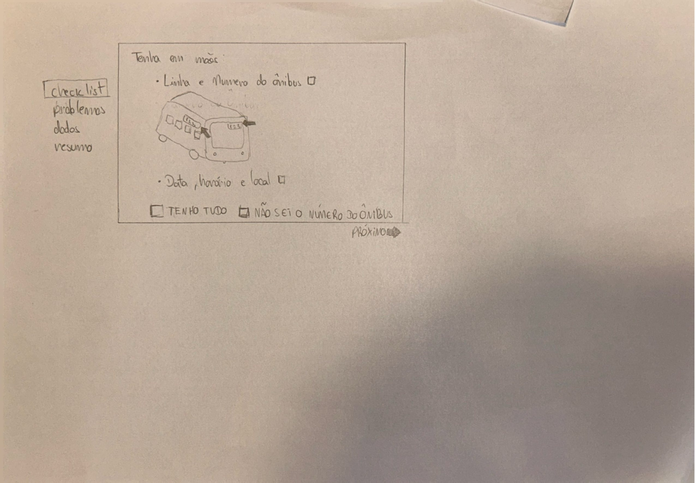
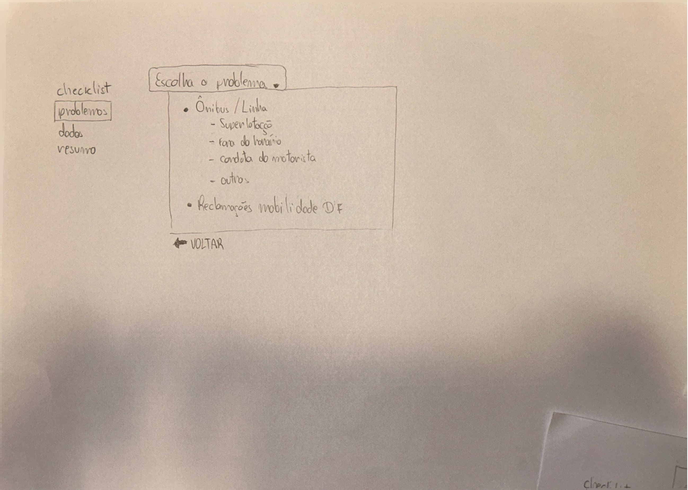
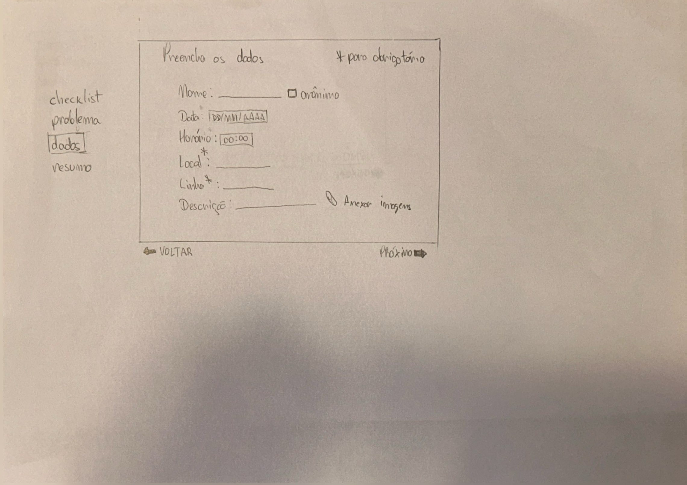
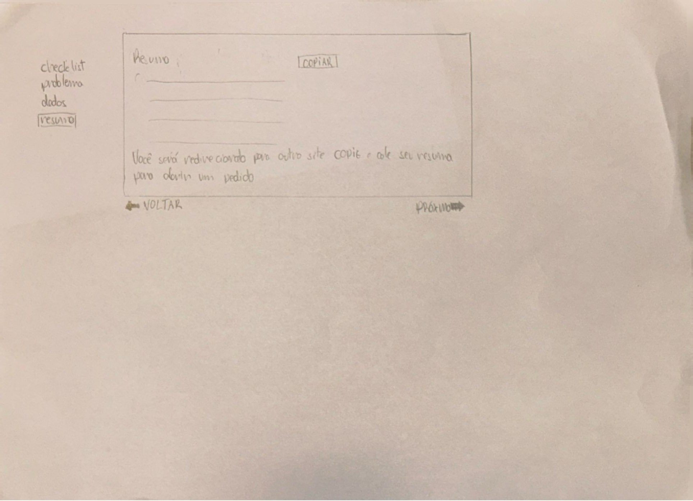
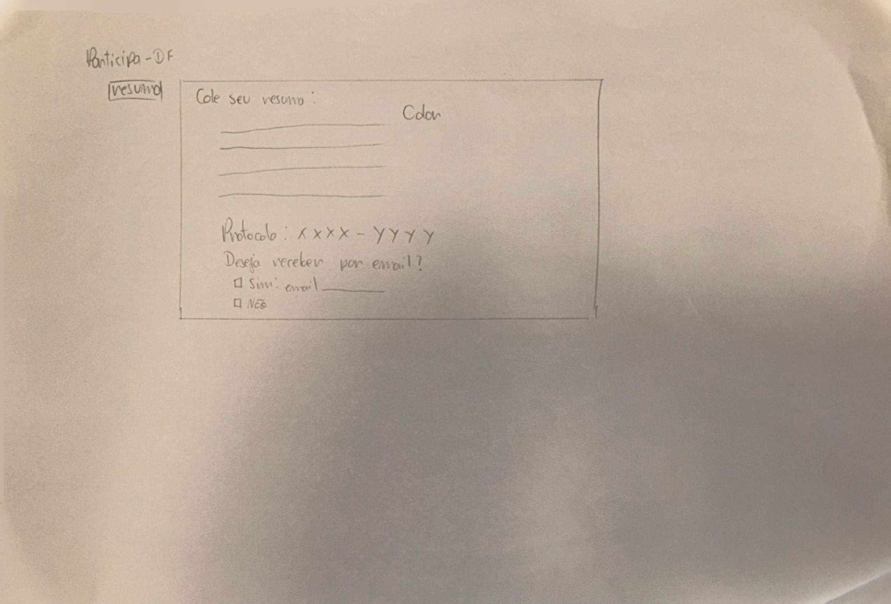

## Histórico de Versão e Contribuição

| Data | Versão | Descrição | Autor(es) | Revisor(es) | Declaração de Uso de IA |
| :---: | :---: | :--- | :--- | :--- | :--- |
| 27/10/2026 | `1.0` | Criação do planejamento do relato dos resultados do Protótipo de Papel (TAR-08). | [Rodrigo Barbosa](https://github.com/RodrigoCBarbosa) | [Carlos Costa](https://github.com/carloshfgit) | Google Gemini - estruturação em Markdown e apoio na formatação textual |

---

# Planejamento do Relato dos Resultados da Avaliação do Protótipo de Papel (TAR-08)

Neste documento, apresenta-se o **Planejamento do Relato dos Resultados da Avaliação do Protótipo de Papel** referente à **[TAR-08 (Registro de Reclamação sobre Ônibus a partir do Site da Semob)](../../../../analise-de-requisitos/analise-de-tarefas/tar-08-reclamacao-onibus.md)**. Trata-se de um planejamento individual concebido para orientar, padronizar e estruturar a futura compilação, análise qualitativa e apresentação dos dados colhidos durante a avaliação empírica presencial com o protótipo de baixa fidelidade em papel.

A formatação deste planejamento fundamenta-se nas diretrizes do livro-texto de Interação Humano-Computador (Barbosa et al., 2021, Cap. 11, Seção 11.7.5; Cap. 12, Seção 12.2.3) e nas normas do Plano de Ensino da disciplina, assegurando a rastreabilidade metodológica entre os problemas de usabilidade identificados nas peças físicas e os insumos que direcionarão o protótipo de alta fidelidade no Figma.

**Artefatos relacionados — fluxo da funcionalidade TAR-08 (Reclamação sobre Ônibus):**

* **Persona:** [Cláudia Regina Santos](../../../../analise-de-requisitos/personas/claudia-regina-santos.md)
* **Cenário:** [Cenário 11](../../../../analise-de-requisitos/cenarios/cenario-11-reclamacao-onibus.md)
* **Análise de tarefas:** [TAR-08](../../../../analise-de-requisitos/analise-de-tarefas/tar-08-reclamacao-onibus.md)
* **Storyboard:** [Storyboard 06](../../../nivel1/storyboards.md#36-storyboard-06-reclamacao-sobre-onibus-a-partir-do-site-da-semob)
* **Nível 1: avaliação do storyboard e da análise de tarefas:** [Planejamento da avaliação](../../../nivel1/planejamentos-individuais/Rodrigo/rodrigo-planejamento-avaliacao.md) · [Planejamento do relato](../../../nivel1/planejamentos-individuais/Rodrigo/rodrigo-planejamento-relato-resultados-avaliacao.md) · [Relato dos resultados](../../../nivel1/relatos-individuais/rodrigo/relato-resultados-storyboard-tarefas.md)
* **Nível 2: protótipo de papel (baixa fidelidade):** [Planejamento da avaliação](rodrigo-planejamento-av-prototipo-papel.md) · Planejamento do relato (*esta página*) · [Relato dos resultados](../../relatos-individuais/rodrigo/relato-resultado-prot-papel.md)
* **Nível 3: protótipo de alta fidelidade:** [Planejamento da avaliação](../../../nivel3/planejamentos-individuais/rodrigo/rodrigo-planejamento-av-prot-alta-fidel.md) · [Planejamento do relato](../../../nivel3/planejamentos-individuais/rodrigo/rodrigo-planejamento-relato-prot-alta-fidel.md) · [Relato dos resultados](../../../nivel3/relatos-individuais/rodrigo/relato-resultados-prot-alta-fidel.md)
* **Telas do protótipo de papel:** [telas no planejamento da avaliação](rodrigo-planejamento-av-prototipo-papel.md#8-telas-do-prototipo-avaliado)
* **Protótipo de alta fidelidade navegável:** *não disponível*

---

## 1. Objetivos do Relato dos Resultados

O relato final dos resultados terá como finalidades centrais:

1. **Sintetizar o desempenho do participante:** Registrar a taxa de sucesso no cumprimento das etapas do assistente de reclamação, o tempo demandado e as eventuais necessidades de suporte verbal do avaliador.
2. **Mapear e catalogar os problemas de IHC:** Documentar detalhadamente todas as hesitações de vocabulário, ambiguidades nos rótulos das peças e dificuldades no preenchimento dos campos do formulário simplificado.
3. **Registrar o ciclo de reprojeto no papel:** Discriminar as correções imediatas aplicadas nas folhas ou *post-its* durante a própria dinâmica de avaliação frente àquelas que permaneceram como pendências para o nível digital.
4. **Subsidiar a Prototipação de Alta Fidelidade no Figma:** Fornecer recomendações práticas de design de interface e interação, garantindo que o protótipo interativo incorpore soluções eficazes para as fragilidades reveladas na avaliação em papel.

---

## 2. Estrutura Padronizada do Relatório Final de Resultados

Em conformidade com a literatura de IHC (Barbosa et al., 2021, pp. 263, 306) e o checklist de avaliação da disciplina, o documento final de consolidação dos resultados observará a seguinte estrutura formal:

1. **Introdução e Objetivos da Avaliação:** Síntese do escopo avaliado na TAR-08 e das metas de usabilidade investigadas.
2. **Metodologia Empregada:** Descrição da técnica de Prototipação em Papel (observação de uso presencial com os papéis de "Avaliador Computador" e "Avaliador Observador") e da técnica de *Think Aloud*.
3. **Caracterização do Participante e Ambiente:** Apresentação do perfil do participante convidado (representante da persona [Cláudia Regina Santos](../../../../analise-de-requisitos/personas/claudia-regina-santos.md)), data, local, infraestrutura e registro do aceite do TCLE.
4. **Sumário dos Dados Coletados:** Métricas de desempenho, taxa de conclusão sem ajuda, contagem de erros de navegação e resumo das respostas às perguntas investigativas P01 a P05.
5. **Análise Qualitativa e Tabela de Problemas de IHC:** Tabela padronizada com a lista de problemas de usabilidade, categorizados segundo a escala de severidade de Nielsen (1994 apud BARBOSA et al., 2021).
6. **Registro de Alterações no Protótipo de Papel:** Tabela discriminando as alterações executadas de imediato no papel versus as pendências encaminhadas para o meio digital.
7. **Recomendações para a Prototipação de Alta Fidelidade:** Diretrizes consolidadas para guiar a construção dos componentes no Figma.
8. **Conclusão:** Síntese das lições aprendidas e validação da proposta conceitual do assistente de reclamação.

---

## 3. Metodologia de Análise e Escala de Severidade dos Problemas

Tendo em vista que a prototipação em papel tem foco predominantemente qualitativo e formativo (Barbosa et al., 2021, p. 308), a análise dos dados será de natureza interpretativa e orientada pelo confronto entre as gravações em vídeo, as anotações do observador e as falas do participante (*Think Aloud*).

Para priorizar o tratamento das falhas de interação identificadas, adotar-se-á a **Escala de Severidade de Problemas** de Nielsen (1994 apud BARBOSA et al., 2021) e Barbosa et al. (2021, p. 270):

<strong>Tabela 1</strong>: Escala de Severidade de Problemas de Usabilidade

| Nível de Severidade | Classificação | Descrição do Impacto na Interação do Usuário no Papel |
| :---: | :--- | :--- |
| **0** | **Sem Importância** | Não afeta a realização da tarefa no papel; comentário puramente cosmético ou sugestão opcional. |
| **1** | **Leve** | Gera pequena hesitação ou dúvida visual passageira, mas o participante conclui a etapa sozinho e sem atraso significativo. |
| **2** | **Moderado** | Provoca incerteza ou toque em componente/cartão incorreto, reduzindo a eficiência sem bloquear o fluxo. |
| **3** | **Grave** | Dificulta substancialmente a realização da tarefa, gerando grande esforço cognitivo ou solicitação de ajuda. |
| **4** | **Catastrófico** | Impede totalmente a conclusão da tarefa no protótipo em papel (abandono da reclamação ou erro irreversível). |

<em>Fonte: Adaptado de Nielsen (1994 apud BARBOSA et al., 2021) e Barbosa et al. (2021).</em>

---

## 4. Modelos de Tabelas para Consolidação dos Resultados

Para garantir o rigor analítico e a padronização das entregas do grupo, o documento final utilizará os três modelos de tabelas descritos a seguir:

---

### 4.1 Modelo de Tabela 1: Desempenho nas Tarefas do Protótipo em Papel

<strong>Tabela 2</strong>: Consolidação do Desempenho nas Tarefas em Papel

| ID Tarefa | Descrição do Cenário / Tarefa no Papel | Sucesso sem Ajuda? | Tempo Gasto | Pedidos de Ajuda | Avaliação da Usabilidade |
| :---: | :--- | :---: | :---: | :---: | :---: |
| **TAR-08.1** | Localizar e acionar o botão `[ 📢 Reclamar de Ônibus ]` na tela inicial da SEMOB-DF em papel. | **[Sim / Não]** | *[mm:ss]* | *[Qtd]* | **[Satisfatório / Com Falhas]** |
| **TAR-08.2** | Selecionar o cartão do motivo "Ônibus não parou" e preencher linha, local e horário (sem número do ônibus). | **[Sim / Não]** | *[mm:ss]* | *[Qtd]* | **[Satisfatório / Com Falhas]** |
| **TAR-08.3** | Revisar os dados no cartão de resumo, confirmar o envio e anotar o número do protocolo gerado. | **[Sim / Não]** | *[mm:ss]* | *[Qtd]* | **[Satisfatório / Com Falhas]** |

<em>Fonte: Elaborado por Rodrigo Barbosa (2026).</em>

---

### 4.2 Modelo de Tabela 2: Registro e Priorização de Problemas de IHC

<strong>Tabela 3</strong>: Tabela de Registro e Priorização de Problemas de Usabilidade

| ID Problema | Descrição da Dificuldade / Erro Observado | Peça / Tela de Papel Afetada | Severidade (0 a 4) | Fatores de Usabilidade Prejudicados | Sugestão de Reprojeto / Ação Recomendada |
| :---: | :--- | :--- | :---: | :--- | :--- |
| **PROB-P01** | *[Descrição da dúvida, hesitação ou toque incorreto]* | *[Ex.: Tela Inicial / Botão de Ouvidoria]* | **[0 a 4]** | *[Ex.: Visibilidade, Clareza de Rótulo]* | *[Ação corretiva no papel ou indicação para alta fidelidade]* |
| **PROB-P02** | *[Descrição da dúvida, hesitação ou toque incorreto]* | *[Ex.: Tela do Formulário / Campo Veículo]* | **[0 a 4]** | *[Ex.: Prevenção de Erros, Carga Cognitiva]* | *[Ação corretiva no papel ou indicação para alta fidelidade]* |

<em>Fonte: Elaborado por Rodrigo Barbosa (2026).</em>

---

### 4.3 Modelo de Tabela 3: Problemas Corrigidos no Papel vs. Pendentes para Alta Fidelidade

<strong>Tabela 4</strong>: Registro de Iterações no Protótipo de Papel e Pendências

| ID Problema | Modificação Realizada no Protótipo em Papel | Corrigido Durante o Teste? | Reincidiu na Interação? | Status para Prototipação Digital (Figma) |
| :---: | :--- | :---: | :---: | :--- |
| **PROB-P01** | *[Ex.: Reescrita do rótulo no post-it para 'Reclamar de Ônibus']* | **[Sim / Não]** | **[Sim / Não]** | **[Resolvido no Papel / Ajustar na Alta Fidelidade]** |
| **PROB-P02** | *[Ex.: Inclusão do texto 'Opcional' ao lado do campo do número do veículo]* | **[Sim / Não]** | **[Sim / Não]** | **[Resolvido no Papel / Ajustar na Alta Fidelidade]** |

<em>Fonte: Elaborado por Rodrigo Barbosa (2026).</em>

---

## 5. Planejamento do Reprojeto e Próximos Passos

A consolidação das evidências guiará o ciclo iterativo característico do design centrado no usuário (Barbosa et al., 2021, p. 305):

1. **Ajustes Imediatos de Baixo Custo:** Inconsistências de nomenclatura ou disposição de cartões passíveis de correção rápida serão redesenhadas no papel para validações adicionais.
2. **Direcionamento da Alta Fidelidade:** Os problemas de severidade moderada e grave (níveis 2 e 3) não mitigáveis no papel serão transpostos diretamente em requisitos de layout e interação para os componentes no **Figma**.
3. **Alinhamento com o Guia de Estilo:** As soluções adotadas serão confrontadas com as diretrizes de cores, tipografia, alvos de toque e botões `[Verbo + Ação]` estabelecidas no Guia de Estilo do Grupo 05.

---

## 6. Localização das Referências no Livro

Conforme as diretrizes pedagógicas da disciplina, a fundamentação teórica adotada neste planejamento localiza-se nas seguintes seções da obra de referência:

* **Obra:** BARBOSA, S. D. J.; SILVA, B. S. da; SILVEIRA, M. S.; GASPARINI, I.; DARIN, T.; BARBOSA, G. D. J. **Interação Humano-Computador e Experiência do Usuário**. Rio de Janeiro: Autopublicação, 2021.
* **Localização Exata:** **Parte IV, Capítulo 11 — Seção 11.7.5 (*Consolidação e Relato dos Resultados*), páginas 263–264**; e **Capítulo 12 — Seção 12.2.3 (*Prototipação em Papel — Relato dos Resultados*), páginas 305–306**.

## 7. Telas do Protótipo Avaliado

As Figuras 1 a 5 mostram as telas do protótipo de papel da [TAR-08](../../../../analise-de-requisitos/analise-de-tarefas/tar-08-reclamacao-onibus.md), também apresentadas no [relato dos resultados da avaliação](../../../nivel2/relatos-individuais/rodrigo/relato-resultado-prot-papel.md).

<strong>Figura 1</strong>: Tela 1 do Protótipo de Papel: Checklist inicial e opção "Não sei o número do ônibus"

{ width="600" }

<em>Fonte: Elaborado por Rodrigo Barbosa (2026).</em>

<strong>Figura 2</strong>: Tela 2 do Protótipo de Papel: Escolha guiada do problema (Ônibus / Linha)

{ width="600" }

<em>Fonte: Elaborado por Rodrigo Barbosa (2026).</em>

<strong>Figura 3</strong>: Tela 3 do Protótipo de Papel: Preenchimento dos dados da ocorrência (com opção de anonimato)

{ width="600" }

<em>Fonte: Elaborado por Rodrigo Barbosa (2026).</em>

<strong>Figura 4</strong>: Tela 4 do Protótipo de Papel: Resumo gerado para cópia e aviso prévio de redirecionamento

{ width="600" }

<em>Fonte: Elaborado por Rodrigo Barbosa (2026).</em>

<strong>Figura 5</strong>: Tela 5 do Protótipo de Papel: Colagem do resumo no Participa-DF, geração do protocolo e envio por e-mail

{ width="600" }

<em>Fonte: Elaborado por Rodrigo Barbosa (2026).</em>

---
---

## 8. Fotos de Referência
As Figuras 6 a 7 mostram os trechos que fundamentam este artefato, recortados e grifados em amarelo diretamente do livro da disciplina (BARBOSA et al., 2021).

<strong>Figura 6</strong>: Prototipação em papel: conteúdo do relato dos resultados

<em>Fonte: BARBOSA et al. (2021, pp. 305–306).</em>

<strong>Figura 7</strong>: 12.2.3 Prototipação em papel: refinamento, priorização e relato

<em>Fonte: BARBOSA et al. (2021, pp. 305–306).</em>

---

## 9. Referências Bibliográficas
* BARBOSA, Simone Diniz Junqueira; SILVA, Bruno Santana da; SILVEIRA, Milene Selbach; GASPARINI, Isabela; DARIN, Ticianne; BARBOSA, Gabriel Diniz Junqueira. **Interação Humano-Computador e Experiência do Usuário**. Rio de Janeiro: Autopublicação, 2021. ISBN 978-65-00-19677-1.
* SALES, André Barros de. **Plano de Ensino: Interação Humano Computador**. Brasília: Universidade de Brasília, Faculdade UnB Gama (FCTE/UnB), 2026.
