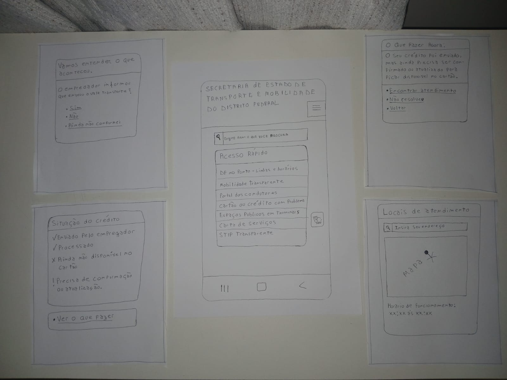

# Relato dos Resultados da Avaliação do Protótipo de Papel (TAR-07)

## Histórico de Versão

| Data | Versão | Descrição | Autor(es) | Revisor(es) | Declaração de ferramenta de IA |
| :---: | :---: | :--- | :--- | :--- | :--- |
| 02/11/2026 | `1.0` | Consolidação das informações da sessão, preenchimento dos resultados e elaboração das recomendações de reprojeto. | [Arthur Mariani](https://github.com/arthur-mariani) | [Carlos Henrique](https://github.com/carloshfgit) | Google Gemini - apoio à consolidação do relato em Markdown e à revisão textual. |

---

## 1. Introdução

Este documento apresenta os resultados da avaliação do protótipo de papel da [TAR-07 — Resolver indisponibilidade de crédito de Vale-Transporte](../../../../analise-de-requisitos/analise-de-tarefas/tar-07-credito-vale-transporte.md). A avaliação utiliza como contexto o [Cenário 4 — Crédito de Vale-Transporte não disponível no cartão antes do trabalho](../../../../analise-de-requisitos/cenarios/cenario-4-credito-vale-transporte.md) e a persona [Maria Eduarda Santos](../../../../analise-de-requisitos/personas/maria-eduarda-santos.md).

O relato segue as decisões estabelecidas no [Planejamento da Avaliação do Protótipo de Papel](../../planejamentos-individuais/Arthur/arthur-planejamento-avaliacao-prototipo-papel.md) e no [Planejamento do Relato dos Resultados](../../planejamentos-individuais/Arthur/arthur-planejamento-relato-prototipo-papel.md). Seu propósito é consolidar as evidências da sessão, os problemas e pontos positivos observados, as alterações realizadas no papel e as recomendações para o reprojeto.

Os resultados são interpretados como evidências de uma avaliação formativa com uma participante. Portanto, indicam oportunidades para a evolução do protótipo, mas não permitem generalizações sobre todas as pessoas que utilizam o Vale-Transporte no Distrito Federal.

---

## 2. Objetivos e escopo

O objetivo geral da avaliação foi verificar se o fluxo em papel permite que uma usuária com perfil compatível com Maria Eduarda encontre e compreenda uma orientação para o crédito de Vale-Transporte indisponível, identificando a informação que precisa confirmar, o próximo passo e um atendimento compatível com seu endereço.

Foram avaliados:

1. a encontrabilidade da orientação para crédito indisponível;
2. a compreensão dos estados **enviado**, **em processamento**, **disponível** e **precisa de atualização ou confirmação**;
3. a clareza do próximo passo e das responsabilidades do empregador, do canal responsável pelo cartão e da SEMOB-DF;
4. a linguagem, os rótulos e o feedback apresentado durante o fluxo;
5. a adequação do fluxo ao uso pelo celular, sob pressão de tempo e com conexão limitada.

O protótipo representa uma proposta de interface. A avaliação não confirma procedimentos operacionais reais do empregador, do BRB Mobilidade ou da SEMOB-DF.

---

## 3. Identificação da sessão

| Campo | Registro |
| :--- | :--- |
| **Data e horário** | 01/11/2026 às 18h |
| **Local** | Casa da entrevistada |
| **Duração efetiva** | Aproximadamente 3 minutos |
| **Participante** | P01 |
| **Perfil relevante** | Jovem que utiliza transporte público frequentemente e com acesso a celular. |
| **Condutor / “computador”** | Arthur Mariani |
| **Observador / anotador** | Arthur Mariani |
| **Forma de registro autorizada** | Anotações e gravação em vídeo da interação com o protótipo |
| **Materiais utilizados** | Telas e peças móveis do protótipo, cartões de tarefa, TCLE e ficha de observação |
| **Intercorrências ou desvios do protocolo** | Como adaptação metodológica, Arthur Mariani acumulou os papéis de condutor / “computador” e observador / anotador. |

### 3.1 Registro em vídeo da entrevista

**Link do vídeo:** [Assistir à gravação da entrevista e da interação com o protótipo](https://youtube.com/shorts/uuk37aMLKu4)

O registro reúne a interação com as telas e as respostas breves da participante. Em razão da curta duração da sessão, os resultados foram complementados pelas anotações feitas durante a aplicação.

---

## 4. Protótipo de papel avaliado

O protótipo foi elaborado para uso simulado em um dispositivo móvel e representa o fluxo de identificação do problema, diagnóstico do estado do crédito, apresentação do próximo passo e encaminhamento para atendimento.

### 4.1 Imagem do protótipo

{ width="100%" }

<strong>Figura 1</strong> — Protótipo de papel móvel para orientação sobre crédito de Vale-Transporte indisponível.

<em>Fonte: Arthur Mariani (2026).</em>

### 4.2 Telas e peças utilizadas

| ID | Tela ou peça | Finalidade |
| :---: | :--- | :--- |
| **TP-01** | Site principal SEMOB | Representar o site inicial do SEMOB em um celular |
| **TP-02** | Tela para entender o acontecimento | Questionar se o usuário sabe se sua empresa enviou ou não o crédito. |
| **TP-03** | Tela que mostra a situação do crédito | Mostrar a atual situação do crédito de acordo com a primeira resposta do usuário. |
| **TP-04** | Tela que explica a situação | Explicar a situação atual do crédito e oferecer escolhas para a participante prosseguir, informar que o problema não foi resolvido ou retornar. |
| **TP-05** | Tela que mostra locais de atendimento | Permitir que a participante informe um endereço e encontre o local de atendimento mais próximo, com seu horário de funcionamento. |

---

## 5. Método executado

A avaliação foi realizada por meio de **prototipação em papel com observação de uso**, em sessão individual e presencial. A participante indicou suas ações tocando, apontando ou dizendo o que faria, enquanto o condutor desempenhou o papel de “computador” e trocou as telas e peças conforme as escolhas realizadas. O observador registrou ações, hesitações, retornos, pedidos de ajuda, verbalizações e dificuldades.

Após a simulação, foi realizada uma entrevista pós-teste para esclarecer as decisões observadas e coletar sugestões. A participante foi informada de que o objeto avaliado era o protótipo, e não sua capacidade de utilizar tecnologia.

**Adaptações realizadas em relação ao planejamento:** o fluxo foi observado em quatro etapas: encontrar a orientação, informar o que sabia sobre o envio do crédito, interpretar a situação e localizar atendimento. Como adaptação metodológica, Arthur Mariani acumulou as funções de condutor / “computador” e observador / anotador. A sessão ocorreu na casa da participante, em ambiente controlado, e não em uma situação real de deslocamento.

---

## 6. Caracterização da participante

| Característica relevante | Registro anonimizado |
| :--- | :--- |
| **Faixa etária** | 18 a 25 anos |
| **Frequência de uso do transporte público** | Diariamente |
| **Experiência com cartão ou Vale-Transporte** | Utiliza Vale-Transporte diariamente |
| **Familiaridade com smartphone** | Utiliza smartphone diariamente |
| **Relação com o perfil da persona Maria Eduarda** | Assim como a persona, é uma trabalhadora, utiliza transporte público, Vale-Transporte e smartphone no cotidiano. |

Não devem ser registrados nome, empregador, número de cartão, saldo ou outras informações pessoais desnecessárias.

---

## 7. Resultados por tarefa

### 7.1 Desempenho nas tarefas

| ID | Tarefa | Resultado | Dificuldades e evidências | Interpretação | Próximo passo |
| :---: | :--- | :---: | :--- | :--- | :--- |
| **T1** | Encontrar orientação para crédito de Vale-Transporte indisponível. | Concluída sem apoio | Leu as opções e selecionou “Cartão ou crédito com problema”, sem pedir ajuda. | O atalho inicial foi encontrado e seu rótulo comunicou adequadamente a finalidade do serviço. | Informar o que sabia sobre o envio do crédito. |
| **T2** | Informar o que sabia sobre o envio do crédito pelo empregador. | Concluída sem apoio | Leu as opções “Sim”, “Não” e “Ainda não confirmei” e escolheu uma resposta sem solicitar explicações. | As alternativas foram compreendidas e permitiram prosseguir no diagnóstico. | Consultar a situação apresentada pelo protótipo. |
| **T3** | Interpretar o estado do crédito e indicar o que faria em seguida. | Concluída sem apoio | Compreendeu a orientação e escolheu “Encontrar atendimento”, sem utilizar “Voltar” ou pedir ajuda. | A ação principal ficou visível e conduziu a participante ao próximo passo esperado. | Localizar um ponto de atendimento. |
| **T4** | Encontrar canal ou local de atendimento após a orientação. | Concluída sem apoio | Informou o endereço no campo previsto e avançou para a visualização do atendimento e de seus horários. | O encaminhamento para atendimento foi compreendido e executado com facilidade no fluxo simulado. | Utilizar as informações apresentadas para buscar atendimento. |

### 7.2 Síntese narrativa da execução

**Tarefa 1 — Encontrar orientação:** era necessário localizar o botão “Cartão ou crédito com problema” na área de acesso rápido da página principal. Após ler as opções, a participante selecionou o atalho adequado com facilidade e não pediu ajuda.

**Tarefa 2 — Informar o que sabia sobre o envio:** a participante respondeu à pergunta “O empregador informou que enviou o Vale-Transporte?” escolhendo entre “Sim”, “Não” e “Ainda não confirmei”. Ela leu as três alternativas e selecionou uma resposta sem hesitação relevante ou pedido de ajuda.

**Tarefa 3 — Interpretar e agir:** a participante interpretou a orientação sobre o crédito e decidiu procurar um local de atendimento. Entre as opções “Encontrar atendimento”, “Não resolveu” e “Voltar”, selecionou a ação esperada com facilidade e sem ajuda.

**Tarefa 4 — Encontrar atendimento após a orientação:** a participante foi encaminhada a uma página na qual poderia informar seu endereço e consultar, no mapa, o local de atendimento mais próximo e os respectivos horários. Ela utilizou o campo proposto e concluiu a etapa sem pedir ajuda.

### 7.3 Critério de sucesso geral

| Questão de verificação | Resposta da participante | Avaliação |
| :--- | :--- | :---: |
| **Qual informação precisa confirmar?** | Se o empregador informou ou confirmou o envio do Vale-Transporte. | Compreendido |
| **Qual é o próximo passo indicado?** | Consultar a orientação apresentada e encontrar um atendimento compatível com sua localização. | Compreendido |
| **Como localizar um atendimento compatível e consultar seu horário?** | A participante informou o endereço no campo previsto e avançou para a visualização do local de atendimento e de seu horário. | Compreendido |

---

## 8. Respostas às perguntas de avaliação

| ID | Foco | Evidência coletada | Interpretação | Resultado |
| :---: | :--- | :--- | :--- | :---: |
| **P01** | Compreensão inicial | A participante reconheceu o atalho “Cartão ou crédito com problema” e iniciou o fluxo sem ajuda. | A finalidade inicial da interface foi compreendida. | Compreendido |
| **P02** | Encontrabilidade | O acesso foi localizado após a leitura das opções da página principal, sem caminho improdutivo registrado. | O rótulo e a posição do atalho foram suficientes na sessão observada. | Compreendido |
| **P03** | Estados do crédito | A participante avançou da confirmação do empregador para a tela de situação e escolheu a ação seguinte sem solicitar explicações. | Há evidência de compreensão do estado apresentado no caminho principal, mas as demais variações de estado não foram testadas. | Parcialmente compreendido |
| **P04** | Próximo passo | Na tela de orientação, a participante escolheu “Encontrar atendimento” e prosseguiu até o campo de endereço. | A ação principal e sua consequência foram compreendidas. | Compreendido |
| **P05** | Responsabilidades | A participante entendeu que deveria procurar atendimento, porém não foi registrado se conseguia explicar separadamente os papéis do empregador, do canal do cartão e da SEMOB-DF. | O encaminhamento prático funcionou, mas a compreensão da divisão institucional não foi demonstrada por completo. | Parcialmente compreendido |
| **P06** | Linguagem e legibilidade | Não houve pedido de esclarecimento sobre rótulos, perguntas ou botões durante as quatro etapas. | A linguagem utilizada foi suficiente para o fluxo principal da participante. | Compreendido |
| **P08** | Adequação ao contexto | A participante concluiu rapidamente o fluxo móvel e sem ajuda, utilizando endereço para localizar atendimento. | O fluxo mostrou-se curto e compatível com uma consulta móvel. | Parcialmente adequado |

---

## 9. Entrevista pós-teste

| ID | Pergunta realizada | Síntese da resposta | Evidência ou observação | Implicação para o design |
| :---: | :--- | :--- | :--- | :--- |
| **Q01** | O caminho inicial para resolver um problema de cartão ou crédito ficou claro? | A participante demonstrou compreender o atalho e iniciou o fluxo sem dificuldade relevante. | Localizou “Cartão ou crédito com problema” sem auxílio. | Manter o acesso rápido e o vocabulário cotidiano. |
| **Q02** | As opções sobre o envio do crédito pelo empregador ficaram compreensíveis? | As alternativas foram interpretadas sem pedido de explicação. | Selecionou uma das três respostas e prosseguiu diretamente. | Manter alternativas curtas e mutuamente distintas. |
| **Q03** | Depois de ler a situação do crédito, ficou claro o que fazer? | A participante entendeu que deveria procurar atendimento para continuar a resolução. | Escolheu “Encontrar atendimento” e avançou até a localização do serviço. | Preservar uma ação principal destacada na tela de orientação. |
| **Q04** | Houve alguma dúvida ou sugestão de mudança? | Não foi registrada dúvida relevante nem sugestão de alteração no fluxo principal. | As quatro etapas foram concluídas sem ajuda. | Manter o fluxo principal e testar, em outra rodada, as demais variações de estado do crédito. |

---

## 10. Problemas e pontos positivos

| ID | Tipo | Tela ou peça afetada | Evidência observada | Impacto na tarefa | Prioridade | Recomendação |
| :---: | :--- | :--- | :--- | :--- | :---: | :--- |
| **PP-01** | Ponto positivo | TP-01 | A participante encontrou “Cartão ou crédito com problema” sem ajuda. | Facilitou o início da tarefa com vocabulário próximo da situação cotidiana. | Baixa | Manter o atalho em destaque na versão seguinte. |
| **PP-02** | Ponto positivo | TP-02 e TP-03 | A participante respondeu sobre o envio e avançou para a situação do crédito sem solicitar esclarecimentos. | Reduziu a necessidade de conhecer termos institucionais para prosseguir. | Baixa | Manter as respostas curtas e revisar se todas as variações de estado levam a orientações coerentes. |
| **PP-03** | Ponto positivo | TP-04 e TP-05 | A participante selecionou “Encontrar atendimento”, informou o endereço e concluiu o fluxo. | Tornou o próximo passo acionável e relacionado à localização da usuária. | Baixa | Preservar a ação principal e a apresentação conjunta de local e horário. |

Os problemas de **alta prioridade** impedem a tarefa, induzem uma ação inadequada, obscurecem o responsável ou podem aumentar custo e atraso. Os de **média prioridade** geram esforço, ambiguidade ou erro recuperável. Os de **baixa prioridade** afetam a fluidez sem comprometer o objetivo central.

### 10.1 Aspectos que funcionaram bem

1. O atalho inicial foi encontrado sem ajuda e utilizou linguagem compatível com o problema apresentado.
2. As opções sobre a confirmação do empregador foram lidas e selecionadas sem dificuldade relevante.
3. A orientação levou a uma providência concreta: localizar atendimento próximo e consultar seu horário.

---

## 11. Iterações realizadas no papel

| ID do problema | Alteração feita | Realizada durante a sessão? | Efeito observado | Situação para a próxima versão |
| :---: | :--- | :---: | :--- | :--- |
| **—** | Não foram realizadas alterações no protótipo durante a sessão. | Não | O fluxo principal foi concluído sem dificuldade que exigisse correção imediata. | Revisar os caminhos não exercitados antes da próxima avaliação. |

---

## 12. Plano de reprojeto

| ID | Alteração proposta | Evidência que a justifica | Prioridade | Responsável | Situação |
| :---: | :--- | :--- | :---: | :--- | :--- |
| **RP-01** | Manter o acesso rápido “Cartão ou crédito com problema” e o fluxo móvel curto. | A participante encontrou o serviço e concluiu as etapas sem ajuda. | Baixa | Arthur Mariani | Aprovada para a próxima versão |
| **RP-02** | Tornar explícitos, na tela de orientação, o papel do empregador, do canal responsável pelo cartão e da SEMOB-DF. | A participante encontrou atendimento, mas a compreensão da divisão de responsabilidades não foi demonstrada por completo. | Média | Arthur Mariani | Planejada |

---

## 13. Limitações

1. A sessão ocorreu em ambiente controlado e não reproduziu integralmente a pressão, as interrupções e as condições de uma parada de ônibus.
2. Apenas o caminho principal foi percorrido; as demais variações de estado do crédito não foram avaliadas empiricamente.
3. Como adaptação metodológica, o mesmo avaliador atuou como condutor / “computador” e observador / anotador, o que pode ter reduzido a quantidade de detalhes registrados durante a interação.

---

## 14. Conclusão

A avaliação indicou que o fluxo principal do protótipo de papel da TAR-07 foi compreendido pela participante. Ela encontrou o atalho para problemas de cartão ou crédito, respondeu à pergunta sobre o envio pelo empregador, interpretou a orientação apresentada, escolheu procurar atendimento e utilizou o campo de endereço para localizar um serviço. As quatro etapas foram concluídas sem pedidos de ajuda ou dificuldades relevantes registradas.

Os principais pontos positivos foram o uso de linguagem cotidiana, a sequência curta de decisões e a apresentação de uma providência concreta ao final do fluxo. Entretanto, a sessão não produziu evidência suficiente sobre a compreensão de todas as variações de estado do crédito e a divisão de responsabilidades entre as instituições.

Assim, recomenda-se preservar o caminho principal na próxima versão, explicitar melhor as responsabilidades institucionais e avaliar outros estados do crédito em uma nova rodada. Os resultados são promissores para esta iteração, mas devem ser interpretados considerando a sessão curta, a participação de uma única pessoa e o acúmulo dos papéis de condutor e observador.

---

## 15. Referências bibliográficas

* BARBOSA, Simone Diniz Junqueira; SILVA, Bruno Santana da. **Interação Humano-Computador**. Rio de Janeiro: Elsevier / Campus, 2010. Capítulo 9, Seção 9.8, p. 312-313; Capítulo 10, Seção 10.2.3, p. 358-361.

---
