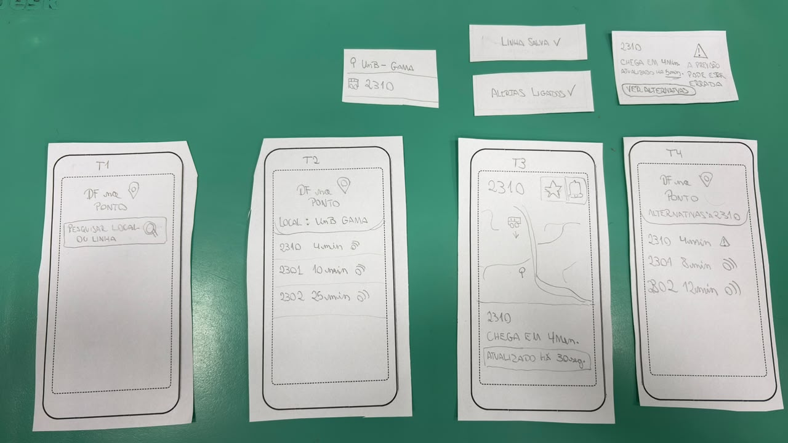
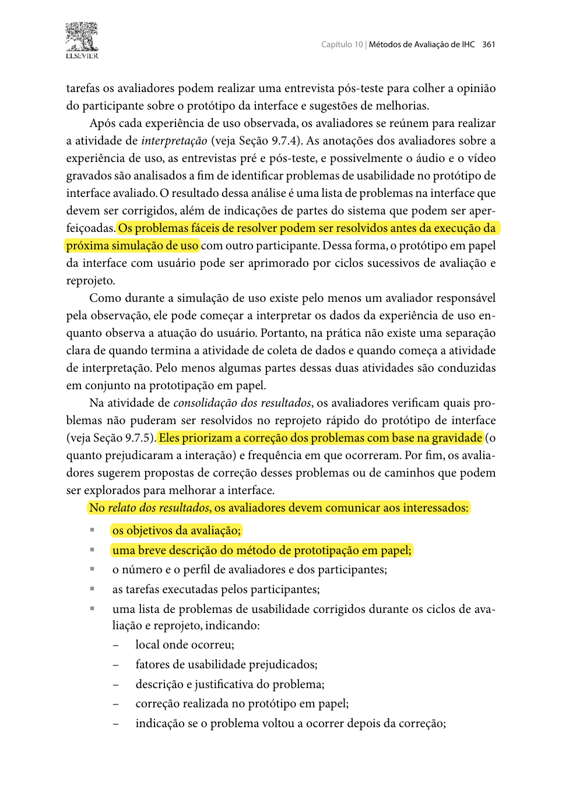
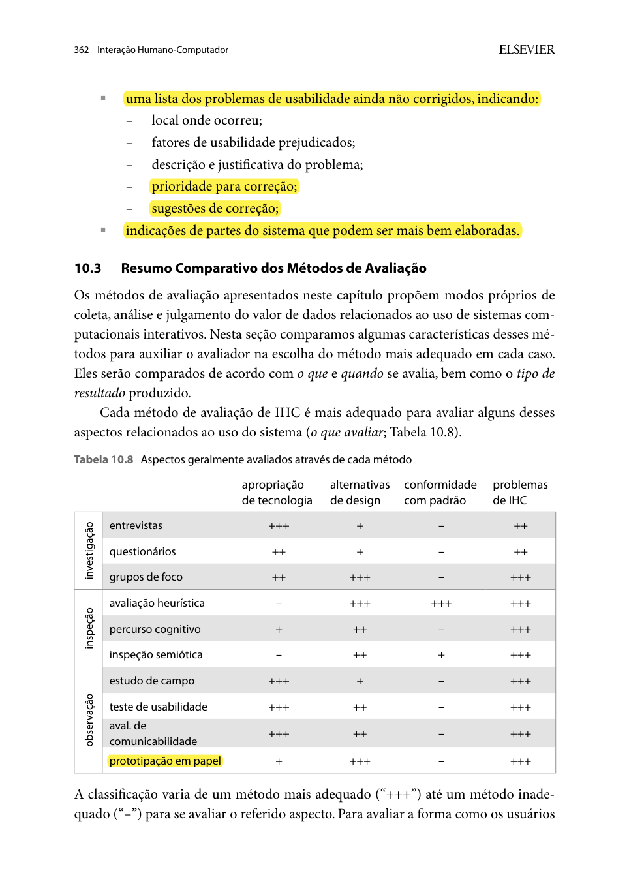
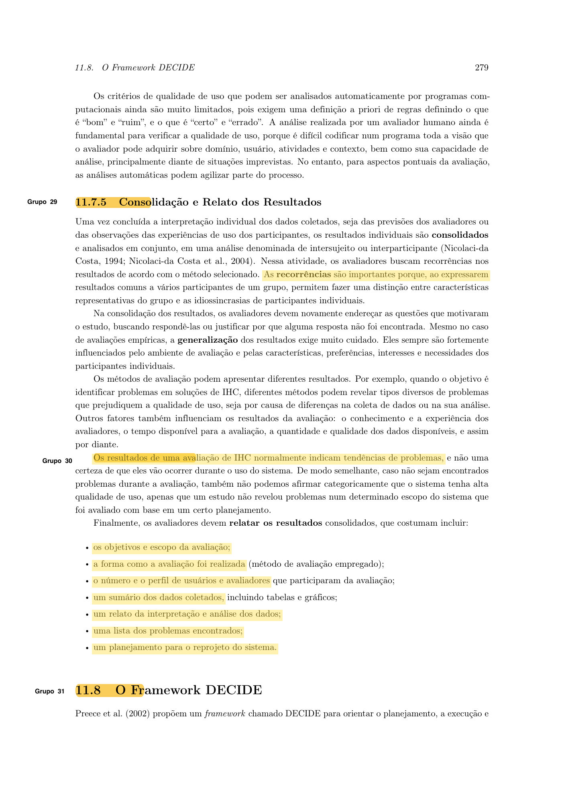

# Relato dos Resultados da Avaliação do Protótipo de Papel (TAR-06)

## Histórico de Versão

| Data | Versão | Descrição | Autor(es) | Revisor(es) | Declaração de uso de IA |
| :---: | :---: | :--- | :--- | :--- | :--- |
| 03/11/2026 | `1.0` | Relato dos resultados da avaliação do Protótipo de Papel (TAR-06), com base no teste piloto e na sessão de 03/11/2026. | [Carlos Costa](https://github.com/carloshfgit) | [Arthur Mariani](https://github.com/arthur-mariani) | Claude Code (Anthropic) - apenas revisou e formatou o texto em Markdown |

---

Neste documento, apresenta-se o **Relato dos Resultados da Avaliação do Protótipo de Papel** referente à **[TAR-06 (Consulta de ônibus em tempo real no DF no Ponto)](../../../../analise-de-requisitos/analise-de-tarefas/tar-06-df-no-ponto.md)**. A sessão seguiu o [Planejamento da Avaliação do Protótipo de Papel](../../planejamentos-individuais/Carlos/carlos-planejamento-av-prototipo-papel.md), e este relato segue a estrutura do [Planejamento do Relato](../../planejamentos-individuais/Carlos/carlos-planejamento-relato-prot-papel.md) (Tabela 1 daquele documento).

O conteúdo do relato da prototipação em papel segue Barbosa e Silva (2010, Seção 10.2.3, p. 361–362): objetivos, método, perfil dos participantes e avaliadores, tarefas e problemas encontrados, separando os corrigidos no papel dos pendentes ([Imagens 1 e 2](#imagem-1)).

---

## 1. Introdução e Objetivos

O protótipo de papel representa a consulta do ônibus em tempo real do [Storyboard 08](../../../nivel1/storyboards.md#38-storyboard-08-consulta-do-onibus-em-tempo-real-no-df-no-ponto), no contexto do [Cenário 2](../../../../analise-de-requisitos/cenarios/cenario-2-viagem-matutina.md) e da persona [João Pedro Carvalho](../../../../analise-de-requisitos/personas/joao-pedro-carvalho.md). Ele incorpora as recomendações da [avaliação do Storyboard 08 e da TAR-06](../../../nivel1/relatos-individuais/carlos/relato-resultados-storyboard-tarefas.md).

A avaliação teve como objetivos:

1. Identificar problemas de usabilidade e navegação nas telas de busca, resultados e detalhe da linha.
2. Verificar se o participante entende o tempo previsto e a indicação de **última atualização** (H4).
3. Observar a reação ao **aviso de posição desatualizada** (H5).
4. Verificar se **favoritar a linha** e **ativar o aviso de atraso** são encontrados e compreendidos (H2).
5. Coletar sugestões de reprojeto para o protótipo de alta fidelidade.

---

## 2. Método

O método foi a **Prototipação em Papel** (Snyder, 2003; Barbosa e Silva, 2010, Seção 10.2.3) com a técnica de **pensar em voz alta**. O participante tocava no papel como se fosse um celular, e o avaliador, no papel de "computador", trocava as telas e as peças apenas em resposta a esses toques. As tarefas foram entregues em cartões impressos, uma por vez, com o contexto do Cenário 2: *"Você está no ponto de ônibus de manhã e precisa chegar à UnB Gama para a primeira aula. Você costuma pegar a linha 2310."*

### 2.1 Teste Piloto

O teste piloto foi feito em **03/11/2026, por volta de 08:30**, cerca de 30 minutos antes da sessão, de forma presencial e com duração de cerca de 5 minutos. O participante simulado foi o integrante [Rodrigo Carvalho](https://github.com/RodrigoCBarbosa). O piloto foi gravado ([vídeo do teste piloto](https://youtu.be/-TKDwNGCNfw)).

  <iframe width="560" height="315" src="https://www.youtube-nocookie.com/embed/-TKDwNGCNfw" title="Teste piloto do protótipo de papel (TAR-06)" frameborder="0" allow="accelerometer; autoplay; clipboard-write; encrypted-media; gyroscope; picture-in-picture; web-share" allowfullscreen></iframe>

O piloto conferiu as peças, a troca das telas, o texto dos cartões, o tempo da sessão, o enquadramento e o áudio. **Nenhum ajuste foi necessário** depois do piloto. Conforme o planejamento, os dados do piloto **não entram nos resultados** (Barbosa et al., 2021, Seção 11.7.2, p. 260).

### 2.2 Datas em Relação ao Planejamento

O planejamento previa o piloto em 31/10/2026 e a sessão em 01/11/2026. Os dois foram realizados em **03/11/2026**. As datas reais foram registradas na versão `1.1` do [Planejamento da Avaliação](../../planejamentos-individuais/Carlos/carlos-planejamento-av-prototipo-papel.md).

---

## 3. Participante e Equipe

<strong>Tabela 1</strong> — Dados da sessão

| Item | Detalhamento |
| :--- | :--- |
| **Participante** | **P05**: estudante de Engenharia de Software da FCTE/UnB, na faixa dos 20 anos. Usa ônibus no DF algumas vezes por semana, já usou o DF no Ponto e costuma saber o número da linha que pega. Não participou da avaliação do Storyboard 08 (P04) e não integra o Grupo 05. |
| **"Computador" e condutor** | [Carlos Costa](https://github.com/carloshfgit) |
| **Observador e cronometragem** | [Arthur Mariani](https://github.com/arthur-mariani) |
| **Data e horário** | 03/11/2026, das 09:00 às 09:08 (cerca de 8 minutos) |
| **Local** | FCTE/UnB, presencial |
| **Ética** | TCLE lido e assinado em duas vias; gravação autorizada, enquadrando apenas a mesa e as mãos, com áudio. O rosto e o nome do participante não aparecem no vídeo. |
| **Gravação** | [Vídeo da sessão](https://youtu.be/WSbr1ijrhuI) |

<em>Fonte: Elaborado por Carlos Costa (2026).</em>

A gravação da sessão está abaixo e também [no YouTube](https://youtu.be/WSbr1ijrhuI).

  <iframe width="560" height="315" src="https://www.youtube-nocookie.com/embed/WSbr1ijrhuI" title="Sessão do protótipo de papel (TAR-06) com o participante P05" frameborder="0" allow="accelerometer; autoplay; clipboard-write; encrypted-media; gyroscope; picture-in-picture; web-share" allowfullscreen></iframe>

---

## 4. Protótipo Utilizado

A [Imagem 4](#imagem-4) mostra o protótipo montado para a sessão. Na confecção, algumas peças mudaram em relação à Tabela 3 do planejamento. A Tabela 2 registra as peças como foram usadas.

<strong>Imagem 4</strong> — Telas e peças do protótipo de papel da TAR-06

<em>Fonte: Elaborado por Carlos Costa (2026).</em>

<strong>Tabela 2</strong> — Peças usadas na sessão

| Peça | Conteúdo | Diferença em relação ao planejamento | Tarefa |
| :--- | :--- | :--- | :---: |
| **T1 — Tela inicial** | "DF no Ponto" e uma barra de pesquisa única: "Pesquisar local ou linha". | O planejamento previa duas opções separadas ("linha" e "lugar de referência") e a área de favoritos vazia. A busca virou uma barra única. | 06.1 |
| **Lista de sugestões da busca** | Recorte pequeno com as sugestões "UnB Gama" (lugar) e "2310" (linha), mostrado ao tocar na barra de pesquisa. | Peça nova. | 06.1 |
| **T2 — Resultados por lugar** | "Local: UnB Gama" com três linhas: 2310 (4 min), 2301 (10 min) e 2302 (25 min). | Lista detalhada para a busca por "UnB Gama". Não foi exibida na sessão, porque P05 escolheu a linha direto nas sugestões. | 06.1 |
| **T3 — Detalhe da linha** | Linha 2310, botões de favoritar (estrela) e de aviso (sino), mapa com o ônibus e o ponto, "Chega em 4 min" e "Atualizado há 30 seg." | Conforme o planejamento. | 06.1–06.3 |
| **N1 — Aviso de posição desatualizada** | Recorte colado sobre T3: "2310 — Chega em 4 min, atualizado há 5 min. A previsão pode estar errada", com o botão "Ver alternativas". | Só com a opção "Ver alternativas". A opção "Consultar de novo" e a peça T3′ não foram usadas. | 06.2 |
| **T4 — Alternativas** | "Alternativas à 2310": 2310 (4 min, com alerta), 2301 (8 min) e 2302 (12 min). | Conforme o planejamento. | 06.2 |
| **N2a / N2b — Confirmações** | "Linha salva ✓" e "Alertas ligados ✓". | Conforme o planejamento. | 06.3 |

<em>Fonte: Elaborado por Carlos Costa (2026).</em>

---

## 5. Tarefas e Desempenho

Os tempos de cada tarefa e a minutagem das falas **não foram registrados** separadamente durante a sessão. A sessão inteira, com as três tarefas e a entrevista, durou cerca de 8 minutos.

<strong>Tabela 3</strong> — Desempenho do participante por tarefa

| ID | Tarefa | Sucesso sem ajuda? | Tempo | Pedidos de ajuda | Observações |
| :---: | :--- | :---: | :---: | :---: | :--- |
| **06.1** | Descobrir em quanto tempo chega o próximo ônibus para a UnB Gama. | **Sim** | Não registrado | 0 | Na lista de sugestões da busca, P05 tocou direto na linha 2310 e foi para T3, sem passar pela lista T2 (resultados por lugar). Navegou sem dificuldade. Cerca de 30 segundos depois do início, o condutor o lembrou de pensar em voz alta. |
| **06.2** | Entender o aviso de posição desatualizada e decidir o que fazer. | **Sim** | Não registrado | 0 | Identificou o aviso e tocou logo em "Ver alternativas". Não houve falas durante a tarefa; a justificativa veio na entrevista. |
| **06.3** | Favoritar a linha e ativar o aviso de atraso. | **Sim** | Não registrado | 0 | Encontrou e usou os dois botões com naturalidade e recebeu as duas confirmações. |

<em>Fonte: Elaborado por Carlos Costa (2026).</em>

Não houve toques em lugares sem peça preparada.

---

## 6. Entrevista Pós-Teste

<strong>Tabela 4</strong> — Respostas da entrevista pós-teste

| # | Pergunta | Ligação | Resposta do participante |
| :---: | :--- | :---: | :--- |
| **1** | Na tela da linha havia o texto "Atualizado há 30 s". O que ele quer dizer? Muda o quanto você confia na previsão? | P04 · H4 | Explicou corretamente o significado e disse que a indicação *"aumenta a confiança"*. |
| **2** | Quando apareceu o aviso sobre a posição do ônibus, o que você entendeu? O que te fez escolher o que escolheu? | P05 · H5 | Percebeu que a posição *"não tá atualizada"* e por isso preferiu ver outras linhas. |
| **3** | Foi mais fácil encontrar a linha pelo número ou pelo lugar? Seria útil o app já mostrar as linhas que você usa? | P01 · H2 · H6 | Disse que prefere buscar por lugar. |
| **4** | Na lista de resultados, ficou claro qual era a sua linha e o seu ponto? | P02 · H3 | Sim. |
| **5** | Você salvaria a linha e pediria o aviso de atraso no dia a dia? Foi fácil de achar? | P06 | Disse que sim e que achou fácil. |
| **6** | Usando um app assim no ponto, você se sentiria informado enquanto espera? | H7 | Disse que sim. O motivo não foi perguntado. |
| **7** | O que você mudaria nessas telas? | Reprojeto | Não sugeriu mudanças. |

<em>Fonte: Elaborado por Carlos Costa (2026).</em>

O participante não fez comentários espontâneos além das respostas acima.

---

## 7. Problemas Encontrados

A classificação usaria a escala de severidade de Nielsen (1994), descrita na Tabela 2 do [Planejamento do Relato](../../planejamentos-individuais/Carlos/carlos-planejamento-relato-prot-papel.md), e os campos de registro de Barbosa et al. (2021, Seção 12.2.1, p. 303).

<strong>Tabela 5</strong> — Problemas de usabilidade encontrados

| ID | Descrição do problema | Tela / peça | Tarefa | Severidade (0–4) | Hipótese relacionada | Sugestão de reprojeto |
| :---: | :--- | :--- | :---: | :---: | :---: | :--- |
| — | Nenhum problema de usabilidade foi observado. O participante concluiu as três tarefas sem ajuda, não tocou em resultado errado e não sugeriu mudanças. | — | — | — | — | Manter o fluxo na alta fidelidade. |

<em>Fonte: Elaborado por Carlos Costa (2026).</em>

---

## 8. Corrigidos no Papel × Pendentes

Nenhuma peça foi redesenhada durante a sessão, porque não surgiram problemas. A Tabela 6 registra os pontos que o protótipo de papel **não chegou a testar** por causa das mudanças na confecção (Tabela 2) e que ficam para a alta fidelidade.

<strong>Tabela 6</strong> — Correções no papel e pendências para a alta fidelidade

| ID | Item | Corrigido durante a sessão? | Voltou a ocorrer? | Encaminhamento |
| :---: | :--- | :---: | :---: | :--- |
| **PE-01** | O aviso N1 ofereceu só "Ver alternativas"; a opção "Consultar de novo", prevista no planejamento, não foi testada. | Não se aplica | Não se aplica | Incluir as duas opções no aviso da alta fidelidade e observar qual o participante escolhe. |
| **PE-02** | A lista de resultados por lugar (T2), com linhas de números parecidos, não foi exibida, então a seleção na lista (H3) não foi testada. | Não se aplica | Não se aplica | Incluir na alta fidelidade uma tarefa que passe pela busca por lugar. |
| **PE-03** | Os tempos de cada tarefa não foram medidos. | Não se aplica | Não se aplica | Cronometrar cada tarefa nas sessões de alta fidelidade, como prevê o planejamento. |

<em>Fonte: Elaborado por Carlos Costa (2026).</em>

---

## 9. Hipóteses da TAR-06

<strong>Tabela 7</strong> — Situação das hipóteses após o protótipo de papel

| ID | Hipótese (resumo) | Evidência na simulação | Situação após o protótipo de papel |
| :---: | :--- | :--- | :---: |
| **H2** | A busca exige lembrar a linha; um atalho para linhas usadas ajudaria. | P05 sabe o número da linha e, na tarefa, tocou direto na linha 2310 nas sugestões; na entrevista, disse preferir buscar por lugar. Favoritou a linha sem ajuda e disse que faria isso no dia a dia. | Parcialmente reforçada |
| **H3** | Itens próximos na lista levam à seleção errada. | P05 escolheu a linha correta nas sugestões da busca e disse que ficou claro qual era a sua linha. A lista T2, com números parecidos (2310, 2301, 2302), não foi exibida. | Sem evidência suficiente |
| **H4** | A indicação de última atualização ajuda a avaliar a confiabilidade. | P05 explicou o "Atualizado há 30 s" e disse que ele *"aumenta a confiança"*. | Reforçada |
| **H5** | O usuário trata a posição defasada como atual e decide com base em dado errado. | Com o aviso N1, P05 percebeu que a posição *"não tá atualizada"* e foi ver alternativas. | Contrariada (com o aviso N1 presente) |
| **H6** | O usuário novo não conhece a busca por referência. | P05 já usava o DF no Ponto; não é usuário novo. | Sem evidência |
| **H7** | Com a consulta em tempo real, o passageiro se sente informado enquanto espera. | P05 disse que se sentiria informado, sem dizer o motivo. | Reforçada (sem justificativa) |

<em>Fonte: Elaborado por Carlos Costa (2026), com base na Tabela 5 da TAR-06.</em>

---

## 10. Recomendações e Limitações

### 10.1 Recomendações para o Protótipo de Alta Fidelidade

1. **Manter o fluxo validado:** barra de busca única com sugestões de lugar e de linha, resultados por lugar, detalhe da linha com "Atualizado há..." e botões de favoritar e de aviso de atraso.
2. **Manter o aviso de posição desatualizada com a opção "Ver alternativas"**, que P05 entendeu e usou sem ajuda, e acrescentar "Consultar de novo" (PE-01).
3. **Manter as duas formas de busca na mesma barra:** P05 usou o número da linha na tarefa, mas disse preferir buscar por lugar.
4. **Medir o tempo de cada tarefa** e anotar a minutagem das falas (PE-03).
5. **Recrutar ao menos um usuário que nunca usou o DF no Ponto**, para obter evidência sobre H6.

Essas recomendações seguem para o [Planejamento da Avaliação do Protótipo de Alta Fidelidade](../../../nivel3/planejamentos-individuais/carlos/carlos-planejamento-av-prot-alta-fidel.md).

### 10.2 Limitações

Barbosa et al. (2021, p. 279) lembram que o relato deve deixar claros os limites da interpretação ([Imagem 3](#imagem-3)). Nesta avaliação:

* **Um participante:** os resultados indicam tendências e não garantem que não existam outros problemas.
* **Participante experiente:** P05 já usa o DF no Ponto e sabe o número da linha, o que pode explicar a navegação sem dificuldade e não informa sobre usuários novos (H6).
* **Sem tempos por tarefa e sem minutagem:** a eficiência não pode ser comparada com a alta fidelidade.
* **Pensar em voz alta incompleto:** o participante falou pouco durante as tarefas, e a explicação das escolhas veio quase toda da entrevista.
* **Caminho único na busca:** P05 escolheu a linha direto nas sugestões, então a lista por lugar (T2) e a hipótese H3 não foram testadas.
* **Mudanças nas peças:** a opção "Consultar de novo" não foi oferecida, então a decisão diante do aviso (H5) foi observada só com a opção de ver alternativas.
* **Sessão curta:** cerca de 8 minutos, contra os 25 minutos previstos, e a pergunta 6 da entrevista ficou sem o "por quê".

---

## 11. Fotos de Referência

<em>Imagem 1 — Interpretação, consolidação e itens do relato da prototipação em papel, parte 1 (Barbosa e Silva, 2010, Seção 10.2.3, p. 361).</em>

<em>Imagem 2 — Itens do relato da prototipação em papel, parte 2: problemas não corrigidos (Barbosa e Silva, 2010, Seção 10.2.3, p. 362).</em>

<em>Imagem 3 — Consolidação, limites da interpretação e estrutura do relato (Barbosa et al., 2021, Seção 11.7.5, p. 279).</em>

---

## 12. Declaração sobre o Uso de IA Generativa

Em cumprimento ao Plano de Ensino e ao Código de Conduta da SBC, declara-se que a ferramenta **Claude Code (Anthropic)** foi utilizada apenas para revisar e formatar o texto em Markdown. A condução da sessão, o registro das observações e das respostas do participante e a interpretação dos resultados são de responsabilidade de Carlos Costa.

---

## 13. Referências Bibliográficas

* BARBOSA, Simone Diniz Junqueira; SILVA, Bruno Santana da. **Interação Humano-Computador**. Rio de Janeiro: Elsevier, 2010. (Capítulo 10, Seção 10.2.3: Prototipação em Papel, p. 358–362).
* BARBOSA, Simone Diniz Junqueira; SILVA, Bruno Santana da; SILVEIRA, Milene Selbach; GASPARINI, Isabela; DARIN, Ticianne; BARBOSA, Gabriel Diniz Junqueira. **Interação Humano-Computador e Experiência do Usuário**. Rio de Janeiro: Autopublicação, 2021. ISBN 978-65-00-19677-1. (Seção 11.7.2, p. 260; Seção 11.7.5, p. 279; Seção 12.2.1, p. 303).
* NIELSEN, Jakob. **Usability Engineering**. San Francisco: Morgan Kaufmann, 1994.
* SALES, André Barros de. **Plano de Ensino: Interação Humano Computador**. Brasília: Universidade de Brasília, Faculdade UnB Gama (FCTE/UnB), 2026.
* SNYDER, Carolyn. **Paper Prototyping: The Fast and Easy Way to Design and Refine User Interfaces**. San Francisco: Morgan Kaufmann, 2003.

---
**Autor:** [Carlos Costa](https://github.com/carloshfgit)  
**Revisor:** [Arthur Mariani](https://github.com/arthur-mariani)
