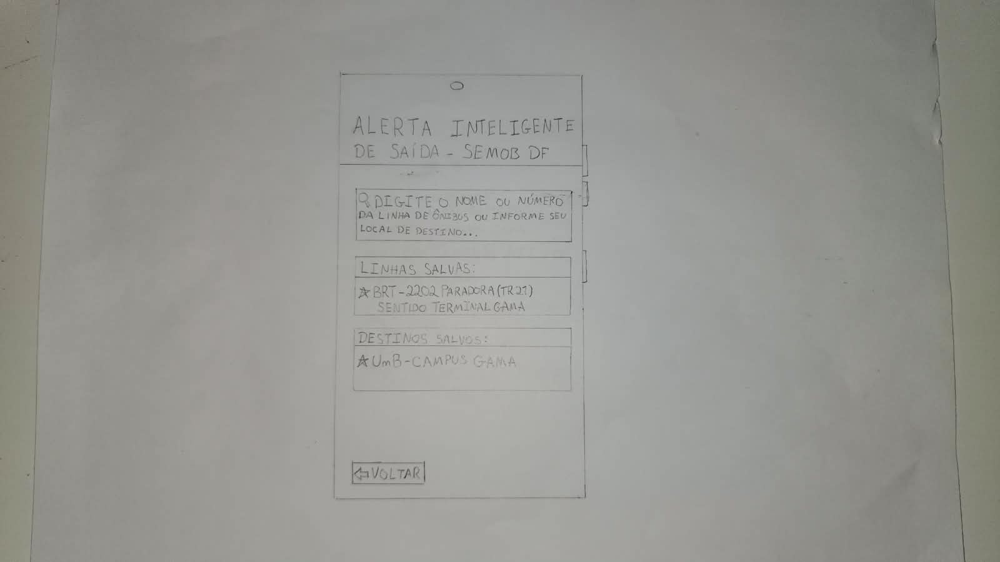
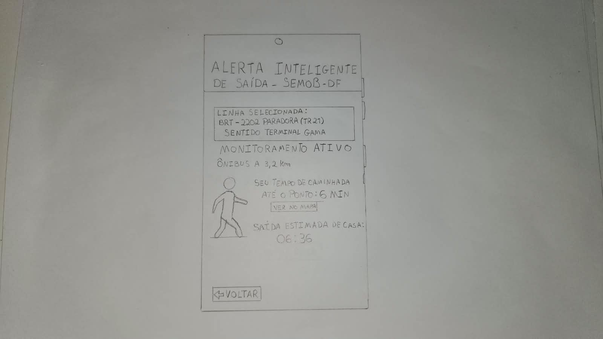
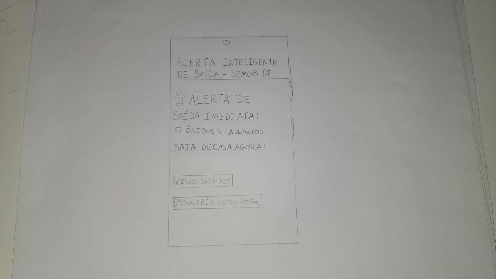
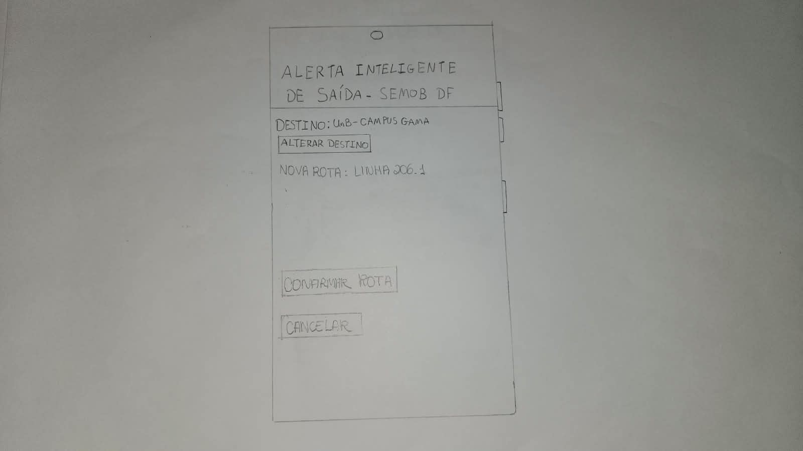
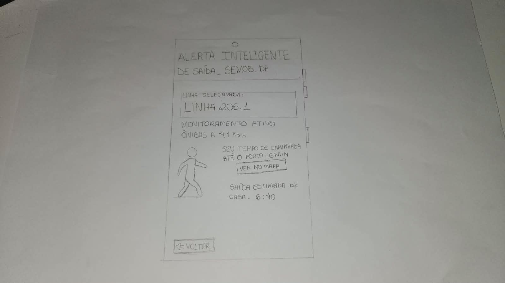
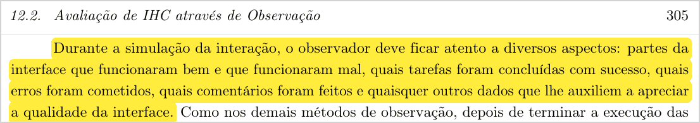

## Histórico de Versão e Contribuição

| Data | Versão | Descrição | Autor(es) | Revisor(es) | Declaração de Uso de IA |
| :---: | :---: | :--- | :--- | :--- | :--- |
| 31/10/2026 | `1.0` | Consolidação dos resultados da avaliação presencial do Protótipo de Papel da [TAR-01](https://interacao-humano-computador.github.io/2026.2-Grupo05/analise-de-requisitos/analise-de-tarefas/tar-01-alerta-saida/#tar-01-alerta-inteligente-de-saida) com base na entrevista de validação. | [Igor Dantas Araújo](https://github.com/IgorDARAUJO) | [Gabriel Cardone](https://github.com/gabriellcardone-06) | Google Gemini - usado para formatação markdown da página |
| 19/11/2026 | `1.1` | Padronização da estrutura (histórico no topo, conteúdo, fotos de referência e referências ao final); declaração de IA levada para o histórico; autor e revisor retirados do rodapé; retirada das referências que não são o livro da disciplina nem material do professor; inclusão de fotos de referência grifadas. Inclusão do bloco de artefatos relacionados (persona, cenário, análise de tarefas, storyboard, planejamentos, relatos e protótipos da funcionalidade). | [Gabriel Melo](https://github.com/gabriellcardone-06) | Pendente de revisão | Claude (Anthropic) — apoio na padronização da estrutura do artefato, na revisão das referências e na formatação em Markdown.; apoio na inclusão dos links entre artefatos |

---

# Relato dos Resultados da Avaliação do Protótipo de Papel ([TAR-01](https://interacao-humano-computador.github.io/2026.2-Grupo05/analise-de-requisitos/analise-de-tarefas/tar-01-alerta-saida/#tar-01-alerta-inteligente-de-saida))

Neste documento, apresenta-se o **Relato dos Resultados da Avaliação do Protótipo de Papel** referente à **[TAR-01 (Alerta Inteligente de Saída de Casa)](https://interacao-humano-computador.github.io/2026.2-Grupo05/analise-de-requisitos/analise-de-tarefas/tar-01-alerta-saida/#tar-01-alerta-inteligente-de-saida)**. O relatório consolida as evidências empíricas coletadas durante a sessão presencial de teste de usabilidade em papel realizada com um representante do público-alvo primário.

A estrutura deste documento segue as orientações da literatura de Interação Humano-Computador (Barbosa et al., 2021, Cap. 12, Seção 12.2.3) e atende aos requisitos do Plano de Ensino da disciplina.

**Artefatos relacionados — fluxo da funcionalidade TAR-01 (Alerta Inteligente de Saída de Casa):**

* **Persona:** [João Pedro Carvalho](../../../../analise-de-requisitos/personas/joao-pedro-carvalho.md)
* **Cenário:** [Cenário 2](../../../../analise-de-requisitos/cenarios/cenario-2-viagem-matutina.md)
* **Análise de tarefas:** [TAR-01](../../../../analise-de-requisitos/analise-de-tarefas/tar-01-alerta-saida.md)
* **Storyboard:** [Storyboard 01](../../../nivel1/storyboards.md#31-storyboard-01-alerta-inteligente-de-saida-de-casa)
* **Nível 1 — avaliação do storyboard e da análise de tarefas:** [Planejamento da avaliação](../../../nivel1/planejamentos-individuais/Igor/igor-planejamento-avaliacao.md) · [Planejamento do relato](../../../nivel1/planejamentos-individuais/Igor/igor-planejamento-relato-resultados-avaliacao.md) · [Relato dos resultados](../../../nivel1/relatos-individuais/igor/relato-resultados-storyboard-tarefas.md)
* **Nível 2 — protótipo de papel (baixa fidelidade):** [Planejamento da avaliação](../../planejamentos-individuais/Igor/igor-planejamento-av-prototipo-papel.md) · [Planejamento do relato](../../planejamentos-individuais/Igor/igor-planejamento-relato-prot-papel.md) · Relato dos resultados (*esta página*)
* **Nível 3 — protótipo de alta fidelidade:** [Planejamento da avaliação](../../../nivel3/planejamentos-individuais/igor/planejamento-av-prot-alta-fidel.md) · [Planejamento do relato](../../../nivel3/planejamentos-individuais/igor/planejamento-relato-prot-alta-fidel.md) · [Relato dos resultados](../../../nivel3/relatos-individuais/igor/relato-resultados-prot-alta-fidel.md)
* **Telas do protótipo de papel:** [telas no planejamento da avaliação](../../planejamentos-individuais/Igor/igor-planejamento-av-prototipo-papel.md#9-telas-do-prototipo-avaliado)
* **Protótipo de alta fidelidade navegável:** [acessar o protótipo](https://www.figma.com/proto/00YEuKWtN4N1rBzpC8V7Gd/prototipo-de-igor?node-id=0-1&t=S9Z2PNsKlHC3LlTt-1)

---

## 1. Introdução e Objetivos do Relato

O objetivo desta avaliação formativa foi verificar a usabilidade e a comunicabilidade da solução de interface em papel desenvolvida para a **[TAR-01 (Alerta Inteligente de Saída de Casa)](https://interacao-humano-computador.github.io/2026.2-Grupo05/analise-de-requisitos/analise-de-tarefas/tar-01-alerta-saida/#tar-01-alerta-inteligente-de-saida)**. O estudo investigou a clareza dos componentes de interface (botões e campos de busca), a aceitação do cálculo automático do tempo de caminhada via GPS e a eficácia da notificação proativa de saída imediata.

---

## 2. O Protótipo de Papel Avaliado

O protótipo de papel da TAR-01 é composto por cinco telas desenhadas à mão, apresentadas abaixo na ordem do fluxo de interação simulado durante a sessão:

<strong>Figura 1</strong> — Tela inicial: busca por linha ou destino, linhas e destinos salvos

{ width="600" }

<em>Fonte: Elaborado por Igor Dantas Araújo (2026).</em>

<strong>Figura 2</strong> — Monitoramento ativo: tempo de caminhada calculado via GPS e horário estimado de saída

{ width="600" }

<em>Fonte: Elaborado por Igor Dantas Araújo (2026).</em>

<strong>Figura 3</strong> — Alerta de saída imediata: ônibus adiantado, com opções "Estou saindo!" e "Sugerir outra rota"

{ width="600" }

<em>Fonte: Elaborado por Igor Dantas Araújo (2026).</em>

<strong>Figura 4</strong> — Rota alternativa: sugestão de nova linha para o destino, com opções de confirmar ou cancelar

{ width="600" }

<em>Fonte: Elaborado por Igor Dantas Araújo (2026).</em>

<strong>Figura 5</strong> — Monitoramento da nova rota: linha alternativa selecionada e novo horário estimado de saída

{ width="600" }

<em>Fonte: Elaborado por Igor Dantas Araújo (2026).</em>

---

## 3. Metodologia e Caracterização dos Participantes

A avaliação foi conduzida por meio do método de **Prototipação em Papel** em ambiente presencial controlado. Durante a simulação, o participante interagiu com as telas de papel indicando suas ações com os dedos, enquanto o avaliador atuou como "computador", manipulando e sobrepondo as peças móveis (cards) em resposta às decisões do usuário.

### Perfis e Atribuições na Sessão:
* **Avaliador / "Computador":** Igor Dantas Araújo (condução, manipulação do protótipo de papel e entrevista pós-teste).
* **Participante / Usuário Convidado:** **João Paulo**.
* **Perfil do Participante:** Usuário frequente do transporte público coletivo do Distrito Federal, enquadrando-se no perfil da persona [João Pedro Carvalho](https://interacao-humano-computador.github.io/2026.2-Grupo05/analise-de-requisitos/personas/joao-pedro-carvalho/).
* **Aspectos Éticos:** O participante foi devidamente informado sobre os objetivos acadêmicos do estudo, o caráter voluntário de sua participação e a confidencialidade dos dados, assinou o TCLE e concedeu autorização para a gravação da sessão.
* **Termo de Consentimento Livre e Esclarecido (TCLE):** [Visualizar PDF do TCLE Assinado](../../../../assets/PDFs/Igor_TCLE_JPMoraes.pdf)
* **Gravação:** O vídeo da sessão está disponível [aqui](https://youtu.be/ZurUrGtRDMk).

---

## 4. Sumário e Consolidação dos Dados Coletados

### 4.1 Desempenho nas Tarefas do Protótipo em Papel

<strong>Tabela 1</strong> — Desempenho do Participante nas Tarefas do Protótipo de Papel

| ID Tarefa | Descrição da Tarefa no Protótipo | Sucesso sem Ajuda? | Pedidos de Ajuda | Avaliação da Usabilidade |
| :---: | :--- | :---: | :---: | :---: |
| **[TAR-01.1](https://interacao-humano-computador.github.io/2026.2-Grupo05/analise-de-requisitos/analise-de-tarefas/tar-01-alerta-saida/#tar-01-alerta-inteligente-de-saida)** | Identificar os campos de digitação/busca e selecionar a linha de ônibus. | **Sim** | **0** | **Satisfatório** |
| **[TAR-01.2](https://interacao-humano-computador.github.io/2026.2-Grupo05/analise-de-requisitos/analise-de-tarefas/tar-01-alerta-saida/#tar-01-alerta-inteligente-de-saida)** | Visualizar o tempo de caminhada calculado via GPS e ativar o alerta de saída. | **Sim** | **0** | **Satisfatório** |
| **[TAR-01.3](https://interacao-humano-computador.github.io/2026.2-Grupo05/analise-de-requisitos/analise-de-tarefas/tar-01-alerta-saida/#tar-01-alerta-inteligente-de-saida)** | Receber e interpretar a notificação de adiantamento (*post-it* de saída imediata). | **Sim** | **0** | **Satisfatório** |

<em>Fonte: Elaborado por Igor Dantas Araújo (2026).</em>

---

### 4.2 Consolidação das Respostas da Entrevista Pós-Teste

<strong>Tabela 2</strong> — Consolidação das Respostas da Entrevista pós-teste

| ID | Tópico Avaliado | Pergunta Aplicada ao Participante | Resumo da Resposta do Participante | Avaliação do Artefato |
| :---: | :--- | :--- | :--- | :---: |
| **Q01** | **Identificação de Campos e Botões** | *"Foi fácil identificar os campos de digitação e os botões onde clicar? Ficou alguma dúvida?"* | Afirmou que a interface ficou bem clara e que os botões e locais de interação estão bem indicados. | **Conforme** |
| **Q02** | **Cálculo Automático de Caminhada via GPS** | *"O sistema calcula automaticamente o tempo de caminhada até o ponto. Você acha válido esse cálculo automático ou preferiria inserir manualmente?"* | Avaliou de forma muito positiva: *"Acho que é muito bom. Acho que facilita bastante, é uma coisa bem prática, não tenho nenhum problema com cálculo automático"*. | **Conforme / Validado** |
| **Q03** | **Compreensão do Alerta Proativo** | *"Quando o alerta para sair de casa foi colocado em cima da tela, você entendeu de imediato o que estava acontecendo?"* | Confirmou que compreendeu a notificação de saída imediata de forma direta e sem dúvidas. | **Conforme** |
| **Q04** | **Incerteza / Sensação de Bloqueio** | *"Teve algum momento durante o teste que você se sentiu travado, confuso ou com medo de fazer a escolha errada?"* | Declarou que em nenhum momento sentiu travamento, dúvida ou receio durante a navegação. | **Sem Problemas** |
| **Q05** | **Sugestões de Alteração / Melhorias** | *"Se você pudesse mudar, retirar ou adicionar qualquer coisa nessas telas, você colocaria algo?"* | Respondeu que não alteraria nada: *"Não. Acho que as coisas estão bem explicadas, tá tudo bem destacado, bem tranquilo"*. | **Conforme** |

<em>Fonte: Elaborado por Igor Dantas Araújo (2026).</em>

---

### 4.3 Tabela de Registro e Priorização de Problemas de IHC

Conforme estabelecido pela escala de severidade de problemas de usabilidade de Nielsen (1994 apud BARBOSA et al., 2021) e Barbosa et al. (2021), registra-se a ocorrência de problemas observados:

<strong>Tabela 3</strong> — Registro e Classificação de Problemas de IHC

| ID Problema | Descrição do Problema Encontrado | Peça / Tela de Papel Afetada | Severidade (0 a 4) | Impacto na Experiência | Ação Corretiva / Recomendação |
| :---: | :--- | :--- | :---: | :--- | :--- |
| **NENHUM** | Nenhum problema de usabilidade, hesitação ou erro de navegação foi detectado durante a sessão. | N/A | **0 (Sem Importância)** | O participante operou o protótipo com fluidez e aprovou integralmente o fluxo visual. | Manter a estrutura aprovada e transitar para a prototipação digital. |

<em>Fonte: Elaborado por Igor Dantas Araújo (2026).</em>

---

### 4.4 Tabela de Iterações no Protótipo de Papel vs. Alta Fidelidade

<strong>Tabela 4</strong> — Registro de Iterações e Pendências de Reprojeto

| ID Item | Modificação Sugerida / Testada | Resolvido no Papel? | Status para Prototipação Digital (Alta Fidelidade) |
| :---: | :--- | :---: | :--- |
| **IT-01** | Manter o cálculo automático do tempo de caminhada via GPS sem intervenção manual. | **Sim** | **Aprovado:** Incorporar como requisito fixo na interface digital. |
| **IT-02** | Manter os botões de ação e caixas de notificação em destaque simplificado. | **Sim** | **Aprovado:** Replicar o layout na prototipação de alta fidelidade. |

<em>Fonte: Elaborado por Igor Dantas Araújo (2026).</em>

---

## 5. Recomendações e Próximos Passos (Prototipação de Alta Fidelidade)

Como o protótipo de papel da **[TAR-01](https://interacao-humano-computador.github.io/2026.2-Grupo05/analise-de-requisitos/analise-de-tarefas/tar-01-alerta-saida/#tar-01-alerta-inteligente-de-saida)** obteve aprovação total do participante **João Paulo** sem apontamentos de problemas, as recomendações para as próximas fases do ciclo de design de IHC são:

1. **Preservar a Carga Cognitiva Reduzida:** Manter a automação do tempo de caminhada via GPS, garantindo que o usuário não precise calcular manualmente seu deslocamento até o ponto de ônibus.
2. **Design da Notificação Digital:** Replicar na versão digital a notificação de alerta proativo com destaque visual imediato para acionamento de saída.
3. **Transição para Alta Fidelidade:** Prosseguir diretamente para a construção dos wireframes interativos e protótipo digital de alta fidelidade no Figma/ferramenta de prototipação da equipe.

---

## 6. Fotos de Referência

As Figuras 6 a 8 mostram os trechos que fundamentam este artefato, recortados e grifados em amarelo diretamente do livro da disciplina (BARBOSA et al., 2021).

<strong>Figura 6</strong> — Prototipação em papel: o que o observador deve registrar

<em>Fonte: BARBOSA et al. (2021, p. 305). Recorte e grifo: [Gabriel Melo](https://github.com/gabriellcardone-06) (2026).</em>

<strong>Figura 7</strong> — 12.2.3 Prototipação em papel: refinamento, priorização e relato

<em>Fonte: BARBOSA et al. (2021, pp. 305–306). Recorte e grifo: [Gabriel Melo](https://github.com/gabriellcardone-06) (2026).</em>

<strong>Figura 8</strong> — Prototipação em papel: conteúdo do relato dos resultados

<em>Fonte: BARBOSA et al. (2021, pp. 305–306). Recorte e grifo: [Gabriel Melo](https://github.com/gabriellcardone-06) (2026).</em>

---

## 7. Referências Bibliográficas

* BARBOSA, Simone Diniz Junqueira; SILVA, Bruno Santana da; SILVEIRA, Milene Selbach; GASPARINI, Isabela; DARIN, Ticianne; BARBOSA, Gabriel Diniz Junqueira. **Interação Humano-Computador e Experiência do Usuário**. Rio de Janeiro: Autopublicação, 2021. ISBN 978-65-00-19677-1. (Capítulo 12: Métodos de Avaliação de IHC, Seção 12.2.3, p. 303–306).
* SALES, André Barros de. **Plano de Ensino: Interação Humano Computador**. Brasília: Universidade de Brasília, Faculdade UnB Gama (FCTE/UnB), 2026.
