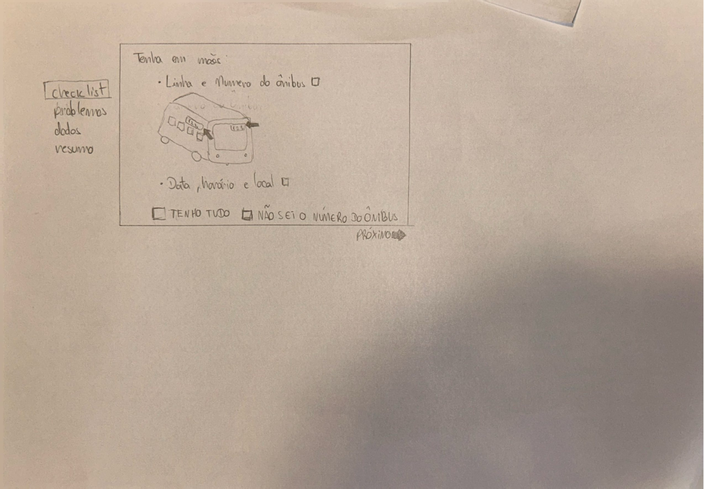
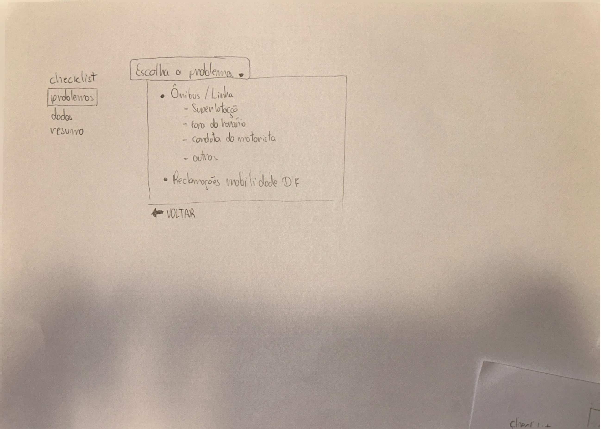
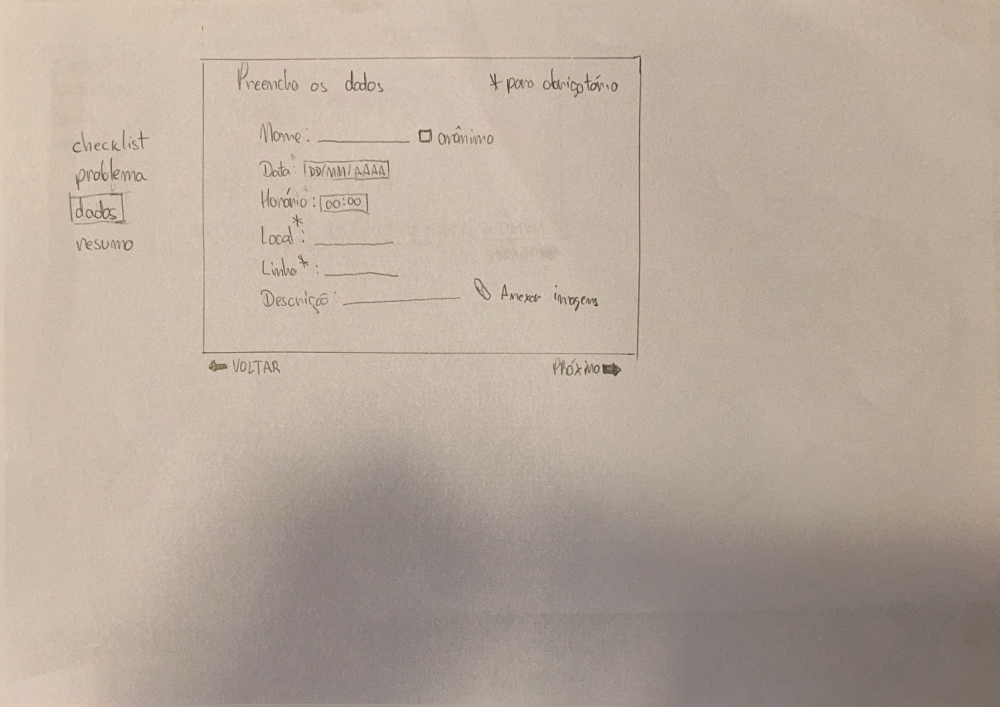
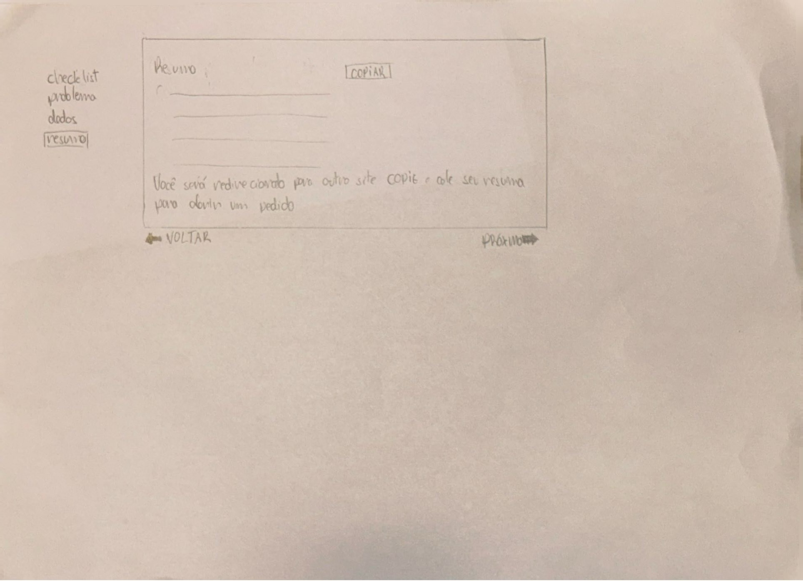
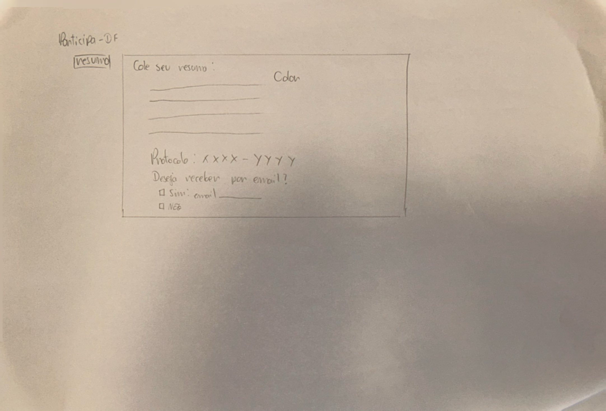

## Histórico de Versão

| Data | Versão | Descrição | Autor(es) | Revisor(es) | Declaração de uso de IA |
| :---: | :---: | :--- | :--- | :--- | :--- |
| 03/11/2026 | `1.0` | Consolidação dos resultados da avaliação presencial do Protótipo de Papel da [TAR-08](../../../../analise-de-requisitos/analise-de-tarefas/tar-08-reclamacao-onibus.md). | [Rodrigo Barbosa](https://github.com/RodrigoCBarbosa) | [Carlos Costa](https://github.com/carloshfgit) | Google Gemini - usado para formatação markdown da página e estruturação das tabelas |

---

# Relato dos Resultados da Avaliação do Protótipo de Papel ([TAR-08](../../../../analise-de-requisitos/analise-de-tarefas/tar-08-reclamacao-onibus.md))

Neste documento, apresenta-se o **Relato dos Resultados da Avaliação do Protótipo de Papel** referente à **[TAR-08 (Registro de Reclamação sobre Ônibus a partir do Site da Semob)](../../../../analise-de-requisitos/analise-de-tarefas/tar-08-reclamacao-onibus.md)**. O relatório consolida as evidências empíricas coletadas durante a sessão presencial de teste de usabilidade em papel realizada com um representante do público-alvo primário, seguindo o planejamento definido no [Planejamento da Avaliação do Protótipo de Papel (TAR-08)](../../planejamentos-individuais/Rodrigo/rodrigo-planejamento-av-prototipo-papel.md) e no [Planejamento do Relato dos Resultados (TAR-08)](../../planejamentos-individuais/Rodrigo/rodrigo-planejamento-relato-prot-papel.md).

A estrutura deste documento segue as orientações da literatura de Interação Humano-Computador (Barbosa et al., 2021, Cap. 11, Seção 11.7.5; Cap. 12, Seção 12.2.3) e atende aos requisitos do Plano de Ensino da disciplina.

---

## 1. Introdução e Objetivos do Relato

O objetivo desta avaliação formativa foi verificar a usabilidade e a comunicabilidade da solução de interface em papel desenvolvida para a **[TAR-08 (Registro de Reclamação sobre Ônibus a partir do Site da Semob)](../../../../analise-de-requisitos/analise-de-tarefas/tar-08-reclamacao-onibus.md)**. O estudo investigou a facilidade de localização do ponto de entrada (`[ 📢 Reclamar de Ônibus ]`), a eficácia do assistente guiado passo a passo (seleção por cartões de motivo), a compreensão da facultatividade do número de ordem do veículo (mitigando o problema `PROB-02` identificado no Nível 1) e a clareza do resumo de confirmação e geração imediata de protocolo (eliminando o atrito do redirecionamento externo apontado no `PROB-01`).

---

## 2. Metodologia e Caracterização dos Participantes

A avaliação foi conduzida por meio do método de **Prototipação em Papel** (Snyder, 2003; Barbosa et al., 2021, Seção 12.2.3) em ambiente presencial controlado. Durante a simulação, o participante interagiu diretamente com as telas de papel (moldura de smartphone, telas base e *post-its*) indicando suas ações e toques com os dedos, enquanto o avaliador atuou como "computador", manipulando e sobrepondo as peças móveis em resposta estrita às decisões do usuário.

### Perfis e Atribuições na Sessão:
* **Avaliador / "Computador" / Observador:** [Rodrigo Barbosa](https://github.com/RodrigoCBarbosa) (condução da sessão, observação e manipulação das peças do protótipo de papel).
* **Participante / Usuário Convidado:** **Vinícius Carvalho**.
* **Perfil do Participante:** Usuário frequente do sistema de transporte público coletivo do Distrito Federal (STPC/DF), habituado ao uso de smartphone no cotidiano e alinhado ao perfil da persona primária [Cláudia Regina Santos](../../../../analise-de-requisitos/personas/claudia-regina-santos.md).
* **Data, Horário e Local:** 29/10/2026 às 19:00 — Ambiente residencial silencioso e controlado (residência do avaliador).
* **Aspectos Éticos:** O participante foi devidamente informado sobre os objetivos acadêmicos do estudo, o caráter voluntário de sua participação e a confidencialidade dos dados, assinou o [Termo de Consentimento Livre e Esclarecido (TCLE)](../../../../assets/PDFs/TCLE_Pesquisa_Transporte.pdf) e concedeu autorização para a gravação da sessão focada na mesa e nas mãos.
* **Gravação:** O vídeo da sessão está disponível [aqui](https://youtu.be/23pFoLcmNfk).

### 2.1 Telas do Protótipo de Papel Avaliado

A seguir, apresentam-se os registros fotográficos das cinco telas em papel utilizadas durante a sessão de avaliação, contemplando o fluxo completo do assistente (`checklist` → `problemas` → `dados` → `resumo` → `Participa-DF / protocolo`):

<strong>Figura 1</strong> — Tela 1 do Protótipo de Papel: Checklist inicial e opção "Não sei o número do ônibus"

<em>Fonte: Elaborado por Rodrigo Barbosa (2026).</em>

<strong>Figura 2</strong> — Tela 2 do Protótipo de Papel: Escolha guiada do problema (Ônibus / Linha)

<em>Fonte: Elaborado por Rodrigo Barbosa (2026).</em>

<strong>Figura 3</strong> — Tela 3 do Protótipo de Papel: Preenchimento dos dados da ocorrência (com opção de anonimato)

<em>Fonte: Elaborado por Rodrigo Barbosa (2026).</em>

<strong>Figura 4</strong> — Tela 4 do Protótipo de Papel: Resumo gerado para cópia e aviso prévio de redirecionamento

<em>Fonte: Elaborado por Rodrigo Barbosa (2026).</em>

<strong>Figura 5</strong> — Tela 5 do Protótipo de Papel: Colagem do resumo no Participa-DF, geração do protocolo e envio por e-mail

<em>Fonte: Elaborado por Rodrigo Barbosa (2026).</em>

---

## 3. Sumário e Consolidação dos Dados Coletados

### 3.1 Desempenho nas Tarefas do Protótipo em Papel

Durante a sessão, o participante executou o fluxo completo de registro de uma reclamação no assistente em papel, subdividido nas três subtarefas principais previstas no planejamento:

<strong>Tabela 1</strong> — Desempenho do Participante nas Tarefas do Protótipo de Papel

| ID Tarefa | Descrição da Tarefa no Protótipo | Sucesso sem Ajuda? | Pedidos de Ajuda | Avaliação da Usabilidade |
| :---: | :--- | :---: | :---: | :---: |
| **[TAR-08.1](../../../../analise-de-requisitos/analise-de-tarefas/tar-08-reclamacao-onibus.md)** | Conferir o *checklist* inicial (indicando `[ ] Não sei o número do ônibus`) e avançar para a seleção do problema. | **Sim** | **0** | **Satisfatório** |
| **[TAR-08.2](../../../../analise-de-requisitos/analise-de-tarefas/tar-08-reclamacao-onibus.md)** | Selecionar a categoria do problema em `Ônibus / Linha` e preencher os dados da ocorrência (`Local*`, `Linha*`, data, horário e opção de anonimato). | **Sim** | **0** | **Satisfatório** |
| **[TAR-08.3](../../../../analise-de-requisitos/analise-de-tarefas/tar-08-reclamacao-onibus.md)** | Copiar o resumo gerado (`[COPIAR]`), ler o aviso de redirecionamento, colar no Participa-DF e obter o protocolo (`XXXX-YYYY`). | **Sim** | **0** | **Satisfatório** |

<em>Fonte: Elaborado por Rodrigo Barbosa (2026).</em>

---

### 3.2 Avaliação das Perguntas Investigativas por Observação Direta (DECIDE)

Com base na observação direta da interação do participante com as cinco telas de papel durante a realização das tarefas, consolidam-se as respostas para as perguntas investigativas definidas no planejamento (`P01` a `P05`):

<strong>Tabela 2</strong> — Verificação das Perguntas Investigativas por Observação de Uso

| ID | Foco Avaliado | Pergunta Investigativa (DECIDE) | Evidência Observada na Interação | Status / Avaliação |
| :---: | :--- | :--- | :--- | :---: |
| **P01** | **Checklist Inicial e Orientação** | O participante compreende o ponto de entrada do assistente e a orientação prévia do que ter em mãos na Tela 1? | O participante leu o *checklist* inicial com a ilustração do ônibus, identificou imediatamente a opção `[ ] Não sei o número do ônibus` e avançou em `PRÓXIMO ->` sem hesitação. | **Conforme / Validado** |
| **P02** | **Seleção do Motivo** | A apresentação das opções guiadas de motivo na Tela 2 permite uma escolha rápida e intuitiva? | O participante localizou prontamente o agrupamento `Ônibus / Linha` (*Superlotação*, *Fora do horário*, *Conduta do motorista*, *Outros*) e selecionou a categoria correspondente. | **Conforme / Validado** |
| **P03** | **Entrada de Informações** | O formulário simplificado na Tela 3 é compreendido sem dúvidas, especialmente quanto à facultatividade do número do ônibus e à opção de anonimato? | O participante preencheu os campos essenciais (`Local*`, `Linha*`, `Data` e `Horário`) sem bloqueio pela falta do número do veículo, compreendendo também a opção `[ ] anônimo` e `Anexar imagens`. | **Conforme / Validado** |
| **P04** | **Resumo e Aviso de Redirecionamento** | A Tela 4 transmite clareza sobre o resumo gerado e prepara o usuário antes da mudança para o Participa-DF? | O participante acionou o botão `[COPIAR]` no resumo estruturado e compreendeu o aviso explícito de que seria redirecionado para colar o texto no sistema oficial. | **Conforme / Validado** |
| **P05** | **Feedback e Protocolo** | A Tela 5 deixa claro que o registro foi realizado com sucesso e fornece os dados necessários para o acompanhamento? | O participante acionou `Colar` na tela do Participa-DF, identificou o número do protocolo (`XXXX-YYYY`) e visualizou a opção de recebimento do comprovante por e-mail. | **Conforme / Validado** |

<em>Fonte: Elaborado por Rodrigo Barbosa (2026).</em>

---

### 3.3 Tabela de Registro e Priorização de Problemas de IHC

Conforme estabelecido pela escala de severidade de problemas de usabilidade de Nielsen (1994) e Barbosa et al. (2021, p. 270), registra-se a ocorrência de problemas observados durante a sessão:

<strong>Tabela 3</strong> — Registro e Classificação de Problemas de IHC

| ID Problema | Descrição do Problema Encontrado | Peça / Tela de Papel Afetada | Severidade (0 a 4) | Impacto na Experiência | Ação Corretiva / Recomendação |
| :---: | :--- | :--- | :---: | :--- | :--- |
| **NENHUM** | Nenhum problema de usabilidade, hesitação relevante ou erro de navegação foi detectado durante a simulação no papel. | N/A | **0 (Sem Importância)** | O participante operou o protótipo com fluidez do início à geração do protocolo. | Manter a estrutura aprovada e transitar para a prototipação digital no Figma. |

<em>Fonte: Elaborado por Rodrigo Barbosa (2026).</em>

---

### 3.4 Tabela de Iterações no Protótipo de Papel vs. Alta Fidelidade

<strong>Tabela 4</strong> — Registro de Iterações e Pendências de Reprojeto

| ID Item | Modificação Sugerida / Testada | Resolvido no Papel? | Status para Prototipação Digital (Alta Fidelidade) |
| :---: | :--- | :---: | :--- |
| **IT-01** | Manter o botão de acesso direto `[ 📢 Reclamar de Ônibus ]` com vocabulário do usuário na tela inicial (mitigação do `PROB-01`). | **Sim** | **Aprovado:** Incorporar como card de acesso rápido na tela inicial do Figma seguindo o Guia de Estilo. |
| **IT-02** | Manter a escolha guiada do problema em cartões selecionáveis e o campo `Número do Ônibus` explicitamente opcional (mitigação do `PROB-02`). | **Sim** | **Aprovado:** Replicar a estrutura de formulário flexível na prototipação de alta fidelidade. |
| **IT-03** | Manter o modal de revisão antes do envio e a geração imediata do código de protocolo com botão de cópia rápida. | **Sim** | **Aprovado:** Implementar no Figma com feedback visual claro e botão `[ 📋 Copiar Protocolo ]`. |

<em>Fonte: Elaborado por Rodrigo Barbosa (2026).</em>

---

## 4. Recomendações e Próximos Passos (Prototipação de Alta Fidelidade)

Como o protótipo de papel da **[TAR-08](../../../../analise-de-requisitos/analise-de-tarefas/tar-08-reclamacao-onibus.md)** validou na prática as soluções propostas para os problemas levantados na etapa anterior, as recomendações para a construção do protótipo de alta fidelidade no **Figma** são:

1. **Preservar o Vocabulário Centrado no Usuário:** Manter o rótulo direto `[ 📢 Reclamar de Ônibus ]` na página inicial, evitando que a persona [Cláudia Regina Santos](../../../../analise-de-requisitos/personas/claudia-regina-santos.md) dependa de termos institucionais como *"Ouvidoria"* ou *"Participa-DF"* para iniciar a tarefa.
2. **Consolidar a Identificação Flexível da Ocorrência:** Preservar no Figma a obrigatoriedade apenas dos dados que o passageiro recorda facilmente (linha, parada/local e horário aproximado), mantendo o número de ordem do ônibus como campo opcional.
3. **Aplicar o Guia de Estilo do Grupo 05:** Transpor as telas de papel para o Figma respeitando rigorosamente os alvos de toque mínimos (*44x44 dp*), a paleta institucional com contraste adequado (WCAG AA) e a padronização de botões no formato `[Verbo + Ação]`.

---

## 5. Conclusão e Limitações do Estudo

A avaliação demonstrou que o protótipo em papel atende aos objetivos da **[TAR-08](../../../../analise-de-requisitos/analise-de-tarefas/tar-08-reclamacao-onibus.md)**, permitindo que o participante completasse as três etapas do registro de reclamação sem solicitar ajuda e sem as barreiras que causavam abandono no fluxo original.

### 5.1 Limitações do Estudo
Os resultados obtidos devem ser interpretados considerando as seguintes limitações metodológicas (Barbosa et al., 2021, p. 263, 304):
* **Amostra de participante único:** A sessão de prototipação em papel contou com apenas um participante (**Vinícius Carvalho**), o que valida o fluxo principal, mas não permite generalizar todas as variações de comportamento do público-alvo.
* **Avaliador único na condução:** O mesmo avaliador acumulou os papéis de "computador" (manipulação das peças de papel) e observador, enquanto a literatura recomenda ao menos dois avaliadores (Barbosa et al., 2021, p. 304), sendo o registro complementado pela gravação em vídeo da sessão.
* **Ausência da entrevista pós-teste:** Durante a condução da sessão, não foram aplicadas as perguntas de entrevista pós-teste ao participante, restringindo a coleta de dados às evidências comportamentais e de desempenho observadas diretamente durante a simulação das tarefas no papel. Recomenda-se aplicar o roteiro completo de perguntas pós-teste nas sessões de avaliação do protótipo de alta fidelidade (Nível 3).
* **Ausência de problemas não comprova qualidade absoluta:** Conforme destacam Barbosa et al. (2021, p. 263), a não detecção de falhas em uma avaliação indica apenas que o estudo não revelou problemas no escopo testado, reforçando a importância da avaliação subsequente em alta fidelidade com 3 participantes.

---

## 6. Declaração sobre o Uso de IA Generativa

Em cumprimento às normas do Plano de Ensino da disciplina, declara-se que ferramentas de Inteligência Artificial Generativa foram empregadas estritamente para auxílio na estruturação das tabelas em Markdown e revisão gramatical do texto. A condução do teste presencial, a observação da interação e a consolidação dos resultados são de responsabilidade autoral de [Rodrigo Barbosa](https://github.com/RodrigoCBarbosa).

---

## 7. Referências Bibliográficas

* BARBOSA, Simone Diniz Junqueira; SILVA, Bruno Santana da; SILVEIRA, Milene Selbach; GASPARINI, Isabela; DARIN, Ticianne; BARBOSA, Gabriel Diniz Junqueira. **Interação Humano-Computador e Experiência do Usuário**. Rio de Janeiro: Autopublicação, 2021. ISBN 978-65-00-19677-1. (Capítulo 11, Seção 11.7.5, p. 263–264; Capítulo 12: Métodos de Avaliação de IHC, Seção 12.2.3, p. 303–306).
* NIELSEN, Jakob. **Usability Engineering**. San Diego: Academic Press, 1994.
* SALES, André Barros de. **Plano de Ensino: Interação Humano Computador**. Brasília: Universidade de Brasília, Faculdade UnB Gama (FCTE/UnB), 2026.
* SNYDER, Carolyn. **Paper Prototyping: The Fast and Easy Way to Design and Refine User Interfaces**. San Francisco: Morgan Kaufmann, 2003.

---
**Autor:** [Rodrigo Barbosa](https://github.com/RodrigoCBarbosa)  
**Revisor:** [Carlos Costa](https://github.com/carloshfgit)

