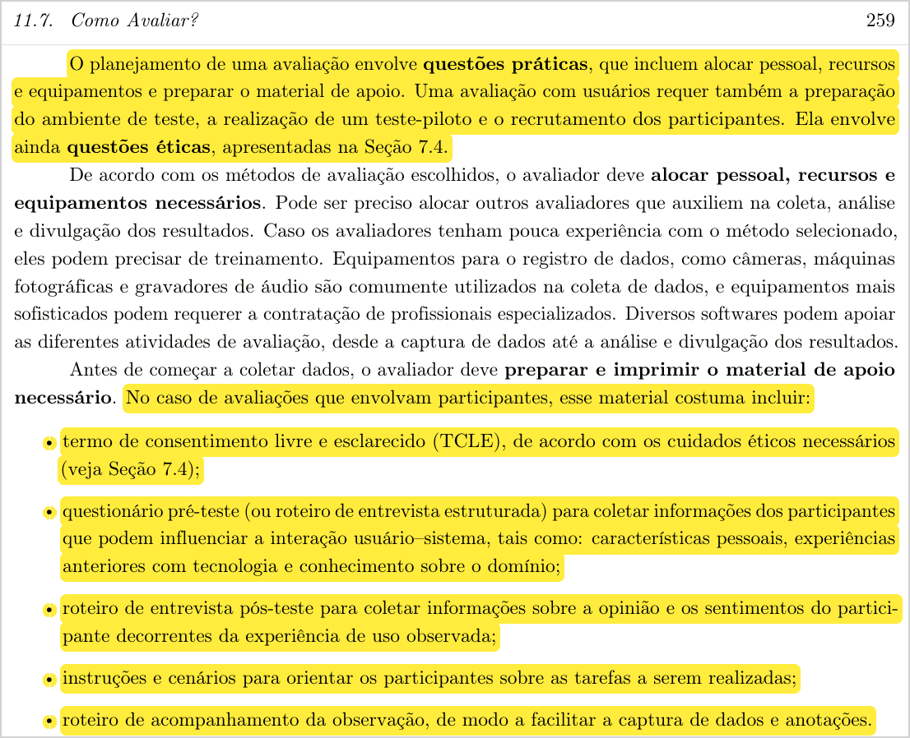
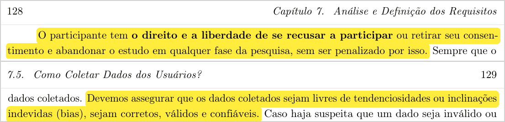
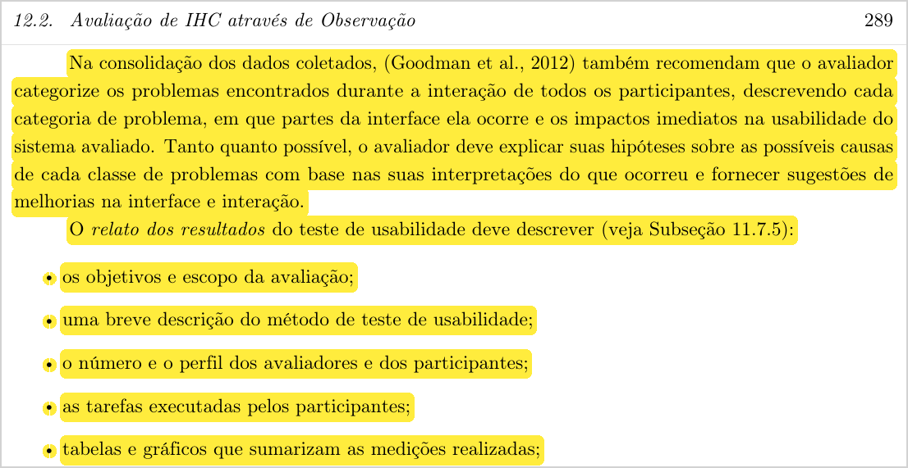
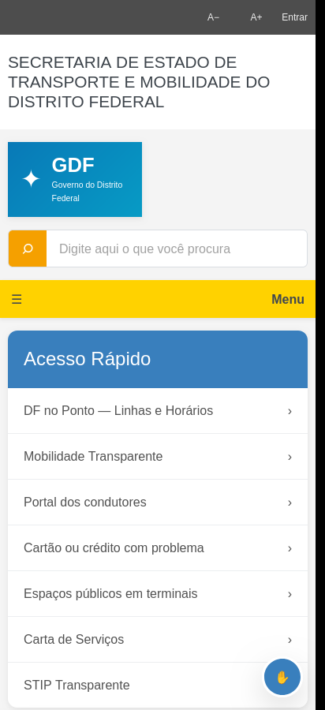
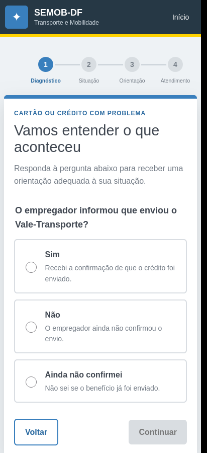
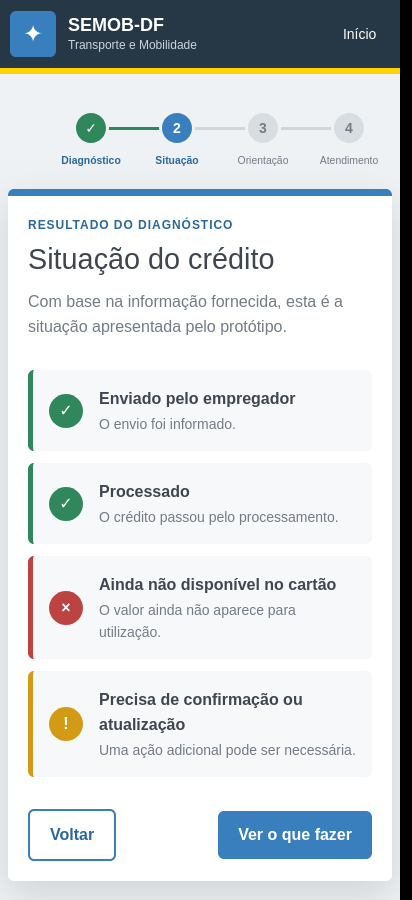
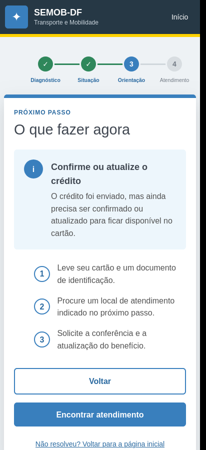
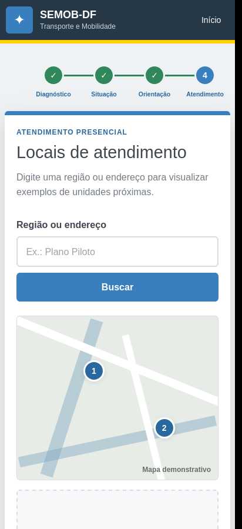

## Histórico de Versão e Contribuição

| Data | Versão | Descrição | Autor(es) | Revisor(es) | Declaração de Uso de IA |
| :---: | :---: | :--- | :--- | :--- | :--- |
| 01/11/2026 | `1.0` | Planejamento da avaliação do protótipo de alta fidelidade da TAR-07, com base no DECIDE. | [Arthur Mariani](https://github.com/arthur-mariani) | [Carlos Henrique](https://github.com/carloshfgit) | Google Gemini - apoio à estruturação em Markdown e revisão textual. |
| 14/11/2026 | `1.1` | Ajuste da rodada para três participantes e registro das condições informadas para as sessões. | [Arthur Mariani](https://github.com/arthur-mariani) | [Gabriel Melo](https://github.com/gabriellcardone-06) | Claude (Anthropic): apoio à atualização do texto e das referências. |

---

# Planejamento da Avaliação do Protótipo de Alta Fidelidade (TAR-07)

## 1. Introdução e escopo

Este documento planeja uma avaliação formativa do **fluxo de orientação sobre crédito de Vale-Transporte indisponível** no protótipo de alta fidelidade. O recorte corresponde à [TAR-07](../../../../analise-de-requisitos/analise-de-tarefas/tar-07-credito-vale-transporte.md), ao [Cenário 4](../../../../analise-de-requisitos/cenarios/cenario-4-credito-vale-transporte.md) e à persona [Maria Eduarda Santos](../../../../analise-de-requisitos/personas/maria-eduarda-santos.md). Esses artefatos do projeto fornecem o **contexto da tarefa**; o método, os critérios de coleta e a estrutura de análise seguem Barbosa et al. (2021). A opção por três participantes combina as condições de prazo e recursos descritas por Barbosa et al. (2021, pp. 258–259) com a proposta de rodadas pequenas e recorrentes de Krug (2000, cap. 9).

A sessão examinará a experiência de **encontrar orientação, interpretar o estado apresentado e localizar o próximo passo ou canal de atendimento**. O protótipo deverá estar navegável nas telas necessárias a essas tarefas. Quando uma consulta real ao saldo ou a uma instituição não estiver implementada, a resposta será simulada e identificada no roteiro. A avaliação não verificará se o crédito foi efetivamente liberado nem estabelecerá procedimentos oficiais de SEMOB-DF, BRB Mobilidade ou empregadores.

Segundo o livro, os objetivos e as perguntas específicas guiam a escolha do método (Barbosa et al., 2021, p. 257). O **DECIDE** articula essas escolhas de modo iterativo (Barbosa et al., 2021, pp. 264–265).

**Artefatos relacionados — fluxo da funcionalidade TAR-07 (Regularização de Crédito de Vale-Transporte):**

* **Persona:** [Maria Eduarda Santos](../../../../analise-de-requisitos/personas/maria-eduarda-santos.md)
* **Cenário:** [Cenário 4](../../../../analise-de-requisitos/cenarios/cenario-4-credito-vale-transporte.md)
* **Análise de tarefas:** [TAR-07](../../../../analise-de-requisitos/analise-de-tarefas/tar-07-credito-vale-transporte.md)
* **Storyboard:** [Storyboard 07](../../../nivel1/storyboards.md#37-storyboard-07-regularizacao-de-credito-de-vale-transporte)
* **Nível 1: avaliação do storyboard e da análise de tarefas:** [Planejamento da avaliação](../../../nivel1/planejamentos-individuais/Arthur/arthur-planejamento-avaliacao.md) · [Planejamento do relato](../../../nivel1/planejamentos-individuais/Arthur/planejamento-relato-analise-tarefas.md) · Relato dos resultados (*não realizado*)
* **Nível 2: protótipo de papel (baixa fidelidade):** [Planejamento da avaliação](../../../nivel2/planejamentos-individuais/Arthur/arthur-planejamento-avaliacao-prototipo-papel.md) · [Planejamento do relato](../../../nivel2/planejamentos-individuais/Arthur/arthur-planejamento-relato-prototipo-papel.md) · [Relato dos resultados](../../../nivel2/relatos-individuais/arthur/relato-resultados-prototipo-papel.md)
* **Nível 3: protótipo de alta fidelidade:** Planejamento da avaliação (*esta página*) · [Planejamento do relato](arthur-planejamento-relato-prototipo-alta-fidelidade.md) · [Relato dos resultados](../../relatos-individuais/arthur/relato-resultados-prot-alta-fidel.md)
* **Telas do protótipo de papel:** [telas no planejamento da avaliação](../../../nivel2/planejamentos-individuais/Arthur/arthur-planejamento-avaliacao-prototipo-papel.md#9-telas-do-prototipo-avaliado)
* **Protótipo de alta fidelidade navegável:** [acessar o protótipo](https://arthur-mariani.github.io/PAF-IHC/credito/)

## 2. Fundamentação e evidências do livro

| Decisão deste planejamento | Base no livro |
| :--- | :--- |
| Organizar objetivos, perguntas, método, recursos, ética e análise pelo DECIDE | Seção 11.8, p. 264; Figura 2 na seção 9. |
| Delimitar tarefas, recrutar representantes do público-alvo e realizar piloto | Seção 11.7.2, pp. 258–260; Figuras 3 e 5–8 na seção 9. |
| Observar execução de tarefas e registrar desempenho, opiniões e dificuldades | Seção 12.2.1, pp. 288–289; Figuras 4, 6 e 14 na seção 9. |
| Interpretar dados e relatar problemas com recomendações de reprojeto | Seções 11.7.4–11.7.5, pp. 262–263; Figuras 11–13 na seção 9. |

---

## 3. D: Determinar os objetivos da avaliação

### 3.1 Objetivo geral

Investigar se pessoas com perfil de passageiras que utilizam Vale-Transporte conseguem usar o fluxo navegável para compreender uma situação de crédito indisponível e identificar uma ação seguinte, sem explicação substantiva do avaliador.

### 3.2 Objetivos específicos

1. Verificar se o acesso à orientação é encontrado a partir da tela inicial do protótipo.
2. Investigar se os rótulos, mensagens e respostas do fluxo são compreendidos no contexto de crédito não disponível no cartão.
3. Observar se a pessoa distingue **informação exibida**, **hipótese sobre a causa** e **ação indicada**, sem interpretar uma simulação como consulta real ao crédito.
4. Verificar se o encaminhamento final permite identificar o próximo passo e o canal apresentado pelo protótipo.
5. Identificar erros, hesitações, retornos, pedidos de ajuda e trechos que demandem reprojeto.

Esses objetivos especificam a tarefa escolhida para a avaliação; não são fatos sobre o funcionamento de serviços de transporte. A delimitação segue a orientação do livro de avaliar as partes da interface e as tarefas mais relevantes aos objetivos do estudo (Barbosa et al., 2021, p. 258).

## 4. E: Explorar as perguntas a serem respondidas

| ID | Pergunta de avaliação | Dado a registrar |
| :---: | :--- | :--- |
| P01 | A pessoa encontra, sem dica, a entrada para tratar do crédito indisponível? | Primeiro caminho escolhido, desvios, retornos e pedido de ajuda. |
| P02 | Ela compreende o texto de cada estado ou mensagem apresentado? | Explicação com as próprias palavras, dúvidas e interpretação divergente. |
| P03 | Ela identifica o próximo passo oferecido para a situação simulada? | Ação selecionada, justificativa e conclusão da tarefa. |
| P04 | Ela encontra um caminho de continuidade quando a informação é insuficiente? | Busca por ajuda, retorno ao fluxo e canal escolhido. |
| P05 | Em quais telas e controles ocorrem erros ou hesitações? | Local, ação, consequência, tempo aproximado e comentários. |
| P06 | O que a pessoa considera claro, confuso ou ausente após o uso? | Respostas à entrevista pós-teste. |

As perguntas operacionalizam os objetivos, conforme o DECIDE (Barbosa et al., 2021, p. 264; **Figura 2**). Os dados a registrar foram selecionados em função dessas perguntas.

## 5. C: Escolher o método de avaliação

Será realizado um **teste de usabilidade com observação de uso**, seguido de entrevista breve. O livro descreve esse método como a execução de tarefas por representantes dos usuários, com registro do desempenho, das opiniões e dos sentimentos decorrentes da experiência (Barbosa et al., 2021, p. 288). A escolha permite observar dificuldades reais no fluxo navegável, adequando-se às perguntas P01–P06. Os indicadores serão interpretados sobretudo para explicar problemas de interação; não se pretende uma comparação estatística entre interfaces.

### 5.1 Roteiro de tarefas

O condutor apresentará o mesmo texto a cada participante. As respostas do protótipo serão previamente configuradas para manter condições comparáveis entre sessões (Barbosa et al., 2021, p. 259).

| ID | Enunciado entregue à pessoa participante | Critério observável de conclusão |
| :---: | :--- | :--- |
| T1 | “Você vai trabalhar e seu cartão informa que o crédito de Vale-Transporte não está disponível. No protótipo, encontre uma orientação para essa situação.” | Abre o fluxo correspondente sem indicação do caminho pelo avaliador. |
| T2 | “Considere que o RH informou que enviou o benefício. Use as informações exibidas para explicar o que você entendeu e o que faria agora.” | Explica a mensagem exibida e escolhe um próximo passo coerente com a resposta simulada. |
| T3 | “Se a orientação não resolver sua dúvida, encontre como continuar buscando atendimento.” | Localiza e identifica o canal ou a alternativa de continuidade presente no protótipo. |

O avaliador não apresentará uma causa como verdadeira nem preencherá lacunas do protótipo por explicação verbal. Se algum estado necessário não estiver implementado, ele deverá ser definido no roteiro de simulação antes do piloto; a ausência será registrada como limitação ou problema do protótipo.

### 5.2 Medidas e registros

Serão registrados por tarefa: conclusão sem ajuda, conclusão com ajuda ou não conclusão; tempo aproximado; erros e retornos; consultas à ajuda; e comentários espontâneos. A entrevista pós-teste buscará esclarecer interpretações e coletar opiniões. O livro apresenta conclusão, tempo, erros, uso de ajuda, anotações e entrevista como dados possíveis no teste de usabilidade (Barbosa et al., 2021, p. 289). O tempo será **descritivo**, sem meta numérica arbitrária.

## 6. I: Identificar e administrar as questões práticas

### 6.1 Participantes, equipe e ambiente

O recrutamento buscará **três pessoas adultas**, usuárias frequentes de transporte coletivo e familiarizadas com cartão e Vale-Transporte, sem participação no design do protótipo. Krug (2000, cap. 9) recomenda três ou quatro participantes por rodada para identificar os principais problemas e corrigir o produto antes de um novo ciclo. A escolha do limite inferior também considera o prazo e os recursos disponíveis, fatores que Barbosa et al. (2021, pp. 258–259) indicam para a definição da amostra; os autores orientam ainda selecionar participantes semelhantes ao público-alvo. Esse número permite identificar problemas na rodada, sem tornar a amostra estatisticamente representativa.

As sessões serão individuais, na **Universidade de Brasília, das 8h às 10h**, usando **smartphone para testar e gravar** o [protótipo de alta fidelidade](https://arthur-mariani.github.io/PAF-IHC). **Arthur Mariani** acumulará as funções de condutor e observador em decorrência da falta de tempo: apresentará as tarefas sem induzir respostas e registrará as ações, dificuldades e falas. A equipe terá dispositivo, carregador, acesso ao protótipo, fichas de observação, roteiro, termo de consentimento e plano de contingência para falha de conexão. As datas das sessões serão registradas no relato.

### 6.2 Preparação e teste-piloto

Antes de recrutar a amostra definitiva, a equipe deverá: conferir o fluxo navegável e os estados simulados; preparar termo, roteiro pré-teste, tarefas, ficha de observação e perguntas pós-teste; testar dispositivo e registro; e executar **um piloto completo** com pessoa que não participou da preparação. O piloto verificará a clareza das instruções, o tempo, a estabilidade do protótipo e se os dados coletados respondem a P01–P06. Depois dos ajustes, seus dados serão descartados, como orienta Barbosa et al. (2021).

| Etapa da sessão | Tempo estimado |
| :--- | :---: |
| Recepção, explicação e consentimento | 5 min |
| Perguntas breves sobre experiência com transporte e celular | 5 min |
| T1, T2 e T3 | 20 min |
| Entrevista pós-teste e encerramento | 10 min |
| **Total previsto** | **40 min** |

O livro recomenda tarefas individuais curtas e sessões que evitem fadiga (Barbosa et al., 2021, p. 259). O tempo acima é uma **estimativa de planejamento**, a ser ajustada pelo piloto.

## 7. D: Decidir como lidar com as questões éticas

Antes de iniciar, o condutor explicará objetivos, tarefas, registros, uso acadêmico dos dados e liberdade de interromper a participação. O aceite será registrado em termo de consentimento. A equipe avaliará o **protótipo**, sem atribuir as dificuldades à capacidade da pessoa; oferecerá pausas e encerrará uma tarefa se houver desconforto ou impasse. Áudio e vídeo dependerão de autorização específica; sem ela, serão utilizadas apenas anotações. Não será solicitado número de cartão, saldo real, empregador ou identificação pessoal desnecessária. O relato usará códigos como `P01`.

Esses cuidados seguem as orientações sobre consentimento, anonimato, autorização de gravação, conforto e liberdade de desistência descritas por Barbosa et al. (2021), além da etapa ética do DECIDE (p. 313; **Figura 2**).

## 8. E: Avaliar, interpretar e apresentar os dados

Logo após cada sessão, Arthur Mariani revisará seus registros de condução e observação. Para cada participante e tarefa, preencherá a ficha de conclusão, caminho seguido, dificuldades, comentários e evidências. Em seguida, agrupará ocorrências semelhantes entre participantes, responderá P01–P06 e separará **observação**, **interpretação** e **recomendação**. O livro orienta interpretação individual, consolidação entre participantes e cautela com generalizações (Barbosa et al., 2021, pp. 262–263).

Cada problema será descrito com tela, ação observada, consequência, possível causa na interface, número de participantes em que apareceu e proposta de correção. A equipe priorizará problemas pelo impacto na conclusão e pela recorrência observada; essa priorização é uma decisão do projeto, não uma escala prescrita pelo livro. Conclusões sobre clareza do fluxo terão alcance restrito ao protótipo, às tarefas e às condições testadas. Será explicitado quando a simulação, a amostra ou o ambiente tiverem afetado confiabilidade e validades interna, externa e ecológica, conforme DECIDE (p. 313; **Figura 2**).

O formato de apresentação e as tabelas vazias estão no [planejamento do relato dos resultados](arthur-planejamento-relato-prototipo-alta-fidelidade.md). Nenhum resultado de participante é antecipado neste documento.

---

## 9. Evidências do livro: trechos grifados

As áreas amarelas destacam os trechos usados como base para as afirmações e decisões metodológicas deste planejamento. A numeração nas legendas corresponde às referências a figuras no texto.

<strong>Figura 1</strong>: Objetivos e perguntas orientam a escolha do método (p. 248).

<em>Fonte: BARBOSA et al. (2021, p. 248).</em>

<strong>Figura 2</strong>: As seis atividades do framework DECIDE no livro (p. 264).

<em>Fonte: BARBOSA et al. (2021, p. 264).</em>

<strong>Figura 3</strong>: Delimitação do escopo, dos caminhos e das tarefas (p. 258).

<em>Fonte: BARBOSA et al. (2021, p. 258).</em>

<strong>Figura 4</strong>: Definição do teste de usabilidade como observação de tarefas (pp. 288–289).

<em>Fonte: BARBOSA et al. (2021, pp. 288–289).</em>

<strong>Figura 5</strong>: Material e orientações iguais para todos os participantes (p. 259).

<em>Fonte: BARBOSA et al. (2021, p. 259).</em>

<strong>Figura 6</strong>: Preparação, coleta, interpretação e relato do teste de usabilidade (p. 289).

<em>Fonte: BARBOSA et al. (2021, p. 289).</em>

<strong>Figura 7</strong>: Seleção de participantes semelhantes ao público-alvo (p. 258).

<em>Fonte: BARBOSA et al. (2021, p. 258).</em>

<strong>Figura 8</strong>: Finalidade do teste-piloto e descarte de seus dados (p. 260).

<em>Fonte: BARBOSA et al. (2021, p. 260).</em>

<strong>Figura 9</strong>: Privacidade, anonimato e autorização para gravação (p. 127).

<em>Fonte: BARBOSA et al. (2021, p. 127).</em>

<strong>Figura 10</strong>: Consentimento, conforto e direito de interromper a participação (pp. 128–129).

<em>Fonte: BARBOSA et al. (2021, pp. 128–129).</em>

<strong>Figura 11</strong>: Interpretação dos dados individuais (p. 262).

<em>Fonte: BARBOSA et al. (2021, p. 262).</em>

<strong>Figura 12</strong>: Início da consolidação entre participantes (p. 263).

<em>Fonte: BARBOSA et al. (2021, p. 263).</em>

<strong>Figura 13</strong>: Cautela na generalização e itens do relato (p. 263).

<em>Fonte: BARBOSA et al. (2021, p. 263).</em>

<strong>Figura 14</strong>: Descrição, causas possíveis e sugestões para os problemas encontrados (p. 289).

<em>Fonte: BARBOSA et al. (2021, p. 289).</em>

## 10. Telas do Protótipo Avaliado

As Figuras 15 a 19 mostram as telas do protótipo de alta fidelidade da [TAR-07](../../../../analise-de-requisitos/analise-de-tarefas/tar-07-credito-vale-transporte.md), também apresentadas no [relato dos resultados da avaliação](../../../nivel3/relatos-individuais/arthur/relato-resultados-prot-alta-fidel.md).

* **Protótipo navegável:** [Acessar o protótipo da TAR-07](https://arthur-mariani.github.io/PAF-IHC)

<strong>Figura 15</strong>: Página inicial do protótipo, com o Acesso Rápido e a opção "Cartão ou crédito com problema"

{ width="300" }

<em>Fonte: Elaborado por Arthur Mariani (2026). Captura de tela do protótipo publicado.</em>

<strong>Figura 16</strong>: Etapa 1 de 4 — Diagnóstico: "Vamos entender o que aconteceu"

{ width="300" }

<em>Fonte: Elaborado por Arthur Mariani (2026). Captura de tela do protótipo publicado.</em>

<strong>Figura 17</strong>: Etapa 2 de 4 — Situação do crédito

{ width="300" }

<em>Fonte: Elaborado por Arthur Mariani (2026). Captura de tela do protótipo publicado.</em>

<strong>Figura 18</strong>: Etapa 3 de 4 — Orientação: "O que fazer agora"

{ width="300" }

<em>Fonte: Elaborado por Arthur Mariani (2026). Captura de tela do protótipo publicado.</em>

<strong>Figura 19</strong>: Etapa 4 de 4 — Atendimento: "Locais de atendimento"

{ width="300" }

<em>Fonte: Elaborado por Arthur Mariani (2026). Captura de tela do protótipo publicado.</em>

---
---

## 11. Fotos de Referência
As Figuras 20 a 23 mostram os trechos que fundamentam este artefato, recortados e grifados em amarelo diretamente do livro da disciplina (BARBOSA et al., 2021).

<strong>Figura 20</strong>: 11.8 Framework DECIDE

<em>Fonte: BARBOSA et al. (2021, p. 264).</em>

<strong>Figura 21</strong>: Representação de interface em alta fidelidade

<em>Fonte: BARBOSA et al. (2021, p. 210).</em>

<strong>Figura 22</strong>: 12.2.1 Teste de usabilidade: objetivo, atividades e medidas por tarefa

<em>Fonte: BARBOSA et al. (2021, pp. 288–289).</em>

<strong>Figura 23</strong>: 11.7.2 Escopo da avaliação, perfil e número de participantes

<em>Fonte: BARBOSA et al. (2021, p. 258).</em>

---

## 12. Referências Bibliográficas
* BARBOSA, Simone Diniz Junqueira; SILVA, Bruno Santana da; SILVEIRA, Milene Selbach; GASPARINI, Isabela; DARIN, Ticianne; BARBOSA, Gabriel Diniz Junqueira. **Interação Humano-Computador e Experiência do Usuário**. Rio de Janeiro: Autopublicação, 2021. ISBN 978-65-00-19677-1.
* KRUG, Steve. **Don't Make Me Think! A Common Sense Approach to Web Usability**. Indianapolis: New Riders, 2000. Cap. 9.
