# Planejamento da Avaliação do Protótipo de Alta Fidelidade (TAR-07)

## Histórico de Versão

| Data | Versão | Descrição | Autor(es) | Revisor(es) | Declaração de ferramenta de IA |
| :---: | :---: | :--- | :--- | :--- | :--- |
| 01/11/2026 | `1.0` | Planejamento da avaliação do protótipo de alta fidelidade da TAR-07, com base no DECIDE. | [Arthur Mariani](https://github.com/arthur-mariani) | [Carlos Henrique](https://github.com/carloshfgit) | Google Gemini - apoio à estruturação em Markdown e revisão textual. |

---

## 1. Introdução e escopo

Este documento planeja uma avaliação formativa do **fluxo de orientação sobre crédito de Vale-Transporte indisponível** no protótipo de alta fidelidade. O recorte corresponde à [TAR-07](../../../../analise-de-requisitos/analise-de-tarefas/tar-07-credito-vale-transporte.md), ao [Cenário 4](../../../../analise-de-requisitos/cenarios/cenario-4-credito-vale-transporte.md) e à persona [Maria Eduarda Santos](../../../../analise-de-requisitos/personas/maria-eduarda-santos.md). Esses artefatos do projeto fornecem o **contexto da tarefa**; o método, os critérios de coleta e a estrutura de análise abaixo vêm exclusivamente de Barbosa e Silva (2010, cap. 9–10).

A sessão examinará a experiência de **encontrar orientação, interpretar o estado apresentado e localizar o próximo passo ou canal de atendimento**. O protótipo deverá estar navegável nas telas necessárias a essas tarefas. Quando uma consulta real ao saldo ou a uma instituição não estiver implementada, a resposta será simulada e identificada no roteiro. A avaliação não verificará se o crédito foi efetivamente liberado nem estabelecerá procedimentos oficiais de SEMOB-DF, BRB Mobilidade ou empregadores.

Segundo o livro, os objetivos e as perguntas específicas guiam a escolha do método (Barbosa; Silva, 2010, p. 303). O **DECIDE** articula essas escolhas de modo iterativo (Barbosa; Silva, 2010, p. 312–313).

## 2. Fundamentação e evidências do livro

| Decisão deste planejamento | Base no livro |
| :--- | :--- |
| Organizar objetivos, perguntas, método, recursos, ética e análise pelo DECIDE | Seção 9.8, p. 313; Figura 2 na seção 9. |
| Delimitar tarefas, recrutar representantes do público-alvo e realizar piloto | Seção 9.7.2, p. 304–307; Figuras 3 e 5–8 na seção 9. |
| Observar execução de tarefas e registrar desempenho, opiniões e dificuldades | Seção 10.2.1, p. 341–343; Figuras 4, 6 e 14 na seção 9. |
| Interpretar dados e relatar problemas com recomendações de reprojeto | Seções 9.7.4–9.7.5, p. 310–312; Figuras 11–13 na seção 9. |

---

## 3. D — Determinar os objetivos da avaliação

### 3.1 Objetivo geral

Investigar se pessoas com perfil de passageiras que utilizam Vale-Transporte conseguem usar o fluxo navegável para compreender uma situação de crédito indisponível e identificar uma ação seguinte, sem explicação substantiva do avaliador.

### 3.2 Objetivos específicos

1. Verificar se o acesso à orientação é encontrado a partir da tela inicial do protótipo.
2. Investigar se os rótulos, mensagens e respostas do fluxo são compreendidos no contexto de crédito não disponível no cartão.
3. Observar se a pessoa distingue **informação exibida**, **hipótese sobre a causa** e **ação indicada**, sem interpretar uma simulação como consulta real ao crédito.
4. Verificar se o encaminhamento final permite identificar o próximo passo e o canal apresentado pelo protótipo.
5. Identificar erros, hesitações, retornos, pedidos de ajuda e trechos que demandem reprojeto.

Esses objetivos especificam a tarefa escolhida para a avaliação; não são fatos sobre o funcionamento de serviços de transporte. A delimitação segue a orientação do livro de avaliar as partes da interface e as tarefas mais relevantes aos objetivos do estudo (Barbosa; Silva, 2010, p. 304).

## 4. E — Explorar as perguntas a serem respondidas

| ID | Pergunta de avaliação | Dado a registrar |
| :---: | :--- | :--- |
| P01 | A pessoa encontra, sem dica, a entrada para tratar do crédito indisponível? | Primeiro caminho escolhido, desvios, retornos e pedido de ajuda. |
| P02 | Ela compreende o texto de cada estado ou mensagem apresentado? | Explicação com as próprias palavras, dúvidas e interpretação divergente. |
| P03 | Ela identifica o próximo passo oferecido para a situação simulada? | Ação selecionada, justificativa e conclusão da tarefa. |
| P04 | Ela encontra um caminho de continuidade quando a informação é insuficiente? | Busca por ajuda, retorno ao fluxo e canal escolhido. |
| P05 | Em quais telas e controles ocorrem erros ou hesitações? | Local, ação, consequência, tempo aproximado e comentários. |
| P06 | O que a pessoa considera claro, confuso ou ausente após o uso? | Respostas à entrevista pós-teste. |

As perguntas operacionalizam os objetivos, conforme o DECIDE (Barbosa; Silva, 2010, p. 313; **Figura 2**). Os dados a registrar foram selecionados em função dessas perguntas.

## 5. C — Escolher o método de avaliação

Será realizado um **teste de usabilidade com observação de uso**, seguido de entrevista breve. O livro descreve esse método como a execução de tarefas por representantes dos usuários, com registro do desempenho, das opiniões e dos sentimentos decorrentes da experiência (Barbosa; Silva, 2010, p. 341). A escolha permite observar dificuldades reais no fluxo navegável, adequando-se às perguntas P01–P06. Os indicadores serão interpretados sobretudo para explicar problemas de interação; não se pretende uma comparação estatística entre interfaces.

### 5.1 Roteiro de tarefas

O condutor apresentará o mesmo texto a cada participante. As respostas do protótipo serão previamente configuradas para manter condições comparáveis entre sessões (Barbosa; Silva, 2010, p. 306).

| ID | Enunciado entregue à pessoa participante | Critério observável de conclusão |
| :---: | :--- | :--- |
| T1 | “Você vai trabalhar e seu cartão informa que o crédito de Vale-Transporte não está disponível. No protótipo, encontre uma orientação para essa situação.” | Abre o fluxo correspondente sem indicação do caminho pelo avaliador. |
| T2 | “Considere que o RH informou que enviou o benefício. Use as informações exibidas para explicar o que você entendeu e o que faria agora.” | Explica a mensagem exibida e escolhe um próximo passo coerente com a resposta simulada. |
| T3 | “Se a orientação não resolver sua dúvida, encontre como continuar buscando atendimento.” | Localiza e identifica o canal ou a alternativa de continuidade presente no protótipo. |

O avaliador não apresentará uma causa como verdadeira nem preencherá lacunas do protótipo por explicação verbal. Se algum estado necessário não estiver implementado, ele deverá ser definido no roteiro de simulação antes do piloto; a ausência será registrada como limitação ou problema do protótipo.

### 5.2 Medidas e registros

Serão registrados por tarefa: conclusão sem ajuda, conclusão com ajuda ou não conclusão; tempo aproximado; erros e retornos; consultas à ajuda; e comentários espontâneos. A entrevista pós-teste buscará esclarecer interpretações e coletar opiniões. O livro apresenta conclusão, tempo, erros, uso de ajuda, anotações e entrevista como dados possíveis no teste de usabilidade (Barbosa; Silva, 2010, p. 342). O tempo será **descritivo**, sem meta numérica arbitrária.

## 6. I — Identificar e administrar as questões práticas

### 6.1 Participantes, equipe e ambiente

O recrutamento buscará **cinco pessoas adultas**, usuárias frequentes de transporte coletivo e familiarizadas com cartão e Vale-Transporte, sem participação no design do protótipo. O livro recomenda participantes semelhantes ao público-alvo e apresenta cinco como referência de custo-benefício para encontrar problemas, sem garantir representatividade estatística (Barbosa; Silva, 2010, p. 305). Se o número efetivo for menor, o relato informará a diferença e reduzirá o alcance das conclusões.

As sessões serão individuais, em ambiente tranquilo, com o protótipo no dispositivo ou navegador para o qual foi projetado. Um **condutor** explicará o procedimento, apresentará as tarefas e evitará induzir respostas; um **observador** registrará as ações, dificuldades e falas. A equipe terá dispositivo, carregador, acesso ao protótipo, fichas de observação, roteiro, termo de consentimento e plano de contingência para falha de conexão. Data, local e versão testada serão registrados no relato.

### 6.2 Preparação e teste-piloto

Antes de recrutar a amostra definitiva, a equipe deverá: conferir o fluxo navegável e os estados simulados; preparar termo, roteiro pré-teste, tarefas, ficha de observação e perguntas pós-teste; testar dispositivo e registro; e executar **um piloto completo** com pessoa que não participou da preparação. O piloto verificará a clareza das instruções, o tempo, a estabilidade do protótipo e se os dados coletados respondem a P01–P06. Depois dos ajustes, seus dados serão descartados, como orienta Barbosa e Silva (2010, p. 306–307).

| Etapa da sessão | Tempo estimado |
| :--- | :---: |
| Recepção, explicação e consentimento | 5 min |
| Perguntas breves sobre experiência com transporte e celular | 5 min |
| T1, T2 e T3 | 20 min |
| Entrevista pós-teste e encerramento | 10 min |
| **Total previsto** | **40 min** |

O livro recomenda tarefas individuais curtas e sessões que evitem fadiga (Barbosa; Silva, 2010, p. 306). O tempo acima é uma **estimativa de planejamento**, a ser ajustada pelo piloto.

## 7. D — Decidir como lidar com as questões éticas

Antes de iniciar, o condutor explicará objetivos, tarefas, registros, uso acadêmico dos dados e liberdade de interromper a participação. O aceite será registrado em termo de consentimento. A equipe avaliará o **protótipo**, sem atribuir as dificuldades à capacidade da pessoa; oferecerá pausas e encerrará uma tarefa se houver desconforto ou impasse. Áudio e vídeo dependerão de autorização específica; sem ela, serão utilizadas apenas anotações. Não será solicitado número de cartão, saldo real, empregador ou identificação pessoal desnecessária. O relato usará códigos como `P01`.

Esses cuidados seguem as orientações sobre consentimento, anonimato, autorização de gravação, conforto e liberdade de desistência descritas por Barbosa e Silva (2010, p. 140–141), além da etapa ética do DECIDE (p. 313; **Figura 2**).

## 8. E — Avaliar, interpretar e apresentar os dados

Logo após cada sessão, condutor e observador compararão seus registros. Para cada participante e tarefa, preencherão a ficha de conclusão, caminho seguido, dificuldades, comentários e evidências. Em seguida, agruparão ocorrências semelhantes entre participantes, responderão P01–P06 e separarão **observação**, **interpretação** e **recomendação**. O livro orienta interpretação individual, consolidação entre participantes e cautela com generalizações (Barbosa; Silva, 2010, p. 310–312).

Cada problema será descrito com tela, ação observada, consequência, possível causa na interface, número de participantes em que apareceu e proposta de correção. A equipe priorizará problemas pelo impacto na conclusão e pela recorrência observada; essa priorização é uma decisão do projeto, não uma escala prescrita pelo livro. Conclusões sobre clareza do fluxo terão alcance restrito ao protótipo, às tarefas e às condições testadas. Será explicitado quando a simulação, a amostra ou o ambiente tiverem afetado confiabilidade e validades interna, externa e ecológica, conforme DECIDE (p. 313; **Figura 2**).

O formato de apresentação e as tabelas vazias estão no [planejamento do relato dos resultados](arthur-planejamento-relato-prototipo-alta-fidelidade.md). Nenhum resultado de participante é antecipado neste documento.

---

## 9. Evidências do livro — trechos grifados

As áreas amarelas destacam os trechos usados como base para as afirmações e decisões metodológicas deste planejamento. A numeração nas legendas corresponde às referências a figuras no texto.

<strong>Figura 1</strong> — Objetivos e perguntas orientam a escolha do método (p. 303).

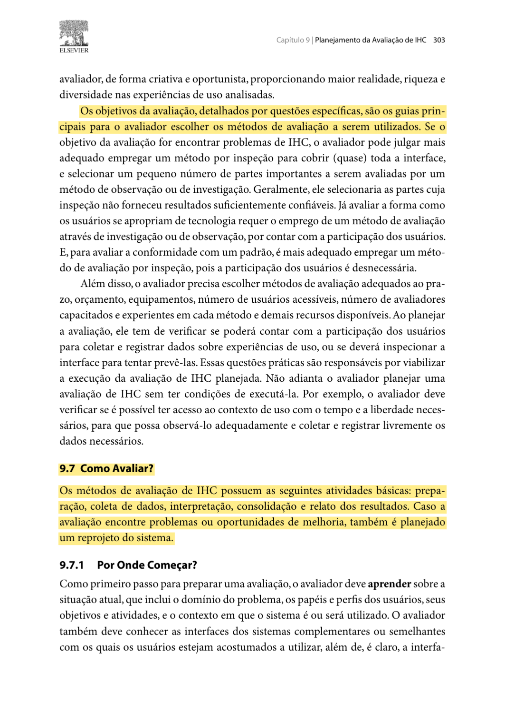

<em>Fonte: Barbosa e Silva (2010, p. 303).</em>

<strong>Figura 2</strong> — As seis atividades do framework DECIDE no livro (p. 313).

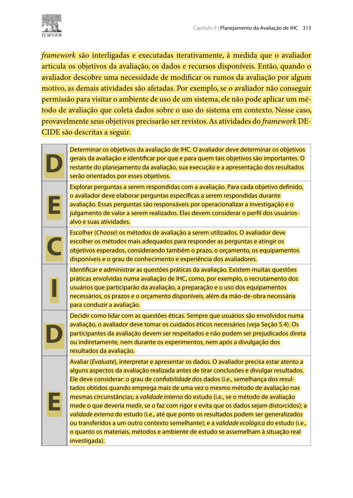

<em>Fonte: Barbosa e Silva (2010, p. 313).</em>

<strong>Figura 3</strong> — Delimitação do escopo, dos caminhos e das tarefas (p. 304).

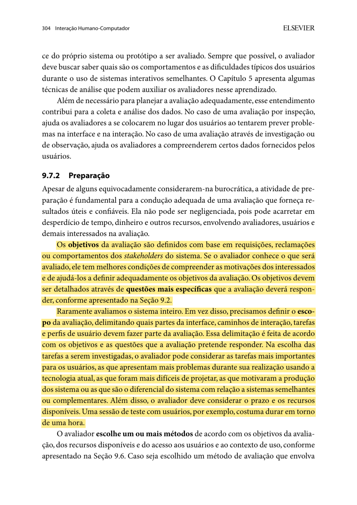

<em>Fonte: Barbosa e Silva (2010, p. 304).</em>

<strong>Figura 4</strong> — Definição do teste de usabilidade como observação de tarefas (p. 341).

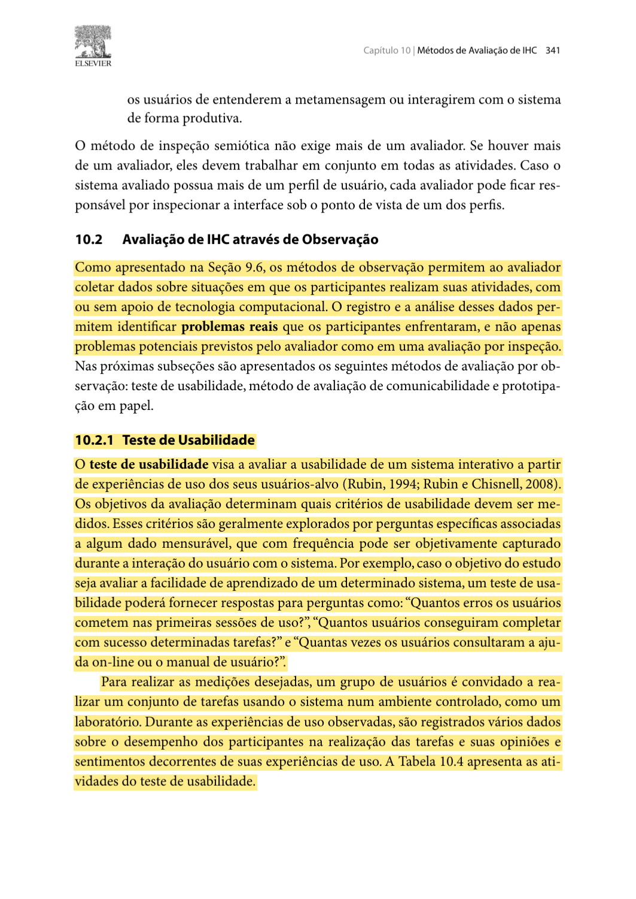

<em>Fonte: Barbosa e Silva (2010, p. 341).</em>

<strong>Figura 5</strong> — Material e orientações iguais para todos os participantes (p. 306).

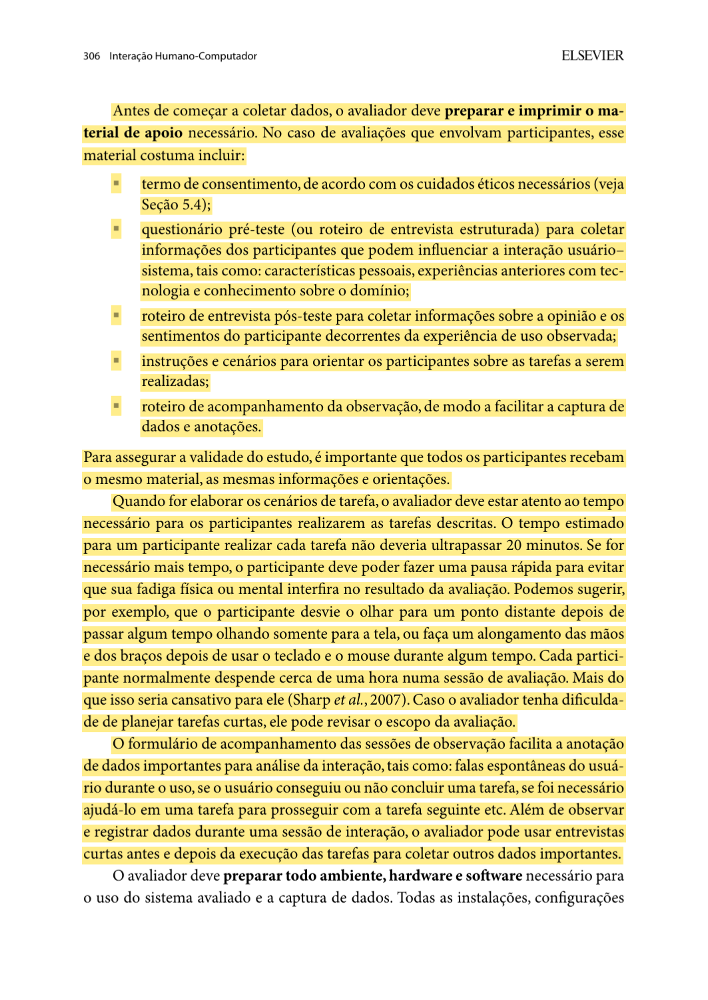

<em>Fonte: Barbosa e Silva (2010, p. 306).</em>

<strong>Figura 6</strong> — Preparação, coleta, interpretação e relato do teste de usabilidade (p. 342).

<em>Fonte: Barbosa e Silva (2010, p. 342).</em>

<strong>Figura 7</strong> — Seleção de participantes semelhantes ao público-alvo (p. 305).

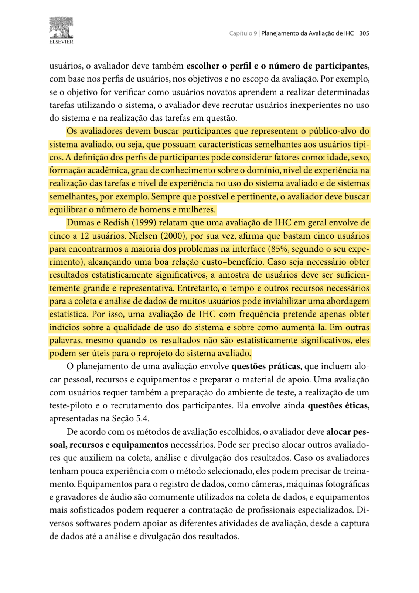

<em>Fonte: Barbosa e Silva (2010, p. 305).</em>

<strong>Figura 8</strong> — Finalidade do teste-piloto e descarte de seus dados (p. 307).

<em>Fonte: Barbosa e Silva (2010, p. 307).</em>

<strong>Figura 9</strong> — Privacidade, anonimato e autorização para gravação (p. 140).

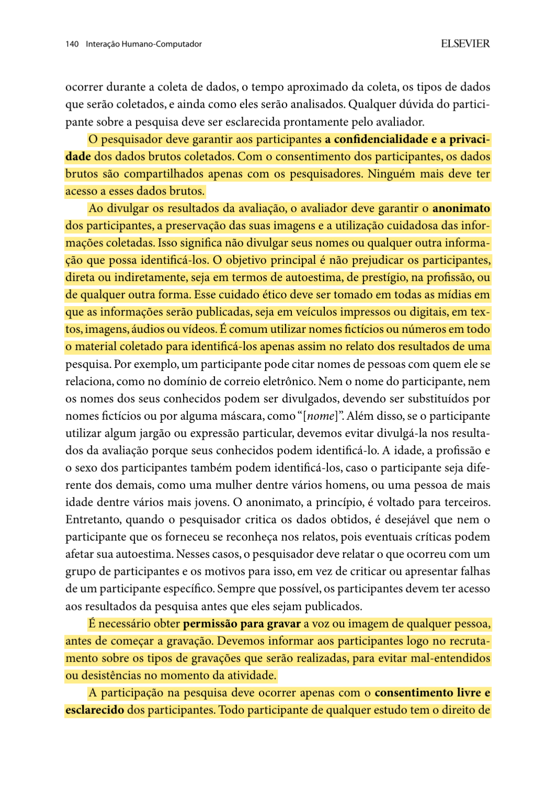

<em>Fonte: Barbosa e Silva (2010, p. 140).</em>

<strong>Figura 10</strong> — Consentimento, conforto e direito de interromper a participação (p. 141).

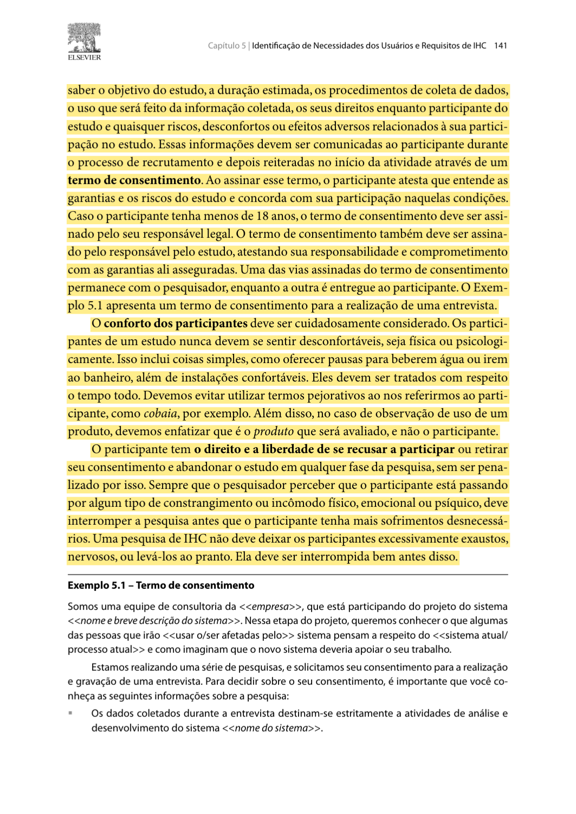

<em>Fonte: Barbosa e Silva (2010, p. 141).</em>

<strong>Figura 11</strong> — Interpretação dos dados individuais (p. 310).

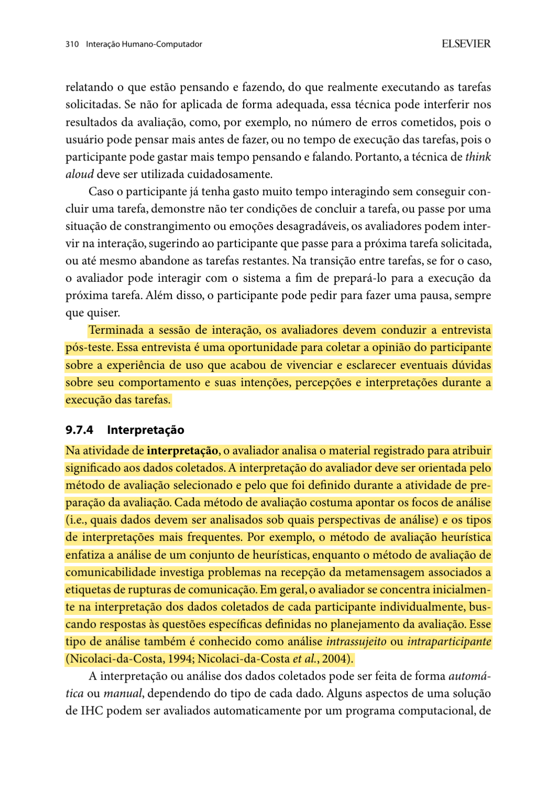

<em>Fonte: Barbosa e Silva (2010, p. 310).</em>

<strong>Figura 12</strong> — Início da consolidação entre participantes (p. 311).

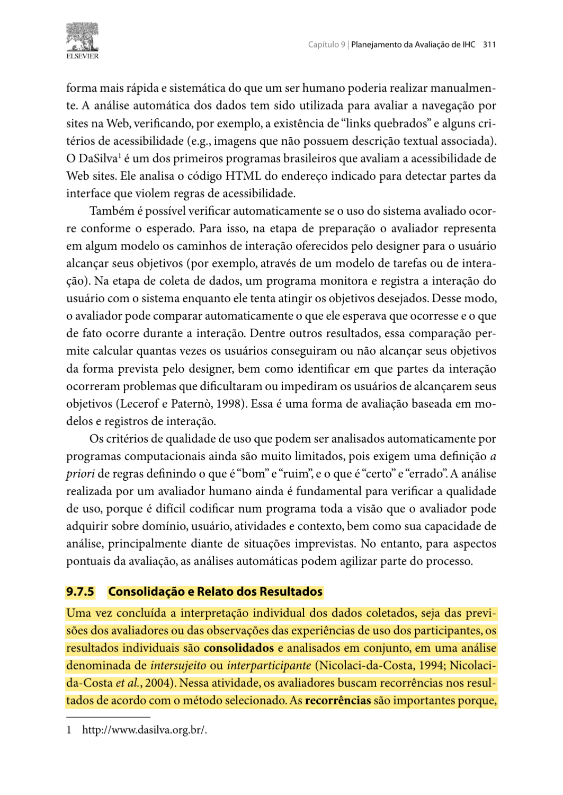

<em>Fonte: Barbosa e Silva (2010, p. 311).</em>

<strong>Figura 13</strong> — Cautela na generalização e itens do relato (p. 312).

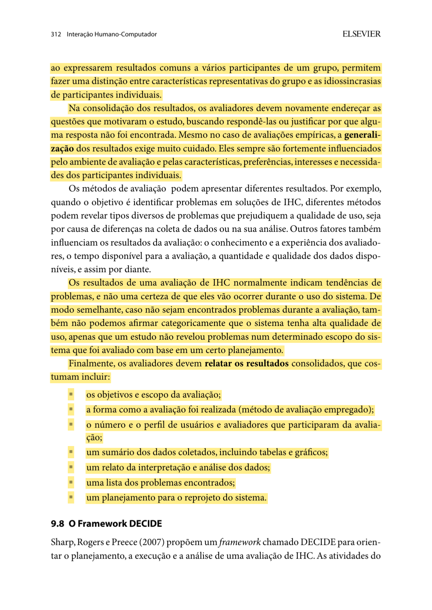

<em>Fonte: Barbosa e Silva (2010, p. 312).</em>

<strong>Figura 14</strong> — Descrição, causas possíveis e sugestões para os problemas encontrados (p. 343).

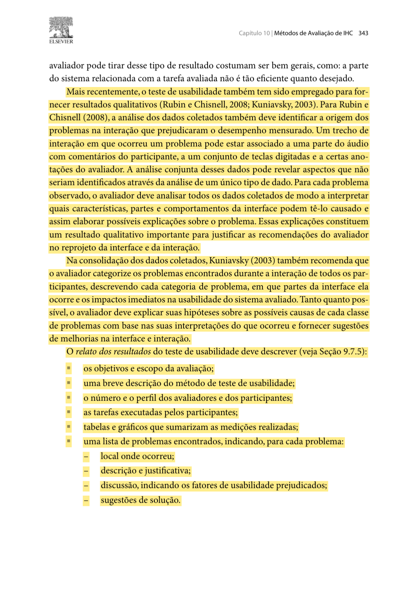

<em>Fonte: Barbosa e Silva (2010, p. 343).</em>

---

## 10. Referências bibliográficas

* BARBOSA, Simone Diniz Junqueira; SILVA, Bruno Santana da. **Interação Humano-Computador**. Rio de Janeiro: Elsevier/Campus, 2010. Cap. 5, seção 5.4, p. 140–141; cap. 9, seções 9.7–9.8, p. 303–307 e 310–313; cap. 10, seção 10.2.1, p. 341–343.

---
