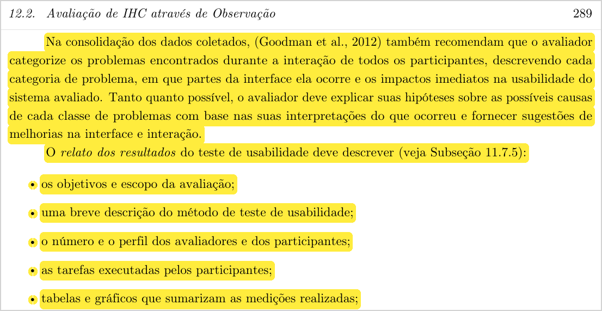
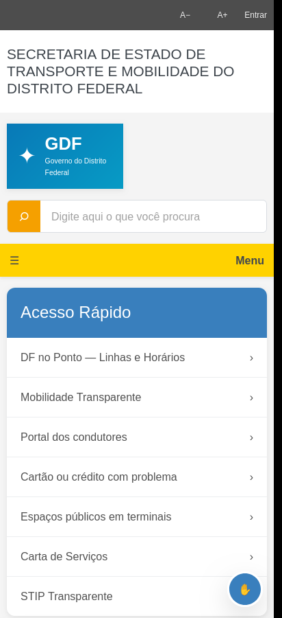
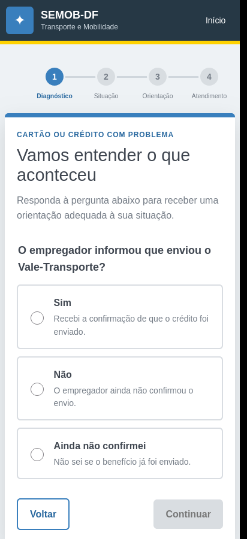
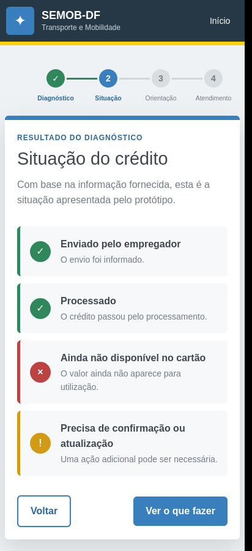
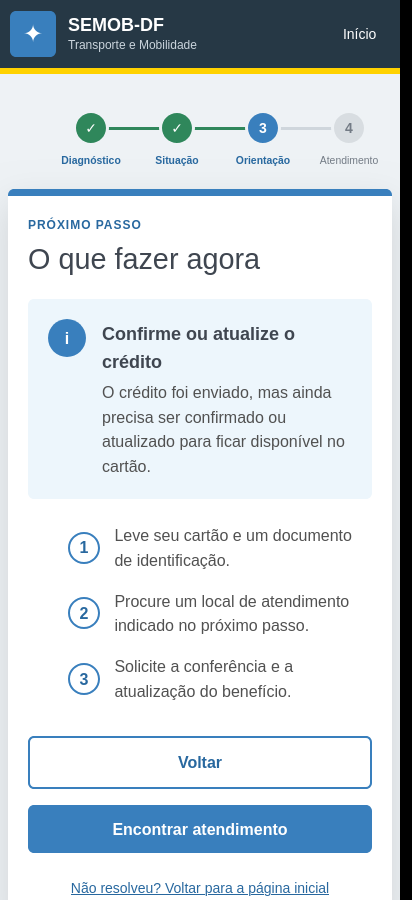
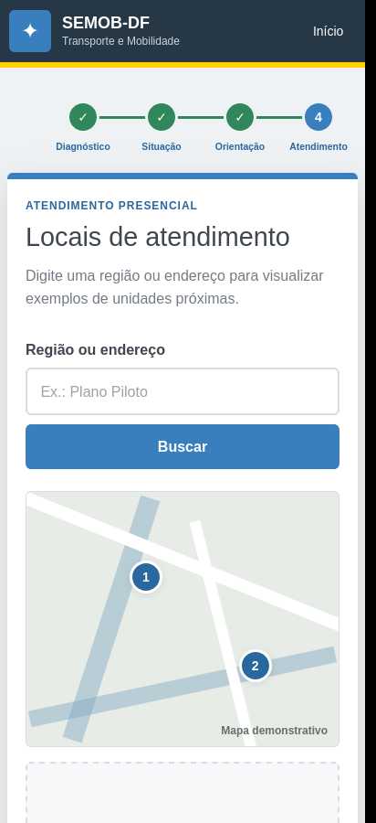

## Histórico de Versão e Contribuição

| Data | Versão | Descrição | Autor(es) | Revisor(es) | Declaração de Uso de IA |
| :---: | :---: | :--- | :--- | :--- | :--- |
| 01/11/2026 | `1.0` | Planejamento da consolidação e apresentação dos resultados da avaliação do protótipo de alta fidelidade da TAR-07. | [Arthur Mariani](https://github.com/arthur-mariani) | [Carlos Henrique](https://github.com/carloshfgit) | Google Gemini - apoio à estruturação em Markdown e revisão textual. |
| 14/11/2026 | `1.1` | Registro de três participantes e das condições informadas para a avaliação. | [Arthur Mariani](https://github.com/arthur-mariani) | A definir | IA: apoio à atualização do texto e das referências. |
| 19/11/2026 | `1.2` | Padronização da estrutura (histórico no topo, conteúdo, fotos de referência e referências ao final); retirada das referências que não são o livro da disciplina nem material do professor; inclusão de fotos de referência grifadas. Inclusão das telas do protótipo avaliado, com links para o protótipo e para o artefato relacionado. Inclusão do bloco de artefatos relacionados (persona, cenário, análise de tarefas, storyboard, planejamentos, relatos e protótipos da funcionalidade). | [Gabriel Melo](https://github.com/gabriellcardone-06) | Pendente de revisão | Claude (Anthropic) — apoio na padronização da estrutura do artefato, na revisão das referências e na formatação em Markdown; apoio na inclusão das telas do protótipo.; apoio na inclusão dos links entre artefatos |

!!! warning "Observação para correção manual"
    As telas da seção "Telas do Protótipo Avaliado" foram capturadas do protótipo publicado (arthur-mariani.github.io/PAF-IHC) em 19/11/2026. O autor deve confirmar se correspondem à versão usada nas sessões de avaliação e trocar as capturas se o protótipo mudou depois.

---

# Planejamento do Relato dos Resultados da Avaliação do Protótipo de Alta Fidelidade (TAR-07)

## 1. Introdução

Este documento define como relatar os resultados da futura avaliação do fluxo de crédito de Vale-Transporte no protótipo de alta fidelidade, referente à [TAR-07](../../../../analise-de-requisitos/analise-de-tarefas/tar-07-credito-vale-transporte.md) e ao [Cenário 4](../../../../analise-de-requisitos/cenarios/cenario-4-credito-vale-transporte.md). Ele complementa o [planejamento da avaliação](arthur-planejamento-avaliacao-prototipo-alta-fidelidade.md), que define as perguntas P01–P06, as tarefas T1–T3, o método e a coleta.

O **contexto do Vale-Transporte** vem dos artefatos do projeto. A **forma de interpretar, consolidar e relatar** segue Barbosa et al. (2021). A rodada foi planejada para três participantes, conforme justificado no [planejamento da avaliação](arthur-planejamento-avaliacao-prototipo-alta-fidelidade.md). As tabelas de dados e interpretação abaixo são modelos para o registro das sessões; os resultados efetivos constam no [relato individual](../../relatos-individuais/arthur/relato-resultados-prot-alta-fidel.md).

**Artefatos relacionados — fluxo da funcionalidade TAR-07 (Regularização de Crédito de Vale-Transporte):**

* **Persona:** [Maria Eduarda Santos](../../../../analise-de-requisitos/personas/maria-eduarda-santos.md)
* **Cenário:** [Cenário 4](../../../../analise-de-requisitos/cenarios/cenario-4-credito-vale-transporte.md)
* **Análise de tarefas:** [TAR-07](../../../../analise-de-requisitos/analise-de-tarefas/tar-07-credito-vale-transporte.md)
* **Storyboard:** [Storyboard 07](../../../nivel1/storyboards.md#37-storyboard-07-regularizacao-de-credito-de-vale-transporte)
* **Nível 1 — avaliação do storyboard e da análise de tarefas:** [Planejamento da avaliação](../../../nivel1/planejamentos-individuais/Arthur/arthur-planejamento-avaliacao.md) · [Planejamento do relato](../../../nivel1/planejamentos-individuais/Arthur/planejamento-relato-analise-tarefas.md) · Relato dos resultados (*não disponível — pendente de correção manual*)
* **Nível 2 — protótipo de papel (baixa fidelidade):** [Planejamento da avaliação](../../../nivel2/planejamentos-individuais/Arthur/arthur-planejamento-avaliacao-prototipo-papel.md) · [Planejamento do relato](../../../nivel2/planejamentos-individuais/Arthur/arthur-planejamento-relato-prototipo-papel.md) · [Relato dos resultados](../../../nivel2/relatos-individuais/arthur/relato-resultados-prototipo-papel.md)
* **Nível 3 — protótipo de alta fidelidade:** [Planejamento da avaliação](arthur-planejamento-avaliacao-prototipo-alta-fidelidade.md) · Planejamento do relato (*esta página*) · [Relato dos resultados](../../relatos-individuais/arthur/relato-resultados-prot-alta-fidel.md)
* **Telas do protótipo de papel:** [telas no planejamento da avaliação](../../../nivel2/planejamentos-individuais/Arthur/arthur-planejamento-avaliacao-prototipo-papel.md#9-telas-do-prototipo-avaliado)
* **Protótipo de alta fidelidade navegável:** [acessar o protótipo](https://arthur-mariani.github.io/PAF-IHC/credito/)

## 2. Fundamentação e evidências do livro

O livro orienta interpretar primeiro os dados de cada participante para responder às perguntas de avaliação e, depois, procurar recorrências entre participantes. Na consolidação, deve-se voltar às perguntas iniciais e justificar respostas que não puderam ser obtidas. O relato deve apresentar objetivos e escopo, método, participantes, dados, interpretação, problemas e plano de reprojeto (Barbosa et al., 2021, pp. 262–263). Para o teste de usabilidade, o livro detalha tarefas, medições e descrição de cada problema com local, justificativa, efeito na usabilidade e sugestão de solução (Barbosa et al., 2021, p. 289). Os prints grifados dessas passagens estão reunidos na seção 8.

---

## 3. Objetivos do relato

1. Responder, com evidências, às perguntas P01–P06 do planejamento da avaliação.
2. Mostrar como cada participante executou T1–T3, incluindo conclusões, erros, hesitações e pedidos de ajuda.
3. Identificar problemas de usabilidade, sua localização e seus efeitos no entendimento do crédito e do próximo passo.
4. Organizar recorrências e diferenças entre participantes sem transformar a amostra em estatística representativa.
5. Propor mudanças rastreáveis no protótipo e registrar perguntas que permaneçam sem resposta.

## 4. Estrutura do futuro relato

| Seção | Conteúdo a apresentar após as sessões |
| :--- | :--- |
| **Identificação e escopo** | Versão do protótipo, datas, ambiente, tarefas T1–T3 e limites da simulação. |
| **Método e participantes** | Teste de usabilidade, quantidade e perfil agregado dos participantes, papéis dos avaliadores, piloto e desvios do plano. |
| **Dados coletados** | Resumo por tarefa: conclusão, tempo aproximado, erros, retornos, ajuda e comentários. |
| **Interpretação** | Respostas a P01–P06 e explicação de cada achado a partir das evidências. |
| **Problemas encontrados** | Tela, descrição, evidência, impacto na usabilidade, recorrência e sugestão de solução. |
| **Reprojeto** | Mudanças propostas, prioridade e responsável. |
| **Limitações e conclusão** | Influência da amostra, ambiente, protótipo e estados simulados; perguntas inconclusivas. |

Essa composição corresponde aos itens de relato indicados pelo livro (Barbosa et al., 2021, pp. 263–264, 289).

## 5. Registro planejado da execução

### 5.1 Identificação

| Campo | Registro após a avaliação |
| :--- | :--- |
| Data, horário e local | 12/11/2026, das 8h às 10h, na Universidade de Brasília |
| Versão e acesso ao protótipo | [Protótipo de alta fidelidade](https://arthur-mariani.github.io/PAF-IHC); versão a registrar |
| Dispositivo e condições de uso | Smartphone para testar e gravar; demais condições a registrar |
| Número de participantes | 3 |
| Perfil agregado relevante | A preencher, sem dados identificáveis |
| Condutor e observador | Arthur Mariani, acumulando as duas funções por falta de tempo |
| Registro autorizado | Anotações; áudio ou vídeo somente se autorizados |
| Desvios do roteiro definitivo | A preencher |

Os dados do piloto não integrarão o resultado, conforme a seção 11.7.2 do livro (Barbosa et al., 2021, p. 260).

### 5.2 Dados a consolidar por tarefa

| Participante | Tarefa | Conclusão | Tempo aproximado | Erros, retornos ou ajuda | Evidência descritiva |
| :---: | :---: | :--- | :---: | :--- | :--- |
| P01 | T1 | A preencher | A preencher | A preencher | A preencher |
| P01 | T2 | A preencher | A preencher | A preencher | A preencher |
| P01 | T3 | A preencher | A preencher | A preencher | A preencher |

Repete-se o conjunto de três linhas para P02 e P03. A coluna **conclusão** usará `sem ajuda`, `com ajuda` ou `não concluída`; o relato explicará qualquer intervenção do avaliador. O livro apresenta conclusão, tempo, erros e uso de ajuda como medidas possíveis e recomenda examinar os comentários para entender a origem dos problemas (Barbosa et al., 2021, p. 289).

## 6. Interpretação e consolidação

### 6.1 Respostas às perguntas DECIDE

| Pergunta | Evidência por participante | Síntese interpretativa | Situação da resposta |
| :---: | :--- | :--- | :--- |
| P01 — Acesso à orientação | A preencher | A preencher | Respondida / Parcial / Inconclusiva |
| P02 — Compreensão das mensagens | A preencher | A preencher | Respondida / Parcial / Inconclusiva |
| P03 — Próximo passo | A preencher | A preencher | Respondida / Parcial / Inconclusiva |
| P04 — Continuidade do atendimento | A preencher | A preencher | Respondida / Parcial / Inconclusiva |
| P05 — Erros e hesitações | A preencher | A preencher | Respondida / Parcial / Inconclusiva |
| P06 — Opinião após o uso | A preencher | A preencher | Respondida / Parcial / Inconclusiva |

Primeiro serão preenchidos os registros individuais; depois, serão buscadas recorrências e diferenças entre participantes. Quando não houver evidência suficiente, a resposta será **inconclusiva**, com justificativa. Esse procedimento segue a interpretação intraparticipante e a consolidação interparticipante descritas por Barbosa et al. (2021, pp. 262–263).

### 6.2 Registro dos problemas e pontos positivos

| ID | Tipo | Tela/controle | Evidência observada | Participantes afetados | Consequência na tarefa | Hipótese de causa | Sugestão de solução |
| :---: | :--- | :--- | :--- | :--- | :--- | :--- | :--- |
| AF-01 | Problema / ponto positivo | A preencher | A preencher | A preencher | A preencher | A preencher | A preencher |

Um problema recorrente aparecerá **uma vez**, com os códigos dos participantes afetados e as variações observadas. O campo de hipótese não será apresentado como fato comprovado: deverá ser sustentado por ações, comentários ou trechos de interação. O livro recomenda descrever a categoria, a parte da interface, o impacto imediato e possíveis causas antes de sugerir melhorias (Barbosa et al., 2021, p. 289; **Figura 4**).

### 6.3 Priorização e reprojeto

| ID do problema | Mudança proposta | Evidência que a justifica | Impacto na tarefa | Recorrência observada | Prioridade | Responsável | Estado |
| :---: | :--- | :--- | :--- | :--- | :---: | :--- | :--- |
| AF-01 | A preencher | A preencher | A preencher | A preencher | A definir | A definir | Planejada |

A equipe definirá a prioridade considerando impacto e recorrência. Problemas que impeçam encontrar orientação ou induzam interpretação errada do próximo passo deverão ser discutidos primeiro. Esta é uma **regra de trabalho do projeto**, aplicada à orientação do livro de incluir um plano de reprojeto no relato (Barbosa et al., 2021, p. 263); não é uma escala atribuída aos autores.

## 7. Limitações e cuidados na apresentação

O relato explicitará: número e perfil efetivos dos participantes; condições do ambiente; versão do protótipo; eventuais respostas simuladas; falhas técnicas; e desvios do roteiro. Diferenças de tempo serão usadas como indícios descritivos. Com uma amostra pequena e tarefas delimitadas, não serão feitas afirmações sobre todos os usuários do Vale-Transporte. Também não se concluirá que um procedimento institucional está correto apenas porque o protótipo o exibiu.

Esses cuidados aplicam o DECIDE ao examinar confiabilidade e validades interna, externa e ecológica antes da divulgação dos resultados, e acompanham a cautela do livro quanto à generalização (Barbosa et al., 2021, pp. 263–264; **Figuras 3 e 5**).

---

## 8. Evidências do livro — trechos grifados

As áreas amarelas destacam os trechos usados como base para as afirmações e decisões metodológicas deste planejamento. A numeração nas legendas corresponde às referências a figuras no texto.

<strong>Figura 1</strong> — Interpretação dos dados de cada participante (p. 262).

<em>Fonte: BARBOSA et al. (2021, p. 262). Recorte e grifo: <a href="https://github.com/gabriellcardone-06">Gabriel Melo</a> (2026).</em>

<strong>Figura 2</strong> — Início da consolidação dos resultados (p. 263).

<em>Fonte: BARBOSA et al. (2021, p. 263). Recorte e grifo: <a href="https://github.com/gabriellcardone-06">Gabriel Melo</a> (2026).</em>

<strong>Figura 3</strong> — Consolidação, cautela na generalização e itens do relato (p. 263).

<em>Fonte: BARBOSA et al. (2021, p. 263). Recorte e grifo: <a href="https://github.com/gabriellcardone-06">Gabriel Melo</a> (2026).</em>

<strong>Figura 4</strong> — Análise qualitativa e descrição dos problemas em teste de usabilidade (p. 289).

<em>Fonte: BARBOSA et al. (2021, p. 289). Recorte e grifo: <a href="https://github.com/gabriellcardone-06">Gabriel Melo</a> (2026).</em>

<strong>Figura 5</strong> — Etapa final do DECIDE: avaliar, interpretar e apresentar dados (p. 264).

<em>Fonte: BARBOSA et al. (2021, p. 264). Recorte e grifo: <a href="https://github.com/gabriellcardone-06">Gabriel Melo</a> (2026).</em>

<strong>Figura 6</strong> — Descarte dos dados do teste-piloto (p. 260).

<em>Fonte: BARBOSA et al. (2021, p. 260). Recorte e grifo: <a href="https://github.com/gabriellcardone-06">Gabriel Melo</a> (2026).</em>

<strong>Figura 7</strong> — Dados de conclusão, tempo, erros e uso de ajuda (p. 289).

<em>Fonte: BARBOSA et al. (2021, p. 289). Recorte e grifo: <a href="https://github.com/gabriellcardone-06">Gabriel Melo</a> (2026).</em>

## 9. Telas do Protótipo Avaliado

As Figuras 8 a 12 mostram as telas do protótipo de alta fidelidade da [TAR-07](../../../../analise-de-requisitos/analise-de-tarefas/tar-07-credito-vale-transporte.md), também apresentadas no [relato dos resultados da avaliação](../../../nivel3/relatos-individuais/arthur/relato-resultados-prot-alta-fidel.md).

* **Protótipo navegável:** [Acessar o protótipo da TAR-07](https://arthur-mariani.github.io/PAF-IHC)

<strong>Figura 8</strong> — Página inicial do protótipo, com o Acesso Rápido e a opção "Cartão ou crédito com problema"

{ width="300" }

<em>Fonte: Elaborado por Arthur Mariani (2026). Captura de tela do protótipo publicado.</em>

<strong>Figura 9</strong> — Etapa 1 de 4 — Diagnóstico: "Vamos entender o que aconteceu"

{ width="300" }

<em>Fonte: Elaborado por Arthur Mariani (2026). Captura de tela do protótipo publicado.</em>

<strong>Figura 10</strong> — Etapa 2 de 4 — Situação do crédito

{ width="300" }

<em>Fonte: Elaborado por Arthur Mariani (2026). Captura de tela do protótipo publicado.</em>

<strong>Figura 11</strong> — Etapa 3 de 4 — Orientação: "O que fazer agora"

{ width="300" }

<em>Fonte: Elaborado por Arthur Mariani (2026). Captura de tela do protótipo publicado.</em>

<strong>Figura 12</strong> — Etapa 4 de 4 — Atendimento: "Locais de atendimento"

{ width="300" }

<em>Fonte: Elaborado por Arthur Mariani (2026). Captura de tela do protótipo publicado.</em>

---
---

## 10. Fotos de Referência
As Figuras 13 a 14 mostram os trechos que fundamentam este artefato, recortados e grifados em amarelo diretamente do livro da disciplina (BARBOSA et al., 2021).

<strong>Figura 13</strong> — 11.7.5 Consolidação e relato dos resultados

<em>Fonte: BARBOSA et al. (2021, p. 263). Recorte e grifo: [Gabriel Melo](https://github.com/gabriellcardone-06) (2026).</em>

<strong>Figura 14</strong> — 12.2.1 Teste de usabilidade: objetivo, atividades e medidas por tarefa

<em>Fonte: BARBOSA et al. (2021, pp. 288–289). Recorte e grifo: [Gabriel Melo](https://github.com/gabriellcardone-06) (2026).</em>

---

## 11. Referências Bibliográficas
* BARBOSA, Simone Diniz Junqueira; SILVA, Bruno Santana da; SILVEIRA, Milene Selbach; GASPARINI, Isabela; DARIN, Ticianne; BARBOSA, Gabriel Diniz Junqueira. **Interação Humano-Computador e Experiência do Usuário**. Rio de Janeiro: Autopublicação, 2021. ISBN 978-65-00-19677-1.
